## 认识与装好

这一篇先完成两件事：认识 Claude Code 这个工具，并在你的 Windows 电脑上把它装好、登录、让它用中文回复。装好之后，本篇会带你跑一组“装完就能用的三连任务”——让它解释一个文件夹、做一处小改动、再把改动撤掉——直观感受它和普通聊天工具的区别。

全篇不需要编程基础。本课的演示环境是 Windows 桌面端的 Claude 桌面应用（以 2026 年 9 月的版本为例），主线走应用里的 Code 页签，不用打开黑色的命令行窗口。这个产品更新很快，个别界面细节可能与你看到的略有差异，一切以你装好的最新版本为准。

这篇文章的实操内容需要 Claude 的付费订阅：Claude Code 从 Pro 套餐起开放，免费账号能装应用、能聊天，但打不开 Code 页签；具体哪些套餐包含它，以官网套餐页和你的账号页面显示为准。

### 1.1 Claude Code 是什么

你可以把 Claude Code 理解成一个能替你操作电脑的 AI 助手：它不只回答问题，还能在你允许的范围内读文件、改文件、运行命令、打开网页，把一个想法一步步做成能用的东西——一个网页、一份表格、一个小工具。

这类能够调用工具、独立完成任务的 AI，通常称为“智能体”（Agent）。现阶段不必专门记住这个术语，本课后面说“智能体”和“它”，指的都是同一个东西。先记住一件事就够了：**普通聊天工具主要给你答案，Claude Code 还能替你把事情做完。**

用一个例子体会这个差别。你对聊天工具说“帮我整理一下下载文件夹”，它只能给你一份整理思路，因为它看不到你的电脑；同样一句话交给 Claude Code，它会真的读取那个文件夹（前提是你把文件夹交给了它），列出里面有什么、动手分类改名，最后把整理结果列出来给你看。它干活的方式也和人接近：接到任务先看情况、再动手、再检查，每一步都在界面上留下记录，你随时能看到它进行到哪、改了什么——这份工作记录怎么读，下一篇《桌面应用全导览》会专门讲。

当然它不是全能的：你没授权的内容它拿不到，超出模型能力的任务会做错，长时间没人验收也可能越做越偏。这些边界怎么划、出了偏差怎么兜底，是《权限、沙盒与模型》和后续各篇的主题，这里你先知道它有这些限制就行。

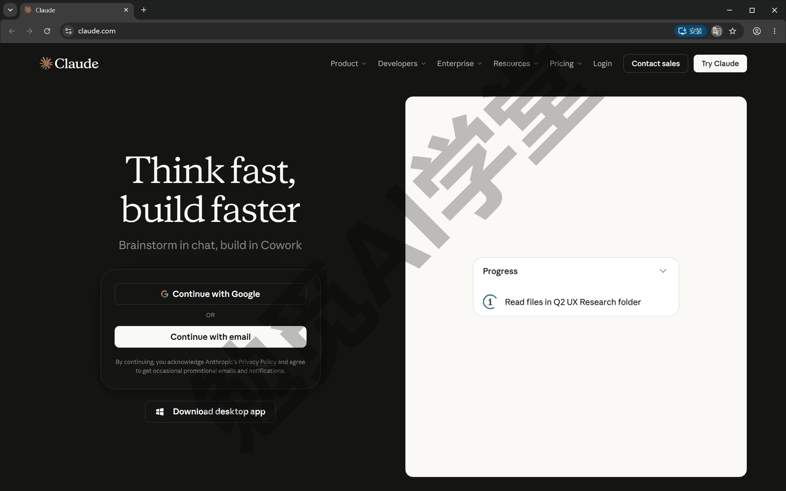

Claude Code 还有三个“不是”要分清。

**它不是一个聊天机器人。** 你可能已经在网页或手机上用过 Claude 聊天，Claude Code 和它是同一家公司的产品、共用同一个账号，但做的事不一样：聊天只回答，Claude Code 会真的动你的文件、跑你的命令，最后把成果交回来给你验收。也因为它会真的动你的文件，本课会反复强调权限和验收的习惯——用聊天工具的时候你不用操心这些，用它的时候就必须养成这个习惯。

**它不是只给程序员用的。** 写代码确实是它最强的能力，但这恰恰是不会编程的人的机会：想要一个记账小工具，“写”这一步可以整个交给它，你负责提要求、看结果。本课从头到尾都按零基础用户设计，不要求你看懂任何一行代码。

**它不是要在黑窗口里敲命令才能用。** 网上的 Claude Code 教程大多讲的是在终端（命令行窗口）里用它，那是它最早的样子。现在不用这样了：Claude Code 已经装在 Claude 桌面应用里，应用顶部有一个 Code 页签，点进去就是带按钮、带面板的图形界面，不需要装 Node.js 这类程序员用的运行环境，也不需要单独装命令行版本。本课全程走桌面应用，命令行只在《终端、编辑器与 VS Code 扩展》里当作“另一个入口”认识一下。

**谁做的、版本号在哪看。** Claude Code 由 Anthropic 公司开发，就是做 Claude 模型的那家公司。想确认自己装的是哪个版本，点应用菜单栏的 Help → About（帮助 → 关于），点一下版本号还能把它复制下来。花几秒记住这个入口是值得的：这个产品几乎每周都在更新，遇到界面和教程对不上、功能不正常，第一件事就是看版本、更新到最新（更新方法见 1.9）；将来出了问题向别人求助时，报上版本号也能让对方更快帮到你。

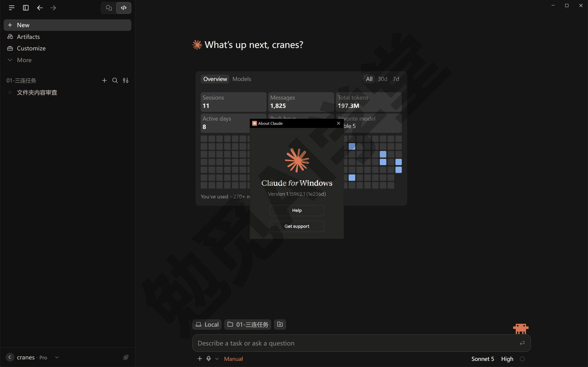

### 1.2 它能帮你做什么

先不急着安装，看五件它最常帮普通人做的事，你可以边看边对照自己的需求。

**第一件：读懂并整理你的文件夹。** 电脑里那种堆了几百个文件、自己都不敢乱动的文件夹，可以直接交给它：让它先读一遍，告诉你里面都有什么；再让它按类型或内容分组、批量改名、找出重复文件。它是真的把文件内容读了再动手，不是凭文件名猜。《文件与办公能力一篇讲全》会用一整篇讲这类任务。

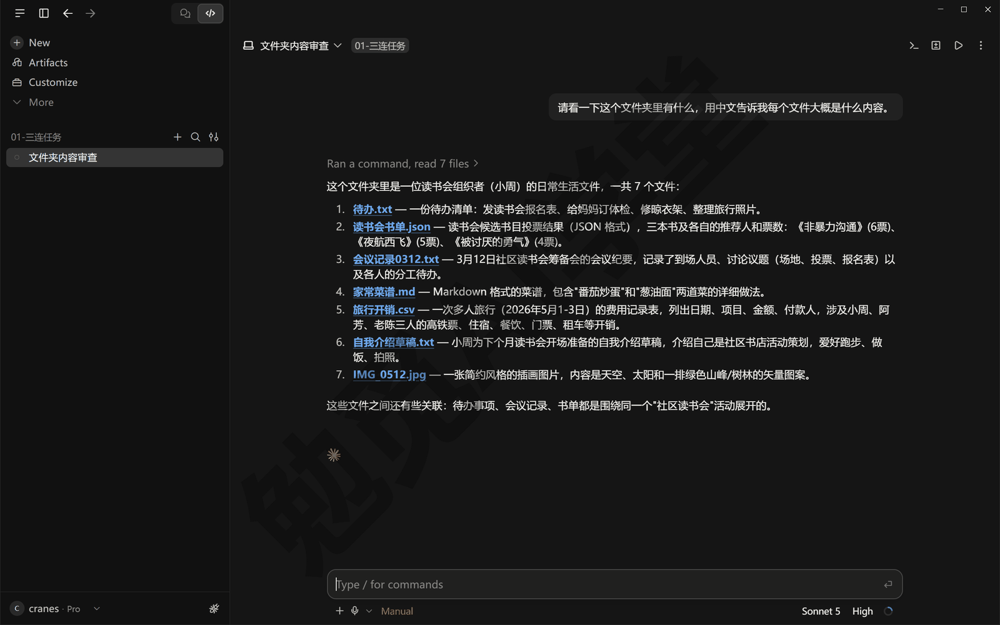

**第二件：写出能跑的网页和小工具。** 一张活动介绍页、一个报名表、一个费用分摊计算器，这类小东西过去只有会写代码的人能做，现在变成“说得清楚就能做”。你描述想要的样子，它把代码写出来、在你的电脑上跑起来给你看；哪里不满意接着说，它接着改。课程后半段的实战篇会完整做出《实战一：社区读书会网站》和《实战三：旅行费用分摊计算器》这样的成品。

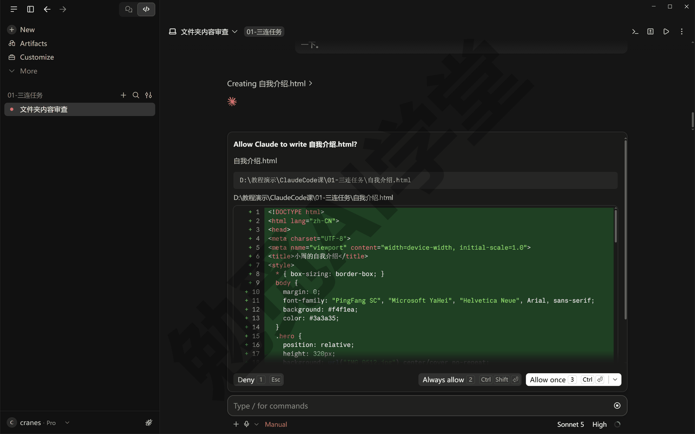

**第三件：自己打开浏览器验证结果。** Code 页签里有一个浏览器面板。做完网页它可以自己打开看、自己检查，发现排版挤了、按钮歪了，会接着改，而不是把没验证过的东西直接交给你。这个能力在《内置浏览器、应用预览与电脑操控》细讲。

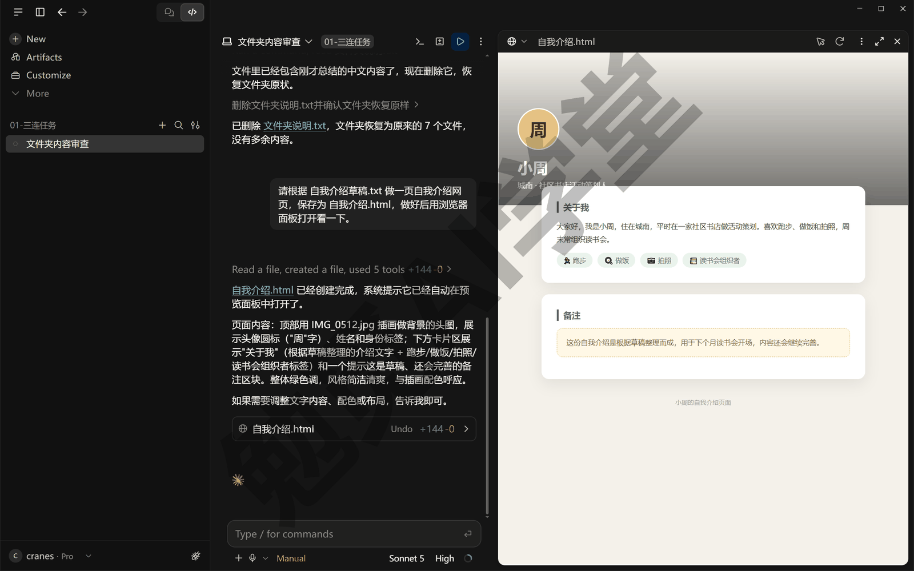

**第四件：记住你的规矩。** 你可以给它写下长期有效的要求，不用每次重复交代。有两个词后面各有一整篇展开，这里先记住名字：

- **CLAUDE.md**：一个放在文件夹里的说明文件，你写给它的长期要求都放在这里，每次对话自动生效，比如“回复永远用简体中文”。《CLAUDE.md 与规则》细讲。
- **技能**：一份教它怎么做某类事的说明书，用的时候它整套照做，比如“我的周报格式”。《技能与斜杠命令》细讲。

**第五件：关掉电脑也在云端干活。** 耗时长的任务可以交给云端会话：任务在 Anthropic 的云端机器上运行，你合上笔记本它也不停，回头在电脑、网页或手机上看结果。这需要付费套餐，《云端会话与手机端》细讲。

**它适合谁、不适合谁。** 如果你经常有重复性的电脑操作、想把一些点子做成小工具、并且愿意在关键步骤自己确认一下，它非常合适。反过来，如果你期望完全撒手不管、一句话就得到完美结果，或者打算把高度敏感的资料交给它而不想了解任何权限设置，那么先降低预期——它需要你学会“提要求、给边界、做验收”这三件事，这也是本课要教的。

**和几个相近产品的分工。** Cursor、Codex 是另外两家公司的同类智能体，核心思路相近，你手里在用哪个就先把哪个用熟；三者怎么分工选用，《毕业项目：家庭事务中心 + 课程总结》会专门讨论。同一个 Claude 桌面应用里还有 Cowork 这部分能力（旧界面是一个单独的 Cowork 页签，新界面已经并进聊天里），它做的是整理文档、做表格这类办公上的事，本课不讲，另有一门《Claude Cowork 办公教程》。

### 1.3 一个产品、五个入口

搜索 Claude Code 时你会看到桌面应用、命令行、VS Code 扩展、网页版、手机 App 等不同说法。它们不是五个让你挑一个的并列产品，而是同一个账号下、按场景分工的五个入口。用一天的使用场景把它们串起来，你就明白各自是干什么用的。

**坐在电脑前干正事：桌面应用的 Code 页签。** 这是你以后用得最多的入口，也是本课的主角。Claude 桌面应用顶部有三个页签：Chat（聊天，和网页版聊天一样，不碰你的文件）、Cowork（办公，替你整理文件、做表格这类办公任务）、Code（做网页与小工具，直接读写你电脑上的文件）。整理文件这类事两边都能做，1.2 那几件事都是在 Code 里做的，本课只讲 Code 页签。官方正在把 Chat 和 Cowork 合成一个入口，你的应用里可能是三个页签、也可能只剩两个，Code 页签的位置不变（以你看到的界面为准）。

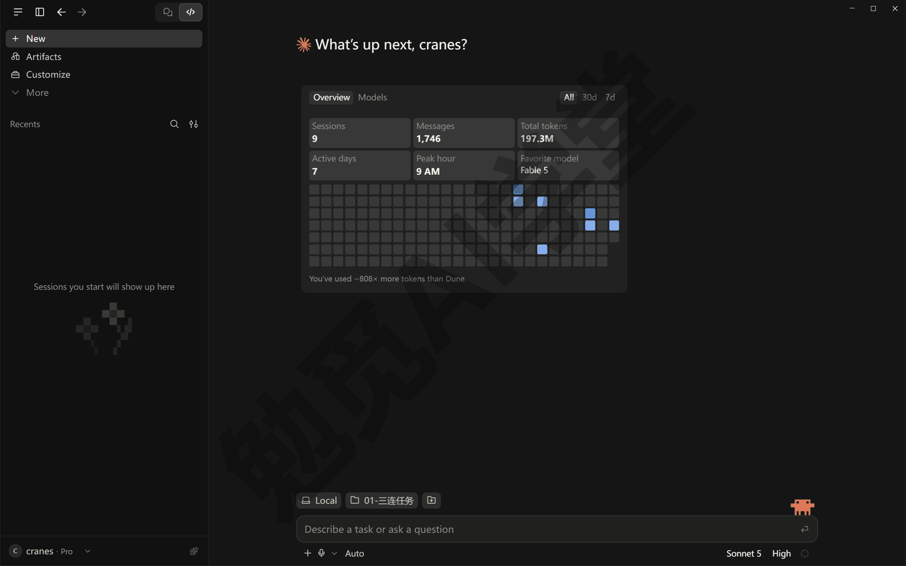


**习惯敲命令的人：命令行。** 在终端里输入 `claude`，就能在黑窗口里对话、派任务，背后和桌面应用是同一套程序。它适合远程服务器和自动化脚本，也是网上大多数教程里出现的样子。零基础读者现在只需要知道有这个入口，《终端、编辑器与 VS Code 扩展》会讲怎么一行装好、怎么把命令行里的对话接回桌面应用。

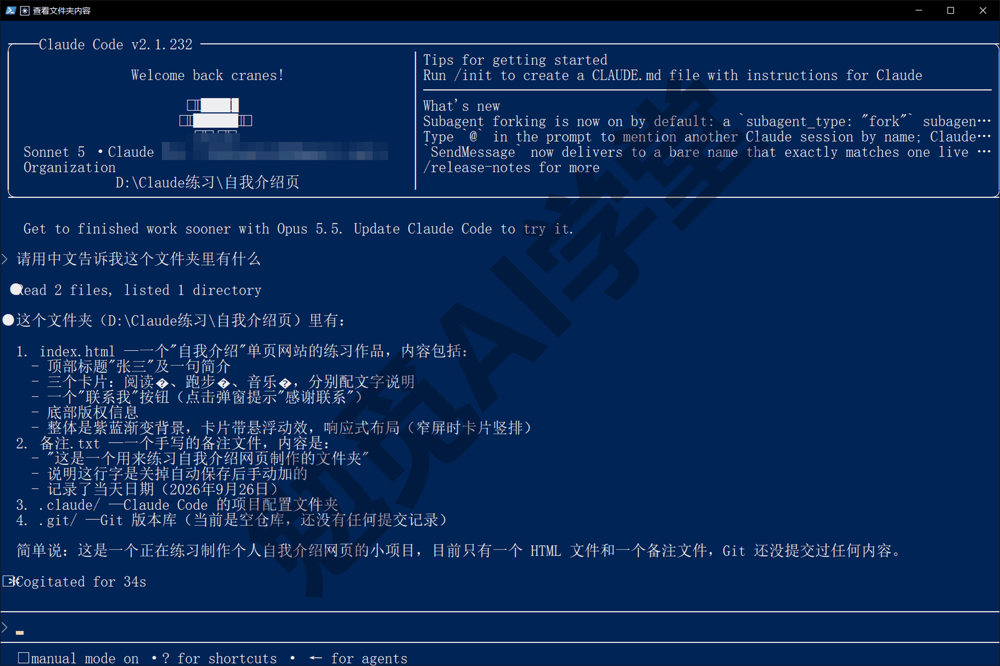

**已经在用编辑器写东西的人：VS Code 扩展与 JetBrains 插件。** 如果你听说过 VS Code（一款流行的免费代码编辑器）或 JetBrains 系列编辑器，Claude Code 可以作为扩展装进去，在编辑器侧边栏里对话。没听说过这些编辑器也完全不影响学习，本课不依赖它们，只在《终端、编辑器与 VS Code 扩展》里认识一下。

**任务太长、你中途要离开：交给云端，在网页上看进度。** 把任务交给云端会话之后，任何一台电脑打开浏览器访问 claude.ai/code 就能查看和指挥它，不需要安装任何东西。网页版和桌面应用看到的是同一份云端会话，两边进度同步。本课到《云端会话与手机端》再展开。

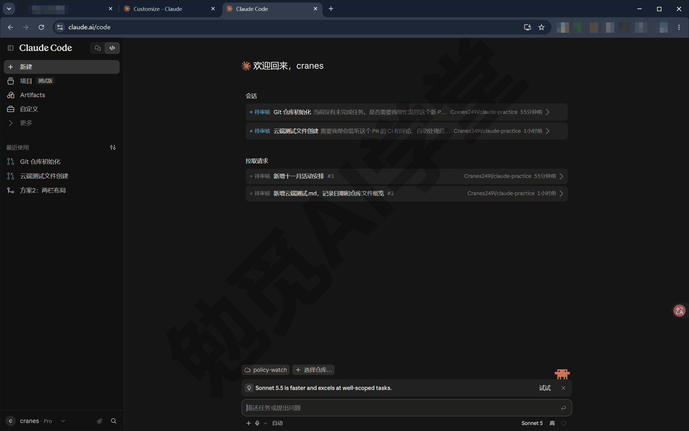

**人在路上：手机 App。** Claude 手机 App 可以查看云端会话的进展、给它下新的指示；Pro 和 Max 用户还有一个叫 Dispatch 的功能，在手机上派一个任务，它会自己在电脑上开一个 Code 会话去做（官方已不再对新用户开放这个功能，老用户暂时还能用；你的账号里有没有这一项，以实际界面为准）。手机上只做“指挥与验收”这两件事，直接在手机上改文件不行。

串完一遍可以看出关系：桌面应用是干活主力，网页版和手机 App 都是用来查看和指挥云端会话的，命令行和编辑器扩展是给习惯敲命令、习惯用编辑器的人用的。五个入口共用同一个账号和同一份套餐用量，在手机上派出的任务，回到电脑能接着看，进度不丢。本课的绝大部分时间都在桌面应用的 Code 页签里度过。

### 1.4 账号与套餐机制

安装之前，先把账号和费用的机制说清楚。这里只讲机制、不写任何价格和额度数字——这类数字变得很快，一切以官网套餐页和你的账号页面显示为准。先弄懂机制有一个很实际的好处：它每干一点活都会消耗你套餐里的用量，你知道用量怎么算，任务做到一半停下来时就知道是碰到了上限还是出了故障。

**免费账号能做什么。** 注册就有，能在桌面应用和网页上聊天。但 Claude Code 不在免费范围里：点 Code 页签时，免费账号会看到一个升级提示，装了应用也用不了它。

**付费套餐多出什么。** 个人付费套餐从 Pro 起步，往上是 Max（Max 又分几个用量档）；公司用的是 Team 和 Enterprise，本课不涉及。机制上，付费多出两类东西：

- **Claude Code 本身**：Pro 起开放桌面应用的 Code 页签、命令行、网页版这些入口；云端会话、Dispatch、电脑操控这类功能各自有套餐要求，讲到时会说明。
- **更多的用量**：Max 包含的用量明显多于 Pro；同一个账号下的 Claude Code、Cowork 和聊天共用一个用量池，在哪个入口用都从同一处扣。

**用量是怎么算的。** 付费套餐的用量按“时间窗口”计：每个五小时窗口有一个上限，用完了等窗口过去再用；此外还有每周的总上限，两个上限同时生效。举个例子：一个下午让它连着做几个大任务，可能先用到五小时上限，等这个窗口过去用量就恢复；一周里天天这样用，则可能用到每周上限，那就要等到下周了。到了上限时它会在对话里明确提示，并显示大约什么时候恢复（提示的样子以实际界面为准），不会不声不响地停。本课不写具体数字，怎么用得值、什么任务最耗用量，《权限、沙盒与模型》会专门讲。

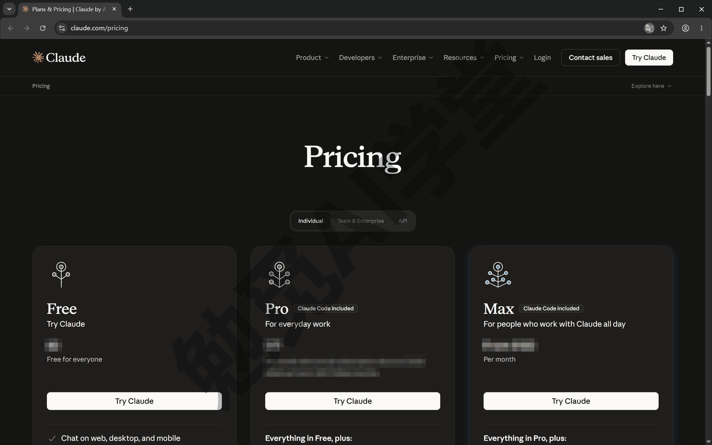

**用量在哪看。** 在 Code 页签里，输入框下方、模型选择器旁边有一个小圆环，点它能看到两层信息：当前这个会话的上下文（它在这次对话里记着的全部内容）用了多少，和你这个套餐在当前窗口里用了多少（这个“窗口”指上一段说的五小时计时窗口，不是软件窗口）。上下文是每个会话各算各的，套餐用量是所有入口共用的。看用量的习惯一开始就养成：每做完一个大任务点一下圆环，几次之后你就知道哪类任务花得多。用完后有两个选择：等窗口重置，或者升级套餐；要不要升级不用提前纠结，等你真的频繁碰到用量提醒再说，那时的判断才有依据。

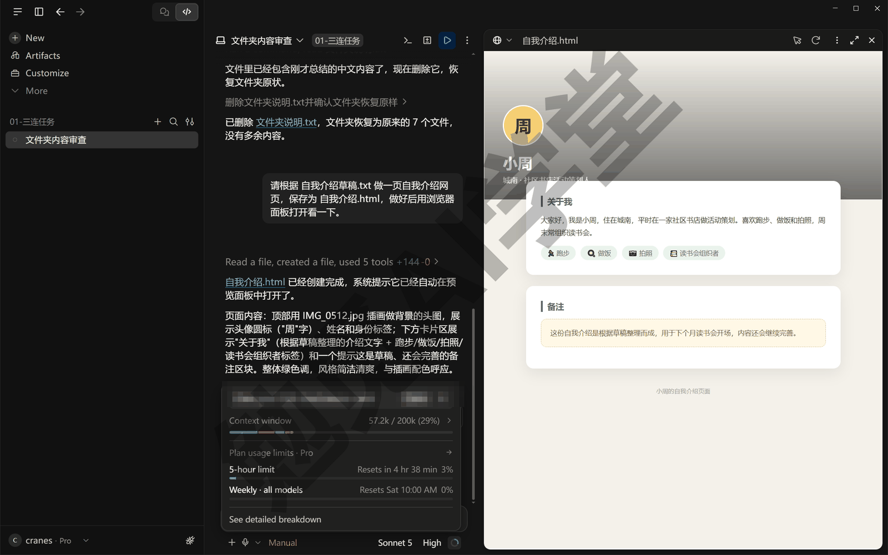

**给零基础读者的建议。** 先开一个月 Pro 把课程学起来，前几篇的练习都是小任务，Pro 的用量一般够用；等确认自己会频繁用到云端、并行会话这类能力，再考虑 Max。套餐随时可以在 claude.ai 的账号设置里升级或降级，升级一般立即生效（以页面提示为准）。涉及更高套餐的文章都会先说明要不要付费。

### 1.5 下载与安装

正常情况下，从下载到装好大约需要 5～10 分钟。下载与安装是全课少数“只做一次”的操作，却也是新手最容易卡住的一段，所以这一节把每一步会看到什么都交代清楚，照着走就行。以下按 Windows 演示，macOS 用户从同一个下载页下载安装包后拖进“应用程序”文件夹即可；Linux 版还在测试阶段，本课不展开。

**第 1 步：下载安装包。** 打开官网下载页（claude.com/download，以官网实际地址为准），页面上有 macOS 和 Windows 的下载按钮；Windows 的下载按钮一般只有一个 Download for Windows（图里就是），点它下载的一般是绝大多数 Windows 电脑用的 x64 版；要是页面上分开列了 x64 和 arm64 两个按钮，只有用 ARM 处理器的电脑（多见于少数轻薄本和平板电脑）才选 arm64，拿不准就先试 x64，装不上再换（按钮上的文字以官网实际页面为准）。点了下载按钮后，浏览器开始下载安装包，默认保存在“下载”文件夹。还有两件事要先确认：系统需要 Windows 10 及以上版本；下载、安装和登录全程要保持联网。还没注册账号的话，可以先到 claude.ai 用邮箱或 Google 账号注册一个，先注册还是装好再注册都行，1.6 登录时用得上。

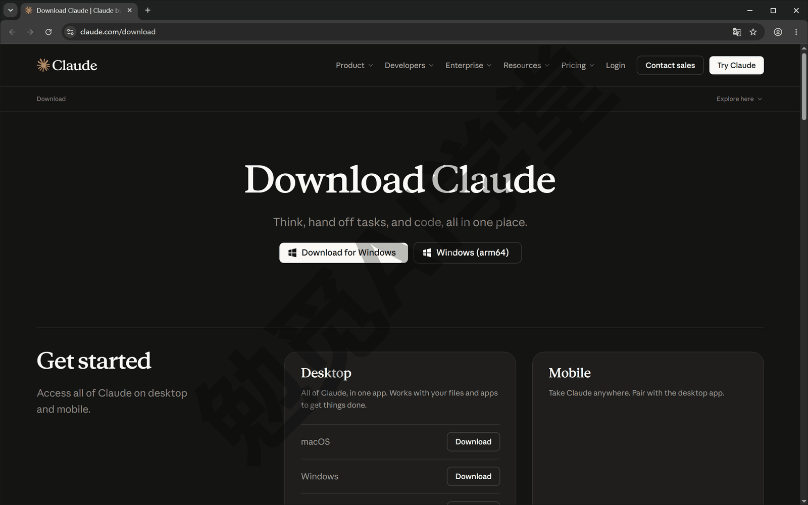

**第 2 步：运行安装程序。** 双击下载好的安装包。Windows 桌面应用用的是系统自带的应用安装器，弹出的窗口很简单：确认应用名是 Claude，点“安装”，进度条走完就装好了，不用选安装位置（需实机验证）。如果 Windows 弹出用户账户控制的确认框，问是否允许这个应用更改你的设备，点“是”继续。

**第 3 步：首次启动。** 装好后在开始菜单里找到 Claude 打开它。第一次启动会先看到登录页，先按 1.6 节登录（登完回到这里接着做第 4 步），登录后进入的是聊天页面，顶部能看到 Code 页签。

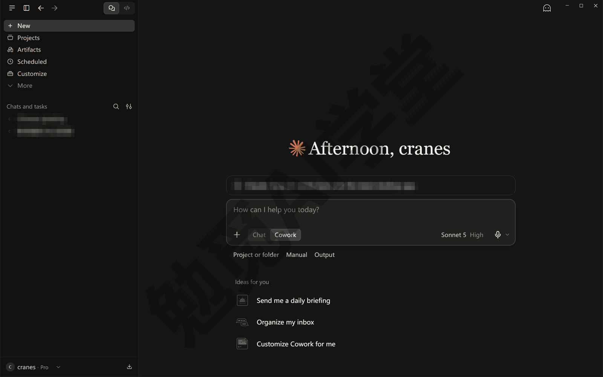

**第 4 步：装 Git for Windows。** Git 是一个记录文件改动历史的免费工具。Claude Code 用它来做两件事：把不同会话的改动隔开（《子智能体、并行会话与工作树》会用到），以及记录和还原版本（《Git、GitHub 与代码审查》会用到）。老一些的桌面应用版本在 Windows 上一开始就要求先装好 Git，新版本到后面几篇用到它时才要求；无论你的版本是哪一种，本课都建议现在就装，后面几篇都离不开它。打开 git-scm.com，点 Windows 下载，运行安装程序，每一页都保持默认选项点下一步即可；每一页选项是什么意思、哪几页要留意，Git 课《认识 Git 与装好》有逐步的图文。装完把 Claude 桌面应用整个关掉再打开一次，它才能找到新装的 Git——点右上角的 × 只是收起窗口，要在屏幕右下角托盘的 Claude 小图标上右键选退出（1.9 节会再讲），再从开始菜单重新打开。

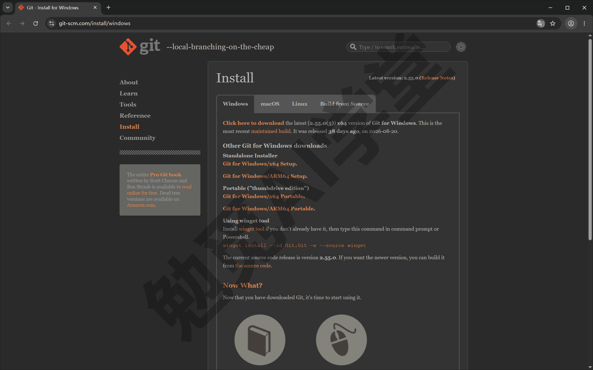

**第 5 步：打开 Code 页签。** 点左上角的 Code 页签（和 1.3 节那张全景图里的位置一样）。第一次打开时可能会遇到三种提示：提示你升级，说明当前账号是免费套餐，要先订阅；提示你到网页上登录，照做后把应用整个关掉再打开；提示 Git is required，说明第 4 步没装或者装完没重启应用。三种提示的画面以你看到的为准（需实机验证），处理办法 1.9 节还会再讲。什么提示都没有、直接看到左侧的会话列表和下方的输入框，就装好了；这时的画面和 1.3 节那张 Code 页签全景是同一个布局，只是左侧的会话列表还是空的。

### 1.6 登录与网络

**登录用哪个账号。** Claude Code 用的就是你的 Claude 账号，也就是在 claude.ai 聊天用的那一个；没有的话在 claude.ai 上用邮箱或 Google 账号注册。付费套餐也是绑在这个账号上的，所以登录前先确认：你要用的这个账号已经订了 Pro 或以上，不然登录进去也打不开 Code 页签；订阅在 claude.ai 的账号设置里升级，1.4 节说过，入口以页面为准。

**登录的过程会看到什么。** 应用的登录页上有两种方式：用 Google 账号继续，或者输入邮箱继续。选哪一种都会跳到浏览器：应用把浏览器打开，你在网页上选账号、完成登录，最后停在一页提示“在 Claude 应用中完成登录”，上面写着 Claude 应该会自动打开，如果没有，请选择“打开 Claude”。这时浏览器多半还会弹一个“要打开 Claude 吗？”的小对话框，点“打开 Claude”，应用就切到前台、回到已登录的首页。邮箱方式最后一步的页面可能略有不同，以你看到的为准。如果浏览器那页点了“打开 Claude”、应用却还停在登录页，先手动切回应用窗口看一眼，多数时候它只是没有自动跳到前台；还不行就把应用整个关掉重开。登录状态会一直保留，以后打开应用不用再登录。

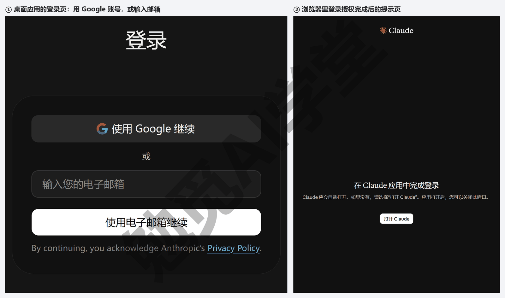

**登录不上先看网络。** 注册、登录和使用都需要能正常访问 claude.ai；不同地区、不同运营商的网络情况不一样，能不能打开以你的实际情况为准。登录页一直转圈、浏览器打不开授权页、或者应用里提示网络错误，多半是网络问题，先用浏览器直接打开 claude.ai 看能否正常访问：网页能开、应用不行，等几分钟再试往往就好；网页也打不开，那就是网络本身的问题，先换一个网络试试（比如手机热点），能开再回来登录。本课不展开网络工具，账号与网络的详细准备参考 Codex 课、Cursor 课里已经讲过的做法。

**公司电脑上的两点提醒。** 公司网络可能拦住应用要访问的地址，登录页空白或一直加载时，问一下管理员；另外，把公司资料交给任何 AI 工具之前，先确认公司允许，这一点和用哪个工具无关。

**账号用在几台电脑上。** 同一个账号可以在几台电脑上登录，用量是共用的。换电脑时装好应用、登录同一个账号即可；本地会话的记录存在各自的电脑上，只有云端会话才会在几台设备之间同步，这一点《云端会话与手机端》会讲。想退出登录换另一个账号，在账号菜单（点击头像打开）里找 Log out（退出登录），退出后重新登录即可（需实机验证）。

**为什么是跳到浏览器登录。** 应用本身不保存你的密码，登录这一步交给浏览器里的 claude.ai 网页完成，应用只拿到一个“已登录”的凭据。所以用 Google 账号登录时，浏览器里已经登着 Google 的话往往一步就过；没登过的要先在浏览器里登 Google。这也意味着：在浏览器里退出 claude.ai 不会让应用掉线，应用的登录状态要在应用自己的账号菜单里退出。

**登录后先确认三件事。** 对照下面三条看一眼：

- 点击头像能看到你的账号名和套餐名；
- 顶部有 Code 页签；
- 点 Code 页签不弹升级提示。

三件都对，账号这一关就过了；任何一件不对，回到 1.9 节对着找。

### 1.7 让它用中文回复

装好后有两件事都是英文：一是应用界面上的按钮和菜单，二是它回复你的话。这两件事是分开的，各有各的办法，别把它们混在一起处理。

**界面语言。** 点应用左下角或右上角的账号头像打开账号菜单，里面有 Language（语言）一项，选中文后界面文字会切换，不用重启应用（需实机验证）。切换范围以实际界面为准：聊天页面的菜单和设置项一般会变成中文，Code 页签里的一部分按钮名可能仍是英文。本课的按钮名一律按英文写并附中文释义，你切成中文界面也能对照上；如果切完发现找不到某个按钮，切回英文对照一下就行。

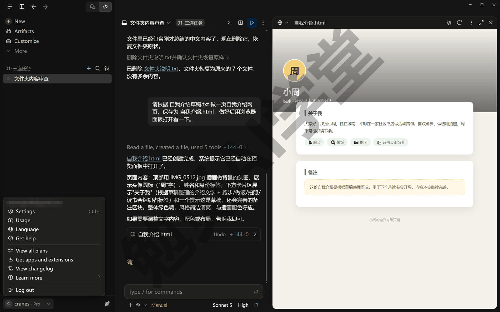

**回复语言。** 它回复用什么语言，和界面语言没有关系，只取决于你怎么跟它说：你用中文提问，它多半就用中文回答；你一句话里夹了英文文件名、英文报错，它有时会切成英文。最直接的办法是在会话的第一句话里加上要求，比如下面这样，之后这个会话里它都会照做；中途想起来再说也行，只是新开一个会话就得再说一遍，这也是下面“一劳永逸的办法”要解决的问题：

```text
接下来这个会话里，所有回复都用简体中文，文件名和命令保持原文即可。
```

**一劳永逸的办法。** 每个会话都说一遍太麻烦，可以把这句要求写进 1.2 节提到的 CLAUDE.md 文件：它是放在你交给它的那个文件夹里的一份说明文件，里面写的要求对这个文件夹里的每个会话自动生效，还可以放一份对所有文件夹都生效的。文件放在哪、怎么写、能写哪些内容，《CLAUDE.md 与规则》会用一整篇讲；这一篇先用说一句的办法。

**为什么它会突然切回英文。** 它是按你这句话和文件里的语言来判断的：你发的一句话里大半是英文文件名、英文报错，或者文件夹里全是英文文档，它就可能整段用英文回。这不是坏了，补一句“用中文回答”就切回来；写进 CLAUDE.md 之后这种情况也会少很多。

**回复里的英文术语怎么办。** 它回复中文时，仍会保留文件名、命令、按钮名这类原文，这是对的，改成中文你反而对不上电脑上的东西：它说“点 Allow once”，你在界面上就能找到那个词；如果它译成“点只允许这一次”，界面上却写着 Allow once，你还要多想一下。碰到看不懂的英文词，直接接着问它“这个词是什么意思”，它会用中文解释。

**一个检查办法。** 切换完界面语言、发过“用中文回复”之后，让它做一件小事（比如介绍一下文件夹里的某个文件；这一步要先有会话和文件夹，等 1.8 开好第一个会话再做也不迟），看看两边是不是都对了：界面菜单是中文（如果你切了）、回复正文是中文、文件名和命令保持原样。三样对了，语言这件事就不用再管。

### 1.8 装完就能用的三连任务

现在把 1.1 节说的“它和聊天工具的差别”亲手试出来。三个任务连着做，前后大约十分钟；做的过程中会遇到几个新界面，这里只讲这次用到的部分，下一篇《桌面应用全导览》再逐个讲透。

**先准备一个练习文件夹。** 在资源管理器里新建一个文件夹，比如 `D:\Claude练习`，往里放三五个你不怕弄乱的文件：几张图片、一两份 Word 或 txt 文档都行。不要一上来就把整个桌面或整个磁盘交给它，先在这个小文件夹里练。

**开一个会话。** 在 Code 页签里点左侧的 New（新建），输入框周围有四样东西要先选好，一样一样来：环境选 Local（本机）——环境指它在哪台机器上干活，本机就是你这台电脑；点 Select folder（选择文件夹）选中刚建的练习文件夹；模型保持默认；权限模式选 Manual（手动）——这一档它每改一个文件、每跑一条命令都先问你，最适合第一次用。四项的位置与名称以你看到的界面为准，下一篇会逐项讲。

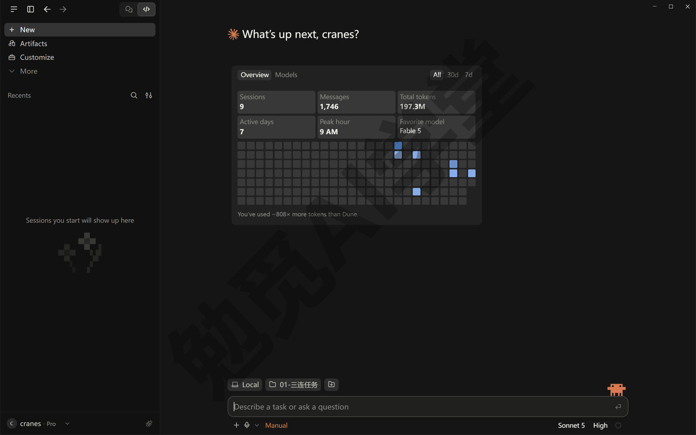

**任务一：让它解释这个文件夹。** 在输入框里输入下面这句话，按回车发送：

```text
请看一下这个文件夹里有什么，用中文告诉我每个文件大概是什么内容。
```

你会看到它先在对话里显示“正在读取某某文件”这样的小卡片，读完之后用中文列出每个文件的内容概要。这一步它只读不改，所以 Manual 模式下不会弹出任何确认。对照一下：同一句话发给聊天工具，它只能回答“我看不到你的文件”。

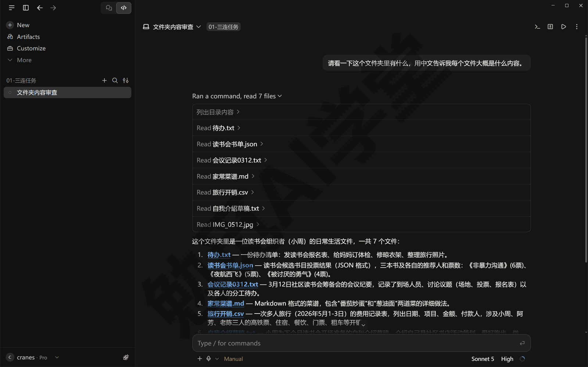

**任务二：让它做一个小改动，看差异。** 接着发第二句话：

```text
请在这个文件夹里新建一个叫“文件夹说明.txt”的文件，把你刚才总结的内容写进去，用中文。
```

因为选的是 Manual 模式，它不会直接动手，而是先弹出一张卡片问你“Allow Claude to write 文件夹说明.txt?”（允许它写这个文件吗），卡片里能看到要写进去的全部内容，下面是三个按钮：Deny（拒绝）、Always allow（始终允许）、Allow once（只允许这一次）。第一次用，点 Allow once，文件就真的建好了，打开练习文件夹能看到它；卡片上还会出现一个类似 `+31 -0` 的数字，表示这次改动加了多少行、删了多少行，点它能打开差异视图逐行看。这个数字和差异视图是你以后每天都要看的东西，《计划模式、差异审阅与回退》会专门讲。

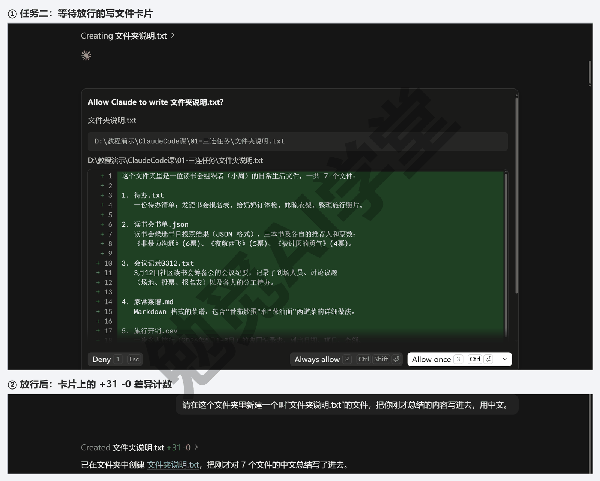

**任务三：把改动撤掉。** 现在假装你后悔了，想回到改动前。先试回退命令：在输入框里输入 `/rewind`（回退）并发送，会弹出一个叫 Rewind 的小窗口，列出你在这个会话里发过的每一句话；点任务二那一句，对话就退回到发它之前的样子，那句话的原文回到输入框里等你改。这时看一眼练习文件夹：刚建的“文件夹说明.txt”还在——桌面应用里的 `/rewind` 只退对话，不退文件，因为文件是已经写到磁盘上的东西，不会跟着对话消失（这一轮的文件改动也可以点改动汇总卡上的 Undo 撤回，下一篇 2.5 节会讲，这里先练习用一句话让它删）。要把文件也撤掉，把输入框里退回来的那句话删掉，换成下面这句发出去：

```text
把刚才新建的“文件夹说明.txt”删掉，让文件夹恢复原样。
```

Manual 模式下它删文件之前会先弹出一张卡片问你，放行后文件就没了。这一退一删就是本课反复会用的“后悔药”：改了很多处之后怎么一次退回、什么时候要靠 Git，《计划模式、差异审阅与回退》和《Git、GitHub 与代码审查》会讲清它能退什么、不能退什么。

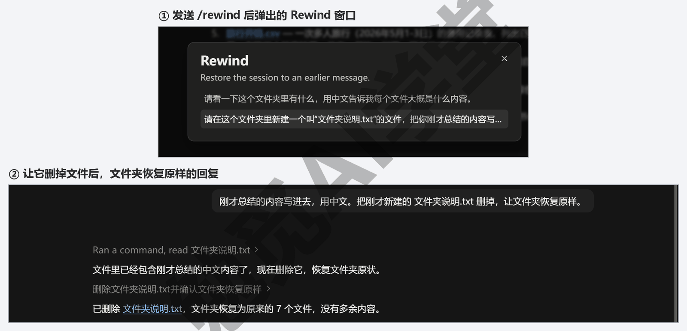

三个任务做完，你已经用到了它和聊天工具最不一样的三件事：真的读你的文件、真的改你的文件、改错了能退回。后面十几篇讲的都是把这三件事做得更准、更快、更安全。

### 1.9 打不开、登不上怎么排查

装好后最常见的几种问题，按你大致会碰到的先后顺序列在这里，遇到时对着找。不管是哪一种，先记住一个通用顺序：先看版本是不是最新（怎么看，见本节末尾）、再把应用整个关掉重开、再看网络、最后看账号。多数问题走到第二步就解决了。

**点 Code 页签提示 Git is required。** 说明这台电脑上还没有 Git，或者装完 Git 没有重启应用。按 1.5 节第 4 步装好 Git for Windows，把应用整个关掉（不是只关窗口，任务栏右下角小图标区里的 Claude 图标也要右键退出）再打开。

**403 错误或提示登录失败。** 常见原因是登录状态过期，或者当前账号没有付费套餐。先在账号菜单里退出登录再重新登录，这是最常见的解决办法；再确认账号是 Pro 或 Max 套餐；还不行就把应用整个退出后重开，并检查网络。

**打开后白屏或卡住不动。** 先关掉应用重开。重开还不行，看看有没有待安装的更新（Windows 上应用一般会在启动时自动更新）。公司电脑上，可能是网络限制拦住了应用要下载的内容，问一下管理员。

**提示 Failed to load session（无法加载会话）。** 多半是这个会话对应的文件夹已经被移动或删除了，也可能是文件夹的访问权限不够。换一个文件夹新建会话，或者重启应用再试。

**它说找不到某个工具。** 以后你让它跑一些需要额外工具的任务时，可能看到它说找不到某某程序。先确认那个程序在你电脑上确实装好了、能用，最直接的办法是在终端里输它的名字看能不能跑起来（终端怎么开，《终端、编辑器与 VS Code 扩展》会讲）；确实能用的话，把应用整个关掉重开，它会重新读取电脑上装了哪些程序。

**会话卡住不动。** 它跑了很久没有新动作、也没有报错时，先按 Esc 停下，再发一句“继续”或者把要求说得更具体；还不动就新建一个会话重发，旧会话留着不用删。

**版本查看与更新。** 点菜单栏的 Help → About（帮助 → 关于）看版本号；点 Help → Check for Updates（帮助 → 检查更新）手动更新。界面和教程对不上、功能不正常时，先更新到最新再排查。

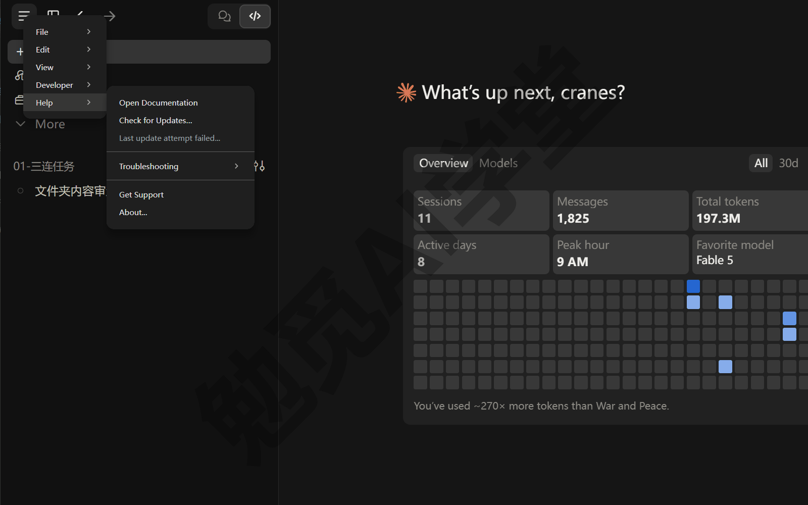

**向别人求助时带上四样东西。** 在社群里提问或者找官方支持（Help 菜单里有 Get Support 入口），把下面四样一起贴出来，对方才好判断：

- 应用版本号；
- Windows 版本；
- 报错原文（截图或原文复制）；
- 你做了什么操作才出现的。

带上这些，多数问题一次就能问清楚。

**命令行版有一条自检命令。** 如果你以后装了命令行版本，在终端里输入 `claude doctor`，它会自己检查安装是否正常并给出提示。桌面应用没有这条命令，这里只需要知道它存在，《终端、编辑器与 VS Code 扩展》会讲。

### 1.10 三个练习任务

方括号里的内容换成你自己的。

**任务一：把三连任务完整做一遍。** 用 `[你的练习文件夹]` 新建一个 Manual 模式的会话，依次发送 1.8 节的这几句话：

```text
请看一下这个文件夹里有什么，用中文告诉我每个文件大概是什么内容。

请在这个文件夹里新建一个叫“文件夹说明.txt”的文件，把你刚才总结的内容写进去，用中文。

/rewind

把刚才新建的“文件夹说明.txt”删掉，让文件夹恢复原样。
```

完成标准：收到中文的文件清单；点 Allow once 之后练习文件夹里多了“文件夹说明.txt”；`/rewind` 之后对话退回、那句话回到输入框；让它删掉之后这个文件消失。

**任务二：把界面切成中文再切回英文。** 在账号菜单的 Language 里切到中文，看一遍 Code 页签里哪些文字变了、哪些没变，再切回英文（本课的按钮名按英文写，切回去方便对照）。

完成标准：能说出至少三个切换后变成中文的界面文字，以及一个仍是英文的按钮名。

**任务三：找出用量在哪看。** 在一个会话里点输入框旁的用量环，看两层信息各是什么；再到 claude.ai 的账号设置里找到套餐名。

完成标准：能说出自己当前的套餐名，以及用量环里“会话上下文”和“套餐用量”两个数各代表什么。

### 1.98 本篇小结与自检

这一篇讲了 Claude Code 是什么（能替你操作电脑的智能体，不是聊天机器人、不是只给程序员用、不是必须敲命令）、它最常帮普通人做的五件事、同一个账号下的五个入口与桌面应用 Code 页签这条主线、套餐与用量的机制；然后按“第 N 步”装好了桌面应用和 Git for Windows、登录、把界面切成中文；最后用三连任务体验了读文件、改文件、回退三件事，并列了打不开、登不上时的排查办法。

可以对照下面的清单检查学习结果：

- [ ] 能用一句话说出 Claude Code 是什么，以及它和聊天工具的区别
- [ ] 能说出五个入口各在什么场景用，知道本课主线是桌面应用的 Code 页签
- [ ] 知道免费账号用不了 Claude Code，知道用量池是共用的、按窗口计
- [ ] 装好了桌面应用与 Git for Windows，登录成功，能打开 Code 页签
- [ ] 知道界面语言在哪切、回复语言怎么定
- [ ] 完成了三连任务：读文件夹、放行一处改动、退回对话并撤掉改动
- [ ] 遇到 Git is required、403、白屏、Failed to load session 时知道先做什么
- [ ] 知道版本号在哪看、怎么更新

完成这些内容后，你的电脑上已经有了一个能干活的 Claude Code。下一篇《桌面应用全导览》把 Code 页签上的每个区域、每个按钮点一遍：侧栏、开会话的四件事、输入框、面板布局、设置页与快捷键，之后再学各项功能时就知道东西都在哪。

### 1.99 新手常见问题

**Q1：要花钱吗？免费账号能用吗？**

Claude Code 需要付费套餐，个人从 Pro 起；免费账号能装应用、能聊天，但打不开 Code 页签。本课的实操默认你有 Pro 或以上套餐，涉及更高套餐的功能会在文章开头说明。具体价格与包含的用量以官网套餐页为准。

**Q2：我完全不会编程，能学吗？**

能。本课就是按零基础设计的：你负责说清楚要什么、在关键步骤点一下确认、看结果对不对，代码由它写。全课不要求你看懂任何一行代码，遇到必须知道的概念会当场用大白话解释。

**Q3：它和 Cursor、Codex 怎么选？**

三个都是同类的智能体，核心思路一样：你提要求，它读文件、改文件、跑命令。手里已经在用哪个就先把哪个用熟，本课学的思路换到另一个上也能用。三者怎么分工，《毕业项目：家庭事务中心 + 课程总结》会专门讨论。

**Q4：一定要装 Git 吗？**

建议装。老版本的桌面应用在 Windows 上不装 Git 开不了本地会话；新版本只在用工作树时要求，但本课后面讲并行会话、记录与还原版本时都要用到它。装一次五分钟，之后不用再管。

**Q5：命令行版和桌面应用是一回事吗？**

是同一个 Claude Code、同一个账号、同一套用量，只是两种界面：桌面应用有按钮和面板，命令行在黑窗口里打字。两者可以同时装在一台电脑上，配置是共用的，命令行里的会话还能接回桌面应用里继续。本课主线用桌面应用，命令行在《终端、编辑器与 VS Code 扩展》认识。
