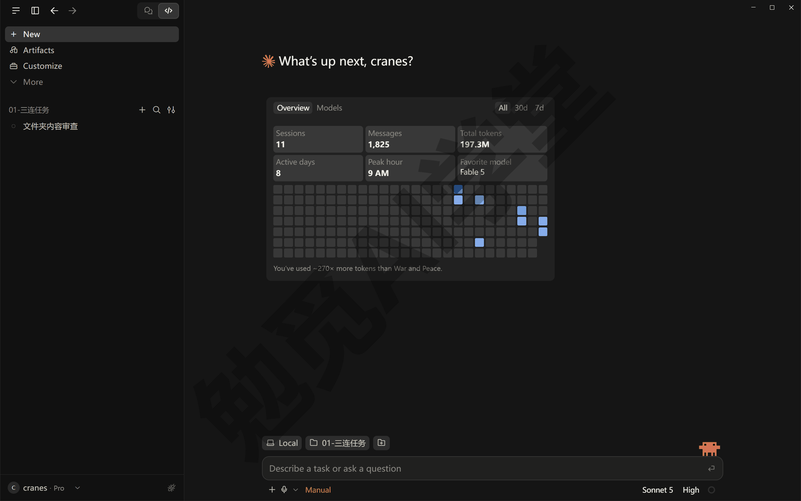
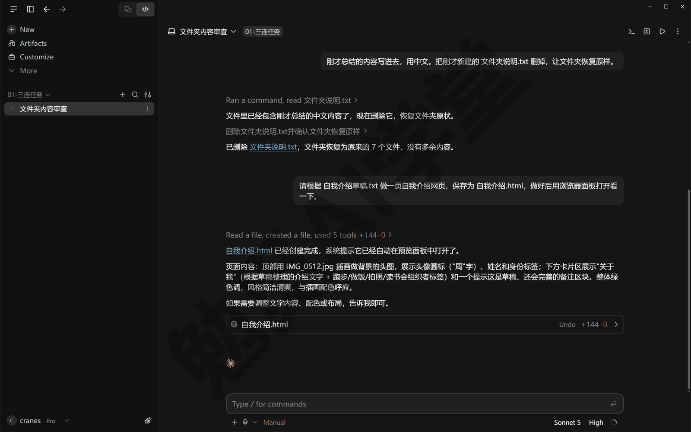
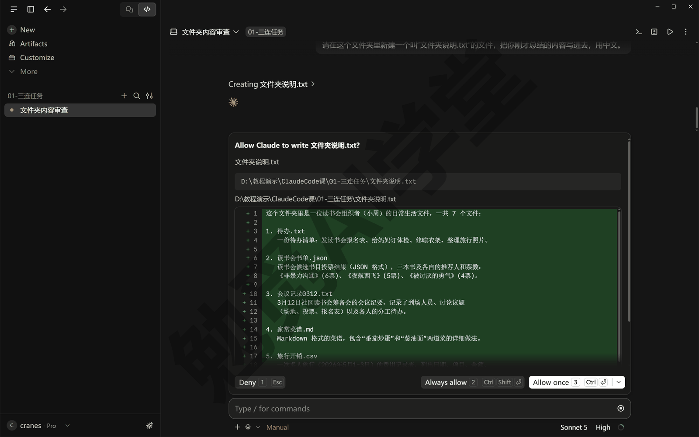
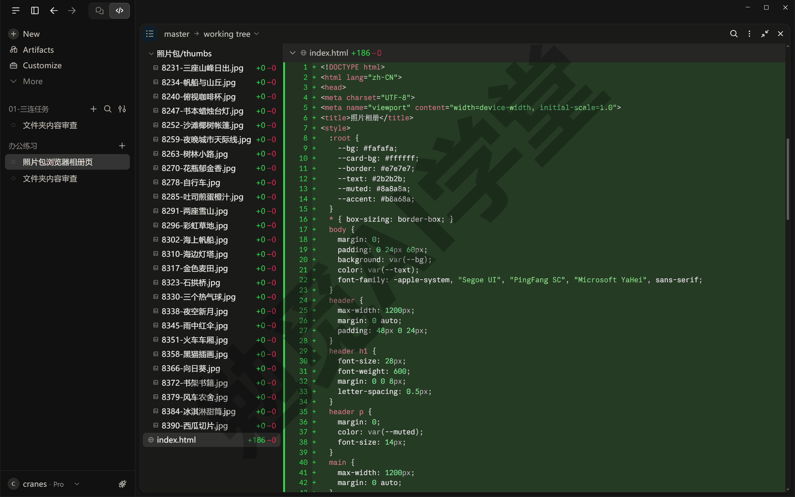
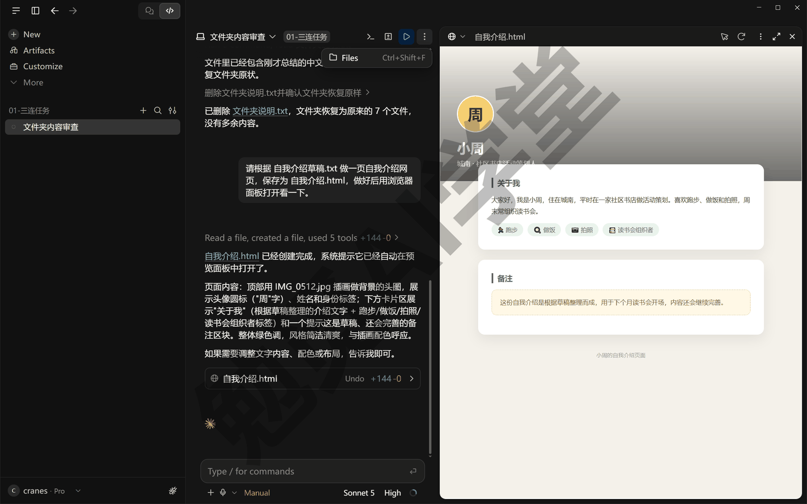
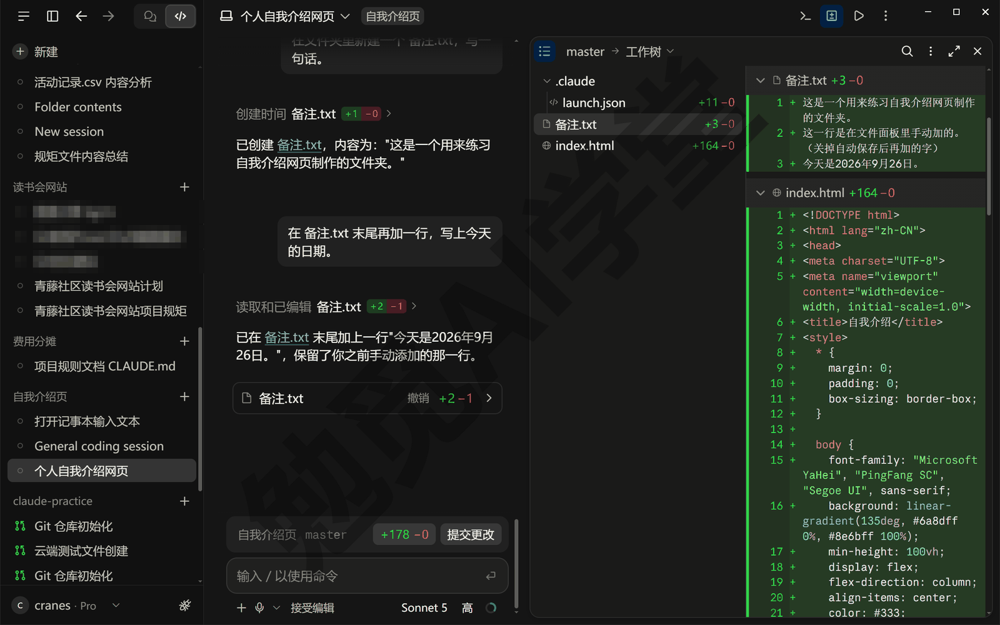
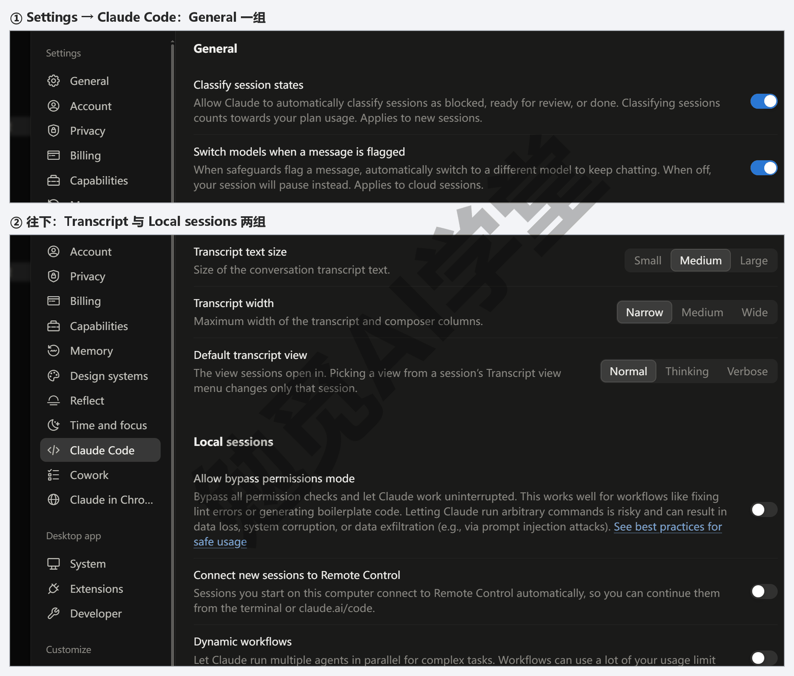
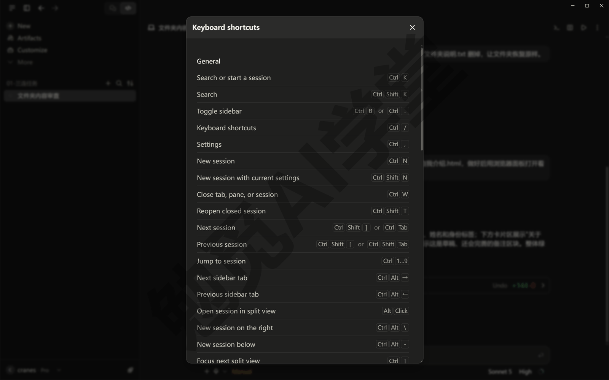
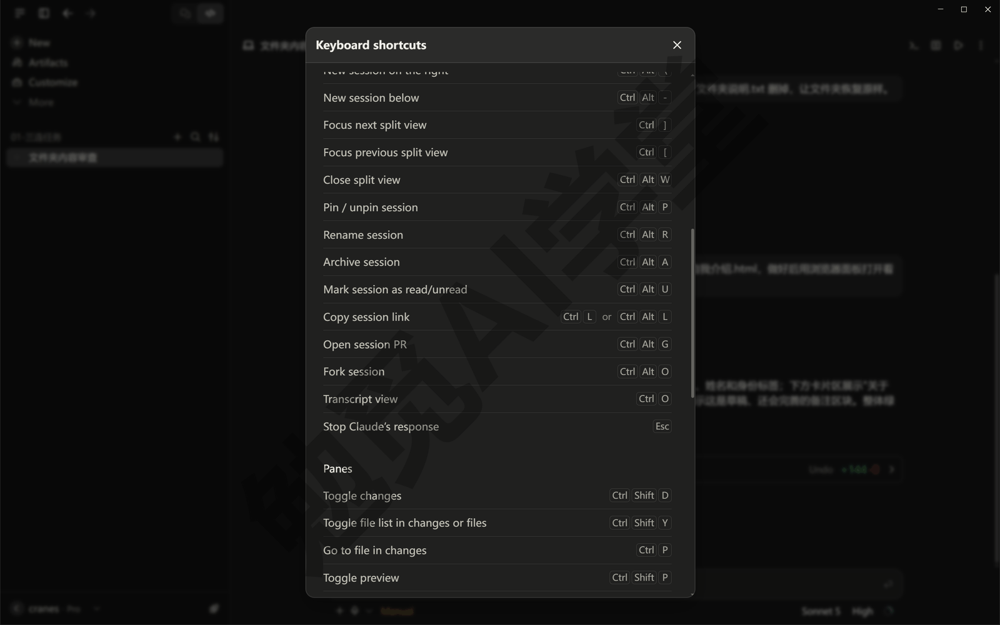
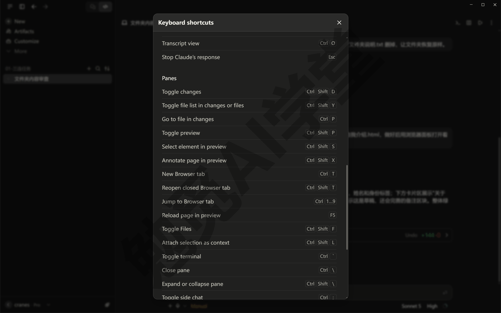

## 桌面应用全导览

上一篇《认识与装好》装好了 Claude 桌面应用，也在 Code 页签里跑过了三连任务。这一篇把 Code 页签上的每个区域、每个按钮点一遍：三个页签是什么关系，左边的侧栏放什么，开一个会话前要先做哪四件事，输入框里每个小按钮是干什么的，它干活时对话里出现的卡片和数字怎么读，面板怎么拖、设置页里有哪些开关、常用快捷键有哪些。看完这一篇，后面各篇说到“点某某按钮”“打开某某面板”，你都知道东西在哪。

这篇文章的实操内容需要 Claude 的付费订阅（Pro 起），和上一篇一样；本篇不新增付费功能。界面按 2026 年 9 月的 Windows 版桌面应用写，按钮名以英文写出并附中文释义，官方正在调整页签布局，个别位置以你看到的界面为准。

### 2.1 三个页签是什么关系

打开 Claude 桌面应用，左上角是页签栏：旧界面是 Chat／Cowork／Code 三个页签，新界面里 Chat 和 Cowork 已经合成一个、只剩对话和 Code 两个图标，当前所在的那个会高亮显示（以你看到的界面为准）。不管是两个还是三个，它们是同一个账号下的几种用法，用量也从同一个池子里扣：

- **Chat（聊天）**：和在 claude.ai 网页上聊天一样，你问它答，不接触你电脑上的文件。适合问知识、改一段文字、要一个思路。
- **Cowork（办公）**：替你整理文档、做表格、写汇报这类办公任务的那部分能力，你授权哪个文件夹它就在哪个文件夹里读写；新界面里它已经并进 Chat，没有单独的页签。这部分本课不讲，另有一门《Claude Cowork 办公教程》。
- **Code（做网页与小工具）**：本课的全部内容都在这里。它直接读写你选定的本机文件夹，每一步改动按你选的权限模式要么先问你、要么做完再让你审阅。

**为什么本课只讲 Code。** 三个页签里，只有它有差异视图、浏览器面板、终端这些做东西时要用的部件，改你电脑上的文件也改得最直接、每一步都看得见。你想“把一个想法做成能用的东西”，就在这里；只是想聊几句，去 Chat 更快。分不清该用哪个时，问自己一句：这件事要不要它在我电脑上做出一个东西来、跑命令、改文件夹里的文件？要，就用 Code；只是整理文件、写文档这类两边都能做的事，本课统一在 Code 里做。

**页签怎么切、默认落在哪。** 点顶部的页签名就能切换，三个页签各自记住自己的内容，切来切去不会丢；Code 页签里正在跑的任务，你切到 Chat 去聊天它也不会停，切回来接着看。应用启动后默认落在哪个页签、Chat 和 Cowork 有没有合并成一个入口，随版本变化（以你看到的界面为准）；不管怎么变，Code 页签的位置和名字不变，找它就行。

**Cowork 和 Code 怎么分。** 两个都会干活，区别在“做什么”：Cowork 做的是整理一批文档、出一份表、写一份汇报这类办公事务，也能在你授权的文件夹里读写文件；Code 负责做网页、写脚本、改代码，直接在你选的文件夹里干活，还带着差异视图、终端这些部件。本课的项目都是网页和小工具，所以全程用 Code。

**同一个账号，三处各记各的。** 三个页签共用账号和用量池，但各自的对话记录是分开的：Chat 里聊过的内容 Code 页签看不到，Code 会话里做过的事也不会出现在 Chat 里。想让 Code 页签知道某段聊天的结论，把那几句复制进 Code 会话的输入框即可。

**和上一篇五个入口的关系。** 上一篇说的桌面应用这个入口，指的就是这里的 Code 页签；命令行、网页版、手机 App 都是它的另外几个入口，它们用的账号和用量是同一份。侧栏最底部是账号头像（下一节的侧栏全景图里能看到），1.7 节的语言设置和 2.7 节的设置页都从这里进；页签旁边的图标随版本变化，以实际界面为准。


### 2.2 侧栏：会话列表与管理

点进 Code 页签，左边一列就是侧栏，里面列的是“会话”。一个会话就是你和它围绕一个文件夹的一段对话，有自己的聊天记录、自己的文件夹、自己的改动，和其他会话互不影响。建议按“一件事一个会话”来用：整理照片开一个，做网页开一个，别把不相关的事塞进同一个会话里，它会越做越乱，你也不好找。

**会话列表。** 侧栏中间是你开过的全部会话，每条显示会话标题；会话运行的地方不同，条目上会带不同的标记：在你电脑上跑的是本地会话，在云端跑的带云端标记，通过 SSH（远程连到另一台电脑）、或者在 WSL（Windows 里的 Linux 子系统）里跑的也各有标记，从手机上派过来的会话带 Dispatch 标记（标记的样式以实际界面为准）。这些运行方式 2.3 节讲。点一条会话，中间就切到它的对话；正在跑的会话，条目上会有运行中的提示，等你确认的会话也会标出来，一眼能看出哪个需要你。会话按最近活动排序，刚用过的在最上面（排序方式以实际界面为准）。

**会话会不会自动消失。** 不会。不管是完成的还是半途停下的会话都留在列表里，直到你归档；关掉应用再打开，列表原样在。半途停下的会话点进去接着发消息就能继续，它记得之前的内容。

**新建会话。** 侧栏顶部的 New（新建）按钮，或者按快捷键 Ctrl+N，都会在中间开出一个空会话，等你做完 2.3 节说的四件事。

**筛选与分组。** 会话多了之后，侧栏顶部的几个筛选按钮可以按状态（正在跑的、等你确认的、已完成的）、按项目文件夹、按运行环境筛选，也可以按项目把会话分组显示（按钮的名称与位置以实际界面为准）。同一个文件夹开过的会话分在一组，回头找“上次整理照片那个会话”就方便。

**重命名与归档。** 会话标题是它根据你第一句话自动起的，想改名，点会话顶部的会话名，在下拉菜单里选 Rename（重命名）；给做完的会话起个一眼能认出来的名字，比如“读书会网站-第一版”，以后翻找省时间。用完的会话不用删，在会话名的下拉菜单里选 Archive（归档），或者把鼠标停在侧栏那条会话上点归档图标，它就从列表里收起来；归档的会话可以在筛选里找回，对话记录不会丢。如果这个会话用了工作树（给会话单独复制一份文件夹的功能，《子智能体、并行会话与工作树》讲），归档不会动你的原文件，那份复制出来的文件夹也还留着，怎么处理《子智能体、并行会话与工作树》12.3 节讲。

**Customize（自定义）与 Projects（项目）。** 侧栏里还有一个 Customize 入口，里面集中管理技能、连接器和插件三类东西，《技能与斜杠命令》和《插件、连接器与 MCP》再讲；云端用户还会看到 Projects，用来把一组云端会话归在一起，《云端会话与手机端》再讲。Customize 和 Projects 现在只需要知道在侧栏里，点进去看一眼不会改任何东西；侧栏顶部的 Artifacts 和 More 两项本课用不到，知道它们在那儿就行。



### 2.3 开一个会话先做四件事

新建会话之后先别急着打字。输入框周围的几个选项，要你开工前先做四件事，它们决定了这个会话在哪跑、动哪个文件夹、用什么模型、有多大自主权。这四件事在会话进行中也能改，但第一次一定要看一眼。


**第一件：运行环境。** 这是一个下拉菜单，里面有四种：

- **Local（本机）**：在你这台电脑上跑，直接用你电脑上的文件。本课全程用它。
- **Cloud（云端）**：在 Anthropic 的云端机器上跑，你关掉应用它也继续；关了电脑回来还能接着看。《云端会话与手机端》讲。
- **SSH**：连到你自己管理的另一台电脑或服务器上去跑，第一次连接时它会自动把 Claude Code 装到那台机器上。本课不用。
- **WSL**：Windows 上装了“Windows 里的 Linux 子系统”的用户可以选它，会话就在那个 Linux 环境里跑。本课不用，《云端会话与手机端》一句认识。

**第二件：项目文件夹。** 点 Select folder（选择文件夹）选一个文件夹。要把这一步想清楚：**这个文件夹就是它干活的地方**，它读的是这里的文件、改的是这里的文件、新建的文件也落在这里，你没选进来的地方它不碰。所以给它选文件夹，就是在给它划范围。上一篇练习用的小文件夹是好起点；以后做正式的项目，给每个项目单独建一个文件夹。

**第三件：模型。** 输入框下方右侧有一个模型下拉菜单（显示着当前模型名），默认已经选好一个，第一次保持默认就行；它旁边还有一个“努力档”（effort）选项，决定它想得多深、花的用量多少。模型怎么选、努力档什么时候调，《权限、沙盒与模型》细讲。

**第四件：权限模式。** 输入框下方左侧的模式选择器（显示着当前模式名，比如 Manual），决定它做事之前要不要先问你。现在的版本有五档，名字和含义先认识一下，《权限、沙盒与模型》一档一档展开：

- **Manual（手动）**：它改文件、跑命令之前都先问你，弹一张卡片给你看要做的事，下面是 Deny（拒绝）、Always allow（始终允许）、Allow once（只允许这一次）三个按钮，你点了它才动。第一次用选它。
- **Accept edits（自动接受编辑）**：它改文件不再问，直接改完让你看差异；跑其他命令仍然问。
- **Plan（计划）**：它只读文件、只想方案，不动你的文件；方案你同意了再切回前两档去做。
- **Auto（自动）**：它不逐条问你，改成由一个后台检查器检查它的每个动作、拦下有风险的；你的账号里有这一项才能选。
- **Bypass permissions（跳过权限）**：它几乎什么都不问。默认藏着，Pro 和 Max 用户要到设置里打开才会出现在选择器里；本课到《权限、沙盒与模型》才讲什么情况下能用。

老版本的 Code 页签把这几档叫 Ask permissions、Auto accept edits、Plan mode，看到旧教程里这些名字，对应的就是 Manual、Accept edits、Plan。

四件事做完，在输入框里打字、按回车，会话就开始了。

### 2.4 输入框逐项认识

输入框是你和它打交道最多的地方，除了打字的区域，周围一圈小按钮各管一件事。先认全，后面各篇用到时不用再找。



**+ 按钮。** 在输入框左侧，点开是一个菜单，里面有四类东西：附件（把图片、PDF 等文件加进这次对话）、Slash commands（斜杠命令，也就是技能）、Connectors（连接器）、Plugins（插件）。后三类各有一篇专门讲，现在只用附件：想让它看一张截图，点附件选文件，或者直接把文件拖进输入框。附件适合放“给它看的东西”——报错截图、参考图、一份 PDF 资料；文件夹里已有的文件不用当附件传，用下面的 @ 更快。

**@ 文件。** 在输入框里打一个 `@`，接着输入文件名的前几个字，它会弹出一个候选列表，选中后这个文件就进了对话，它会去读。这是把文件夹里某个具体文件交给它的最快办法：你说“把 @预算表.xlsx 里的数字汇总一下”，它就不用自己去猜是哪个文件。《对话与上下文管理》细讲。云端会话和 WSL 会话里没有这个功能。

**/ 命令。** 打一个 `/`，弹出的列表里是能用的全部命令：内置命令（比如 `/compact` 压缩上下文、`/rewind` 回退、`/btw` 侧聊）、你自己的技能、项目里的技能、插件带来的技能。选中一条，它会变成一个带底色的小块放在输入框里，后面接着写你的要求再发送。它正在跑的时候也能发命令，不用等它停。《技能与斜杠命令》会把内置命令逐条讲。

**模式选择器与模型选择器。** 就是 2.3 节的第三、第四件事，会话中随时能改：模式改了，从下一个动作开始生效；模型改了，从下一条消息开始用新模型。一个常见的用法是先用 Plan 让它出方案，方案看过了再切到 Manual 或 Accept edits 让它动手。

**Transcript 视图（对话记录视图）。** 这一项不在输入框周围：点会话顶部的会话名，下拉菜单里有一项 Transcript view（对话记录视图），决定对话里显示多少细节，2.5 节讲。

**发送、停止与插话。** 打完字按回车发送，想在输入框里换行用 Shift+回车（以实际界面为准）。它跑的过程中，发送按钮会变成停止按钮，点一下它立刻停下；不想停、只想纠正它，直接打字再按回车，它做完当前这一步就会读到你的话并调整方向，不用等它跑完、也不用重来。比如它正在改第三个文件，你发现要求说错了，直接发一句“等等，标题用蓝色不是红色”，它改完手上这个文件就会按新要求做。

**用量环。** 模型选择器旁边的小圆环，上一篇见过：点开看当前会话的上下文用量和套餐用量。上下文快满时它会自动做一次压缩再继续，你也可以主动发 `/compact` 让它先压缩，《对话与上下文管理》讲。

### 2.5 看它怎么干活

发出一句话之后，对话里不会只有一段回复，而是一串它工作的记录。学会读这些记录，才知道它到底做了什么——这是验收的第一步，也是本课后面反复要用的习惯。

**工具卡片。** 它每做一个动作，对话里就出现一张小卡片：读了哪个文件、改了哪个文件、跑了哪条命令。Manual 模式下，要你批准的动作会显示成带 Deny、Always allow、Allow once 三个按钮的卡片，你不点它就等着。卡片默认折叠，只显示一句概要，点开能看细节：读文件的卡片能看到它读了哪几行，跑命令的卡片能看到命令原文和输出。读卡片的顺序就是它做事的顺序，从上往下看一遍，就知道它先看了什么、再改了什么。

**跑命令的卡片要多看一眼。** 读文件的卡片扫一眼就行，改文件的卡片看差异就够了；跑命令的卡片要看两处：命令原文是什么、输出里有没有报错。看不懂命令也没关系，先找输出末尾有没有 error、failed 这类字样；拿不准就把卡片里的内容原样发回去，让它解释这条命令做了什么。它有时会在报错后自己再试一次，卡片会连着出现两张，看最后一张的结果即可。



**差异计数与差异视图。** 它改过文件之后，界面上会出现类似 `+12 -1` 的一组数字：加了 12 行、删了 1 行；数字旁边还有一个 Undo（撤销）按钮，点它能把这一轮改动整个撤回。点数字打开差异视图，左边是这次改过的文件列表，右边是每个文件里具体改了哪几行，删掉的和新增的用不同颜色标出；面板小的时候文件列表可能是收起来的，点左上角的 ☰ 就能打开。在差异视图里点某一行，行号旁边会出现一个 +，点它就能在这一行下面写评论，比如“这里不对，改成……”；几处评论写完，按 Ctrl+回车一起发给它，它会按你的评论再改一轮，改完出现新的差异让你再看。想让它自己把这次改动审一遍，在输入框里发送 `/code-review`，它会读一遍改过的文件，把发现的问题写在对话里，只挑真正的错误，不挑格式和写法。这一整套怎么用，《计划模式、差异审阅与回退》细讲。



**工具栏上的面板入口。** 会话右上角的工具栏里有终端、差异、浏览器几个图标和一个 ⋮ 菜单，2.6 节的几种面板都从这里打开。

**几档视图。** 2.4 节提到的 Transcript view 菜单里有三档：Normal（普通）只把工具卡片折叠成一句概要、完整显示它的回复；Thinking（思考）比 Normal 多显示它的思考过程，这一档只在它这次会话里产生过思考之后才出现；Verbose（详细）把每一次读文件、每一条命令、每一步中间过程都展开。平时用 Normal；想看它做某一步具体读了什么、跑了什么命令，切 Verbose；想看它当时是怎么想的，切 Thinking。按 Ctrl+O 可以在几档之间轮换。老版本的桌面应用还有一档 Summary（摘要），只留最终回复和改了什么，新版本已经去掉；你看到的是三档就对了。

**做完了会通知你。** 一个会话跑完任务、而你正在看别的会话或别的窗口时，Windows 右下角会弹一条系统通知，不用一直盯着。

### 2.6 面板布局

Code 页签不是一个固定的窗口布局，而是由几种面板拼起来的，每一种都能拖、能关、能拉出去单独开一个窗口。这样设计是为了让你能一边看对话、一边对照着看它改出来的东西：改网页时左边聊天、右边浏览器预览；改文件时左边聊天、右边差异。

**八种面板。** 每一种是什么、在哪一篇展开，见下表：

| 面板 | 是什么 |
| --- | --- |
| 聊天 | 对话本身 |
| 差异 | 2.5 节的差异视图 |
| 浏览器 | 预览网页、打开外站，《内置浏览器、应用预览与电脑操控》讲 |
| 终端 | 在会话的文件夹里敲命令，《终端、编辑器与 VS Code 扩展》讲 |
| 文件 | 点对话里的文件路径就能打开来看、小改几处再保存 |
| 计划 | Plan 模式下它写的方案 |
| 任务 | 后台正在跑的子任务，《子智能体、并行会话与工作树》讲 |
| 子智能体 | 点任务面板里的某一项看它的输出 |

其中终端、差异、浏览器三种在工具栏上各有一个图标，文件和计划在 ⋮ 菜单里（计划只在 Plan 模式出过计划之后才出现），任务和子智能体两种的入口以你看到的界面为准。



**拖动与关闭。** 按住面板顶部的标题栏拖，就能把它放到左边、右边或下方；拖面板的边缘可以调大小。按 Ctrl+\ 关掉你刚点过的那个面板。关掉的面板随时从工具栏再打开。想把差异或终端放到另一块屏幕上，把那个面板拖出主窗口，它会变成独立窗口，用完拖回来即可，拖出去的这段时间它照常干活。布局会跟着会话保存，下次打开这个会话还是你拖好的样子（以实际界面为准）。

**常用的两种布局。** 做网页时：左边聊天、右边浏览器面板，它每改一次页面就自动刷新，你不用切窗口；改文件时：左边聊天、右边差异面板，它每改一处你就能立刻看到。这两种布局记住就够，别的面板用到再拖。



**文件面板的几个小动作。** 在对话或差异视图里点一个文件路径，文件面板就打开它；网页、PDF、图片这几类会在浏览器面板里打开。你可以在文件面板里直接改几个字，面板默认开着自动保存，打完字就写回了磁盘；它改了你正开着的文件，面板里的内容会跟着刷新。右键点任何一个文件路径还有一组菜单：Attach as context（作为附件加进下一句话）、Copy ›（复制路径）、Open in（用 VS Code、Cursor 这类装了的编辑器打开）、Show in Explorer（在资源管理器里显示）。《终端、编辑器与 VS Code 扩展》8.2 细讲。

**两个会话并排看。** 按住 Alt 点侧栏里的另一条会话，它会在当前会话旁边开出第二栏，两个会话同时看；这时再点侧栏的第三条，会替换掉你刚点过的那一栏。按 Ctrl+Alt+W 关掉有焦点的那一栏，回到单会话。

**面板拖乱了怎么办。** 把多出来的面板逐个用 Ctrl+\ 关掉，只留聊天，再从工具栏按需要一个个打开，就回到整齐的样子；有没有一键复位布局的入口，以实际界面为准。

### 2.7 设置页全部开关认识一遍

设置页从账号菜单进（点击头像 → Settings），在输入框里输入 `/config` 也会直接打开它的 Claude Code 分页。里面分几组，这里把和 Code 页签有关的逐项过一遍，说清每一项什么时候要动、哪一篇会讲它。一个总的原则：现在全部保持默认，等讲到对应功能那一篇再回来动；本课后面每一篇要动某个开关时，都会写清“到 Settings → 哪一组 → 哪一项”，照着找就行，不用现在记住每一项的位置。



**General（通用）。** 这一组只有两项。Classify session states（自动给会话标状态）打开后，它会自动把每个会话标成卡住了、等你审、做完了三种状态之一，这个标注会计入套餐用量；Switch models when a message is flagged（消息被安全机制标记时自动换模型）打开后，某条消息被安全机制拦下时它会自动换一个模型接着聊，关了就停下等你，这一项只对云端会话起作用。两项都保持默认。电脑操控（让它操作屏幕上的其他应用）的总开关不在这个分页，在左边 Desktop app 一组的 System 里，《内置浏览器、应用预览与电脑操控》讲，现在不要开。分页里各项的名称以实际界面为准。

**Transcript（对话记录）与 Local sessions（本机会话）。** Transcript 一组三项都只管显示效果：Transcript text size（文字大小）、Transcript width（对话栏宽度）、Default transcript view（新会话默认用哪一档视图，Normal／Thinking／Verbose 三档 2.5 节讲过），看着不舒服再来调，不影响它做事。再往下的 Local sessions 一组管在你电脑上跑的会话，和本课关系最大：

- Allow bypass permissions mode（允许跳过权限模式）：打开后 2.3 节的第五档才会出现在选择器里。现在保持关闭。
- Connect new sessions to Remote Control（新会话自动接入远程控制）：打开后你在这台电脑上开的会话都能从网页版接着指挥，《云端会话与手机端》讲；Dynamic workflows（动态工作流）让它为复杂任务同时开多个智能体干活，很耗用量；Draw attention on notifications（有通知时闪任务栏）是它等你的时候让任务栏按钮闪一下。这三项现在都不用动。
- Worktree location（工作树位置）：并行会话复制出来的文件夹放在哪，默认就是 Inside project（放在项目文件夹里），本课不改它；同一组里还有一项和 General 里同名的 Switch models when a message is flagged，这一项管的是本机会话。《子智能体、并行会话与工作树》讲工作树。
- 再往下是 Browser（浏览器）和 Pull requests（合并请求，也就是 GitHub 上的 PR）两组：浏览器面板、预览与 Keep cookies 的开关在 Browser 一组，《内置浏览器、应用预览与电脑操控》讲；Pull requests 一组里是 Branch prefix（给它开的分支名加的前缀）、PR 合并或关闭后自动归档会话这类设置，连了 GitHub 之后才用得上，《Git、GitHub 与代码审查》讲。

**Connectors（连接器）。** 已经接上的外部工具（GitHub、日历这类）在这里管理和断开；接一个新的连接器不在这里，而是在输入框的 + 菜单里，这里只管已经接上的。《插件、连接器与 MCP》讲。

**Language（语言）。** 就是上一篇 1.7 节切界面语言的地方，在账号菜单里。

**桌面应用和命令行共用的配置文件。** 你以后如果也装了命令行版，两边读的是同一批文件：项目文件夹里的 CLAUDE.md（《CLAUDE.md 与规则》讲）、你的用户目录下 `.claude` 文件夹里的设置文件（Windows 上一般在 `C:\Users\你的用户名\.claude`），以及连接外部工具用的 `.mcp.json`。在一边改了，另一边同样生效。这些文件叫什么名字、放在哪，讲到对应功能时会一一给出，现在不用去找。侧栏 Customize 里装的技能、连接器和插件是跟着账号同步的，和这些本机文件是两套东西，现在不用记，《技能与斜杠命令》会讲清两套的关系。

### 2.8 快捷键速查

Code 页签的快捷键不多，按 Ctrl+/ 会弹出全部快捷键的总表，随时可以查。下面这些是日常最常用的，先记住前五个就够，其余用到时看总表。表里的组合键都是 Windows 的写法，macOS 上多数把 Ctrl 换成 Cmd，本课不展开：

| 快捷键 | 作用 |
| --- | --- |
| Ctrl+/ | 显示全部快捷键 |
| Ctrl+N | 新建会话 |
| Ctrl+Tab／Ctrl+Shift+Tab | 切到下一个／上一个会话 |
| Esc | 停止它当前的回复 |
| Ctrl+; | 打开侧聊 |
| Ctrl+Shift+D | 打开或关闭差异面板 |
| Ctrl+Shift+P | 打开或关闭浏览器面板 |
| Ctrl+反引号键（键盘左上角 ~ 那个键） | 打开或关闭终端面板 |
| Ctrl+\ | 关闭你刚点过的那个面板 |
| Ctrl+O | 轮换视图档位 |
| Ctrl+Shift+M | 打开权限模式菜单 |
| Ctrl+Shift+I | 打开模型菜单 |
| Ctrl+Shift+E | 打开努力档 |
| 数字 1～9 | 在打开的菜单里选第几项 |







**为什么先记这五个。** Ctrl+/ 是查表用的，忘了别的按它就行；Ctrl+N 和 Ctrl+Tab 管开会话、切会话，会话多了以后天天用；Esc 是停止键，它跑偏了立刻停下比等它做完再改省用量；Ctrl+; 的侧聊下面单独说。后面几个面板快捷键，等你用熟了差异、浏览器、终端再记。

**菜单里用数字选。** 表里最后一行的意思是：Ctrl+Shift+M 这类快捷键打开一个菜单后，直接按数字 1、2、3 就能选第几项，不用再拿鼠标点。比如 Ctrl+Shift+M 再按 3，就切到了第三档权限模式（顺序以菜单里的实际排列为准）。

**侧聊是什么。** 表里的 Ctrl+;（或者在输入框里输入 `/btw`）会打开一个小窗，你可以在里面问一个和当前任务有关、但不想打断主对话的问题，比如“刚才那个文件是干什么的”。侧聊能看到主对话到目前为止的全部内容，但它的回答不会写回主对话，关掉之后主对话原样继续。侧聊不保存，关掉应用就没了。《对话与上下文管理》细讲。

**这些快捷键只在 Code 页签里生效。** Chat 页签有自己的一套；网上命令行教程里说的 Shift+Tab 切换权限模式，在桌面应用里也不适用，桌面应用用的是 Ctrl+Shift+M。

**和中文输入法的冲突。** 用中文输入法时，Ctrl+Shift 开头的组合键可能先被输入法拿去切换中英文或简繁体，导致快捷键没反应。遇到这种情况，先切到英文输入状态再按，或者在输入法设置里把冲突的组合键改掉（以你用的输入法为准）。

### 2.9 三个练习任务

方括号里的内容换成你自己的。

**任务一：新建两个会话并排看。** 用 `[你的练习文件夹]` 新建一个会话，发送下面第一句；再按 Ctrl+N 新建第二个会话、选同一个文件夹，发送第二句。然后按住 Alt 点侧栏里的第一个会话，让两个会话并排：

```text
这个文件夹里一共有几个文件？只回答数字和一句话说明。

列出这个文件夹里最大的三个文件，标出各自的大小。
```

完成标准：两个会话并排显示在中间区域；每个会话各有自己的回复；按 Ctrl+Alt+W 能回到单会话。

**任务二：把一个现有文件夹开成会话，让它新建一份说明文件。** 用 Manual 模式给 `[一个你平时在用的文件夹]` 开会话，发送下面这句，等它弹出写文件的卡片后点 Allow once，再点 `+N -0` 打开差异视图看一遍：

```text
请在这个文件夹里新建一个“README.md”，
用中文写清楚这个文件夹是放什么的、里面每个子文件夹各放什么。
```

完成标准：文件夹里出现 README.md；差异视图左侧只有这一个文件、右侧全是绿色新增行。

**任务三：找出“允许跳过权限模式”在哪。** 打开 Settings → Claude Code，找到 Allow bypass permissions mode 这一项，看清它现在是关闭的，不要打开。

完成标准：能说出这个开关在设置页的哪一组、现在是开还是关。

### 2.98 本篇小结与自检

这一篇把 Code 页签点了一遍：三个页签里只有 Code 直接读写本机文件；侧栏管会话，新建、筛选、重命名、归档都在这里；开会话先选环境、文件夹、模型、权限模式四件事，其中文件夹就是它干活的范围，权限模式五档从 Manual 起认识；输入框周围的 + 按钮、@ 文件、/ 命令、模式与模型选择器、Transcript 视图、用量环各管一件事，跑的过程中可以随时停、随时插话；对话里的工具卡片和 `+12 -1` 差异计数是它工作的记录，差异视图里能逐行评论，发 `/code-review` 能让它自己审查一遍；八种面板可以拖、关、并排；设置页的 Claude Code 分组放着跳过权限、工作树位置、自动归档这些开关；快捷键按 Ctrl+/ 随时查，侧聊用 Ctrl+;。

可以对照下面的清单检查学习结果：

- [ ] 能说出 Chat、Cowork、Code 三个页签各是干什么的
- [ ] 会在侧栏新建、切换、重命名、归档会话
- [ ] 开会话时知道四件事各是什么，知道文件夹就是它干活的范围
- [ ] 能说出五档权限模式的名字，知道第一次用选 Manual
- [ ] 知道 + 按钮、@、/ 各是干什么的，会在它跑的时候停下它或插话
- [ ] 会点差异计数打开差异视图，知道在哪逐行评论，知道发 `/code-review` 让它自己审查
- [ ] 会从工具栏打开面板、拖动面板、用 Ctrl+\ 关面板、并排看两个会话
- [ ] 知道设置页里 Allow bypass permissions mode 在哪，现在保持关闭
- [ ] 记住了 Ctrl+/、Ctrl+N、Ctrl+Tab、Esc、Ctrl+; 五个快捷键

完成这些内容后，Code 页签上的每个区域你都认识了。下一篇《权限、沙盒与模型》讲它动你电脑的边界：五档权限模式每一档它会问什么、不问什么，沙盒在 Windows 上的现状，模型和努力档怎么选，以及用量怎么花得值。

### 2.99 新手常见问题

**Q1：会话记录存在哪？换电脑还在吗？**

本地会话的记录存在你这台电脑上，换电脑看不到；云端会话存在云端，在任何一台电脑、网页或手机上登录同一个账号都能看到。想让一段本地会话到另一台电脑上接着做，《云端会话与手机端》讲的“送到云端继续”能做到。

**Q2：两个会话会互相影响吗？**

每个会话有自己的对话记录，这一点上互不影响。但如果两个会话选了同一个文件夹，它们改的是同一批文件，一个改了另一个就会看到。想让它们真正互不干扰，新建会话时选工作树选项，每个会话拿到一份自己的文件夹副本，《子智能体、并行会话与工作树》讲。

**Q3：面板拖乱了怎么复位？**

用 Ctrl+\ 把多出来的面板逐个关掉，只留聊天，再从工具栏按需要重新打开。拖出去变成独立窗口的面板，拖回主窗口就行。

**Q4：快捷键按了没反应？**

先看是不是中文输入法拿走了 Ctrl+Shift 开头的组合键，切到英文输入状态再试；再看光标是不是停在输入框以外的地方，有些快捷键要先点一下会话区域才生效。还不行就按 Ctrl+/ 对一下总表，确认组合键没记错。

**Q5：我在命令行里开过的会话，桌面应用能接着用吗？**

能，但要从命令行那一头送过来：在命令行的会话里输入 `/desktop`，它会把这个会话送到桌面应用里打开，对话内容都在。桌面应用这边没有反过来接的命令，在 Code 页签输入 `/resume` 只会回一句 “/resume isn't available in this environment.”（在这个环境里不可用）。《终端、编辑器与 VS Code 扩展》细讲。
