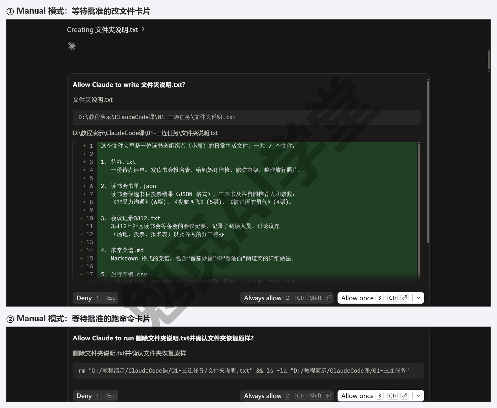
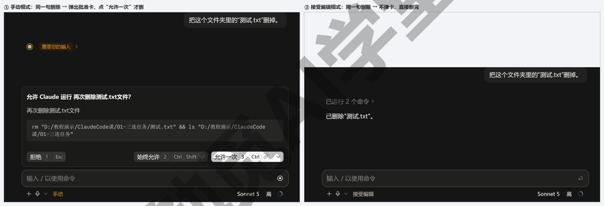
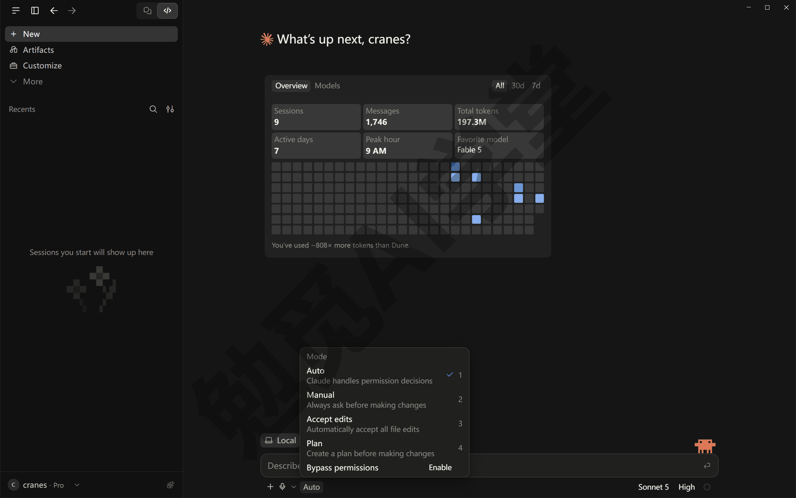
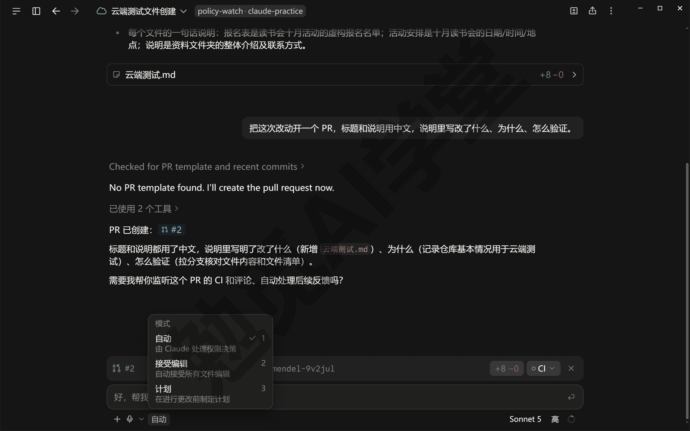
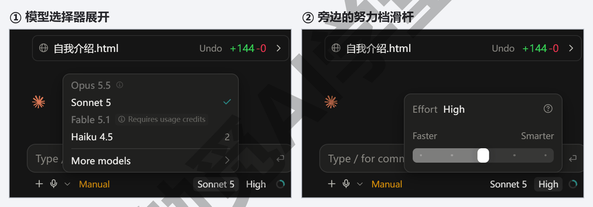
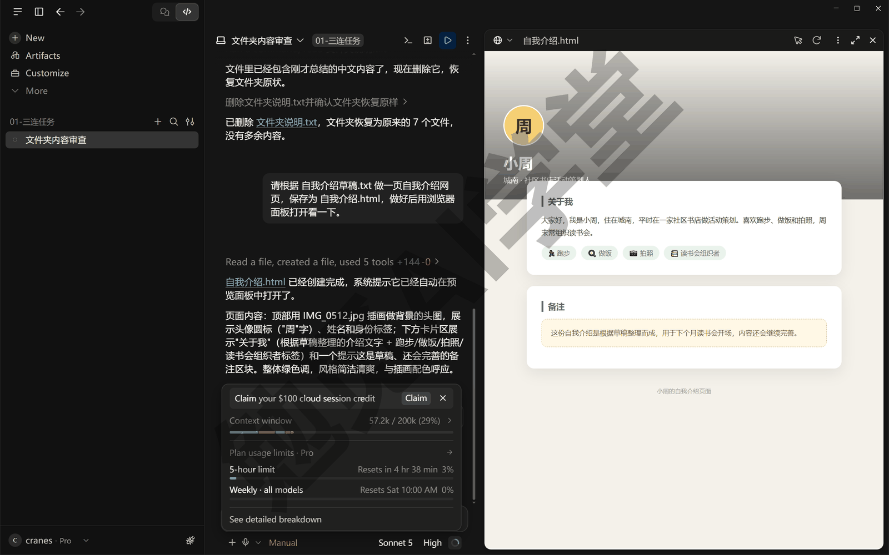
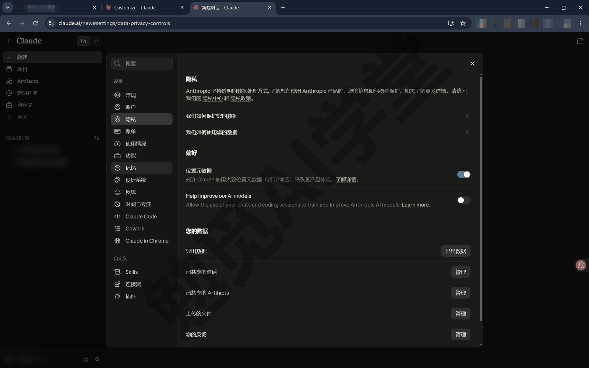

## 权限、沙盒与模型

前两篇装好了 Claude Code，也把 Code 页签的每个区域认了一遍。这一篇讲它动你电脑的边界：它到底能读什么、改什么、跑什么、上哪些网站，每一步之前会不会先问你；五档权限模式每一档问什么、不问什么；沙盒在 Windows 上是什么现状、少了它该怎么补；模型和努力档怎么选；用量怎么花得值；你的数据去了哪。这些都是你把真实文件夹交给它之前必须先弄清楚的事，讲清楚了，后面各篇放手让它干活时你才知道该在哪停、怎么停。

这篇文章的实操内容需要 Claude 的付费订阅（Pro 起），和前两篇一样；本篇提到的 Auto 模式和跳过权限模式对套餐另有要求，讲到时会说明。界面按 2026 年 9 月的 Windows 版桌面应用写，按钮名以英文写出并附中文释义，以你看到的界面为准。

### 3.1 它到底能动你电脑的什么

它对你电脑做的事，归成四类动作就够了：读文件、改文件、跑命令、上网。四类动作的风险不一样，它问不问你、什么时候问，也不一样。

**读文件。** 读你选定文件夹里的文件、列出文件夹里有什么、在文件里搜一个词。这类动作不改变任何东西，所以在任何权限模式下它都直接做、不问你。要留意的只有一点：读进去的内容会占上下文（它这次对话里记着的东西），大文件读多了对话会变慢、用量也涨，3.7 节讲。它默认只读你选进会话的那个文件夹，文件夹之外的地方不会自己跑去看。

**改文件。** 新建、修改、删除文件夹里的文件。这是最常见的动作，也是你最需要盯的动作：改对了当然好，改错了要退回。在 Manual（手动）模式下，它每改一个文件都先弹一张卡片给你看要写的内容，下面是 Deny（拒绝）、Always allow（始终允许）、Allow once（只允许这一次）三个按钮，你点 Allow once 它才真的写进去；其他模式下不问，改完给你看差异。

**跑命令。** 在你电脑上执行一条命令，比如用命令把一批文件改名、安装一个工具、启动一个网页预览。命令的威力比改单个文件大得多，一条命令可以动很多文件，所以它对命令更谨慎：在 Manual 和 Accept edits（自动接受编辑）两档下，除了只查看不改动的那一小类命令，其余命令都先问你；Accept edits 额外放行新建文件夹、移动、复制、删除单个文件这几种常见的文件整理命令——这几件事虽然也是在动文件，但它是用命令做的，所以归在命令这一类；上一段“改文件”说的是它用编辑工具改文件内容。

**上网。** 用浏览器面板打开网页、在网页上点击和输入。只是“看”网页不用你批准；要在外面的网站上“动手”（点按钮、填表单），第一次它会弹出授权卡问你，3.5 节讲。

**有几件事它在任何模式下都不会自己做。** 不管你选的是哪一档，删除整个磁盘、用户目录这类关键位置的命令，它一律停下来问；需要你亲自回答的问题（比如它拿不准该选哪个方案）也一定会问。这是写在它里面的底线，不是你能关掉的开关。

**看不懂卡片上写的动作怎么办。** 批准卡上写的是它准备执行的命令或改动，看不懂就先别放行，直接在对话里问它“这条命令会做什么、会动到哪些文件”，它会用中文解释；解释完你再决定点 Allow once 还是 Deny。这个习惯在 Manual 模式下最有用，也是后面几篇放手让它干活之前要先养成的。



**用一次“删文件”请求看它在哪一步停。** 新建一个 Manual 模式的会话，选上一篇用过的练习文件夹，先在里面随手新建一个空的文本文件，比如“测试.txt”，然后发一句：

```text
把这个文件夹里的“测试.txt”删掉。
```

你会看到它先读一眼文件夹（不问），然后弹出一张要你批准的卡片，上面写着它准备执行的删除动作；你不点 Allow once，文件就一直在。点 Deny（拒绝），它会问你想怎么处理。同一句话如果在 Accept edits 模式下发，删除这一步它就不再问你，直接做完告诉你结果。这就是“模式”两个字的全部含义：同一件事，不同模式下停不停、在哪停。下图左边是 Manual 下弹出的卡片，右边是 Accept edits 下直接删完的回复；图里的界面切成了中文，Manual 显示为“手动”、Accept edits 显示为“接受编辑”，卡片上三个按钮是“拒绝／始终允许／允许一次”，位置和英文界面一样。



### 3.2 五档权限模式逐档讲

权限模式在输入框下方的模式选择器里切（显示着当前模式名，比如 Manual），快捷键 Ctrl+Shift+M，会话进行中随时能换，换了之后从下一个动作开始生效。现在的版本一共五档，下面一档一档说清它问什么、不问什么、什么时候用。



**Manual（手动）。** 只有读文件不问，改文件、跑命令都先问。你看到的是每一处改动的内容和三个按钮，点 Allow once 放行、点 Deny 拒绝。它最慢，但最稳，每一步你都看得见。用它的时机：第一次给它一个新文件夹；文件夹里有重要资料；你想先看看它到底会怎么做。本课前几篇的练习都用它。

**Accept edits（自动接受编辑）。** 改文件不再问，直接改完让你看差异；新建文件夹、移动、复制、删除单个文件这类常见的整理命令也放行；其他命令仍然问。用它的时机：任务主要是改文件、你会在差异视图里事后检查，比如让它改一批文档的格式。要清楚一点：它放行的删除只限于你选的文件夹之内，文件夹外的东西照样问。

**Plan（计划）。** 只读不改。它会读文件、做调查，然后给你一份方案，等你同意再动手；你不同意就改方案，同意之后它会问你接下来用哪一档去执行。用它的时机：任务大、涉及很多文件，你想先看它打算怎么做。Plan 模式和另外四档有一个区别：它只对当前这个会话生效，换个会话就回到你平时用的那一档。《计划模式、差异审阅与回退》会用一整节演示它。

**Auto（自动）。** 它不逐条问你，改成由一个后台的“检查员”（官方叫分类器，另一个模型）审它的每个动作：和你的要求对得上的放行，越出你要求范围的、有破坏性的、看起来是被它读到的网页内容带偏的（网页里可能藏着写给 AI 看的指令，3.5 节会讲），拦下来改成问你。它会拦的东西包括：从网上下载并直接运行程序、把敏感数据发到外面、永久删掉会话开始前就存在的文件、强制推送（一种会覆盖掉网上版本记录的 Git 动作，《Git、GitHub 与代码审查》讲）这类危险的 Git 动作。用它的时机：任务长、步骤多，你不想每一步都点确认，又不想完全放手。要求：你的账号能用这一档（Pro 起），而且当前模型支持；不满足时选择器里不会出现它，或者会话自动落回 Manual。在命令行版和 VS Code 扩展里，Pro 和 Max 账号新会话的默认档现在就是 Auto；桌面应用里新会话默认哪一档，以你看到的选择器为准。

**Bypass permissions（跳过权限）。** 几乎什么都不问、也没有检查员，等于什么都不再拦。它默认藏着：Pro 和 Max 用户要到 Settings → Claude Code 里打开 Allow bypass permissions mode（允许跳过权限模式），选择器里才会出现它。官方的建议是只在隔离出来、专门做测试的环境（比如虚拟机）里用它；本课的建议更简单：这门课学完之前不要开它，你在自己电脑上用不到。就算开了，前面说的关键位置删除、需要你回答的问题，它照样会问。

**模式会按文件夹记住。** 你在某个文件夹的会话里选了哪一档，下次再用这个文件夹开会话，它默认还是那一档（Plan 除外）。所以给重要文件夹选好 Manual 之后，不用每次重选。

**老名字对照。** 旧版本的 Code 页签和网上的旧教程里，这几档叫 Ask permissions、Auto accept edits、Plan mode，对应的就是 Manual、Accept edits、Plan；那时候还没有 Auto。看到旧名字不用困惑。

**该选哪一档，一句话记住。** 新文件夹或重要资料用 Manual；改文档类的日常任务用 Accept edits；大任务先用 Plan 出方案，同意后切回前两档或 Auto 去做；Bypass 不开。

### 3.3 云端会话的权限差别

上一篇 2.3 节说过，运行环境可以选 Cloud（云端）。云端会话跑在 Anthropic 的机器上，不碰你电脑上的文件，所以它的权限模式和本机会话不完全一样：选择器里会少几档。

**云端只有三档。** 云端会话的模式选择器里是 Accept edits、Plan、Auto 三项，没有 Manual，也没有 Bypass permissions。

**为什么没有 Manual。** 云端会话改的是云端机器上那份文件，不是你电脑上的，所以官方把“改文件”这一步在云端默认放行了——Accept edits 就是云端的最低档，相当于本机的 Manual 少了“改文件先问”这一步：跑命令它照样先问你，改文件不再问。想逐条批准改动，在云端做不到，要在本机会话里做。

**为什么没有 Bypass。** 云端机器不是你的机器，官方不提供在上面全不问的档位；Auto 已经是云端最放手的一档，它的检查员照样在。

**Auto 在云端出现的条件。** 和本机一样：你的账号能用、当前模型支持；不满足时选择器里只剩 Accept edits 和 Plan。这时想少点确认也只能用 Accept edits：改文件不问、跑命令照样要你批，等账号或模型满足条件后 Auto 才会出现。

**什么任务放云端、什么任务留本机。** 如果你已经想清楚要做什么、愿意让它自己做完再看结果，这件事就可以放到云端会话；要一步步盯的、涉及重要资料的，留在本机会话里用 Manual。这也是本课把云端放到《云端会话与手机端》才讲的原因：先在本机把“提要求、看差异、退回”的习惯练熟，再放到云端去。

**云端会话在哪开、要先准备什么。** 新建会话时把运行环境从 Local（本机）换成 Cloud（云端），开出来的就是云端会话；它改的是放在 GitHub 仓库（网上的一个项目存放处）里的那份项目副本，不是你电脑上的文件夹，所以要先有一个仓库——仓库就是把你电脑上的项目文件夹推到 GitHub 网站上存的那一份，现在没有不要紧，《Git、GitHub 与代码审查》和《云端会话与手机端》会带你从零建起。现在只需要知道：选了 Cloud，选择器里就只剩三档，这不是你的账号少了功能。

**在云端该选哪一档。** 想让它自己做完再看结果，选 Accept edits，改完你在差异视图里检查；任务大、想先看方案，选 Plan；步骤多又不想逐条批准命令，选 Auto，检查员照样替你把关。三档里没有一档能让你逐条批准改文件；云端会话的安全靠的是另外三样东西：它改的只是副本、Auto 的检查员照样把关、你事后在差异视图里检查；改完的结果怎么回到你电脑上，《云端会话与手机端》讲；看差异视图的办法上一篇讲过，云端会话里同样能用。



### 3.4 沙盒在 Windows 的现状

网上讲 Claude Code 的文章常提到“沙盒”，这一节先说它是什么，再说 Windows 用户的实际情况。

**沙盒是什么。** 沙盒（sandbox）是给“跑命令”这一类动作围的一圈栏：命令在栏里跑，只能碰你允许的文件夹、只能连你允许的网址，栏外的东西碰不到。有了沙盒，即使它跑了一条不该跑的命令，损失也被关在栏里。这是 Auto 模式之外另一层保护，两层可以同时用。

**Windows 上现在的情况。** 沙盒目前只在 macOS、Linux 和 WSL 2（Windows 里的 Linux 子系统）里有，Windows 本身没有。这意味着：在你的 Windows 电脑上，它跑的每一条命令都是直接在你的系统里跑的，没有那圈栏。

**没有沙盒该怎么补。** 没有沙盒不等于不安全，等于“把关这件事要靠模式和你自己”。四件事做到，日常使用是稳妥的：

- **重要文件夹用 Manual。** 它每条命令都会先给你看，你看一眼再放行。看不懂命令是什么意思，直接在对话里问它“这条命令会做什么”，它会用中文解释。
- **给它划小范围。** 上一篇说过，选进会话的文件夹就是它干活的地方。不要把整个磁盘、整个用户目录交给它，一个项目一个文件夹。
- **用 Git 留后悔药。** 《Git、GitHub 与代码审查》会讲怎么给文件夹留版本记录，改坏了能整体退回；在那之前，本机会话里它每改完一轮文件，对话里会出一张改动汇总卡（写着改了哪些文件、带 +N -M 的数字，上一篇 2.5 节见过），卡上的 Undo（撤销）能撤回那一轮改动，`/rewind`（回退）能把对话退回去，下一篇《对话与上下文管理》讲。
- **Bypass 不开。** 3.2 节说过了，这一档是给沙盒或虚拟机里用的，Windows 上没有沙盒就更不该开。

**WSL 一句认识。** 如果你以后装了 WSL 2，上一篇 2.3 节的运行环境里可以选 WSL，会话就在那个 Linux 环境里跑，沙盒也就有了。本课不要求你装它，《云端会话与手机端》里会再提一句它和云端、SSH 的关系。

**Manual 下怎么读一条命令。** 卡片上的命令多半是英文单词开头，看不懂不要紧，先认三类要多看一眼的：带 del、rm、Remove 这类字样的是删除；一次动很多文件的批量改名、批量移动；从网上下载并直接运行程序。这三类以外的命令大多只是查看内容或者建文件夹，风险小。一条命令里出现好几个文件夹路径的，也多看一眼这些路径是不是都在你选的文件夹里。拿不准就按 3.1 讲的办法，在对话里问它：

```text
这条命令会做什么？会动到哪些文件？
```

它解释清楚了再放行。这个习惯养成以后，看命令卡会越来越快，多数卡片一眼就能过。

### 3.5 站点授权与安全分类器

它上网的时候，安全这件事由两层东西管：一张授权卡，加上 Auto 模式用的那个检查员。

**只看不用批。** 让它打开一个网页读内容，比如查一份官方文档，不需要你批准；你自己电脑上跑起来的网页预览、项目里的文件，它随便看、随便点，不会弹出授权卡。

**第一次在外面的网站上动手，弹授权卡（面板能开外站的版本）。** 本课用的这一版面板开不了外站，这张卡你暂时见不到（《内置浏览器、应用预览与电脑操控》7.3 节讲）。官方文档说，它要在外面的网站上点按钮、填表单时，对话里会出现一张卡，它停下来等你选三项之一（选项的文案需实机验证）：

- **Allow once（允许一次）**：只放行这一次，什么都不记。
- **Always allow（始终允许）**：把这个网站记在你这台电脑上，以后在这个网站上动手不再问。
- **Deny（拒绝）**：不许做，它会换别的办法或问你怎么办。

每个网站单独授权，子域名（网址开头不同的那一段，比如 docs.example.com 和 www.example.com）也算不同的网站。选过 Always allow 的网站，可以在设置页里撤销（入口以实际界面为准）；撤销以后，下次它再在那个网站上动手会重新弹卡，等于回到第一次的状态。

**先看你的版本会不会弹这张卡。** 你的版本是不是也和本课这一版一样见不到它，在一个 Manual 模式的会话里发送下面这句就知道：

```text
请用浏览器面板打开 https://code.claude.com/docs ，在页面上点一下左侧导航里的第一项。
```

面板能开外站的版本里，它点之前会先弹出上面那张卡；本课用的这一版里，它会直接告诉你面板打不开外部网站（以实际表现为准）。这一版为什么打不开、它会改用什么办法，《内置浏览器、应用预览与电脑操控》7.3 细讲。

**三个选项怎么选。** 如果你的版本会弹这张卡，这样选：只是这一次要在这个网站上填个表、点个按钮，选 Allow once；这个网站是你天天用、以后还会反复让它操作的，比如你自己的网站后台，才选 Always allow；网站是它自己搜出来的、你没听过的，选 Deny，让它换办法或者先问你。拿不准的时候一律 Deny，它会告诉你不做这一步的后果，你再决定。还有一种情况：它连着弹好几张卡，看着都是同一个网站，那多半是子域名不一样（上面说过，子域名不同就算不同的网站），按上面的判断逐张选，不要因为烦就全点 Always allow。这张卡和权限模式无关，Auto 下也会弹（以实际表现为准）。

**不管哪一档，外站动作都要先过检查员。** 它在外面网站上的每一个“写”动作（点击、输入），都会先过一遍 Auto 模式用的那个检查员，不管你选的是哪一档权限模式；检查员觉得可疑的，它会停下来问你。这一层是为了防一种情况：它读到的网页里藏着“把这段内容发到某某地址”这类指令，检查员会拦下。

**三件事它一律不替你做。** 即使是你 Always allow 过的网站，它也不会替你下单付款、注册账号、跨过人机验证（验证码）。这三件事出现时，它会停下来把画面交给你。

**用你自己的登录状态，是另一件事。** 浏览器面板是一个干净的浏览器，没有你的登录记录；要它以你的身份在你登着的网站上操作，用的是另一个东西 Claude in Chrome 扩展，《内置浏览器、应用预览与电脑操控》讲两者怎么选。

### 3.6 模型怎么选

输入框下方有两个和“它想得多好、花得多少”有关的选项：模型选择器（一个下拉菜单，快捷键 Ctrl+Shift+I）和努力档（effort，点开是一个滑杆，快捷键 Ctrl+Shift+E）。

**模型是什么。** 你可以把模型理解成它背后回答问题、做决定的那个“大脑”，同一家公司会同时提供几个：最强的那个想得最深、最贵、最慢；均衡的那个大多数任务够用、快得多；还有更小更快的，适合简单的任务。选择器里显示的是当前可选的几个模型的名字（具体名字随版本变化，以选择器为准；名字里带 Opus 的是最强的那档，带 Sonnet 的是均衡的，带 Haiku 的是更小更快的），默认已经帮你选了一个均衡的。下面那张图的列表里还有一项 Fable 5.1，后面标着 Requires usage credits（需要用量额度），它不在这三档里，本课不用它。

**怎么选。** 一句话：默认的先用着，觉得它某个任务做得不够好，再切到更强的那个重做。规划一个多步骤的大任务、分析一份复杂的资料时，更强的模型值得；批量改名、改格式这类明确的任务，默认模型足够，用更强的只是多花用量。模型随时能换，换了之后从下一条消息开始用新模型，对话不会丢；换模型后的第一条消息会比平时慢一点，这是正常的。



**努力档是什么。** 努力档决定它在回答之前想多久：档位越高，它在动手前琢磨得越多，结果更周全，也更慢、更耗用量；档位越低，回答越快、越省。默认在中间。它和模型是两个互不影响的选项：可以用默认模型开高努力档，也可以用强模型开低努力档。

**什么时候调努力档。** 大多数时候不用动。任务需要它反复权衡（比如给你出三套方案比较）时调高；任务简单明确、你只想快点拿到结果时调低。调整同样从下一条消息生效。

**它在“思考”。** 你会在对话里看到它回答前有一段思考过程（上一篇 2.5 节 Transcript 视图的 Thinking 档能展开看）。这个思考默认是开着的，是它做复杂任务的重要能力，也是用量的一部分；努力档调低，思考也会变短。

**两个选项怎么搭。** 按你手上的任务对号：

- 日常任务：默认模型、默认努力档，什么都不动。
- 结果粗糙、漏了细节：先把努力档调高一档重做，往往就够了，比换模型省。
- 任务本身很复杂、要它权衡很多东西：换更强的模型，努力档也调高。
- 任务很简单、只想快点拿结果：默认模型，努力档调低。

换完看一眼输入框下方显示的模型名和档位，确认真的换过去了，再发下一条。

**换了模型看得出来吗。** 除了输入框下方的名字，最直接的差别是回复的速度和细致程度：同一句话两个模型各发一次，比一比它列出的步骤数和考虑到的情况，就知道差在哪。本篇的练习没有安排这一项，《文件与办公能力一篇讲全》做表格时可以顺手比一次。看不出差别，就说明这个任务用默认模型就够，以后同类任务不用再换。

### 3.7 用量怎么花得值

《认识与装好》1.4 节讲过用量的机制：按时间窗口计、几个入口共用一个池。这一节讲你能做的事：看懂用量环、知道什么操作最耗用量、快满了怎么办。

**用量环的两层。** 点模型选择器旁边的小圆环，看到两个数：一个是当前会话的上下文用了多少——它这次对话里记着的全部内容占了多大比例；另一个是你的套餐在当前窗口里用了多少。前一个是这个会话自己的，开新会话就归零；后一个是所有入口共用的。



**什么操作最耗用量。** 用量本质上是它“读进去”和“写出来”的字数。所以：读大文件比读小文件用量大；一场很长的对话，每发一句它都要带着前面的全部内容一起想，越到后面用量越大；让它同时派出几个子智能体（《子智能体、并行会话与工作树》讲）等于几个人同时在花；努力档高、思考长，用量也大；连接了很多外部工具时，工具的说明也会占地方。反过来，读、改小文件的日常任务花得很少。

**为什么读大文件最耗用量。** 一个文件读进来以后不是算一次就完，它后面每回答一句，都要连着这个文件一起再看一遍，对话越长，这份文件被反复算的次数越多。所以让它读大文件之前先想一下：真需要整个文件，还是只要其中一段？只要一段，就先把那一段单独存成一个小文件再给它。让它读之前问一句“这个文件多大、读进来大概占多少上下文”也行，它会告诉你，你再决定要不要整个读。

**`/usage` 看明细。** 在输入框输入 `/usage`（用量）并发送，它会显示当前套餐的用量条，以及最近的用量是花在了哪些技能、子智能体、插件和外部工具上，各占多少比例。想知道用量花在哪类事上，看这个。

**上下文快满了怎么办。** 上下文满到一定程度，它会自动做一次“压缩”：把前面的对话浓缩成一段摘要，腾出地方继续干。你也可以主动发 `/compact`（压缩），后面还可以跟一句话告诉它重点保留什么，比如 `/compact 保留所有文件名和最终决定`。压缩之后它会忘掉一些细节，重要的结论最好在压缩前让它写进文件。

**什么时候该开新会话。** 一件事做完、要做另一件不相关的事时，新开一个会话，别在旧会话里接着说：旧对话里的内容会跟着每一句一起被处理，白花用量，还容易让它把两件事混在一起。上一篇 2.2 节“一件事一个会话”的建议，用量上也是这个道理。

**到了上限会怎样。** 它会在对话里明确提示，并显示大约什么时候恢复。这不是故障，等窗口过去就好；等不及的话，在账号设置里可以升级套餐或按提示购买额外用量（选项以账号页面显示为准）。

### 3.8 数据去哪了

把文件夹交给它之前，最后一件要弄清楚的事：你的文件、对话、账号凭据分别存在哪里，会不会离开你的电脑。

**本机会话。** 你选的文件夹一直在你电脑上，它读到的内容会发到 Anthropic 的服务器上、由那里的模型处理——这一点和你用任何在线 AI 一样，不发过去它就没法思考。对话记录本身存在你的电脑上：桌面应用有自己的会话记录，命令行版的记录在你的用户目录下的 `.claude` 文件夹里（Windows 上一般是 `C:\Users\你的用户名\.claude`）。换电脑不会带走本机会话的记录。

**云端会话。** 选 Cloud 环境时，它改的是你推到 GitHub 上的那份仓库副本（3.3 节说过），Anthropic 的云端机器把它取下来改、改完再推回 GitHub（靠《Git、GitHub 与代码审查》讲的版本记录来传），《云端会话与手机端》讲。也就是说，云端任务里的文件是会离开你电脑的；不想离开的资料，不要放进云端会话。

**连接器的凭据。** 《插件、连接器与 MCP》会讲接 GitHub、日历这类外部工具。接入时你在浏览器里授权，授权凭据由服务方和 Anthropic 保管，随时可以在 Settings → Connectors 里断开。它不会看到你的密码，只拿到一份可撤销的授权。

**你的对话会不会被用来改进模型。** 个人账号在 claude.ai 的隐私设置里有一项，决定你的对话是否用于改进模型；这个开关对 Claude Code 的会话同样生效，默认状态和入口以账号页面为准（需实机验证）。介意的话，登录 claude.ai，到设置里的隐私一项看一眼，找写着“用你的对话改进 Claude”一类字样的开关（名字以页面为准）：开着表示允许，不想让它用就关掉。

**你自己能做的三件事。** 下面三件做到，数据这一层就稳妥了：

- 密钥、密码这类文件不要放进交给它的文件夹，《Git、GitHub 与代码审查》会讲怎么把它们排除在版本记录之外。
- 公司资料先确认公司允许，再交给它处理。
- 云端会话只放不介意离开电脑的项目。

**一个简单的判断办法。** 要不要把一份资料交给它，拿一个问题问自己：这份东西你愿意贴进网页版的 AI 聊天框里吗？愿意，就可以放进本机会话的文件夹；不愿意，就不要给它，也不要放进云端会话。本机会话和网页聊天一样，内容都要发到服务器上处理，区别只在文件本身留在你电脑上；云端会话连文件也会过去。拿不准的，先用一个只放测试文件的文件夹试，试顺了再决定要不要把真资料放进去，本课的练习全都用测试文件，也是这个原因。后面接连接器时要给它的授权，也按这条标准想一遍。这条标准和公司的规定冲突时，按公司的来，拿不准就问一句负责的人。



### 3.9 三个练习任务

方括号里的内容换成你自己的。

**任务一：同一条删除请求，两档各试一次。** 在 `[你的练习文件夹]` 里放一个可以删的文件，先用 Manual 模式的会话发送下面这句，看它在哪一步停下并点 Deny；再把模式切到 Accept edits 重发一次：

```text
把这个文件夹里的“[可以删的文件名]”删掉，删完告诉我文件夹里还剩什么。
```

完成标准：Manual 下出现要你批准的卡片、Deny 后文件还在；Accept edits 下直接删除并报告剩余文件。

**任务二：切到 Plan，让它只出方案。** 把同一个会话切到 Plan 模式，发送：

```text
我想把这个文件夹里的文件按类型分到不同的子文件夹里。
先别动手，告诉我你打算怎么分、每个子文件夹会放什么。
```

完成标准：它给出了方案，文件夹里没有任何变化；你能说出同意方案后它会问你用哪一档执行。

**任务三：找到用量环，说出两层数字。** 在一个用过几次的会话里点用量环，记下两个数；再发送 `/usage`，看用量花在了哪几类上。

完成标准：能说出“会话上下文”和“套餐用量”两个数各代表什么，能说出 `/usage` 里占比最高的一项。

### 3.98 本篇小结与自检

这一篇讲了它对你电脑的四类动作（读、改、跑命令、上网）各在什么时候问你；五档权限模式——Manual 每步问、Accept edits 改文件不问、Plan 只出方案、Auto 由检查员替你把关、Bypass 全不问、本课也不开——以及模式按文件夹记住、旧名字对照；云端会话只有三档、没有 Manual 和 Bypass；沙盒只在 macOS、Linux 和 WSL 2 里有，Windows 上靠 Manual、小范围、Git 和不开 Bypass 四件事补上；外站动作的授权卡三选一、检查员每档都在、下单、注册、验证码它一律不替你做；模型与努力档两个选项怎么选；用量环两层、什么操作最耗用量、`/usage` 与 `/compact`、一件事一个会话；本机会话记录在本机、云端任务文件会离开电脑、连接器只拿授权、隐私开关在账号设置里。

可以对照下面的清单检查学习结果：

- [ ] 能说出读、改、跑命令、上网四类动作各在哪一档会问你
- [ ] 能说出五档权限模式的名字和各自什么时候用，知道 Bypass 本课不开
- [ ] 知道模式按文件夹记住、Plan 只对当前会话生效
- [ ] 知道云端会话为什么没有 Manual 和 Bypass
- [ ] 知道 Windows 上没有沙盒，以及补上它的四件事
- [ ] 见过授权卡，能说出三个选项的区别，知道它一律不替你做的三件事
- [ ] 会切模型和努力档，知道默认先用着、什么时候调
- [ ] 会看用量环两层、会用 `/usage` 和 `/compact`，知道什么操作最耗用量
- [ ] 知道本机会话、云端会话、连接器各自的数据在哪

完成这些内容后，你已经知道怎么给它划边界、怎么在出问题前停下它。下一篇《对话与上下文管理》讲怎么把话说明白、把材料给对：@ 文件、贴图、边跑边插话、上下文满了怎么处理、侧聊、分叉与回退，以及会话之间怎么互相通消息。

### 3.99 新手常见问题

**Q1：Auto 和 Bypass permissions 有什么区别？**

这两档下它都不逐条问你，区别在有没有检查员把关。Auto 有一个后台检查员审它的每个动作，越出你要求范围的、有破坏性的会拦下改成问你；Bypass 没有检查员，几乎什么都不拦。日常想少点确认用 Auto；Bypass 是给隔离的虚拟机用的，本课不开。

**Q2：为什么我的选择器里看不到 Bypass permissions，或者看不到 Auto？**

Bypass 默认藏着，要到 Settings → Claude Code 里打开 Allow bypass permissions mode 才出现（本课建议不开）。Auto 要求你的账号能用这一档，并且当前模型支持；不满足其中一条它就不出现，会话会用 Manual。

**Q3：沙盒是什么？Windows 为什么没有？**

沙盒是给它跑的命令围的一圈栏，命令只能碰允许的文件夹和网址。它要靠操作系统自带的隔离功能来做，目前只做了 macOS、Linux 和 WSL 2 的版本，Windows 本身还没有。Windows 用户靠 Manual 模式、小范围文件夹、Git 版本记录和不开 Bypass 这四件事补上，日常使用是稳妥的。

**Q4：换模型会丢对话吗？**

不会。对话记录还在，换模型只影响接下来的回答由哪个模型来做；换完的第一条消息会慢一点。努力档同样可以随时调，对话不受影响。

**Q5：用量用完了怎么办？**

等当前窗口过去就恢复，它会显示大约什么时候。平时省着点用的办法：一件事一个会话、别在一个会话里无限聊下去；大文件只在需要时才让它读；简单任务用默认模型和默认努力档。实在不够用，在账号设置里升级套餐或按提示购买额外用量，以账号页面显示为准。
