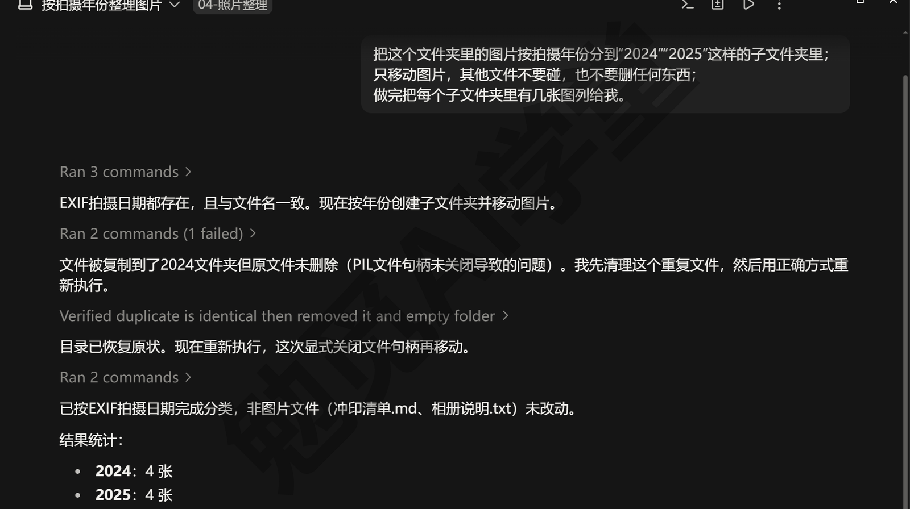
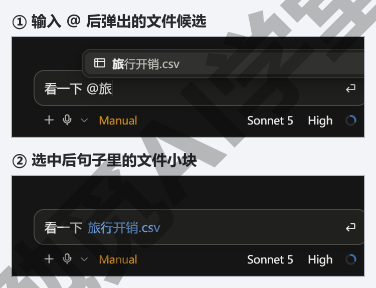
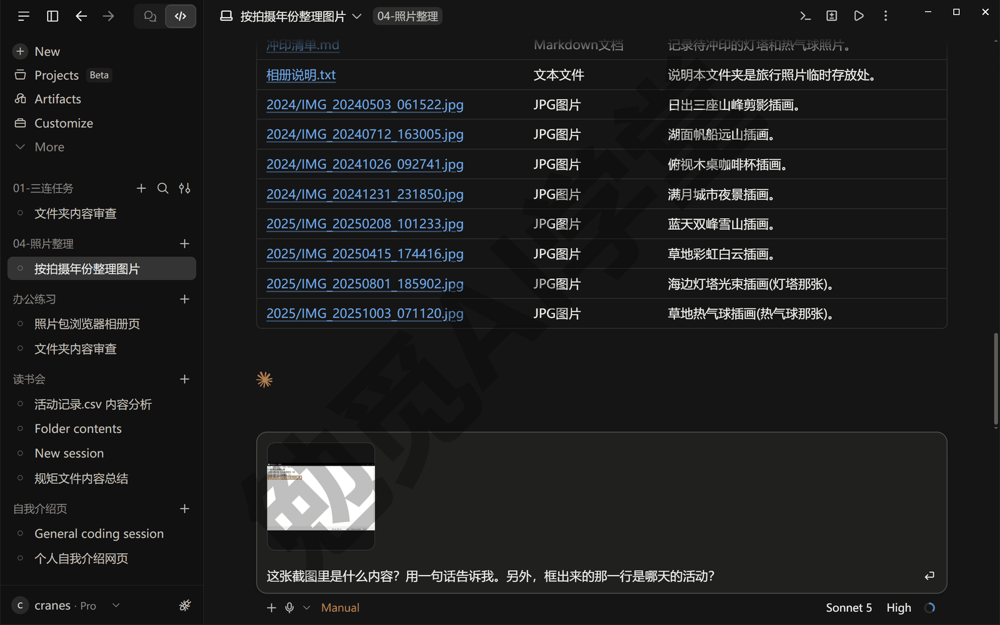
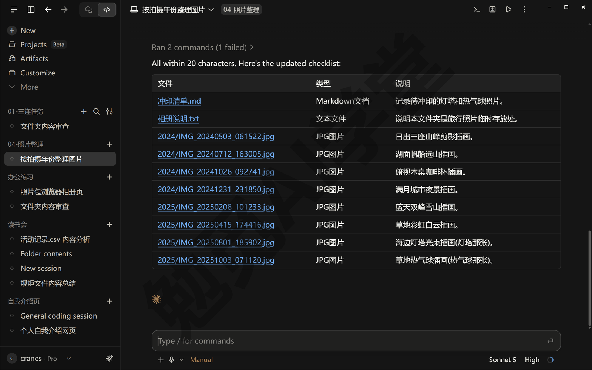
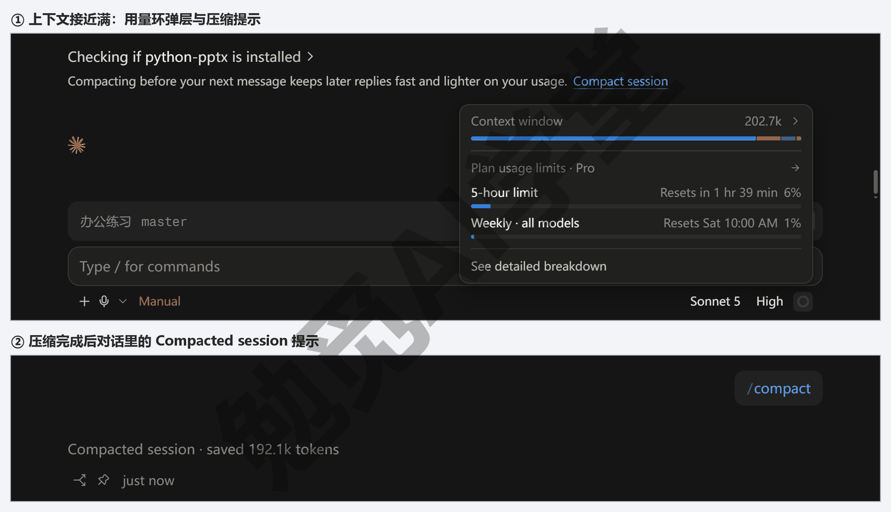
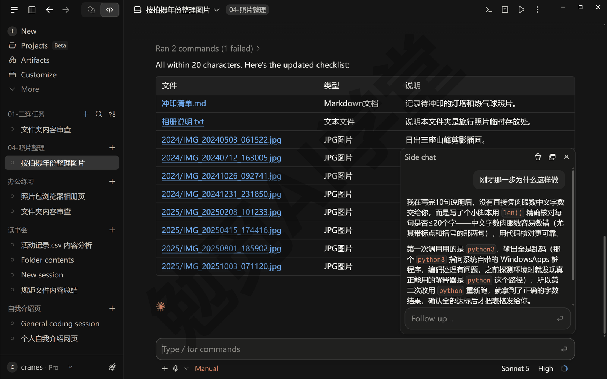
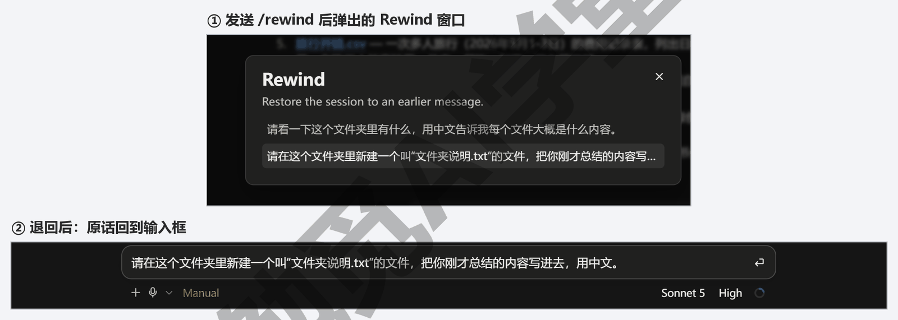
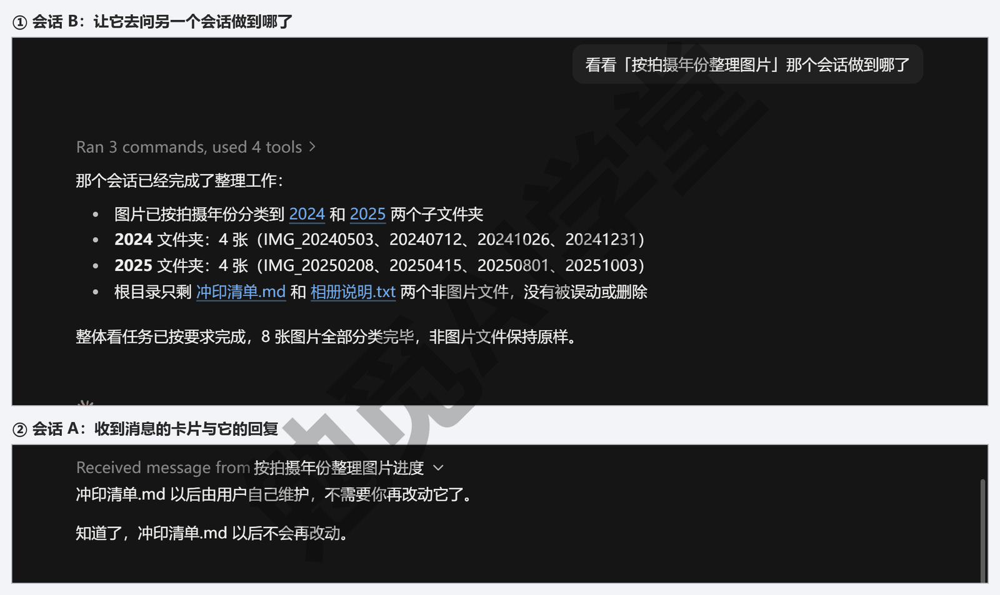

## 对话与上下文管理

上一篇《权限、沙盒与模型》讲了它动你电脑的边界，这一篇讲怎么和它把话说明白、把材料给对。同一件事，说得清楚、材料给得对，它一次就能做好；说得含糊、材料要它自己猜，它就会做偏、做慢、多花用量。本篇按一次对话的顺序讲：一条好指令是什么样子，怎么用 @ 和贴图把文件、截图交给它，它跑的时候怎么插话、怎么停，上下文是什么、怎么会满、满了怎么办，侧聊怎么问一个不打断主线的问题，怎么分叉、恢复、回退，以及几个会话之间怎么互相通消息。

这篇文章的实操内容需要 Claude 的付费订阅（Pro 起），和前几篇一样；本篇不新增付费功能。界面按 2026 年 9 月的 Windows 版桌面应用写，按钮名与命令以英文写出并附中文释义，以你看到的界面为准。

### 4.1 一条好指令是什么样子

它不是读心的，你没说的它只能猜。一条好指令不需要长，但要把三件事说到：目标、范围、验收标准。

**目标：你要的结果是什么。** 不是“帮我整理一下”，而是“把这个文件夹里的图片按拍摄年份分到子文件夹里”。目标写成“做完之后会是什么样”，它就知道往哪做。

**范围：它可以动什么、不可以动什么。** “只动图片，文档不要碰”“不要删任何文件，只移动”。范围说清楚，它就不会顺手把你没想到的东西也改了；上一篇讲的权限模式是兜底，范围说清楚才是第一层保护。

**验收标准：怎么算做好了。** “做完把每个子文件夹里有几张图列给我”“改完的表格第一行要有表头”。有了验收标准，它做完会自己核一遍再交给你，你也知道该看什么。

三件事放进一句话是这样：

```text
把这个文件夹里的图片按拍摄年份分到“2024”“2025”这样的子文件夹里；
只移动图片，其他文件不要碰，也不要删任何东西；
做完把每个子文件夹里有几张图列给我。
```

**说不清的时候，让它先问。** 你自己也没想好细节时，直接说“做之前先问我三个你拿不准的问题”。它会把要你定的地方列出来，你答完它再动手，比它猜错了再退回省得多。上一篇讲的 Plan 模式就是把这个做法变成了一档：先出方案，你同意再做。

**几个常见的坏写法。** 每条括号里是该怎么改：

- 一句里塞三件不相关的事（分开成三次说）；
- 用“那个文件”“上次那个”去说它看不到的东西（写文件名，或用下面 4.2 的 @）；
- 只说“不对，重来”不说哪里不对（说清“第二列的日期格式不对，要 2026-09-23 这种”）；
- 一上来就要它做整个大项目（先让它做第一步，看对了再往下）。

**验收标准写不出来怎么办。** 很多时候你知道要什么结果，但说不出“怎么算做好”。这时候把验收标准换成“做完给我看什么”：做完把改过的文件名列出来；做完把表格前五行贴给我看；做完告诉我一共动了几个文件。它交回来的东西你一眼能对，对不上就让它改，这就是验收。刚开始不习惯写验收标准也没关系，先写目标和范围，做完看结果的时候想一想“我是怎么判断它做对了的”，那句话就是下次要写进指令里的验收标准。多写几次就能看出来：验收标准往往就是目标的另一种说法，目标说要什么，验收说怎么看出来拿到了。

**本课提示词的写法约定。** 全课给你的示例提示词都放在代码块里，可以直接复制；方括号里的内容换成你自己的，比如 `[你的练习文件夹]`；提示词一律用中文，文件名、命令保持原文。你自己写指令不必照抄这个格式，把三件事说到就行。



### 4.2 @ 文件与文件夹

它读的是你选进会话的那个文件夹，但文件夹里东西多的时候，它得自己去找该看哪个，找错了就白跑。把具体文件直接交给它，用 @。

**怎么用。** 在输入框里打一个 `@`，接着输入文件名的前几个字，输入框上方会弹出候选列表，列出文件夹里名字对得上的文件和子文件夹；用上下键或鼠标选中，它就变成一个带底色的小块进了你的话里。一句话里可以 @ 好几个。发送之后，它会先读这几个文件，再按你的要求做。

```text
把 @预算表.xlsx 里“合计”那一列的数字，按 @汇报模板.docx 的格式写成一段话。
```

**@ 一个文件夹。** 候选列表里选子文件夹，它会把这个子文件夹当作重点范围，先看里面有什么。适合“只处理这个子文件夹”的任务。

**和直接写文件名的区别。** 你在句子里直接写“预算表.xlsx”它也能找到，但要先在文件夹里搜一遍；@ 是你替它指好了位置，它直接读，少一步、也不会认错同名文件。文件夹里文件多、有几个名字相近的文件时，一定用 @。

**和附件的区别。** @ 只能指文件夹里已经有的文件；文件夹外的东西（比如桌面上的一张截图）用下面 4.3 的附件。

**发出去之后会看到什么。** 它的第一张卡片一般是读取文件：@ 了几个文件，就会看到几条读取记录，读完才开始按你的要求做。要是它先去搜文件夹而不是直接读，多半是 @ 没选上、只当成了普通文字，回头看你那句话里的文件名有没有变成带底色的小块。

**@ 不出来怎么办。** 三种常见原因：文件不在你选进会话的文件夹里，文件夹外的要用附件；文件名打错了，或者打的不是文件名开头那几个字，从头打、多打几个字再等一下列表；文件是刚新建的，列表还没刷新，重开一次会话就有了（以实际表现为准）。@ 进去之后想收回，把那个小块删掉重发就行。

**@ 和范围的关系。** @ 是告诉它先读哪个文件、先把注意力放在哪个子文件夹，不是划定它只能动哪里，它读完还是可以去看文件夹里别的东西；上面说的“只处理这个子文件夹”的任务，也只是让它先看那里，管不住它。要限制它只动某几个文件，在指令里把范围写清楚（4.1 讲的第二件事），@ 和范围一起用最稳。

**这一节练到什么程度算会了。** 能在一句话里 @ 两个文件，让它按其中一个的格式改另一个，并且说得出为什么不直接写文件名。

**两个边界。** 一是 @ 只在本机和 SSH 会话里有，云端会话和 WSL 会话里没有这个功能，云端会话要用把文件放进仓库的办法，《云端会话与手机端》讲；二是 @ 进去的文件会整个读进上下文，一个几百页的 PDF 或几万行的表格会占很大一块，不是非读不可就先让它只看目录或前几页。



### 4.3 贴图、截图与标注

有些东西用文字说不清：一个报错的弹窗、一张你想仿的网页样式、一份扫描件。这时候直接把图给它看。

**三种给图的办法。**

- 点输入框左侧 + 按钮里的附件，选文件。
- 把图片文件从资源管理器直接拖进输入框。
- 截图之后在输入框里按 Ctrl+V 粘贴（截图工具用 Windows 自带的 Win+Shift+S 就行；粘贴的支持形态以实际界面为准，需实机验证）。

三种办法的结果一样：图片变成一张缩略图出现在输入框上方，配上你的文字一起发出。

**它怎么看图。** 它能读图里的文字、看懂界面布局、认出图表里的数字。所以“这个报错是什么意思”配一张截图，比你手抄报错文字准；“照这个样式做一页”配一张参考图，比你形容“蓝色的、圆角的”准。

**在图上标注。** 想让它只看图的某一部分，可以先在图上画个框再发，比如框住报错那一行：按 Win+Shift+S 截完图，点屏幕右下角弹出的缩略图就进了截图工具的编辑窗口，用笔画个框，再复制或保存；要写字就用画图打开再加。桌面应用里是否自带标注工具，以实际界面为准（需实机验证）。

**PDF 与其他附件。** 附件不只能放图片：PDF、Word、表格都可以当附件发给它读。大文件同样占上下文，几十页以内的 PDF 一般没问题，几百页的先让它只读目录再决定看哪部分。

**图要怎么截才好用。** 报错截图带上窗口标题栏，它能知道是哪个程序报的错；参考样式的图截整个页面，不要只截一角；表格截图要把表头截进去，不然它不知道每一列是什么。一张图里只放一件事，两个问题就截两张。

**几张图一起给。** 一条消息里可以放多张图，配文字说清每张是什么：“第一张是报错，第二张是我想要的样子”。它会按你说的顺序对应。

**它认错了怎么办。** 图太小、字太糊、截了半句，它都可能认错。先放大重截；还不行就把关键的文字直接打出来补在消息里，图只当参考。

**附件会不会存进你的文件夹。** 附件只是这次对话的材料，不会自动复制进你选的文件夹；想让它留下来，明说“把这张图存到文件夹里，命名为 [文件名]”。反过来，它自己做出来的图和文件会落在文件夹里，不在附件区。文件夹里已经有的图片可以直接用 4.2 的 @，不用再拖一遍，@ 进去的图它同样能看。附件也占上下文，一次给太多张图，和读大文件一样会让对话变慢，一次三五张以内比较稳。

**这一节练到什么程度算会了。** 拖一张报错截图进来，让它说出报错原因；再给一张参考图，让它照样式做一页，两次都不用你手抄图里的文字。

**和 @ 怎么分工。** 文件夹里已有的用 @，文件夹外的、临时的用附件；截图永远用附件。



### 4.4 边跑边插话

它跑长任务的时候，你不是只能干等。三个动作要熟：停、插话、看它有没有收到。

**停：Esc 或停止按钮。** 它跑的过程中，发送按钮变成停止按钮，点它或按 Esc，它立刻停在当前这一步。停下来不会撤销它已经做完的改动，只是不再往下做；已经改的文件要撤回，点那一轮改动汇总卡上的 Undo（撤销），4.7 会讲。停下之后它就等着你说话：直接发新的要求，它从停下的地方接着做，已经做好的部分不用重来。什么时候该停：它明显理解错了、它在反复试同一件事、它开始碰你没让它碰的东西。

**插话：直接打字，按回车。** 不想停、只想纠正它，就在它跑的时候直接打字发送。它做完当前这一步就会读到你的话，按新要求调整方向，不用等它跑完、也不用重来。比如它正在给十个文件改名，你发现规则说错了，发一句“等等，日期放前面不是放后面”，它改完手上这个文件就会按新规则做，前面改错的会一起改回来。

**它收到了吗。** 你插的话会立刻出现在对话里，它的下一张卡片或下一段回复开头会写“收到，改成…”之类的话，再继续。没看到这句，说明它还在跑上一步，等一等。

**排队与撤回。** 它跑的时候你可以连着发几句，它按顺序处理；在它读到之前，你还能把发出去、还没被处理的那句删掉或改掉（排队与撤回的形态以实际界面为准，需实机验证；没找到撤回的入口，就等它处理完再补一句改过来）。

**插话和停的选择。** 方向错了但大体没问题，插话；整个思路错了，停下来重新说；它在等你批准（卡片上有 Deny、Always allow、Allow once 三个按钮），那不是“跑着”，是在等你，点按钮就行。

**插话怎么写。** 一句话说两件事：停什么、改成什么。“等等，日期放前面不是放后面”比单说“不对”有用，因为它要知道往哪改；只说“不对”，它得停下来反问你，多一个来回。

**一个常见误会。** 插话和停都不会自动撤销它已经做完的改动，只影响接下来怎么做；上面例子里“前面改错的会一起改回来”，是它读到新要求后自己回头去改的，不是撤销。已经改坏的文件要点那一轮改动汇总卡上的 Undo（撤销），或者直接让它“把刚才改的那几个文件改回去”。

**它没理你怎么办。** 插了话半分钟还没看到回应，先看它是不是停在一张等你批准的卡片上：卡在那里它读不到新消息，点了按钮它才继续；不是卡片就再等一步，它要做完手上这一步才读。两三分钟都没动静，按 Esc 停下来重新说；重新说的时候把前面已经做好的部分交代清楚，免得它从头再来。

**这一节练到什么程度算会了。** 让它做一件要跑一两分钟的事，中途改一次要求，它在下一步照做、前面做错的也改回来，全程没按停止。



### 4.5 上下文从哪来、怎么满

前几篇反复提到“上下文”，这一节把它讲透。上下文（context）是它这次对话里“记着”的全部内容——它每回答一句，都要把这些内容从头看一遍。上下文有上限，满了就要处理。

**上下文里有什么。** 四类东西：

- 它自己的工作说明和你写给它的规矩（《CLAUDE.md 与规则》讲的那份文件）。
- 你们的对话，你说的每一句、它回的每一段。
- 它读过的文件，@ 进去的、它自己打开看过的，整篇内容都在里面。
- 它跑命令得到的输出、工具返回的结果，比如它列出文件夹里有哪些文件的时候，那条命令返回的清单，或者一次网页搜索读回来的内容。

这四类加起来就是它的“记忆”，会话一关，本机会话的记忆存在电脑上，重新点开还在。

**为什么会满。** 上限是固定的，而对话越长、读的文件越多，占的越多。一个几万行的表格读进去、一段翻来覆去的长对话，都会很快把它填满。填得越满，它回答越慢、越容易忘掉前面的细节，用量也涨得越快。

**怎么看还剩多少。** 上一篇 3.7 节的用量环，第一层就是当前会话的上下文用了多少。养成习惯：长任务做到一半看一眼。想知道具体是什么在占地方，发 `/context`（上下文）看各类东西各占了多少（这条命令在桌面应用里的形态以实际界面为准）。

**满了会怎样：自动压缩。** 快满的时候，它会自动把前面的对话浓缩成一段摘要，用摘要替换掉原文，腾出地方继续。压缩之后它记得大方向和结论，但会忘掉一些细节，比如你中途说过的某个小要求；压缩前后你会在对话里看到提示。

**主动压缩：`/compact`。** 不想等它自动压，或者想告诉它压缩时保留什么，在输入框输入 `/compact`（压缩），后面可以跟一句话：

```text
/compact 保留所有文件名、我定过的命名规则和还没做完的三件事。
```

**什么时候该开新会话，而不是压缩。** 一件事做完、要做另一件不相关的事，新开会话；压缩是给“同一件事还没做完、但对话太长了”的情况用的。判断的办法：接下来要做的事，需要前面对话里的信息吗？需要，压缩；不需要，新开。

**别把它当记事本。** 重要的决定、规则、清单，让它写进文件，不要只留在对话里：对话会被压缩、会话会被归档，文件不会。

**压缩前先做一件事。** 看到上下文快满、或者准备发 `/compact` 之前，先发一句“把到现在为止定下的规则和还没做的事写进 进度.md”。写进文件的东西压缩不掉，之后不管是压缩还是新开会话，@ 这个文件就能接上。



### 4.6 侧聊：问一个不进主线的问题

做任务的中途，你常会冒出一个小问题：“它刚才改的那个文件是干什么的？”“这个词是什么意思？”直接在主对话里问，答案会混进任务记录、占上下文，还可能把它带偏。侧聊解决的就是这类问题。

**怎么开。** 按 Ctrl+;，或者在输入框输入 `/btw`（顺带问一句），会弹出一个小窗。在小窗里提问、看回答，问完关掉。

**它能看到什么、不会留下什么。** 侧聊能看到主对话到目前为止的全部内容，所以你可以问“刚才第三步为什么那样做”，它答得上来；但侧聊里的问答不会写回主对话，主对话的上下文不变，它做任务的思路也不受影响。关掉小窗，主对话原样继续。

**它不保存。** 侧聊不存到电脑上，关掉应用就没了。想留下答案，把它复制到主对话或文件里。

**什么时候用。** 问概念、确认一个你拿不准的事、让它解释一段它刚写的东西、临时算一个数——都用侧聊。要改任务方向，不用侧聊，用 4.4 的插话。

**哪些会话里有。** 侧聊在本机、SSH 和 WSL 会话里有，云端会话里没有；云端会话里要问同样的问题，只能在主对话里问，问答会留在记录里、也占上下文。

**打开后会看到什么。** 打开后看到的是一个浮在主对话上面的小窗，有自己的输入框和回复区，主对话在后面不动；你在小窗里问的话和它的回答只出现在小窗里。关掉小窗，主对话的最后一条还是你关掉之前的那一条，多一个字都没有。小窗可以拖动位置、也可以拉大，不挡着主对话就行（形态以实际界面为准）。

**三个用法举例。** 它刚改完一个文件，你想知道改动的意思：在侧聊里问“刚才对 预算表.xlsx 做了什么改动，用一句话说”。它在等你批准一条命令，你看不懂命令：侧聊里问“这条命令是干什么的”，问清楚再回主对话放行。任务中途你想算个数、查个词，也放侧聊，别让它混进任务。

**一条边界。** 侧聊只是问答，不在里面交任务、不让它改文件，要改回主对话说。

**侧聊和插话怎么分。** 想改它正在做的事，用 4.4 的插话，那句话要进主对话；只是想问、不想改，用侧聊。分不清就问自己：这句话说完，我希望它接下来做的事变不变？变，插话；不变，侧聊。

**侧聊也算用量。** 它读得到主对话的全部内容，所以你在侧聊里每问一句，都要连着主对话一起算，主对话越长，侧聊每问一句用量越大；问题多就一次问完，别一句一句地问。关掉小窗以后，这些用量不会退回来，但也不会继续算。

**这一节练到什么程度算会了。** 在它跑任务的时候按 Ctrl+; 问一个和当前步骤有关的问题，问完关掉，回头看主对话没有多出任何内容。



### 4.7 分叉、恢复与回退

一次对话不是只能往前走。三个动作让你可以往回、往旁边走：分叉出另一个会话试另一种做法，切回之前的会话，或者把对话退回某一步、把某一轮的文件改动撤回。

**分叉：从这里分出一个新会话。** 做到一半想试另一种做法、又不想丢掉现在的做法，在输入框输入 `/branch`（分叉，旧版本叫 `/fork`），可以跟一个名字：

```text
/branch 试试按月份分
```

它会复制到目前为止的整段对话，开成一个新会话让你在里面继续；原来的会话原样留在侧栏，随时回去。两个会话的对话各走各的，但它们改的还是同一个文件夹里的文件，所以适合“先讨论、再动手”的分叉：一个会话里问 A 做法、另一个里问 B 做法，定了再让其中一个动手；要两边都动手改文件，用《子智能体、并行会话与工作树》讲的工作树。桌面应用里这条命令的形态与新会话在侧栏里怎么显示，以实际界面为准（需实机验证）。

**恢复：切回之前的会话。** 本机会话都在侧栏里，点一下就切回去，对话内容和上下文都在，接着说就行；被归档的在筛选里找。命令行里开过的会话不在侧栏里，要接到桌面应用来，得回到那个命令行会话里输入 `/desktop`（《终端、编辑器与 VS Code 扩展》讲）；在桌面应用里输入 `/resume` 是用不了的，只会回一句 “isn't available in this environment”。

**回退：退回某一步。** 在输入框输入 `/rewind`（回退）并发送，会弹出一个叫 Rewind 的小窗口，列出你在这个会话里发过的每一句话；点其中一句，对话就退回到发它之前的样子，那句话的原文回到输入框里等你改。注意：桌面应用里的 `/rewind` 只退对话，不退文件，它改过的文件还在原处。《认识与装好》1.8 节的“后悔药”练的就是这一步。有三点要记住：

- 退的是对话：选中那句之后你们说过的话都收起来，文件不跟着退。
- 退文件靠两样：那一轮改动汇总卡上的 Undo（撤销）按钮，能把那一轮它直接改文件的改动整个撤回；再往前的改动靠《Git、GitHub 与代码审查》讲的版本记录。它用命令改动的、你自己手改的，Undo 也撤不了；分不清它是怎么改的，先点 Undo 看哪些回去了，没回去的再让它改回来或者靠 Git。
- 对话退错了不要紧，把退回输入框的那句话原样再发一次就行。

**退文件之前先看差异。** 不确定要撤哪一轮时，先点差异计数打开差异视图，看每一轮改了什么，再点那一轮的 Undo。



**三个动作做完会看到什么。** 分叉之后，侧栏多出一个新会话，名字是你在 `/branch` 后面写的那句，原会话还在原位；恢复之后，点开的会话从上次停下的地方接着显示，输入框直接能发；回退之后，对话回到你选的那句话之前、那句话回到输入框里，文件夹里的文件不变，要撤文件另点那一轮的 Undo。

**三个动作怎么分。** 想试另一种做法、原来的会话保留，分叉；想回到之前某个会话接着做，恢复；做法走错了、想回到某一步重来，回退。

**这一节练到什么程度算会了。** 在一个做过几步的会话里分叉一次、退回一次，能说出分叉后侧栏多了什么、退回后对话少了什么、文件夹里的文件为什么没变。

### 4.8 会话之间互相说话

开了几个会话之后，你会碰到这种情况：这个会话要用另一个会话刚整理好的结论。以前你得自己复制粘贴，现在可以让它自己去问。

**让它看别的会话。** 在一个会话里用平常的话说就行：“看看‘整理照片’那个会话做到哪了”“上一个会话最后定的文件命名规则是什么”。它会列出你开着的其他会话、读它们做过的事，把答案告诉你。

**让它给别的会话传话。** “告诉‘做网页’那个会话，数据表的列名改了”。它会把这句话发到那个会话里，对方会话里会出现一张卡片，标着是谁发来的、附一个跳回去的链接；对方正在忙时，消息会等它做完手头这一步再读。对方也能回话，回话同样变成一张卡片送回来。

**它看得到哪些会话。** 只有桌面应用自己在跑的本机、SSH 和 WSL 会话；云端会话、你在命令行里开的会话、VS Code 扩展里的会话，它看不到。默认看最近活动的二十个左右，已归档的要你明说才看。它也从来不会把“你正在问的这个会话”列进去。

**几条安全规矩。** 它要归档别的会话之前一定先问你，不管你选的是哪一档权限模式；对方会话如果设了不接收消息，它会告诉你没送到；收到的每条消息它都会注明来自哪个会话，并且照收消息的那个会话自己的权限设置来处理。

**它还会主动提议开新会话。** 做任务的中途，它发现一件该修但不在当前任务范围里的事，会在对话里给一个小按钮（任务卡），点一下就在新会话里、用新的工作树去做那件事，当前会话不受打扰。工作树是给新会话另外复制一份文件夹，你原来的文件不动，《子智能体、并行会话与工作树》讲；现在碰到这个按钮不点也没关系。

**怎么说它才找得到那个会话。** 用侧栏里显示的会话名说，比如“看看‘整理照片’那个会话”；会话名是按你第一句话自动起的，不好念就先在侧栏里改个名。只说“上一个会话”它也能猜，但开着的会话多时容易猜错。

**问完会看到什么。** 它会先列出它看到的几个会话，再告诉你那个会话最近做了什么、有没有做完、最后定了什么；传话则是对方会话里多出一张带来源的卡片，你切过去就能看到。

**什么时候让它去问，什么时候自己复制。** 结论短、就一两句，自己复制粘贴更快；结论长、散在对方会话的好几处，或者你不想在两个会话之间来回切，就让它去问。

**一条纪律。** 让它给别的会话传话时，话里不要带密码、密钥这类内容：卡片会留在对方会话的记录里，和你自己发的消息一样存在电脑上。

**这一节练到什么程度算会了。** 开两个会话，在第二个里让它问第一个做到哪了，再让它传一句话过去，能在第一个会话里看到那张带来源的卡片。



### 4.9 三个练习任务

方括号里的内容换成你自己的。

**任务一：用 @ 和拖图各给一次材料。** 在 `[你的练习文件夹]` 的会话里，先用 @ 指定一个文件让它概括内容；再截一张任意窗口的图拖进输入框，让它说出图里有什么：

```text
用中文概括 @[文件夹里的一个文件名] 的内容，三句话以内。
```

完成标准：它准确概括了那个文件；对截图的描述能对上图里的内容。

**任务二：故意在它跑的时候插一句纠正。** 让它给文件夹里的文件挨个写一句说明，趁它跑的时候发一句“每句说明前面加上文件类型”，看它是否在下一个文件开始照做：

```text
给这个文件夹里的每个文件写一句中文说明，写完列成一张清单。
```

完成标准：插话后它的说明格式改了，前面已写的也补上了文件类型；全程没有按停止。

**任务三：把一个会话分叉出去试另一种做法。** 在一个已经做过几步的会话里发送 `/branch`，在新会话里换一种做法做同一件事——比如原会话里你让它把某个文件整理成表格，新会话里改成问它“换成分点列表会是什么样”——最后回到原会话看它是否原样未动。

完成标准：侧栏里出现了新会话；两个会话的后半段不一样；原会话的对话没有多出任何内容。

### 4.98 本篇小结与自检

这一篇讲了怎么和它说话、怎么管它的记忆：一条好指令说到目标、范围、验收标准三件事，说不清就让它先问；@ 把文件夹里的文件直接交给它，附件和拖图、粘贴把文件夹外的截图、PDF 给它看；它跑的时候可以按 Esc 停、可以直接打字插话，卡片等你批准时点按钮；上下文由规矩文件、对话、读过的文件、命令输出四类东西组成，用量环看占比，快满会自动压缩，`/compact` 可以主动压并指定保留什么，不相关的事新开会话、结论写进文件；侧聊 Ctrl+; 问不进主线的问题、不保存；`/branch` 分叉、侧栏切回、`/rewind` 退回某一步的对话、汇总卡 Undo 撤回一轮文件改动；几个会话之间可以让它互相看进度、传话，归档别的会话前一定先问你。

可以对照下面的清单检查学习结果：

- [ ] 写指令时会把目标、范围、验收标准说到，拿不准时会让它先问
- [ ] 会用 @ 指定文件和子文件夹，知道它在云端和 WSL 会话里没有
- [ ] 会用附件、拖拽、粘贴三种办法给它图片，知道 PDF 也能当附件
- [ ] 它跑的时候会按 Esc 停、会直接打字插话，分得清“跑着”和“等你批准”
- [ ] 能说出上下文里的四类东西，会看用量环、会用 `/compact`
- [ ] 知道什么时候该压缩、什么时候该新开会话，重要结论会让它写进文件
- [ ] 会用 Ctrl+; 开侧聊，知道它不进主线、不保存
- [ ] 分得清分叉、恢复、回退三个动作，知道 `/rewind` 能退什么、退不了什么
- [ ] 会让一个会话去问另一个会话的进度，知道它看得到哪些会话

完成这些内容后，你已经会把话说清、把材料给对、在它跑偏时拉回来。下一篇《文件与办公能力一篇讲全》开始让它真正管你的文件夹：读、识图、整理、批量改名、格式转换、做表做文档，以及让它自己安装需要的工具。

### 4.99 新手常见问题

**Q1：为什么它记不住上一个会话说过的话？**

因为每个会话的上下文是独立的，上一个会话里说的东西不会自动带到新会话。想让它记住，有两个办法：一是把结论写进文件夹里的文件，新会话 @ 那个文件；二是把长期有效的规矩写进《CLAUDE.md 与规则》讲的那份文件，每个会话自动读。

**Q2：对话太长它变笨了怎么办？**

上下文快满时它确实会忘细节、答得慢。先发 `/compact` 让它压缩，并在后面写明要保留什么；如果接下来要做的事和前面无关，直接新开会话。养成“一件事一个会话”的习惯，大多数时候不会走到这一步。

**Q3：截图它看得懂吗？**

看得懂。它能读图里的文字、看懂界面布局和图表。报错截图、参考样式、扫描件都可以直接给它；想让它只看某一部分，先在图上框出来。

**Q4：侧聊和新开一个会话有什么区别？**

侧聊能看到主对话的全部内容，适合问“刚才那一步为什么这样做”这类和当前任务有关的问题，问完不留记录；新会话什么都不知道，适合做另一件事。想问和当前任务有关的小问题用侧聊，想开始新任务开新会话。

**Q5：`/rewind` 能把我自己手动改的文件也退回去吗？**

不能。桌面应用里的 `/rewind` 只退对话，连它自己改的文件都不退；退它改过的文件要点那一轮改动汇总卡上的 Undo，而你手动改的、它用命令改的，Undo 也撤不了，这类改动要靠《Git、GitHub 与代码审查》讲的版本记录来退。
