## 文件与办公能力一篇讲全

前面几篇装好了应用、认识了 Code 页签、弄清了权限边界，这一篇开始让它真正替你干活：先读一个乱文件夹并汇报，再看懂文档、表格、PDF 和图片，然后批量改名、归类、查重，转换格式，写脚本做出 Excel 和 PPT，工具不够它自己装，最后讲清生成的文件落在哪、报错了怎么办。每个能力都给出可以直接复制的完整提示词，全程不需要编程基础。这篇文章的实操内容需要 Claude 的付费订阅（Pro 起），和前几篇一样，不新增其他费用。

### 5.1 先建一个练习文件夹，让它只读不改

**项目文件夹就是它能动的范围**

《桌面应用全导览》讲过开一个会话先做四件事：选运行环境、选项目文件夹、选模型、选权限模式。其中“项目文件夹”这一项在这一篇正式派上用场：你选哪个文件夹，智能体就在哪个文件夹里干活，读的是里面的文件，生成的文件默认也落在里面。想让它处理你的文件，第一步不是发指令，而是把文件放进它能动的范围。

反过来说，项目文件夹之外的文件它默认不会去改：你选的是“照片整理”文件夹，它就动不到别处的资料。这既是限制，也是保护。

**建一个练习文件夹**

建议先建一个专门的练习文件夹，例如 D:\Claude练习\办公练习，本篇的操作都在这里完成。本课演示环境是 Windows，示例路径都按 Windows 写法给出；macOS 用户在自己的个人文件夹下新建同名文件夹就行，后面不再重复说明。

在练习文件夹里建三个子文件夹，名字就用下面加粗的三个，各放一类素材；全部用真实文件的副本，不要拿唯一一份重要资料直接练习：

- **照片包**：二三十张手机照片的副本，最好混几张苹果手机拍的 HEIC 格式和网页保存的 webp 格式。
- **文档包**：几份 PDF（发票、说明书、报告都行），加上一两份 Word、txt 或 md 文件，再放一份表格（xlsx 或 csv，比如自己记账表的副本）——5.4 和练习任务里方括号写的 [开销记录.xlsx] 这类名字，就换成你放的这份。
- **下载区副本**：从你的下载文件夹复制一批各种类型都有的文件，当作一个乱文件夹来练。

素材放好后，在 Code 页签开一个新会话：点侧栏的 New（新建），运行环境选 Local（本机），项目文件夹选 D:\Claude练习\办公练习，模型保持默认，权限模式先选 Manual（手动，它改文件、跑命令之前都会先问你）。这几个选项都在输入框附近，《桌面应用全导览》带你认过一遍，位置以实际界面为准。Windows 上第一次开本机会话如果提示要先装 Git，按《认识与装好》的做法装好再回来。

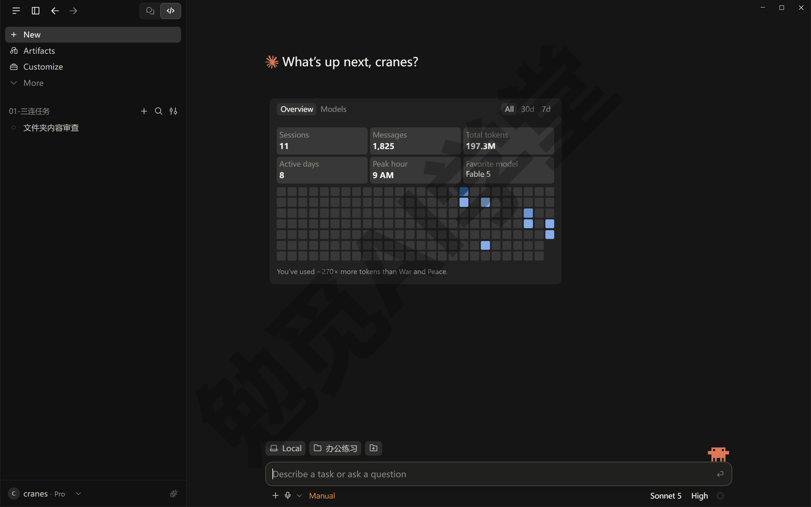

**先报告再动手**

本篇会反复用到一个写法：任务涉及改名、移动、删除时，提示词末尾加一句“先把方案发给我确认，确认后再动手”。它会先读文件、给出方案，等你回复确认后才真正改动。《对话与上下文管理》讲过“说不清的时候，让它先问”，这一篇把它变成固定写法。

第一个任务就用这个写法，让它把乱文件夹读一遍、只汇报不改动。发送：

```
只读不改：把这个文件夹里的三个子文件夹都看一遍，
告诉我每个子文件夹里有多少个文件、都是什么类型、
有没有明显重复或者名字看不出内容的文件。
先不要新建、改名或移动任何文件。
```

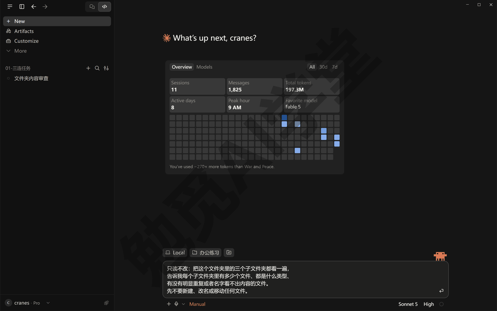

发送后你会在对话里看到它逐个读取文件夹的工具卡片（《桌面应用全导览》讲过怎么读这些卡片），最后给出一份汇报。开头的“只读不改”明确了这次任务不动文件，建议以后都保留这个写法。

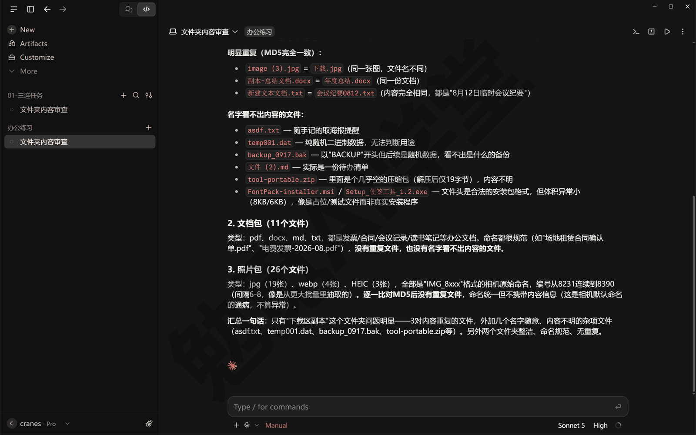

**权限模式和这一篇的关系**

《权限、沙盒与模型》讲过五档权限模式，这一篇只要记住两点。Manual 模式下，它改文件、跑命令之前都会弹出带 Deny（拒绝）、Always allow（始终允许）、Allow once（只允许这一次）三个按钮的卡片，你看一眼再放行。Accept edits（自动接受编辑）模式下，它改文件不再问你，在项目文件夹里新建、复制、移动、删除文件这类常见操作也不再问，只有别的命令才问。所以做整理、改名、删除这类任务时，建议留在 Manual，或者至少把“先报告再动手”写进提示词，两道保险比一道稳。

### 5.2 读与识：文本、表格、PDF 和图片

拿到一批文件却不知道里面是什么，是最常见的起点：一个文件夹的会议记录、一堆报销发票、几百张没名字的照片。逐个打开看太慢，这一节让它替你读。

本篇所有提示词中，方括号里的内容换成你自己的文件或文件夹名。文件在项目文件夹里时直接写名字就行，不必写完整路径；想精确指定某一个文件，在输入框里打一个 `@` 再输入文件名，从候选列表里选中，这个文件就进了对话（《对话与上下文管理》细讲，云端会话里没有这个功能）。

**读文本：把一个文件夹读成一张清单**

txt、md、Word 这类文字型文件，它可以直接读内容并汇总。发送：

```
只读不改：把[文档包]里的 txt、md 和 Word 文件都读一遍，
按“文件名、主要内容、值得注意的信息”整理成一张清单发在对话里，
暂时不要新建任何文件。
```

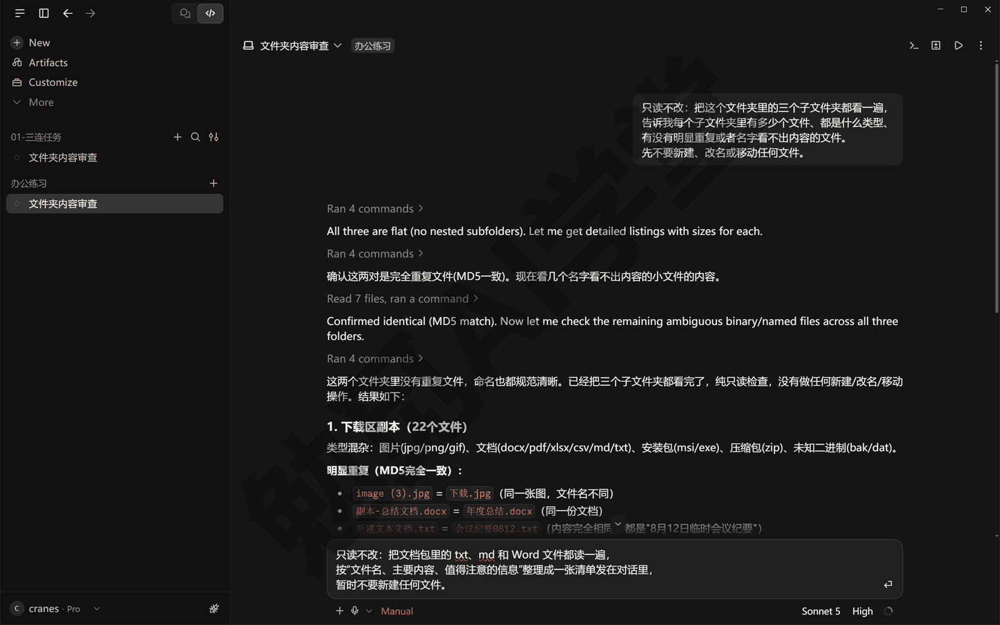

发送后你会看到它逐个读取文件的工具卡片，最后在对话里给出一张汇总清单。Word 文件不是纯文字格式，它一般会写一小段脚本或者借助工具去读，过程不用你操心；Manual 模式下跑这类命令会先弹审批卡，看一眼命令里有没有你要读的文件名，对得上就放行。

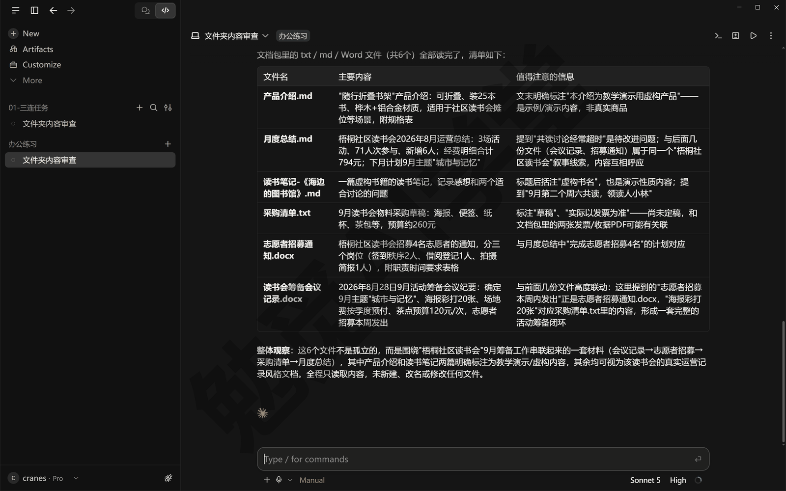

**读表格：行数、列名和分类汇总**

CSV（逗号分隔的纯文本表格，很多软件都能导出）和 Excel 表格同样能读。发送：

```
读一下[开销记录.xlsx]，告诉我一共多少行、有哪些列，
再按[类别]列做分类汇总，算出每类的总金额和占比，
结果先发在对话里，不要改原文件。
```

完成后你会得到行数、列名和一张分类汇总表。如果它说读取失败，多半是缺工具，让它自己装就行（见 5.5）。

**读 PDF：批量提取关键信息**

一堆 PDF 发票逐张录入最耗时，交给它批量提取。发送：

```
把[文档包]里的 PDF 逐个读一遍，
提取“文件名、日期、来源单位、金额或主题”，
汇总成一张表格，保存为“PDF汇总.md”放在同一个文件夹里。
```

这一次允许它新建文件，完成后项目文件夹里会多出一份汇总表。要注意：扫描件 PDF 本质是图片，提取质量取决于扫描清晰度，关键数字一定要抽查几条；加密的 PDF 需要你先提供密码。

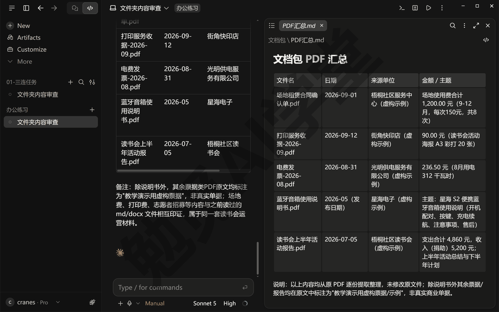

**看图识别内容**

它可以直接查看常见格式的图片（png、jpg、gif、webp 等）并描述内容，这是后面按内容重命名、归类的基础；照片包里混进的 HEIC 不在这个名单里，它能不能直接看以实际表现为准，看不了的后面“格式转换”那一段会统一转成 jpg。除了让它去读文件夹里的图，你也可以把一张图直接交给它：点输入框左侧的 + 按钮选附件，或者把图片拖进输入框，刚截的图直接粘贴进去一般也行（以实际界面为准）。发送：

```
看一下[照片包]里前 10 张图片，
按“文件名：一句话内容描述”的格式发给我，不要改动文件。
```

你会看到它逐张读取图片，然后给出每张的内容描述。先看 10 张是为了确认它认得准不准，没问题再让它看全部。

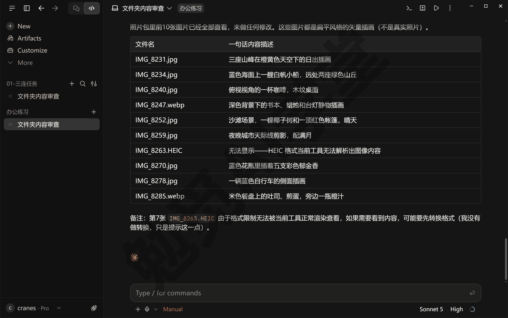

**汇总整个文件夹：联系表大图**

图片一多，逐张读又慢又消耗用量。你可以让它先把图片拼成几张带编号的“联系表”大图（一张大图里排着很多张缩略图，像照相馆洗照片前给你看的那张小样），它一次读一张大图就能看到一批照片。要点是每格不能太小：格子太小它看不清内容，就容易靠猜，反而误判。发送：

```
把[照片包]里的图片拼成几张带编号的联系表大图，
每张最多排 9 张、每格保持清晰可辨，存到“联系表”子文件夹；
然后对照联系表，输出“编号、原文件名、内容描述”的完整清单。
```

完成后你会得到几张联系表和一份对照清单，一批照片的内容一目了然。这个办法在处理上百张图时尤其省时间和用量。


### 5.3 整理：重命名、归类与查重

读懂只是第一步，这一节开始动文件。所有会改动文件的操作，都按 5.1 说的“先报告再动手”来做。

**命令做的改动，Undo 撤不回来**

《认识与装好》的三连任务里你用过“后悔药”`/rewind`，它把对话退回去；《桌面应用全导览》提过改动汇总卡上的 Undo（撤销），它把一轮改动撤回。但 Undo 只管它用“编辑文件”这个工具做的改动；批量改名、移动、删除这类操作它多半是靠运行命令完成的，命令改出来的结果 Undo 撤不回来（《计划模式、差异审阅与回退》会把回退的边界讲全）。所以整理类任务的保险不能指望 Undo，要靠两件事：素材只用副本，改动前先看方案。

**批量重命名：改成中文名，保留编号前缀**

相机和手机拍的照片名字都是 IMG_8231.jpg 这类，看名字完全不知道内容。让它按内容改成中文名，同时保留原文件名里的数字编号：编号记录了拍摄顺序，全改掉顺序就乱了，以后想找回对应的原图也没了线索。发送：

```
把[照片包]里的图片按内容重命名为中文名，
保留原文件名中的数字编号作前缀（如 IMG_8231 里的 8231），
新名字格式：编号-内容描述.jpg。
先把“原名 → 新名”对照表发给我，我确认后你再改名。
```

它会先读图、给出对照表；你回复确认后才真正改名。Manual 模式下，改名的命令还会再弹一次审批卡，卡片上能看到它要运行的命令，命令里的文件名和对照表对得上就放行。完成后文件列表会变成“8231-山顶合影.jpg”这样既按顺序排、又一眼看得出内容的名字。

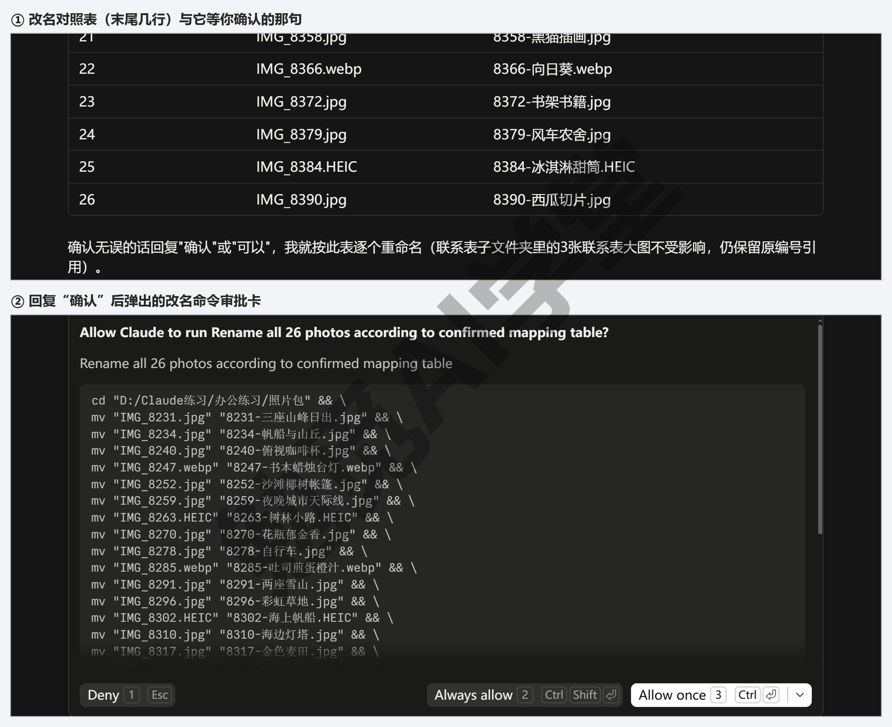

**按内容归类**

乱文件夹的第二步是分门别类。发送：

```
把[下载区副本]里的文件归类：
图片放“图片”子文件夹，文档按主题分子文件夹，
安装包放“安装包”，拿不准的放“待定”。
先把归类方案发给我，我确认后你再移动文件。
```

确认后它会新建子文件夹并移动文件。“待定”这一类建议留着：与其让它硬猜，不如把拿不准的留给你自己看一遍。

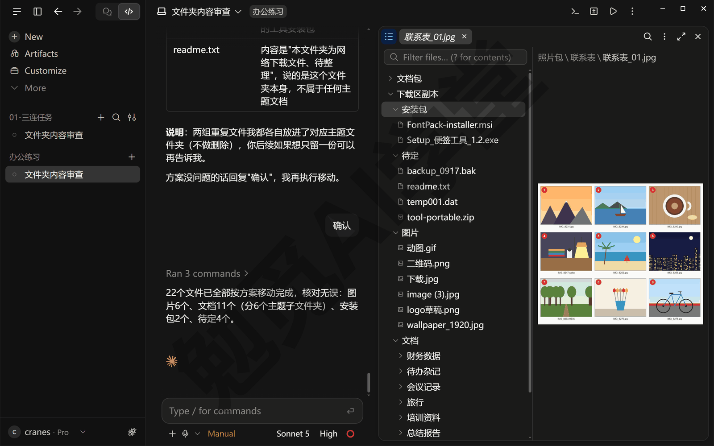

**查重：按内容找重复，先报告不删除**

同一份文件常常被存了好几次，文件名还各不相同。查重要按内容判断而不是按文件名。发送：

```
检查[下载区副本]里有没有内容重复的文件（按内容判断，不看文件名），
把重复组列出来，每组说明建议保留哪个、理由是什么。
只出报告，不要删除任何文件。
```

你会得到一份重复文件报告。要不要删、删哪个，由你看过报告后另发指令，这一步不要合并进查重指令里。

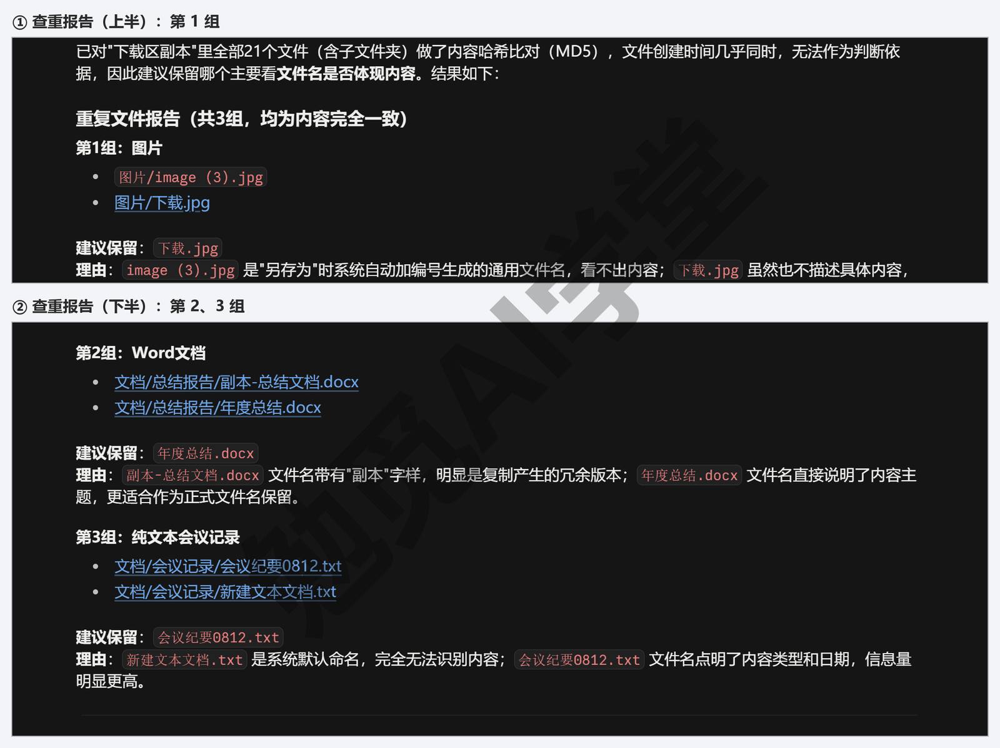

**真要删的时候：分三步把关**

练习阶段不真的删。真正清理时，删除这件事拆成三步把关，一步都不省：

1. 先报告：让它列出要删的每一项的名称、大小和理由，你看过再说。
2. 你确认：回复确认之后它才动手；Manual 模式下删除命令还会弹审批卡，再看一眼。
3. 进回收站：提示词里写明“能进回收站的先进回收站，不要直接永久删除”，删错了还能从回收站找回。

```
按刚才的查重报告，删掉我确认过的这几项：[列出你确认的项]。
删除前把每一项的名称和大小再列一遍让我最后确认，
能进回收站的先进回收站，不要直接永久删除。
```

5.1 末尾说过的那一点在删除时最要紧：在 Accept edits 模式下，它运行项目文件夹里的删除命令时是不问你的。所以删除类任务要么留在 Manual，要么把“先报告”写进提示词，两个都做最稳。

### 5.4 转换与做表做文档

这一节从“处理已有文件”进到“做出新东西”。它的做法通常是写一小段脚本（一段让电脑自动执行的小程序）来完成任务，你不需要看懂脚本，只需要说清楚要做什么，做完检查一下结果。

**格式转换：HEIC、webp 转 jpg**

苹果手机拍的 HEIC 和网页保存的 webp，很多软件打不开，统一转成 jpg 最不容易出问题。发送：

```
把[照片包]里的 HEIC 和 webp 图片都转成 jpg，
转换后的文件放进“jpg版”子文件夹，原图保持不动。
缺什么工具你自己装，装之前先告诉我要装什么。
```

执行时你会看到它运行转换命令、弹出审批卡，按 5.5 的方法看一眼再放行。完成后“jpg版”子文件夹里就是全部转好的图。

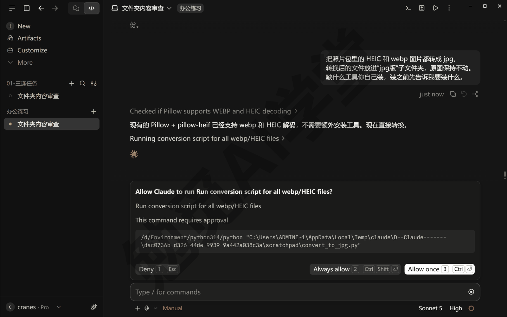

**文档转换：md 转 Word、PDF**

自己写的 md 笔记要交给别人看，转成 Word 或 PDF 更通用。发送：

```
把[月度总结.md]转成 Word 版和 PDF 版，
尽量保持标题、列表和表格的格式，
生成“月度总结.docx”和“月度总结.pdf”放在同一文件夹。
```

转换完打开抽查一遍：跨格式转换难免有版式和字体上的差异，重点看标题层级对不对、表格有没有丢。标题只是加粗放大、没有用 Word 的标题样式的，让它“标题用 Word 标题样式重做一版”，不然以后目录做不出来。PDF 可以直接在浏览器面板里看，做法见 5.6。

**生成表格与文档：让它写脚本跑出来**

很多人以为出 Excel、PPT 必须装 Office，其实不用：让它写脚本直接生成文件就行，电脑上没有 Office 也能做出 xlsx 和 pptx。发送：

```
根据[开销记录.csv]生成一份带图表的 Excel：
第一张工作表放明细，第二张放按类别的汇总，配一张饼图；
用脚本生成，不要依赖 Office，输出“开销分析.xlsx”。
```

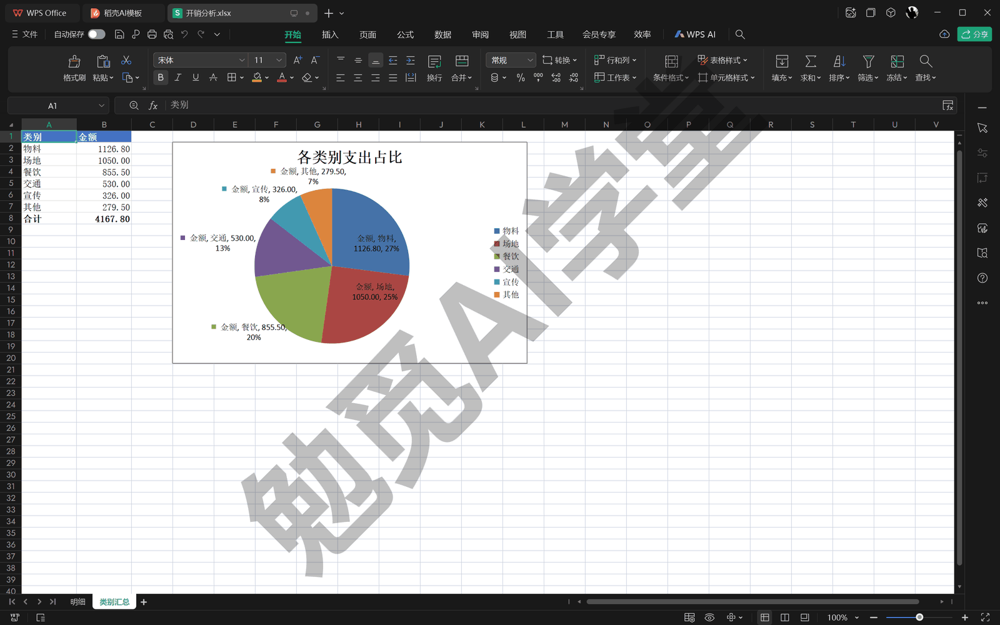

PPT 也一样：

```
把[产品介绍.md]做成一份 10 页以内的 PPT：
封面一页、要点分页、结尾一页，配色简洁，
用脚本生成“产品介绍.pptx”，不要依赖 Office。
```

做出来的 Excel 和 PPT 要打开检查三处：数字对不对（抽两三个和原表核对，优先核合计和最大的几个数，错常出在这里），图表有没有、指的是不是你要的那一列，标题和页数是不是你要的。这套“写脚本出文档”的做法，在《实战二：网店订单月报流水线》里会完整用上：三个平台的订单表放进去，一句话让它清洗、汇总，直接做出带图表的 Excel 和一页汇报 PPT。这一篇先把做法练熟，到实战篇你就能直接上手。

### 5.5 让它自己装工具

**为什么要它装工具**

前面的转格式、出 Excel，背后靠的都是 Python 这类通用工具。以前的做法是你自己搜官网、下载安装包、再一步步设置，每一步都可能把新手卡住。现在换成一句话：让它自己装，装完自己验证。

本篇会碰到的几个工具，先认识一下名字：Python 是写脚本最常用的一种语言，出表格、批量处理文件多半靠它；Node.js 是运行网页类工具的环境；ffmpeg 专门负责音视频的转换与合成。这些都不需要你会用，知道名字、审批时能对上号就行。很多时候你甚至不用主动装：任务需要什么，它会自己提出“需要安装某某”，你确认就行。

**一句话安装，装完自己验证**

装 Python：

```
帮我装 Python，装完运行一条命令输出版本号，
把版本号发给我确认安装成功。
```

装 Node.js、ffmpeg，或者 pandoc（把 Word、Markdown 这类文档互相转换的工具）也一样，把名字换掉就行：

```
帮我装 pandoc，装完用它输出版本信息确认能用，
并告诉我它装到了哪里、以后在别的文件夹里能不能直接用。
```

“装完自己验证”这半句很重要：工具装没装成，要看版本号能不能正常输出，不能只听它说“装好了”。安装命令要经过审批：Manual 和 Accept edits 模式下，运行前都会弹出审批卡，你放行后它才真正执行。然后你会看到它运行安装命令、再运行一条版本检查命令，最后把版本号贴给你。

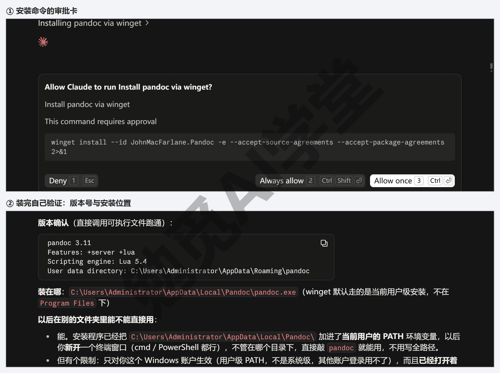

**审批卡怎么读**

安装工具基本都会触发审批。卡片上能看到它要运行的命令原文，以及 Deny（拒绝）、Always allow（始终允许）、Allow once（只允许这一次）几个按钮（按钮名以实际界面为准）。看不懂命令不要紧，按三个问题过一遍：

- **它要做什么**：命令里一般带着工具名（python、ffmpeg），和你的要求对得上就合理。
- **来源可靠吗**：从官方网站或系统自带的软件安装工具装，是最常见的情况；如果你不确定，先别点按钮，按 Ctrl+; 开侧聊问一句“解释一下这条命令是干什么的、从哪里下载”（审批卡停着的时候主对话收不到新消息，《对话与上下文管理》讲过侧聊），它会用通俗的话解释，你再决定放不放行。
- **影响范围多大**：装工具影响的是整台电脑的环境，而不只是这个项目文件夹，所以要比普通命令多看一眼。

**装到哪里、别处能不能用**

工具可能装在两种地方，装在哪决定了“别处能不能用”：

- **装进系统环境**：登记进系统找命令用的那份地址簿（叫 PATH），任何文件夹、任何终端都能用。Python、ffmpeg 这类通用工具适合这样装。
- **只装进当前项目文件夹**：有些配套的程序包会被装进只属于这个文件夹的独立环境（叫虚拟环境），只在这个文件夹里有效，换个文件夹就找不到了。

想要在哪个文件夹都能用，就在指令里说清楚：“装成全局可用，并在一个新终端里验证”。另外，刚装完的工具在已经开着的会话里可能找不到，这不是装失败，新开一个会话或重启应用后一般就能找到。

安装也可能失败，最常见的是网络原因。处理办法和 5.7 讲的一样：把安装报错原文发回对话，它通常会换渠道或换方法重试；多次失败时，让它给出手动下载的官方地址，你下载安装后再让它继续验证和配置。

### 5.6 生成的文件落在哪

**默认落在项目文件夹**

它做出来的东西默认保存在当前的项目文件夹里，对话里通常也会报出文件名和位置。一个有用的习惯是在任务提示词末尾加一句“完成后列出所有新建或修改的文件及路径”，让每次任务都以一份文件清单收尾，以后要找文件时照着清单找就行。

如果生成的文件多、任务杂，还可以要求它给文件名加日期前缀，例如“2026-09-23-发票汇总.md”：文件一多，按名字一排就能对上是哪天哪次任务做出来的。这个要求同样直接写进提示词。

**四个查看入口**

- **点对话里的路径**：它在对话里报出的文件路径可以直接点。md、txt、csv 这类文字文件会在文件面板里打开，能看也能小改几处，改完自动保存；PDF、图片、网页、视频会在浏览器面板里打开。《桌面应用全导览》介绍过这两个面板。
- **右键路径**：在对话里的文件路径上点右键，菜单里从上到下是 Attach as context（作为附件加进下一句话）、Copy ›（复制路径）、Open in ›（用别的软件打开）、Show in Explorer（在资源管理器里显示）四项，想用系统自带方式查看就选最后一项 Show in Explorer。
- **让它自己汇报**：发一句“把这次生成的所有文件列个清单，带完整路径”，适合一次任务生成多个文件的情况。
- **兜底**：自己开资源管理器，按它报的路径找过去。

生成的文件想换个地方存也不用你动手：一句“把这次生成的文件统一移动到‘结果’子文件夹”就够，挪文件这件事它自己就能做。

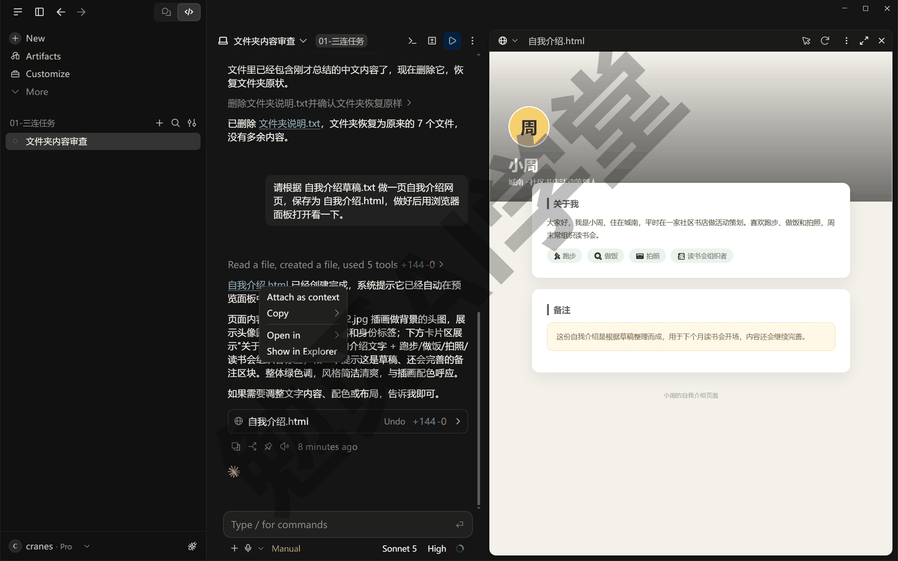

**说好的文件找不到？先分三种情况**

- **存到了别的位置**：直接问一句“把这次生成的文件的完整路径贴出来”，按路径找过去。
- **任务其实没做完**：翻到对话末尾看看，它可能停在一张等你放行的审批卡上，或者停在一个提问、一条报错上等你回应，回它一句就能继续。
- **被杀毒软件拦了**：文件刚生成就消失，多半是这种情况，处理办法见 5.7。

**Excel、PPT 这类文件在差异视图里看不了怎么办**

《桌面应用全导览》介绍过差异视图：逐文件查看它改了什么。文字型文件在差异视图里核对最方便，md、csv 这类文件新增了哪些行一目了然，发现汇总表少了一列，直接在对话里说“补上某某列”就行。但差异视图只适合文字型文件；xlsx、pptx、jpg 这类文件的内容不是纯文字，在差异视图里一般只能看到“新增了一个文件”，看不到里面具体是什么。

这不是出错。验收这类文件的正确方式是打开文件本身：Excel 用表格软件或 WPS 打开看数字和图表，Word 翻一遍版式，图片和 PDF 点路径在浏览器面板里看。不方便打开时，让它把内容贴出来：“把这个 xlsx 每张工作表的前 5 行贴出来给我看”，用可读的方式核对内容。差异视图只能告诉你它改了哪里，文件能不能用，最终要靠你打开文件看一眼。

### 5.7 边界与坑

这一节集中讲文件任务最常见的四个坑，都配了兜底做法。

**大批量任务分批做**

几百个文件一次交给它，中途出错很难收拾，也不好核对。稳妥的节奏分三步：

1. 先拿 5 到 10 个文件试一遍，检查结果是否符合预期。
2. 确认没问题，再让它处理剩余部分；数量很大时分成几批，每批完成后抽查几个。
3. 涉及改名、移动的批量操作，每批都保留“先报告再动手”。

批量任务文件越多，花的时间和用量也越多，先小批试再放开，也是控制用量的办法。更稳的做法是开工前后各看一眼用量环（《权限、沙盒与模型》讲过它的两层含义），一批下来消耗了多少一看就知道，下次同类任务就能提前估算。

**中文路径与空格**

日常使用中文文件名一般没有问题，但少数较旧的工具处理不好中文或带空格的路径，典型症状是明明文件在那里却报“找不到文件”，或者输出的文件名变成乱码。路径里带空格是同类问题的另一种样子，它一般会自己加引号处理，多数时候你察觉不到。遇到反复失败的情况也不用自己反复试：把报错发回给它，它通常会自己换一种写法重试；实在不行，让它把涉及的文件复制一份改成临时英文名处理，完成后再改回中文名。

**杀毒软件拦截**

它写的脚本、刚装的工具，偶尔会被杀毒软件误判拦截，典型症状是文件刚生成就消失，或者命令突然无法运行。处理思路分三步：先到杀毒软件的隔离区确认是不是被隔离了，是误报就恢复文件，再把练习文件夹加入信任名单。用 Windows 自带的 Windows 安全中心的话：打开它，点“病毒和威胁防护”，“保护历史记录”里能看到被隔离的文件、点开选恢复；同一页“病毒和威胁防护设置”下点“管理设置”，拉到“排除项”把练习文件夹加进去（菜单名以你的系统版本为准）；用别的杀毒软件，看它的说明。这种情况大多是误报，不代表它真做了危险的事，但如果你有疑虑，可以让它解释被拦的文件是干什么的，再决定要不要恢复。另外，新装的工具第一次运行时被拦的概率最高，所以 5.5 里强调装完立刻自己验证：能把误报早点暴露出来，总好过做表跑到一半才失败。

**失败了，把报错发回去让它自己修**

任务失败时先别自己琢磨：把报错原文完整复制，贴回对话，一个字都不用改，这是最有效的办法；界面上的错误弹窗也可以直接截图粘贴进输入框发回去（《对话与上下文管理》讲过，截图它看得懂）。对它来说，报错信息是精确的线索，多数问题它读完就能自己改好再重跑。最没用的反而是只说一句“出错了”“不行”，那等于不给它任何可用的线索。

发回报错时带上三样东西，效果最好：

- **报错原文**：完整复制，不要删减，越长越有用。
- **你当时让它做什么**：一句话就行，例如“转换第二批 HEIC 时报的错”。
- **你期望的结果**：一句话就行，例如“期望全部转成 jpg 放进 jpg版 文件夹”。

这四个坑有一个共同点：都不需要你自己会修。你的任务是识别症状（结果不对、文件消失、报错），然后把你看到的情况原样发回给它；修的事，交给它来。发回去之后，它一般会先说明自己对报错的理解，改一处再重跑一遍，成功后把结果贴给你。

### 5.8 三个练习任务

下面三个任务把本篇能力串起来练一遍。方括号里的内容换成你自己的；素材就用 5.1 里建好的练习文件夹，权限模式留在 Manual。

**任务一：给 20 张照片按内容起中文名，保留编号**

```
把[照片包]里的 20 张图片按内容重命名为中文名，
保留原文件名中的数字编号作前缀，
新名字格式：编号-内容描述.jpg。
先发“原名 → 新名”对照表给我确认，确认后再改名。
```

完成标准：改名后的文件都是“编号-中文描述”格式；编号与原文件一一对应；抽查 5 张，描述与图片内容相符；改名命令的审批卡你看过并放行过。

**任务二：把一个文件夹的 PDF 汇总成一张表**

```
把[文档包]里的 PDF 逐个读一遍，
提取“文件名、日期、来源单位、金额或主题”，
汇总成表格保存为“PDF汇总.md”，放在同一文件夹里。
```

完成标准：项目文件夹里出现“PDF汇总.md”；表格行数与 PDF 份数一致；抽查两行，关键信息与原件相符；你能点对话里的路径在文件面板里打开它。

**任务三：装 Python 并做出一份带图表的 Excel**

```
先帮我装 Python，装完输出版本号确认能用；
然后根据[开销记录.csv]生成“开销分析.xlsx”：
第一张工作表放明细，第二张放按类别的汇总并配一张饼图，
用脚本生成，不要依赖 Office。
```

完成标准：对话里出现 Python 版本号；项目文件夹里出现 xlsx 文件；打开后两张工作表都在，饼图指向类别汇总，抽查两个数字与原表相符。

### 5.98 本篇小结与自检

这一篇把文件与办公能力过了一遍：先建练习文件夹、只读不改地汇报；读与识（文本、表格、PDF、图片、联系表汇总）；整理（重命名、归类、查重、分三步把关的删除）；转换与做表做文档（格式转换、脚本生成 Excel 与 PPT）；自装工具（一句话安装加自己验证、审批卡怎么读）；最后是到哪里找它生成的文件，以及四个常见坑。最需要养成的习惯有两个：会改动文件的任务先报告再动手；失败了把报错原文发回去。

可以对照下面的清单检查学习结果：

- [ ] 建好了练习文件夹，能说出“项目文件夹就是它能动的范围”
- [ ] 让它读过文本、表格、PDF 和图片各至少一次
- [ ] 完成过一次批量重命名，编号前缀保留完好，审批卡看过再放行
- [ ] 知道命令做的改动 Undo 撤不回来，整理类任务靠副本和先看方案兜底
- [ ] 让它装过至少一个工具，并看到它自己输出版本号做验证
- [ ] 会用点路径、右键菜单、让它汇报三种方式找到生成的文件
- [ ] 遇到过（或模拟过）一次报错，把报错原文发回让它自己修好

完成这些内容后，你已经能把日常的文件与办公任务交给它了。不过到目前为止，所有任务都是“一句话直接干”；任务一大，直接干就容易走偏。下一篇《计划模式、差异审阅与回退》介绍先想清楚再动手的计划模式、怎么逐文件审它的改动、怎么让它自己审一遍，以及改坏了怎么退回去。

### 5.99 新手常见问题

**Q1：它会删我的文件吗？**

Manual 模式下，删除命令运行前会弹审批卡，你不放行它就不会删；Accept edits 模式下，它在项目文件夹里运行删除命令时不再问你。所以删除类任务留在 Manual，并且永远拆成“先报告、我确认、进回收站”三步，重要资料只用副本练习。项目文件夹之外的文件，它默认不会去改。

**Q2：能处理不在项目文件夹里的文件吗？**

读没有问题：把文件拖进输入框，或者用 + 按钮当附件加进来让它看。要改动的话，最简单的做法是把要处理的文件复制进项目文件夹再开工，生成的文件也好找；确实要让它动别处的文件夹，另开一个会话、把那个文件夹选成项目文件夹。

**Q3：处理 100 张图要多久、要花多少用量？**

取决于做法。逐张读图最慢也最消耗用量；联系表大图一次看一批，省用量得多；批量转格式、改名这类不需要理解内容的操作走脚本，既快，用量也少。具体耗时和用量以实际运行情况为准，稳妥节奏是先拿 10 张试，看看用量环的变化再决定剩下的怎么处理。

**Q4：为什么它装的工具，我在别的地方用不了？**

最常见的原因是工具被装进了当前项目文件夹的虚拟环境，只在这个文件夹里有效，换个地方自然找不到；想全局可用，安装时明确要求“装成全局可用”。另一个常见原因是装完后系统还没把新工具登记进地址簿，已经开着的会话里找不到新命令，新开一个会话或重启应用就行。拿不准是哪种，就把“在别处运行失败的报错”发回对话，让它判断是哪一种。
