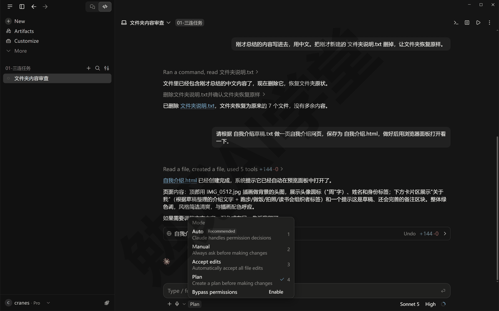
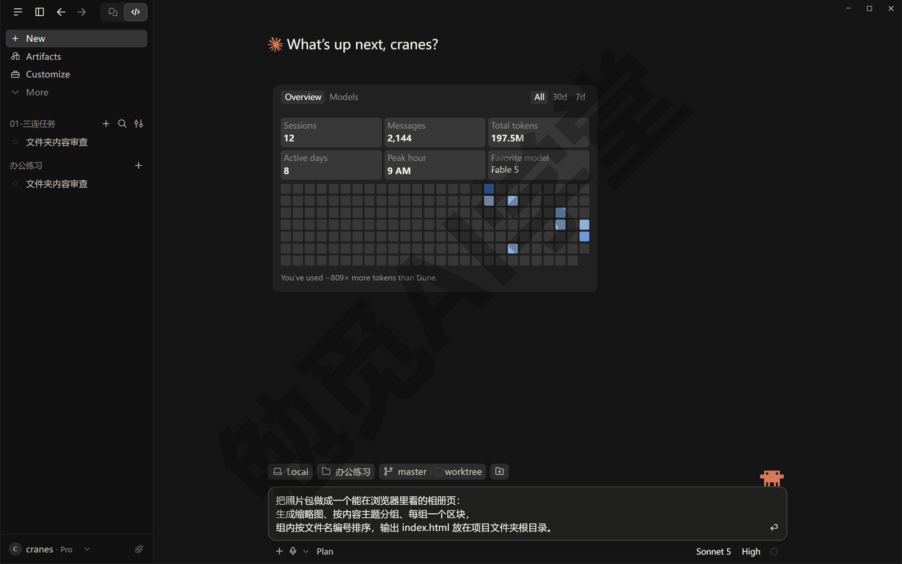
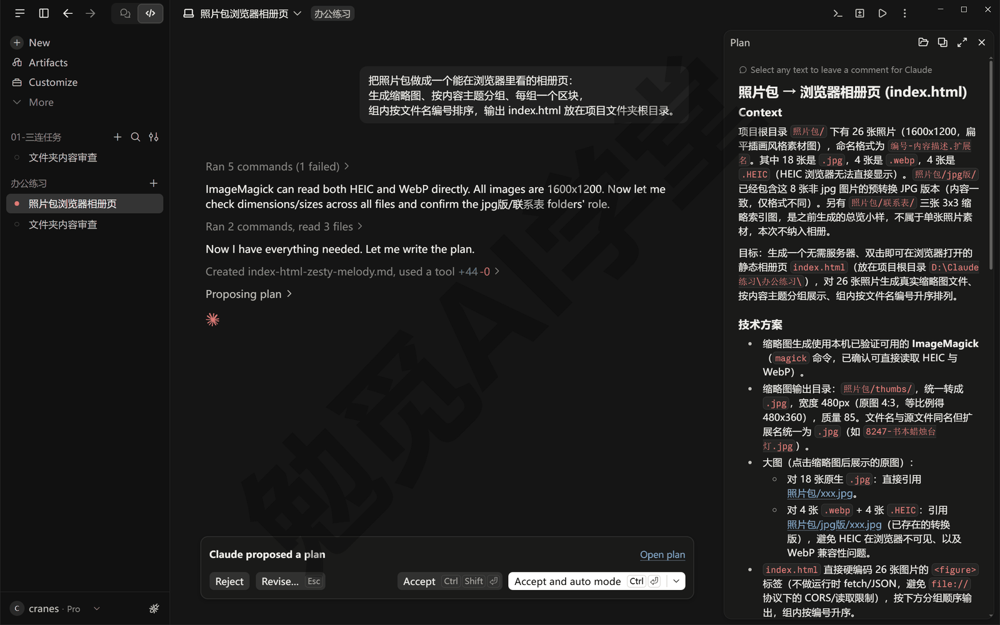
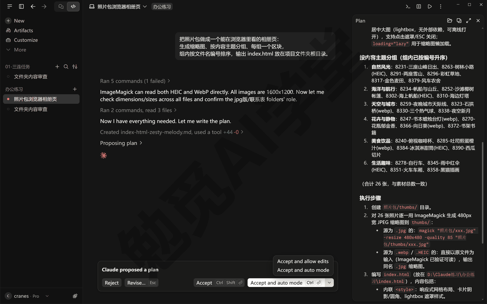
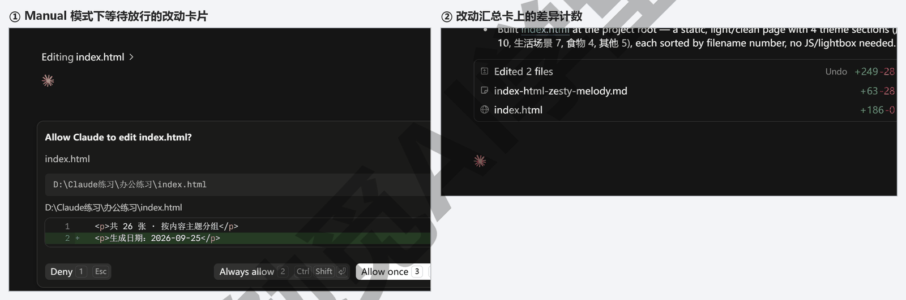
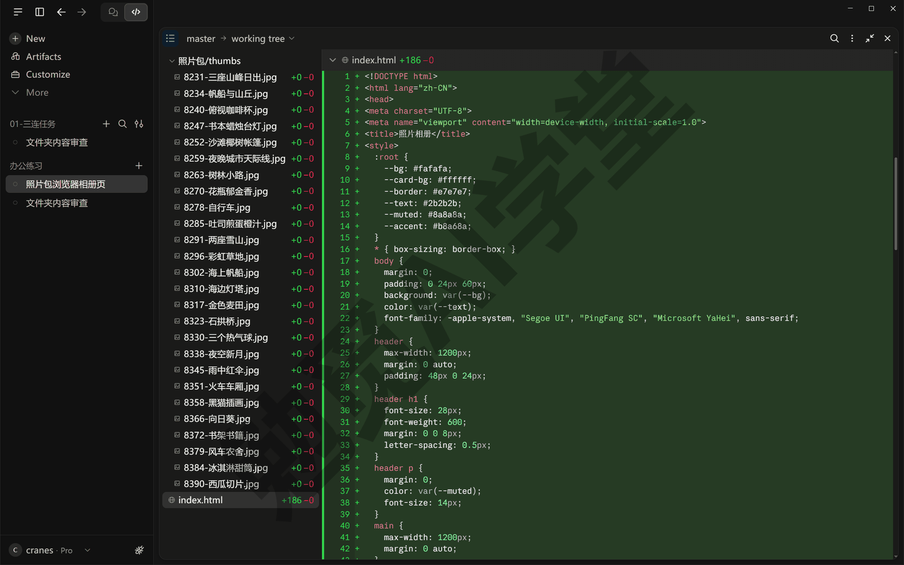
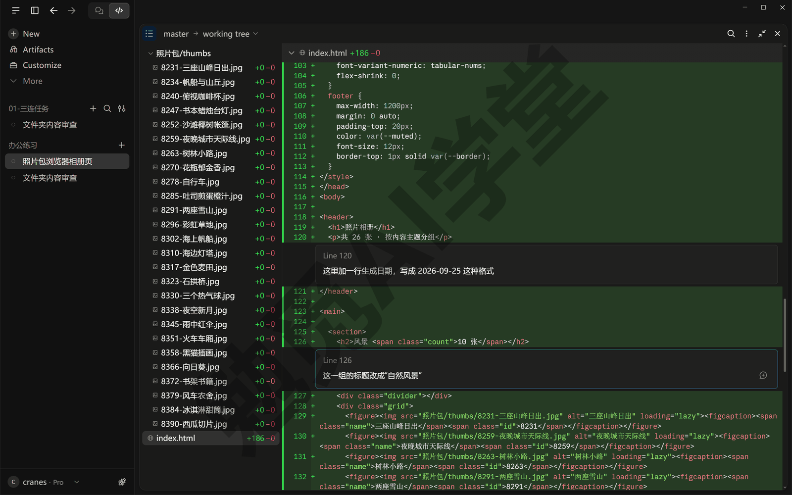
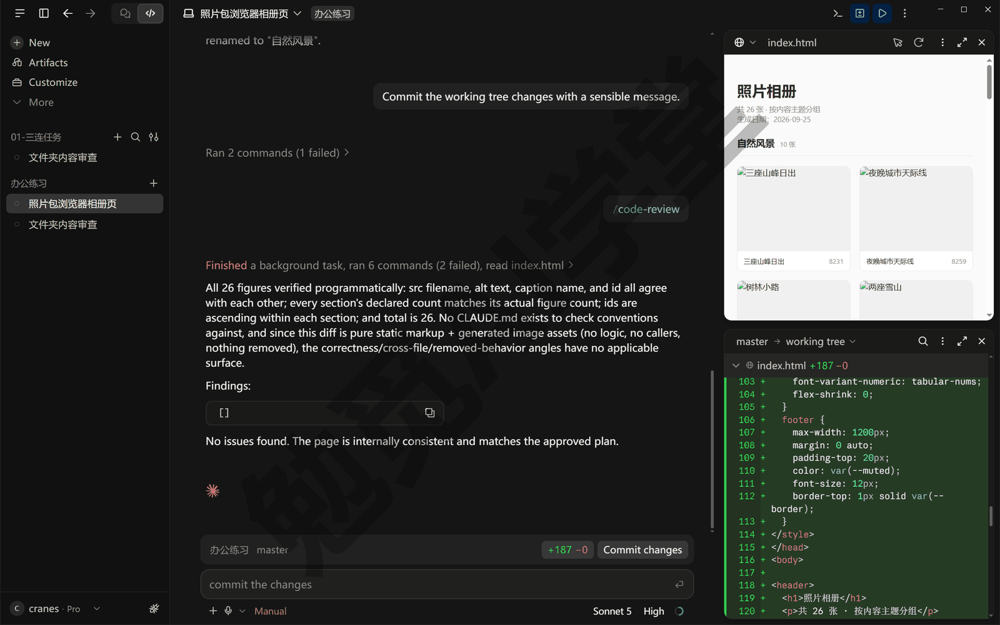
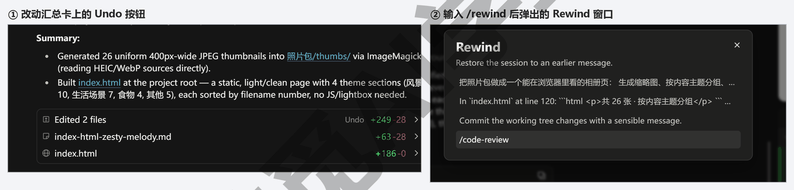
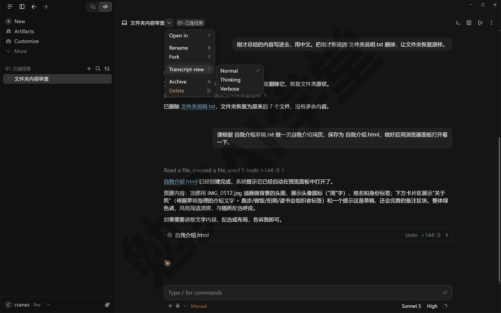

## 计划模式、差异审阅与回退

到《文件与办公能力一篇讲全》为止，你交给它的任务都是一句话直接干：发出去，它就动手。这一篇讲三件配套的事：任务一大，怎么让它先想清楚再动手（计划模式）；它改完之后，怎么逐文件、逐行地审它的改动，怎么让它自己先审一遍（差异审阅）；改坏了，怎么退回去（回退）。三件事合起来，就是复杂任务也能稳妥做成的一套办法。本篇继续使用《文件与办公能力一篇讲全》建好的练习文件夹。这篇文章的实操内容需要 Claude 的付费订阅（Pro 起），和前几篇一样。

### 6.1 为什么先想清楚再动手

**同一个任务，两种交给它的方式**

拿一个任务做对比：把练习文件夹里的照片包做成一个能在浏览器里看的相册页。相册页就是一个网页文件，双击用浏览器打开，照片按组排好、每张带一张小缩略图。这个任务步骤多、有好几种做法，正适合用来比较。

第一种是一句话直接干。在 Accept edits 模式下发送（这一档它改文件不问你，正好看它自己会怎么做；你可以真发一次看看，到 6.2 再做一遍之前让它“把刚才做的相册页和缩略图都删掉”即可，也可以不真发、只看下面的描述）：

```
把照片包做成一个相册页。
```

它会立刻开工，读几张图、写一个网页文件、也许再写一段生成缩略图的脚本，几分钟后告诉你做好了。打开一看，常见的结果是这样的：分组分得五花八门，缩略图有大有小，页面配色不是你想的那样，照片顺序也乱了。这些都不是它做错了，而是你脑子里想的和它理解的不一样，它又没有机会问你。更麻烦的是返工：你再发一句“分组不对”，它改一轮；又发现顺序不对，再改一轮。几轮下来花的时间和用量，比一开始就说清楚多得多。

第二种是先出计划。它先读文件、弄清现状，有拿不准的地方先问你，然后写一份计划，用的是普通文字、不是代码：要动哪些文件、分几步、每步做什么。你读一遍，把分组规则、缩略图大小、配色写清楚，同意之后它才动手。这一轮多花了几分钟，换来的是第一次就做成你要的样子。计划里的每一个词都是你能改的：它写“按拍摄地点分组”，你改成“按主题分四组”；它写“缩略图 200 像素”，你改成 400。在计划阶段改是改几个字，做出来再改是重做一遍。它问的问题也不会白问：它问“照片按什么分组”，你就知道自己还没想过这件事，这一轮问答本身就是在替你把需求想完整。

**什么时候先出计划**

这几类任务最适合先出计划：

- **方案不止一种**：相册页是做成一个长页面还是分组折叠，先在计划里定，免得做完再推翻。
- **要动很多文件**：涉及多个文件、多个步骤的改动，中间一步理解错，后面几步都得重来。
- **需求还没想清楚**：让它先研究现状、把问题问出来，帮你把需求聊明白，这时候计划模式就是一次不会动到文件的讨论。
- **想先审方案**：动手前想看看它打算怎么做，尤其是会动到你在意的文件、或者要花不少用量的时候。

反过来，小改动和做熟了的任务直接干，不必事事先出计划：改一处文字、换一个颜色，先出计划反而是绕远路。判断的办法很简单：这件事你能不能用一句话说完，说完之后它有没有可能理解成别的样子。一句话说得完、不会有歧义的，直接干；说不完，或者有好几种理解的，先出计划。拿不准的时候先出计划不吃亏，多花的只是几分钟。

### 6.2 计划模式全程

**计划模式是什么**

计划模式是《权限、沙盒与模型》五档权限模式里的 Plan 那一档。切到这一档之后，它可以读文件、可以运行只看不改的命令去摸清现状，但不改你的任何文件；它最后交出的是一份计划，你批准之后才进入动手阶段。它不会一直停在 Plan 这一档：批准计划后它就退出 Plan、回到动手的模式（回到哪一档由你在批准时选，第 7 步会讲到）。新开的会话一开始是哪一档也不固定：点 New 选完文件夹多半回到 Auto，从侧栏分组的 ＋ 开的新会话沿用上一个会话的模式，以你底部选择器显示的为准。所以批准计划后、新开会话时，都看一眼当前是哪一档。

**动手前先做一件准备：让它把练习文件夹交给 Git。** 这一篇后半要用的差异视图、行内批注和 `/code-review`，都是拿 Git 记住的上一个版本来比出“改了什么”的；文件夹没交给 Git，差异视图只会显示 No changes to show（没有可显示的改动），一处都看不到。Git 是《认识与装好》1.5 第 4 步装过的那个记录文件改动历史的工具，《Git、GitHub 与代码审查》才正式讲，现在不用懂它，让它替你做一次就行。在练习文件夹的会话里、Manual 模式下发送：

```
请把这个文件夹交给 Git 管理：初始化仓库，并把现在的全部内容提交一次。
```

它会跑几条命令，每条弹一张审批卡，点 Allow once 放行；中途要是问你什么（比如某个文件要不要一起提交），选它推荐的那一项就行。做完后输入框上方会多出一条写着文件夹名和 master（或 main）的状态条，那是 Git 的记号，现在不用管；文件夹里的东西一样没动，只是多了一个记录版本用的隐藏文件夹 `.git`，别去删它。以后它每改一处文件，这条状态条和改动汇总卡上就会出现 `+N -M` 这样的加减行数。

下面用相册页这个任务把全程走一遍。

**第 1 步：切到 Plan。** 点输入框下方左侧的模式选择器，选 Plan（计划）；也可以按 Ctrl+Shift+M 打开模式菜单再选。切完看一眼模式选择器上显示的名字，确认写的是 Plan。



**第 2 步：发出需求。** 需求照平常写，不用因为是计划模式就写得更详细，它拿不准的地方会来问你。发送：

```
把[照片包]做成一个能在浏览器里看的相册页：
生成缩略图、按内容主题分组、每组一个区块，
组内按文件名编号排序，输出 index.html 放在项目文件夹的最外层（根目录）。
```



**第 3 步：回答它的问题。** 它可能先问你几个问题把需求确认清楚，例如主题怎么分、缩略图要多大、要不要点击放大，问什么要看具体任务。它有时直接在对话里问，你就在对话里答；有时弹出一张选择题卡，点中一项（或按数字键）再点 Submit（提交），几个选项都不合适就选 Other（其他）自己写。它要是一个问题都没问、直接开始研究，这一步就跳过，想补充的到第 6 步改计划时再说。要是它问了，可以这样答：

```
主题分四组：风景、人物、食物、其他；
缩略图统一 400 像素宽；配色浅色简洁；
不需要点击放大，能看清就行。
```

**第 4 步：等它研究。** 它会读取文件夹里的相关文件、看几张照片、摸清现状，你会在对话里看到读取和搜索的工具卡片。这一步的命令都是只看不改的，一般不用你审批；如果它要运行的命令超出了只读范围，仍然会弹出审批卡让你看（是否弹出以实际表现为准）：看一眼命令，是列文件、看内容这类只读的就点 Allow once；Plan 阶段不该改东西，卡上的命令要改文件就点 Deny。

**第 5 步：读计划。** 研究完成后它会给出一份计划。计划通常包含目标、要动的文件、分步骤的安排，具体结构以实际生成的内容为准。这时对话里只会出现一行 Proposing plan（提出计划），计划的正文在右侧自动弹出的 Plan（计划）面板里；面板关掉了也不要紧，点会话右上角工具栏的 ⋮ 菜单，再点 Plan 就能重新打开。同时对话底部会出现一张写着 Claude proposed a plan（Claude 提出了一份计划）的卡片，第 6、7 步都在这张卡上操作。逐段读一遍，重点核对它对需求的理解和你想的是否一致：分组是不是四组、顺序对不对、有没有它自己加上的你没要的东西。



**第 6 步：改计划。** 有不对的地方，点那张卡片上的 Revise…（修改计划），卡片会变成一个文本框，把修改意见写进去再点 Revise 发出，例如“把分组顺序固定为风景、人物、食物、其他”“缩略图不要放在根目录，放进 thumbs 子文件夹”；直接在输入框里把意见发给它也一样。它会改出新版计划，改到你满意为止；改多少轮都可以，这一步不会动到任何文件。

**第 7 步：批准，切回动手的模式。** 计划改到满意后，看对话底部那张 Claude proposed a plan 卡片，上面有四个按钮：Reject（拒绝）、Revise…（修改计划）、Accept（接受）、Accept and auto mode（接受并切到 Auto）；最后一个按钮右边还有个小箭头，点开多一项 Accept and allow edits（接受并切到 Accept edits）。点 Accept，它退出计划模式开始动手，权限模式回到你切到 Plan 之前的那一档，本篇就是 Manual，每改一处它仍然会先问你；点 Accept and allow edits 或 Accept and auto mode，就切到 Accept edits 或 Auto 让它一路做下去。注意最右边那个 Accept and auto mode 是默认高亮的按钮，按 Ctrl+Enter 就等于点了它；第一次做，用鼠标点 Accept 回到 Manual，每一步改动你都能看到。



**第 8 步：看它按计划做。** 动手阶段和平时一样：对话里出现一张张工具卡片，Manual 模式下每个改动带 Deny、Always allow、Allow once 三个按钮。不同的是这次每一步都有计划可对照，做到第几步、下一步是什么，你随时能对着计划核对。做完后 6.3 教你怎么审它的改动。

**计划存在哪、怎么留档**

计划文档不会保存在你的项目文件夹里，而是存在你的用户文件夹下的 `.claude\plans` 文件夹里（Windows 上就是 `C:\Users\你的用户名\.claude\plans`），文件名是它自动起的，像 index-html-zesty-melody.md 这样；会话还在的时候，从 ⋮ 菜单里点 Plan 随时能重新打开。想留档，直接让它保存一份最稳妥：“把这份计划原样保存为项目文件夹里的 计划-相册页.md”。留下的计划就是一份现成的“这件事当时是怎么定的”说明书，日后改版、给别人接手都用得上。

### 6.3 差异视图：逐文件、逐行地审

**改动是怎么显示出来的**

它改文件时，你看到改动的方式有两种，取决于你的权限模式。Manual 模式下，每一处改动都先变成一张卡片出现在对话里，卡片里是这处改动前后的对比，你点 Allow once 它才写进文件，点 Deny 就不改。Accept edits 模式下它直接改，改完之后你再看。改动少、每一处都想亲眼看的时候用 Manual 逐张点；改动多的时候一张张点太慢，切到 Accept edits 让它一口气改完，再用差异视图整体看一遍。两种方式看到的东西一样，只是一个边改边看、一个改完再看。两种模式下，只要有文件被改过，对话里那张改动汇总卡上就会出现一组类似 `+12 -1` 的数字：加了 12 行、删了 1 行。点它打开差异视图，按 Ctrl+Shift+D 也能开关这个面板。差异是拿 Git 记住的上一个版本比出来的，所以 6.2 开头“交给 Git”那一步不能省。



**差异视图怎么读**

差异视图左边是这次改过的文件列表，右边是当前选中文件里具体改了哪几行（面板小的时候可能只显示改动内容，点面板上的放大按钮，或左上角的 ☰，就能看到左侧的文件列表）：删掉的行和新增的行用不同颜色标出，没动的行照原样显示，让你看得出改动前后是什么内容。一处改动常常是“删一行、加一行”成对出现，把成对的两行一起读，就知道它把什么改成了什么；文件列表里每个文件名后面带着这个文件自己的加减行数，先从数字大的文件看起。逐个文件点过去，重点看三处：改的是不是你要它改的文件；新增的内容是不是你要的；有没有顺带删掉了不该删的东西。看不懂代码也没关系：在新增的内容里找你提过的词，比如分组名、颜色词、照片的文件名；认不出就把文件名发回去问它“这个文件里哪几行是分组、哪几行是配色”。

以相册页为例，文件列表里应该有 index.html，还有它生成的那一批缩略图——每张缩略图是一个新文件，加减行数显示 `+0 -0`，因为图片不按行算；它要是用脚本生成的缩略图，列表里还会多一个脚本文件，也可能多一份单独的样式文件（网页的配色和排版设置），它没提也正常。如果多出来一个你完全没想到的文件，先点开看看它是什么。



**在某一行上写批注**

看到不对的地方，不用切回对话去描述“第几行哪里不对”：在差异视图里点那一行，行号旁边会出现一个蓝色的 +，点它，这一行下面就展开一个评论框，把要改的写进去，按回车。这条批注会挂到输入框上方，变成一张写着 Comment（批注）的小卡，先不发出去；可以接着在别的行上再写几条，它们会排在一起。全部写完，在输入框里按回车（或 Ctrl+Enter）一次发出，它会读所有批注、照着改一轮，改完出现新的差异让你再看。这比在对话里描述位置准得多，它不会认错行。批注和对话里的消息是两回事：批注挂在具体某一行上，它读到的是“这一行怎么改”；对话里的消息没有位置，它得自己去找你说的是哪里。凡是能指到某一行的意见，都用批注说。



批注怎么写，它才改得准？说清“改成什么”，不只说“不对”。例如“这一组的标题改成‘风景’”，比“标题不对”省一轮来回。一条批注只说一件事，两处要改就写两条；可以有几种不同改动的地方，把你要的那种写出来，比如“日期写成 2026-09-24 这种格式”。

### 6.4 让它自己审一遍

**`/code-review` 是什么**

在输入框里输入 `/code-review` 并发送（输入 `/` 会弹出命令列表，接着打 code 就能找到它）。它会把这次改动当成别人的作业来检查：读一遍改过的文件，跑几条核对用的命令（只看不改的命令一般直接跑，会改东西的命令 Manual 模式下才弹审批卡，照常点 Allow once 放行），最后把发现的问题写在对话里。它检查的是差异视图里列出来的改动，也就是从 6.2 开头交给 Git 以来、还没再提交的全部改动，不是整个项目：差异视图里列着几个文件，它就看这几个文件改过的地方。

它审的是“真错”：写法上跑不起来的错误、逻辑上一定会出问题的地方、安全漏洞、明显的 bug（程序里的错误）；也会顺带提几处可以写得更简单的地方。它不挑格式、不挑写法风格，一般也不管这次改动之前就有的旧问题。所以看到它一条问题都没提，不等于文件完美，只是说这次改动里没有它认得出的明显错误。真错和你的要求也是两回事：分成了六组、配色不对，这些不是错误，是不合你的意，它不会标，要靠你在 6.3 自己看。

**什么时候发它**

一批改动做完、你自己在差异视图里看过一遍之后，发一次最合适：你看的是“是不是我要的”，它看的是“有没有写错”，两遍看的东西不一样。改动很小、只改了几个字的时候不必发；改动多、又涉及脚本和网页文件时，发一次花不了多久，比等到文件跑不起来再找原因省时间。审一次也会消耗一些用量，用量紧张时先自己看、有疑问再发。还有一种情况也该发一次：你看不懂它改了什么。它写了一段你完全不明白的脚本，与其硬看，不如发一次让它自己查一遍，再让它用一句话解释这段是做什么的。

**审完之后怎么办**

它列出的每一条问题你都能在对话里回复：同意就让它照改（“第 1、3 条照改”），不同意就说明理由，或者让它再看一遍某一条。它说的也不一定全对，看不懂它为什么说这是错的，直接回一句“解释一下第 2 条为什么有问题”，听完再决定改不改。它挑出的问题也可能是你故意那么做的，比如测试用的假数据，回一句“这是有意的，保留”就行。让它照改之后，差异视图里对应的地方随之更新；全部处理完再整体看一眼文件列表，确认没有多出新文件。



**和《Git、GitHub 与代码审查》里的代码审查有什么区别**

`/code-review` 审的是你电脑上这一轮做的改动，是动手过程中随手审一遍；《Git、GitHub 与代码审查》会讲把改动推到 GitHub 之后，在网页上开合并请求、让它在那里审（“推到 GitHub”“合并请求”这两个说法那一篇才讲，现在不必记），是交出去之前正式审一遍。两个都是它自己审，用的时机不同：改完先在本机随手审，交出去之前再正式审。

### 6.5 改坏了怎么退回

**三层“后悔药”**

改坏了有三种退回的办法，从近到远：

- **改动还没写进文件**：Manual 模式下点 Deny，这处改动就不会发生。这是最近的一层。
- **已经改了，想撤回**：改动汇总卡上的 Undo（撤销）能把那一轮改动整个撤回；`/rewind` 把对话退回到某一句之前，但桌面应用里它不退文件。这一节讲的就是这两样。
- **要长期保存版本、隔几天还能退**：靠 Git 提交，《Git、GitHub 与代码审查》细讲。回退只管这一个会话里最近的一段，长期的版本要靠 Git。

**回退怎么用**

桌面应用里退回分两样东西，各有各的入口：

- **退文件：汇总卡上的 Undo。** 它每做完一轮改动，对话里会出现一张汇总卡，写着改了哪些文件和 `+N -M` 的差异计数，旁边有一个 Undo（撤销）按钮；点它，这一轮它用“编辑文件”动作做的改动整个撤回，文件回到这一轮之前的样子。要撤哪一轮，就点哪一轮的卡。
- **退对话：`/rewind`。** 在输入框里输入 `/rewind`（回退）并发送，会弹出一个叫 Rewind 的小窗口，列出这个会话里你发过的每一条消息（只列你在输入框里发出的，点按钮、答选择题的不算）；点中一条，对话就退回到发它之前的样子，那条消息的原文回到输入框里等你改。文件不跟着退。

命令行版的 `/rewind` 菜单比这多几项（Restore code and conversation、Restore code、Summarize from here 等），能连文件一起退，靠的是它自动存的检查点（每次改文件前自动留下的一份文件备份）；桌面应用里这些选项不出现，退文件用 Undo。



以相册页为例：批准计划之后它做出了第一版，你觉得分组方式整个不对、想换一种思路重来，就先点第一版那张汇总卡的 Undo 把文件撤回，再用 `/rewind` 退到你发需求的那一条消息（批准计划是点按钮，Rewind 列表里没有它，列表里能选的只有你发过的话），那条消息回到输入框，改完需求重发。

**回退的边界**

回退很方便，但有几件事它管不到，其中一部分你在《文件与办公能力一篇讲全》整理文件时已经碰到过：

- **命令做的改动**：Undo 只撤它用“编辑文件”这个工具做的改动；用命令删掉、移动、复制的文件，Undo 撤不回来；分不清它哪一步是编辑、哪一步是命令，先点 Undo 看哪些回去了，没回去的再处理。批量改名、清理这类靠命令完成的操作，出了问题只能靠事先留的副本和 Git 救回来。
- **子智能体做的改动**：《子智能体、并行会话与工作树》会讲它怎么派帮手出去干活，帮手改的文件一般不在汇总卡里，要退回只能靠 Git。
- **你自己或别的会话改的**：Undo 只管这个会话里它自己改过的文件，你手动改的、另一个会话改的不算。
- **会话归档了就没有了**：Undo 和 `/rewind` 都只在这个会话里有效，会话归档、换了电脑就找不到了。要长期保存、隔几天还能退，还是要靠 Git。

**退文件和退对话不是一回事**

退对话（`/rewind`）只是让它忘掉后面的内容，文件不变；退文件（Undo）只是把文件还原，它还记得后面聊过什么。两样一起做，才是“当作那些事没发生过”。做偏了想重来，两样都做；只是想省上下文，就用《对话与上下文管理》讲的 `/compact`。

### 6.6 三档视图配合看

**对话里显示多少细节**

《桌面应用全导览》介绍过会话名下拉菜单里的 Transcript view（对话记录视图），按 Ctrl+O 也能在几档之间轮换。三档的差别只在显示多少，它做的事一样：切换档位不会改变它的行为，也不影响已经做完的工作，随时可以来回切换。这一篇讲它们在审改动时怎么配合：

- **Normal（普通）**：工具卡片折叠成一句概要，完整显示它的回复。平时用它，看结论；它的每一步动作都还在，只是折叠起来了，想看哪一步点开那张卡片就行。
- **Thinking（思考）**：在普通视图基础上多显示它的思考过程。想知道它为什么这么分组、为什么选这个写法时看它；思考过程比回复长得多，看完记得切回去。
- **Verbose（详细）**：每一次读文件、每一条命令、每一步中间过程都展开。它做出来的东西和计划不一致时，切到这一档从头看它到底做了什么，多半能找到是哪一步走偏的；这一档下每条命令的原文和输出都能看到，要把问题发给别人看时也用它。

老版本的桌面应用还有一档 Summary（摘要），新版本已经去掉；你的界面上有哪几档，以实际显示为准。给别人演示或录屏用 Normal，画面最干净；自己排查问题用 Verbose。两个人一起排查同一个问题时，让对方也切到 Verbose，看到的才是同一份记录。

**审改动时的用法**

先在 Normal 里看它的总结，再开差异视图看改了什么；两边对不上，或者结果和计划不一致，切到 Verbose 找它偏在哪一步，然后决定是写批注让它改，还是回退到那一步重来。三档和差异视图各看一半：差异视图看结果改了什么，Verbose 看过程中做了什么，两边对着看才知道结果为什么是这样。先别急着回退：先看是哪一步偏了，多数时候写一条批注就能修好。

以相册页为例：计划里写的是四组，做出来却有六组。切到 Verbose 从头看，能看到它读了哪几张图、在哪一步决定把“夜景”和“风景”分开、跑了哪条命令生成缩略图。偏差出在“分组”那一步，就在差异视图里给分组那几行写批注让它合并；要是从读图那一步就理解错了，回退到批准计划那一条重来更快。看完记得切回 Normal，Verbose 下对话会很长，平时不用它。偏差常见的三处是读材料时理解错了、定规则时自己加了主意、执行时漏了一步，在 Verbose 里按这三处的顺序找最快；找到了就知道该写批注还是该回退，不用凭感觉猜。找的时候不用逐行读命令，只看每张卡片开头那一句它在做什么，就能找到出偏差的那一步。



### 6.7 三个练习任务

三个任务都在练习文件夹里完成，建议按顺序做。

**任务一：用计划模式做一个三步以上的改动，并改一次计划**

```
给这个项目文件夹做一个“素材索引页”：
读取各子文件夹，统计每类文件的数量，
生成一个带目录和统计表的网页，文件名 素材索引.html，放在根目录。
```

要求：切到 Plan 再发；在批准之前至少修改一处计划；批准时点 Accept（回到 Manual）；做完让它把计划保存为项目文件夹里的一个 md 文件。

完成标准：文件夹里有保存下来的计划文档；你能指出自己改了计划的哪一处；做出来的结果与计划一致。

**任务二：对一次改动逐行批注，再让它自审**

```
把 素材索引.html 的页面标题改成“我的素材库”，
每个统计表加一列“最近修改时间”，
页面底部加一行生成日期。
```

要求：Accept edits 模式下发送；改完打开差异视图，至少在两行上写批注并一起发出；它改完后发 `/code-review` 让它自己审一遍。

完成标准：你写的批注都被改到了；`/code-review` 的结果你看过，它提的每一条你都回复过（照改或说明不改的理由）。

**任务三：故意接受一个坏改动，再回退**

```
把 素材索引.html 里所有的统计数字都改成 0，
并把页面标题改成“测试”。
```

要求：Accept edits 模式下发送，让它真的改；打开页面确认改坏了；然后点这一轮改动汇总卡上的 Undo 把文件撤回，再用 `/rewind` 退到这条消息。

完成标准：回退后 素材索引.html 恢复到任务二做完时的样子；对话回到发这条消息之前，输入框里出现了这条消息的原文。

### 6.98 本篇小结与自检

这一篇讲了三件配套的事。计划模式：切到 Plan 让它先研究、先问、先出计划，你改到满意再批准，批准后切回 Manual 或 Accept edits 动手，批准后看一眼当前切到了哪一档。差异审阅：先让它把练习文件夹交给 Git，再从汇总卡上的 `+12 -1` 点开差异视图逐文件看，点某一行写批注、一起发出，`/code-review` 让它自己先审一遍真错。回退：汇总卡上的 Undo 撤回一轮文件改动，`/rewind` 选一条消息把对话退回去；命令做的改动、子智能体的改动、你手动改的它们管不到，长期靠 Git。三档视图配合着看，Verbose 用来找它偏在哪一步。

可以对照下面的清单检查学习结果：

- [ ] 能说出什么任务该先出计划、什么任务直接干
- [ ] 用计划模式走完过“切到 Plan、发需求、回答问题、读计划、改计划、批准”全程
- [ ] 批准计划后会看一眼切到了哪一档，知道它不会一直停在 Plan 这一档
- [ ] 知道差异视图要靠 Git 才算得出改动，让它把练习文件夹交给过 Git
- [ ] 会打开差异视图，在某一行上写过批注并让它照改
- [ ] 发过 `/code-review`，知道它只挑真错、不挑格式
- [ ] 用 Undo 撤回过一轮改动、用 `/rewind` 退回过对话，能说出两样各退什么
- [ ] 知道回退管不到命令做的改动，知道长期版本要靠 Git

完成这些内容后，复杂任务的四步你都有了办法：先想清楚、再动手、再审改动、改坏了退得回。下一篇《内置浏览器、应用预览与电脑操控》让它自己打开网页验证做出来的东西：这一篇计划模式做出的相册页，正好可以拿过去让它在浏览器面板里看一眼。

### 6.99 新手常见问题

**Q1：计划模式会改我的文件吗？**

不改。Plan 模式下它只读文件、只跑用来了解情况的命令，计划本身也不是写进你项目文件夹的文件。要动文件，必须先批准计划、切回 Manual 或 Accept edits。所以在计划模式里怎么问、怎么改计划都没有风险。

**Q2：批注了它不改怎么办？**

先确认批注发出去了：在评论框里按回车只是把批注挂到了输入框上方，还要在输入框里再按一次回车（或 Ctrl+Enter）才会把全部批注一起发给它。发出去了它改得不对，多半是批注写得不够具体，把“改成什么”写清楚再发一轮；还是不对，就在对话里把那几行原样贴出来、说明要改成什么。

**Q3：`/code-review` 和《Git、GitHub 与代码审查》里的代码审查有什么区别？**

`/code-review` 审的是你电脑上当前这一轮改动，随手审一遍，结果写在对话里；那一篇讲的是改动推到 GitHub、开了合并请求之后，让它在网页上审，是交出去之前正式审一遍。两个都是它自己审，先随手审、交之前再正式审，两道不冲突。

**Q4：回退会不会把我手动改的也退掉？**

Undo 只还原它自己在这一轮里改过的文件。你在别的软件里改的、另一个会话改的文件，一般不会被动到；但如果你手动改的正好是它这一轮也改过的那个文件，Undo 时那个文件会整体回到这一轮之前的样子，你手动改的部分也会一起没了。所以自己动手改之前，先等它这一轮改完、你也审完；或者手动改完先用 Git 提交一次。
