## 内置浏览器、应用预览与电脑操控

这一篇做出第一个看得见的作品：让它写一页网页，然后看它自己把网页打开、自己截图检查、自己改。做完你会认识 Code 页签里的浏览器面板——它既是给你看成果的窗口，也是它自己验证结果的工具；再认识两样和“让它操作屏幕”有关的东西：Claude in Chrome 扩展，以及还在预览阶段的电脑操控。

前六篇里它做的事都在文件和对话里，你要看结果得自己打开文件；从这一篇起，它会把结果直接放到你眼前。本篇的演示环境仍是 Windows 上的 Claude 桌面应用（以 2026 年 9 月的版本为例），全程在 Code 页签里。

这篇文章的实操内容需要 Claude 的付费订阅（Pro 起）：浏览器面板是 Code 页签的一部分，Code 页签从 Pro 起开放；7.5 的电脑操控是研究预览功能，同样要 Pro 或 Max，Team 和 Enterprise 套餐目前没有它（以官网与你的账号页面为准）。

### 7.1 第一个看得见的作品

**先看没有浏览器面板时你要怎么做。** 让它写一页网页，它写完告诉你“做好了”，然后呢？你得到文件夹里找到那个 html 文件，双击用浏览器打开，看到排版挤了，回来告诉它“标题太大、按钮歪了”，它改完你再双击一次。一来一回，每一轮都要你当它的眼睛。有了浏览器面板，这些事它自己做：写完就打开、打开就截图、看到不对就改，改完再看一遍，最后把一个它自己检查过的页面放到你面前。

下面把这件事从头做一遍。

**第 1 步：建一个练习文件夹，开一个会话。** 在资源管理器里新建一个空文件夹，比如 `D:\Claude练习\自我介绍页`。回到 Code 页签，点左侧的 New（新建），环境选 Local（本机），点 Select folder（选择文件夹）选中这个空文件夹——第一次打开一个新文件夹会弹出 Trust this workspace?（信任这个工作区？）的确认框，点信任——模型保持默认。权限模式这次建议选 Accept edits（自动接受编辑）；选完文件夹它会回到 Auto，所以先选文件夹、再切模式，切完看一眼。这一档它改文件夹里的文件不再逐个问你，跑命令、动文件夹外的东西仍然要先问过你；网页要改很多轮，每改一次都点一下确认会打断节奏。这一档的边界《权限、沙盒与模型》讲过，这里只用它。

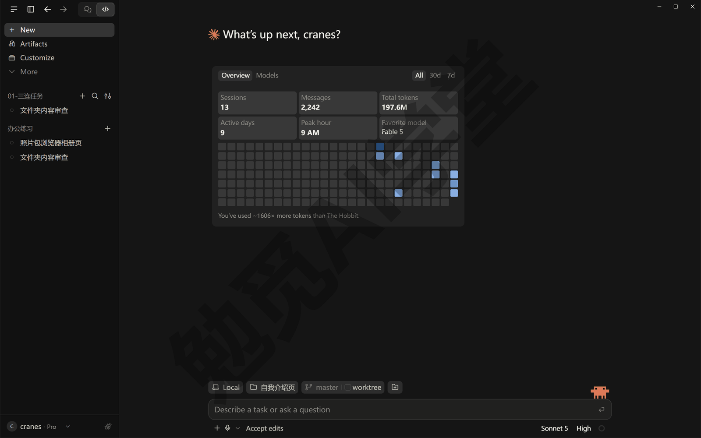

**第 2 步：把要做的网页说清楚。** 在输入框里输入下面这段话，按回车发送：

```text
请在这个文件夹里做一页自我介绍网页，文件名 index.html：
页面顶部是一个大标题写我的名字（先用“张三”占位），下面一句话自我介绍；
中间放三张“爱好卡片”，每张卡片一个标题、两句说明；
底部放一个“联系我”按钮，点了弹出一句“感谢联系”。
做完在浏览器面板里打开给我看，自己检查一遍排版和按钮。
```

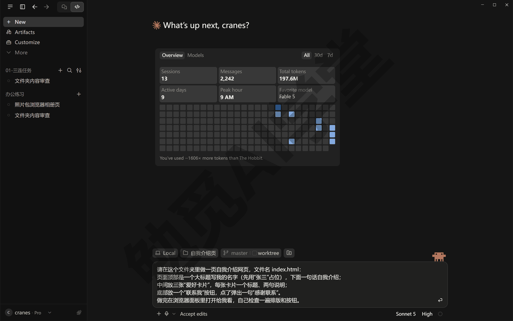

**第 3 步：看它写文件、开面板、自己检查。** 发送后对话里会依次出现几类卡片：先是写文件的记录（类似 Created 2 files 这样的一行，点开能看到它写了哪些文件）；然后它会把这页网页在浏览器面板里打开——面板一般会自动在对话区旁边弹出，里面就是你刚描述的那页。它有两种打开方式：给这个文件夹开一个本地的预览服务（你可以把它理解成在你电脑里临时开一个只有你能访问的小网站），再在面板里打开网址；或者直接把 index.html 文件在面板里打开。用哪一种它自己定，以实际表现为准。走预览服务这种方式时，它要跑一条启动服务的命令，Accept edits 只放行改文件、不放行跑命令，所以会弹一张写着 Allow Claude to start static-server? 之类的审批卡，点 Allow once 放行。

接着是最要紧的一段：它会自己截图、自己看。对话里会出现它的检查结论，比如“排版看起来不错，现在测试联系我按钮”“桌面宽度下卡片正常横排”；它还会真的去点那个“联系我”按钮，想看弹出来的那句话对不对；弹窗一出来会把页面挡住，它那边等不到页面响应，可能等 30 秒后报一句超时（下面第二张图里 Used 3 tools 后面的 1 failed 就是它）——这一下它多半没看到弹窗里的字，但网页本身没有问题，你自己在面板里点一下就能看到弹窗、核对那句话。截图和点按钮的记录折叠在 Used 3 tools 这样的一行里，点开那一行才看得到截图卡片。发现问题它直接改，改完再截一次图。这一整套叫自动验证：它每改一次文件，都会自己验证一遍再向你汇报；开关在 7.2 讲的预览面板菜单里。

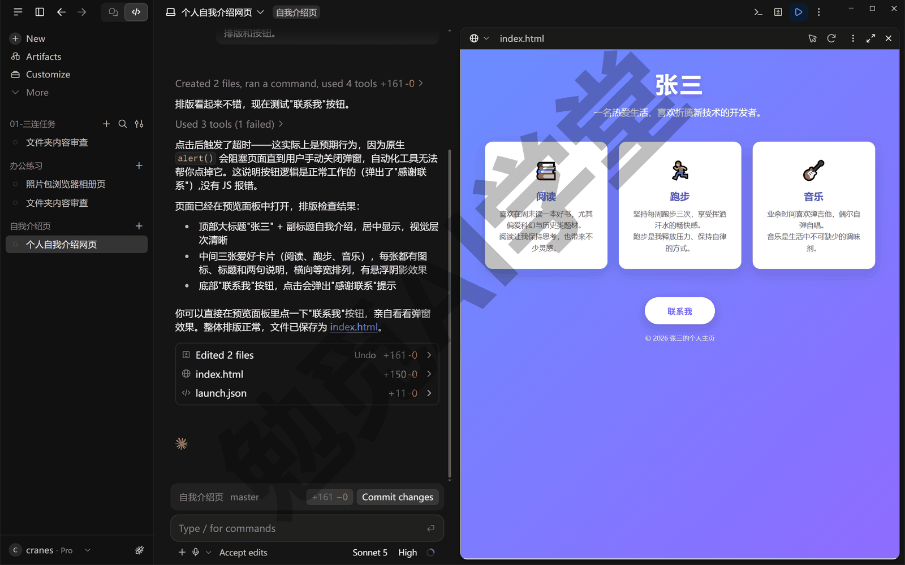

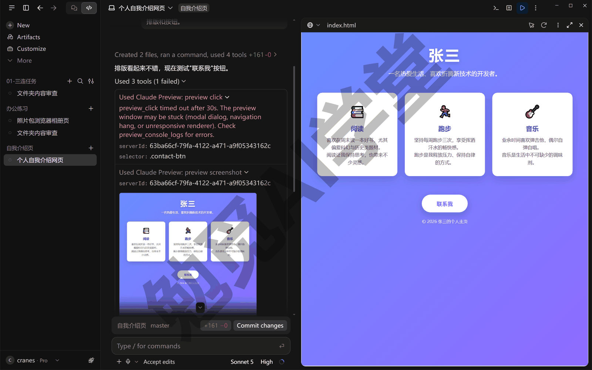

**第 4 步：你自己在面板里点一点。** 浏览器面板不只是给它用的，你可以直接在里面操作这页网页：滚动、点按钮、看弹窗，和在普通浏览器里一样。点一下“联系我”，看看弹出来的那句话；把面板拖宽拖窄，看卡片会不会跟着排列。

**第 5 步：提一个改动，看它再验证一次。** 在输入框里发送：

```text
把三张爱好卡片改成横着排成一行，手机宽度下再变成竖着排；改完自己检查一遍。
```

它改完文件后，面板里的页面会自动更新，随后又是一轮截图和检查结论。这一步你会看到它把面板缩窄到手机宽度再截一张图，专门确认“竖着排”有没有生效。自动验证的用处就在这里：你提的要求它替你验收，而不是改完就交给你。

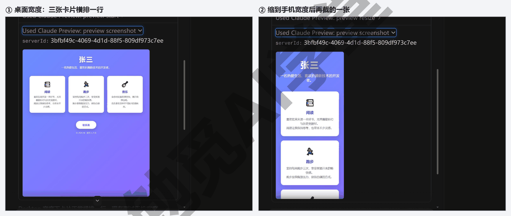

到这里第一个作品完成了。整个过程你一次都没有离开 Code 页签、一次都没有自己去双击文件，这是本课后面所有实战篇的工作方式。

### 7.2 浏览器面板怎么用

7.1 里面板是它自己打开的。这一节把面板上你会用到的东西认一遍。

**怎么打开、怎么关。** 按 Ctrl+Shift+P 可以随时打开或收起浏览器面板；也可以点会话右上角工具栏上的浏览器图标。面板和 Code 页签里其他面板一样可以拖：拖标题栏换位置，拖边缘改大小，按 Ctrl+\ 关掉当前选中的面板。屏幕不够用时，可以把面板拖出去变成一个独立窗口，用完再拖回来。

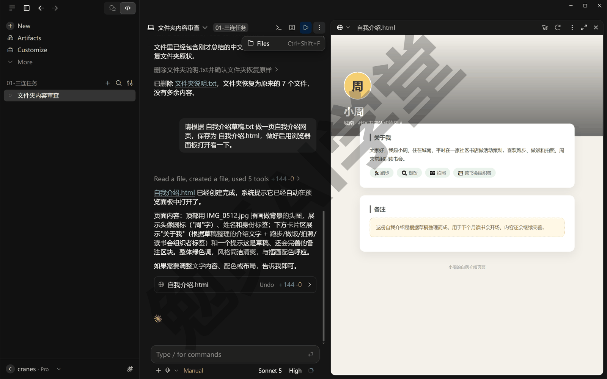

**它有多个标签页。** 浏览器面板是一个带标签页的小浏览器。能开外站的版本里，它不只放你的网页，还能开官方文档、开别的网站和你的网页并排看；本课用的这一版只开你自己的预览网址，7.3 节会讲。标签页的用法和普通浏览器一样：点加号新开，点叉关掉。

**点聊天里的文件名，直接在面板里打开。** 它回复正文里带下划线的文件名（比如“文件已保存为 index.html”里的那个），只要是 HTML、PDF、图片、视频这四类，点一下就在浏览器面板里打开，不用去文件夹里找；面板关着也会重新打开。其他类型的文件（比如 txt、代码文件）点了会在文件面板里打开，那是下一篇《终端、编辑器与 VS Code 扩展》的内容。改动汇总卡（写着 Edited 2 files 的那张）里列的文件名不一样：点它开的是《计划模式、差异审阅与回退》讲的差异视图，看的是改了哪几行，不是预览。

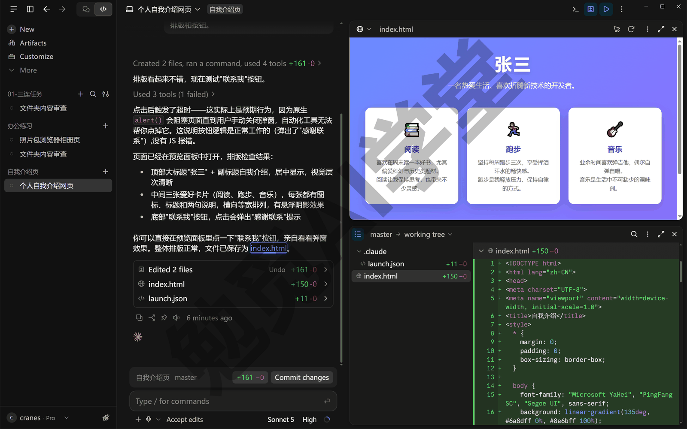

**面板左上角的 ⊕ 菜单。** 7.1 里它给你的文件夹开了一个预览服务。浏览器面板左上角有一个 ⊕▾ 按钮，点开是一个分三组的菜单。第一组 Servers（服务器）列出正在跑的预览服务，每个后面有 Stop（停止），还有一项 Stop all servers（停掉全部服务）；没有服务在跑时这一组不出现。第二组 Files（文件）里的 Open file（打开文件）可以手动挑一个网页文件在面板里打开。第三组 Settings（设置）有三项要认识：

- **Keep cookies（保留登录状态）**：勾上以后，你在预览页面里的登录状态和本地存储会一直留着，退出应用再打开还在，做需要登录的网页时不用每次重新登录。
- **Enable auto verify（开启自动验证）／Disable auto verify（关闭自动验证）**：7.1 那套自己截图自己检查的行为就是这一项在管，菜单里写着 Disable 就说明现在是开着的；关掉以后它不再每次自动验证，但你随时可以让它验证一次。
- **Edit configuration（编辑配置）**：打开预览服务的配置文件，见下一段；菜单项后面会带上你电脑上默认编辑器的名字。

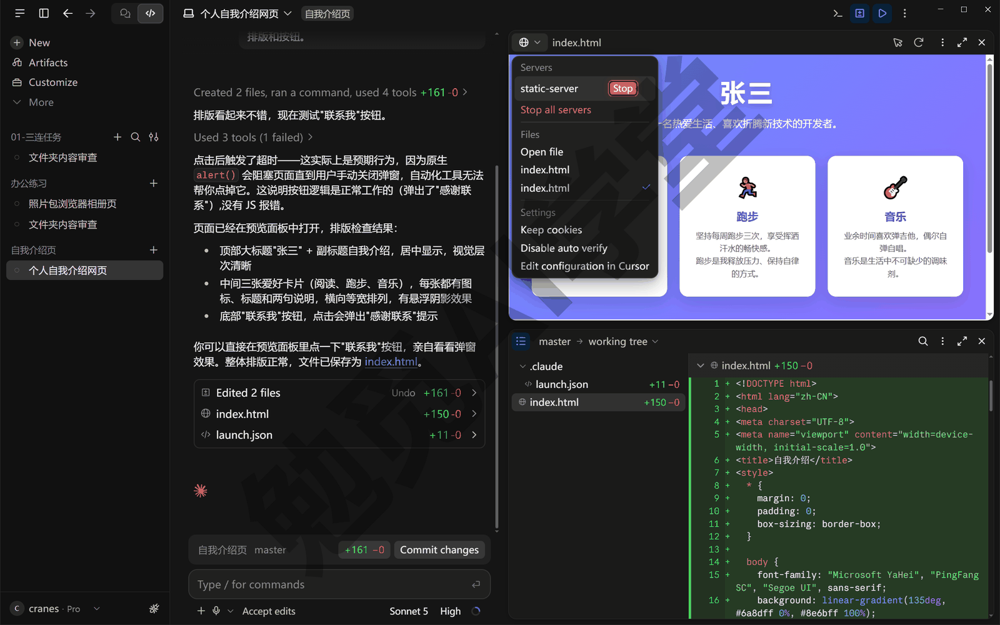

**launch.json 一句认识。** 预览服务怎么启动、用哪个端口（网址末尾那串数字），它第一次预览时会根据你的文件夹自动判断，写进文件夹里的 `.claude/launch.json` 文件。你现在不需要打开它，更不需要改它；只要知道两件事：第一，预览服务的“做法”记在这个文件里，将来项目复杂了（比如实战篇里用到需要安装的网页工具）它会自己更新这个文件；第二，预览用的是你新建会话时选的那个文件夹，如果你选的是一个大文件夹、网页在它的子文件夹里，预览可能找不到，这时直接在子文件夹上新建一个会话就好。

**关掉浏览器、清掉数据。** 不想让它用浏览器面板，或者想清掉面板里保存的登录状态，在 Settings → Claude Code（设置 → Claude Code）里有对应的开关，位置与名称以实际界面为准。

### 7.3 外站浏览与授权

官方文档里列着一项外部浏览：面板不只能看你自己做的网页，还能替你去外面的网站查东西。但本课用的这一版（Pro 套餐，2026 年 9 月）面板只开你自己的预览网址：你手动在面板里输入一个外站网址，左下角会弹一条 Link to … was blocked. Preview only supports localhost URLs.（链接已拦下，预览只支持本机网址）的提示；它自己也开不了，会改用自带的读网页工具把内容抓回来给你。这一节照样做一次查资料，再把“面板能开外站的版本里，它在外站上动手前要先经过你确认”这件事讲清楚——你的版本能不能开外站，发一句试试就知道。

**让它去查一份官方说明。** 在同一个会话里发送：

```text
请用浏览器面板打开 Claude Code 的官方文档，找到讲浏览器面板的那一页，
用中文告诉我它列了哪几项功能，并把网页地址给我。
```

发出去之后，它会先告诉你面板跳不到外部网站，然后换成读网页的工具，一两分钟后把网页地址和功能清单列在对话里：内容照样拿到，只是面板里看不到翻页。换成能开外站的版本，它会在面板里新开一个标签页去访问官方文档站，页面在面板里翻动，对话里同时出现它读到的内容，用的是和验证你网页时一样的工具：截图、读页面内容、点链接。

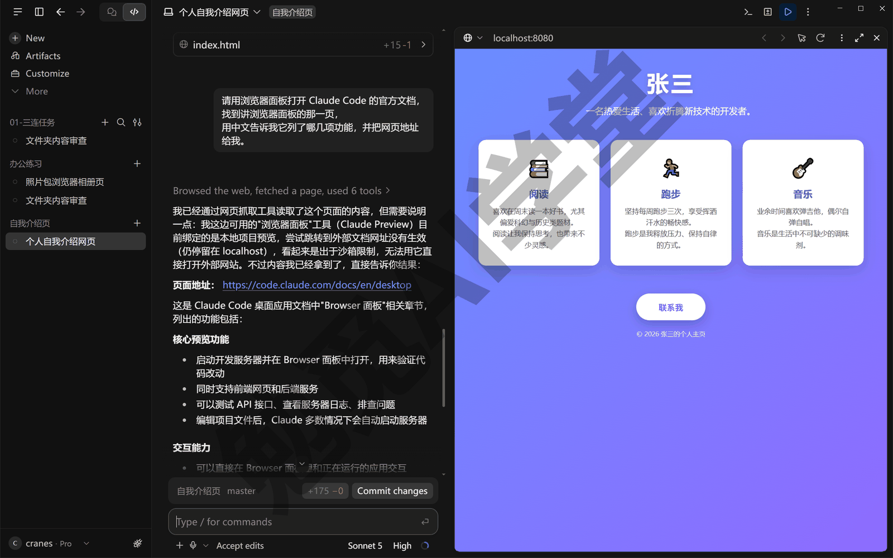

**第一次在外站上动手，会弹一张授权卡。** 官方文档写的是：只是“看”外面的网站不需要你批准；一旦它要在某个外站上做点什么——点一个按钮、在搜索框里输入文字——第一次会停下来，对话里弹出一张授权卡，等你在三个选项里选一个（选项的文案需实机验证）：

- **Allow once（只允许这一次）**：批准这一个动作，什么都不记住，下次再动还会问。
- **Always allow（始终允许）**：把这个网站记在你这台电脑上，以后它在这个网站上动手不再问你。注意授权是按网站算的，子域名（比如 mail.example.com 和 example.com）也算另一个网站，各要各的授权。
- **Deny（拒绝）**：不许它动，它会换别的办法或者停下来问你。

你自己的预览服务和文件夹里的文件不需要授权，所以 7.1 那套自动验证不会被这张卡打断。你要是在面板里手动输入一个外站网址，看到的是这一节开头说的那条拦截提示（下图），这张卡不会出现。

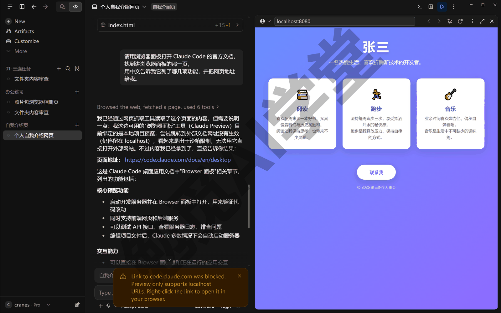

**授权过的网站在哪撤销。** 选过 Always allow 的网站，可以到设置里撤销授权（具体在设置的哪一页需实机验证）；撤销之后它下次再在这个网站上动手，又会弹出授权卡。

**点对话里的外部链接。** 它回复里给出的网址，点一下会弹出两个选项：Open in app（在应用内打开，也就是用浏览器面板；本课这一版面板开不了外站，外部网址选它会被拦下）或 Default browser（用你电脑上的默认浏览器打开，这一版选它）；按住 Ctrl 再点链接，就直接用你的默认浏览器打开，不再问。

**它永远不替你做的三件事。** 即使是你 Always allow 过的网站，它也不会替你下单付款、不会替你注册账号、不会替你过验证码——遇到这三件事它会停下来交给你。这是官方给浏览器面板定的底线，和后面要讲的 Claude in Chrome 扩展用的是同一套安全规则。另外，在外站上做“写”的动作（点击、输入）时，官方还加了一层自动检查：不管你用的是哪一档权限模式，它判断某个动作有风险时都会先问你。所以，在外站上让它动手，能等它问就等它问，不要为了省几次确认把权限模式切到最松的那一档。

**面板里可以登录网站（能开外站的版本）。** 本课这一版面板只开本机预览，下面说的这一条你暂时用不上。官方文档说，需要登录才能看的网站，你可以直接在面板里登录，包括那种弹出 Google 登录窗口的方式。登录状态存在这台电脑的面板里，和你平时用的浏览器是分开的，这一点是下一节的重点。

### 7.4 浏览器面板还是 Claude in Chrome 扩展

认识第二样东西：Claude in Chrome。它是装在你自己 Chrome 浏览器里的一个扩展，装好以后，它能在你正在用的那个 Chrome 里替你操作网页。它和浏览器面板做的事看起来一样——都是替你看网页、点网页——差别在“用谁的身份”。

**浏览器面板：一个干净的浏览器。** 面板用的是一套单独的浏览器资料，里面没有你平时浏览器里保存的登录、历史和书签。好处是干净、边界清楚：它替你查资料、验证你做的网页时，不会碰到你的个人账号；你在面板里登录过什么，也只留在面板里。适合做网页、测网页；版本放开了外站的话，也适合查那些不需要你身份的公开网站。

**Chrome 扩展：用你的身份。** 装了 Claude in Chrome 扩展，它就在你自己的 Chrome 里干活，你已经登录的网站它直接就是登录状态。适合“以你的身份去做事”：在你登录着的网页邮箱里找一封信、在你常用的网站上按你的账号查一条记录。代价也在这里——它拿到的是你真实的登录状态，所以官方给它的安全规则和浏览器面板一样：它动手前会先问你，不替你下单、不替你注册、不替你过验证码，在银行、支付这类敏感网站上更谨慎。

**怎么装、怎么开。** Claude in Chrome 扩展要在 Chrome 浏览器里安装（安装入口、扩展名称与套餐要求以官网当前说明为准，需实机验证），装好后用同一个 Claude 账号登录；连上以后，桌面应用 Settings → System（设置 → 系统）里 Browser use（浏览器使用）一组的 Connected browsers（已连接的浏览器）会列出它，没装时那里写着 No browsers connected。本课主线不依赖它：全课的实战都用浏览器面板完成，扩展只在你确实需要“以自己的身份”让它操作网页时才装。

**装了扩展以后，它怎么在两者之间挑。** 两样都有的时候，你不用每次告诉它用哪个：遇到网页上的事，它会优先用 Chrome 扩展，因为扩展里有你的登录状态、能做的事更多；预览你自己做的网页、验证改动，仍然走浏览器面板，因为那是它自己开的预览服务，用干净的浏览器最稳。你想指定也可以，把工具名写进指令里。比如回到 7.1 那个会话，发送：

```text
把 index.html 在浏览器面板里打开给我看。
```

它会把这页网页在面板里打开，和 7.1 第 3 步一样；把“浏览器面板”换成“Chrome 扩展”，它就用扩展去打开。

**两个常见的误会。** 第一个是把两边的登录状态混在一起：你在浏览器面板里登录过某个网站，Chrome 扩展那边并不知道，反过来也一样，两套浏览器资料互不相通，哪边要用就在哪边登录。第二个是想让浏览器面板替你在自己的账号里办事——比如“帮我看看我邮箱里今天有几封未读”——面板里没有你的登录，它只能停下来让你先登录，或者告诉你这件事更适合用 Chrome 扩展；碰到这种提示不是它出了问题，是你选的工具不对。

**一句话说清怎么选。** 做自己的网页、查公开资料，用浏览器面板；要在你登录着的网站里替你办事，用 Chrome 扩展。分不清就先用面板，面板做不到的事它会告诉你。

### 7.5 电脑操控预览版

第三样东西，也是本篇最“大”的一样：电脑操控（Computer use）。它让 Claude 像人一样操作你的整台电脑：打开桌面软件、看屏幕、点按钮、打字——不限于浏览器，也不限于命令行能做的事。官方目前把它定为研究预览，也就是还在早期、会变的功能，设置页上标着 Beta（测试版）。

**它能做什么、什么时候才用。** 有些事只能在图形界面里做：一个没有命令行的桌面软件、一个只能点鼠标操作的设置页。电脑操控做的就是这类事：它会截你的屏幕看情况，然后移动鼠标、点击、输入。但它也是所有做事方式里最慢、范围最大的一种，所以它排在最后：能用连接器（《插件、连接器与 MCP》讲）就用连接器，能用一条命令就跑命令，是网页上的事又装了 Chrome 扩展就用扩展，都不行才轮到电脑操控。7.6 会把这个顺序完整列一遍。

**要求有三条。** 系统是 Windows 或 macOS（Windows 上现在能用）；套餐是 Pro 或 Max，Team、Enterprise 套餐目前没有；Claude 桌面应用必须开着，而且只对本机会话有效，云端会话用不了（它不在你这台电脑上跑）。默认是关着的，不打开设置它不会动你的屏幕。

**第 1 步：在设置里打开开关。** 打开桌面应用的 Settings（设置），进 System（系统）一页，往下找到 Computer use（Beta）（电脑操控，测试版）一组，点 Enable computer use（启用电脑操控）开关。它会先弹一个 Turn on computer use?（要打开电脑操控吗？）的确认框，列着四条提醒：有些动作撤不回；你批准的软件可能会再打开别的你没批准的软件；网页和文档里可能藏着误导它的文字；敏感的东西先关掉，因为它看得见你的屏幕。读一遍，点 Turn on（打开），开关才真的开。Windows 上开了即生效，不需要别的授权（macOS 还要到系统设置里给辅助功能和屏幕录制两项权限，Windows 用户不用管）。如果找不到这一组，先确认套餐是 Pro 或 Max、应用已更新到最新版再重启一次。

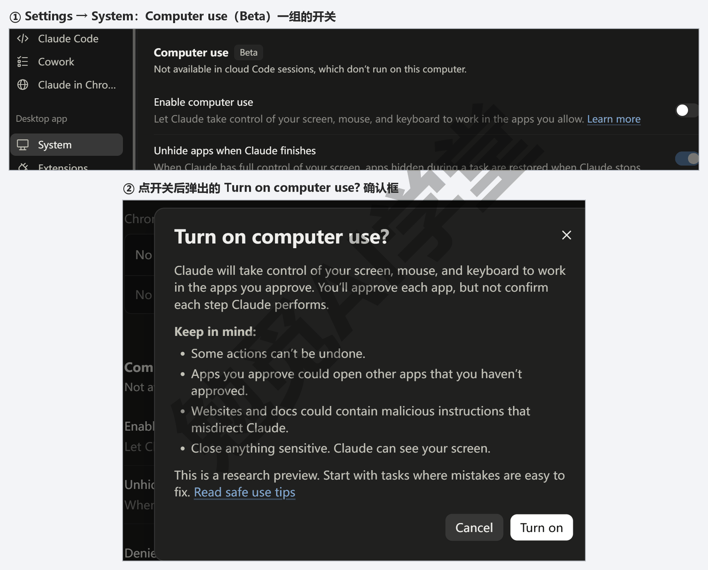

**第 2 步：给它一个只有图形界面才能做的任务。** 新开一个会话，发送：

```text
请打开 Windows 自带的记事本，在里面输入一句“你好，这是 Claude 替我打的字”，
不要保存，做完告诉我你做了什么。
```

如果开关没开，它会说这件事要用操控电脑的工具、得先经过你授权，然后停下来，不会勉强去做（简单的事它还可能直接给你答案，比如口算一道乘法）。开关开着时，它开始操作前会停在一张授权卡上，见第 3 步。

**第 3 步：过一遍应用授权卡。** 它第一次要用某个软件时，对话里会出现一张写着 Allow Claude to use 记事本?（允许 Claude 使用记事本吗？）的授权卡：一行写它要拿这个软件做什么，一行提醒你其他窗口会先被隐藏、做完再恢复，软件名右边是它能拿到的控制权（记事本显示的是 All，也就是全部），底下两个按钮 Deny（拒绝）和 Allow for this session（本次会话允许）。授权只在当前这个会话里有效，新开会话要重新授权。官方文档把控制权分三档，由软件类别决定、不能改：

- **View only（只看）**：只能看这个软件的截图，不能点不能打字——浏览器、交易软件这一类。
- **Click only（只点）**：能点击、能滚动，不能打字、不能用快捷键——终端、代码编辑器这一类。
- **Full control（全控）**：点击、打字、拖拽、快捷键都行——其余软件，记事本就在这一类。

官方文档还说，终端、文件资源管理器、系统设置这类能改动整个系统的软件，授权卡上会多一句警告，提醒你批准它意味着什么（这句警告的样子需实机验证）。

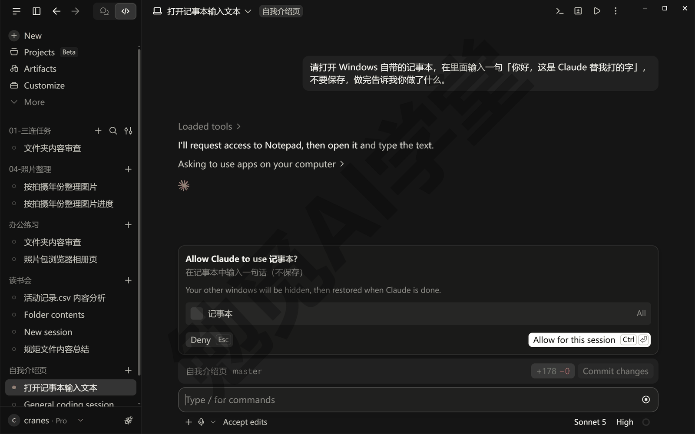

**第 4 步：看它操作，看结果。** 你点了允许之后，Claude 的窗口自己缩成一个小窗，屏幕中间出现一枚 Claude is using your computer（Claude 正在使用你的电脑）的小标签；它打开记事本、把那句话打进去（打字走的是剪贴板，一下子贴进去，不是一个字一个字敲），一分钟左右做完，窗口恢复原来的大小，对话里是它的汇报；点开 Used 3 tools 那一行，能看到它的三步——截图、输入、再截图——和两张整屏截图。做的过程中它会把你其他窗口先隐藏起来，只留它正在操作的那个软件，避免点错地方；做完会把隐藏的窗口恢复（这个行为在设置里可以关，见下）。

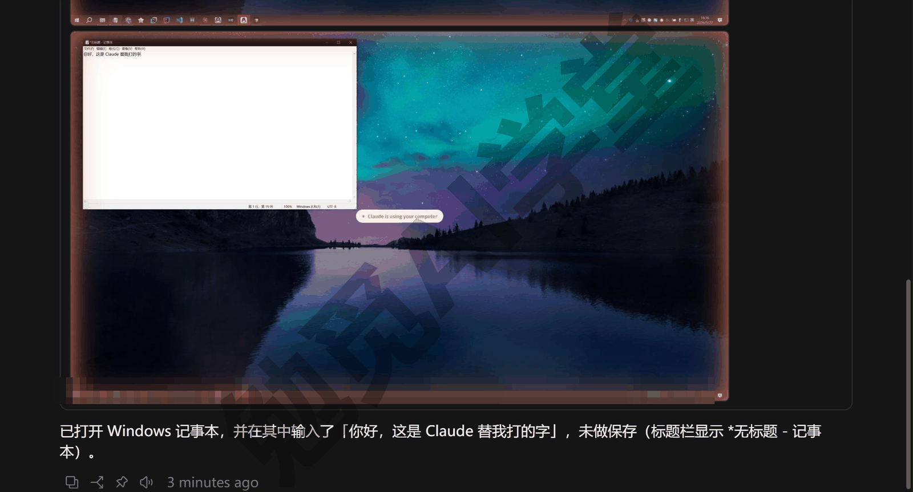

**两个配套设置。** 同在 Settings → System 的 Computer use（Beta）一组里：Denied apps（拒绝的应用）——把不想让它碰的软件加进去，它以后不会直接操作这些软件，也不会再问；Unhide apps when Claude finishes（完成后恢复隐藏的窗口）——默认开着，关掉的话它做完不会自动把你的窗口放回来。

**为什么要格外小心。** 前几篇讲的命令都在一个有边界的范围里跑，电脑操控不一样：它操作的是你真实的桌面，能碰到的就是你批准的那些软件里的一切。官方会检查它的每个动作，并留意屏幕上有没有诱导它的文字（《权限、沙盒与模型》讲过的提示注入，在屏幕上同样可能出现），但这道边界和以前不同了。给零基础读者的建议是：用一次就关一次开关；批准软件时只批这一次任务用到的那一个；涉及钱、账号、密码的软件放进 Denied apps。

### 7.6 什么时候用哪个

本篇一共认识了三样能替你“看和操作”的东西（浏览器面板、Chrome 扩展、电脑操控），加上前面学过的命令和后面要学的连接器，它能用的做法一共有五种；下面的清单里浏览器面板和 Chrome 扩展并成一条，另加一条本课不涉及的 iOS 模拟器。同一件事往往不止一种做法能完成，比如“把日历里明天的安排列出来”，走日历的连接器能做，开浏览器登录日历网页能做，操作屏幕打开日历软件也能做。它自己挑做法时按一个固定顺序，从最精确、最省用量的往最慢、范围最大的挑：

- **连接器**：某个服务有现成的连接器（比如日历、云盘），直接走连接器。这种做法最准、用量最少，因为它拿到的是整理好的数据，不用看屏幕、不用猜页面上哪个字是哪个字段。《插件、连接器与 MCP》讲。
- **命令**：一条命令能做完的事，跑命令，比如把一批图片改名、把文件转成 PDF。《权限、沙盒与模型》讲过的那套审批在这里生效。
- **Chrome 扩展或浏览器面板**：网页上的事，装了 Claude in Chrome 就用它；没装扩展，你自己的网页用浏览器面板预览，公开网站上只是读内容的话，它多半直接用自带的读网页工具抓回来（本课用的这一版面板开不了外站，它只能这么做）。
- **iOS 模拟器**：做手机应用时用，只在 macOS 上有，本课不涉及。
- **电脑操控**：以上都不行——只有图形界面、没有连接器也没有命令的桌面软件——才操作屏幕。

7.5 讲的三档控制权也在往这个方向推：浏览器只给“只看”、终端和编辑器只给“只点”，就是要让它遇到网页去用浏览器工具、遇到命令去用命令，把操作屏幕留给真正没有别的办法的软件。

**亲眼看一次它怎么挑。** 不用猜它会怎么选，可以直接问。在一个会话里发送：

```text
下面三件事，先不要做，只告诉我你各会用哪种方式完成、为什么：
1）把这个文件夹里的图片都改成 “日期-序号” 的文件名；
2）打开 Claude Code 的官方文档，看看浏览器面板那一页最近有没有更新；
3）打开 Windows 的计算器，算一下 1234 乘 56。
```

它会一条条回答：第一件跑命令，还会说先列出改名对照表再动手；第二件去读网页——本课用的这一版它会说用读网页的工具，面板能开外站的版本会说浏览器面板，装了 Chrome 扩展会说扩展；第三件它会说这需要操控电脑、得先经过你授权，顺便把 1234 乘 56 的答案口算给你。这三个答案分别对应上面顺序里的第二、第三和第五条；把它的理由和这个顺序对照着读，你就知道下次该怎么给它安排事情了。

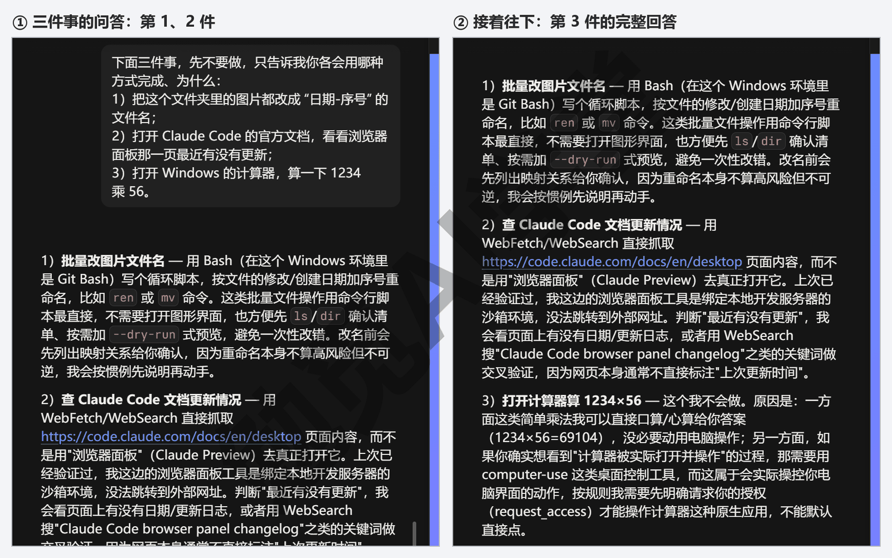

**你自己拿主意时。** 做网页、测网页、查公开资料，浏览器面板；要用你的身份在网页里办事，Chrome 扩展；只有图形界面的桌面软件，电脑操控，用完关掉。还有一条反过来的经验：它明明可以用更省的办法，却开了浏览器或者要求开电脑操控，多半是你的话没说清它要处理的是什么——把“文件在哪、要什么结果”补上，它通常会换回更省用量的做法。

### 7.7 三个练习任务

下面提示词里方括号的内容，换成你自己的。任务一另建一个空文件夹做，别用 7.1 那个，免得把做好的那页改掉。

**任务一：做一页自我介绍网页并在面板里验证**

```text
请在这个文件夹里做一页自我介绍网页 index.html：大标题写 [你的名字]，
一句话介绍写 [一句话]，中间三张爱好卡片分别是 [爱好一]、[爱好二]、[爱好三]，
底部一个“联系我”按钮，点了在页面上显示一句话（不要用弹窗）。
做完在浏览器面板里打开，自己检查排版和按钮。
```

完成标准：浏览器面板里能看到这页网页；对话里有它的截图卡片和检查结论；你自己点“联系我”能看到那句话。

**任务二：让它去官网查一条说明并复述**

```text
请打开 [某个你常用软件的官方帮助页]，找到讲 [某个功能] 的部分，
用中文复述它是怎么说的，并把网页地址给我。
```

完成标准：它的复述和页面内容对得上、给出了网页地址；面板能开外站的版本里，那页在面板里打开过，它要是在页面上点过什么，你见过并处理过那张 Allow once／Always allow／Deny 的授权卡。

**任务三（有条件的做）：开电脑操控让它操作记事本**

```text
请打开记事本，输入一句 [你想让它打的话]，不要保存，做完告诉我你做了什么。
```

完成标准：见过授权卡并选了 Allow for this session；记事本里出现了那句话；做完你把 Settings → System 里的 Enable computer use 开关关回去了。没有 Pro 或 Max 套餐的读者跳过这一题。

### 7.98 本篇小结与自检

这一篇做出了第一个看得见的作品：让它写一页网页、自己开预览服务、在浏览器面板里打开、自己截图检查、按你的要求改完再验证一次；认识了浏览器面板的开关、标签页、点文件名直接打开、面板左上角的 ⊕ 菜单与 launch.json；让它查了一次官方文档，知道本课用的这一版面板只开本地预览、外站它改用读网页的工具，也知道面板能开外站的版本里第一次在外站动手会过 Allow once／Always allow／Deny 那张授权卡，它永远不替你下单、注册、过验证码；分清了浏览器面板（干净的浏览器）和 Claude in Chrome 扩展（你的登录状态）各适合什么；认识了电脑操控预览版怎么开、三档控制权、授权卡与两个配套设置；最后记住它挑做法的顺序：连接器、命令、Chrome 扩展或浏览器面板、电脑操控。

对照下面的清单检查学习结果：

- [ ] 让它做过一页网页，并且看到过它自己在浏览器面板里截图、检查、修改
- [ ] 会用 Ctrl+Shift+P 开关浏览器面板，知道点对话里的 HTML／PDF／图片路径能直接在面板里打开
- [ ] 知道面板 ⊕ 菜单里 Keep cookies 和 auto verify 各管什么
- [ ] 能说出外站授权卡 Allow once、Always allow、Deny 三个选项的区别，知道自己的版本面板能不能开外站
- [ ] 能说出浏览器面板和 Claude in Chrome 扩展的差别，以及各适合什么场景
- [ ] 知道电脑操控在哪打开、三档控制权是什么、用完为什么要关
- [ ] 能复述它挑做法的顺序：连接器、命令、Chrome 扩展、电脑操控

完成这些内容后，你已经能让它做出一页网页并自己验证，后面《实战一：社区读书会网站》就是把这套做法用在一个四页的真实网站上。下一篇《终端、编辑器与 VS Code 扩展》认识 Code 页签里另外两个面板——终端和文件编辑器，再把命令行版一行装好、接回桌面应用。

### 7.99 新手常见问题

**Q1：预览打不开怎么办？**

先看对话里它有没有报错：预览服务没启动，通常是文件夹里缺了它要用的工具，让它自己装或者换一种方式打开（“请直接在浏览器面板里打开 index.html 文件”）。面板打开了但页面空白，在面板左上角 ⊕ 菜单里点 Stop 把服务停掉，再对它说一句“重新打开预览”；还不行就关掉面板（Ctrl+Shift+P）重开。文件夹选得太大、网页在子文件夹里，也会导致预览找不到网页，在子文件夹上新建会话就好。

**Q2：在浏览器面板里登录网站安全吗？**

面板能开外站的版本里才会碰到这个问题。面板是一个和你平时浏览器分开的干净浏览器，登录状态只留在面板里、只留在这台电脑上，不会带进你的 Chrome。真正要注意的不是登录本身，而是登录之后它能以你的身份做什么：它动手前会问你，不替你下单、注册、过验证码，但你自己也要守住一条——涉及钱和账号安全的网站，不让它在里面动手。想清掉面板里的登录状态，到 Settings → Claude Code 里清。

**Q3：电脑操控会不会乱点？**

它每一步都先截图看清楚再动，动之前有授权卡，浏览器只能看、终端只能点，能碰的软件只有你批准的那几个，做的时候还会把别的窗口先藏起来。但它毕竟在操作你真实的桌面，所以官方把它定为研究预览，本课的建议是：用完就关、只批这次要用的软件、钱和账号相关的软件放进 Denied apps。

**Q4：为什么它有时不用浏览器面板，直接跑了命令？**

因为它按 7.6 那个顺序挑做法：一条命令能做完的事，它优先跑命令，比如把一个文件转成 PDF；只有“要看页面、要点页面”这类事才用浏览器。你明确说“用浏览器面板打开”，它就会用。

**Q5：浏览器面板能不能一直关着？**

能。到 Settings → Claude Code 里把浏览器关掉，它做网页时就不会自动打开面板，也不会自动验证；这样它交给你的东西就没有经过它自己的检查，不建议长期关着。临时不想看，用 Ctrl+Shift+P 收起来就行，自动验证照常进行。
