## 终端、编辑器与 VS Code 扩展

这一篇认识 Code 页签里剩下的两个面板——终端和文件编辑器，然后走出桌面应用，把命令行版本一行装好、看看它在黑窗口里是什么样子、再用一条命令把命令行里的对话接回桌面应用；最后认识一下 VS Code 扩展和 JetBrains 插件，知道它们是什么、什么时候会用到。

读完这一篇，你手里就有了 Claude Code 的全部入口，也知道自己该用哪一个。本课主线不变：桌面应用的 Code 页签；命令行和编辑器扩展是“另一个入口”，认识了以后用得上，不认识也不影响后面的学习。演示环境仍是 Windows 上的 Claude 桌面应用与命令行版（以 2026 年 9 月的版本为例，命令行版以 2.1.232 为例）。

这篇文章的实操内容需要 Claude 的付费订阅（Pro 起）：终端面板、文件面板是 Code 页签的一部分；命令行版用的是同一个账号、同一份用量，不另外收费。

### 8.1 面板里的终端

**终端是什么。** 终端就是那个黑底白字、只能打字的窗口，Windows 上叫 PowerShell 或命令提示符。程序员在里面输入命令让电脑做事。本课前七篇你一次都没有打开过它，因为该跑的命令它都替你跑了；但有两类时刻你会想自己看一眼：一是想确认它到底改了什么，二是想自己跑一条命令核对结果。Code 页签把终端做成了一个面板，不用另开窗口。

**先看没有这个面板时要怎么做。** 你得另开一个 PowerShell 窗口，用 cd 命令一层层切到项目文件夹，再跑命令；跑完切回桌面应用看对话。面板里的终端省掉了前两步：它打开时就已经在你这个会话的文件夹里，和它用的是同一套环境，你跑的命令看到的文件就是它正在改的文件。

**第 1 步：打开终端面板。** 在 7.1 那个自我介绍页的会话里，按 Ctrl+`（反引号键，在键盘左上角数字 1 的左边）打开终端面板；也可以点会话右上角工具栏上的终端图标（画着 >_ 的那个），按键没反应时点它一样能开。面板打开后先是几行 Windows PowerShell 的版权说明，下面是一个以 PS 开头的提示符，后面跟着的就是这个会话的文件夹路径，比如 `PS D:\Claude练习\自我介绍页>`。

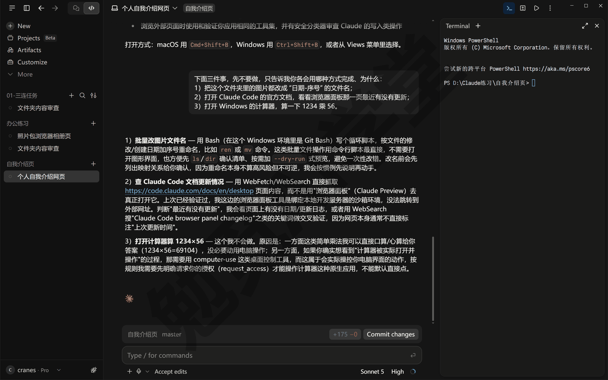

**第 2 步：跑一条命令看它改了什么。** 这条命令是 Git 的，而 7.1 新建的这个文件夹还没交给 Git 管，先在对话里让它做一次（《计划模式、差异审阅与回退》6.2 开头给相册页做过同样的事）：

```text
请把这个文件夹交给 Git 管理：只初始化仓库，先不要提交。
```

它会跑一条 `git init` 命令；Manual 和 Accept edits 模式下跑命令都要先经过你，审批卡弹出来点 Allow once 放行。做完在终端面板里输入下面这条命令，按回车：

```text
git status
```

这条命令来自 Git（《认识与装好》1.5 第 4 步装的那个记录改动历史的工具），它列出这个文件夹里哪些文件被新建、哪些被改过、还没有被记录下来。7.1 里它新建的 index.html，和装着 launch.json 的 `.claude/` 文件夹，都会列在 Untracked files（未跟踪的文件）下面。这是你以后核对它改动范围最快的办法：对话里说改了两个文件，清单里就应该只有两个。如果这条命令报错说不认识 git，说明 Git for Windows 没装或装完没重启应用，回到《认识与装好》1.5 节第 4 步处理；报错 not a git repository（不是一个 Git 仓库）则是上面“交给 Git”那一步没做成，让它再做一次。

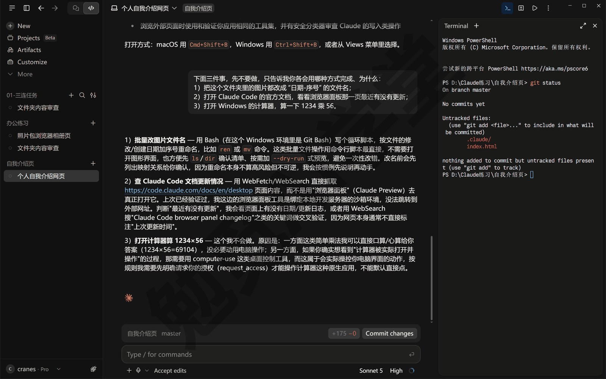

**第 3 步：再开一个标签页。** 终端面板可以同时开几个：点面板标题栏上的加号，标题栏就变成 Terminal 1、Terminal 2 两个标签页，新开的也停在这个会话的文件夹里，第一个标签页里跑过的输出还留在那里。官方文档还写了一种开法：在对话里右键点一个文件夹路径，选 Open in terminal（在终端中打开），会直接开一个停在那个文件夹的终端标签页，本课没有试到这一项（需实机验证）。

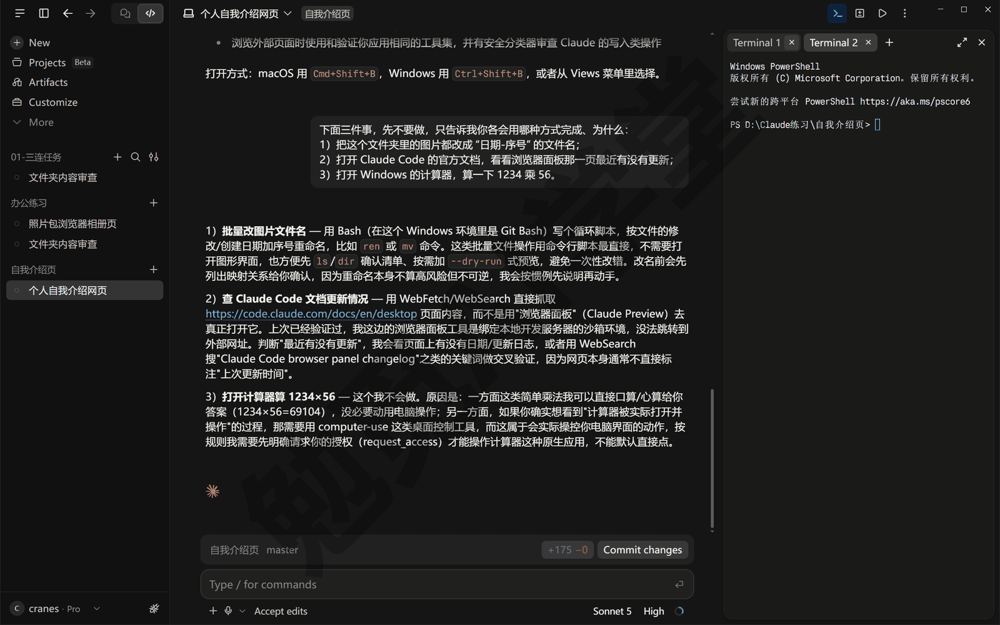

**两条边界。** 终端面板只在本机会话（Local）里有，云端会话里没有——云端的事让它自己跑命令。另外，这个终端和它共用环境，你在里面装的工具、改的文件它都能看到，反过来也一样；所以别在这里做你不想让它看到的事，比如登录一个私人账号。

**三个常见的小问题。** 遇到时对着找：

- 跑了一条一直不结束的命令（比如它开的预览服务），按 Ctrl+C 能停掉；停掉预览服务后浏览器面板里的网页会打不开，让它重新启动一次就好。
- 不要在这个面板里再输入 `claude` 开一个命令行会话：那会在同一个文件夹里同时跑两个它，改动互相看不见，容易乱。命令行版怎么用见 8.3、8.4。
- 输出里中文显示成方块或问号，多半是终端的编码问题，不影响它干活；在面板里输入 `chcp 65001` 回车，切成 UTF-8 编码后通常就正常了（以实际表现为准）。

### 8.2 文件面板

**文件面板是什么。** 上一篇 7.2 讲过，它回复里的文件名点一下就能打开：HTML、PDF、图片、视频在浏览器面板里开，其他文件——txt、代码、配置文件——在文件面板里开。文件面板（界面上叫 Files）就是一个小编辑器，左边是这个文件夹的文件树，右边是带行号的文件内容，让你不离开 Code 页签就能看一眼文件、改两个字。不等它给链接也能打开它：点会话右上角工具栏的 ⋮ 菜单选 Files，或按 Ctrl+Shift+F。

**第 1 步：在文件树里打开 launch.json。** 按 Ctrl+Shift+F 打开文件面板，左边文件树里有 7.1 它建的 index.html 和一个 `.claude` 文件夹；点开 `.claude`，再点里面的 launch.json，右边就显示出这个文件的内容——十来行配置，写着预览服务用哪条命令、哪个端口，就是 7.2 讲过的那份。面板窄的时候文件树和文件内容只显示一个，点工具栏最左边的 ☷ 图标在两者之间切换，把右栏拖宽才能并排看。改动汇总卡里列的文件名点开进的是差异视图，不是这里。

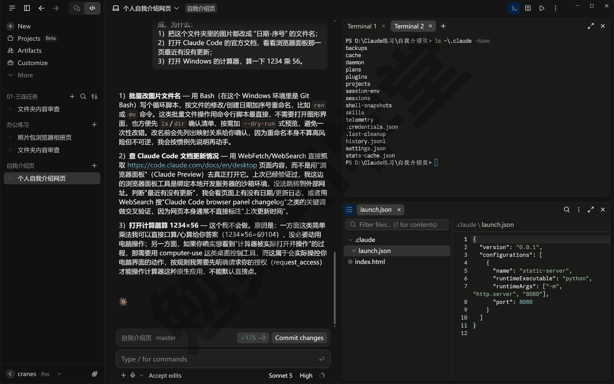

**第 2 步：手改两行，它自动保存。** 文件面板可以直接编辑。做一个无害的练习，先在对话里发送：

```text
在文件夹里新建一个 备注.txt，写一句话。
```

它回复里的 备注.txt 是蓝色的链接，点一下就在文件面板里打开了（左边文件树这时也会刷新出这个新文件）；在内容区点到第 2 行，打一句话。不用找保存按钮——面板默认开着自动保存（Auto save），你打完字它就写回了磁盘，第一次改文件时会弹一条 Auto save is on（自动保存已开启）的提示。想自己决定什么时候保存：点面板工具栏上的 ⋮，把 Auto save 的勾去掉，之后再改，右上角会出现 Cancel（取消）和 Save（保存）两个按钮，点 Save 才写进磁盘，Cancel 按字面是放弃这次没保存的改动（需实机验证）；官方文档里这两个按钮叫 Save 与 Discard，名字以你看到的为准。

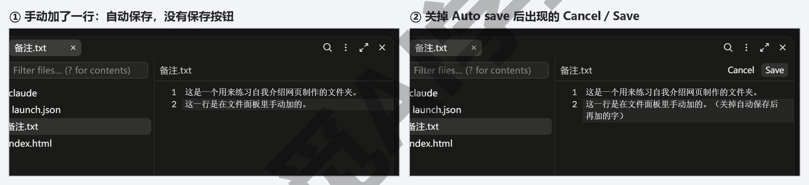

**它改了同一个文件，面板会跟着刷新。** 备注.txt 还开在面板里时，让它“在 备注.txt 末尾再加一行，写上今天的日期”：它改完，面板里的内容自己刷新成三行，不用你重新打开；它改之前会先读一遍文件，你刚手加的那一行会保留下来。关掉自动保存的话还有一种情况：你手里有还没保存的改动、文件又被它改了，这时面板会提醒你选覆盖还是放弃（需实机验证）；真碰到了别急着点覆盖，先看它改了什么，再决定留谁的。

**复制完整路径。** 点面板标题栏上的路径，就把这个文件的完整路径（从盘符开始的那一串）复制到了剪贴板（需实机验证）；拿不准就用下面右键菜单里的 Copy。路径要发给别人、要在别的软件里打开时用得上。

**右键一个文件名，能做四件事。** 右键对话里的文件链接，会弹出四项（差异视图、文件面板里的文件路径右键也是同一个菜单，以实际界面为准）：

- **Attach as context（作为上下文附上）**：把这个文件加进你下一条消息里，等于替你 @ 了它一次。
- **Copy（复制）›**：展开后能复制这个文件的路径，子菜单里具体有哪几项以实际界面为准（需实机验证）。
- **Open in（在…中打开）›**：展开后列出你电脑上装的编辑器，比如 Cursor、VS Code，点一个就用它打开这个文件；8.6 会讲 VS Code 是什么，没装的话这里就没有它。
- **Show in Explorer（在资源管理器中显示）**：打开这个文件所在的文件夹，并选中它。

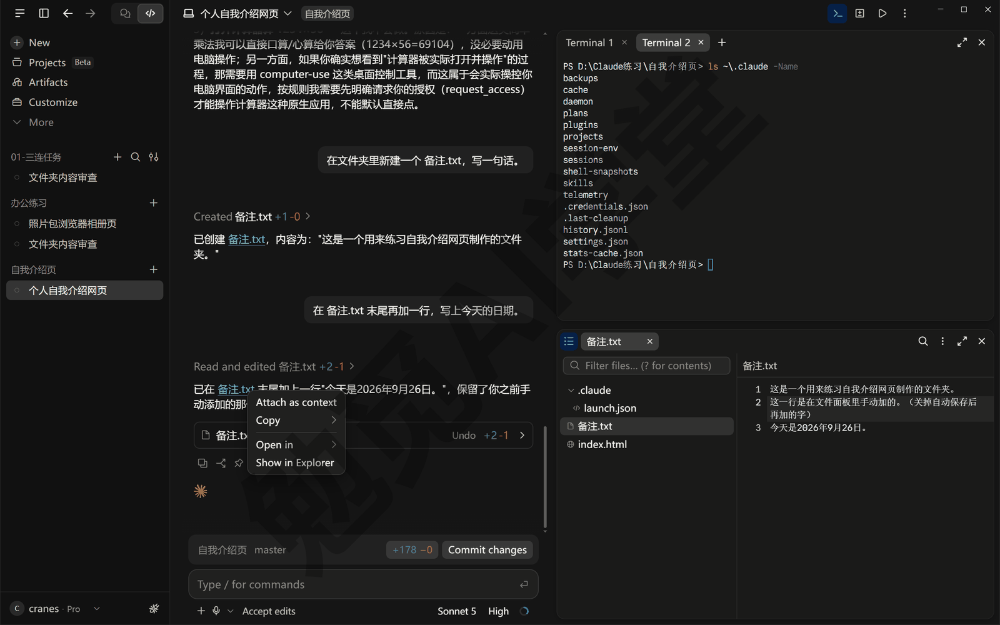

**什么时候自己改、什么时候让它改。** 文件面板适合两类事：看一眼文件里到底写了什么，以及改一两个字——改个标题、补一个标点、把一个数字换掉。要改一大段、改好几个文件，还是让它改：它改的每一轮都会在改动汇总卡和差异视图里留下记录、能用 Undo 撤回，你自己在文件面板里改的东西 Undo 撤不了。另外，你手改过的文件它下一次读的时候能看到，不用专门告诉它；但如果它正在改同一个文件，先等它做完再动手，两边同时改一个文件容易把内容改乱。

**一条边界。** 文件面板在本机和 SSH 会话里有，云端会话里没有；云端会话里想改文件，直接让它改。

### 8.3 命令行版一行装好

前面七篇多次提到“命令行版”，网上大多数 Claude Code 教程用的也是它。这一节把它装上，不是要你换主线，而是有三个理由值得花五分钟：

- 后面《定时任务、钩子与自动化》里那种“不用人守着、到点自己跑”的用法，只有命令行能做；
- 你在网上看到的绝大多数教程和问答都是命令行的样子，认识它才看得懂；
- 它和桌面应用共用同一个账号、同一份配置，装上不会多出任何要管的东西。

**不需要先装别的东西。** 现在的命令行版是一个独立程序：安装时不用装 Node.js（一种程序员用的运行环境，老教程第一步都是装它），不用装 WSL（Windows 里的 Linux 子系统），也不用管理员权限。一行命令就装好。

**第 1 步：打开 PowerShell。** 在开始菜单搜索 PowerShell 打开它（或者按 Win+X，在弹出的菜单里选 Windows PowerShell；Windows 11 上这一项叫“终端”）。打开后看提示符：以 `PS C:\` 开头的是 PowerShell，只有 `C:\` 没有 PS 的是命令提示符（CMD）。下面这条命令是给 PowerShell 的，确认是 PowerShell 再往下。

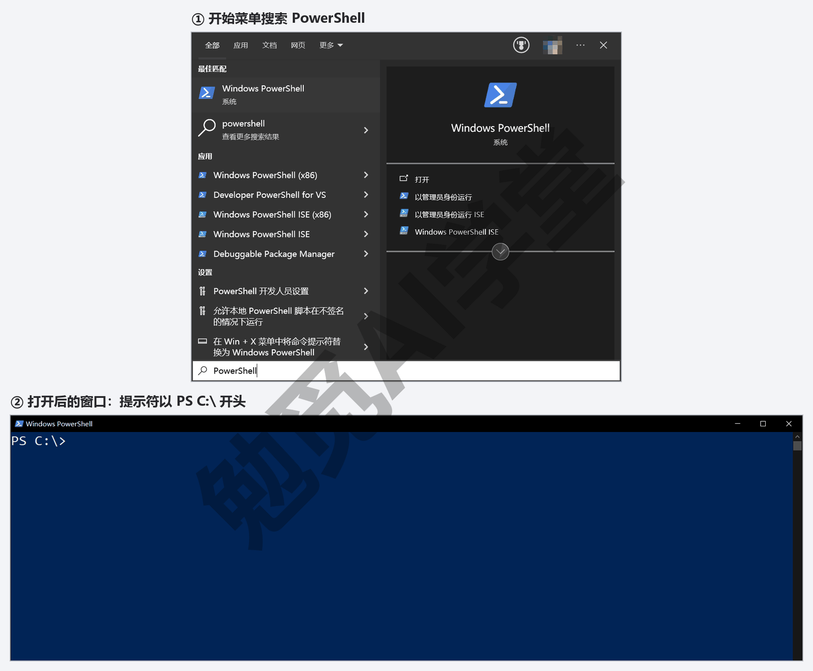

**第 2 步：粘贴安装命令。** 把下面这一行复制进 PowerShell，按回车：

```powershell
irm https://claude.ai/install.ps1 | iex
```

它会下载并安装程序：屏幕上先出现 Setting up Claude Code...，过一会儿打出绿色的 Claude Code successfully installed!（Claude Code 安装成功），下面是版本号和程序装到的位置（你的用户目录下的 `.local\bin` 文件夹），最后一行是 Installation complete!。整个过程不需要你选任何选项。装完如果多出一段 Setup notes（下图最后几行就是），说 `.local\bin` 这个文件夹 is not in your PATH（不在 PATH 里；PATH 是系统找程序时要查的一串文件夹），那么第 3 步重开窗口也找不到 claude，先照它写的加一次：按 Win 键搜“环境变量”，打开“编辑账户的环境变量”，在上半栏选中 Path 点“编辑”，点“新建”，把它打出来的那个程序位置（`.local\bin` 所在的完整路径，上面的安装输出里有）粘进去，一路点确定，再开一个新的 PowerShell 窗口。如果报错说 `irm` 不是可识别的命令，说明你打开的是命令提示符不是 PowerShell，回到第 1 步换窗口；如果报错提到 `&&` 不是有效的语句分隔符，说明你把别处看到的命令提示符版本命令粘进了 PowerShell，用上面这条即可。

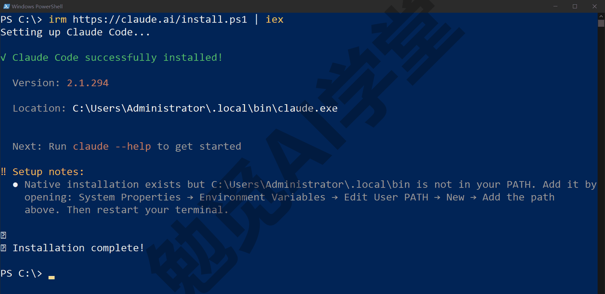

**第 3 步：新开一个窗口，确认装好。** 装完把这个 PowerShell 窗口关掉，重新开一个（新装的程序要重新开窗口才找得到；第 2 步末尾要是让你加 PATH，加完再开），输入：

```text
claude --version
```

它会打出一行版本号，比如 `2.1.294 (Claude Code)`，以你打出来的为准；有这一行就说明装好了。想做一次更全的自检，再输入：

```text
claude doctor
```

它会打出一份只读的检查报告：第一段是安装信息——Running 后面是安装方式和版本号（按第 2 步装的写 native，就是这一节开头说的那个独立程序），再往下是程序路径、Auto-updates（自动更新）开没开、上一次自动更新的结果，以及两行给团队和企业版看的 Managed settings 与 Organization policy（个人账号这两行写着 not fetched 和 not applicable，不用管）；中间 Remote Control 两行是说：以后你在命令行里开的会话，可以从网页版或手机 App 接过去继续（《云端会话与手机端》会讲）；最后是结论，没有问题时写 No installation issues found（未发现安装问题），并提示在会话里输入 /doctor 能做更全的、还能顺手修的检查。报告里没有账号信息。这份报告不会启动对话、不会改任何东西，什么时候觉得命令行不对劲都可以跑一次。

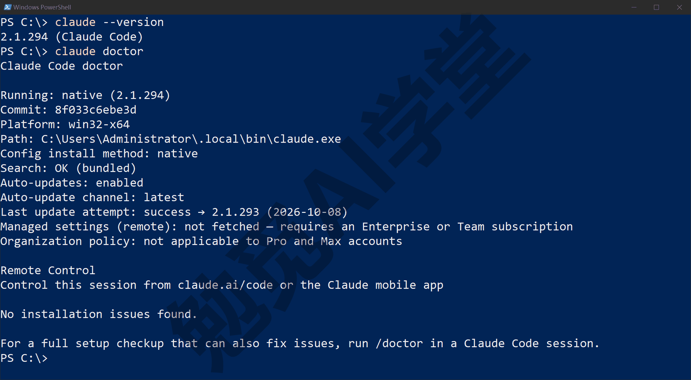

**第 4 步：进入练习文件夹，第一次启动。** 提示符里 PS 后面跟着的，就是你当前所在的位置，比如第 2 步截图里是 `PS C:\>`。先用 cd 命令进入练习文件夹，再输入 `claude` 启动（第一行换成你自己的练习文件夹路径）：

```text
cd D:\Claude练习\自我介绍页
claude
```

进入以后，提示符里 PS 后面会变成练习文件夹的路径。要先进入练习文件夹，是因为启动后它会问你是否信任当前所在的文件夹；如果还没进入练习文件夹就确认，信任的就是你当时所在的位置，比如整个 C 盘。

第一次启动时，它会先让你登录，再问你是否信任这个文件夹。下图里的①②③，就是这几个画面出现的先后顺序。

登录时，窗口里会出现 Login 和一长串网址（下图①），同时它会自动打开浏览器。浏览器没有打开的话，按 c 键复制网址，再粘贴到浏览器的地址栏里。浏览器里是一个授权页（下图②），列出 Claude Code 会用你的账号做哪些事。点“授权”，回到 PowerShell 窗口，你就已经登录好了。如果网页上授权以后，窗口没有自动进入下一步，可以用窗口里那行 Paste code here if prompted（如果提示就把代码贴到这里），按它的提示操作即可。

如果这台电脑上的桌面应用已经登录过，命令行一般已经是登录好的状态，不会再让你登录。没登录过的电脑上，登录之前会不会出现别的提示，以你看到的为准。

接着它会问你是否信任这个文件夹（下图③）。屏幕上出现一句 Quick safety check: Is this a project you created or one you trust?（快速安全检查：这是你自己建的、或者你信得过的项目吗？），下面两项是 1. Yes, I trust this folder（是，我信任这个文件夹）和 2. No, exit（否，退出），按回车选第一项即可。在每个文件夹里第一次启动 `claude`，都会问一次，和桌面应用里弹出的 Trust this workspace?（信任此工作区）提示作用一样。

命令行版和桌面应用用的是同一个账号，两边的用量合在一起算。

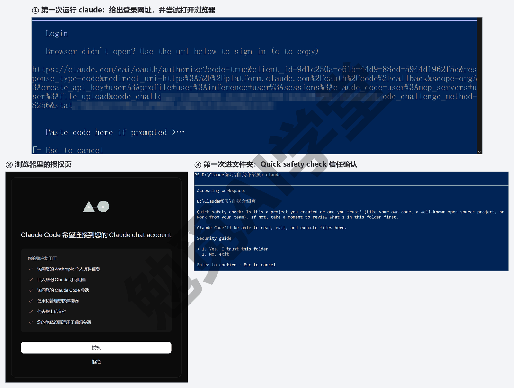

**装不装 Git for Windows 有什么区别。** 《认识与装好》让你装了 Git for Windows，它在这里多了一个用处：装了它，命令行版会用它自带的 Git Bash 来跑命令（Bash 是 Linux 和 macOS 上通用的命令方式，网上教程里的命令大多是它的写法）；没装，命令行版就改用 PowerShell 跑命令，功能一样，只是它写命令的方式不同。两种都能正常工作，本课按装了 Git 的情况写。

**更新与卸载。** 用这条命令装的程序会在后台自动更新，你不用管；想立刻更新就输入 `claude update`。装错了或不想要了，装的位置和卸载方法在官方安装页有说明，以官网当前说明为准。另外还有一条用 Windows 自带包管理器安装的命令 `winget install Anthropic.ClaudeCode`，结果一样，但这种安装方式不会自动更新，本课不用它。

### 8.4 命令行里是什么样子

装好了就进去看一眼。8.3 第 4 步做完，你已经在练习文件夹的会话里了，接着往下看就行；要是中间关掉了窗口，重开 PowerShell，先用 cd 切到 7.1 的练习文件夹，再输入 `claude` 按回车（这个文件夹 8.3 第 4 步信任过，不会再问）：

```text
cd D:\Claude练习\自我介绍页
claude
```

**交互式会话。** 屏幕会清空：顶部是一块欢迎横幅，版本号、你的账号、模型名和当前文件夹都写在上面，右边是几条使用提示；底部是一个以 > 开头的输入框，输入框下面一行小字写着当前的权限模式，比如 manual mode on（手动模式开着）。这就是命令行版的“对话窗口”，和 Code 页签里的输入框是同一个东西的两种样子：打字、回车发送、它回复、它要动文件时用文字问你允许还是拒绝——只是全部用文字显示，没有面板。试着发一句：

```text
请用中文告诉我这个文件夹里有什么。
```

它会像在桌面应用里一样列出文件，只是全是文字；文件名旁边要是有显示成问号或方块的符号，那是 Windows 自带的黑窗口画不出表情符号，不影响内容。想中断它正在做的事按 Ctrl+C；想退出，再按一次 Ctrl+C（或按 Ctrl+D），也可以输入 `/exit`。

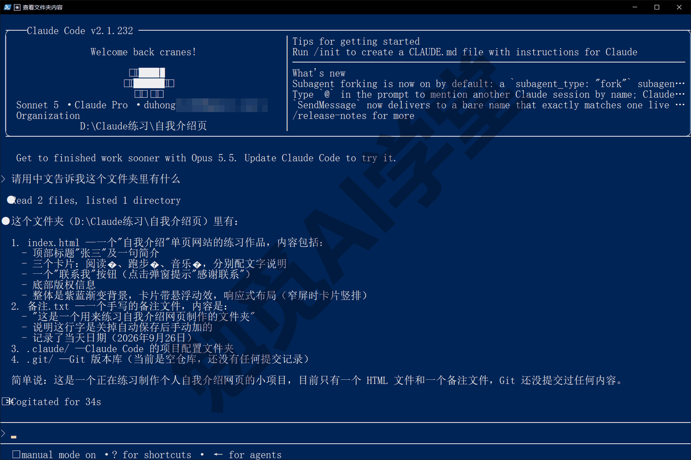

**Shift+Tab 切权限模式。** 在命令行里没有模式选择器，按 Shift+Tab 轮换权限模式：Manual（手动）→ Accept edits（自动接受编辑）→ Plan（计划）→（如果开了绕过权限，再多一档）→ Auto（自动），再按回到 Manual。当前是哪一档，输入框下面那行小字会跟着变（手动时写着 manual mode on）。五档的含义与《权限、沙盒与模型》讲的完全一样，只是切换的办法从点菜单变成了按键。

**斜杠命令一样能用。** 输入 `/` 会弹出命令列表，按字母顺序排、一屏只露出几条，接着多打几个字母它就只剩匹配的几条——比如打到 `/de`，就能看到 `/desktop`；桌面应用里学过的 `/rewind` 这里也在；`/help` 列出全部命令，`/doctor` 在会话里做一次自检并能替你修一些问题，`/config` 打开设置。命令行独有的几条在下面和《技能与斜杠命令》里讲。

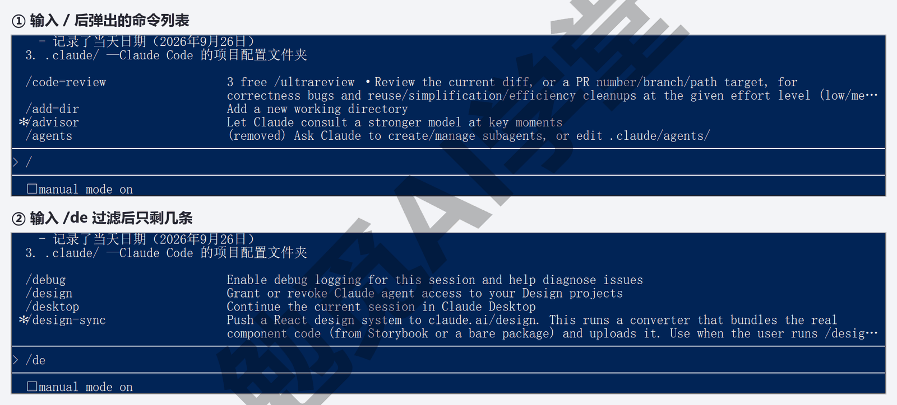

**`/desktop`：把这个对话接回桌面应用。** 这是本节最要记住的一条命令。在命令行会话里输入 `/desktop` 按回车，它会保存这个会话、在 Claude 桌面应用里把它打开，然后退出命令行：黑窗口里只剩一行 Resume this session with: claude --resume …（想回命令行接着聊，复制这行命令跑就行）；桌面应用那边几秒后自动切到这个会话，侧栏里多出一条，权限模式沿用你在命令行里的那一档——你在黑窗口里说过的话、它读过的文件、改了什么，全部带到 Code 页签里接着做。这条命令要求你用的是 Claude 订阅账号登录（用 API 密钥登录的用不了），Windows 上支持 x64 版本，也就是绝大多数 Windows 电脑。

反过来不行：本课用的这一版桌面应用里没有 `/resume` 这条命令，在 Code 页签输入它只会回一句 “/resume isn't available in this environment.”。所以命令行里的会话要接到桌面应用，只能在命令行那一头发 `/desktop`；送过去以后想回命令行，就用上面那行 `claude --resume …`。

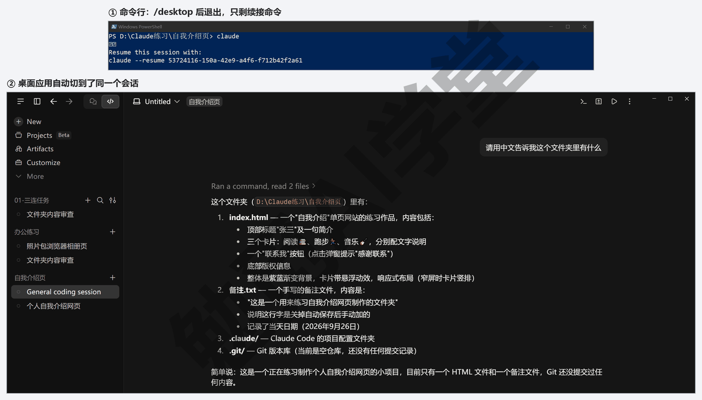

**`claude -p`：一句话问完就走。** 不进入对话，让它回答一句就退出，用 `-p`（也写作 `--print`）：

```text
claude -p "用一句中文说明这个文件夹里的 index.html 是做什么的"
```

它直接把回答打在窗口里就结束，不进对话；回答里的格式符号（比如加粗用的 `**`）会原样显示。这个用法现在看着平常，到《定时任务、钩子与自动化》会变得重要：让电脑定时替你跑一条这样的命令，就是“不用人守着也能跑”的第一步。先知道有这么个写法就行。

**接着上次的对话。** `claude -c`（也写作 `--continue`）直接接着这个文件夹里最近一次对话；`claude --resume` 让你从列表里挑一个旧对话接着聊。

### 8.5 桌面应用与命令行怎么选

两个入口是同一个 Claude Code、同一个账号、同一套配置，只是界面不同。选哪个，看你要做的事：

- **选桌面应用**：要同时开几个会话、要把对话、差异、浏览器、终端几个面板并排看、要用鼠标逐行审阅改动、要在浏览器面板里看网页——这些只有桌面应用有，它也是本课的主线。
- **选命令行**：要把它写进脚本、定时跑、在没有图形界面的电脑上用（比如远程服务器），或者你本来就习惯在终端里工作——这些只有命令行能做。

**两边共用的东西。** 你在一边做的设置，另一边直接生效：

- **CLAUDE.md**：项目文件夹里的规矩文件，两边都读；你在桌面应用里让它写进去的“回复用中文”，命令行里同样生效。《CLAUDE.md 与规则》讲。
- **MCP 连接**：MCP 是一种把外部工具接给它的标准接法（《插件、连接器与 MCP》讲），写在项目里的 `.mcp.json` 或用户目录的 `~/.claude.json` 里的连接，两边都能用。
- **钩子、技能与设置文件**：`~/.claude/settings.json` 与 `~/.claude.json` 两边共读，里面定义的钩子、技能、权限规则对桌面应用的会话同样有效。
- **模型**：两边能选的模型一样，桌面应用在输入框下方的模型菜单里选，命令行用 `--model` 参数或在会话里切换。

有一处要分清：上面说的“两边共读”指的是你电脑上的那批文件，也就是 `~/.claude` 文件夹和与它并排的 `~/.claude.json`（`~` 指你的用户目录，Windows 上一般是 `C:\Users\你的用户名`），以及项目文件夹里的 CLAUDE.md 和 `.mcp.json`，桌面应用的本机会话和命令行都读它们；桌面应用侧栏 Customize 里管的技能、连接器、插件是另一套，走你的 claude.ai 账号同步，不在你电脑上的这些文件里。两处怎么对应、哪些会互通，《技能与斜杠命令》《插件、连接器与 MCP》讲到时会专门说清。

**亲眼看一下共用的文件在哪。** 在 8.1 的终端面板里输入下面这条命令，按回车：

```text
ls ~\.claude -Name
```

终端面板用的是 PowerShell，这是 PowerShell 的写法，`-Name` 是让它只列名字（不加的话面板窄，名字那一列会被挤出画面）。它会列出 `~/.claude` 文件夹里的内容：能看到 `settings.json`（设置文件），装过技能的话还有 `skills` 文件夹，用过命令行的话还有 `projects` 这类它自己记会话用的文件夹（每台电脑装过的东西不同，列出来的项目以你看到的为准）。这个文件夹就是两个入口共用的地方：下一篇写规矩、后面装技能，动的都是这里的东西，不管你是从桌面应用还是从命令行动的手。现在只看不改，里面的文件下面几篇会一个个讲。

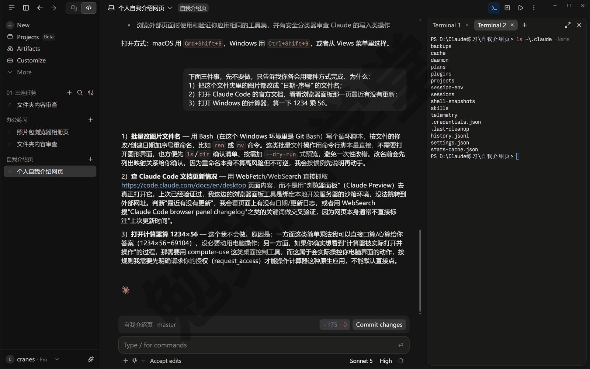

**各记各的会话列表。** 桌面应用和命令行各有一份会话列表，不会自动合并；要把命令行里的会话搬到桌面应用，用 8.4 讲的 `/desktop`；送过去之后命令行里留下的那行 `claude --resume …`，能把它再接回命令行。桌面应用里没有 `/resume`。两边可以同时开着；但同一个文件夹里同时让两边改文件，改动互相看不见、容易乱（8.1 说过），其中一边改、另一边只看就不会乱，要两边都改就开工作树。

### 8.6 VS Code 扩展与 JetBrains 插件认识

最后认识两样本课不依赖、但你迟早会在别处看到的东西。

**VS Code 是什么。** Visual Studio Code，一款微软出的免费代码编辑器，写代码的人几乎人手一份；Cursor 就是在它基础上改出来的。如果你从来没用过它，这一节看一遍就行，不需要装。

**Claude Code 的 VS Code 扩展。** 装进 VS Code 之后，编辑区右上角会多一个橙色的 Claude 图标（左侧竖栏里也多出同样的图标），点开是一个对话面板，和 Code 页签的对话区很像：能 @ 文件、能选权限模式、它改文件时给你看左右对照的差异、能先出计划再动手。安装方法：在 VS Code 里按 Ctrl+Shift+X 打开扩展页，搜索 Claude Code，结果里会有一排名字相近的扩展，认准发布者是 Anthropic、名字叫 Claude Code for VS Code 的那一条（发布者旁边带认证勾），点 Install（安装）；第一次装这家的扩展会弹一个 Do you trust the publisher “Anthropic”?（你信任发布者 Anthropic 吗？）的确认框，点 Trust Publisher & Install（信任发布者并安装），半分钟左右装好，编辑区会自动打开一页 Get started with Claude Code 的入门引导。第一次打开面板时用 Claude 账号登录（要 VS Code 1.94 及以上版本；付费套餐即可，不需要 API 密钥）。扩展自带了一份命令行程序，所以不装 8.3 的命令行版也能用它。Cursor 编辑器里也能装同一个扩展。

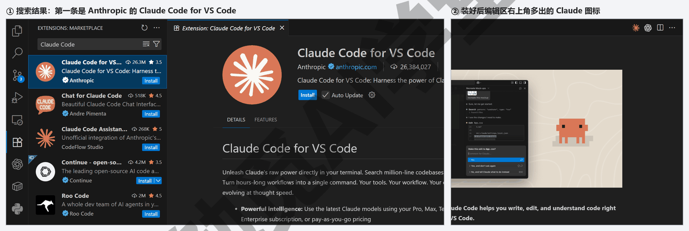

**扩展和命令行版的关系。** 扩展的对话面板用的是它自带的那份命令行程序，和 8.3 你装的那份是两份独立的程序，各自更新；但账号、CLAUDE.md、设置文件是同一套，在扩展里定的规矩，桌面应用和命令行一样认。想在 VS Code 自带的终端里输入 `claude` 用命令行版，仍然要按 8.3 单独装，扩展不替你装。

**什么时候会用到它。** 你已经在用 VS Code 或 Cursor 写东西、改代码，不想切到另一个应用——这时装个扩展，在编辑器里就能让它改。零基础读者按本课主线走，用不到它；哪天你开始在编辑器里写代码了，再回来看这一段。还有一个常见的误会：扩展不是 Claude Code 的“完整版”，桌面应用才是功能最全的入口——并行会话、浏览器面板、终端和文件面板、任务面板这些，扩展里都没有；扩展的长处只有一条，就是不用离开编辑器。

**JetBrains 插件。** JetBrains 是另一家编辑器公司，IntelliJ IDEA、PyCharm、WebStorm 这些都是这家公司的产品，程序员用得多。Claude Code 也有对应的插件，从 JetBrains 的插件市场安装；不同的是这个插件不自带命令行程序，要先按 8.3 装好命令行版，插件在编辑器的终端里启动 `claude` 并和它连起来（快捷键 Ctrl+Esc，或在命令行会话里输入 `/ide` 连接）。同样，本课不用它，这一段也只是官方文档的说法，动手时以官网当前说明为准。

**一句话总结。** 桌面应用是主线，命令行是第二入口，VS Code 扩展和 JetBrains 插件是第三入口，给平时就在编辑器里工作的人用——五个入口的全貌，《认识与装好》1.3 讲过，到这一篇你已经见过桌面应用、命令行和编辑器扩展（JetBrains 插件只读了一段，不算见过），网页版和手机 App 到《云端会话与手机端》才用。

### 8.7 三个练习任务

下面提示词里方括号的内容，换成你自己的。

**任务一：在终端面板里核对它的改动**

先在一个会话里让它做一处改动：

```text
请在这个文件夹里新建一个 [文件名].txt，写两行 [任意内容]。
```

然后按 Ctrl+` 打开终端面板，输入 `git status`，看清单里有没有这个新文件（8.1、8.2 新建的别的文件也会列在那儿；要是换了一个还没交给 Git 的新文件夹，`git status` 会报不是仓库，就还在 8.1 那个文件夹里做）。

完成标准：会用 Ctrl+` 开关终端面板；`git status` 的输出里能找到它新建的那个文件，清单里除了它和 8.1、8.2 本来就有的文件，没有多出别的。

**任务二：装好命令行版并接回桌面**

在 PowerShell 里装好命令行版，切到 `[你的练习文件夹]`，运行 `claude`，发送：

```text
请用中文告诉我这个文件夹里有什么。
```

看完回复后输入 `/desktop`。

完成标准：`claude --version` 能打出版本号；`/desktop` 之后桌面应用里出现了这个会话，里面有你刚才那句话和它的回复。

**任务三：用文件面板手改一处并保存**

在对话里点开任务一新建的 txt 文件，在文件面板里再加一行 `[你想加的话]`（默认自动保存，不用点什么）；然后在对话里发送：

```text
请读一下 [文件名].txt，告诉我现在有几行、最后一行写的是什么。
```

完成标准：它报出的行数比原来多一行，最后一行就是你手加的那句。

### 8.98 本篇小结与自检

这一篇认识了 Code 页签里的终端面板（Ctrl+` 打开，和它共用文件夹与环境，用 `git status` 核对它改了什么）和文件面板（点文件名或从文件树打开、手改两行会自动保存、它改了面板跟着刷新、右键四件事）；在 PowerShell 里用一行命令装好了命令行版，用 `claude --version` 和 `claude doctor` 确认安装，过了第一次启动时的登录和信任确认；进过命令行的交互式会话，知道 Shift+Tab 切权限模式、`/` 命令一样能用、`/desktop` 把会话接回桌面应用（桌面应用里没有反过来接的 `/resume`）、`claude -p` 一句话问完就走；比较了桌面应用和命令行各适合什么、共用哪些配置；最后认识了 VS Code 扩展和 JetBrains 插件是什么、什么时候会用到。

对照下面的清单检查学习结果：

- [ ] 会用 Ctrl+` 打开终端面板，跑过一次 `git status` 核对它的改动
- [ ] 在文件面板里手改过一处，知道默认是自动保存，知道右键文件名能做的四件事
- [ ] 装好了命令行版，`claude --version` 与 `claude doctor` 都跑过
- [ ] 进过命令行的交互式会话，会用 Shift+Tab 切模式、Ctrl+C 中断或退出
- [ ] 用 `/desktop` 把一个命令行会话接回过桌面应用
- [ ] 能说出什么时候选桌面应用、什么时候选命令行，以及两边共用哪些配置
- [ ] 知道 VS Code 扩展和 JetBrains 插件是什么，知道本课主线不依赖它们

完成这些内容后，Claude Code 的五个入口你都亲眼见过了，往后不管在哪看到它的截图，都能认出那是哪个入口。下一篇《CLAUDE.md 与规则》回到桌面应用，讲怎么把你的规矩写成文件让它长期记住——从此不用每个会话都重复“回复用中文”。

### 8.99 新手常见问题

**Q1：命令行和桌面应用会不会各记一套东西？**

配置是一套：CLAUDE.md、MCP 连接、钩子、技能、设置文件两边共读，账号和用量也是同一份。各记各的只有会话列表——命令行里开的对话不会自动出现在桌面应用里，要在命令行里用 `/desktop` 送过去；桌面应用里没有 `/resume`，没法从这一头接过来。

**Q2：黑窗口看不懂、怕输错怎么办？**

本课主线不需要你用命令行，8.3、8.4 只是认识。真要用时记住三件事就够：它在等你输入时底部有输入框，和聊天一样打字回车；随时按 Ctrl+C 能中断它正在做的事，再按一次退出；输入 `/help` 能看到全部命令。输错了命令最多是报一行错，不会弄坏东西。

**Q3：VS Code 是什么？必须装吗？**

一款免费的代码编辑器，写代码的人用它。本课从头到尾不需要它：Code 页签自带文件面板，改两行字够用；要大段改文件，让它改。只有你本来就在用 VS Code 或 Cursor 写东西时，才值得装个扩展。

**Q4：输入 `claude` 提示找不到命令怎么办？**

最常见的原因是装完没有开新窗口——把 PowerShell 关掉重开一个再试。还不行，跑一遍 `claude doctor`（如果 doctor 也找不到，说明安装没成功，回到 8.3 第 2 步重装）；用了 Windows 自带包管理器安装的，确认 `winget` 那条命令跑成功了。

**Q5：命令行版怎么更新、怎么卸载？**

用一行命令装的版本会在后台自动更新，`claude doctor` 报告里能看到自动更新开没开、上次更新的结果；想马上更新输入 `claude update`。自动更新偶尔会失败，会话右下角会出一条 Auto-update failed（自动更新失败）的提示，这时重新跑一遍 8.3 第 2 步的安装命令，通常就修好了。卸载方法以官方安装页当前说明为准；卸掉命令行版不影响桌面应用，两者是分开安装的。
