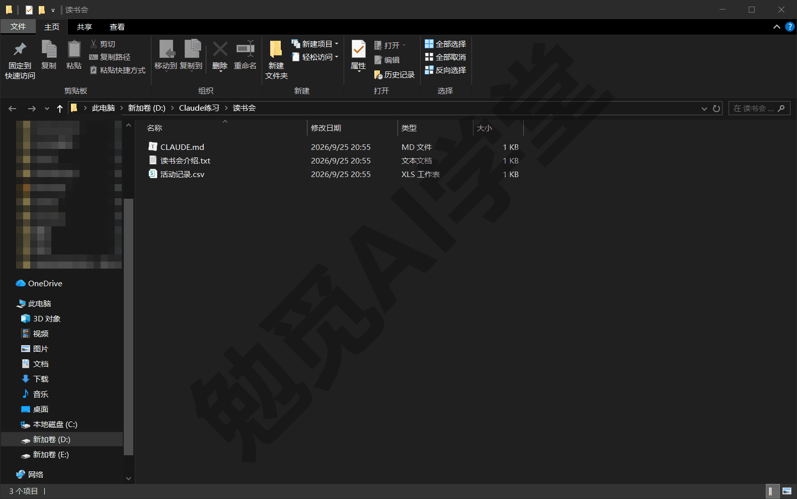
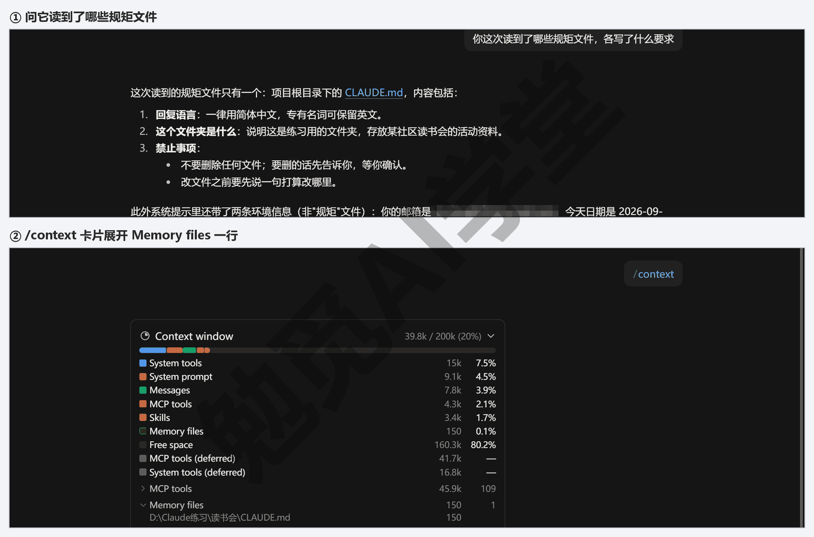
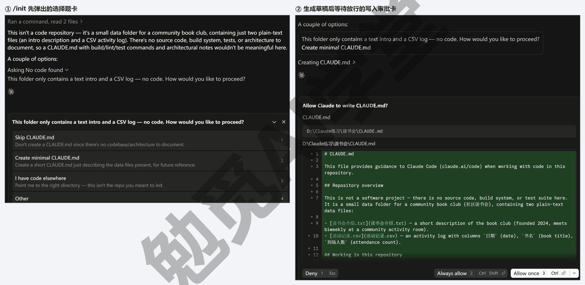
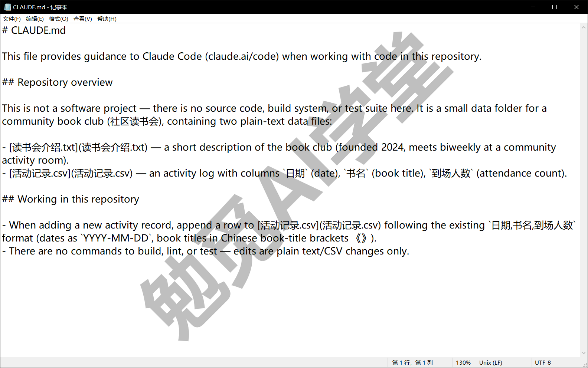
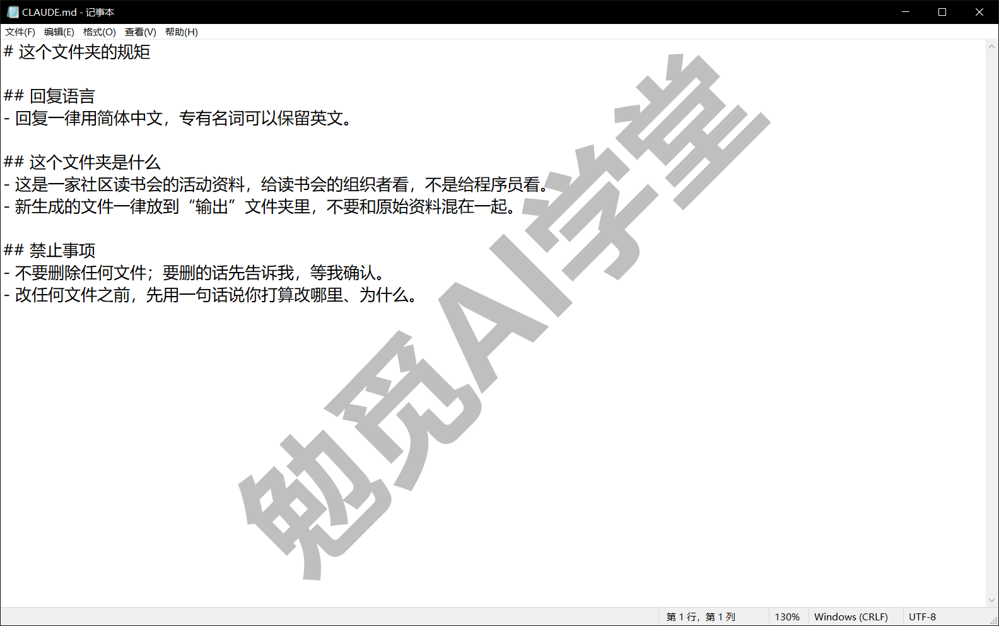
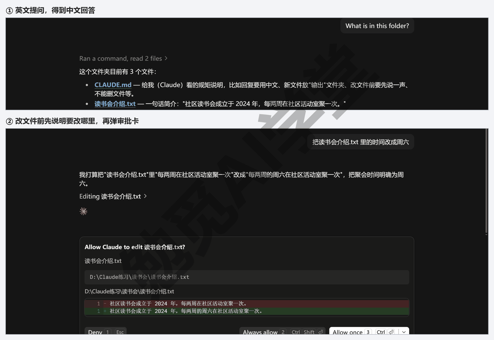
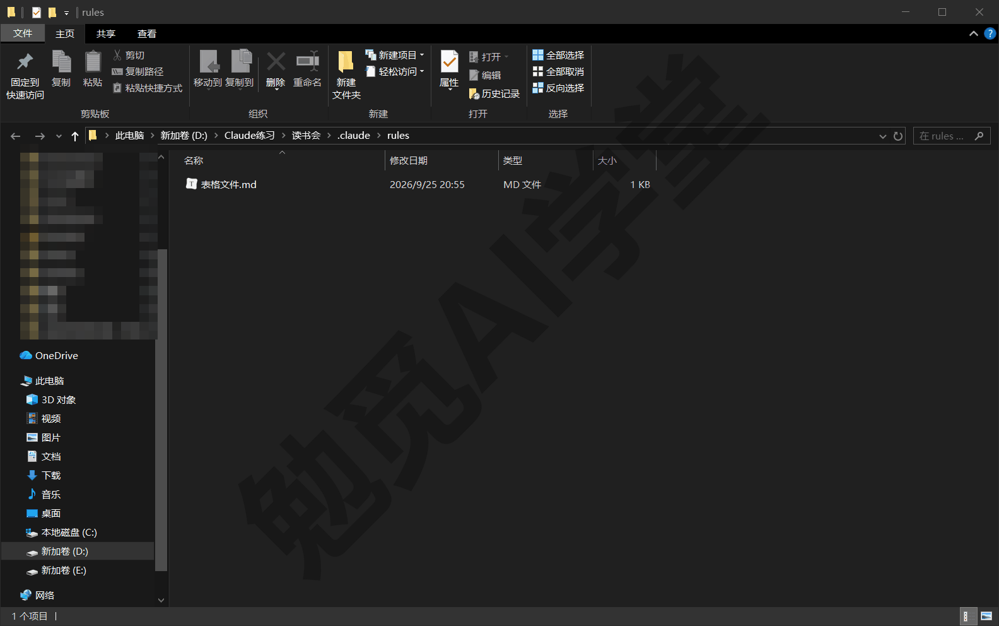
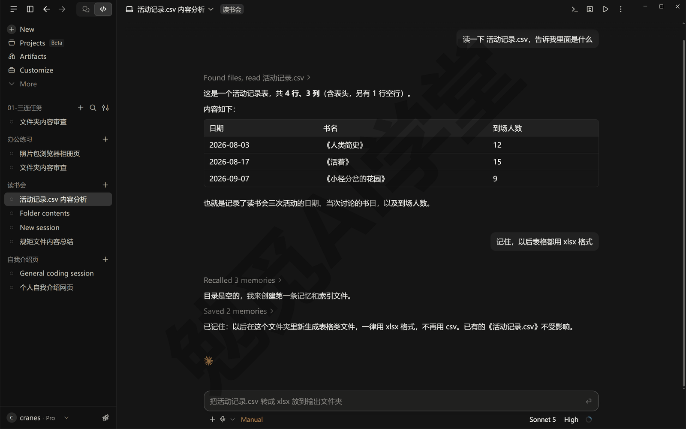
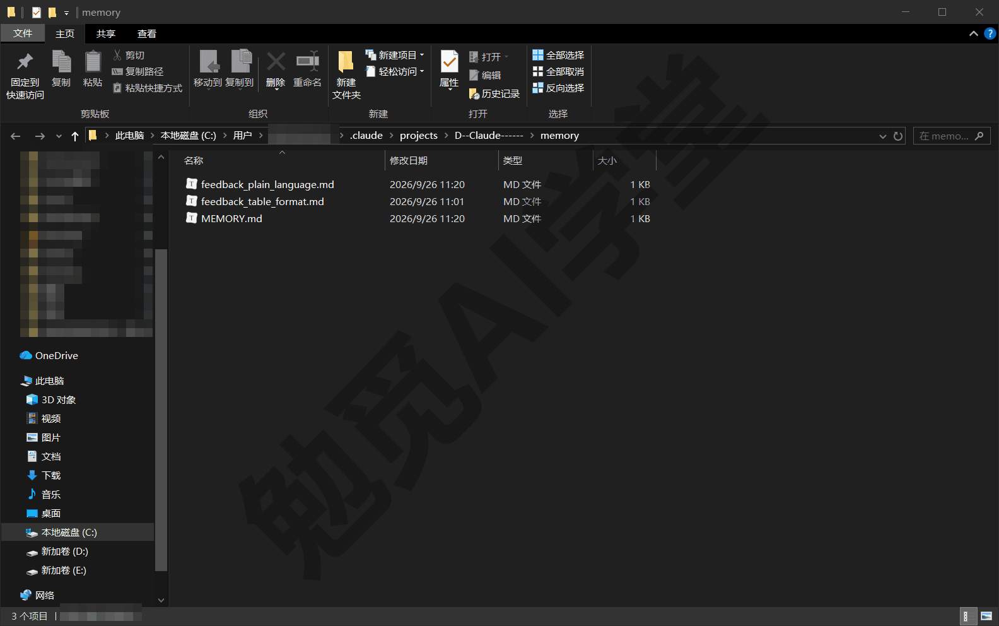

## CLAUDE.md 与规则

前面几篇里，你每开一个新会话都要重复交代几句话：回复用中文、别删我的文件、改之前先说一声。这一篇教你把这些话写进一个文件，让它每次开工自动读，从此不用再重说。全篇围绕三样东西：规矩文件 CLAUDE.md、按文件类型生效的规则文件，以及它自己记下来的“记忆”。

这篇文章的实操内容需要 Claude 的付费订阅（Pro 起），不需要更高的套餐：能打开 Code 页签就够，全部操作都在本机会话里完成，用量也很少。演示环境仍是 Windows 上的 Claude 桌面应用（以 2026 年 9 月的版本为例），个别按钮名与位置以你看到的界面为准。

### 9.1 为什么要有规矩文件

先看一个前几篇里常碰到的场景。

**笨办法：每个会话重说一遍。** 你在《认识与装好》里学过，让它用中文回复最直接的办法是开头说一句“回复用中文”。到了《文件与办公能力一篇讲全》，你又多了几句常说的话：不要删文件、改之前先告诉我、生成的文件放到“输出”文件夹。于是每开一个新会话，前三句都在交代同样的事；哪次忘了说，它就用英文回复、或者直接动手改了文件。会话越多，重复越多，漏掉的次数也越多。

**先亲手看一次这个问题。** 新开一个会话，选一个还没有 CLAUDE.md 的练习文件夹，什么都不交代，直接发送下面这句（意思是“这个文件夹里有什么”）：

```text
What is in this folder?
```

它多半会用英文回答。再新开一个会话发同样的话，还是英文。这就是笨办法的代价：你不说，它就不知道；每个会话都要从头说一遍。下面要做的，就是把“回复用中文”这类话写进一个它每次都会读的地方。

**好办法：写一次，以后每次自动生效。** 你可以把这些长期有效的要求写进一个名字固定叫 CLAUDE.md 的文件。每次在这个文件夹里开会话，它会先把这个文件读一遍，把里面的话当作你这次的要求来遵守。你写一次，以后每个会话都省下开头那几句。

“CLAUDE.md”这个名字看起来有点像程序员的东西，其实不是。CLAUDE 就是产品名，md 是 Markdown 格式的扩展名：Markdown 是一种纯文本的写法，用井号表示标题、用短横线表示列表，记事本就能打开和修改，本课的文章本身也是用它写的。所以 CLAUDE.md 就是一个叫 CLAUDE 的文本文件，只是扩展名不是 txt 而是 md，写进去的是给它看的话。

**它不是硬性的开关，是写给它读的话。** 官方的说法是：CLAUDE.md 的内容会作为一条消息交给模型读，它会尽力照做，但不保证每次百分之百执行，尤其是写得含糊或互相矛盾的要求。所以写法很重要（9.5 会讲），而那些必须每次都执行、一次都不能漏的事，比如“改完文件自动检查一遍”，官方建议用钩子（在它做到某一步时自动跑起来的一条命令）来做，那是《定时任务、钩子与自动化》的内容。日常的语言、风格、禁止事项这类要求，写进 CLAUDE.md 已经足够可靠。

**哪些话适合写进去。** 三类最常见：回复语言这类每次都一样的偏好；这个文件夹是干什么的、给谁看；你不希望它做的事。相反，只对这一次任务有效的要求，比如“这次只处理 8 月的数据”，不用写进去，直接在对话里说就行——写进去的应该是下个月、下个会话仍然成立的话。

### 9.2 CLAUDE.md 是什么、在哪

**它放在你交给它的那个文件夹里。** 回想《桌面应用全导览》讲的“开一个会话先做四件事”，其中一件是选文件夹——那是它这次干活的地方。CLAUDE.md 就放在这个文件夹的最外层（也叫根目录），和你的其他文件并排。它开会话时会在这个文件夹里找这个名字的文件，找到就读。



一个文件夹一份规矩，这是最常用的一层，官方叫它“项目级”。但实际上它会看三个位置，各管一个范围：

- **项目级 `CLAUDE.md`** ——放在你交给它的文件夹里，只对这个文件夹的会话生效。这一份也可以放进文件夹里的 `.claude` 子文件夹（`.claude\CLAUDE.md`），两种放法效果一样，本课用最外层这种，容易找到。
- **用户级 `~\.claude\CLAUDE.md`** ——放在你的用户主目录下的 `.claude` 文件夹里，对你这台电脑上的每个文件夹、每个会话都生效。“回复用简体中文”这种到处都适用的要求，写在这里最合适，写一次，整台电脑通用。
- **`CLAUDE.local.md`** ——和项目级放在同一个文件夹里，名字多了一个 local，意思是“只给我自己用的”。它和 CLAUDE.md 一起被读，用途是放你个人的补充：比如这台电脑上文件放在哪个盘、你自己的测试数据在哪。当这个文件夹要和别人共享、或者上传到 GitHub 上时，可以把它排除在外，只留下大家共用的 CLAUDE.md（排除要用到 Git 的 .gitignore 文件，本课不展开）。一个人自己用的时候，用不上它。

路径里的 `~` 代表你的用户主目录，Windows 上就是 `C:\Users\你的用户名`。`.claude` 是这个目录下一个名字以点开头的文件夹，它把你的设置、记忆、技能都存在这里；Windows 的资源管理器里能直接看到它、能进去，只是自己手动新建这种带点的文件夹不方便。想打开它，在资源管理器的地址栏输入 `%USERPROFILE%\.claude` 回车就行。要在里面写一份用户级 CLAUDE.md，直接让它替你写更简单：在任何一个会话里说“在我的用户级 CLAUDE.md 里加一条：回复一律用简体中文”，它知道这个文件在哪。

**几份都存在时怎么读。** 它把找到的几份连起来一起读，不是只读一份。顺序是从外到里：先读用户级，再读你选中文件夹的上级文件夹里的（如果有），最后读你选中文件夹里的；同一个文件夹里两份都有的话，先读 CLAUDE.md，再读 CLAUDE.local.md。也就是说，离你选中文件夹越近的，越后读。顺序只在几份规矩互相冲突时才要紧，日常不用管，现在只要知道三处都会被读到。选中文件夹里的子文件夹如果也有自己的 CLAUDE.md，不会在开会话时就读，而是等它进那个子文件夹读文件时才一起读进来——这是给大项目分区写规矩用的，本课的练习文件夹都很小，知道有这回事就行。

**桌面应用和命令行读的是同一份。** 《终端、编辑器与 VS Code 扩展》8.5 讲过，CLAUDE.md 是桌面应用和命令行两边都读的，上面这几份都一样：不管你从 Code 页签开会话，还是在命令行里输入 `claude` 开，读到的都是同一份规矩，不用写两遍。

**怎么确认它真的读到了。** 新开一个会话，直接问它一句“你这次读到了哪些规矩文件，各写了什么要求”，它会把读到的 CLAUDE.md 与规则文件列出来，再逐条说出里面的要求。它有时还会提到你的账号邮箱和今天的日期，那两条是系统交给它的环境信息，不是从规矩文件里读到的。

你也可以在输入框里发送 `/context`：它会回一张上下文用量卡，写着这个会话的上下文用了多少、一共能放多少；点卡片右边的 › 展开明细，滚到最下面有一行 Memory files（记忆文件，官方把 CLAUDE.md 也算作记忆的一种），点开这一行，读进来的规矩文件会一个个列出来，带着完整路径和各自占了多少上下文。命令行版里也有这条命令。



### 9.3 用 `/init` 自动生成一份，再手改

你可以自己从零写一份 CLAUDE.md，但先让它替你起个草稿更快。

**第 1 步：在会话里发送 `/init`。** 在这个文件夹的会话输入框里输入 `/init`（斜杠加 init，init 是“初始化”的缩写）并发送。它会先把文件夹里的文件读一遍。如果文件夹里放的是资料、不是代码，比如读书会的活动资料，它多半会先停下来：用英文说明这里没有代码，再弹出一张选择题卡，问你要不要建、建多简单。卡上的选项是它当场写的，每次的说法可能不一样，比如 Skip CLAUDE.md（不建）、Create minimal CLAUDE.md（建一份简短的）；选“建一份简短的”那一项，点 Submit（提交）。文件夹里放的是网页、代码的话，它通常不问，直接写草稿。文件夹里还没有规矩告诉它用中文，所以这一轮它多半全程说英文，不影响往下做。

它接着写出一份草稿，里面是它从文件里看出来的东西：这个文件夹是干什么的、有哪些文件、有什么惯例。写进文件这一步和普通的改文件一样，Manual 模式下它会先弹出审批卡，给你看要写进去的内容，Deny／Always allow／Allow once 三个按钮里点 Allow once 放行；对话里出现一行 Created CLAUDE.md，文件就建好了。如果文件夹里已经有一份 CLAUDE.md，它不会覆盖，而是提出修改建议。



**第 2 步：打开生成的文件，删掉用不上的。** 放行之后，文件夹里就多了 CLAUDE.md。在资源管理器里右键它，在“打开方式”里选记事本；也可以用《终端、编辑器与 VS Code 扩展》8.2 讲过的文件面板打开（按 Ctrl+Shift+F，在左边的文件树里点它）。它生成的草稿多半是英文的，而且偏“程序员视角”，会提到构建、测试这类写代码才用得上的事；对一个放资料的普通文件夹来说，这些用不上，删掉，只留下对你有用的描述。看不懂英文也不要紧，把它整份删掉、照第 3 步的模板重写也可以。



**第 3 步：补上三类它猜不出来的内容。** 它能从文件夹里看出来的东西不用你写，你要补的是它看不出来的、只有你知道的要求。最常用的是下面三类，先照抄，再把内容换成你自己的：

```markdown
# 这个文件夹的规矩

## 回复语言
- 回复一律用简体中文，专有名词可以保留英文。

## 这个文件夹是什么
- 这是一家社区读书会的活动资料，给读书会的组织者看，不是给程序员看。
- 新生成的文件一律放到“输出”文件夹里，不要和原始资料混在一起。

## 禁止事项
- 不要删除任何文件；要删的话先告诉我，等我确认。
- 改任何文件之前，先用一句话说你打算改哪里、为什么。
```

三类分别是：

- **回复语言**：《认识与装好》1.7 里每开一个新会话都要再说一遍“用中文回复”，写在这里，以后就不用每次说。
- **这个文件夹是什么**：它是干什么的、给谁看、生成的东西放哪，这决定它做事的分寸。
- **禁止事项**：你不希望它做的动作，比如删文件、不先说一声就改文件；写清楚了，它要做这类事之前会先跟你说。

井号开头的是标题，短横线开头的是一条条要求，写成这样它读起来最清楚。



**第 4 步：验证生效。** 保存文件，新开一个会话（选同一个文件夹），随便问它一句英文，比如 “What is in this folder?”，它应该用中文回答；再让它改一个文件，比如把某个 txt 文件里的一句话换掉，它应该先用一句话说明打算改哪里、为什么，然后才弹出审批卡。两条都做到，说明规矩读进去了。



**让它替你改也可以。** 以后想加一条规矩，不必自己打开文件：在会话里说“把这条加进 CLAUDE.md：生成的表格一律用 xlsx 格式”，它会打开文件、加上这一条、给你看差异，你放行就行。改规矩、删规矩也是这样跟它说。

### 9.4 规则文件：按文件类型生效的规矩

CLAUDE.md 是一整份文件，它每次开会话都整份读一遍。等你的项目大了，这样会碰到两个问题：一是文件越写越长，官方建议一份 CLAUDE.md 控制在 200 行以内，太长会占用上下文、也会让它顾不过来；二是有些规矩只跟某一类文件有关，比如“读表格文件时先报行数”，跟它处理图片时毫无关系，没必要每次都读。规则文件解决的就是这两个问题。

**规则文件放在哪。** 在你的文件夹里建一个 `.claude` 子文件夹，再在里面建一个 `rules` 文件夹，每个主题的规矩单独写成一个 md 文件放进去，比如 `表格文件.md`、`命名.md`。文件名随你取，一个文件只写一个主题，方便以后找。用户级也有对应的位置 `~\.claude\rules\`，放进去的规则对所有文件夹生效。



**不写条件的规则，和 CLAUDE.md 一起读。** 一个规则文件如果只有正文，没有下面说的“开头信息”，它会在开会话时和 CLAUDE.md 一起读进来，效果和写在 CLAUDE.md 里一样，只是分了文件、更好整理。

**写了条件的规则，碰到对应文件才读。** 想让某条规矩只对某类文件生效，在文件最开头加一段用三条短横线包起来的“开头信息”，里面用 `paths`（路径）写明它管哪些文件。下面这份规则只在它读到 csv 文件时才生效（csv 是用逗号分隔的表格文本文件，Excel 能直接打开）：

```markdown
---
paths:
  - "**/*.csv"
---
# 读表格文件的规矩
- 读任何 .csv 文件时，先报告它有多少行、多少列，再说内容。
```

`"**/*.csv"` 的意思是“任何文件夹里的、扩展名为 csv 的文件”：两个星号代表任意层级的文件夹，一个星号代表任意文件名。你可以照这个样子换成别的扩展名，比如 `"**/*.xlsx"` 管所有 Excel 文件，`"**/*.md"` 管所有 md 文件。开会话时它不读这份规则；等它第一次读到一个 csv 文件，这份规则才被加进来，之后在这个会话里一直有效。

**不想自己建带点的文件夹，就让它建。** `.claude` 这种以点开头的文件夹，资源管理器里看得见，但你自己新建时不太好操作，交给它最简单：在会话里发送“在这个文件夹的 .claude\rules 下建一个 表格文件.md，内容如下”，然后把上面那段贴在后面。它会建好文件夹、写好文件、给你看差异。

**什么时候用规则文件，什么时候直接写 CLAUDE.md。** 如果一条规矩所有会话都要遵守、几句话就能说完，写进 CLAUDE.md；如果它只跟某类文件有关，或者你的 CLAUDE.md 已经超过一两屏，就把这部分拆成规则文件。本课后面的实战篇，规矩都不长，一份 CLAUDE.md 就够；规则文件是给你以后项目变大时用的。

### 9.5 写规则的原则

规矩写得好不好，直接决定它照不照做。下面四条原则来自官方的写作建议。

**说具体，别说感觉。** “格式弄好看点”这种话它不知道怎么执行；换成“标题用二级标题，列表用短横线，每段不超过五行”，它就能照做。判断一条规矩写得够不够具体，可以想一想：如果把这句话交给一个刚来的新同事，他不用再问你就能照做吗？能，就够具体了。

**给例子。** 光说“文件名要规范”不够，加一句“比如 2026-09-读书会活动记录.xlsx”，它就知道你要的是日期在前、内容在后、用短横线分隔。一个例子顶三句解释。

把前两条合起来看一组对照。上面一段是常见的写法，下面一段是改过之后的：

```markdown
## 改之前
- 文件名要规范。
- 格式弄好看点。

## 改之后
- 新生成的文件名按“日期-内容”写，比如 2026-09-读书会活动记录.xlsx。
- 文档用二级标题分段，列表用短横线，每段不超过五行。
```

改之前的两条它只能猜；改之后的两条，它和一个新同事一样能直接照做。

**少而准，不写它自己能看出来的。** 文件夹里有什么、文件怎么组织，它读一遍就知道，不用你写；`/init` 生成的那些描述性内容，用不上的可以删。留下的每一条都应该是“它自己看不出来、又确实会影响做法”的：你的语言偏好、你的禁止事项、你的验收标准。官方建议一份 CLAUDE.md 不超过 200 行，写得越短，它越容易照着做。

**同一件事只在一个地方写，不要互相矛盾。** 如果你在用户级写了“回复用中文”，项目级又写了“回复用英文”，会怎样？官方的说法是：两条规矩互相矛盾时，它可能随便挑一条执行，没有可靠的“谁压过谁”。所以正确的做法不是研究优先级，而是不让矛盾出现：整台电脑通用的只写在用户级，单个文件夹特有的只写在项目级，改了一处记得看另一处。用了一段时间之后，把几份文件一起打开读一遍，删掉过时的、合并重复的，是个好习惯。

**9.3 那份模板为什么算合格。** 把它按上面四条原则再看一遍：“回复一律用简体中文”够具体；“新生成的文件一律放到‘输出’文件夹里”给了确切的位置；“不要删除任何文件；要删的话先告诉我”是你的底线，它自己看不出来；三类内容一共不到十行，没有互相矛盾的地方。这就是一份合格的规矩文件。

**写完做一次检查。** 规矩写好后不要只保存了事，新开一个会话，把文件里每一条对应的事各做一次：让它回答一个问题（看语言）、让它生成一个文件（看放到了哪里）、让它改一处内容（看有没有先说明）。哪一条它没照做，就回到上面四条原则里找原因，多半是那一条写得还不够具体，把它改得更具体，再试一次。

### 9.6 记忆怎么管

除了你写给它的规矩，它自己也会记笔记。这件事很多人不知道，但会影响它的表现。

**它记什么、存在哪。** 用的过程中，它会把值得下次记住的事写进自己的记忆文件：你是做什么的、你纠正过它什么、这个文件夹的工作进展到哪、去哪找相关资料。这些笔记存在你电脑上的 `~\.claude\projects\` 下、以这个文件夹命名的子文件夹里的 `memory` 文件夹中，里面有一个 `MEMORY.md` 目录文件和几个主题文件，全部是普通的 md 文本，你随时能打开看。这个功能默认开着；它不是每个会话都记，只在判断“这件事下次还用得上”时才写。对话里出现类似 “Saved 2 memories”（保存了两条记忆）或 “Recalled 3 memories”（想起了三条记忆）的提示，就是它在读写这些文件；写记忆不用你放行，Manual 模式下也不会弹审批卡。



**记忆和 CLAUDE.md 的分工。** 两样东西都会影响它的行为，区别在于谁写的（9.2 的 `/context` 里 Memory files 那一行列的是 CLAUDE.md 这类规矩文件，官方把它们也归在“记忆”这个词下；这里说的记忆是另一种）：CLAUDE.md 是你写的规矩，你要求它照做；记忆是它自己写的笔记，帮它记住你的偏好和进展。官方也明确了它不记什么：CLAUDE.md 里已经写了的、以及它从文件夹里就能看出来的，都不会再记一遍。所以两者一般不重复：CLAUDE.md 里放的是你的要求，记忆里放的是它的经验。

**你说的话会进哪一边。** 你在对话里说“记住，以后表格都用 xlsx 格式”，它会记进自己的记忆；你说“把这条加进 CLAUDE.md”，它会去改规矩文件。想让一条要求成为长期规矩、以后任何会话都遵守，用后一种说法更稳。

**怎么看、怎么删。** 桌面应用里没有 `/memory` 这条命令，你发送的话，它只回一句 “isn't available in this environment”（在这个环境里不可用）；命令行版才有它，能列出所有规矩文件和记忆文件、打开或关掉自动记忆、打开记忆文件夹。桌面应用里看记忆有两个办法：自己在资源管理器里打开记忆文件夹，下面就动手看一次；或者在会话里说“把你记的关于我的记忆列出来，删掉关于表格格式那一条”，它会替你列出来、替你删。记忆文件是普通文本，删了不影响任何别的东西。

**动手看一眼记忆文件夹。** 在资源管理器地址栏输入 `%USERPROFILE%\.claude\projects` 回车，里面每个子文件夹对应一个你用过的文件夹，名字是用那个文件夹的路径改成的：冒号、反斜杠和中文字都换成了短横线，比如 `D:\Claude练习\读书会` 对应的是 `D--Claude------`，几个名字看着差不多时，按修改日期找最近用过的那个。进去找 `memory` 文件夹，用记事本打开 `MEMORY.md`：每行一条它记下的事，后面标着细节存在哪个主题文件里。看一遍你就知道它现在对你的“印象”是什么；还没用过几次的话，这个文件夹可能还是空的，那是正常的。



**两个边界。** 一是记忆只在这台电脑上，换电脑不会跟着走，云端会话也不共用（《云端会话与手机端》会讲云端的差别）；二是记忆不进上下文压缩的清理范围，会一直保留到你或它改动为止。所以如果发现它老是按一个过时的偏好做事，来这里找一找，多半有一条旧记忆该删了。

### 9.7 三个练习任务

方括号里的内容换成你自己的。

**任务一：写一条“始终用简体中文回复”，并验证生效。** 在 `[你的练习文件夹]` 里新建一个叫 `CLAUDE.md` 的文件（用记事本新建，保存时“保存类型”选“所有文件”，文件名连扩展名一起写成 CLAUDE.md，否则会被存成 .txt），内容写下面三行，然后新开一个会话（选这个文件夹）发送后面那句英文：

```markdown
# 规矩
## 回复语言
- 回复一律用简体中文。
```

```text
What files are in this folder? Please describe each one briefly.
```

完成标准：它用中文回答；你问它“读到了哪些规矩文件”，它能说出这份 CLAUDE.md 和里面那一条。

**任务二：用 `/init` 给读书会文件夹生成 CLAUDE.md。** 准备一个放着三五个活动资料文件、还没有 CLAUDE.md 的文件夹（9.3 用过的那个已经有了，再 `/init` 它只会提修改建议，练不到建文件；《实战一：社区读书会网站》可以接着用这个新文件夹），开会话后发送：

```text
/init
```

它要是先弹出选择题卡，选“建一份简短的”那一项（比如 Create minimal CLAUDE.md）；审批卡弹出来点 Allow once 放行，然后打开文件，删掉用不上的段落，按 9.3 的模板补上回复语言、文件夹说明、禁止事项三类内容。

完成标准：文件夹里有一份不超过 30 行的 CLAUDE.md，三类内容齐全，新开会话后它能复述其中至少两条。

**任务三：写一条按文件类型生效的规则。** 在同一个文件夹的会话里发送：

```text
请在这个文件夹的 .claude\rules 下新建一个文件 表格文件.md，内容如下（原样写入）：
---
paths:
  - "**/*.csv"
---
# 读表格文件的规矩
- 读任何 .csv 文件时，先报告它有多少行、多少列，再说内容。
```

然后往文件夹里放一个 csv 文件（Excel 里另存为 csv 格式即可），新开会话说“读一下 [文件名].csv，告诉我里面是什么”。

完成标准：它先报出行数和列数，再说内容；在同一个会话里接着让它读一个 txt 文件时不报行列数（说明规则只对 csv 生效）。

### 9.98 本篇小结与自检

这一篇把“每次重说”变成了“写一次自动生效”：CLAUDE.md 是放在文件夹根目录、开会话就读的规矩文件，还有对整台电脑生效的用户级和只给自己用的 local 版本；`/init` 能替你起草，再手改成回复语言、文件夹说明、禁止事项三类内容；规则文件放在 `.claude\rules` 里，写了 `paths` 条件的只在碰到对应文件时才读；写规矩要说具体、给例子、少而准、不矛盾；它自己记的记忆存在 `~\.claude\projects` 下，和 CLAUDE.md 一个管你的要求、一个管它的经验，都能打开看、能删。

可以对照下面的清单检查学习结果：

- [ ] 能说出 CLAUDE.md 放在哪、什么时候被读、为什么它不是硬性开关
- [ ] 分得清项目级、用户级、CLAUDE.local.md 三个位置各管什么范围
- [ ] 用 `/init` 生成过一份 CLAUDE.md，并手改成三类内容
- [ ] 写过一条带 `paths` 条件的规则文件，验证过它只对某类文件生效
- [ ] 能说出写规矩的四条原则，知道两条规矩矛盾时该怎么处理
- [ ] 知道它自己的记忆存在哪、怎么看、怎么删，以及和 CLAUDE.md 的分工

完成这些内容后，你已经有了一份自己写的、验证过生效的规矩文件。下一篇《技能与斜杠命令》讲另一种“写一次、反复用”的东西：规矩是它每次都要遵守的要求，技能则是它用到时才拿出来照做的说明书，那一篇会带你把《文件与办公能力一篇讲全》里“一句话出月报”的做法写成一份技能。

### 9.99 新手常见问题

**Q1：CLAUDE.md 写长了会不会占上下文？**

会。它每次开会话都整份读进上下文，越长占得越多，也越容易顾不过来，官方建议控制在 200 行以内。想看它现在占了多少，发送 `/context`，在展开的明细里找 Memory files 那一行。写长了有两个办法：删掉它自己能看出来的描述性内容；把只跟某类文件有关的规矩拆成带 `paths` 条件的规则文件，碰到对应文件才读。上下文是怎么被占满的，《对话与上下文管理》讲过。

**Q2：改了 CLAUDE.md，要重开会话吗？**

新开会话最稳，它开会话时读一遍规矩文件。同一个会话里改了文件，最简单的办法是说一句“重新读一下 CLAUDE.md”，让它当场再读；上下文被压缩之后，它也会自动把文件夹根目录的 CLAUDE.md 重新读一遍。要验证有没有生效，就问它“你现在的规矩文件里写了什么”。

**Q3：用户级和项目级都写了，冲突听谁的？**

不要指望它按某个优先级选。官方的说法是两条矛盾的规矩它可能随便挑一条，所以正确做法是不让矛盾出现：整台电脑通用的写用户级，单个文件夹特有的写项目级，同一件事只写在一处。如果确实需要某个文件夹例外（比如用户级写了中文、某个文件夹要用英文），就在那个文件夹的 CLAUDE.md 里写清楚“这个文件夹例外，回复用英文”，把话说清楚，不留给它猜。

**Q4：它“忘了”规矩怎么办？**

按顺序查三件事。第一，规矩文件有没有被读到：问它“你读到了哪些规矩文件”，没读到多半是文件放错了位置或名字拼错了（必须叫 CLAUDE.md，大小写按这个写）。第二，规矩写得够不够具体：含糊的要求它照做的概率低，按 9.5 改具体。第三，有没有别的规矩或旧记忆跟它冲突：把几份规矩文件和记忆文件一起看一遍，删掉矛盾的。三件都查过还不行，那条要求可能更适合写成钩子，《定时任务、钩子与自动化》会讲。

**Q5：记忆会不会把我的隐私记下来？**

它记的是工作偏好和进展，不会主动记密码、密钥这类内容；但你在对话里说过的话它都可能记，所以不想让它记的事不要在对话里说。记忆文件全部在你自己电脑的 `~\.claude\projects` 下，随时可以打开检查、删除；想彻底不让它记，命令行版的 `/memory` 里有开关；桌面应用里没有这条命令，有没有对应的设置项以设置页实际显示为准。
