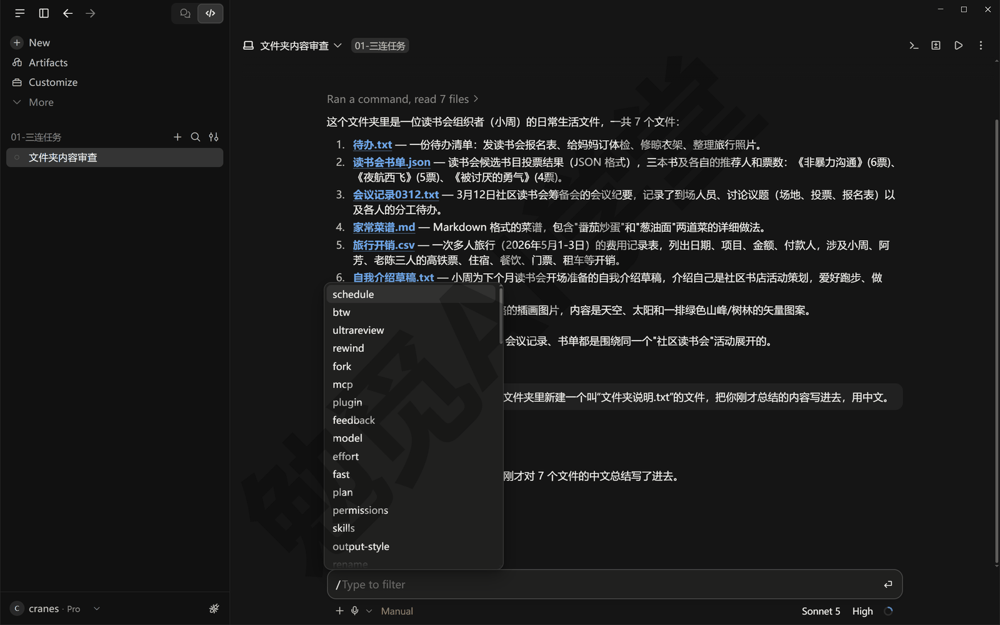
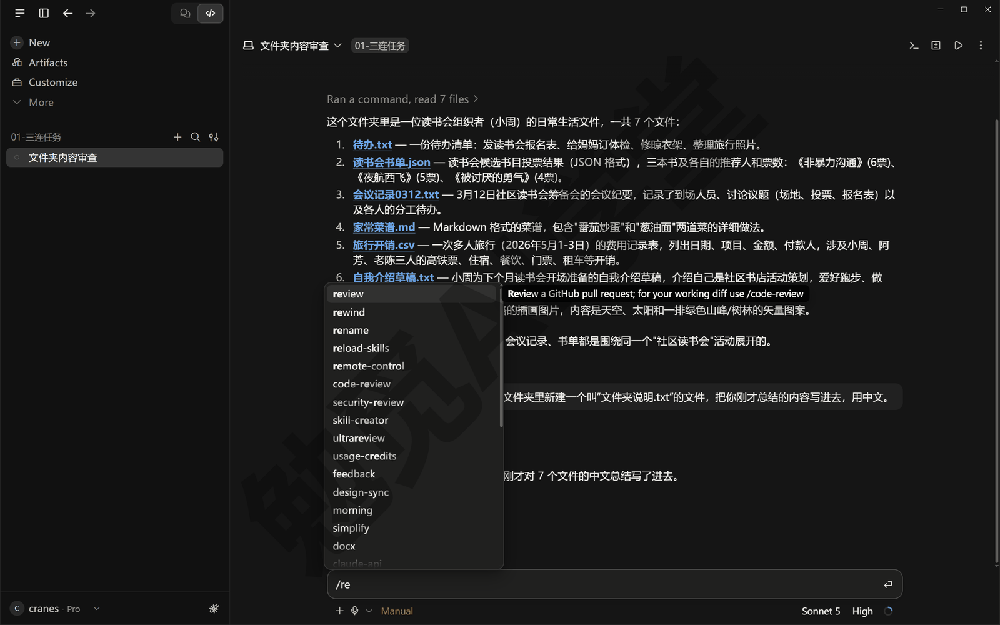
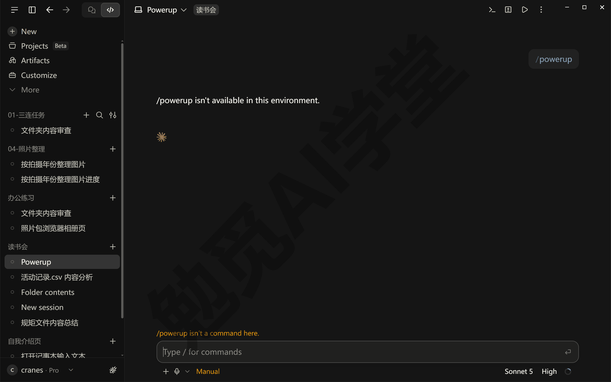
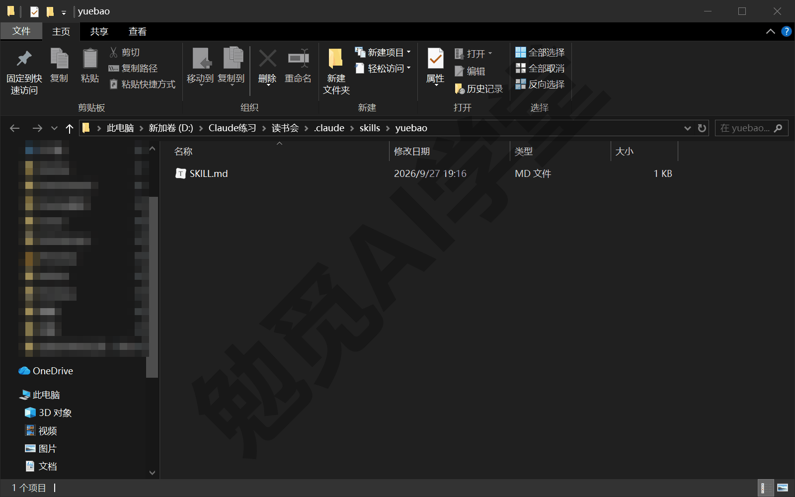
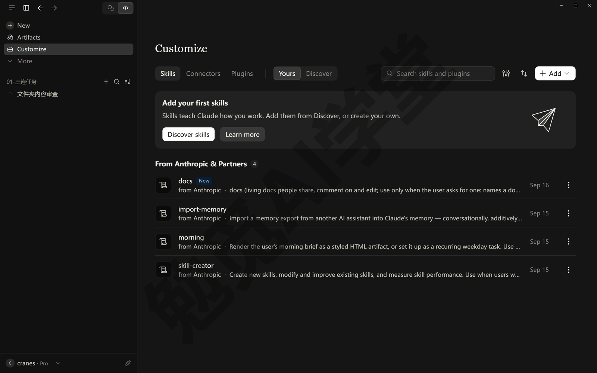
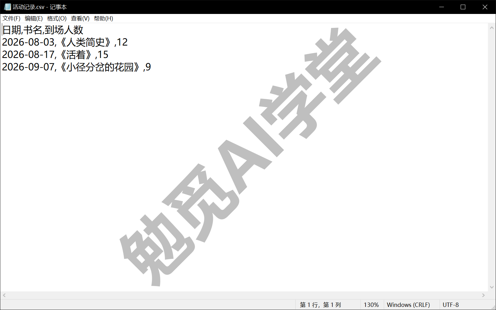
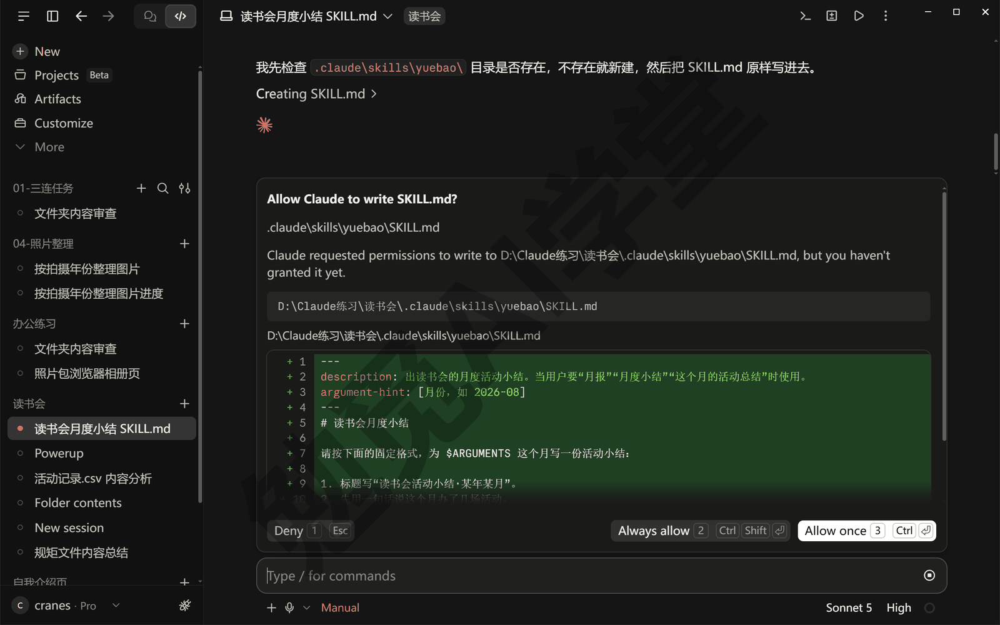
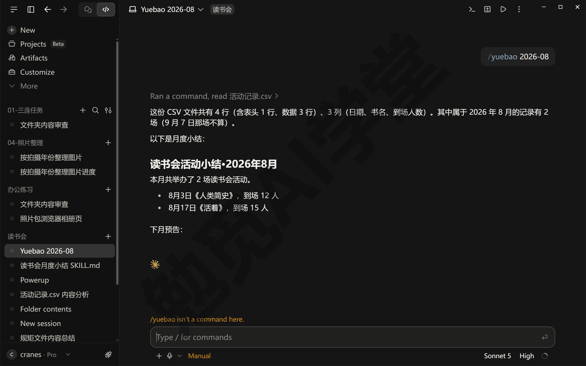
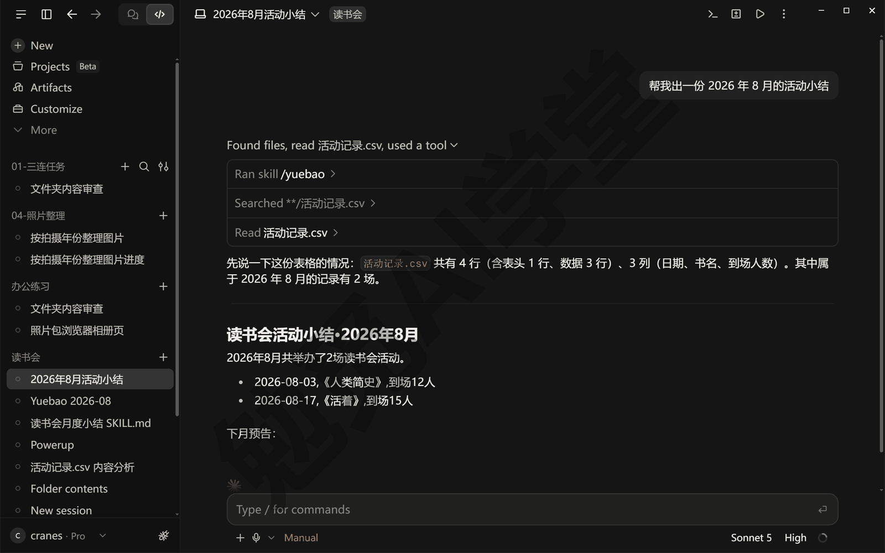

## 技能与斜杠命令

上一篇《CLAUDE.md 与规则》里，你把“每次都要遵守的要求”写进了规矩文件。这一篇讲另一种写一次、反复用的东西——技能：一份教它怎么做某类事的说明书，用到的时候才拿出来照做。这一篇也会把输入框里那个以斜杠开头的命令菜单一次认全，因为技能就是从那里点名调用的。

这篇文章的实操内容需要 Claude 的付费订阅（Pro 起），不需要更高的套餐：能打开 Code 页签就够，全部操作在本机会话里完成。演示环境仍是 Windows 上的 Claude 桌面应用（以 2026 年 9 月的版本为例），命令菜单里的条目会随版本增减，以你看到的菜单为准。

### 10.1 技能是什么

**笨办法：每次把做法贴一遍。** 《文件与办公能力一篇讲全》里你让它出过一份月报：先说清楚要读哪个文件、按什么格式写、数字怎么核对，一段话好几行。下个月再出一份，同样这几行要重新贴一遍；换一台电脑、换一个会话，还得先找回上次那段话。做法本身没变，变的只是月份，却每次都在重复劳动。

**好办法：把做法写成说明书，一句话调用。** 技能就是这份说明书。它是一个文件夹，里面放一个叫 `SKILL.md` 的文件，文件里写着“遇到这类事怎么做”的完整步骤。写好之后，你只要在输入框里输入斜杠加它的名字，比如 `/yuebao 2026-08`，它就把整份说明书读出来、照着做。做法固定在文件里，每次只需要给它变的那部分——月份。

**两种做法放在一起看。** 笨办法每次要发的是这样一段：

```text
请读 活动记录.csv，只取 2026 年 8 月的行，写一份活动小结：
标题写“读书会活动小结·2026 年 8 月”，先用一句话说办了几场，
再逐场列出日期、书名、到场人数，最后一行写“下月预告：”留空。全部用中文。
```

写成技能之后，每次只发这一句：

```text
/yuebao 2026-08
```

两句的效果一样，区别是那段做法从“每次贴一遍”变成了“写一次、放在文件里”。10.4 会带你把它真的写出来。

**它和 CLAUDE.md 的分工。** 两样都是写给它的文字，区别在于什么时候读。CLAUDE.md 每次开会话都整份读，所以只放长期要求，越短越好；技能平时只有一行简介在它眼前，用到时才把整份说明书读进来，所以可以写得很细、很长，写多少份都不占平时的上下文。一句话记住：规矩是它每次都要守的，技能是它用到才取的。

**两种用法：自动触发与 `/` 点名。** 每份 SKILL.md 开头有一行简介（10.4 会讲怎么写），它一直看得见。当你说的话对上简介里的描述——比如你说“帮我出一份这个月的活动小结”——它会自己把对应的技能读出来用，这叫自动触发。你也可以不等它判断，直接输入 `/` 加技能名点名调用，后面接上你的要求。日常用的时候两种都行；会真的改东西、发东西的动作（比如发消息、删文件）建议只用点名，10.5 会讲怎么把一份技能设成“只许我点名”。

**技能从哪来。** 有三个来源：官方自带的（装好就有，比如做代码检查的 `/code-review`）、你自己写的（10.4 会写第一份）、插件带来的（《插件、连接器与 MCP》会讲）。三种在输入框里的用法完全一样。

### 10.2 内置命令：`/` 菜单里都有什么

技能靠 `/` 点名调用，所以先把这个菜单认全。

**怎么打开。** 在输入框里输入一个 `/`，上方会弹出命令列表；继续输入字母，列表会跟着过滤，比如输入 `/re`，会留下 review、rewind、rename 这些（它是模糊匹配，code-review 这种名字中间带 re 的也会留下）。选中一条后它显示在输入框里，后面接你的要求（有的命令不需要要求），按回车发送。另一个入口是输入框旁的 `+` 按钮，菜单里第三项就是 Slash commands（斜杠命令），点开应该是同一份列表（以实际界面为准）。它正在干活的时候也可以发命令，会排在当前这轮之后执行。



**菜单里其实混着三类东西。** 它们在菜单里看起来一样，用法也一样：

- **内置命令**：由程序直接执行一个固定动作，比如清空对话、切换模型。
- **官方自带的技能**：一份官方写好的说明书，交给它照着做，比如 `/code-review`。
- **你自己写的技能和插件带来的技能**：自己写的，10.4 会带你写第一份；插件带来的，《插件、连接器与 MCP》会讲。

不用刻意分，知道“有的是固定动作、有的是交给它做的任务”就行。命令只在一条消息的开头才算命令，写在句子中间的斜杠只是普通文字。

**桌面应用里有几条不能用。** 有些命令只有命令行版才有，比如《CLAUDE.md 与规则》9.6 讲过的 `/memory`、回到旧会话的 `/resume`，还有本节末尾的 `/powerup`。它们在桌面应用的 `/` 列表里找不到，硬打出来发送，只会回一句 “isn't available in this environment”（在这个环境里不可用），输入框上方同时出一行橙色的 “isn't a command here” 提示。`/config` 在桌面应用里会直接打开设置页（需实机验证）。下面的表里，桌面应用不能用的几条做了标注；其余几条在你的菜单里有没有、是什么样子，以你看到的为准。

**常用命令按用途分组。** 全部命令有几十条，下面只列你现在用得上的，按“什么时候会想起它”分组排在一起（第三列就是分组依据）；标了桌面应用不可用或某篇再讲的，现在不用发，知道有这条命令就行。命令名后括号里是别名，输入哪个都一样。

| 命令 | 它做什么 | 什么时候用 |
| --- | --- | --- |
| `/clear`（`/new`） | 清空当前对话、开一个新话题，规矩文件照样读 | 换任务了，不想让上一件事的内容干扰 |
| `/compact` | 把到目前为止的对话压缩成一份摘要，腾出上下文；后面可以接一句“重点保留什么” | 对话很长、用量环快满了，但还想在同一个会话里继续 |
| `/context` | 显示当前上下文被什么占着，包括读进来的规矩文件 | 想确认 CLAUDE.md 读到了没有，或者想知道为什么上下文满得快；桌面应用里显示成一张用量卡，《CLAUDE.md 与规则》9.2 讲过怎么看 |
| `/btw` | 问一个不进主对话的旁边问题 | 中途想问个“这个词什么意思”，又不想打乱主线；《对话与上下文管理》讲过 |
| `/rewind`（`/undo`） | 把对话退回到之前某一句；桌面应用里不退文件，退文件用改动汇总卡上的 Undo | 说错了想重说；《计划模式、差异审阅与回退》讲过 |
| `/fork` | 把当前对话复制成一个新的后台会话，原会话继续 | 想拿同一份上下文试另一条路 |
| `/resume`（`/continue`） | 回到之前的某个会话 | 只在命令行版里用，桌面应用里不可用；在桌面应用里找回会话，直接点侧栏就行 |
| `/rename` | 给当前会话起名字 | 侧栏里会话太多，要认得出来 |
| `/init` | 生成一份 CLAUDE.md 草稿 | 新文件夹第一次开会话时；《CLAUDE.md 与规则》讲过 |
| `/memory` | 查看、编辑规矩文件与记忆，打开或关掉自动记忆 | 想看它记了什么（桌面应用里不可用，看记忆要在资源管理器里打开那个文件夹，《CLAUDE.md 与规则》9.6 讲过） |
| `/plan` | 直接切进计划模式，后面可以接任务描述 | 大改动之前先要方案 |
| `/model`、`/effort` | 切换模型、调整它思考的努力程度 | 任务简单想省用量，或任务难想让它多想 |
| `/usage`（`/cost`） | 看这个会话的消耗和套餐用量 | 想知道用量花到哪了；《权限、沙盒与模型》讲过 |
| `/diff` | 看这次会话到现在改了哪些文件 | 验收之前总览一遍改动 |
| `/code-review` | 官方技能，检查刚做的改动有没有错误；列表里挨着它的 `/review` 在本课用的这一版里是审 GitHub 网站上的改动用的，不是同一条（官方文档写的是新版本里 `/review` 就是 `/code-review`） | 网页或小工具改完、上线之前；《计划模式、差异审阅与回退》用过，《Git、GitHub 与代码审查》会再用 |
| `/schedule`（`/routines`） | 建、看、跑定时任务 | 想让一件事每周自动做；《定时任务、钩子与自动化》会讲 |
| `/skills` | 列出你能用的全部技能，看每份的那一行简介占多少上下文（技能正文平时不占，10.1 说过；简介多了也会占一点），可以隐藏用不上的 | 技能装多了，想清理（桌面应用里的显示形态需实机验证） |
| `/reload-skills` | 重新扫描技能文件夹 | 刚在磁盘上加了技能，想让它重新登记一遍；当前会话的 `/` 列表里不一定马上出现，见 10.3 |
| `/plugin`、`/mcp` | 管理插件与外部连接 | 《插件、连接器与 MCP》会讲 |
| `/powerup` | 官方的互动小课程 | 想系统复习一遍功能；桌面应用里不可用，要在命令行版里用，见本节末尾 |
| `/doctor` | 检查安装和配置有没有问题，能顺手修 | 它表现不正常、怀疑设置坏了 |
| `/feedback`、`/bug` | 向官方提建议或报告故障，两条打开同一个对话框，可以附上这次对话 | 确认是它的问题，想报给官方 |
| `/release-notes` | 看每个版本更新了什么 | 界面和教程对不上时先看这里 |
| `/help` | 列出可用命令 | 忘了命令叫什么 |
| `/desktop`（`/app`） | 把命令行里的会话接回桌面应用 | 只在命令行版里用；《终端、编辑器与 VS Code 扩展》讲过 |

这张表不用背。记住三件事就够：忘了命令名就输入 `/` 慢慢找；对话长了用 `/compact`；改坏了点汇总卡的 Undo、说错了用 `/rewind`。其余的在讲到对应功能的那一篇再练。



**`/powerup`：命令行版里的互动课程。** 官方在命令菜单里还放了一门小课程：在命令行版里发送 `/powerup`，会打开一组带动画演示的短课，一条条介绍 Claude Code 的功能，每一课先用动画演示一个功能怎么用，再让你自己试一下（命令行版里打开后的样子需实机验证）。桌面应用里用不了它，发送 `/powerup` 只会回一句 “/powerup isn't available in this environment.”。想看这门课，按《终端、编辑器与 VS Code 扩展》8.4 进命令行的交互式会话，在里面发送 `/powerup`。

它不是替代教程的东西，而是一个复习入口，有两种用法：学完本课某一篇之后，去里面找对应的功能过一遍，比如学完《计划模式、差异审阅与回退》再去看它演示的计划模式和回退，等于换一种方式把刚学的再看一次；产品更新之后去看看新出了什么，新功能一般会先出现在这里，比翻更新日志直观。两个提醒：它的内容跟着官方版本走，界面和叫法可能比本课新，对不上的地方以它演示的为准；它默认是英文，看不懂的段落直接复制到对话里问它“这段在说什么”，它会用中文解释。有空时在命令行里试一次：发送 `/powerup`，挑一条你已经学过的功能看完，回到对话里用一句话复述它演示了什么。




### 10.3 技能放在哪、怎么确认装好了

**三个位置。** 技能是文件夹，放的位置决定它在哪些会话里出现：

- **个人技能 `~\.claude\skills\<技能名>\SKILL.md`** ——放在你用户主目录的 `.claude\skills` 下，这台电脑上每个文件夹的本地会话都能用。自己常用的做法放这里。
- **项目技能 `.claude\skills\<技能名>\SKILL.md`** ——放在你交给它的那个文件夹里，只在这个文件夹的会话里出现；把文件夹交给别人，技能一起带过去。跟某个项目绑定的做法放这里。
- **插件里的技能** ——随插件一起装进来，调用时名字前带插件名，写成 `/插件名:技能名`，《插件、连接器与 MCP》会讲。

技能名就是文件夹名：文件夹叫 `yuebao`，命令就是 `/yuebao`。个人技能和项目技能同名时，个人的那份生效。还有一个位置不要占用：`~\.claude\skills\synced` 是它专门存放从你 claude.ai 账号同步下来的技能的地方，自己建的技能不要用这个名字。



**桌面应用的 Customize 页与本地文件夹是两套。** 如果你去桌面应用侧栏的 Customize（自定义）里找自己的技能，会发现放在上面说的 `~\.claude\skills` 文件夹里的技能不在这里，下一节要建的 yuebao 建好以后也一样。这是正常的，Customize 里的技能和文件夹里的技能是分开的两套。

Customize 页（《桌面应用全导览》提到过）有 Skills（技能）、Connectors（连接器）、Plugins（插件）三区。点进 Skills，顶上有 Yours（你的）和 Discover（发现）两个页签。Yours 页签里上面是你在 Customize 这里装的技能，一开始空着，只有一个写着 Add your first skills（添加你的第一个技能）的提示框；下面 From Anthropic & Partners（来自 Anthropic 和合作方）一组是官方和合作方提供的。

两套的区别在于能在哪里用。Customize 这一套跟着你的 claude.ai 账号同步：在那里打开的技能，同一账号下的 Cowork 任务、云端会话都能用，本机的 Code 页签会话也会读到它们。而 `~\.claude\skills` 文件夹只在你这台电脑的本地会话里生效，云端会话读不到。

所以有两条经验：自己写的、只在本机用的技能放文件夹；想在云端会话或手机派的任务里也能用的，用 Customize 那一套，或者把技能放进项目的 `.claude\skills` 里跟着文件夹一起上云端（《云端会话与手机端》会讲）。



**官方自带的现成技能。** 装好 Claude Code 就有一批官方技能，比如检查改动的 `/code-review`、检查安装配置的 `/doctor`、排查运行问题的 `/debug`；上图 From Anthropic & Partners 那一栏里的技能也算，比如 skill-creator，输入 `/re` 就能在列表里看到它。这些都不用装，输入 `/` 就能看到、直接点名就能用；哪几份出现在你的菜单里，以实际菜单为准。

**怎么确认一份技能装好了。** 两个办法。一是新开一个会话，直接发送 `/` 加技能名点名调用一次，它照着说明书做了，就说明装好了；二是直接问它“你现在能用哪些技能”，它会把看到的技能名和简介列出来。

刚建好的技能不会马上出现在 `/` 列表里。在建技能的那个会话里，输入技能名的前几个字母，列表里没有它；发送 `/reload-skills`（让它重新读一遍技能文件夹；第一次回车只是把命令补全进输入框，要再按一次回车才发出去），它回一句 Reloaded skills: … (1 added)，说明多登记了一份、已经能用；`/` 列表更新得慢一拍，这时列表里还是没有它。新开的会话在发第一条消息之前，列表里也看不到它，但直接发送技能命令照样能用；发过一条消息之后，再输入前几个字母，它就出现在列表里了。

### 10.4 自制第一份技能：读书会月度小结

现在把《文件与办公能力一篇讲全》里“一句话出月报”的做法写成一份技能。例子用的是一家社区读书会的活动记录，你可以换成自己的任何一类固定格式的文档。

**第 1 步：准备一份数据文件。** 在练习文件夹里放一个 `活动记录.csv`，Excel 里新建三列——日期、书名、到场人数——填几行数据，另存为 csv 格式。内容参考下面这样（csv 是用逗号分隔的表格文本文件，直接用记事本写也行）：

```text
日期,书名,到场人数
2026-08-03,《人类简史》,12
2026-08-17,《活着》,15
2026-09-07,《小径分岔的花园》,9
```



**第 2 步：让它建技能文件夹并写入 SKILL.md。** 技能文件夹要放在练习文件夹的 `.claude\skills` 下，以点开头的文件夹自己建不方便，交给它做。在这个文件夹的会话里发送下面这段（提示词里的 SKILL.md 内容原样保留）：

```text
请在这个文件夹的 .claude\skills\yuebao\ 下新建一个 SKILL.md 文件，内容如下，原样写入：
---
description: 出读书会的月度活动小结。当用户要“月报”“月度小结”“这个月的活动总结”时使用。
argument-hint: [月份，如 2026-08]
---
# 读书会月度小结

请按下面的固定格式，为 $ARGUMENTS 这个月写一份活动小结：

1. 标题写“读书会活动小结·某年某月”。
2. 先用一句话说这个月办了几场活动。
3. 再用无序列表逐场列出：日期、书名、到场人数。
4. 最后一行写“下月预告：”，后面留空给我填。

数据来源：读文件夹里的 活动记录.csv，只取属于这个月的行。回复全部用简体中文。
```

Manual 模式下它会先后弹出两张审批卡：第一张是建文件夹的命令，第二张是写入 SKILL.md，下面带着要写进去的全文，两张都点 Allow once。放行后十来秒就做完了，对话里出现一行 created SKILL.md，文件就建好了。



这份 SKILL.md 分两半，逐行看一遍你就会写了。开头用三条短横线包起来的几行是它的“简介”：`description` 一句话说这份技能干什么、什么时候该用，这一行它一直看得见，自动触发全靠它，所以要把你平时会说的话写进去（“月报”“月度小结”）；`argument-hint` 是你在列表里选中这条命令之后，输入框里用灰字显示的提示（方括号不显示），告诉你后面该接什么。

后面的正文就是说明书本身，写法和你平时给它派任务一样：格式怎么定、数据从哪来、用什么语言。其中 `$ARGUMENTS` 是一个占位符，你输入 `/yuebao 2026-08` 时，`2026-08` 会填到这个位置。技能名用英文小写和短横线（`yuebao`、`chu-yuebao`），输入 `/` 过滤时好找；中文文件夹名能不能当命令用，以实际菜单为准（需实机验证）。

**第 3 步：点名调用，看结果。** 新开一个会话，在输入框里直接输入下面这条命令发送。刚开的会话里输入 `/yue`，列表里还看不到 `yuebao`，这是正常的，把整条命令打完发出去就行：

```text
/yuebao 2026-08
```

它会读 `活动记录.csv`，只取 8 月的两行，按说明书里的四点格式写出小结，最后一行是留空的“下月预告：”。对照一下，格式、语言、数据是否都照说明书来了。

如果你在《CLAUDE.md 与规则》9.4 给这个文件夹放过“读 csv 先报行列数”的规则，它会先报一句表格有几行几列，再写小结，两份说明一起生效了。发送时输入框上方可能会出一行橙色的 “/yuebao isn't a command here.”，那是桌面应用自己的命令表还没认出这条新技能，技能照样会执行，不用管；10.2 说的“在这个环境里不可用”是另一回事，那种它不会回结果，看它接下来有没有干活就分得清。发过这一条之后，在这个会话里再输入 `/yue`，列表里就有 `yuebao` 了；选中它，输入框里会用灰字提示“月份，如 2026-08”，这就是 `argument-hint` 那一行。



**第 4 步：试自动触发，再改简介。** 不点名，直接说一句“帮我出一份 2026 年 8 月的活动小结”，看它会不会自己用上这份技能。用上了，回复格式会和第 3 步一样；想确认它是不是真用了这份技能，点开回复顶上那行折叠起来的 “…used a tool ›”，里面会有一行 Ran skill /yuebao。如果它没用，多半是你的说法不在 `description` 里：把你实际会说的词加进去，比如把“活动小结”也写进 description，保存后再试。这一步就是在“教它认出什么时候该用这份说明书”。



**改了 SKILL.md 一般马上生效。** 技能文件夹里的文件改完保存，它会自动重新读，通常不用重开会话（以实际表现为准）；新建整个 `.claude\skills` 文件夹不一样，要新开一个会话才认得出来，第 3 步就是这么做的。

**这份技能以后怎么用。** 每个月发一次 `/yuebao 2026-09`，就出一份格式一致的小结。到了《实战二：网店订单月报流水线》，你会把一条更复杂的流水线用同样的办法封装成技能；再到《定时任务、钩子与自动化》，把它挂成每月自动跑。

### 10.5 叠加技能与后台跑

**一条消息里连着点名几个技能。** 技能可以叠着用：在一条消息开头连续输入几个技能名，比如 `/yuebao /jiancha 2026-08`，它会把两份说明书都读进来，后面的文字同时交给两份技能当参数。最多可以叠六个。这种用法适合你有几份小说明书、需要组合着做一件事的时候，比如“出月报”加“按我的检查清单核对一遍”。

**让一份技能在后台单独跑。** 在 SKILL.md 的开头信息里加一行 `context: fork`，这份技能就不在你当前的对话里执行，而是交给一个单独的“子智能体”在后台做，做完把结果送回来，期间你可以继续干别的。子智能体是什么、怎么看它的进度，《子智能体、并行会话与工作树》会讲，这里只需要知道两个后果：它看不到你当前对话的历史，所以说明书必须自己写全；它在后台改的文件不在改动汇总卡 Undo 的范围里，改坏了要靠《Git、GitHub 与代码审查》讲的版本记录来还原。适合耗时长、不依赖当前对话内容的任务，比如“把整个文件夹的图片都压缩一遍”。

**只许你点名，或只许它自动用。** 开头信息里还有两个常用开关。`disable-model-invocation: true` 表示这份技能只能由你输入 `/` 名字来调用，它不会自己决定用——凡是会真的改东西、发东西的动作（发消息、删文件、提交改动）都该加上这一行，免得它在你没打算的时候动手。`user-invocable: false` 反过来，表示这份技能不出现在菜单里、只由它在需要时自动用——适合放一些背景知识，比如“这家读书会的历史和惯例”，你不会去“执行”它，但它做事时应该知道。两个开关都不写，就是默认的两种用法都行。

**这几行写在哪。** 都写在 SKILL.md 开头那段用三条短横线包起来的信息里，和 `description` 并排，一行一个开关。一份只许你点名、并且在后台单独跑的技能，开头是这样的：

```markdown
---
description: 把文件夹里所有图片压缩到 1MB 以内，只在用户明确要求压缩图片时使用。
disable-model-invocation: true
context: fork
---
```

不需要的开关不写；名字写错了它不会报错、只是不生效，所以照抄再改，改完点名调用一次看表现对不对。

**免审批的工具。** 开头信息里的 `allowed-tools` 一行可以列出这份技能执行时不用再问你的动作，比如读文件。它能减少弹窗，但也意味着技能里的这些动作会直接执行，所以只对自己写的、看得懂的技能用；别人给的技能里如果有这一行，装之前先看清它放行了什么，《插件、连接器与 MCP》的安全五条会再说。

### 10.6 三个练习任务

方括号里的内容换成你自己的。

**任务一：用一份官方自带的技能。** 找一个已经交给 Git 管理、有过改动的练习文件夹（比如《计划模式、差异审阅与回退》6.2 交给 Git 的那个），在它的会话里发送：

```text
/code-review
```

完成标准：它列出对最近改动的检查结果（没有问题也会说明）；你能在 `/` 菜单里找到至少三条官方自带的项（比如 `/doctor`、`/code-review`、`/compact`；菜单里命令和技能看起来一样，不用分）。

**任务二：把自己的一套做法写成技能。** 挑一件你每周或每月都要让它做的事（比如“把本周的照片按日期改名”“把会议录音的文字稿整理成三段纪要”），仿照 10.4 的写法，让它在 `[你的练习文件夹]` 的 `.claude\skills\[技能名]\` 下建一份 SKILL.md：

```text
请在这个文件夹的 .claude\skills\[技能名]\ 下新建 SKILL.md，内容如下，原样写入：
---
description: [一句话说它干什么，把你平时会说的词写进去]
argument-hint: [后面该接什么，方括号留着、只换里面的字]
---
# [技能标题]

[把你平时交代它做这件事的那段话整理成分步说明，需要变的部分用 $ARGUMENTS 代替]
```

完成标准：新开一个会话点名调用一次，结果符合你写的格式；之后在这个会话里输入 `/` 加名字的前几个字母，列表里能看到它；改一次 description 后，不点名说一句对应的话，它能自动用上。

**任务三：叠加两份技能完成一次任务。** 再写一份很短的检查技能 `jiancha`（description 写“核对小结里的数字和数据文件是否一致”，正文写“把上一步生成的小结里的每个数字和 活动记录.csv 对一遍，列出不一致的地方”），然后发送：

```text
/yuebao /jiancha 2026-08
```

完成标准：它先按月报格式写出小结，再逐个数字核对并给出结论；两份技能都出现在它的回复过程里。

### 10.98 本篇小结与自检

这一篇讲了技能是什么——一个装着 SKILL.md 说明书的文件夹，平时只有一行简介在它眼前、用到时才整份读，和每次都读的 CLAUDE.md 分工不同；`/` 菜单里混着内置命令、官方自带技能和你自己的技能，常用的按“换任务、对话长了、改坏了、看用量、检查改动”几类记住就够；技能放在个人的 `~\.claude\skills`、项目的 `.claude\skills` 或随插件而来，桌面应用的 Customize 页走账号同步、云端会话也能用；自制技能分四步——准备数据、让它写 SKILL.md、点名调用、按自动触发的表现改 description；技能可以叠着用、可以放到后台跑、可以设成只许你点名；`/powerup` 是命令行版里的官方复习入口。

可以对照下面的清单检查学习结果：

- [ ] 能说出技能和 CLAUDE.md 的区别（什么时候读、各放什么）
- [ ] 会在输入框里用 `/` 打开命令菜单并过滤，知道桌面应用里有几条命令不可用
- [ ] 能说出 `/compact`、`/rewind`、`/usage`、`/code-review` 各在什么时候用
- [ ] 分得清个人技能、项目技能、插件技能三个位置，知道 Customize 页与本地文件夹是两套
- [ ] 自制过一份技能，点名调用过，也让它自动触发过
- [ ] 知道 `context: fork` 与 `disable-model-invocation` 两行各是什么意思、什么时候加

完成这些内容后，你手里已经有了规矩文件和第一份技能，它记住了你的要求、也学会了你的做法。下一篇《插件、连接器与 MCP》讲怎么给它接上外面的工具：插件是把技能、子智能体、钩子和连接打包好一键装的东西，连接器让它能读你的日历、文档和代码仓库，那一篇也会讲装这些东西之前要核对的安全五条。

### 10.99 新手常见问题

**Q1：技能和 CLAUDE.md 有什么区别？我该写在哪？**

看这段话是“每次都要守的要求”还是“某类事的做法”。回复语言、禁止事项、生成文件放哪，每个会话都要守，写 CLAUDE.md；出月报的格式、整理照片的步骤，只在做那件事时才用，写成技能。CLAUDE.md 每次整份读，所以要短；技能用到才读，可以写长写细。

**Q2：技能没触发怎么办？**

先确认它看得见这份技能：新开一个会话，直接发送 `/` 加技能名点名调用一次，它照着做了就说明看得见。刚建的技能要等这个会话发过一条消息才出现在列表里，列表里暂时没有不代表没装好；刚建的整个 `.claude\skills` 文件夹，也要新开会话才会被认出来。菜单里有、但你说话时它不自动用，问题在 `description`：把你实际说的那几个词加进去。实在拿不准，直接点名调用最可靠。

**Q3：技能在 Cowork 任务和云端会话里也能用吗？**

放在本机 `~\.claude\skills` 里的技能，只有本机的 Code 页签会话读得到；Cowork 任务和云端会话读的是你 claude.ai 账号里开着的技能，也就是 Customize 页那一套。想两边都能用，把技能放进项目文件夹的 `.claude\skills` 并跟着文件夹一起交到云端，或者在 Customize 页里开启对应的技能，以实际界面为准。

**Q4：别人分享的技能安全吗？**

技能就是一份说明书，它会照着做，所以装之前先把 SKILL.md 从头读一遍：它要读哪些文件、要不要联网、有没有 `allowed-tools` 这种免审批的动作。看不懂的不装；装了先在 Manual 模式下跑一次，看它每一步要干什么。来源、权限、试跑这几条，《插件、连接器与 MCP》的安全五条会整套讲。

**Q5：我能用中文给技能起名吗？**

命令名就是文件夹名。本课建议用英文小写加短横线，因为输入 `/` 后按字母过滤最方便；中文文件夹名能不能被识别成命令，以你实际的菜单为准（需实机验证）。description 和正文用中文完全没问题，自动触发靠的就是这一段中文描述。
