## 插件、连接器与 MCP

前面十篇里，它能做的事都发生在你的电脑和你选的那个文件夹里。这一篇把它接到外面去：让它读你的日历、翻你的 Notion 笔记、往 Slack 发消息，或者一次装进一整套别人做好的能力。你会认识三个词：插件、连接器、MCP（一种让智能体接上外部工具的通用标准，11.1 节展开）。先把它们的关系说清楚，再逐个动手：在 Customize 页面看清自己有什么，装一个插件、接一个连接器、手工配一个 MCP 服务，最后给出办公类的推荐清单和五条安全做法。

这篇文章的实操内容需要 Claude 的付费订阅（Pro 起）；插件与连接器本身不另外收费，但接进来的外部服务（比如 Notion、Slack、Google 日历）用的是你自己在那些服务上的账号，它们收不收费以各自的说明为准。全篇按 Windows 桌面应用的 Code 页签演示，按钮名以英文写出并附中文释义，界面细节以你装好的最新版本为准。

### 11.1 三个词的关系

先比一比同一句话在接上连接器之前和之后的两种结果。现在就在任意一个会话里发一句：

```text
看看我明天有什么安排。
```

没有接任何东西的时候，它多半只会告诉你它看不到你的日历，和聊天工具一样；接上 Google 日历的连接器之后，同一句话，它会真的去读你的日历，把明天的日程列出来，还能帮你把某个会挪到后天（11.4 节里会带你真的接一次）。这一篇讲的，就是怎么把这种“外面的东西”接进来。

再加上你已经用过的技能，这三样东西各自负责一件事，列在一起最好记：

- **技能**：一份教它怎么做某类事的说明书，《技能与斜杠命令》讲过。它不增加新的能力，只是把做法固定下来。
- **连接器**：把一个外部服务接给它，让它能读、能写那个服务里的东西。日历、笔记软件、聊天工具、代码托管平台，都是通过连接器接进来的。
- **插件**：一个打包好的安装包，里面可以同时装着技能、子智能体（下一篇讲）、钩子（《定时任务、钩子与自动化》讲）和 MCP 服务。装一个插件，等于一次装进去一整套配好的能力。

**MCP 是连接器背后的标准。** MCP 的全称是 Model Context Protocol（模型上下文协议），你可以把它理解成智能体和外部工具之间的一种“通用插头”：只要一个服务按这个标准做好了，任何支持 MCP 的智能体都能接上它。连接器就是带着图形化配置界面的 MCP 服务——你点几下、在浏览器里授权，背后接的就是一个 MCP 服务。手工配置 MCP，则是不走图形界面、自己填一段配置文件把服务接进来，11.5 节会做一次。这个词在界面和资料里会反复出现，现阶段只要记住“一个 MCP 服务就是一个能接给它的外部工具”就够了。

把三样放在一起看：插件是最大的那个包，里面可以装技能，也可以装 MCP 服务；连接器背后接的就是 MCP 服务，它可以单独接，也可以被插件带进来；技能只管做法，不接任何外部服务。

**这三样各在什么时候用。** 只想固定一种做法（比如你的周报格式），用技能；想让它碰你在别处的数据（日历、笔记、聊天记录），用连接器；一个团队或一位作者把一整套东西配好了发给大家，你拿来一键装，那是插件。三者可以同时存在：一个插件里装着的技能，用起来和你自己写的技能没有区别；插件带进来的 MCP 服务，和你手工配置的 MCP 服务也一样在对话里出现。拿不准某样东西属于哪一类，看它是“教做法”（技能）、“接服务”（连接器）还是“一个包”（插件）。

**接进来不等于放开权限。** 无论哪种方式接进来的东西，它用起来都还是受《权限、沙盒与模型》讲的权限模式管：在 Manual（手动）模式下，它调用任何一个外部工具之前都会先问你，你看得见它要调什么、传什么；接进来只是让它“能用”，什么时候真的用、用到什么程度，仍然由你在每一次询问里决定。这一点在 11.7 节的安全五条里还会讲到具体怎么做。

### 11.2 Customize 页面：三样东西一处管

Code 页签左侧侧栏里有一个 Customize（自定义）入口，点开是一个管理页面，顶部是 Skills（技能）、Connectors（连接器）、Plugins（插件）三个页签，每个页签里又分 Yours（你的）和 Discover（发现）两栏：Yours 列你装过、接过、写过的东西，Discover 是可以新加的。《技能与斜杠命令》10.3 节里你看过它的 Skills 区，这一篇要用到另外两个区。

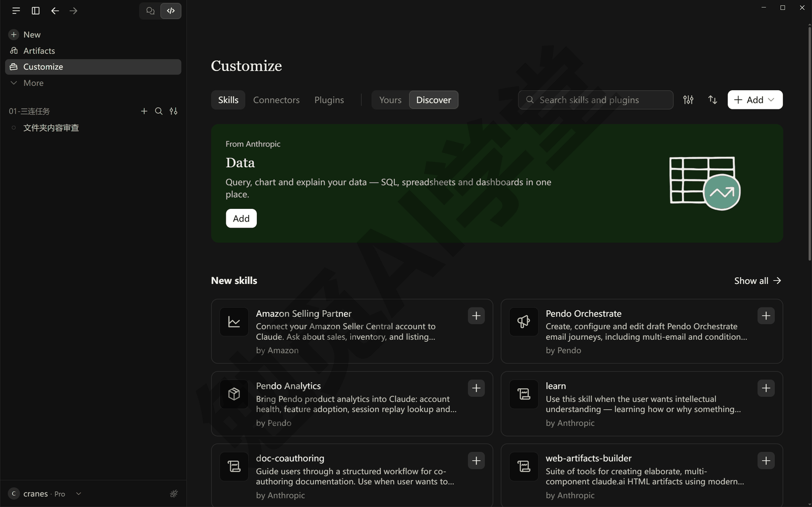

**这一页的内容跟着 claude.ai 账号走。** 这决定了东西存在哪、别处能不能用。桌面应用的技能、连接器、插件配置，绑在你的 claude.ai 账号上，同一个账号下的 Cowork 页签也从这里取用；这些内容不是存在某个本地文件夹里的。另一套放在你电脑用户目录下的 `.claude` 文件夹（Windows 上通常是 `C:\Users\你\.claude`），技能放在 `skills` 子文件夹、插件放在 `plugins` 子文件夹，命令行版主要读这一套；MCP 服务的配置则记在用户目录下另一个叫 `.claude.json` 的文件里，它和 `.claude` 文件夹并排。两套并不完全隔开：用同一个账号登录的命令行会话，也会加载你在 claude.ai 账号上启用的技能和插件；本地会话同时还会读 `.claude\skills` 里的技能。可以这样记：

- **只用桌面应用的人**：连接器和插件在 Customize 页面管；技能两套都能用——账号里的在 Customize 装，自己写的照《技能与斜杠命令》放进本地 `.claude\skills`；规则文件照《CLAUDE.md 与规则》放在项目文件夹里，这两处不归 Customize 管。
- **桌面应用和命令行都用的人**：账号上启用的东西两边都能用；只放在本地 `.claude` 文件夹里的东西，桌面应用的本地会话读得到，云端会话读不到。
- **云端会话**（《云端会话与手机端》讲）：只加载账号上启用的技能和插件，不读你电脑上的任何文件夹。

**第一次打开这一页建议做两件事。** 一是清点：看看三个区里各有什么，是不是都是你自己装的、接的——如果之前在网页版 claude.ai 上接过某个服务，这里也会列出来。二是把不认识、不再用的东西关掉或断开，它们越少，你后面每一步审批时看到的可选工具就越少、越不容易点错。关掉和断开都可以随时再开回来，不会丢数据。清点也可以在会话里直接问它：

```text
现在这个会话里有哪些技能、连接器和插件可用？每一项能做什么，用中文列出来。
```

它会把当前会话能用到的东西列一遍，你把这份清单和 Customize 页面对照一下，两边应该对得上（列不出来的，多半是只在别的范围里启用、这个会话读不到）。这句话以后每装一样新东西都可以再发一次，当作清点。

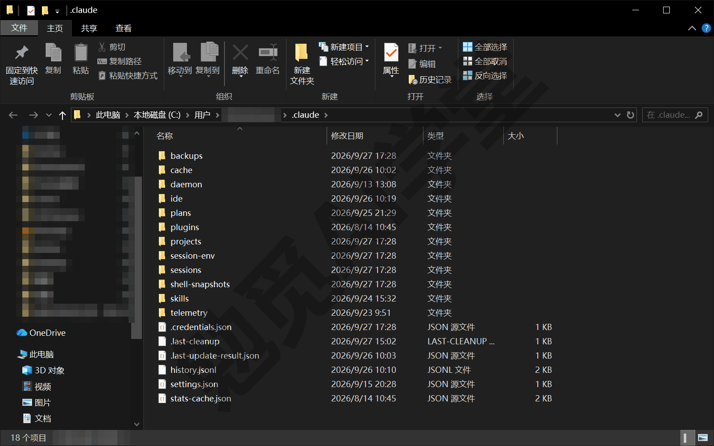

### 11.3 插件一键装

**插件是什么，为什么要有它。** 你想让它帮你管 GitHub 上的项目，需要一个接 GitHub 的 MCP 服务、几条常用做法的技能、可能还有一个专门审代码的子智能体。分开配置的话，你要填三四个地方；作者把这些打成一个包，你装一次就全有了——这就是插件解决的问题。官方维护了一个市场，叫 claude-plugins-official，里面的插件经过 Anthropic 筛选；另有一个社区市场收第三方作者提交的插件。桌面应用里装插件不用敲任何命令。

**第 1 步：打开插件浏览器。** 在一个本地会话里，点输入框旁的 + 按钮，菜单里有五项：Add files or photos（添加文件或图片）、Add folder（添加文件夹）、Slash commands（斜杠命令）、Connectors（连接器），最后一项是 Add plugins（添加插件）。点 Add plugins，会打开设置里的 Plugins 页（和 11.2 从侧栏 Customize 进去看到的是同一批插件，入口不止一个），分 Yours（你的，已装的插件）和 Discover（发现，市场里的插件）两个页签；Discover 里按 Anthropic 推荐、新上架、装得最多分组列着，顶上有一个搜索框。云端会话和 WSL 会话（在 Windows 内置的 Linux 环境里跑的会话）没有这个入口，插件浏览器只在本地与 SSH 会话（连到远程机器上跑的会话）可用。

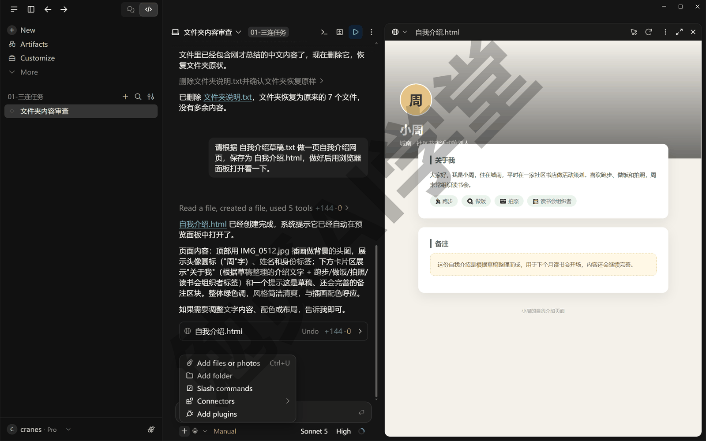

**第 2 步：找到要装的插件。** 本篇拿官方市场里的 explanatory-output-style（讲解式输出风格）演示：装上之后，它的回复末尾会多一块讲解，说它为什么这样做，而且不需要任何外部账号。在 Discover 页签的搜索框里输入 explanatory，结果里第一条就是它，作者写着 Anthropic，一行英文简介说它会讲解实现上的选择，右边是 Add（添加）按钮。本课用的这一版里，搜索结果点不开详情，要装上以后才能进详情页看它到底带了什么，所以下一步装之前先把警告读完。

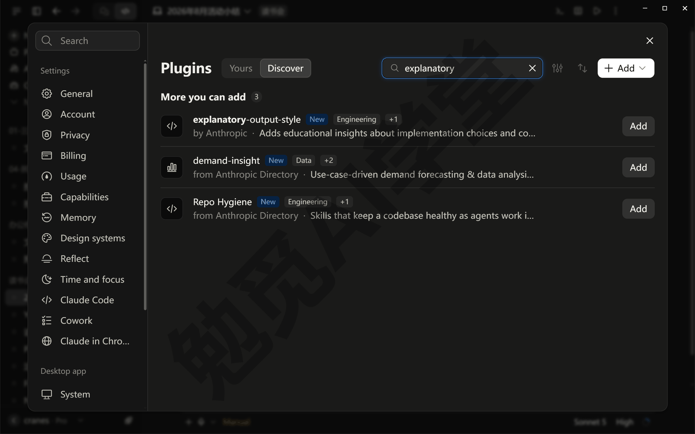

**第 3 步：读完警告，装上。** 点 Add 之后先弹出一个警告框：标题是 The explanatory-output-style plugin includes components that run code（这个插件里有会运行代码的组件），下面一行红字 Installing will grant access to everything on your computer.（装上它，就等于让它能碰你电脑上的一切），再下面一句 Only enable plugins from people you trust.（只启用你信得过的人做的插件），按钮是 Cancel（取消）和 Continue（继续）。这个插件的作者是 Anthropic，点 Continue。

一秒左右就装好了，右下角弹出 explanatory-output-style is installed and ready to use.（已经装好，可以用了），页面直接进到这个插件的详情页。本课用的这一版装的时候不问装给谁：从 Discover 里装的插件落在账号这一级，所有项目都能用，回到 Yours 页签能看到它列在 From Anthropic & Partners 下面，而不是 In this project（这个项目）下面。

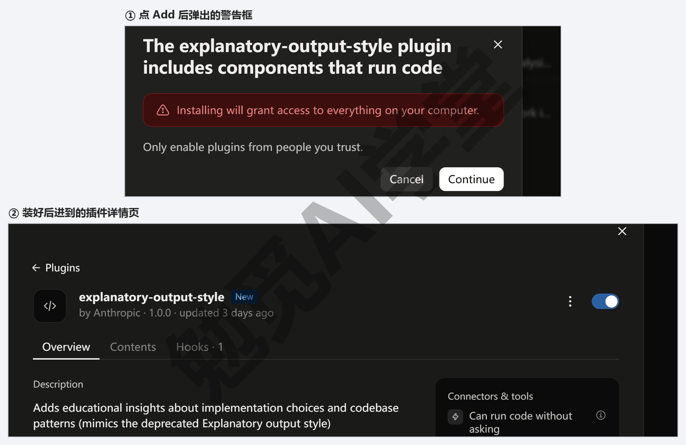

**第 4 步：看它带了什么，用一次。** 装好后打开的详情页上有几个页签：Overview（概览）、Contents（内容）和 Hooks（钩子）。Contents 列出插件里的每个文件；Hooks 里只有一条 Session start（会话开始时运行），意思是每开一个新会话，它就先给对话加上一段“边做边讲解”的要求。Contents 里的说明文件还特意提醒，这会多花一些用量。带技能、子智能体或 MCP 服务的插件，详情页会多出对应的页签；插件带来的技能名字前面会带插件名，写成“插件名:技能名”，这是为了几个插件里有同名技能时不冲突。以后想再看这个页面，点 + 按钮 → Add plugins，在 Yours 页签里找到它。

钩子在会话开始时才加载，所以要新开一个会话试效果。在新会话里让它做一处小改动，比如：

```text
请在这个文件夹里新建一个 readme.txt，写三行介绍这个文件夹的话，用中文。
```

装了之后，回复末尾会多出一块以 ★ Insight 开头、上下各有一条横线的讲解，写两三条要点，说它为什么这样做；讲的内容偏程序员的视角，比如它先读了哪些文件、用了什么工具。没装之前的回答没有这一块，差别就是这个插件带来的。

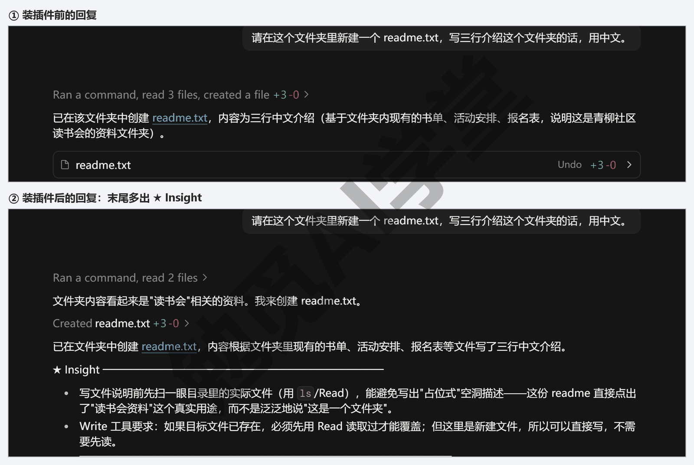

**管理与卸载。** 点 + 按钮 → Add plugins，切到 Yours 页签，已装的插件都列在这里；点插件那一行右边的 ⋮，菜单里有 Turn off（关掉）、Check for updates（检查更新）、Remove（移除）三项。关掉只是不加载，配置还在，想用时再打开；移除会弹一个确认框 Remove plugin?，说它带来的命令和技能都不能再用了、以后可以再装回来，点 Remove 后右下角提示 Plugin removed.（已移除）。演示用的这个插件会多花用量，练完就在这里关掉或移除。

**装完先在 Manual 模式试。** 插件带进来的东西是别人写的，第一次用最好把权限模式切到 Manual（手动），看清它每一步想做什么再放行；用熟了再切回 Accept edits（自动接受编辑）。权限模式怎么切，《权限、沙盒与模型》讲过。

**命令行版的对应做法。** 如果你装了《终端、编辑器与 VS Code 扩展》里的命令行版，那里用的是 `/plugin` 命令：输入后会打开一个带页签的面板，Discover（发现）页签浏览市场、Installed（已安装）页签管理已装的、Errors（错误）页签看没装好的原因；也可以直接一句 `/plugin install 插件名@市场名` 安装。桌面应用里没有这个面板，用上面的插件浏览器。

### 11.4 连接器：接一个外部工具

**连接器是什么，为什么要有它。** 你的日程在 Google 日历里、笔记在 Notion 里、同事的消息在 Slack 里，这些都不在你交给它的那个文件夹里，它本来是看不到的。你可以把连接器理解成一把进这些服务的钥匙：你在浏览器里登录并授权一次，之后它就能在对话里读那里的数据、往那里写东西。官方给出的例子包括 Google Calendar（Google 日历）、Slack、GitHub、Linear、Notion 等，实际能选哪些以你界面上的列表为准。

**第 1 步：打开连接器列表。** 在本地会话里点输入框旁的 + 按钮，把鼠标移到 Connectors（连接器）上，右边会展开一个子菜单：上面是 Browse connectors（浏览连接器）和 Manage connectors（管理连接器），下面列着已经接上的服务和各自的开关。点 Browse connectors，会打开设置里的连接器页，停在 Discover（发现）页签，一格一格列着能接的服务，比如 Google Drive、Gmail、Google Calendar、Notion、Slack，每格右上角有一个 +。开会话之前和开了会话之后都可以加。云端会话和 WSL 会话的输入框没有 + 按钮，接不了连接器，这两种会话怎么用外部服务，《云端会话与手机端》再讲。

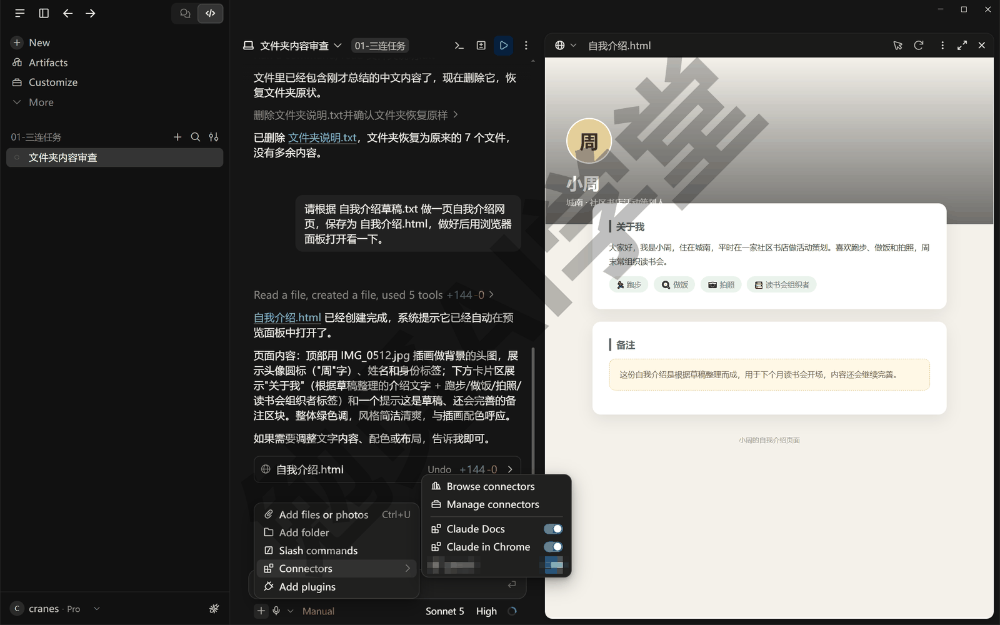

**第 2 步：授权。** 本篇以 Google 日历为例（如果你没有 Google 账号，换 Notion 或任何一个你在用的服务，步骤大同小异）。点 Google Calendar 那一格右上角的 +，应用会打开浏览器，先到 claude.ai 的一个确认页，问你要不要完成连接器的连接。只有这个连接是你刚在桌面应用里点出来的，才点“继续连接”；别人发给你的来路不明的连接器链接，不要点。

接着跳到 Google 的页面。如果浏览器里登录了好几个 Google 账号，页面会先让你选一个，选的就是要接进来的那个日历，上面写着“继续前往 Claude for Google Calendar”，这是授权方在 Google 这边的名字。下一页只要你的邮箱；再下一页才是日历的权限，一项一项列着，默认都没勾：前两项是查看日程、查看日历，第三项是查看、修改、共享以及永久删除你的日历。读清楚，三项都勾上再点“继续”，为什么三项都得勾，下面“只读还是可写”会讲。回到应用后，在设置里的连接器页打开 Google Calendar，右上角出现 Disconnect（断开连接）按钮、下面列出它能用的工具，就是接好了。

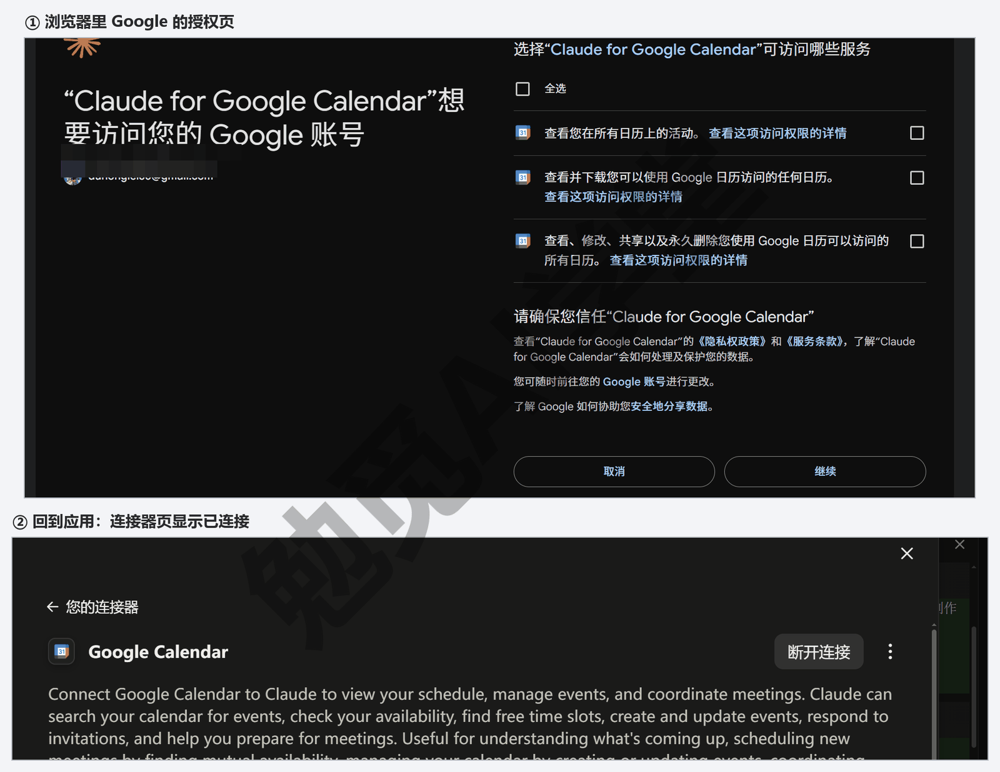

**第 3 步：在对话里用它。** 不需要任何特殊写法，像平时一样说话就行：

```text
看看我明天有什么安排，按时间顺序列出来，用中文。
```

在 Manual 模式下，它调用之前会先弹一张审批卡，标题写着要用哪个连接器的哪个工具（这里是 Google Calendar 的 Lists calendar events），下面灰框里是这次调用带的参数，比如查从哪天到哪天；点 Allow once（只允许这一次）它才去读。读完，回复上方是一行可以展开的 Used 2 tools（已使用 2 个工具）›，点开能看到它调的是 Google Calendar 的哪个功能，下面就是按时间排好的日程。如果你不确定现在接了哪些连接器，直接问它“现在这个会话接了哪些连接器”，它会列给你。

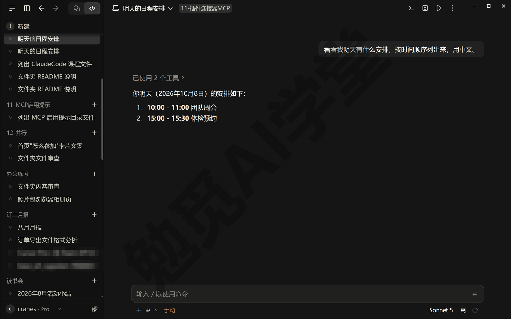

**第 4 步：管理与断开。** 两个地方都能进：应用的 Settings → Connectors（设置 → 连接器），或者 + 按钮 → Connectors 子菜单里的 Manage connectors（管理连接器）。Yours 页签里一行一个已接的服务，写着类型和状态；点进一个服务，就是第 2 步最后看到的那个详情页：右上角是 Disconnect，下面的工具权限里，每个工具右边有三个图标，分别是始终允许、需要批准、禁止，可以一个一个改。不再用的点 Disconnect，断开后它就拿不到那个服务的任何数据了。同一个账号在网页版 claude.ai 的连接器设置里接的服务，桌面应用里也会出现，两处管的是同一份。

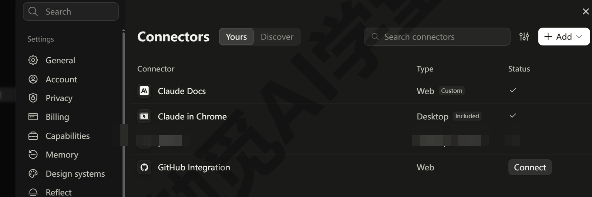

**只读还是可写。** 授权页上的权限是一项一项列的，像 Google 日历，前两项只是看，第三项能改、能删。只勾前两项的话，浏览器里显示连上了，回到应用却一直写着“尚未完成”，要连第三项一起给才接得上（别的服务是不是也这样，以授权页为准）。所以“先只读”主要靠你说话的方式：第一次用某个连接器，先让它只读（“列出来”“告诉我”），确认它读得对，再让它写（“帮我建一个”“发给某某”）。给了写权限，它就能替你发消息、建日程、改笔记，你一句话没说清楚，它就可能真的把消息发出去，所以写的动作在 Manual 模式下逐条确认；也可以在第 4 步那个详情页里，把会改东西的工具设成需要批准。

### 11.5 MCP 手工配置：连接器列表里没有的怎么接

连接器列表里只有官方接好的那些服务。世界上能接给它的 MCP 服务远不止这些：有人给本机文件夹、数据库、天气、地图各做了 MCP 服务，这些要自己填一段配置接进来，这就是“手工配置”。手工配置是这一篇里最接近程序员操作的一节，但只是复制一段文字、改一个路径，跟着做就行。

**配置写在哪、管多大范围。** MCP 服务的配置有三种范围，决定了它在哪些项目里出现：

| 范围 | 在哪些项目里出现 | 配置写在哪 |
| --- | --- | --- |
| 项目 | 只在这个项目文件夹里 | 项目文件夹根目录的 `.mcp.json` |
| 用户 | 你电脑上所有项目 | 用户目录下的 `.claude.json`（顶层） |
| 本地 | 只在这个项目、只对你 | 同一个 `.claude.json`，记在该项目的条目下 |

你只用第一种就够：`.mcp.json` 就是项目文件夹里的一个文本文件，谁拿到这个文件夹谁就有同样的配置，也最容易检查和删除。桌面应用和命令行读的是同一份配置，一处配好两边都能用。

**第 1 步：写 `.mcp.json`。** 本篇以官方提供的示例服务里的“文件系统服务”为例，这个服务让它能按 MCP 的方式读写你指定的文件夹。在你的项目文件夹根目录新建一个名为 `.mcp.json` 的文本文件（注意开头有个点）。最简单的做法是让它建：发“在项目根目录新建 .mcp.json，内容如下：”再把下面这段贴给它；自己用记事本建的话，另存为时保存类型选“所有文件”、文件名两头加英文引号（`".mcp.json"`）、编码选 UTF-8，才不会变成 .mcp.json.txt。文件内容如下，把里面的路径换成这个项目文件夹本身（就是你开会话时选的那个）：

```json
{
  "mcpServers": {
    "files": {
      "command": "npx",
      "args": [
        "-y",
        "@modelcontextprotocol/server-filesystem",
        "D:\\教程演示\\ClaudeCode课\\11-插件连接器MCP"
      ]
    }
  }
}
```

三处要留意。`files` 是你给这个服务起的名字，英文、不带空格，之后在对话和面板里都用这个名字认它。`command` 加 `args` 是启动这个服务的命令，`npx` 是 Node.js 自带的一个下载并运行程序包的工具，所以这一类用 `npx` 启动的服务需要电脑上装有 Node.js（不知道装没装，让它“检查这台电脑有没有 Node.js，没有就装一个”，《文件与办公能力一篇讲全》5.5 节讲过怎么让它自己安装工具）；不需要 Node.js 的服务，作者会给出别的命令，照抄进来即可。Windows 路径里的每一个反斜杠在这个文件里都要写成两个（`D:\\教程演示`），这是 JSON 文件的写法要求，只写一个，整份配置就读不出来。

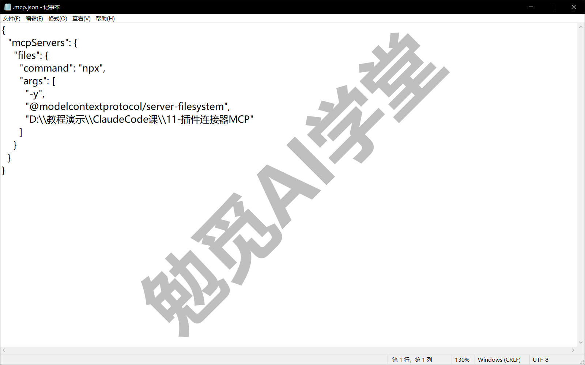

**路径要写项目文件夹本身。** 上图里的路径，就是会话开着的那个文件夹 `D:\教程演示\ClaudeCode课\11-插件连接器MCP`。要是写成它的上一级（比如 `D:\教程演示\ClaudeCode课`），再让它去列上一级，会报 Access denied - path outside allowed directories（路径不在允许的目录里），它最后还是只能列会话文件夹。这个服务只能碰你开会话的那个文件夹，路径写成别的文件夹也没有用——第 1 步说的“你指定的文件夹”，在桌面应用里就只能指定它。它本来就能读这个文件夹，接这个服务并不会多出一个可读的地方；这一节接它，为的是把“接一个 MCP 服务”的全套步骤走一遍，以后接别的服务做法一样。

**第 2 步：重开会话，它会自动接上。** 保存文件后，在这个文件夹上新开一个会话，`.mcp.json` 里写的服务就自动接上了，不会单独问你要不要启用。你有两次机会拦下这个服务：第一次打开这个文件夹时弹出的信任提示 Trust this workspace（信任此工作区），和 Manual 模式下它第一次调用这个服务的工具时弹出的审批卡。所以打开别人给你的文件夹之前，先看一眼里面有没有 `.mcp.json`；有的话，看清它要启动什么命令，是你认识的再点信任；一旦点了信任，里面写的服务就会跟着这个文件夹一起跑起来。

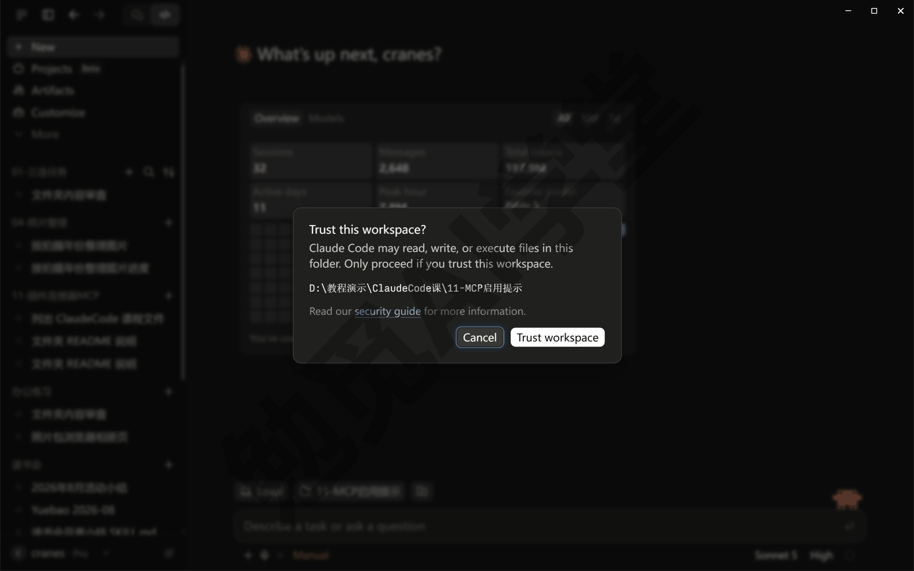

**第 3 步：在对话里用它，看审批。** 让它做一件要用到这个服务的事：

```text
用 files 这个服务列出这个文件夹里有哪些文件，用中文告诉我。
```

MCP 服务提供的每个功能，在它这里都是一个“工具”；调用工具和读文件、跑命令一样，受权限模式管。Manual 模式下它每次调用前都会弹审批卡，标题同时写着工具名和服务名，比如 Allow Claude to use list directory (files)?（允许它用 files 服务的 list directory 工具吗？），下面一行是它要列的路径。按钮还是那三个：Allow once（只允许这一次）、Always allow（这个工具以后不再问）、Deny（拒绝）；Allow once 右边的 ▾ 里还有一项 Allow and switch to Auto，意思是放行这一次，同时把这个会话切到 Auto 模式。放行后，对话里的工具卡片写成 files: list directory 这样，冒号前是服务名、后面是工具名，这是你核对它“有没有做多余的事”的地方。

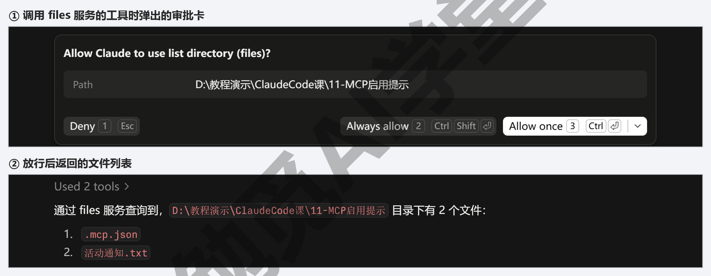

**跑得久的调用会自动转到后台。** 有的 MCP 工具一次要跑很久，比如让一个服务去抓一批网页。一次调用超过两分钟还没结束，它不会一直卡在那里等，而是把这次调用挪到后台继续跑（较新的版本才有这个行为，以实际表现为准），主线对话照常进行，跑完后结果以一条通知回到对话里。后台跑着的东西在任务面板里能看到、也能停掉，任务面板是什么，下一篇《子智能体、并行会话与工作树》讲。

**改配置或删服务。** 直接改或删 `.mcp.json` 里对应的条目，保存后重开会话生效。想彻底不用，把文件删掉即可；想暂时不连某个服务但保留配置，命令行版的 `/mcp` 面板里可以把它关掉，桌面应用里能不能单个关掉以实际界面为准。

**命令行版用一条命令就能写入。** 如果你装了命令行版，可以不手写文件，在项目文件夹里用这条命令写入同样的配置（`--scope project` 表示写进 `.mcp.json`）：

```text
claude mcp add --scope project files -- `
  npx -y @modelcontextprotocol/server-filesystem D:\教程演示\ClaudeCode课\11-插件连接器MCP
```

命令太长分成了两行，行尾的反引号是 PowerShell 的续行符，整段一起复制粘贴就能运行。`claude mcp list` 会列出已配置的服务和它们是否连上，`claude mcp remove files` 会把这个服务删掉。注意命令行里 `--` 后面的部分是原样交给服务的启动命令，不要改动顺序；路径同样换成你的项目文件夹本身。

**Windows 上 MCP 起不来怎么查。** 按官方给的顺序查：

- 先核对配置有没有写错（最常见是路径少了一个反斜杠、名字里带了空格）。
- 把应用整个退出重开一次。
- 在任务管理器里看服务对应的进程有没有在跑（这个服务是用 npx 起的，进程名是 node.exe；看不出来就直接重开会话）。
- 还不行就让它把服务的日志读给你看，报错原文往往直接写着缺什么。

另外有几个名字是系统保留的，不能给自己的服务用，比如 workspace、computer-use、Claude Browser；你起的名字和这几个重了，它会跳过这个服务并提醒你改名。

### 11.6 办公类插件与连接器推荐清单

下面这份清单按普通用户的场景挑，都是官方市场或官方连接器列表里有的；名字和有没有以你打开时的列表为准，市场里的内容经常变。接进来之前，先确认你在那个服务上有账号、并且愿意把它的数据交给它读。

| 想做的事 | 推荐接什么 | 类型 | 一句话说明 |
| --- | --- | --- | --- |
| 让它看日程、建日程 | Google Calendar（Google 日历） | 连接器 | 读明天的安排、按你的话建会议 |
| 让它读写笔记 | Notion | 连接器或插件 | 把 Notion 里的页面读进来当材料，或把结果写回去 |
| 让它看消息、发消息 | Slack | 连接器或插件 | 读频道里的讨论，起草并发出消息（发之前先确认） |
| 让它管项目待办 | Linear、Asana、Atlassian（Jira） | 连接器或插件 | 读任务列表、新建任务、更新状态 |
| 让它管代码仓库 | GitHub | 连接器或插件 | 读仓库、开合并请求，《Git、GitHub 与代码审查》会用到 |
| 让它一边改一边讲 | explanatory-output-style | 插件 | 回复末尾附一段讲解，说它为什么这样做；会多花用量 |
| 让它自己查安全问题 | security-guidance | 插件 | 它每改一处都同时查常见安全漏洞并当场修 |

同一个服务往往既有连接器也有插件（比如 Notion、Slack、GitHub），两者接的是同一个服务，区别是插件可能额外带几条技能；只想读写数据，选连接器步骤最少；先接连接器，用了一阵子觉得缺几条现成做法，再看有没有插件补上。清单里没有你用的服务，先到 Customize 页面和插件浏览器里搜一下，再考虑 11.5 节的手工配置。

**挑的时候按这个顺序想。** 先问“我要它做的事，靠它已有的能力能不能做”——读你电脑上的文件、写网页、跑命令，这些不用接任何东西；再问“数据在哪个服务里”，在哪里就接哪里的连接器；最后才是“有没有一个插件把我要的几样一起打包了”。顺序反过来，很容易装一堆用不上的东西。

**接好之后先验证一次。** 每接一样东西，用一句只读的话让它试用，确认它真能拿到数据、拿到的是对的：

```text
用刚接好的 [服务名] 读一条最近的内容，原样告诉我它写了什么，不要改任何东西。
```

读回来的内容和你在那个服务里看到的一致，这一样东西才算接好；对不上，先看 Settings → Connectors 里它的状态是不是已连接，再看授权时给的权限够不够（只给了读、你却让它写，就会失败）。验证通过，再让它做正事。

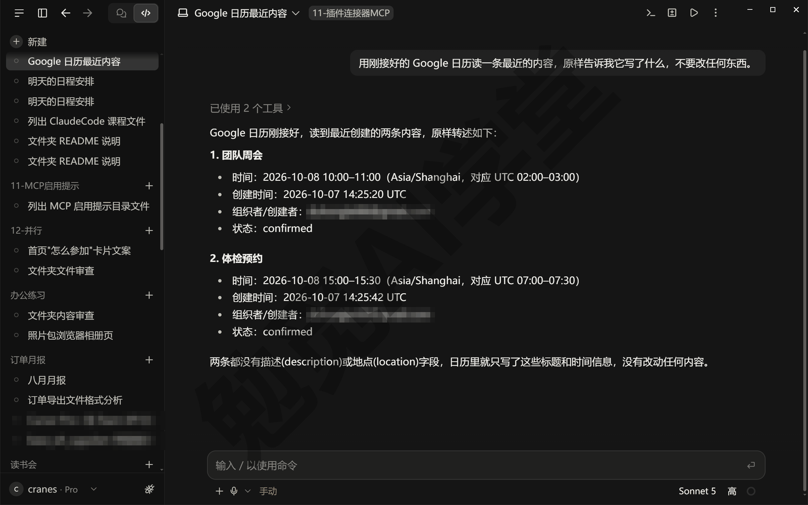

### 11.7 安全五条

接进来的每一样东西都在扩大它能碰到的范围，所以这一节比前面任何一节都重要。五条都是动手前的习惯，不难做到。

**第一，只装可信来源的插件。** 官方市场里的插件经过 Anthropic 筛选，社区市场里的插件经过自动化检查，但官方明确说过不保证它们一定按描述工作。作者不明、简介含糊、要的权限和功能对不上的插件，不装。

**第二，装上先看清它带了什么，不对就卸。** 本课这一版的插件，装之前你能看到的只有一行简介和点 Add 后弹出的警告框（11.3 第 3 步），看不全；装上之后马上会进详情页，看 Contents、Hooks 这些页签它到底带了什么，对不上就当场 Remove——装完到你看清的这几十秒里，先别在会话里发消息，它一般就不会自己动手（以实际表现为准）。一个说自己只是“改一下输出风格”的插件，如果带着一个要联网的 MCP 服务，就该多问一句为什么。

**第三，连接器分清只读还是可写。** 11.4 节说过：先用只读的说法，确认它读得对，再让它写；写的动作在 Manual 模式下逐条确认。有的连接器授权时就得连写权限一起给（Google 日历就是），这时更要靠这一条。

**第四，别把密码、密钥贴进对话。** 如果你手工配置的 MCP 服务需要一个访问密钥，按作者的说明把它写进配置文件的 `env` 一栏或系统的环境变量里，不要在对话里对它说“密钥是 xxx”。对话会被记录、可能被压缩、可能被你截图分享，密钥一旦进了对话就不该再算秘密。这一条在《权限、沙盒与模型》讲数据去哪了时也提过。

**第五，装完先在 Manual 模式试。** 新装的插件、新接的连接器、新配的 MCP 服务，第一次用都切到 Manual，看清它每一步调用了什么、传了什么，跑顺了再换回不用逐条确认的模式。这一条花不了两分钟，却能把前四条漏掉的都兜住。

**拿不准现在接了多少能往外写的东西，直接问它。** 下面这句话，你可以每隔一段时间发一次：

```text
列出这个会话里所有能联网、或者能往外部服务里写东西的工具，
各自来自哪个插件或连接器，用中文。
```

它列出来的每一项，你都应该能说出是自己什么时候接的、为什么接的；说不出来的，回 Customize 页面或 Settings → Connectors 里关掉。

**出了事怎么办。** 如果你发现它调用了一个你没想到的服务、或者往外写了不该写的东西，先在对话里按 Esc 停下它；接着到 Settings → Connectors 断开那个服务、或在 + 按钮 → Add plugins 的 Yours 页签里关掉那个插件；文件层面的改动用改动汇总卡上的 Undo（撤销）按钮退回，退不干净的靠 Git（《计划模式、差异审阅与回退》和《Git、GitHub 与代码审查》讲过怎么退；桌面应用里的 `/rewind` 只退对话、不退文件）；已经发到外部服务里的内容退不回来，只能到那个服务里手动处理。最后回头看对话里的工具卡片，弄清它是在哪一步、因为哪句话去调那个工具的，下次把话说得更具体。这四步的顺序不要颠倒：先停、再断、再退、最后回看。

### 11.97 练习任务

方括号里的内容换成你自己的。

**任务一：装一个插件并看清它多了什么。** 在插件浏览器里装 explanatory-output-style（或任何一个不需要外部账号的插件）。装之前先在一个会话里发一次下面这句；装上后把详情页各个页签里列的东西记下来，再新开一个会话发同一句：

```text
请在 [你的练习文件夹] 里新建一个叫“插件测试.txt”的文件，写两行任意内容，用中文。
```

完成标准：能说出这个插件带进来了哪几样东西；同一条请求，装前装后的回复有可见差别；练完在 + 按钮 → Add plugins 的 Yours 页签里把它关掉或移除。

**任务二：接一个连接器并让它读一条数据。** 接 Google 日历、Notion 或任何一个你在用的服务，接好后只让它读、不让它写：

```text
用 [你接的服务] 帮我读一条最近的内容（日程、页面或消息都行），
原样告诉我它写了什么，不要做任何修改。
```

完成标准：对话里出现了调用该连接器的工具卡片；它读回的内容和你在那个服务里看到的一致；在 Settings → Connectors 里能找到它并知道断开按钮在哪。

**任务三：手工配置一个 MCP 服务并触发一次审批。** 按 11.5 节在练习文件夹里写一份 `.mcp.json`，接文件系统服务（路径换成你的练习文件夹），新开会话后：

```text
用 files 这个服务读一下 [你的练习文件夹] 里任意一个文本文件的前几行，用中文告诉我。
```

完成标准：新开会话后不用另外启用，它就能用上 files 服务；调用工具前出现过审批；它读回的内容正确；练完把 `.mcp.json` 删掉。

### 11.98 本篇小结与自检

这一篇先把技能、连接器、插件和 MCP 的关系讲清：技能固定做法，连接器接外部服务，插件把一整套东西打成一个包，MCP 是连接器背后的标准；认识了 Customize 页面的三个区，以及桌面应用走 claude.ai 账号同步、命令行走本地 `.claude` 文件夹的关系；按“第 N 步”装了一个插件（打开插件浏览器→搜到它→读完警告装上→看详情页的页签→新开会话用一次→关掉或移除）、接了一个连接器（列表→授权→对话里用→管理与断开）、手工配置了一个 MCP 服务（写 `.mcp.json`→重开会话自动接上→调用审批→跑得久的自动转后台）；给出了办公类的推荐清单和五条安全做法。

可以对照下面的清单检查学习结果：

- [ ] 能用一句话说出技能、连接器、插件各是什么，以及 MCP 和连接器的关系
- [ ] 知道 Customize 页面在哪、三个区各管什么，知道桌面应用与命令行的配置各存在哪
- [ ] 会从插件浏览器装一个插件、看它带来了什么，会在 Yours 页签里关掉或移除
- [ ] 会接一个连接器并在对话里用它读数据，知道在 Settings → Connectors 里断开
- [ ] 会写一份 `.mcp.json` 接一个本机服务，知道新开会话就会自动接上、打开别人的文件夹前先看一眼里面的 `.mcp.json`、调用工具要审批、跑超两分钟会转后台
- [ ] 知道 Windows 上 MCP 起不来先查什么
- [ ] 能说出安全五条，尤其是“先只读再可写”和“密钥不进对话”

完成这些内容后，它能碰到的范围已经从一个文件夹扩到了你在用的外部服务。下一篇《子智能体、并行会话与工作树》讲怎么让它同时干几件事：同一个会话里它自己派分身、几个会话各干各的互不干扰，以及怎么让两个会话互相通消息。

### 11.99 新手常见问题

**Q1：插件、技能、连接器到底谁包含谁？**

插件最大，它是一个包，里面可以装技能、子智能体、钩子和 MCP 服务；连接器是一个带图形化配置的 MCP 服务，可以单独接，也可以被插件带进来；技能是一份说明书，可以自己写，也可以由插件带进来。三者装好之后，在对话里用起来没有区别：技能用 `/` 点名或让它自动触发，连接器和 MCP 服务在它需要时自动调用。

**Q2：连接器授权安全吗？它会不会乱动我的数据？**

授权走的是那个服务自己的登录和授权页面，你的密码不经过 Claude；授权页会写明给了哪些权限，读一遍再同意。它能不能“乱动”，取决于两件事：你给了它哪些权限（有的连接器必须连写权限一起给），以及你用的权限模式和连接器里每个工具的设置。按 11.7 节的做法先只读、再让它写，写的动作在 Manual 模式下逐条确认，风险就很小。不再用的服务及时在 Settings → Connectors 里断开。

**Q3：MCP 报错了怎么看？**

先看对话里工具卡片上的报错原文，多数会直接写明原因：连不上服务、路径不存在、缺少密钥。然后按 11.5 节末尾的顺序查：配置文件有没有写错、应用重开一次、进程在不在、日志说什么。实在看不懂，把报错原样贴回对话让它帮你解释，这也是《文件与办公能力一篇讲全》讲过的报错自救办法。

**Q4：Windows 上手工配置的 MCP 服务起不来，最常见的原因是什么？**

最常见的是路径写法：JSON 文件里 Windows 路径的反斜杠要写成两个，少写一个整段配置就读不出来；其次是服务名里带了空格或用了保留名；再次是这类用 `npx` 启动的服务需要 Node.js，电脑上没装就起不来。三条都核对过还不行，按 11.5 节末尾的排查顺序来。

**Q5：桌面应用和命令行装的插件是同一套吗？**

不完全是。桌面应用里装的插件绑在你的 claude.ai 账号上，用同一个账号登录的命令行会话也能加载它们；命令行里用 `/plugin` 装到本地 `.claude` 文件夹的插件，只在命令行和桌面应用的本地会话里可用，云端会话读不到。只用桌面应用的话，插件和连接器都在 Customize 页面管；自己写的技能照《技能与斜杠命令》放进本地 `.claude\skills`，这一点 11.2 说过。
