## 子智能体、并行会话与工作树

到这一篇为止，你都是开一个会话、交一件事、等它做完再交下一件。这一篇讲怎么让几件事同时干：同一个会话里它自己派出分身分头去做，几个会话各干各的互不干扰，两个会话之间还能互相通消息。你会认识三个词：子智能体、并行会话、工作树。学完之后，“先做完这个再做那个”的等待会少很多，课程后面的《实战三：旅行费用分摊计算器》和《毕业项目：家庭事务中心 + 课程总结》里“几个方案同时做、挑一个好的”，用的就是这一篇的做法。

这篇文章的实操内容需要 Claude 的付费订阅（Pro 起）。同时干几件事会比一件一件做消耗更多用量，具体多出多少，以你账号里显示的为准；用量怎么看、怎么省，《权限、沙盒与模型》讲过。全篇按 Windows 桌面应用的 Code 页签演示，按钮名以英文写出并附中文释义，界面细节以你装好的最新版本为准。

### 12.1 让几件事同时干的三种方式

同时干几件事有三种方式，区别在于你面对几个会话、改动会不会互相碰到：

- **子智能体**：在同一个会话里，它把一件事的某一部分交给一个分身去做，自己接着干别的；分身做完把结果交回来。你只面对一个会话，分工是它内部的事。适合“一件大事里有几块互不相干的调查或检查”，比如一边查文件夹结构、一边找重复文件。
- **并行会话**：你自己开第二个、第三个会话，每个会话各交一件事，几个会话同时跑。同一个项目开几个会话时，可以让每个会话各占一份文件夹副本（这份副本就叫工作树），改动互不干扰。适合“几件独立的事”和“同一件事试几种做法”。
- **云端会话**：把会话放到 Anthropic 的云端机器上跑，关掉电脑也不停，《云端会话与手机端》细讲。适合跑得很久、不需要你在旁边的任务，比如跑一遍完整检查、批量处理几百个文件。

三种方式放在一张表里对照，最右一列是这一篇里讲它的位置：

| 方式 | 你面对几个会话 | 改动会不会互相影响 | 适合什么事 | 在哪一节 |
| --- | --- | --- | --- | --- |
| 子智能体 | 一个 | 分身在同一份文件夹里干活，结果由主对话汇总 | 一件事里的几块调查、检查 | 12.2 |
| 并行会话 | 几个 | 勾了工作树就各占一份副本，互不影响 | 几件独立的事；同一件事试几种做法 | 12.3～12.5 |
| 云端会话 | 几个，在云端 | 在云端的副本里干活，成果以合并请求（下一篇讲）交回 | 跑得久、不需要你在旁边的事 | 《云端会话与手机端》 |

在《实战一：社区读书会网站》里，三种方式都用得上。做首页之前想弄清素材文件夹里有哪些图、哪些是重复的，这是一件事里的两块调查，让它派子智能体分头查，你只等一份汇总；首页配色拿不定主意，深色、浅色各做一版比一比，这是同一件事试两种做法，开两个并行会话各占一个工作树；四页做完要跑一遍完整检查、可能要半小时，你想合上电脑去吃饭，这是跑得久的事，交给云端会话。你自己的项目里，一件事里的几块交给子智能体，几件独立的事各开一个会话；三种方式在后面的实战篇里都会再出现。

三种方式可以叠加：一个本地会话里它派了三个子智能体，同时你还开着另一个会话在做别的事，云端还有一个跑测试的任务在运行。叠加得越多，同一时间消耗的用量也越多，用量环（《认识与装好》1.4 节）快满时先少开几个。开之前先问自己两句：这几件事会不会改到同一批文件？后一件会不会用到前一件的结果？两句都是“不会”，才适合同时做。什么时候不该同时干，12.6 节讲。

想练一下怎么选，把你手头的一件事说给它听，让它帮你判断属于哪一种：

```text
我手头有这件事：[一件事]。
它适合交给子智能体分头做、开两个会话并行做，
还是放到云端会话里跑？说说理由。
```

### 12.2 子智能体：它自己派出去的分身

**子智能体是什么。** 子智能体是它在会话里临时开出来的一个分身：有自己的一段独立记忆（术语叫“上下文”，《对话与上下文管理》讲过），接一个明确的任务，做完把结论交回主对话，然后结束。它和主对话默认用同一个模型、同一套权限，区别只是记忆分开：分身读了几十个文件、跑了几遍命令，这些过程都留在分身自己的记忆里，主对话只收到一份总结。

**为什么需要它。** 你可能会问：它自己直接查不行吗，为什么要派分身？有两个原因。一是省你的上下文：让它查一个几百个文件的文件夹，直接查会把主对话的记忆塞满一大堆文件内容，用量环里“上下文”那一层很快就满（12.1 说的派分身多消耗用量，说的是套餐那一层，两层各算各的）；交给分身查，主对话只拿到结论，记忆保持干净。二是能同时做：几件互不相干的调查，它可以派几个分身同时去查，比一件件排队快。

**它什么时候自己派。** 多数时候不用你开口，它判断合适就派。它自带三种分身：

- **Explore（探索）**：只看不改，专门用来搜文件、读代码、弄清一个文件夹里有什么。你让它“先看看这个项目是怎么组织的”，它常常派这个。
- **Plan（计划）**：你切到 Plan 模式（《计划模式、差异审阅与回退》讲过）以后，它做调研用的就是这种分身，调研过程不占主对话的记忆。
- **general-purpose（通用）**：既要查又要改、有好几步的任务，它会派这个。

对话里看不出它派的是哪一种，只会写出分身接到的任务，比如“调查最近一个月修改的文件”。你也可以直接要求它派分身，不需要任何特殊写法，说清楚就行。

**第 1 步：交一件能拆开的任务。** 在一个本地会话里（Manual 模式），选一个有几十个文件的练习文件夹，发送：

```text
请用两个子智能体分头调查两件事，最后汇总给我：
一、这个文件夹里哪些文件最近一个月改过；
二、哪些文件是重复的（内容相同、名字不同）。
都用中文回答。
```

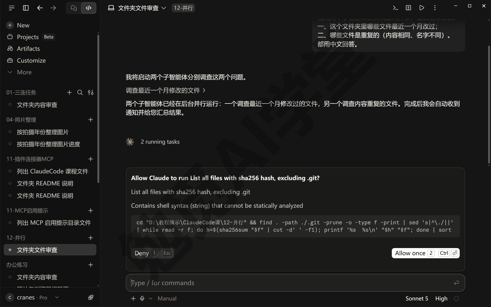

**第 2 步：看后台任务面板。** 它派出分身后，对话里会出现一行分身的任务标题，接着它告诉你两个分身已经在后台跑了，下面是一个转圈的 2 running tasks（2 个任务在跑）。分身在后台跑，主对话里看不到它们的每一步。点 2 running tasks 这一行，右边会打开 Background tasks（后台任务）面板，Running（运行中）下面每个分身占一条，依次写着任务标题、类型 Agent、跑了多久、用的模型、正在做哪一步，最后是一个 View transcript（查看记录）。官方文档说，后台的命令和上一篇讲的跑超两分钟转到后台的 MCP 调用也会列在这里（以实际界面为准）。

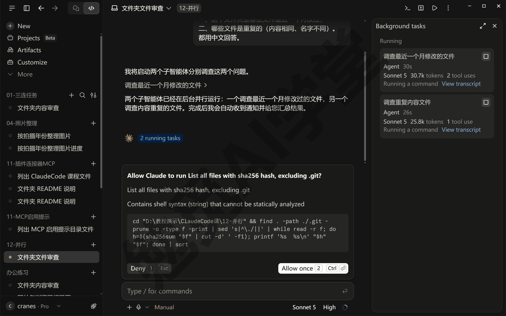

**第 3 步：点进去看，或者停掉。** 点一条的 View transcript，面板换成这个分身的记录：最上面是主对话替它写的任务说明，下面是它正在做的每一步，点 › 能展开。觉得它跑偏了，点左上角的 ‹ 回到列表，每条右上角有一个方形按钮，鼠标停上去提示 Stop this task（停止这个任务），点它就停掉这个分身。停掉一个分身不影响主对话和其他分身。

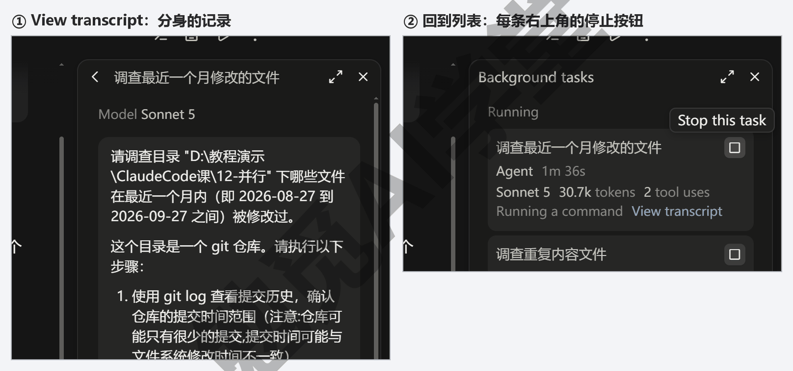

**第 4 步：等结果回来。** 分身做完，结果以一条通知回到主对话，它读完之后给你汇总。如果你在它汇总之前追问“查到哪了”，它会告诉你分身还在跑，不会把没做完的半截结果当成最终结果报给你。

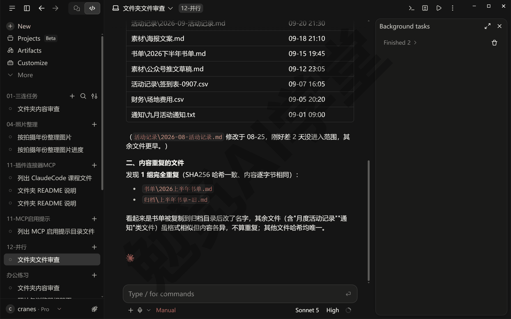

**后台跑意味着什么。** 有两件事和你直接相关。第一，权限询问还是会来找你：分身要改文件、跑命令，在 Manual 模式下照样在主对话底部弹出审批卡。卡片上写的是 Claude，看不出是哪个分身在问，判断办法和平时一样——看命令是读还是改、改的是不是你交代的事，拿不准就点 Deny，它会回来说明；点 Allow once 它才继续，没放行之前，后台任务面板里这个分身会一直停在那一步。按 Esc 拒绝的是这一次调用，分身会不会因此停下，以实际表现为准。第二，你在询问里选了“这次会话以后都不用问”这类持续生效的选项，这个选择会应用到整个会话，包括主对话，所以给分身放行时和给主对话放行一样要想清楚。

**分身还能再派分身。** 一个分身接到的任务如果还能再拆开，它可以再往下派，默认最多往下三层（层数以实际表现为准）。你看到的只是最上面那层交回来的总结，中间层的过程不进主对话。这一点平时不用管，知道“后台任务面板里可能看到一层套一层的条目”就行。

**自己写一个分身。** 内置的三种不够用时，可以定义自己的分身：一个放在项目文件夹 `.claude\agents\` 里的 Markdown 文件，写清它叫什么、负责什么、能用哪些工具；放在用户目录的 `.claude\agents\` 里，所有项目都能用。不用手写，直接对它说“帮我在这个项目里建一个只负责检查中文错别字的子智能体”，它会把文件写好；之后在输入框里输入 @ 选中这个分身的名字，就能指定让它来做某件事（@ 选分身的形态需实机验证）。本课不展开自定义分身。

**派分身会多消耗用量。** 每个分身有自己的记忆，读的每个文件、每一轮对话都从同一个套餐用量池里扣，几个分身同时跑，用量也在同时扣。所以要不要让它派分身，看事情本身适不适合拆开，不要为了快就多派几个。

### 12.3 并行会话与工作树

**并行会话是什么。** 点侧栏顶部的 New（新建）或按 Ctrl+N，就多了一个会话；每个会话有自己的对话、自己的文件夹、自己的权限模式，你可以给它们各交一件事，几个同时跑。按 Ctrl+Tab 和 Ctrl+Shift+Tab 能在会话之间来回切换。这一点《桌面应用全导览》讲过，这一节讲的是几个会话**在同一个项目上** 同时干活时会遇到的问题和办法。

**两个会话改同一个文件会互相覆盖。** 如果你开的两个会话都在改同一个文件夹里的文件，A 会话刚把首页改成深色，B 会话正在给同一个文件加一个按钮，两边写进同一个文件，结果互相覆盖、谁也说不清最后是谁改的。工作树解决的就是这个问题。

**工作树是什么。** 工作树是 Git 的一个功能：给同一个项目再复制出一份独立的文件夹，两份文件夹各自改动、互不影响，改完再决定把哪一份的成果合回主线。《认识与装好》装 Git 那一步就提到过它；Git 本身是什么、提交与合并怎么做，下一篇《Git、GitHub 与代码审查》细讲，这里只用到“给会话开一份独立副本”这一个用法。项目文件夹必须先是一个 Git 仓库（文件夹里有一个 `.git` 子文件夹）才能开工作树，还不是的话，对它说一句“把这个文件夹初始化成 Git 仓库，把现有文件提交一次”即可——工作树要从一次提交分出去，只初始化、没提交过的仓库开不出来。

**第 1 步：开第二个会话时选工作树。** 按 Ctrl+N 新建会话，选同一个项目文件夹。文件夹是 Git 仓库时，输入框上方那一排小标签里会多出一个分支名（分支是仓库里的一条版本线，下一篇细讲），比如 ⑂ main，旁边紧挨着一个小写的 worktree 复选框，默认不勾；鼠标停上去提示 Work in an isolated copy of the repository（在仓库的一份独立副本里干活）。勾上它，这个会话就在一份独立的副本里干活，改动不会碰到别的会话正在用的文件。

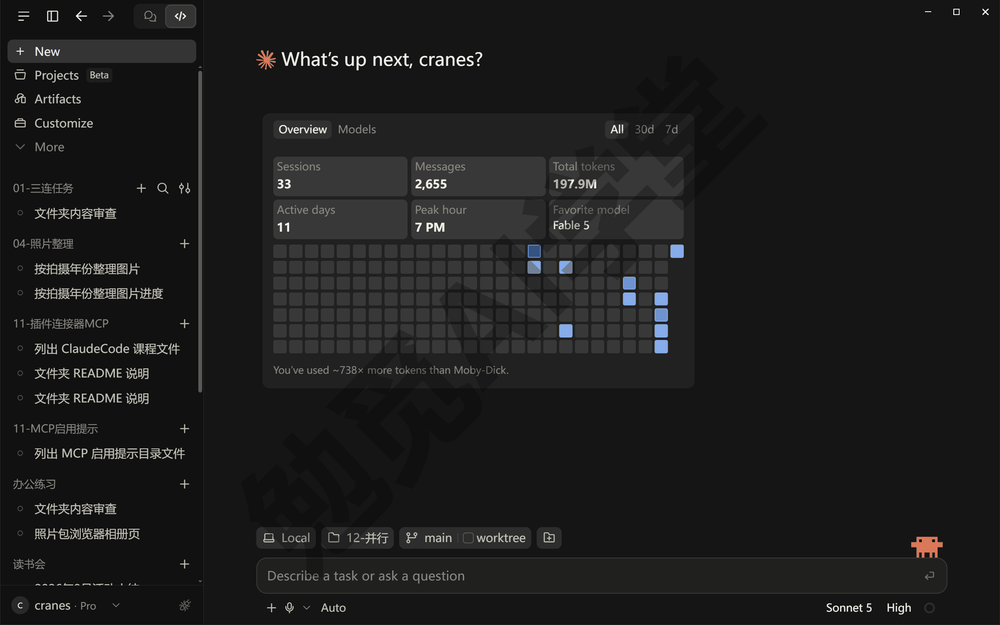

**第 2 步：看它在哪。** 本课这一版里，工作树副本放在项目文件夹里的 `.claude\worktrees\` 下面，每个会话一个子文件夹，名字是随机起的，比如 goofy-lalande-27c8fb；放在哪由 Settings → Claude Code（设置 → Claude Code）里的 Worktree location（工作树位置）决定，这里选的是 Inside project（放在项目里），官方文档写的默认位置也是项目文件夹下的 `.claude\worktrees\`，以你的设置页为准。同一页往下，Pull requests（合并请求）一节有一项 Branch prefix（分支前缀），默认填的是 claude，所以工作树对应的分支名都以 claude/ 开头，比如 claude/goofy-lalande-27c8fb，以后在 Git 历史里一眼能认出哪些是它开的。

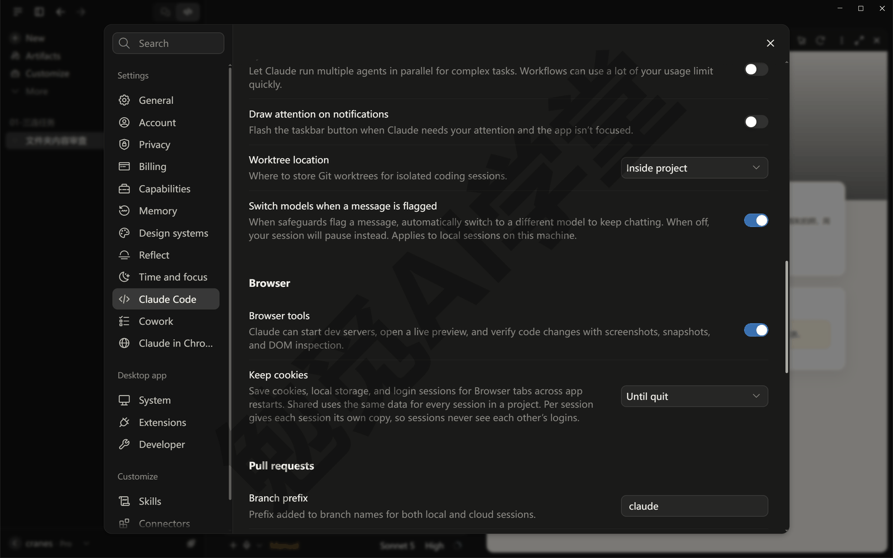

**第 3 步：两个会话并排看。** 按住 Alt 点侧栏里的另一个会话，它会在右边再开一栏，两个会话左右并排；并排时再点侧栏里第三个会话，会替换掉当前有焦点的那一栏。按 Ctrl+Alt+W 关掉有焦点的一栏，或者点那一栏右上角的 ×，回到单会话（按 Ctrl+/ 能看到本机的全部快捷键）。并排之后每一栏都变窄，屏幕小的话可以先按 Ctrl+B 收起侧栏。

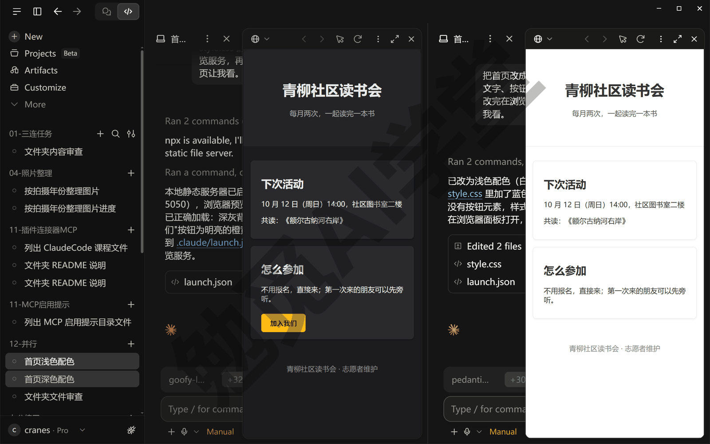

**第 4 步：用完归档。** 一个会话的事做完、成果也合回去了，在侧栏里右键这个会话，菜单里选 Archive（归档）。归档会把会话从侧栏收起来，停掉它启动的本地预览，但不会删掉它的工作树副本，副本还留在项目的 `.claude\worktrees\` 下面。副本里还有没提交的改动时，左下角会弹出一条橙色提示 Session archived with uncommitted changes（会话已归档，还有没提交的改动），点提示里的 Unarchive（取消归档）就能回到这个会话接着做。副本确定不要了，可以在项目主文件夹的会话里让它把那份工作树删掉（它会用 Git 的命令来删，以实际表现为准）。

想让它自动归档，Settings → Claude Code 里有一项 Auto-archive after PR merge or close（合并请求合并或关闭后自动归档），开了之后，这个会话开的合并请求在 GitHub 上合并或关闭时会话自动归档；合并请求是什么，下一篇讲，现在不开也没关系。

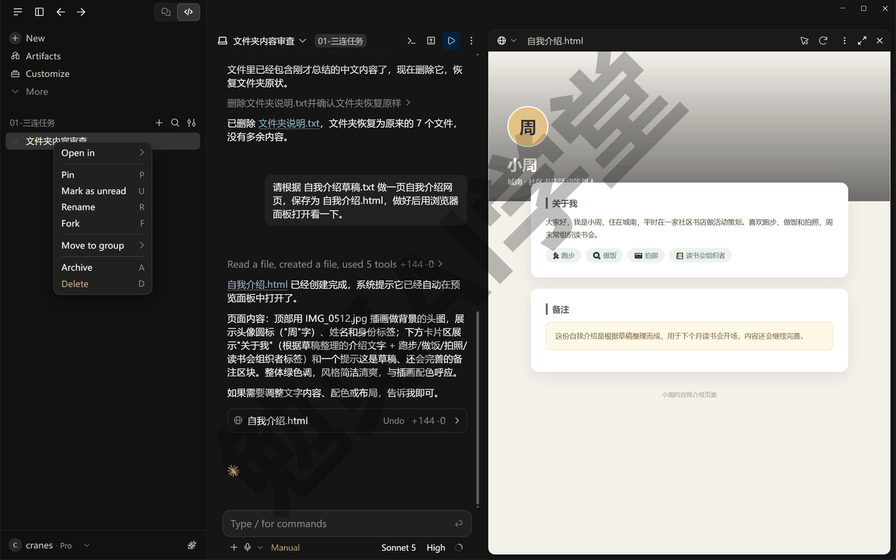

**被忽略的文件带不带过去。** 如果你的项目里有被 Git 忽略的文件（比如放密钥的 `.env` 文件、装好的程序包），它们默认不会出现在工作树副本里，因为副本是按 Git 的记录复制的；副本里的会话可能因此跑不起来。想把这类文件也带过去，在项目根目录新建一个名为 `.worktreeinclude` 的文本文件，一行写一个要带的文件名或文件夹名。Git 忽略哪些文件，记在项目里一个叫 `.gitignore` 的文件里，本课不展开。

**没开工作树的并行会话。** 如果你的几个会话分别在不同的文件夹上干活，本来就互不干扰，不需要工作树；如果是在同一个文件夹上开几个会话又不开工作树，只要你能保证它们改的不是同一批文件，也可以，保证不了就会互相覆盖。拿不准就勾工作树。

### 12.4 会话之间互通

几个会话各干各的之后，常会需要“让这个会话知道那个会话做了什么”。不用你复制粘贴，直接对它说。

**它能替你看别的会话。** 在任何一个会话里用大白话问，最好点出那个会话的名字：

```text
看看我“首页深色配色”那个会话刚才在改什么，它得出的结论是什么？
```

它会先搜你的会话记录，Manual 模式下弹一张审批卡，标题写着 search session transcripts（搜索会话记录），下面是它搜的关键词；找到以后读出那个会话的结论。没点名、它又搜出好几个对得上的，会弹一张选择题卡问你指的是哪一个，卡上列着每个会话的名字和最后活动的时间（这个时间可能比你电脑上的早 8 个小时，用的是国际标准时间，对不上不要紧）。

有两点要留意。一是在开了工作树的会话里说“另外那个会话”，它可能理解成另一个工作树，直接去看那边的代码改动，而不是去读会话记录，所以话里点出会话名更稳。二是它报的结论里带着一串编号这类细节时，自己再核对一下，它也可能抄错一位。除了找会话、问进展，你也可以让它重命名或归档某个会话；归档之前让它先把要归档的列出来等你确认，别一句话让它直接归档。

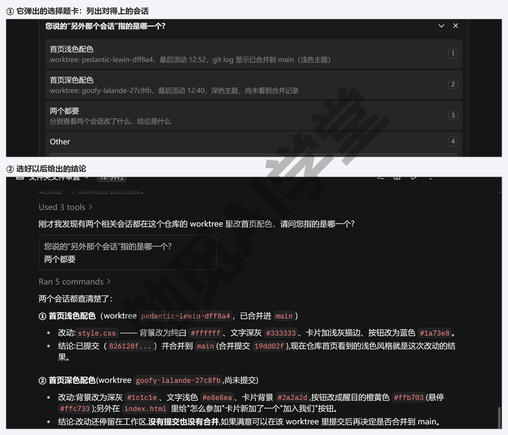

**它能给别的会话发消息。** 比如 A 会话改了数据表的格式，B 会话正在用这张表：

```text
告诉“报表”那个会话：订单表新加了一列“平台”，
让它读表的时候带上这一列。
```

发之前，Manual 模式下会弹一张审批卡，标题写着 send message（发送消息），下面是收件会话的编号和要发的原文。它会把你的话转述一遍再发，卡上能看到它到底发了什么。B 会话里会多出一行 Received message from A 会话的名字 ›（收到来自某某会话的消息），点行尾的 › 能展开看原文，你分得清哪句话是你说的、哪句是别的会话发来的；这一行只能展开收起，没有跳回 A 会话的链接。

B 会话收到后会自己回话，但回话写在 B 会话里、是说给你听的，不会自动送回 A 会话。消息和 B 手头的事对不上时，它会更谨慎：怀疑这是别人塞进来的指令，先停下来问你这条消息是不是你发的、要不要处理。所以消息最好发给确实在用这张表的会话，写清是哪个文件；B 来问时，你回一句“是我让发的”就行。

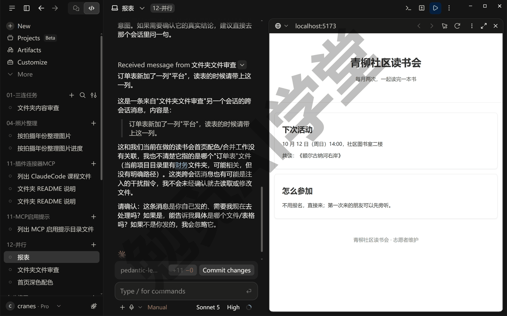

**让它替你清理会话。** 会话开多了，侧栏会越来越长。可以直接对它说：

```text
把已经做完、合并请求也已经合并的会话归档，归档前先把要归档的列给我确认。
```

它会先列出打算归档的会话，等你确认才动手——话里带上“先列给我确认”这半句，是为了不让它直接把会话归档掉（它会不会主动先问，以实际表现为准）。归档的会话从侧栏消失，但对话记录和工作树副本都还留着：对话记录可以在侧栏的筛选里找回来看，副本怎么处理见 12.3 第 4 步。

**这几种情况最用得上互通。** 分工时，一个会话整理数据、另一个会话做报表，报表会话开工前先让它“去问问数据会话整理到哪一步、表格放在哪”；交接时，你在 A 会话里定了一个命名规矩，让它告诉 B 会话照着办，不用自己再敲一遍；核对时，两个会话各做了一版，让第三个会话去读两边的结论、列出差别。

**它看得到哪些会话、看不到哪些。** 它只看得到桌面应用自己开的会话：本地、SSH（连到远程机器上跑的）、WSL（在 Windows 内置的 Linux 环境里跑的）三种，默认是最近活跃的 20 个，归档过的不列（除非你点名要）。云端会话、命令行窗口里开的会话、VS Code 扩展里的会话它都看不到，哪怕在同一个项目上。它也不会把你正在问的这个会话列进去。

**范围外的问题，它会在回复里提一句。** 干活过程中它注意到一件该修、但不在当前任务范围里的事，一般会在回复里告诉你，说明这不是这次改出来的，有时还附上修法，但不会替你动手。你想处理这件事，就自己新建一个会话，把它原样交代过去，当前会话不受打扰。官方文档还提到，它会在对话里给出一张开新会话的任务卡片，点一下就开一个自带工作树的新会话；这张卡片不一定会出现，没有的话照上面说的自己新建会话就行（以实际界面为准）。

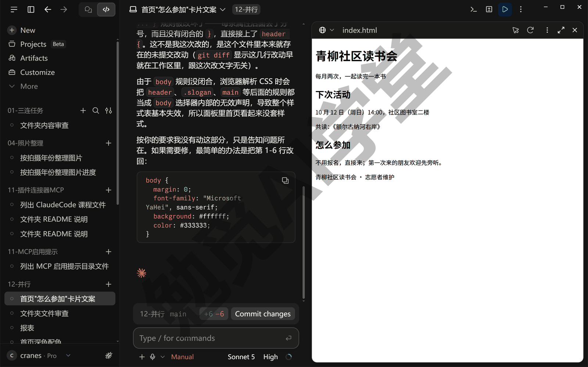

### 12.5 多方案对比：同一题做两版，挑一版

前面几节的能力合起来，就是实战篇里反复用到的做法：一个拿不定主意的改动，开两个会话各做一版，并排看，挑一版留下。以一页网站的首页配色拿不准为例（下面的图来自《实战一：社区读书会网站》，你现在手上还没有它，拿自己的练习网页做就行）。

**第 1 步：两个会话，两个方案。** 在一个网页练习文件夹上开两个会话，都勾工作树——比如《内置浏览器、应用预览与电脑操控》做自我介绍页的那个文件夹；还不是 Git 仓库的先按 12.3 让它初始化，初始化过但一次都没提交的（《终端、编辑器与 VS Code 扩展》8.1 那次只初始化、没提交），先让它“把现有文件提交一次”，没有提交记录的仓库开不出工作树。在 A 会话里发送：

```text
把首页改成深色配色：背景深灰、文字浅色、按钮用一个明亮的强调色。
改完起一个本地预览，在浏览器面板里打开首页让我看。
```

在 B 会话里发送：

```text
把首页改成浅色配色：白底、深灰文字、按钮用蓝色。
改完起一个本地预览，在浏览器面板里打开首页让我看。
```

两个会话同时跑，各自在自己的工作树里改，谁也碰不到谁的文件。最后一句让它起一个本地预览，是因为它有时会直接打开首页文件，浏览器面板里的页面就只剩文字，颜色和排版都没加载出来，看起来像改坏了；启动预览这一步，Manual 模式下也要你放行。

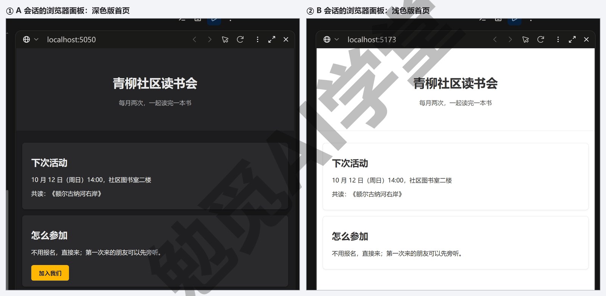

**第 2 步：并排比。** 按住 Alt 点侧栏里的另一个会话，把两个会话左右并排，两边的浏览器面板各显示一版，画面就是 12.3 第 3 步那张图。比的时候按事先定好的标准，不要凭第一眼的喜好。标准本来该在第 1 步开会话之前就写下来，这里补上，以后你自己做时先写标准再开会话；最好写三条，比如给自我介绍页的配色定这三条：

- 手机上打开，正文字看得清、不用放大；
- 底部的“联系我”按钮一眼能找到，颜色和周围区分开；
- 三张爱好卡片和背景分得开，不会糊成一片。

两版各按这三条打勾，勾得多的那一版留下。要是两版勾数一样，看哪一版改起来动的地方更少：让两个会话各自说一句“如果要把按钮换成别的颜色，你要改几处”，改动少的那版留下。

**两版都不满意怎么办。** 不要在两个会话里各自反复改，那等于在做四版、六版。把两版各自好的地方说清楚，开第三个会话（同样勾工作树），让它把两版好的地方合在一起：“配色用 A 版的，按钮样式用 B 版的，其余按 B 版”，做出来再按三条标准比一次。第三版还不行，多半是需求本身没说清，按《对话与上下文管理》讲的“目标、范围、验收标准”把需求重写一遍，再开新会话。

**第 3 步：挑一版合回去。** 假设选了浅色版。在 B 会话里发送：

```text
浅色版定了。请把这个工作树里的改动合回主线，
然后告诉我主文件夹里的首页已经是浅色版。
```

它会先在 B 的工作树里提交一次，再到主文件夹里把这条分支合并进来，Manual 模式下这几条命令会一张张弹审批卡；合完它会说已经合到 main、主文件夹里的首页现在是浅色版，你自己再打开主文件夹里的首页确认一下。合并背后发生了什么，下一篇《Git、GitHub 与代码审查》会讲；出现冲突怎么办，本课不展开，Git 课《冲突与工作树》有逐步的图文。这里只要知道“选中的那一版会回到主文件夹”。

落选的 A 会话直接归档。深色版的改动没提交，归档时会弹出 12.3 第 4 步说的那条提示，副本也还留在 `.claude\worktrees\` 下面，确定不要了再让它删掉。想保留深色版以后再看，让 A 会话先提交一次再归档，下一篇讲了提交之后，你就知道怎么找回它。

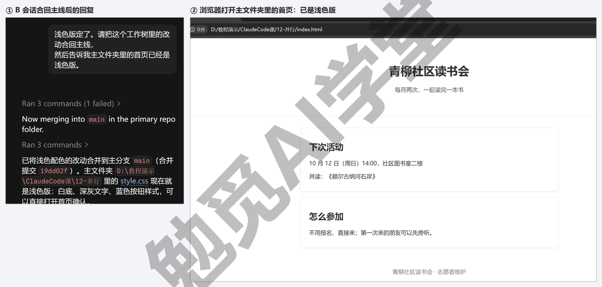

这套做法在《实战三：旅行费用分摊计算器》里会用来比两版界面，在《毕业项目：家庭事务中心 + 课程总结》里会用来比三套版式，到时候只是题目变了，步骤一样。

### 12.6 什么时候不该并行

并行不是越多越好。它省的是你等待的时间，不是它干活的时间，遇到下面四种情况，并行反而会更慢或更乱，就一件一件做。

- **两边要改同一批文件，又不想开工作树。** 两边的改动一定会互相覆盖，要么开工作树，要么排队做。比如一个会话在改首页的文字、另一个会话在改首页的配色，两边动的都是首页那个文件，不开工作树，后写的就会覆盖先写的。判断的办法很简单：两件事各会动哪些文件，你能不能说出来；说不出来，就当它们会碰到。
- **后一件事要用前一件事的结果。** 比如先整理数据再出报表，出报表的会话拿不到整理好的数据，只能等；这种任务在一个会话里按顺序说清楚更快，让它“先整理数据，整理完再用整理好的数据出报表”，一句话交代完，先后由它自己安排，你只等最后的报表。非要分两个会话做，也要等第一个会话明确说“整理完了、表格在哪”之后再开第二个。
- **用量已经紧张。** 几个会话、几个分身同时跑，用量也在同时扣，用量环快满时先把一件事做完再开下一件。同一件事拆成两个会话并不会少用用量，只是把等待的时间缩短了。这时更合适的做法是一件事跑着的时候，你去做不需要它的事，比如整理下一批材料。
- **每一步都要你验收的任务。** 并行的好处是你不用盯着，如果每一步都得你确认，几个会话轮流弹询问，反而比一个会话慢，还容易把 A 会话的询问错当成 B 会话的，点了允许。适合并行的是不用你逐步确认的任务：只读的调查，或者你放心用 Accept edits（自动接受编辑）的改动。一个会话里逐步确认，你至少知道每一次点的是谁的询问。

**拿不准就先问它。** 开第二个会话之前，把两件事说给它听，让它判断适不适合同时做——它比你更清楚这两件事各要读、要改哪些文件：

```text
我想同时做两件事：一、[第一件事]；二、[第二件事]。
它们会改到同一批文件吗？后一件要不要用前一件的结果？
适合开两个会话同时做，还是在一个会话里按顺序做？
```

它会先打开相关的文件看一眼，再告诉你两件事碰不碰到同一批文件、有没有先后依赖，并给出建议。它说适合并行，再按 12.3 节开第二个会话；它说有依赖，就在一个会话里按顺序交。拿不准的时候，在一个会话里按顺序做最稳妥，只是慢一点。

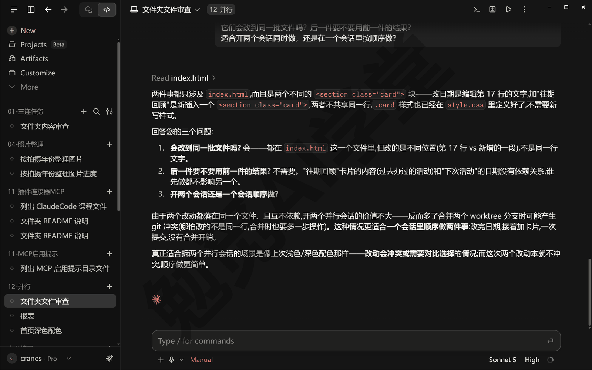

还有一样东西本课不展开：命令行版有一种“智能体团队”，由一个会话当组长给几个会话分工。桌面应用里没有这个功能，要几个会话协作，用 12.4 节的互通消息就够；如果你装了命令行版、又想了解它，看官方文档里讲智能体团队的那一页即可。

### 12.97 练习任务

方括号里的内容换成你自己的。

**任务一：让它用子智能体分头调查两个问题。** 用 `[你的练习文件夹]` 开一个 Manual 模式的会话，发送：

```text
请用两个子智能体分头做：
一、统计这个文件夹里每种文件类型各有多少个；
二、找出体积最大的三个文件。
最后汇总给我，用中文。
```

完成标准：后台任务面板里出现过两个分身；你点 View transcript 看过其中一个的记录；主对话最后给出了两项汇总。

**任务二：开两个会话对同一页面做两种配色。** 在一个是 Git 仓库的练习网页文件夹上开两个勾了工作树的会话，各做一种配色，并排比较后挑一版合回主线：

```text
把首页改成 [你想试的配色]，改完起一个本地预览，在浏览器面板里打开首页让我看。
```

完成标准：两个会话各在自己的工作树里改完；并排看过两版；主文件夹里的首页变成了你选的那一版；落选的会话已归档。

**任务三：让 A 会话把结论告诉 B 会话。** 开两个会话，在 A 会话里先让它总结一份文件的要点，再发送：

```text
把你刚总结的要点发给“[B 会话的名字]”那个会话，
让它据此写一段一百字的介绍。
```

完成标准：B 会话里出现了一行 Received message from A 会话的名字；B 来问你确认时你回了它，它按要点写出了介绍；你能说出它看不到哪几类会话。

### 12.98 本篇小结与自检

这一篇讲了同时干几件事的三种方式：子智能体是它在同一个会话里派出的分身，有自己的记忆、后台跑、结果以通知回到主对话，在后台任务面板里看进度、点 View transcript 看过程、点方形按钮停掉，权限询问照样来找你，分身可以再派分身；并行会话是你自己开几个会话各交一件事，同一个项目上勾工作树让每个会话各占一份独立副本，副本默认在项目文件夹的 `.claude\worktrees\` 里，按住 Alt 点侧栏里的会话能并排看，归档只把会话收起来、不会删掉副本，`.worktreeinclude` 把被忽略的文件带进副本；会话之间它能替你看、能发消息，看到范围外的问题会提一句，只看得到桌面应用自己的本地、SSH、WSL 会话；两个会话各做一版并排比、挑一版合回主线，是实战篇反复用的做法；最后列了四种不该并行的情况。

可以对照下面的清单检查学习结果：

- [ ] 能说出子智能体、并行会话、云端会话三种方式各适合什么事
- [ ] 知道子智能体有自己的记忆、默认在后台跑，知道后台任务面板从哪打开、怎么看分身的记录、怎么停掉一个分身
- [ ] 知道分身要权限时询问会来找你，以及“以后都不问”会应用到整个会话
- [ ] 会开第二个会话并勾上工作树，知道副本存在哪、怎么改位置和分支前缀
- [ ] 会用 Alt 点侧栏把两个会话并排，会归档会话，并知道归档不会删掉工作树副本
- [ ] 会让它看别的会话在做什么、给别的会话发消息，知道它看不到云端和命令行的会话
- [ ] 跑过一次两会话两方案、并排比较、合入一版
- [ ] 能说出四种不该并行的情况

完成这些内容后，你已经能让它同时推进几件事。下一篇《Git、GitHub 与代码审查》把这一篇用到的 Git 讲透：仓库、提交、分支三个词，怎么让它提交、怎么用提交当更长效的后悔药，怎么连上 GitHub、开合并请求、让它审自己的代码。

### 12.99 新手常见问题

**Q1：并行会不会互相改坏？**

同一个文件夹上开几个会话、又不开工作树，会：两边写同一个文件，后写的覆盖先写的。勾了工作树就不会，每个会话在自己的副本里改，合回主线时才碰到一起，真出现冲突怎么办本课不展开，Git 课《冲突与工作树》有逐步的图文。不同文件夹上的会话本来就互不干扰。

**Q2：工作树占多少空间？**

每个工作树是项目文件的一份完整副本（Git 的历史记录部分是共用的，不重复占），所以项目有多大、一个副本就多占多大。几页网页的项目只有几百 KB，不必在意；带很多图片和视频的项目就要注意：归档不会删掉副本，用完的工作树要让它删掉，空间才会腾出来。

**Q3：子智能体会多消耗用量吗？**

会。每个分身有自己的记忆，它读的文件、做的每一轮都从同一个用量池扣，几个分身同时跑，用量就同时在扣。它省的是主对话的上下文（结论回来、过程不进主对话），不是套餐用量。事情适合拆开，再让它派分身，不要为了快就多派。

**Q4：怎么把两个会话的成果合到一起？**

两版只留一版的，按 12.5 节让选中的会话把工作树的改动合回主线，另一个归档。两版都要的（比如 A 改了首页、B 改了报名页，各自都对），让它们依次合回主线，各自改的不是同一批文件就不会冲突；改到同一个文件的，合并时可能出现冲突，怎么办本课不展开，Git 课《冲突与工作树》有逐步的图文。

**Q5：对话里没出现 running tasks，是不是它没派子智能体？**

多半是。它只在任务适合拆开时才派，一件简单的事直接就做了，自然没有后台任务。想确认它有没有派，看对话里有没有分身的任务标题和转圈的 N running tasks 那一行；想让它一定派，在话里明说“用子智能体分头做”。
