## Git、GitHub 与代码审查

《计划模式、差异审阅与回退》里的 `/rewind` 能把对话退回去，改动汇总卡上的 Undo（撤销）能把一轮改动撤回，但它们只管这一个会话：会话归档了、或者你想回到上星期的样子，它们就帮不上了。这一篇给你一颗长效的“后悔药”，也为以后和别人合作打好基础：先用三个词把 Git 讲到够用，让它替你提交和还原；再连上 GitHub，把项目放到网上、开一个合并请求，看它替你跟进自动检查、自动修、自动合并；最后认识代码审查的两个入口。全篇不要求你自己敲 Git 命令——命令由它敲，你负责看结果和点确认；想系统地学 Git，可以看另一门课《Git 零基础入门教程》；本篇后面写到“Git 课《某某》”，指的都是那门课里的某一篇。

这篇文章的实操内容需要 Claude 的付费订阅（Pro 起）和一个 GitHub 账号，GitHub 免费账号就够用，本篇不涉及 GitHub 的付费功能。

### 13.1 Git 三个词：仓库、提交、分支

**为什么 Code 页签离不开 Git。** 《认识与装好》1.5 节第 4 步让你装了 Git for Windows，当时只说“后面几篇都离不开它”。现在可以说清楚了：Claude Code 靠 Git 做两件事。一是把不同会话的改动隔开，《子智能体、并行会话与工作树》讲的工作树就是 Git 的功能；二是记录每一次改动、随时还原，也就是本篇要讲的事。你可以把 Git 理解成给文件夹记账的工具：文件夹里每一次“定稿”都被记下来，以后任何一次都能翻回去。

Git 本身是一门大课，这里只讲三个词，够你看懂 Code 页签上和它有关的每一处。

**仓库。** 一个交给 Git 管理的文件夹。它和普通文件夹的区别只有一点：里面多了一个隐藏的 `.git` 文件夹，全部历史都存在那里。你的项目文件夹交给 Git 之后，它就是一个仓库；把 `.git` 删掉，它又变回普通文件夹，文件一个不少，只是历史没了，所以平时别去动它。

**提交。** 给整个文件夹拍一张快照，并且写一句说明，比如“把报名表加上手机号一栏”。每次提交都有一个编号，是一串字母和数字混在一起的“哈希”，一般看前七位就分得清是哪一次。提交是永久的：会话归档了、换了电脑、过了一年，只要仓库还在，每一次提交都能找回来。这就是它比 `/rewind` 和 Undo 长效的原因，13.2 节会把分工说清。

**分支。** 一条独立的版本线。仓库建好时只有一条主线，一般叫 main，也有的电脑上叫 master，只是名字不同，本篇后面说的 main 指的就是这条主线；你可以从主线上分出一条新线，在上面随便改，改满意了再合回主线，不满意就整条丢掉，主线一直干干净净。《子智能体、并行会话与工作树》里几个会话并排干活、互不冲突，就是每个会话各占一条分支。13.4 节要讲的合并请求，说的就是“把这条分支合回 main”的请求。

三个词在 Code 页签里能看到的地方，对照一下：

| 词 | 一句话 | 在 Code 页签的哪里能看到 |
| --- | --- | --- |
| 仓库 | 交给 Git 管理的文件夹，历史存在 `.git` 里 | 新建会话选的项目文件夹；文件夹是仓库，输入框上方才会出现分支名和工作树选项 |
| 提交 | 一张带说明的快照，有编号，永久可找回 | 让它提交后对话里的工具卡片；终端面板里 `git log` 的输出 |
| 分支 | 一条独立的版本线，main 是主线 | 新建会话时分支名旁的工作树选项；差异视图顶上那个“分支名 → working tree（工作区，也就是文件夹现在的样子，不是上一篇的工作树副本）”的下拉菜单 |

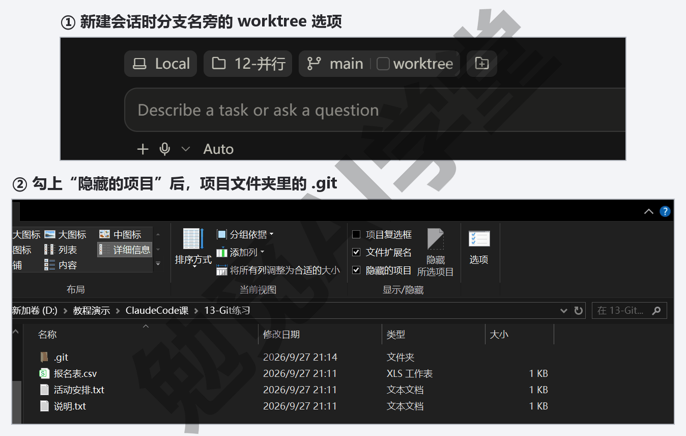

**再往下就交给 Git 课。** 暂存区、合并冲突、标签这些词本篇都不讲，你在 Code 页签里用到它们的机会很少；真遇到了，Git 课《第一个仓库：提交与历史》和《冲突与工作树》有逐步的图文。

### 13.2 让它提交：写说明、看历史、用提交还原

这一节的全部操作都在一个练习文件夹里做。用《认识与装好》1.8 节建的那个就行，或者新建一个，放两三个不怕弄乱的文件；开会话时权限模式选 Manual（手动），这样它每跑一条会改东西的 Git 命令都会先征求你的同意（只看不改的命令，比如查历史，一般直接跑），你正好借机看看它在敲什么。

**第 1 步：把文件夹变成仓库并做第一次提交。** 新建会话，环境选 Local（本机），点 Select folder（选择文件夹）选中练习文件夹，权限模式选 Manual，然后在输入框里发送：

```text
请把这个文件夹初始化成一个 Git 仓库，把现有文件做第一次提交，
提交说明用中文写“初始化：现有文件”。做之前先告诉我你要跑哪几条命令。
```

它会先列出打算跑的命令——一般是三条：初始化仓库、把全部文件加入（它的卡片上写的是“暂存”）、提交——然后直接开始跑；它每次列出的命令可能略有不同，以它的回答为准。Manual 模式下每条会改东西的命令跑之前都会弹一张审批卡，标题是它要做的事，比如 Allow Claude to run 初始化 Git 仓库?（允许 Claude 运行“初始化 Git 仓库”吗），框里是命令本身，点 Allow once（只允许这一次）放行。跑完的命令在对话里会折成一两行，比如 Ran 2 commands（跑了 2 条命令）和 Committed（已提交）加一串编号，点行尾的 › 能展开看每条命令和它的输出；输出里的中文文件名可能显示成一串反斜杠加数字，那是 Git 的显示方式，文件本身没问题。做完后练习文件夹里多了一个隐藏的 `.git` 文件夹（资源管理器里要打开“显示隐藏的项目”才看得见）。

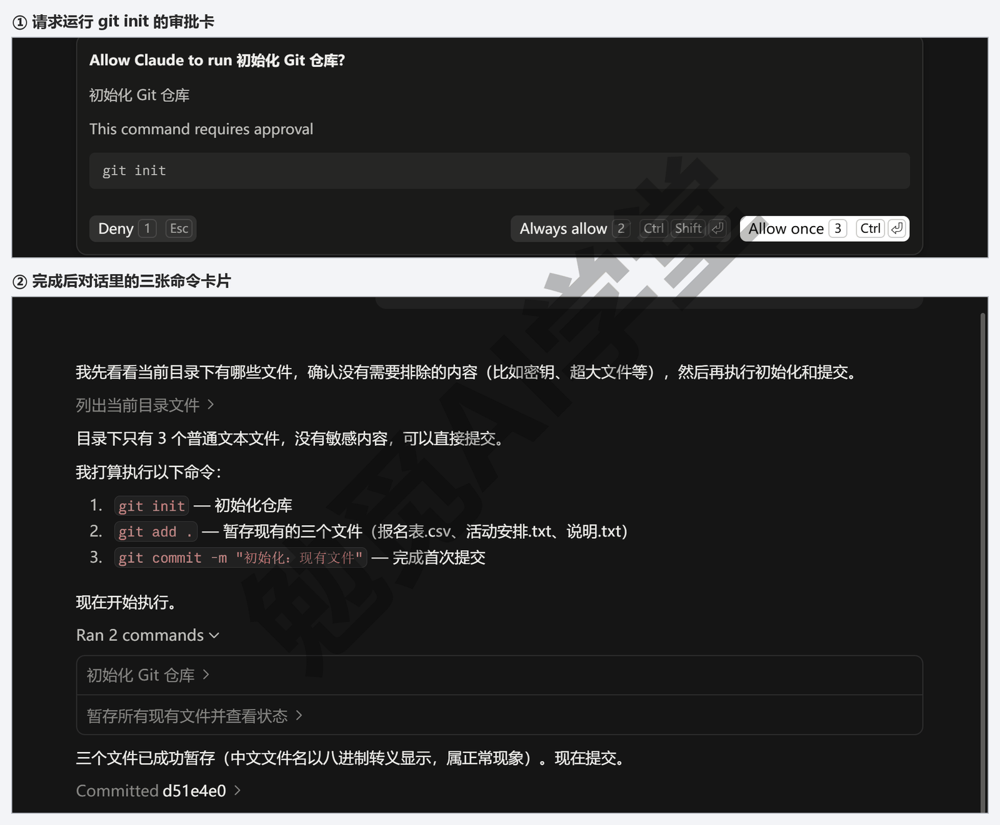

**第 2 步：改一处，再提交一次。** 让它做一个小改动，比如往某个文本文件里加一行（Manual 模式下改文件也会先弹审批卡，点 Allow once 放行）。改完你会看到《认识与装好》1.8 节见过的差异计数 `+1 -0`，点开差异视图看一眼；输入框上方还会多出一条状态条，写着文件夹名、分支名 master（或 main）和同样的 `+1 -0`，右边有一个 Commit changes（提交改动）按钮——这一节让它用对话提交，按钮先不用点。它改完多半会主动问你要不要提交，确认没问题后发送下面这句就行：

```text
把刚才这次改动提交，说明写“说明文件：补充一行联系方式”。
```

提交说明怎么写有一个够用的公式：动词加对象，必要时加一句为什么，比如“报名表：加手机号一栏，方便活动当天联系”。写中文、写清楚改了什么，以后翻历史时一眼就能找到是哪一次；不要全写成“更新”“修改”，那样历史就没法用了。这个公式和 Git 课《第一个仓库：提交与历史》2.5 节讲的一样。

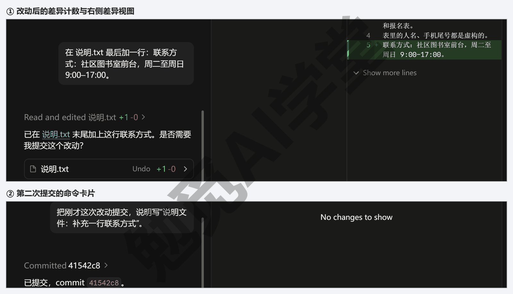

**第 3 步：看历史。** 发送：

```text
列出这个仓库的提交历史，每条一行，带编号和说明。
```

它会跑 `git log` 这类只看不改的命令（Manual 模式下这类命令一般不弹审批卡，直接跑），把两条提交列出来，每条带七位编号和你写的说明，先列哪条以它的回答为准。你也可以自己看：按 Ctrl+`（反引号）打开《终端、编辑器与 VS Code 扩展》8.1 节讲过的终端面板，输入 `git log --oneline` 回车，看到的是同一份历史，最新的一条在最上面；编号后面括号里的 HEAD -> master（或 main）是在说“现在就在这条分支上”。

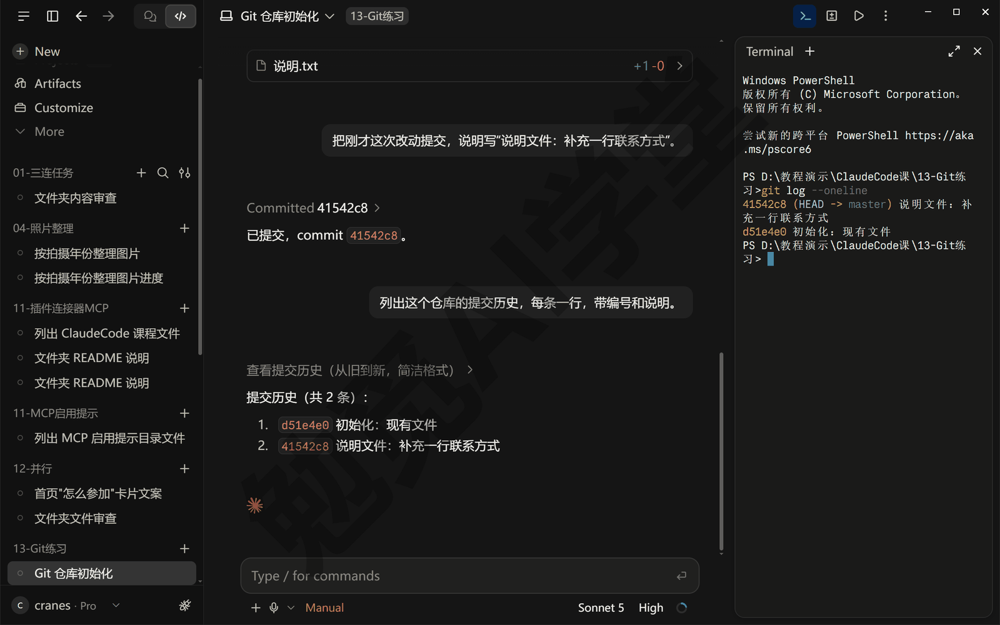

**第 4 步：用提交还原。** 现在假装改坏了：让它把那个文本文件的内容全部换成一句乱写的话，点 Allow once（只允许这一次）让改动生效。然后发送：

```text
把这个文件恢复到上一次提交时的样子。
```

它会用 Git 的还原命令把文件恢复成第二次提交时的内容，Manual 模式下它同样会先征求你的同意。点它回复里蓝色的文件名，右边会打开这个文件：乱写的那句话没了，之前加的联系方式还在。如果你想整个文件夹都回到某一次提交，把话说成“把整个仓库恢复到编号 xxx 那次提交的状态”，它会先提醒你这会丢掉那之后的全部改动，再等你确认（以它实际的回答为准）——这类会丢东西的操作，Manual 模式下它一定停下来问，这也是本节建议用 Manual 的原因。

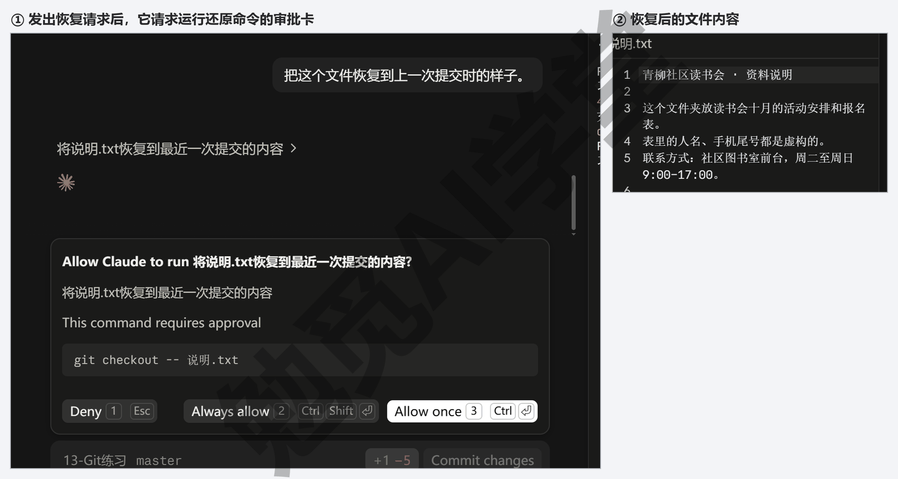

**提交和会话里的回退怎么分工。** 这两样都是“后悔药”，管的范围不一样：

- `/rewind` 和改动汇总卡上的 Undo 管的是这一个会话：`/rewind` 把对话退回到某一句之前，Undo 把那一轮改动撤回，退起来快，但只认这个会话——会话归档了就没有了，你自己在资源管理器里手改的文件它们也不知道。
- 提交管的是整个文件夹的每一次定稿，跨会话、跨电脑、连你手改的都记着，只要仓库还在就能找回；代价是要你主动说一句“提交”。

可以养成一个够用的习惯：在一个会话里做小调整时靠汇总卡的 Undo 和 `/rewind`；每做完一件能说清楚的事、每次让它大改之前、每天收工前，让它提交一次。这三个时刻和 Git 课《第一个仓库：提交与历史》2.11 节讲的“多提交”是同一个意思。

**它会不会自己乱提交。** 不会。Manual 模式下它跑会改东西的命令都先问你；Accept edits（自动接受编辑）模式下它改文件不问、跑命令仍然问，Git 命令算命令，所以提交、还原这类操作在这两档下都会经过你。Auto（自动）模式下由《权限、沙盒与模型》3.2 节说的那个后台检查员判断：和你要求对得上的普通提交一般直接做，强制推送这类危险的 Git 动作会拦下来问你。只有 Bypass permissions（跳过权限）才会一律不问，3.2 节讲过那一档只在隔离的环境里用。

### 13.3 连 GitHub：装 gh、登录、把项目推上去

**GitHub 是什么。** Git 是装在你电脑上的工具，GitHub 是一个存放 Git 仓库的网站：把仓库推到 GitHub 上，你就有了一份放在别处的完整备份，别的电脑能把它取下来，别人也能参与进来。Git 课《GitHub 与远程仓库》用一整篇讲它，这里只做本篇需要的三件事：装一个叫 `gh` 的小工具、登录、把项目推上去。

**为什么要装 gh。** `gh` 是 GitHub 官方的命令行工具，Claude Code 靠它在你的电脑上和 GitHub 打交道：开合并请求、查自动检查的结果都要用它。没装的话，第一次让它开合并请求时桌面应用会提示你安装。提前装好可以少一次打断。

**第 1 步：注册 GitHub 账号。** 打开 github.com 点右上角的 Sign up（注册），用邮箱注册，按提示完成邮箱验证和两步验证。每一页选什么，Git 课《GitHub 与远程仓库》6.2 节有逐步的图文；已经有账号的直接到第 2 步。

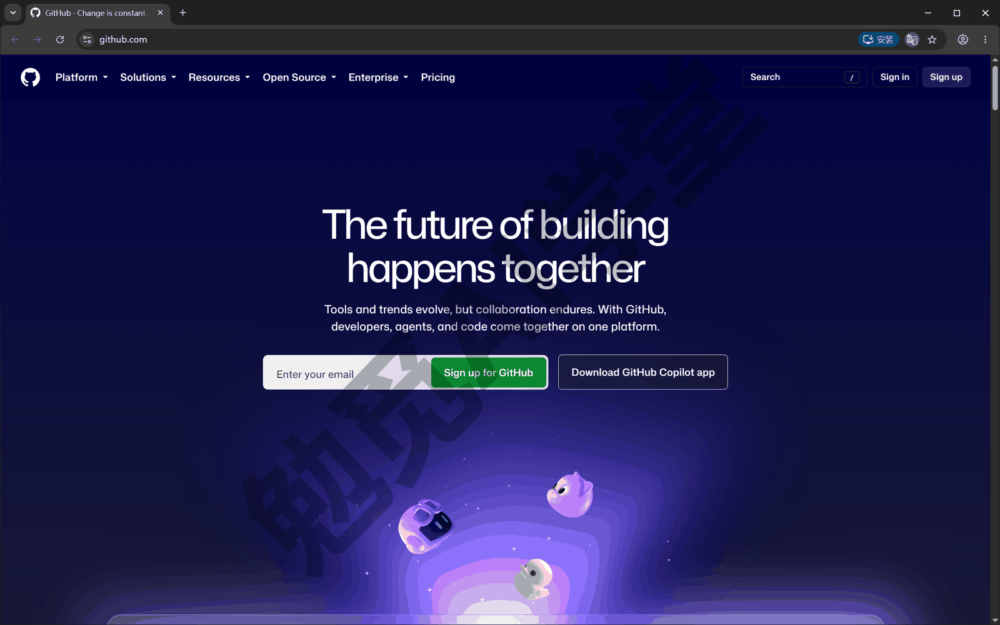

**第 2 步：装 gh。** 最简单的办法是让它装。在练习文件夹的会话里发送：

```text
请在这台电脑上安装 GitHub 的命令行工具 gh，装完告诉我版本号。
```

Windows 上它一般会用系统自带的 winget 安装，Manual 模式下会先弹一张卡请你放行，卡上的命令是 `winget install --id GitHub.cli -e --source winget …` 这样一条（末尾还带两个自动接受协议的参数，以它列出的为准），点 Allow once。你也可以自己装。按 Ctrl+` 打开终端面板，输入下面这条命令回车，等进度条走完：

```text
winget install --id GitHub.cli
```

装完把 Claude 桌面应用整个关掉再打开，它才能找到新装的 `gh`；再让它“告诉我 gh 的版本号”，能报出版本号就装好了。

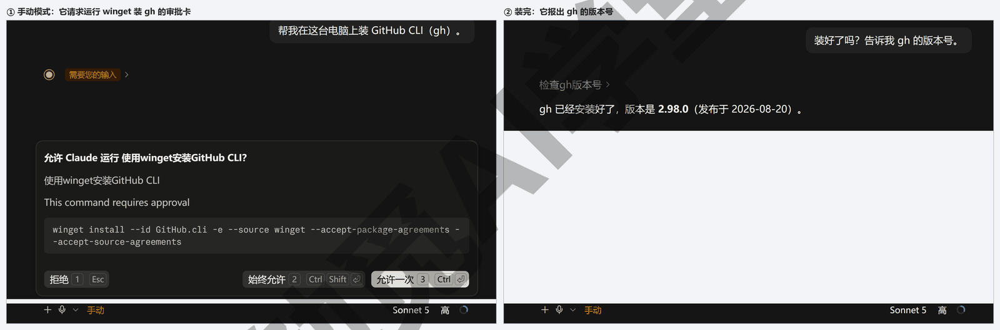

**第 3 步：登录 gh。** 登录要在浏览器里授权，所以这一步自己在终端面板里做。输入 `gh auth login` 回车，gh 会连着问几个问题，按下面选（各提示的原文以你看到的为准，需实机验证）：

- 登录到哪个 GitHub：选 GitHub.com；
- Git 操作用哪种协议：选 HTTPS；
- 是否用 GitHub 凭据（也就是你这次要登录的 GitHub 账号）认证 Git：选 Yes（是）。第一次在这台电脑上用 gh 登录多半会问这一句；之前用 gh 登录过、这一项选过 Yes 的，就不再问，直接到下一问（这一步末尾的图里就没有这一问）；
- 用什么方式登录：选 Login with a web browser（用浏览器登录）。

接着终端里出现一个八位的一次性代码，用鼠标选中后右键复制（终端里别按 Ctrl+C，那会中断正在跑的登录；记不住的话，就看着终端里的代码一个个敲进去），按回车后浏览器会打开 GitHub 的授权页，把代码填进去、点授权，回到终端看到 Logged in as 加你的用户名，就登录好了。登录只做一次，以后你自己在终端里用 `gh`，或者让它替你操作 GitHub，都不用再登录。

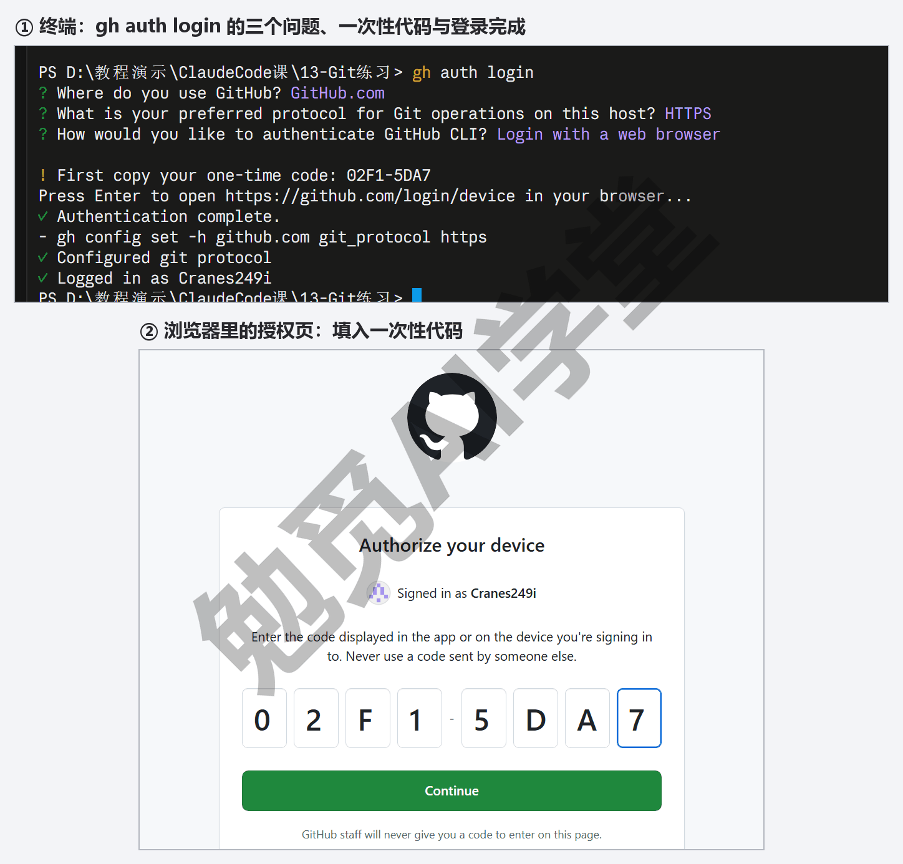

**第 4 步：把项目推上去。** 回到会话，发送：

```text
在我的 GitHub 账号下新建一个私有仓库，名字叫 claude-practice，
把这个项目推上去，然后把仓库网址给我。
```

它会用 `gh` 在你的账号下建仓库、把本地仓库连上去、推送，最后在对话里给出网址（具体用哪几条命令，以它列出的为准，需实机验证）。打开那个网址，能看到你的文件和两次提交，说明推成功了。练习阶段选私有仓库，只有你自己看得见；以后要用 GitHub Pages 把网页放到网上给别人看，才需要公开仓库，《实战一：社区读书会网站》16.6 节会讲。

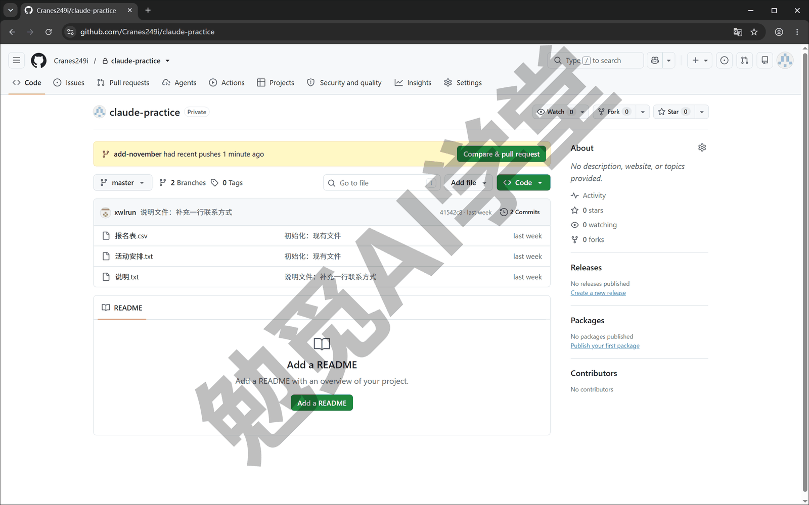

**以后怎么推送和取回。** 项目连上 GitHub 之后，让它“提交并推送”就行，本地的新提交会送到 GitHub 上；换一台电脑，让它“把 GitHub 上的 claude-practice 仓库克隆到这个文件夹”就能取回来（克隆就是把网上那份仓库连历史一起完整复制下来）。这两件事 Git 课《GitHub 与远程仓库》6.4 与 6.5 节讲得更细。

### 13.4 合并请求全程：开 PR、自动检查、Auto-fix 与 Auto-merge

**PR 是什么。** PR 是 pull request 的缩写，中文常叫合并请求：把一条分支上的改动打包成一份请求，请仓库的主人审一遍、跑一遍自动检查，通过了再合进 main。多人合作时它是必经之路。如果你只是一个人用，多半会问：没有别人审，还要开 PR 吗？也值得，有三个好处：

- 改动有边界：一个 PR 对应一件事，出了问题知道是哪一个 PR 引起的；
- 审查的意见有地方放：13.5 节会讲在 GitHub 上让它审 PR，意见就留在 PR 页面上，以后翻得到；
- 自动检查有地方跑：仓库里配好的检查会在每个 PR 上自动跑一遍。

Git 课《多人协作：PR 与 Issue》讲的是在 GitHub 网页上手动走这一套；本篇讲的是让它替你走，你只看结果。

**前提：改动要先放在一条分支上。** PR 是把一条分支合回 main，所以你要开 PR，改动就不能直接做在 main 上。有两种办法：新建会话时勾上分支名旁的工作树选项，会话就在自己的分支上干活；或者在现有会话里说一句“新开一条分支叫 add-contact，在这条分支上做下面的改动”。

**第 1 步：让它开 PR。** 先按上面第二种办法让它开分支并改一处，比如“新开一条分支叫 add-contact，在首页加一行联系方式，改完提交”；改好、提交好之后发送：

```text
把这条分支推到 GitHub 并开一个 PR，标题和说明用中文，
说明里写三件事：改了什么、为什么改、怎么验证。
```

它会推送分支、用 `gh` 开出 PR，把 PR 的网址给你。“改了什么、为什么、怎么验证”这三件事是 Git 课《多人协作：PR 与 Issue》7.2 节定下的说明格式，审的人不用打开代码就知道这个 PR 在做什么。

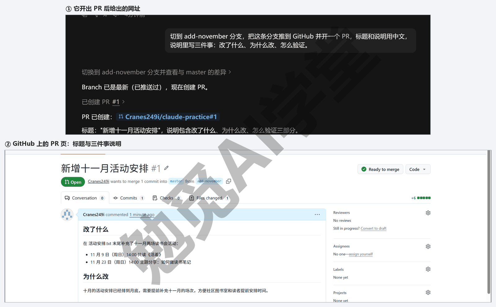

**第 2 步：点开 CI 状态栏。** PR 开出来之后，输入框上方会多出一条状态条，写着 PR 的编号、仓库名、分支名和改动的行数，右边有一个 CI 按钮，这就是 CI 状态栏；点 CI 按钮会弹出一个小面板。CI 是持续集成的缩写，可以理解成仓库里配置好的自动检查——比如每次推送自动跑一遍测试、检查一遍格式。小面板里列着每一项检查的名字和结果，它用 `gh` 定时去查，有失败的会单独列出来；检查全部跑完时桌面会弹一条通知。你的练习仓库还没配任何检查，小面板里只会写一句还没有任何检查，这很正常；给仓库加自动检查要用到 GitHub Actions，《定时任务、钩子与自动化》15.5 节会带你先认识它。

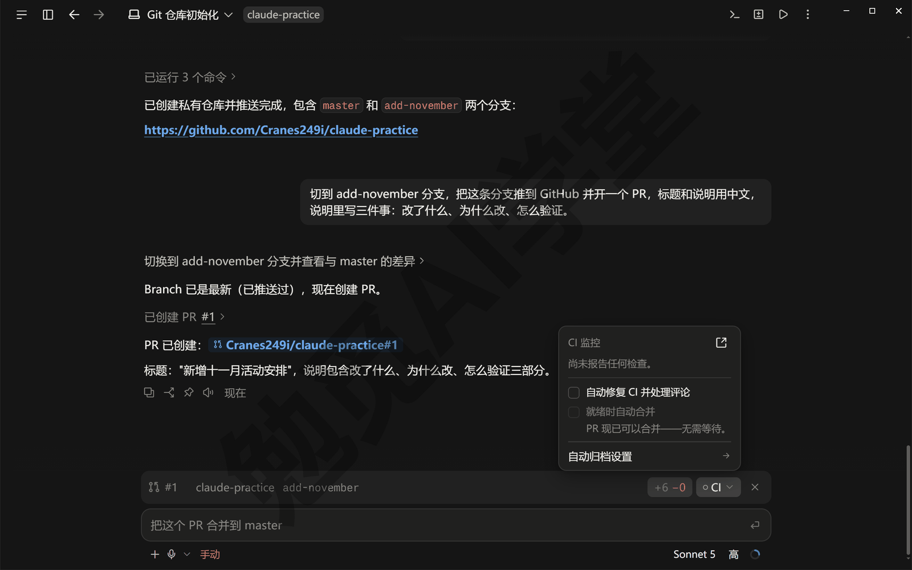

**第 3 步：两个开关。** 小面板里有两个可以勾的开关：

- **Auto-fix（自动修复 CI 并处理评论）**：勾上后，某项检查失败时它自动去读失败的输出、改代码、再推上去，直到通过或者它判断改不了；PR 上有人留了审查意见，它也会照着处理。
- **Auto-merge（准备好就自动合并）**：勾上后，全部检查通过时它自动把 PR 合进 main，合并方式固定是 squash——把分支上的几次提交压成一次再合进去，主线历史更干净。这个开关有一个前提：先在 GitHub 仓库的设置里允许自动合并（仓库页 Settings → General，Pull Requests 一栏勾上 Allow auto-merge，位置以实际页面为准），没开的话它合不了，会在会话里告诉你。练习仓库没配任何检查时，这一项是灰的，旁边写着现在就可以合并、不用等。

两个开关只对当前这个 PR 有效，换一个 PR 要重新勾。第一次用建议只勾 Auto-fix、自己到 GitHub 的 PR 页面点 Merge pull request 合并，看几次它修的是什么，再决定要不要把合并也交给它；练习仓库没配检查的话，Auto-fix 没东西可修、Auto-merge 也是灰的，知道这两个开关在哪就行。

**第 4 步：合并后让会话自己归档。** PR 合并或关闭之后，这个会话的任务就结束了。在应用的 Settings → Claude Code 里打开 Auto-archive after PR merge or close（PR 合并或关闭后自动归档），上一步那个小面板最下面的一行链接也能直接跳到这个开关；开了以后，这类会话会在 PR 合并后自动从侧栏收进归档，它只对已经跑完的本地会话生效。开关下面的说明写着：这样自动归档时，会一并删掉这个会话的工作树副本和它的分支，没推上去的改动会保留（以实际表现为准）。这一点和你自己右键归档不一样——手动归档不删副本，《子智能体、并行会话与工作树》12.3 节讲过。

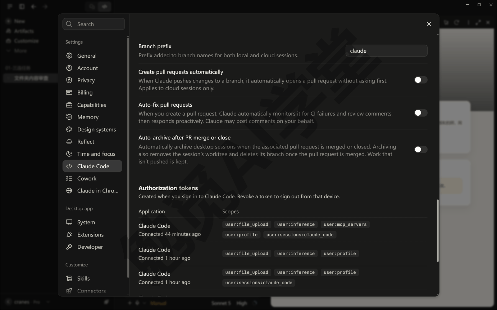

**云端会话的 PR 有一点不同。** 本节讲的是本机会话：命令跑在你的电脑上，靠 `gh` 和 GitHub 打交道。下一篇《云端会话与手机端》讲的云端会话跑在 Anthropic 的机器上，开 PR 与 Auto-fix 走的是安装在你仓库上的 Claude GitHub App，那一篇会讲怎么装。

### 13.5 代码审查：两个入口

审查就是让它当一个挑错的读者，把改动里的问题指出来。本课不要求你看懂代码，所以审查的意义在于：你看不出的问题，让它替你看一遍。审查有两个入口，先看一张表：

| 入口 | 在哪里 | 审的是什么 | 什么时候用 |
| --- | --- | --- | --- |
| `/code-review` 命令 | 本机会话的输入框里输入 `/`，在菜单里选 | 这一轮还没提交的改动 | 提交前、开 PR 前 |
| GitHub 上 @claude | PR 或 Issue（GitHub 上提问题、记待办的帖子）的评论里 | GitHub 上那个 PR | PR 开出来之后，或别人提交的 PR |

**入口一：`/code-review` 命令。** 它改完之后、你提交之前，在输入框输入 `/`，接着打 review，列表里会剩下 review、code-review 等几条；排在上面的 review 在本课用的这一版里是另一条命令，把鼠标停上去，说明里写着它审的是 GitHub 上的 PR、审自己电脑上的改动要用 /code-review（下图），本篇不用它（官方文档写的是新版本里 /review 就是 /code-review，输哪个都一样；你的版本是哪一种，以鼠标停上去看到的说明为准）。选 code-review 发送。你在《计划模式、差异审阅与回退》6.4 节用过它：它审的是你电脑上这一轮还没提交的改动，差异视图里列着哪几个文件，它就读这几个文件改过的地方，把发现的问题写在对话里，只挑真会出问题的地方，不挑格式与风格。

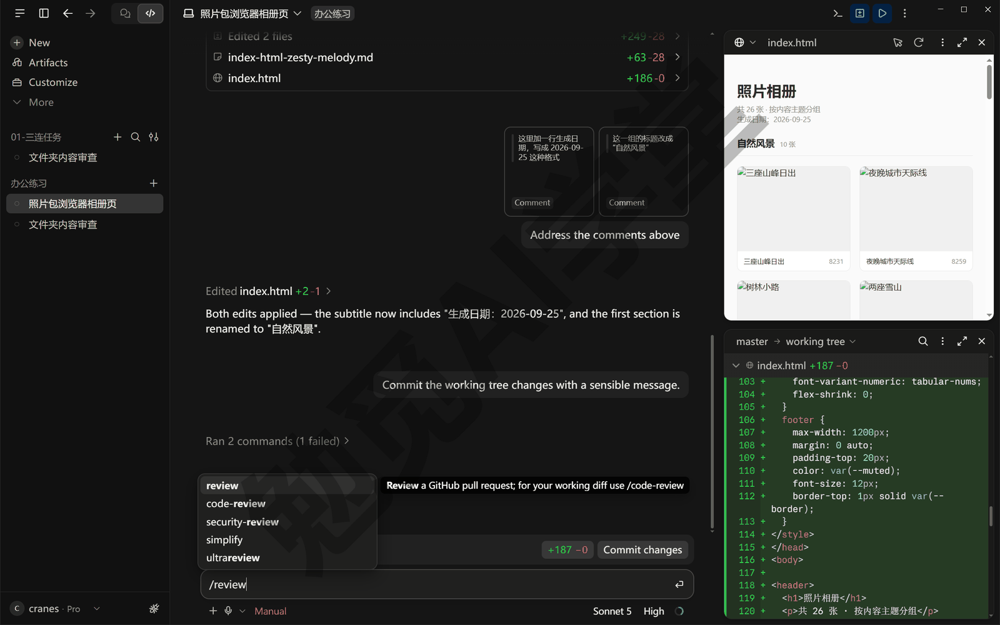

**它给出的报告。** 发送后它会先跑一两条只看不改的命令，比如看一眼当前有哪些改动（这类命令 Manual 模式下一般不弹审批卡，直接跑）；然后在对话里给出一份报告，列出它认为可能出错的地方，一条问题都没找到时会直接说没发现问题（报告的写法以实际输出为准）。练习文件夹里只有文本文件的话，它可能会说这不是代码、用不着完整审一遍，直接给一句结论，这也算跑通了；等到实战篇改的是网页文件，报告里才会有东西可挑。报告里的每一条你都可以回复：同意就让它照改，不同意就说明理由。用它的时机是提交之前、开 PR 之前，改动还没定稿的时候。

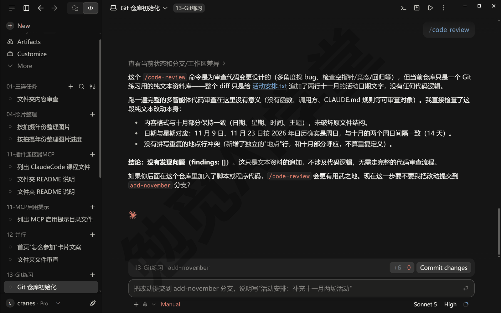

**入口二：GitHub 上的 @claude。** 在 GitHub 的 PR 或 Issue 评论里写一句 `@claude 检查一下这个 PR 有没有问题`，它会在 GitHub 上回复，必要时直接把改动提交、推送到仓库里。这个入口跑在 GitHub 的机器上，不需要你的电脑开着，别人给你的仓库提的 PR 也能用它审。前提是给仓库装上 Claude GitHub App，并加一个工作流文件（告诉 GitHub 什么时候自动运行它的配置文件），最简单的做法是在命令行版里做：打开《终端、编辑器与 VS Code 扩展》8.3 节装好的命令行版，进入项目文件夹运行 `claude`，输入 `/install-github-app`，它会替你装 App、把一个用你的订阅生成的令牌（一串代表你身份的密码串）存进仓库、再开一个带工作流文件的 PR，你在 GitHub 上合并那个 PR，`@claude` 就在这个仓库里生效了（桌面应用的 `/` 菜单里有没有这条命令以实机为准，需实机验证）。还有两点要知道：这个入口消耗的是你自己套餐的用量；默认只有对仓库有写权限的人 @ 它才会回应，没有写权限的人 @ 它也不会有反应。

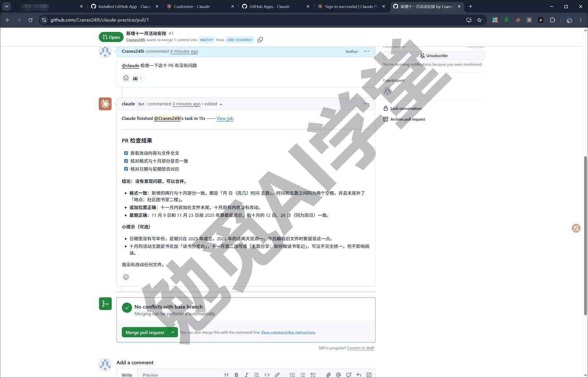

**两个入口怎么选。** 如果你是一个人做项目，入口一就够：改完、提交之前跑一次 `/code-review`。入口二是给多人合作准备的，或者你想让它替你跟进别人提的 PR 时用；一个人用它意义不大。

**团队才用得到的几样，知道名字就行。** GitHub 与云端相关的功能里，还有几样是公司团队才用得到的。两样和公司自己的机器有关：公司自己搭的 GitHub（GitHub Enterprise Server），Team 和 Enterprise 套餐的云端会话能连它；公司自己的云端环境（自托管环境），任务跑在公司的机器上而不是 Anthropic 的。另外两样是管理上的：管理员设置，管理员可以关掉本地会话、限定能连的远程机器、预先配好连接；把 Claude 接进 Slack 的 Claude Tag。个人账号里这些入口要么看不见、要么灰着（以实际界面为准），不用管。

### 13.6 三个练习任务

方括号里的内容换成你自己的。

**任务一：把一个文件夹变成仓库并提交两次。** 用 `[你的练习文件夹]` 开一个 Manual 模式的会话，先初始化并做第一次提交，再让它改一处、做第二次提交，最后列出历史：

```text
请把这个文件夹初始化成一个 Git 仓库，把现有文件做第一次提交，
提交说明用中文写“初始化：现有文件”。做之前先告诉我你要跑哪几条命令。
```

做完让它改一处（比如给某个文件加一行），再发：

```text
把刚才这次改动提交，说明写“[改了什么]：[为什么]”。
```

最后发：

```text
列出这个仓库的提交历史，每条一行，带编号和说明。
```

完成标准：练习文件夹里有隐藏的 `.git`；历史里有两条提交，说明都是中文、能看出改了什么；每条会改东西的 Git 命令你都点过一次 Allow once。

**任务二：推到 GitHub，开一个 PR 并合并。** 在同一个仓库里让它新开一条分支改一处，推上去开 PR，你在 GitHub 上点合并：

```text
新开一条分支叫 [分支名]，在这条分支上把 [某个文件] 里的 [某处] 改成 [新内容]，
提交后推到 GitHub 并开一个 PR，标题和说明用中文，说明里写改了什么、为什么、怎么验证。
```

完成标准：GitHub 上有一个你账号下的仓库；PR 页面能看到中文标题与三件事说明；PR 已合并，主线上有了这处改动；会话里出现过 CI 状态栏。

**任务三：提交前让它审一遍。** 在一条新分支上让它做一处改动，先不要提交，发送 `/code-review` 让它审一遍，再逐条处理它的意见：

```text
在这条分支上，给 [某个文件] 加一段 [内容]，先不要提交。
```

等它改完，再单独发一条：

```text
/code-review
```

完成标准：对话里有一份 `/code-review` 的报告；它提的每一条你都回复过（照改或说明不改的理由）；你能说出 `/code-review` 和 GitHub 上的 @claude 各审什么（自己电脑上还没提交的改动，与 GitHub 上的 PR）。

### 13.98 本篇小结与自检

这一篇讲了 Git 的三个词（仓库是交给 Git 管理的文件夹、提交是带说明的永久快照、分支是独立的版本线）以及 Code 页签为什么离不开 Git；让它初始化仓库、提交、看历史、用提交还原文件，并分清了提交和会话里回退的分工；装了 `gh`、登录、把项目推到了 GitHub 的私有仓库；走了一遍合并请求：开 PR、看 CI 状态栏、Auto-fix 与 Auto-merge 两个开关（Auto-merge 要先在仓库设置里允许自动合并）、合并后自动归档会话；认识了代码审查的两个入口——`/code-review` 审本机还没提交的改动、GitHub 上 @claude 审网页上的 PR；最后提了几样团队才用得到的功能，本课不展开。

可以对照下面的清单检查学习结果：

- [ ] 能用一句话说出仓库、提交、分支各是什么，知道 Code 页签哪几处会看到它们
- [ ] 会让它初始化仓库并提交，提交说明写“动词加对象加为什么”
- [ ] 会让它把一个文件恢复到上一次提交，知道提交和会话里的 Undo／`/rewind` 各管什么
- [ ] 装好并登录了 `gh`，把一个项目推上了 GitHub 的私有仓库
- [ ] 会让它开 PR，知道 CI 状态栏、Auto-fix 与 Auto-merge 各是什么、Auto-merge 的前提是什么
- [ ] 知道合并后自动归档会话的开关在哪
- [ ] 知道两个审查入口各在哪、各审什么范围
- [ ] 知道 GitHub 上 @claude 要先装 Claude GitHub App，用的是自己套餐的用量

完成这些内容后，你的项目有了永久历史、放到了 GitHub 上、走通了一次合并请求。下一篇《云端会话与手机端》让任务离开你的电脑：云端会话在 Anthropic 的机器上跑、关电脑也不停，网页和手机上都能看进度、发指令。

### 13.99 新手常见问题

**Q1：Git 和 GitHub 是什么关系？**

Git 是装在你电脑上的工具，负责记录文件夹的每一次改动；GitHub 是一个网站，负责存放 Git 仓库，让你有一份放在别处的备份、让别人能参与。没有 GitHub，Git 在你电脑上照样能用；没有 Git，GitHub 上就没有东西可放。本课让它替你用 Git，GitHub 上的操作大部分也由它通过 `gh` 完成。

**Q2：提交了还能改吗？**

能。提交不是锁定，只是记了一笔账。想改内容，接着改、再提交一次就行，历史里会多一条记录；想回到之前的样子，让它恢复到那次提交。真正需要留意的是“已经推到 GitHub 的提交不要改写”，一个人用的时候基本碰不到这个问题，多人合作时 Git 课《多人协作：PR 与 Issue》会讲。

**Q3：PR 是什么？一个人用要不要？**

PR 是把一条分支的改动打包、请人审一遍再合进主线的请求。一个人用不是必须的：直接在 main 上提交也能把项目做完。但它有三个好处——改动有边界、审查的意见有地方放、自动检查有地方跑——而且让它开 PR 只是多加一句指令，所以本课建议养成习惯，实战篇会一直用。

**Q4：Auto-merge 安全吗？**

它只在全部检查通过时才合并，检查都是你仓库里配好的；仓库没配检查时，等于开了 PR 就合，和你自己点合并没有区别。安全不安全取决于你的检查够不够：有测试的项目开着它很省时间，没有任何检查的练习仓库建议先自己点合并，等仓库里配好了检查再考虑。它合并用的是 squash 方式，合进主线的是压成一次的提交，分支上的原始提交不会进 main。

**Q5：我要不要学 Git 命令？**

不学也能把本课学完：命令由它敲，你看它列出的命令名、点 Allow once 放行、看结果。想看懂它每一步在干什么、或者想自己在终端面板里操作，Git 课《Git 零基础入门教程》从零开始讲，一共十二篇，学到前六篇就能看懂本篇出现的全部命令。
