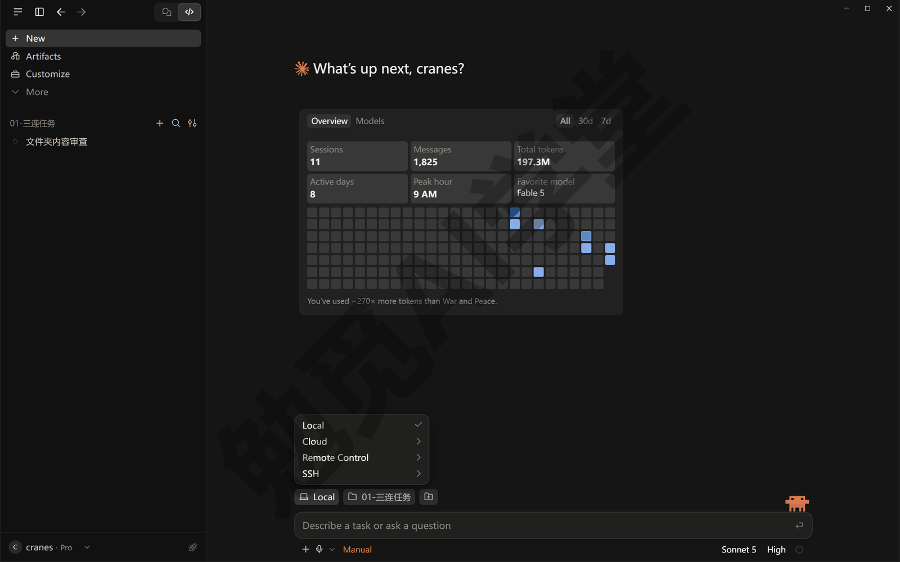
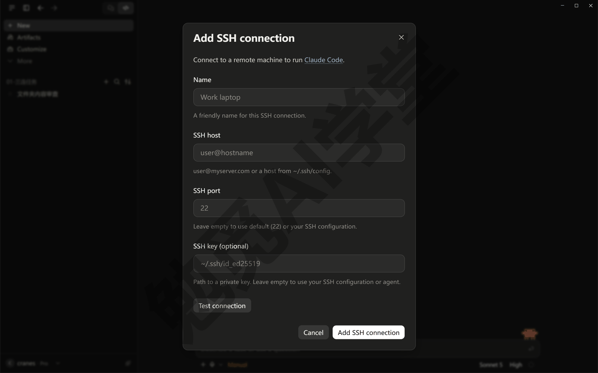
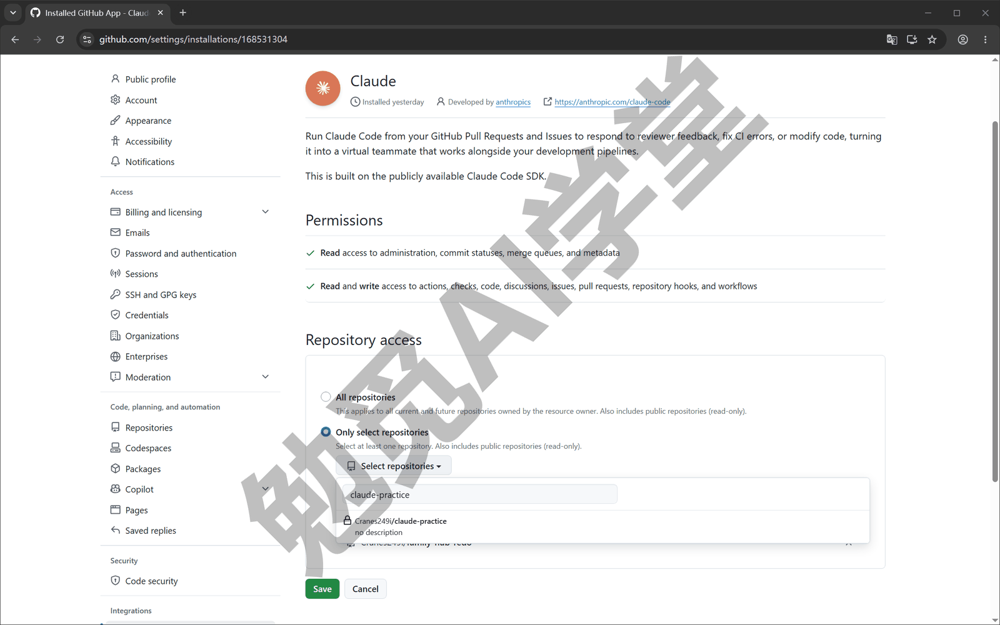
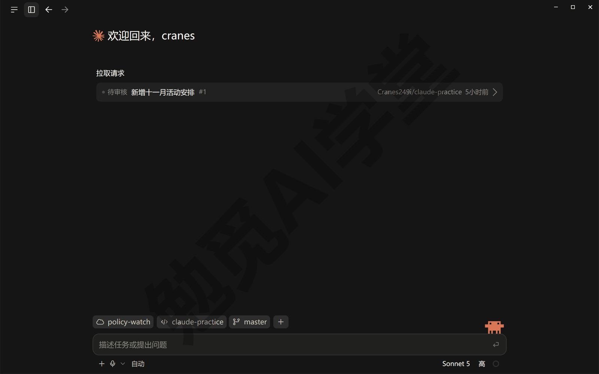
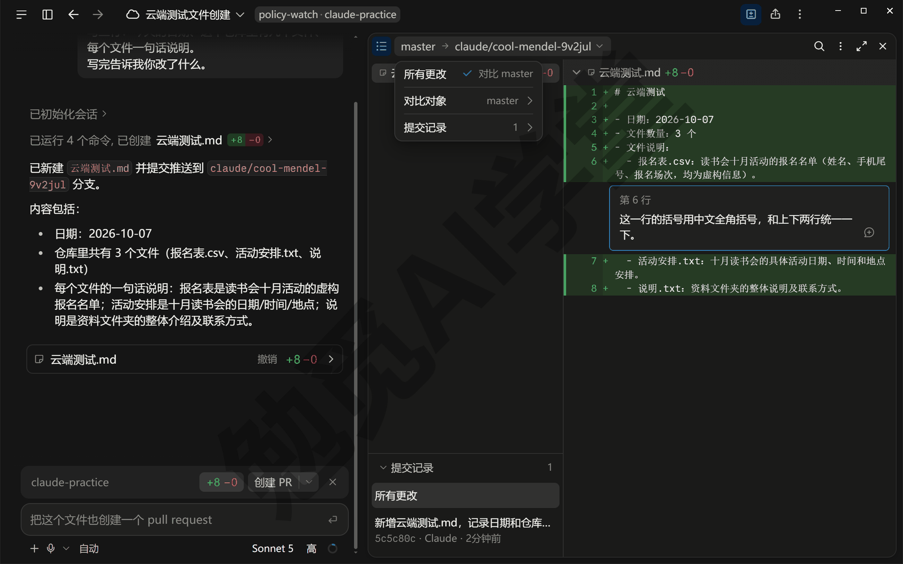
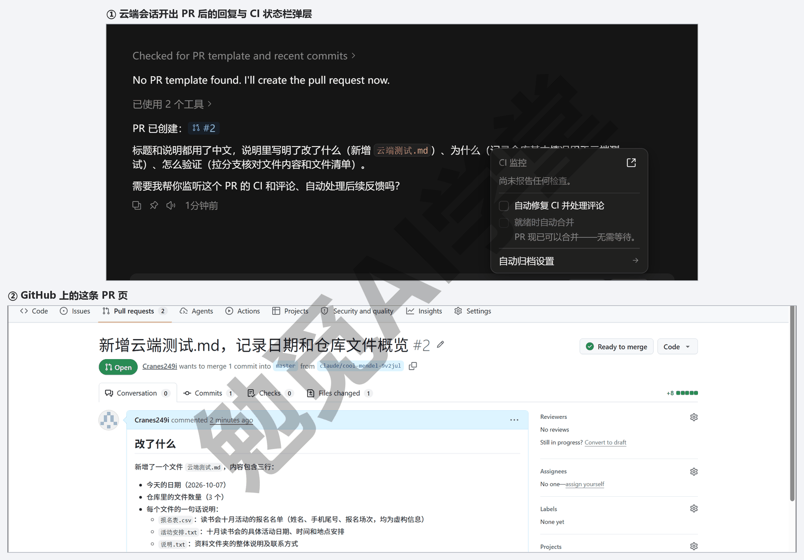
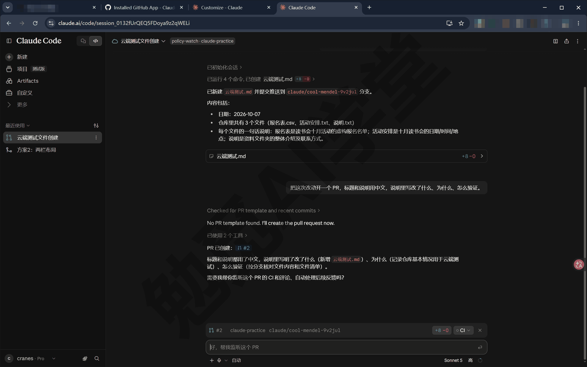
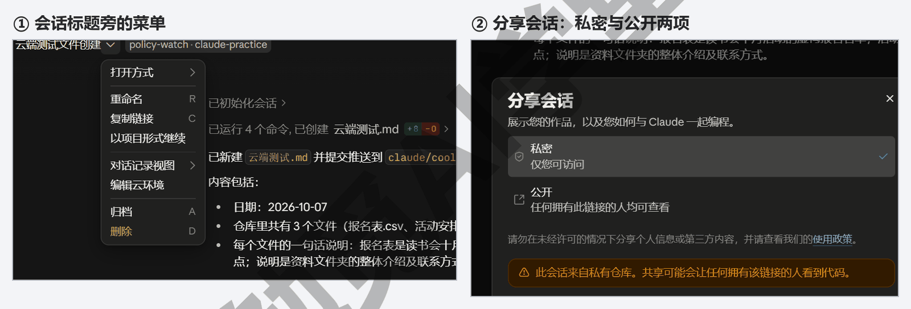
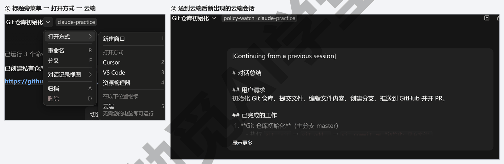

## 云端会话与手机端

到上一篇为止，它干的每一件事都在你的电脑上跑，电脑一合上它就停。这一篇让任务离开你的电脑：云端会话在 Anthropic 的机器上运行，关掉应用、关掉电脑它都不停；在网页版和手机 App 上能看进度、发指令；本机会话做到一半可以用“Continue in”送到云端接着做；Pro 与 Max 用户还有一个叫 Dispatch 的入口，在手机上派一个任务，它自己在电脑上开会话去做。另外认识 Remote Control、SSH、WSL 这几项环境，最后把费用和隐私说清楚。

这篇文章的实操内容需要 Claude 的付费订阅：云端会话对 Pro、Max、Team 套餐开放，云端机器不另收费、用量从你的套餐里扣；Dispatch 需要 Pro 或 Max，而且官方已不再对新用户开放它，你的账号里有没有以实际界面为准。

### 14.1 什么是云端会话

**云端会话是什么。** 云端会话是跑在 Anthropic 机器上的 Claude Code 会话：你在桌面应用里新建会话时把环境从 Local（本机）换成 Cloud（云端），任务就在一台隔离出来的云端电脑里运行，你的电脑只是一个看进度、发指令的窗口，关掉也不影响它。这项功能还在快速变化，界面和范围可能变动，一切以你看到的为准。

**它和本机会话差在哪。** 两种会话用同一个输入框、同一套斜杠命令、同一个差异视图，差别集中在下面几处：

| 项目 | 本机会话 | 云端会话 |
| --- | --- | --- |
| 跑在哪 | 你的电脑 | Anthropic 管理的一台隔离的云端电脑 |
| 关掉应用或电脑 | 会话停下 | 继续跑，回来再看 |
| 干活的文件夹 | 你电脑上的文件夹 | 从 GitHub 克隆下来的仓库，可以一次选几个仓库 |
| 权限模式 | Manual、Accept edits、Plan、Auto、Bypass permissions | Auto（默认）、Accept edits、Plan；没有 Manual，也没有 Bypass permissions |
| @ 文件、文件面板、+ 按钮里的连接器与插件 | 都能用 | 都不能用；要改文件直接跟它说，技能与插件用 claude.ai 账号里启用的那一套 |
| 从哪里看 | 桌面应用 | 桌面应用、网页版 claude.ai/code、手机 App 三处同步 |
| 用量 | 从套餐扣 | 同样从套餐扣，云端机器不另收费 |

两处最重要：第一，云端会话的项目来自 GitHub 仓库，不是你电脑上的文件夹，所以要先把项目推上 GitHub（《Git、GitHub 与代码审查》13.3 节），它才有东西可干；第二，它没有 Manual 模式，默认是 Auto（自动），改文件、跑命令都不逐条问你，只有遇到有风险的动作它才拦下来问——但它改的是云端那份复制品，你电脑上的文件一个字节都不会动，最后的改动会作为一个 PR 交回来，由你决定合不合。

**什么任务适合交给云端。** 如果任务要跑很久（大范围改动、跑全部测试、迁移数据），或者你要走开（下班前派出去、第二天看结果），或者你想在手机上盯着进度，就适合交给云端。反过来，要读你电脑里没推上 GitHub 的文件、要用你电脑上装的软件、要用电脑操控点桌面程序的任务，都只能在本机做。

**云端环境。** 每个云端会话都在一个“云端环境”里跑，环境保存着三样设置：能不能上网以及能访问哪些网站、环境变量（给程序预先设好的一些值，比如某个服务的密钥）、启动时自动跑的准备脚本。第一次用云端会话时，有的账号会预置一个叫 Default 的环境；没有的话，在新建会话的环境下拉菜单里把 Cloud 展开，点 Add cloud environment（添加云环境）自己建一个，网络访问级别保持默认的 Trusted（可信）就行，其他的你都不用改。以后要看或改建好的环境，也在 Cloud 展开后的那一级菜单里。演示账号里，鼠标停在环境上没有出现齿轮图标；官方文档写的是把鼠标停在一个环境上、点出现的齿轮图标，就能编辑或归档它（需实机验证）。



**另外两项环境：Remote Control 与 SSH。** 环境下拉菜单里除了 Local 和 Cloud，还有 Remote Control 和 SSH 两项，你基本用不到，知道是什么就行。Remote Control（远程遥控）是接命令行版会话用的：在命令行版里开了远程遥控的会话（14.4 末尾会提到 `/remote-control`），能从这里接上来看进度、接着说，本课不展开（子菜单里有什么以实际界面为准）。SSH 是一种加密的远程登录方式。选它，Claude Code 跑在你能远程登录的另一台机器上——比如你租的服务器——桌面应用只当界面。把 SSH 展开，点 Add SSH connection（添加 SSH 连接），填一个名字（Name）、主机地址 SSH host（`用户名@主机名`）、端口 SSH port（默认 22），私钥文件 SSH key（登录那台机器用的密钥文件）可以不填，点 Test connection（测试连接）试一下再添加；第一次连上时它会自动在那台机器上装好 Claude Code，那台机器要是 Linux 或 macOS。你有自己的服务器才会用到它。



**装了 WSL 才会多出的一项：WSL。** WSL 是 Windows 里自带的 Linux 子系统。电脑上装了 WSL，环境下拉菜单里才会多出 WSL 这一项，没装的电脑上看不到，14.1 开头那张环境下拉菜单的图里也没有（以实际界面为准）；选它，Claude Code 跑在你电脑里的那个 Linux 环境中，用 Linux 的工具和路径。《权限、沙盒与模型》3.4 节讲过，沙盒只在 WSL 2 里有，这是它对普通用户唯一的吸引力；代价是 WSL 会话里 @ 文件、+ 按钮、插件都不能用。你装过 WSL 可以试，没装过不必为它专门去装。

### 14.2 开一个云端会话全程

下面用《Git、GitHub 与代码审查》13.3 节推上去的 claude-practice 仓库做一遍。

**第 1 步：连上 GitHub。** 云端会话要能读你的仓库、推分支，所以第一次用之前要授权。这一步不用自己找入口，第 2 步第一次把环境选成 Cloud、或者第一次打开 claude.ai/code 时，它会引导你安装 Claude GitHub App（引导页的形态以实际界面为准，需实机验证），跟着跳到 GitHub 上的那一页做完再回来：Repository access（仓库范围）选 Only select repositories（只选部分仓库），在 Select repositories（选择仓库）下拉里勾上练习仓库，点 Save（保存）——练习仓库是私有的，一定要把它勾进去，否则云端会话看不到。以后想再加仓库，到 GitHub 的 Settings → Applications → Claude → Configure 还是这一页。如果你已经在用命令行版，还有第二种办法：在命令行里运行 `/web-setup`，把 `gh` 的登录信息交给 Claude 账号用；本课用第一种。



**第 2 步：新建会话，环境选 Cloud。** 点侧栏的 New（新建），在输入框上方的环境下拉菜单里选 Cloud，再选一个云端环境；原来选文件夹的那个小标签会变成两个——云端环境名和仓库名——后面还跟着一个分支名。点仓库名，下拉里列的是你账号下的全部仓库（多的话用底部的搜索），选 claude-practice，分支名会自动跟着换成这个仓库的主线；要一次改几个仓库，点分支名右边的 + 号继续加，每个仓库各有自己的分支。第一次切到 Cloud 可能会弹一张说明卡，告诉你 Auto（自动）已是默认权限模式，点“知道了”就行；左下角的权限模式默认是 Auto；想先看方案再动手就换成 Plan（计划），但 Plan 下它出完方案会停下等你批准，第 3 步要关电脑出门的话就留 Auto，让它一口气做完；右下角的模型和平时一样选就行。然后像平时一样写任务，把目标、范围、验收标准说清（《对话与上下文管理》4.1 节的写法约定）：

```text
在这个仓库里新建一个叫“云端测试.md”的文件，
写三行：今天的日期、这个仓库里有几个文件、每个文件一句话说明。
写完告诉我你改了什么。
```

发送后它开始在云端准备：克隆仓库、跑准备脚本，会话里能看到准备的进度；准备好之后正常干活。



**第 3 步：关掉应用。** 现在把 Claude 桌面应用整个关掉，甚至关掉电脑，去做别的事。它不受影响；做完或者需要你回答问题时，桌面应用重新打开会显示出来，手机 App 装了的话会收到推送（通知的形态以实际表现为准）。

**第 4 步：回来看结果。** 重新打开应用，侧栏里这个会话带着云端标记。点开，先看它的汇报，再点差异计数（类似 `+42 -18`）打开差异视图：逐个文件看改了什么；看到不满意的地方，把鼠标停到那一行，行号左边会出现一个 +，点它就能给这一行写批注，批注会随你下一条消息一起发给它，它照着改。差异视图顶上写着“基础分支 → 它开的分支”，默认就是拿改动和分出来时的基础分支比；想和别的分支比，点左边那个基础分支名，菜单里选 Compare against（对比对象）再挑一条。



**第 5 步：让它开 PR 交回来。** 改动满意了，发送：

```text
把这次改动开一个 PR，标题和说明用中文，说明里写改了什么、为什么、怎么验证。
```

它会把分支推到 GitHub、开出 PR、给你网址，多半还会主动问你要不要帮你跟进这个 PR。之后的事和《Git、GitHub 与代码审查》13.4 节一样：到 GitHub 上看、合并；想让它跟进这个 PR、自动修检查失败和审查意见，回一句“好”，或者在输入框上方的 CI 状态栏里点 CI 按钮、勾上 Auto-fix（自动修复 CI 并处理评论；桌面应用和网页版里都有这条状态栏）——云端会话的 Auto-fix 靠的是第 1 步装的 Claude GitHub App，不是本机的 `gh`。



**会话会过期。** 云端会话一段时间没有动静，它占用的那台云端电脑会被收回，会话显示为过期；从侧栏或网页版重新打开，官方会给它换一台新机器、把对话历史原样恢复，你接着说就行。恢复不了的是“当时还在后台跑的东西”——比如收回那一刻还没跑完的命令，要重新让它做。等你审批一个连接器工具、或等你登录某个服务的时候，也算没有动静，等太久同样会过期。

**它改文件不问你，要不要担心。** 云端会话默认 Auto，改文件、跑命令不逐条弹确认，遇到有风险的动作它才拦下来问你。这在云端是合理的：它改的是云端那份复制品，跑的命令也在那台隔离的机器里，你的电脑不受影响；最终所有改动都要经过 PR 由你审过才进主线。想让它每一步先说再做，把模式切成 Plan，它就只出方案、不动文件。

### 14.3 网页版 claude.ai/code 与手机 App

**网页版看到的是同一份会话。** 在任何一台电脑的浏览器里打开 claude.ai/code，登录同一个账号，左侧就是你的云端会话列表，点开一个和桌面应用里看到的完全一样：对话、差异计数、差异视图、行内批注、开 PR，都能做。网页版还能直接新建云端任务，不需要装任何东西：点会话列表顶部的新建按钮，选仓库、写任务，和桌面应用里选 Cloud 新建是同一回事（按钮名以实际页面为准）。第一次在网页版用云端会话，它同样会引导你装 Claude GitHub App，装过的不用再装。只有一件事它看不到：你在桌面应用里开的本机会话，因为那些跑在你的电脑上，网页管不到。



**网页版能做的几件事。** 除了看和说，还有：

- **撤回排队的消息**：它正在干活时你发的消息会排队，想收回就点消息上的 ✕，文字退回输入框让你改；它已经读了的收不回。
- **归档与删除**：点会话标题旁的 ∨ 菜单，里面有 Archive（归档）和 Delete（删除）两项：归档的会话收进归档列表，筛选“已归档”还能找回来；删除了就找不回来，点之前它会再问你一次确认（以实际界面为准）。
- **分享**：点右上角的分享图标，Pro 与 Max 账号的会话可以在 Private（私密，只有你能看）和 Public（公开，拿到链接的人都能看）之间切；会话里用到私有仓库时，切公开前它会弹一条橙色提示，说分享可能让拿到链接的人看到代码，所以分享前先检查里面有没有不该给人看的东西；想要求看的人必须有这个仓库的访问权限，或者不显示你的名字，在 Settings → Claude Code → Sharing settings（分享设置）里改。
- **命令**：`/compact`（压缩上下文）和 `/context`（看上下文用了多少）能用，`/clear` 不能用，要清空就新建一个会话。



**手机 App：看进度、答问题、发指令。** Claude 手机 App 里也能打开同一份云端会话列表（入口的名字和位置需实机验证，一般在底部或侧边菜单里找带 Code 字样的那一项）：能看它做到哪、能回答它的问题、能发新指令、也能新建云端任务；做完或者要你审批时手机会收到推送。常见的用法是这样：在电脑上把任务派出去，出门后手机上收到它的提问就答一句，回到电脑再打开差异视图验收，三处看到的是同一份对话，不用在哪一端重复说明。手机上做不到的是直接改文件、看本机会话，它的定位就是《认识与装好》1.3 节说的“指挥与验收”。手机端画面本课用文字讲，以你手机上的界面为准。

### 14.4 “Continue in”接力：本机会话送到云端

如果你的任务在本机开了头，做到一半得出门，又不想它停，桌面应用为此准备了一个叫“Continue in”（在……继续）的功能：把这场对话连同它已经做的改动一起送到云端，云端的它接着做。

**入口在哪。** 点本机会话顶部标题旁的 ∨，菜单里有一项“打开方式”，把它展开：上面几项是在新窗口或编辑器里打开这个项目，最下面“在以下位置继续”一组里有一项“云端”，旁边写着不需要你的电脑也能运行——送到云端点的就是它（“打开方式”在英文界面里多半叫 Open in，其余几项叫什么以实际界面为准，需实机验证）。下面分别讲送到云端和打开编辑器两件事。

**送到云端。** 在“打开方式”里点“云端”，会弹一个确认框，告诉你它要做三件事：把当前分支推到 GitHub、给这场对话写一份交接说明、用这份说明新建一个云端会话；确认后三步依次打勾，新的云端会话开头就是那份说明，云端的它接着你们聊到的地方继续做；本机这个会话默认留着（以实际界面为准）。

送之前先确认三个条件都满足：

- 这个项目已经推上过 GitHub，而且 14.2 第 1 步装的 Claude GitHub App 授权到了它，不然它会告诉你分支推不上去；
- 本机的改动全部提交过（Git 课叫“工作区干净”，意思是文件夹里没有还没提交的改动，做法是先让它“把当前改动提交”）；
- 当前不是 SSH 或 WSL 会话，这两种会话不能送。

送出去之后先看两件事：新出现的云端会话开头带着这场对话的摘要（摘要由它自动写，内容是这场对话的目标、已经做了什么、还剩什么），读一遍，确认你们已经定下的要求都在里面，漏了就补一句；再到 GitHub 上看分支是不是已经推上去了，云端接着改的就是这条分支。送出去的那一刻起，本机这份会话和云端那份就是分开的两份：本机留着的只是一份记录，之后的改动都在云端那份里进行。

什么时候用它、什么时候直接开云端会话？任务已经在本机聊了一半、你不想重新描述一遍，用 Continue in；一件全新的任务，直接按 14.2 新开云端会话更直接。



**打开编辑器。** 同一个菜单里还能把这个项目在 VS Code 或别的编辑器里打开，方便你在编辑器里手改文件；它做的只是在编辑器里打开项目文件夹，不会把对话带过去。你不会用编辑器的话，用《终端、编辑器与 VS Code 扩展》8.2 节的文件面板就够，这一项知道有就行。

**反过来，云端拉回本机。** 这个方向桌面应用没有按钮，命令行版有：在项目文件夹里运行 `claude --teleport`，选一个云端会话，它会把那条分支取下来、把对话历史装进终端，你在本机接着做。取回来之后，终端里的这份会话和云端那份就分开了：你在本机接着做的事不会同步回网页版和手机；想继续从手机上盯着，要在本机会话里输入 `/remote-control` 开启远程遥控（这条命令本课不展开，知道有就行）。你用到的机会不多，遇到时《终端、编辑器与 VS Code 扩展》8.4 节的命令行知识够用。

### 14.5 Dispatch 与手机派任务

**Dispatch 是什么。** 它是应用里一个长期开着的对话（旧界面放在 Cowork 页签里，新界面在侧栏，有没有这一项以你看到的界面为准）。你在手机上给它发一个任务，它先判断这是哪类任务：修一个问题、更新依赖、跑测试、开 PR 这类开发类的任务，它会在你的电脑上自动开一个 Code 会话去做，会话出现在 Code 页签的侧栏里、带一个 Dispatch 徽章；查资料、改文档、做表格这类办公任务，留在 Cowork 里自己做。你也可以直接指定：“开一个 Claude Code 会话，把首页的错别字改掉”。

从手机上派任务的过程是这样的：在手机 App 里打开 Dispatch 这个对话，像发消息一样把任务写清楚；电脑这边的桌面应用要开着，过一会儿 Code 页签的侧栏里会多出那个带徽章的会话，它开始干活；它需要你批准某个动作、或者做完了，手机会收到推送提醒你回到对话里处理（推送和处理方式的形态以实际界面为准）。任务本身照平时派任务的写法写，比如下面这句：

```text
把首页的错别字改掉，改完开一个 PR，标题和说明用中文。
```

**用 Dispatch 的前提。** Dispatch 需要 Pro 或 Max 套餐，Team 与 Enterprise 没有；官方已经不再向新用户开放它，老用户暂时还能用，你的应用里有没有以实际界面为准。它开出的 Code 会话跑在你的电脑上，所以电脑和桌面应用要开着（以实际表现为准）。手机 App 要先和账号配对、在设置里开启 Dispatch，具体步骤以官方帮助中心的 Dispatch 页面为准（需实机验证）。如果你用的是 Team 或 Enterprise 套餐，想在手机上派任务，用 14.2 的云端会话就行，手机 App 里同样能新建。

**和电脑操控的关系。** 如果你在《内置浏览器、应用预览与电脑操控》7.5 节开了电脑操控，Dispatch 开出的会话也能用它，只是每次授权只管 30 分钟，过了会重新问你——普通会话里授权管整场会话。从手机上派任务时你人不在电脑前，所以这个有效期有意设得更短；到期时它会停下来等你，手机上会收到提醒。

**和云端会话怎么选。** 如果你想在手机上派任务，Dispatch 和云端会话都行，差别在任务跑在哪台机器上：Dispatch 开的会话跑在你的电脑上，能用你电脑里的文件和软件，但电脑得开着；云端会话跑在 Anthropic 的机器上，电脑关了也行，但只能做 GitHub 仓库里的事。如果你人在外面、电脑开着，两种都能用；电脑关了，就只能用云端会话。还有一条实际的建议：Dispatch 开出的会话跑在你电脑上，用的是本机会话那一套权限，第一次用时先在电脑旁看几次它派出来的会话做了什么，再放手让它在你出门时干。

### 14.6 费用与隐私

**用量怎么算。** 云端会话的用量和本机会话一样从你的套餐里扣，云端那台机器本身不另收费。《认识与装好》1.4 节讲的五小时窗口与每周上限对它同样生效；同时开几个云端会话，每一个都在花你的用量，开得越多用得越快。可以养成一个够用的习惯：把耗时长的任务交给云端，动手前先在本机用 Plan 模式把方案聊清楚，云端只负责执行，方案定好了再跑，花的用量就少，这和本机会话省用量的办法是同一个道理。还有一个和费用无关但会卡住人的前提：云端会话只能用 Claude 官方的模型服务，如果你的桌面应用把模型服务改成了第三方（设置里的推理配置不是官方默认，一般人不会碰到），云端会话会提示不可用，改回官方默认就好（提示的原文以实际界面为准）。

**你的代码去了哪里。** 云端会话把你的 GitHub 仓库克隆到 Anthropic 管理的一台隔离的云端电脑里，也就是说代码离开了你的电脑。官方为这台机器做了几层隔离：每个会话一台独立的机器；网络访问默认受限、可以整个关掉；Git 的登录凭据（能替你操作 GitHub 的那份授权）不放进这台机器，推分支这类要用凭据的操作由机器外的一个服务代为完成，所以就算它跑的代码有问题也拿不到你的凭据。网络访问也有一层：云端环境默认是 Trusted（可信）级别，只放行常用的网站和软件源，需要的话可以在环境设置里把网络整个关掉，关掉之后它仍然能连 Anthropic 自己的服务；你用默认就行。即便如此，含密钥、含个人隐私的文件仍然建议不要放进要交给云端的仓库。

**私有仓库与分享。** 私有仓库只有装了 Claude GitHub App 的才能被云端会话读到，授权范围在 14.2 节第 1 步选。会话默认是 Private，只有你自己看得见；14.3 节讲过公开分享前要先检查内容。删掉的会话找不回来。对话和代码内容会送到 Anthropic 的模型服务处理，这一点和本机会话一样；不同的是仓库的副本也放在 Anthropic 的机器上，所以本课的建议是：练习仓库、公开项目放心用云端，含客户资料、密钥的仓库先问清所在单位的规定再决定。练习用的会话可以直接删，正式项目的会话建议归档而不是删，归档的还能找回来。

**国内网络。** 云端会话、网页版和手机 App 都要能正常访问 claude.ai，各地、各运营商的网络条件不一样，能不能用以你的实际情况为准；《认识与装好》1.6 节的说法这里同样适用。网页版打不开的时候，桌面应用里的本机会话通常也受影响，先把网络弄好再试云端。

### 14.7 三个练习任务

方括号里的内容换成你自己的。

**任务一：开一个云端会话并关掉应用等结果。** 用 `[你推上 GitHub 的仓库]` 开一个 Cloud 会话，派一个要跑几分钟的任务（写一份 README.md，也就是放在仓库首页给人看的说明文件），发送后把桌面应用整个关掉，过十分钟再打开看：

```text
请给这个仓库写一份 README.md：说明每个文件是做什么的，
再列出你认为可以改进的三处，用中文，不要动其他文件。
```

完成标准：应用关掉期间任务继续跑；重新打开后会话里有汇报，差异视图里能看到新建的 README.md；你在差异视图里至少写过一条行内批注并让它改了。

**任务二：在网页版接着聊同一个会话。** 电脑上不开桌面应用，用浏览器打开 claude.ai/code，找到任务一的会话，再发一条消息，然后让它开 PR：

```text
把 README.md 里“可以改进的三处”那一节改成表格，然后开一个 PR，标题和说明用中文。
```

完成标准：网页版里能看到任务一的完整对话；这条消息发出后它照做了；GitHub 上出现了这个 PR，你在 GitHub 上合并了它。

**任务三：把一个本机会话送到云端。** 在本机开一个会话改一处、让它提交，然后用 Continue in 把会话送到云端，让云端的它再做一步：

```text
把当前改动提交，说明写“[改了什么]”。

（送到云端后，在云端会话里发送）
接着上面的工作，把 [某个文件] 里的 [某处] 也改成一样的写法。
```

完成标准：Continue in 之后侧栏里多了一个云端会话，里面带着本机对话的摘要；云端会话接着完成了那一步；你能说出送到云端的三个条件（项目推上过 GitHub 并授权给了 Claude GitHub App、改动都提交过、不是 SSH 或 WSL 会话）。

### 14.98 本篇小结与自检

这一篇讲了云端会话是什么（跑在 Anthropic 机器上、关电脑不停、项目来自 GitHub 仓库、默认 Auto、没有 Manual 与 Bypass、@ 文件与 + 按钮不可用）和它适合什么任务；按“第 N 步”开了一个云端会话：装 Claude GitHub App、选 Cloud 与仓库、关掉应用、回来在差异视图批注、开 PR 交回；网页版 claude.ai/code 与手机 App 看到的是同一份会话，能撤回排队消息、归档、删除、分享；“Continue in”把本机会话送到云端要先提交改动；Dispatch 在手机上派任务、在你电脑上开 Code 会话，需要 Pro 或 Max，而且已不对新用户开放；Remote Control、SSH 与 WSL 这几项环境是给用命令行版、有服务器和用 Linux 子系统的人准备的；用量从套餐扣、云端机器不另收费，代码会离开你的电脑、隔离在一台独立的云端机器里。

可以对照下面的清单检查学习结果：

- [ ] 能说出云端会话和本机会话的四处差别：跑在哪、关电脑会不会停、项目从哪来、权限模式有哪几档
- [ ] 知道用云端会话之前要先把项目推上 GitHub、装 Claude GitHub App 并把仓库勾进授权范围
- [ ] 开过一个云端会话，关掉应用后它继续跑，回来在差异视图里批注过并开了 PR
- [ ] 在网页版 claude.ai/code 找到并接着聊过同一个会话
- [ ] 知道 Continue in 在哪、送到云端的三个条件是什么
- [ ] 知道 Dispatch 是什么、跑在哪、需要什么套餐、和云端会话怎么选
- [ ] 知道 Remote Control、SSH 与 WSL 各是什么人用的
- [ ] 知道云端会话的用量怎么算、代码去了哪、分享前要检查什么

完成这些内容后，你的任务已经可以离开电脑独立运行，并且能在电脑、网页、手机三处接力。下一篇《定时任务、钩子与自动化》把重复的事整个交出去：定时任务按时间跑、钩子按事件跑、命令行按脚本跑，云端定时任务就是本篇云端会话的自动版。

### 14.99 新手常见问题

**Q1：云端会话要花钱吗？**

云端那台机器不另收费，用的是你套餐里的用量，和本机会话一样按五小时窗口与每周上限计。几个云端会话同时跑，用量一起算，所以别一口气派太多。具体套餐包含多少用量，以官网套餐页与你的账号页面显示为准。

**Q2：国内网络能用吗？**

云端会话、网页版、手机 App 都要能正常访问 claude.ai，桌面应用的本机会话也一样。各地、各运营商的网络条件不一样，能不能打开以你的实际情况为准；先用浏览器打开 claude.ai/code 看能否正常显示会话列表，能显示就能用。

**Q3：手机上能干什么、不能干什么？**

能看云端会话的进度、回答它的问题、发新指令、新建云端任务、收推送；Pro 与 Max 老用户还能用 Dispatch 派任务到自己的电脑上。不能直接编辑文件、看不到本机会话。把手机当作看进度、答问题和验收的工具用就可以了。

**Q4：云端和本机改了同一个文件怎么办？**

不会直接冲突，因为云端改的是云端那份复制品，最后以 PR 交回。真正的碰面发生在合并时：如果本机也改了同一处并且推上了 GitHub，PR 合并时 GitHub 会提示有冲突，你让云端会话“处理一下和 main 的冲突”，它会去解；解不了的按 Git 课《冲突与工作树》5.4 节的办法自己看两段、留一段。避免的办法很简单：一个文件同一时间只交给一边改。

**Q5：任务派出去了，我中途想改主意怎么办？**

直接在会话里发消息。它正在干活时消息会排队，做完手头这一步就照新话办；发错了，在消息还没被读之前点上面的 ✕ 撤回。想让它彻底停，说一句“停下，不要再改了”，然后看差异视图决定这些改动要不要开 PR；不要的话把会话归档，云端那份复制品会随会话一起作废，你的电脑和 GitHub 上的 main 都没有被动过。
