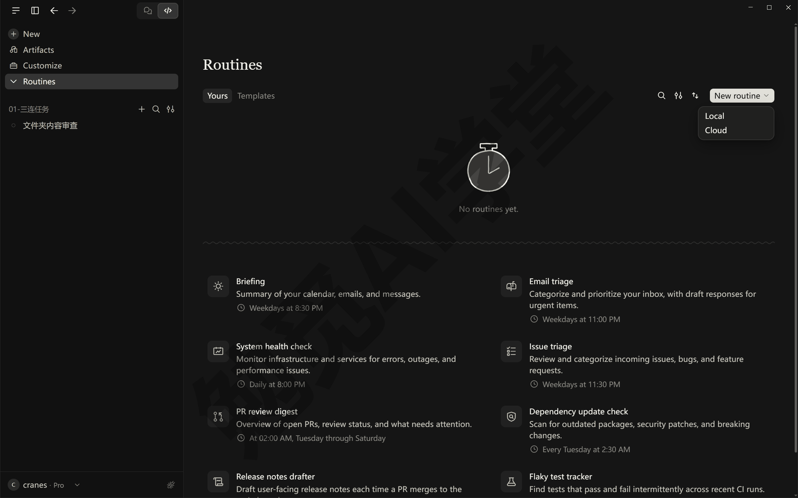
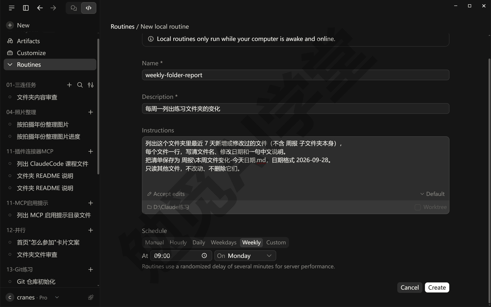
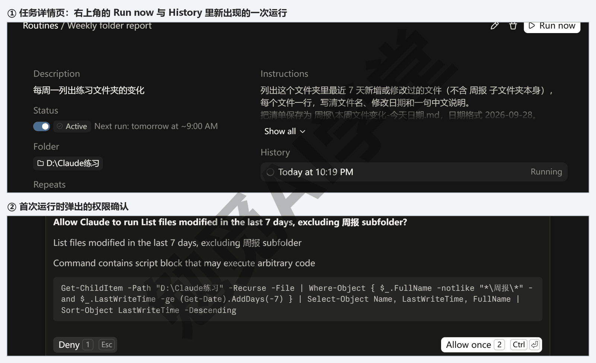
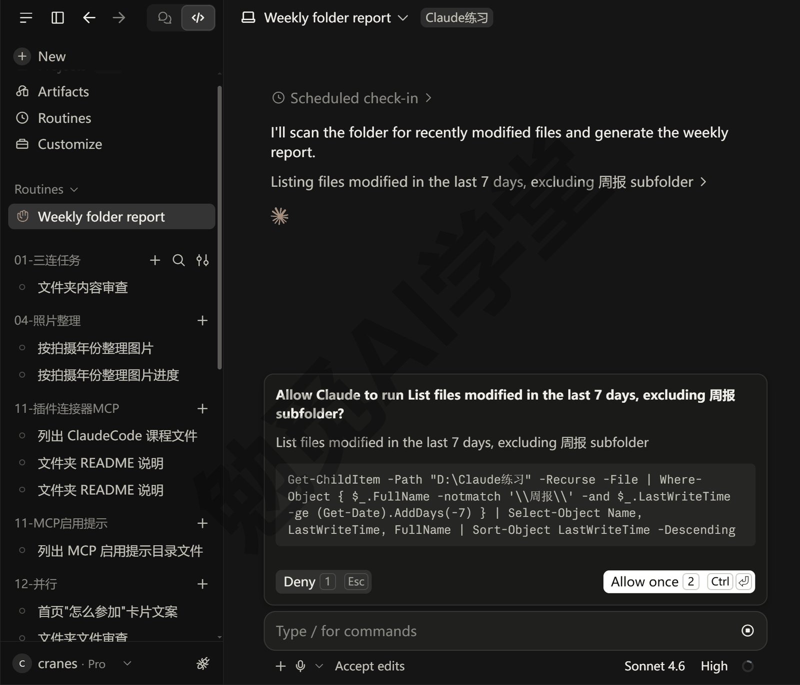
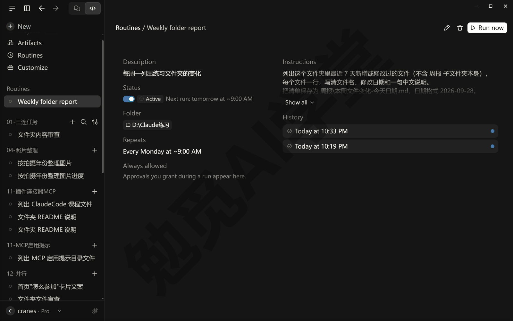
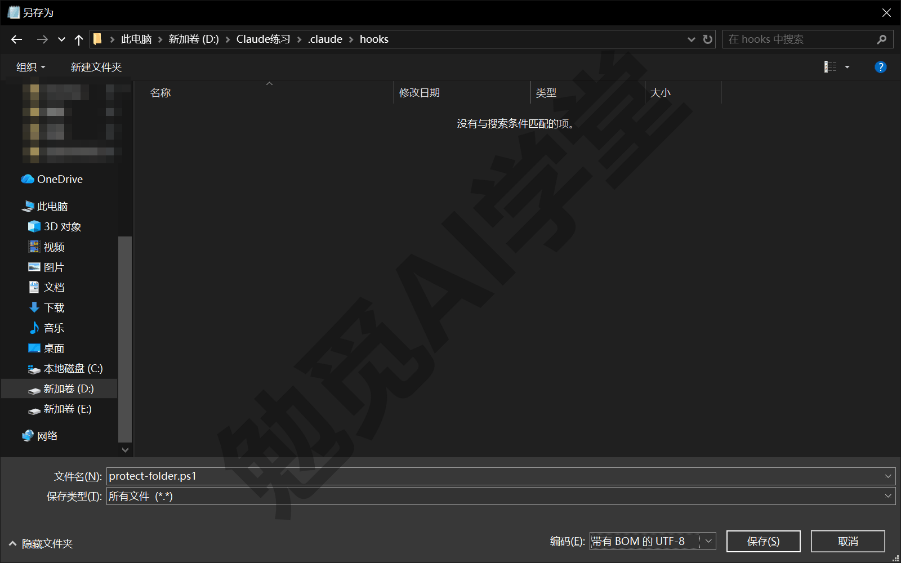
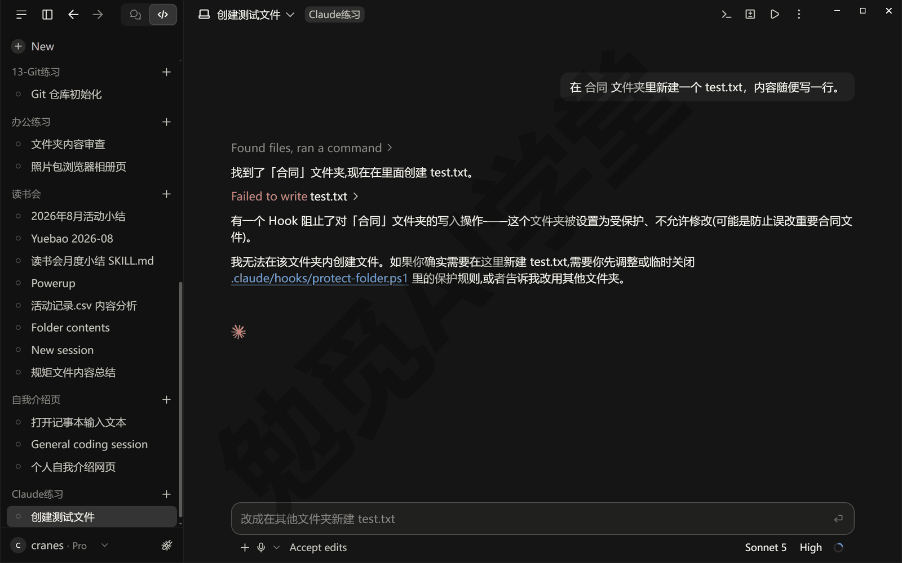
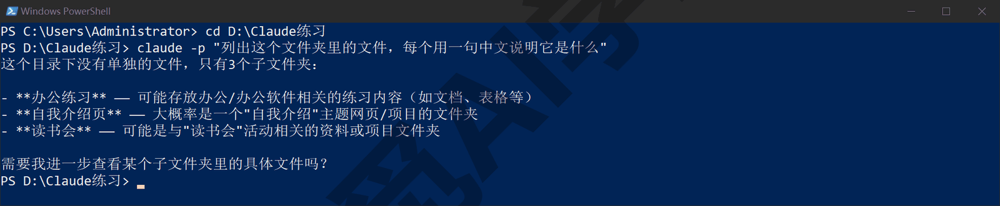
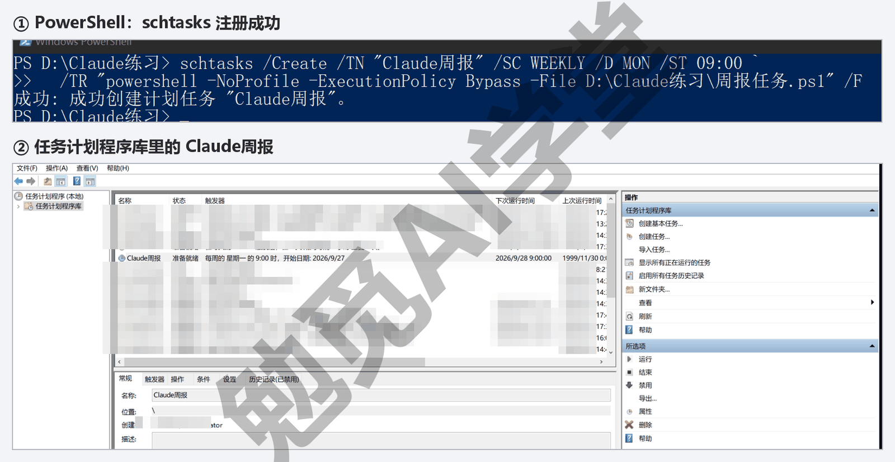

## 定时任务、钩子与自动化

前面十四篇里，每一件事都是你坐在电脑前发一句话、看它做完。这一篇讲怎么把重复的事交出去：按时间自动开工的定时任务，在它做某类动作前后自动跑一段检查的钩子，还有在命令行窗口里一句话跑完就退出、不用人在场的用法。最后讲两件配套的事：一条流程怎么从“对话里能做对”变成“可以放心交给自动化”，以及这个产品几乎每周都在更新，你怎么自己跟上。

本篇以 2026 年 9 月的 Claude 桌面应用与命令行 2.1 版为例。定时任务全程在桌面应用的 Code 页签里做；钩子和命令行用法会碰到设置文件和命令行窗口，每一步都会讲清楚，不要求编程基础。个别界面细节可能与你看到的略有差异，以你装好的最新版本为准。

这篇文章的实操内容需要 Claude 的付费订阅（Pro 起，与前面各篇相同）；15.5 讲的 GitHub Actions 还需要一个 GitHub 账号，本篇只带你认识它，不要求动手。

### 15.1 三种自动化怎么分工

学到这里，你手里已经有几条“每次做法都一样”的流程：《文件与办公能力一篇讲全》里让它整理文件夹，《CLAUDE.md 与规则》里定下的规矩，以后《实战二：网店订单月报流水线》每月出一次月报。这些事有一个共同点：做法已经固定，唯一还需要人的地方，是“到点了有人去发那句话”。自动化解决的就是这最后一件事。

Claude Code 给了三种交出去的方式，各管一类场景：

- **定时任务** ——按时间触发。你定好“每周一早上九点”，到点它自己新开一个会话，照你事先写好的指示干活，做完把这次会话留在侧栏里，你回来看结果。适合月报、周报、每天早上的待办摘要这类“到点就做一整件事”的任务。桌面应用里就能建，15.2 里会讲。
- **钩子** ——按事件触发。不看时间，看它做到了哪一步：比如每次它准备改一个文件之前，先自动检查一下“这个文件是不是在禁区里”，是就拦下。钩子不替你干活，替你把关和收尾，15.3 里会讲。
- **命令行一句话** ——按脚本触发。在命令行窗口里输入一句 `claude -p "……"`，它把这一句做完、把结果打印出来就退出，不进入对话。这一句可以写进任何脚本，再交给 Windows 自带的任务计划程序定时跑，15.4 里会讲。

三种方式怎么选，记一句话就够：要按时间做一整件事，用定时任务；要在它每次做某类动作时自动检查或收尾，用钩子；要把它嵌进你已有的脚本，或者不想一直开着桌面应用，用命令行。

这三种方式有一个共同的边界：都在你自己的电脑上跑，电脑关了就都不跑。要“电脑关了也在跑”，用的是云端的定时（桌面应用里叫 Cloud routine，云端例行任务），它在 Anthropic 的机器上运行，前提是把项目放到 GitHub 仓库里。云端会话是什么，《云端会话与手机端》讲过；云端定时怎么建、怎么收结果，《实战四：政策与补贴通知追踪》会真正做一次，这一篇只讲本机的三种。

三种方式用的都是同一个 Claude Code：你在对话里怎么说它就怎么做，权限模式、CLAUDE.md、技能、连接器全部照旧生效。学会了对话，自动化就只是“把那句话交给谁来发”的问题。

动手之前先看一眼现状。在任意一个会话里发送：

```text
列出我现在有哪些定时任务；再看一下这个项目和我用户目录下的设置文件里有没有配置钩子，
用中文告诉我结果。
```

第一次学到这里，它多半会回答“没有定时任务、没有配置钩子”——这是正常的，也正好说明这两样东西都得你自己建，它不会替你偷偷加上。后面两节各建一个，做完再发一遍这句话，就能看到它们出现在回答里。

### 15.2 桌面应用的定时任务

**定时任务是什么。** 官方叫 Scheduled tasks（定时任务）：你写好一段指示、定好时间，到点它自动新开一个会话，照指示做事。它的入口在 Code 页签的 Routines（例行任务）页里。这一页能建两种东西：Local（本机）任务在你的电脑上跑，能直接读写你的文件；Cloud（云端）例行任务在云端跑，电脑关了也跑，但拿不到你本机的文件，要连 GitHub 仓库。本篇建的是本机任务。

**为什么需要它。** 没有它，每周一早上你得记得打开应用、找到那个文件夹、把上周那句话再发一遍，哪一周忘了，这一周就没做。有了它，指示只写一次，每周到点它自己开工，你只负责看结果。

**入口在哪。** 在 Code 页签左侧栏找 Routines；侧栏上没有的话，在侧栏的 More（更多）菜单里找。较旧版本的桌面应用没有这一页，先按《认识与装好》1.9 节更新到最新版。点进 Routines 页（第一次打开可能空白两三秒，等一下或再点一次侧栏的 Routines），点右上角的 New routine（新建例行任务），选 Local（本机）。



下面用《认识与装好》1.8 节的练习文件夹 `D:\Claude练习` 建一个每周任务：每周一早上九点，列出这个文件夹里最近七天新增或改动过的文件，写成一份中文清单。

**第 1 步：填四件事。** 新建表单里有四个要填的地方，名字和描述是必填的：

- **Name（名称）** ——任务的名字。它会被转成小写、空格换成短横线，当作这个任务在磁盘上的文件夹名，所以不能和别的任务重名。这里填 `weekly-folder-report`。
- **Description（描述）** ——一句话说明，显示在任务列表里，比如“每周一列出练习文件夹的变化”。
- **Instructions（指示）** ——任务跑起来时发给它的那段话，写法和你平时在输入框里说话一样。这个输入框里带着权限模式和模型的选择器，输入框下方可以选它干活的文件夹，以及要不要在一个隔离的工作树里运行（工作树是什么，《子智能体、并行会话与工作树》讲过；只在自己文件夹里读写的任务不需要勾）。
- **Schedule（计划）** ——多久跑一次，有六个预设：Manual（手动，只在你点 Run now 时跑，适合先存一段常用指示）、Hourly（每小时）、Daily（每天，带时间选择）、Weekdays（工作日，同每天但跳过周六周日）、Weekly（每周，选星期几和几点）、Custom（自定义，自己写时间规则，本篇不用）。默认选中的是 Daily，几点跑会自动填一个接近现在的时间，这里改成 Weekly、星期一、9:00（Weekly 默认就是星期一）。

这次的指示全文如下，直接粘进 Instructions：

```text
列出这个文件夹里最近 7 天新增或修改过的文件（不含 周报 子文件夹本身），
每个文件一行，写清文件名、修改日期和一句中文说明。
把清单保存为 周报\本周文件变化-今天日期.md，日期格式 2026-09-28。
只读其他文件，不改动、不删除它们。
```

选文件夹的地方在 Instructions 框下方：点 Select folder（选择文件夹），列表里是最近用过的文件夹，不在列表里的点 Choose a different folder（选别的文件夹）去找；文件夹必须先选好才能点 Create（创建）保存，没信任过的文件夹，保存前会先让你确认信任（“信任一个文件夹”是什么意思，《权限、沙盒与模型》讲过）。权限模式在 Instructions 框的左下角，默认写着 Settings default（跟随设置），这里选 Accept edits（自动接受编辑）：它写清单文件不用问你，跑命令仍然要问；只在自己文件夹里读写的任务，选这一档最合适，五档各是什么，《权限、沙盒与模型》3.2 节讲过。



预设里没有的节奏——每 15 分钟一次、每月 1 日、某个未来时刻只跑一次——不用你自己学写时间规则：在任意一个会话里用一句话说清楚就行，比如“建一个定时任务，每 6 小时跑一遍全部测试”“明天下午三点提醒我检查发布结果”，它会替你建好；一次性的提醒跑完会自己停用。

**第 2 步：先手动跑一次。** 保存后进入这个任务的详情页，点右上角的 Run now（立即运行）。页面不会跳走，下面的 History（运行历史）里会多出一行写着 Running（运行中），点这一行才进到这次运行的会话里。第一次跑的目的不是看结果，是把权限问题当场解决：任务用的是你选的权限模式，遇到需要批准的动作它会停下来等你；这次运行里弹出的审批卡，能选 Always allow（总是允许）的都选它，以后的运行遇到同样的命令就不再问。

有的卡只给 Deny 和 Allow once 两个按钮、卡上写着命令里带脚本块（Command contains script block），这种命令每次运行都会停下来等你。这种卡一般出现在它临时写了一整段脚本来做某件事的时候，碰到了就改指示：把要它一次做完的几件事拆成几句，或者先让它把那一步写成项目里的一个脚本文件、指示里只说“运行 tools/xxx.py”，它就不用每次临时写一整段命令（哪种写法会触发以实际表现为准）。改了指示还不行，就改用 15.4 的命令行办法。

“先手动跑一次”这一步要是跳过，没人在旁边时任务会停在那里等你批准——会话留在侧栏里，回来再答也行，但这一周的清单就晚了。按这次的指示，它会先列文件、再建 `周报` 文件夹、再写清单，前两样是跑命令，Accept edits 下照样弹卡，写清单文件不弹；全部放行后两三分钟，清单文件出现在 `周报` 子文件夹里。



**第 3 步：等它自己跑，看结果。** 到了星期一九点，它会在几分钟内开跑（故意晚几分钟，下面会说）；系统通知开着的话，桌面右下角会弹一条通知。侧栏的 Routines（例行任务）分组里多出这次自动开的会话，它在等你批准什么时，行首会有一个橙色的举手图标。打开它，能看到它读了什么、写了什么，和你手动开的会话没有区别；右边还会自动开着一个 Runs（运行记录）面板，列着这个任务的每一次运行。它能改文件、跑命令、提交、开 PR，也一样受权限模式管。还有一点不同：自动开的会话不能和你其他会话互发消息（《对话与上下文管理》4.8 节讲过的那个能力）。



**电脑睡着了会怎样。** 任务只在应用开着、电脑醒着的时候运行，应用每分钟核对一次计划。错过了时间点也不会白白丢掉：应用启动或电脑唤醒时，它会检查过去七天有没有错过的运行，有就补跑一次——只补最近的那一次，更早的不补；补跑时也有通知。所以写指示时要想到“它可能晚跑”：一个定在早上九点的任务，电脑睡了一天，可能晚上十一点才跑。时间要紧的任务，把时间限制写进指示里，比如“只处理今天的文件；如果现在已经过了下午五点，只写一句说明今天错过了，不做别的”。不想让电脑自己睡过去，到 Settings（设置）的 Desktop app（桌面应用）下面的 General（通用）里打开 Keep computer awake（保持唤醒）；合上笔记本盖子仍然会睡。另外每次到点后它会晚几分钟再开始，这是有意错开大家同时发请求，同一个任务每次晚的时间是固定的。

**详情页上还能做什么。** 点 Routines 列表里的任务进详情页，上面有六样东西：

- **Run now（立即运行）** ——不等下一个时间点，现在就跑一次。
- **Status（状态）** ——在 Active（启用）与 Paused（暂停）之间切换；暂停只是不再按时跑，任务和历史都留着。
- **Edit（编辑，右上角的铅笔图标）** ——改指示、计划、文件夹和权限模式。
- **运行历史** ——列出每一次运行，包括被跳过的；鼠标停在跳过的那条上能看到原因：电脑在睡眠、上一次还没跑完、别的定时任务正在跑。
- **Always allowed（总是允许）** ——第 2 步里存下的授权都列在这里，不想再放行的可以撤销。
- **Delete（删除，右上角的垃圾桶图标）** ——删掉任务并归档它建过的会话；磁盘上的指示文件不会一起删，不要了就自己到下面说的 `~/.claude/scheduled-tasks/` 里删掉那个文件夹（以实际界面为准）。

这些指示存在你用户目录下的 `~/.claude/scheduled-tasks/<任务名>/SKILL.md` 里（`~` 就是你的用户主目录，Windows 上一般是 `C:\Users\你的用户名`），直接改这个文件，下一次运行就按新指示走；计划、文件夹、模型不在这个文件里，要在 Edit 表单里改。不想点界面，在任何会话里说一句“暂停 weekly-folder-report”“列出我的定时任务”也行。



**用量怎么算。** 每一次运行都是一次完整的会话，按你套餐的用量计，机制和你手动开的会话相同（《权限、沙盒与模型》3.7 节讲过）。所以间隔别定得比需要的密，指示里把范围限定住——“只读最近七天的文件”比“把整个文件夹看一遍”用量少得多。

### 15.3 钩子：在它动手前后自动跑一段检查

**钩子是什么。** 你可以把钩子（Hook）理解成挂在它工作流程某个固定点上的一条自动命令：每当它走到那个点——“准备改一个文件”“一条回复结束了”“需要你批准”——这条命令就自动跑一次，跑出的结果还能决定它接下来能不能继续。它不需要你在场，也不需要它“记得”。

**为什么需要它。** 你可能会想：《CLAUDE.md 与规则》里写一句“不要改合同文件夹”不就行了？多数时候它确实会听，但那是提醒，不是拦截：对话长了、上下文压缩过之后，它有可能忘掉。钩子是硬规则：不管它记不记得、不管当前用的是哪一档权限模式——连 Bypass permissions（跳过权限）都拦得住——走到那个点就检查一次，不合规矩就拦下。不过本篇只用钩子拦下不该做的动作；钩子其实也能替你自动放行某类动作，但那要在脚本里写更多判断，新手阶段先不碰。

**钩子写在哪。** 钩子不是界面上的开关，它写在设置文件里。常用的有两处：用户级 `~/.claude/settings.json`，对你电脑上所有文件夹生效；项目级 `.claude/settings.json`，放在项目文件夹里，只对这个项目生效，可以连同项目一起交给别人。桌面应用与命令行读的是同一份设置，所以在桌面应用的会话里同样生效。不想手写配置文件，直接在对话里描述你要的钩子，让它替你写进设置文件——它写完你在差异视图里看一眼再接受，也算过了一遍你的眼。

**几个常用的触发点。** 每个触发点有一个英文名，配置文件里要写对：PreToolUse（工具调用前，能拦下）、PostToolUse（工具调用成功后）、Notification（它需要你时）、Stop（一条回复结束时）、SessionStart（会话开始时）。这里的“工具”指它干活用的动作：Read 读文件、Edit 与 Write 改写文件、Bash 跑命令，Windows 上没装 Git for Windows 时跑命令用的是 PowerShell。配置里的 matcher（匹配器）按工具名筛选，比如只在 Edit 和 Write 前触发，写成 `"matcher": "Edit|Write"`。

**实例：禁止它碰某个文件夹。** 假设练习文件夹里有一个 `合同` 子文件夹，任何时候都不允许改。分三步，脚本用 Windows 自带的 PowerShell 写，不用装任何东西。

第 1 步，写检查脚本。在项目文件夹里新建 `.claude\hooks\` 两层子文件夹，把下面的内容存成 `protect-folder.ps1`——最简单的做法是让它建：发“在项目里新建 .claude\hooks 文件夹，把下面的脚本原样存成 protect-folder.ps1，编码用带 BOM 的 UTF-8”再把脚本贴给它；自己建的话，资源管理器里新建文件夹时名字直接输入 .claude 就行。存的时候注意两处：用记事本另存为时，保存类型选“所有文件”（不然它会在文件名后面再加一个 .txt），编码选“带有 BOM 的 UTF-8”——下拉里紧挨在 UTF-8 下面的那一项，不是默认的 UTF-8（BOM 是写在文件开头、用来标明编码的一个看不见的记号），不带这个记号的文件里的中文，Windows 自带的 PowerShell 会读错。



```powershell
# protect-folder.ps1：禁止改动 合同 文件夹里的任何文件
[Console]::InputEncoding = [System.Text.Encoding]::UTF8
[Console]::OutputEncoding = [System.Text.Encoding]::UTF8
$data = [Console]::In.ReadToEnd() | ConvertFrom-Json
$path = [string]$data.tool_input.file_path
if ($path -like '*\合同\*' -or $path -like '*/合同/*') {
  [Console]::Error.WriteLine("已拦下：$path 位于 合同 文件夹，这个文件夹不允许修改。")
  exit 2
}
exit 0
```

不用逐行读懂，只看三处就行：它从输入里取出这次要改的文件路径；路径里含 `\合同\` 就把原因写出来、以退出码 2 结束，退出码 2 就是告诉 Claude Code “拦下，别做”；其余情况以退出码 0 结束，放行。开头两行把读进来的内容和写出去的提示都定为 UTF-8 编码，少了它们，中文路径会被读成乱码、拦不住。还有一个小坑：脚本里的提示语不要用中文弯引号“”，PowerShell 会把它们当成引号的边界，整段脚本报错。

第 2 步，登记钩子。在项目文件夹的 `.claude\settings.json` 里加上这一段（文件不存在就新建；已经有内容的，把 `hooks` 这一块加进去，不要覆盖别的设置——不会改这种带大括号的文件就别手改，把下面这段贴给它说“把这段 hooks 配置合并进 .claude\settings.json，别动已有的设置”）：

```json
{
  "hooks": {
    "PreToolUse": [
      {
        "matcher": "Edit|Write",
        "hooks": [
          {
            "type": "command",
            "command": "powershell.exe",
            "args": [
              "-NoProfile",
              "-ExecutionPolicy",
              "Bypass",
              "-File",
              "${CLAUDE_PROJECT_DIR}/.claude/hooks/protect-folder.ps1"
            ]
          }
        ]
      }
    ]
  }
}
```

这段配置的意思是：在 Edit 或 Write 之前，用 PowerShell 运行项目里的那份脚本。`${CLAUDE_PROJECT_DIR}` 会被替换成当前项目文件夹的路径，所以这份配置换一台电脑也能用；`-NoProfile` 让 PowerShell 跳过加载你的个人配置、启动更快，`-ExecutionPolicy Bypass` 允许它运行本地脚本文件。

第 3 步，验证。改过设置文件后，它一般会自动重新读取；没生效就新开一个会话。然后发送：

```text
在 合同 文件夹里新建一个 test.txt，内容随便写一行。
```

它可能先跑一条命令找这个文件夹，照常放行。正确的结果是：它准备写文件时被拦下，对话里出现一行红字 Failed to write test.txt（写入 test.txt 失败），点行尾的 › 展开，能看到 PreToolUse:Write hook error 后面跟着脚本写的那句“已拦下”——这个 error 不是钩子坏了，被拦下时显示的就是这样一行；接着它会告诉你这个文件夹受保护、它没有动手。再让它在练习文件夹根目录新建一个文件，应该照常完成——钩子只拦 `合同` 文件夹。



**另外两个常见用法。** 一是改完自动收尾：把触发点换成 PostToolUse、匹配器仍是 `Edit|Write`，命令换成一个整理工具，它每改完一个文件就自动跑一次，写代码的人常用这个办法统一格式。二是需要你时弹窗提醒：触发点 Notification，命令用 PowerShell 弹一个消息框，这样你切到别的窗口干活时，它等你批准也不会被错过——弹窗有可能被压在别的窗口后面，第一次用先看一眼任务栏。这两个用法的现成配置，官方文档的 Hooks guide 页里有，照抄改一处命令就能用。

**条件 `if`：比匹配器再细一层。** 匹配器只按工具名筛，有时不够：你想在它跑 git 命令时检查，但不想每条命令都跑一遍脚本。这时在钩子里加 `"if"` 字段，写法与权限规则相同，比如 `"if": "Bash(git *)"` 只在 git 命令前触发，`"if": "Edit(*.md)"` 只在改 .md 文件时触发。`if` 只对工具类触发点有效，写到 Notification 这类触发点上，钩子就不会跑了。

**写坏了怎么办。** 脚本报错不会拦住它：只有退出码 2 才拦，其他退出码都算“出了错但放行”，错误内容会显示在对话里，你照着改脚本就行；脚本卡住不动有超时兜底，默认十分钟。想临时关掉所有钩子，在设置文件里加 `"disableAllHooks": true`。命令行版里输入 `/hooks` 能看到已配置的钩子清单，桌面应用里这类会打开终端面板的命令表现不一样，直接看设置文件更可靠。最后一条纪律：钩子只放你看得懂的命令；别人给的钩子先读一遍再装，《插件、连接器与 MCP》的安全五条对钩子同样适用。

### 15.4 命令行一句话跑完：`claude -p`

**它是什么。** 《终端、编辑器与 VS Code 扩展》里装过命令行版：在 PowerShell 里输入 `claude` 进入对话。在后面加一个 `-p`（print 的缩写，意思是打印出来），它就不进入对话了：把你跟在后面的那一句做完，把结果打印在窗口里，然后退出。官方把这叫非交互模式；对你来说，它就是“一句话版”的 Claude Code，人不用坐在旁边。

**为什么需要它。** 定时任务在桌面应用里，要应用开着；钩子只在它工作时触发。有两种场景这两样都不合适：你想把它接进一个已有的脚本，比如先跑一个 Python 脚本抓数据、再让它读结果写摘要；或者你想用 Windows 自带的任务计划程序定时，不想一直开着桌面应用。这两种场景用命令行一句话最合适，也是《实战四：政策与补贴通知追踪》把本地路线做成自动化时要用的办法。

**第一次用。** 打开 PowerShell（开始菜单搜索 PowerShell，点开），先进到练习文件夹，再发一句只读的话：

```powershell
cd D:\Claude练习
claude -p "列出这个文件夹里的文件，每个用一句中文说明它是什么"
```

十几秒后，回答直接打印在窗口里，然后回到命令提示符；打印出来的是原样的 Markdown 文字，加粗用的 ** 会照原样显示。它用的是你在命令行里登录过的账号和同一份套餐用量；读文件夹这类只读动作在默认权限下不需要确认，所以这一句能直接跑完。



**要它改文件时。** `-p` 模式下没有人在旁边点批准，默认权限模式是 Manual（手动），需要确认的动作会直接被拒绝，任务就做不下去。有两种放行办法，按需要选一种：加 `--permission-mode acceptEdits`，它改写文件不再问你，跑命令仍然要授权；加 `--allowedTools "Bash(python *)"` 这样的参数，只放行某一类命令（引号里写工具名和允许的命令前缀，空格加星号表示“以此开头的都行”）。比如让它整理周报：

```powershell
claude -p "把 周报 文件夹里最新一份 .md 的要点整理成 5 条，写进 周报\摘要.md" `
  --permission-mode acceptEdits
```

行尾的反引号是 PowerShell 的续行符，整段复制进去就能跑。有两条提醒：没人在旁边看着时，更要把范围写清楚——读哪个文件夹、写到哪个文件、不做什么；不要用 `--dangerously-skip-permissions`（跳过全部权限检查），它的名字里就写着“危险”，官方只建议在断网的隔离环境里用。

**把结果存下来、接进脚本。** 命令行的好处是，交给它的内容从哪来、它给出的结果到哪去，都由你决定：在命令末尾加 `> 结果.txt`，回答就存进文件而不是打印在窗口；反过来用 `Get-Content 报错.txt | claude -p "用中文解释这个报错的原因"`，就把一个文件的内容交给了它。加 `--output-format json` 会得到给程序读的结构化结果，写脚本的人用得上。官方文档还提到一个 `--bare` 参数，能让启动更快，但它不读你的订阅登录、只认 API 密钥，订阅用户不要加。

**接进任务计划程序。** 把一句话变成每周自动跑，分两步。第 1 步，把命令存成一个脚本文件，比如 `D:\Claude练习\周报任务.ps1`（同样存成带 BOM 的 UTF-8）：

```powershell
Set-Location D:\Claude练习
$task = "列出这个文件夹里最近 7 天新增或修改过的文件，写成一份中文清单，" +
        "保存为 周报\本周文件变化.md"
claude -p $task --permission-mode acceptEdits
```

第二、三行先把要说的话存进一个叫 `$task` 的变量里（变量就是给一段内容起的临时名字；两段用加号接起来，是为了不让一行太长），第四行再把它交给 `claude -p`。先在 PowerShell 里手动运行一遍这个脚本，确认能跑通、文件写出来了。第 2 步，在 PowerShell 里注册计划任务（命令按续行拆成了两行，整段复制运行；要不要让它长期跑由你决定）：

```powershell
schtasks /Create /TN "Claude周报" /SC WEEKLY /D MON /ST 09:00 `
  /TR "powershell -NoProfile -ExecutionPolicy Bypass -File D:\Claude练习\周报任务.ps1" /F
```

取消注册用：

```powershell
schtasks /Delete /TN "Claude周报" /F
```

注册成功会回一句“成功创建计划任务”，任务计划程序库里也能看到 Claude周报 这一项。之后每周一早上九点，Windows 会自动运行那个脚本，清单文件出现在项目文件夹里（到点自动跑这一步需实机验证）。



有两个常见问题：计划任务里找不到 `claude` 命令，多半是计划任务运行时不知道它装在哪，在 PowerShell 里输入 `(Get-Command claude).Source` 能看到它的完整路径，把脚本里的 `claude` 换成这个完整路径即可；计划任务默认只在你登录时运行，电脑关机、没登录都不会跑。

**与桌面应用的定时任务怎么选。** 两者都在你的电脑上跑、都要求电脑开着。多数情况下用桌面任务就够：它有界面、有运行历史、权限授权能记住，结果是一个能打开看的会话。如果你已经有脚本，或者想把几步串起来，就用命令行：它不依赖桌面应用开着，能接进脚本，输出能给程序读。电脑关机时两者都不跑；关机也要跑的，用 15.1 说的云端定时。

### 15.5 GitHub Actions 里的 Claude：先认识一下

GitHub Actions 是 GitHub 提供的一种自动化机制：在 GitHub 的服务器上，按某个事件（有人提交了、有人在 PR 里评论了、到了某个时间）自动跑一段你事先写好的流程。仓库、PR 这些词，《Git、GitHub 与代码审查》讲过。Claude Code 也能在这套机制里跑，官方叫 Claude Code GitHub Actions，它有两种用法。

**互动用法：在 PR 或问题里 @claude。** 装好以后，你在仓库的某个 PR 或问题（issue）的评论里写一句“@claude 把这个页面的标题改成……”，它会在 GitHub 的服务器上读仓库、改代码、推提交，再在评论里回复你做了什么。你不用开电脑，在手机上打开 GitHub 网页就能派任务。

**自动用法：写好指示，按事件自动跑。** 在工作流文件里写好一段指示，它就不用等你 @ 它，按事件自动跑，比如每天定时检查一遍、或者每个新 PR 都自动审一遍。这就是“电脑关了也在跑”的另一条路，走的是 GitHub 的机器。

**怎么装。** 官方给了一条快捷的安装方法。在这个仓库的文件夹里打开命令行版 Claude Code，输入下面这条命令，按提示一步步走：

```text
/install-github-app
```

它会替你装好 GitHub App、把登录用的密钥存进仓库的设置里、开一个 PR 把工作流文件加进仓库，你合并这个 PR，@claude 就生效了。密钥这一项，如果你用的是订阅账号，安装过程会让你选：用 Claude 订阅生成一个长期有效的登录令牌（一串代表你账号的字符），或者粘贴一个 API 密钥；选前一项，它会替你生成并存进仓库（需实机验证）。《Git、GitHub 与代码审查》13.5 节讲 GitHub 上的 @claude 时，用的也是这条安装命令。前提有两个：先装好并登录 GitHub 命令行工具 gh（《Git、GitHub 与代码审查》13.3 节装过），并且你对这个仓库有管理员权限。装好后，在仓库的任何一个问题或 PR 下面留一条评论就能试：

```text
@claude 把首页标题下面那行介绍改得更简短一些，改完告诉我动了哪个文件。
```

几分钟后这条评论下面会出现它的回复：读了哪些文件、改了什么、推了哪次提交，改动在仓库里能直接看到，不满意就在下面再评论一句让它接着改。还有两条边界：只有对仓库有写权限的人 @claude 它才会响应，别人在你的公开仓库里 @ 它也没有用；它每次运行用的是你的订阅用量或 API 额度，所以公开仓库里装它之前，先想清楚谁有写权限、会不会有人拿它当免费的聊天工具用。

本篇讲到这里就够了：知道有这个办法、知道它跑在 GitHub 的机器上、知道入口是 `/install-github-app`。本课后面的实战不再用到它；以后想用自动用法，工作流文件怎么写，看官方文档里讲 Claude Code GitHub Actions 的那一页。

### 15.6 先在对话里调到完美，再做成自动化

三种自动化都有一个共同的前提，也是本篇最要紧的一条方法：自动化不负责把事做对，它只负责把已经能做对的事按时再做一遍。顺序是固定的四步：

1. 在对话里把这件事做一遍，看结果对不对，不对就改提示词再来；
2. 至少做对两遍，两遍用的是同一段提示词；
3. 把最后这一段提示词原样搬进定时任务的 Instructions 或脚本里，一个字不改；
4. 先手动运行一次（定时任务点 Run now，脚本手动跑一遍），把权限确认都处理掉，再放手。

拿 15.2 那个每周清单任务走一遍这四步。第一遍在对话里说“把这个文件夹最近的变化整理一下”，它可能把所有文件都列了一遍，还顺手改了两个文件名——范围没说清。第二遍改成“只列最近 7 天新增或修改过的文件，只读不改”，结果对了，但清单存到了文件夹根目录，和别的文件混在一起。第三遍加上“保存为 周报\本周文件变化-今天日期.md”，再跑一遍还是对的，这一段就是可以搬进定时任务的那一版。最后那段指示比第一遍长了好几倍，多出来的每一句都是某一次没说清楚换来的；自动化里省不掉这些句子，因为到时候没有人替你补。

这四步之外，还要守两条纪律：

- **只把验证过的指示做成自动化，“希望它自己想明白”的任务不交给自动化。** 对话里你在旁边，它理解偏了你能当场纠正；自动运行时没有这个机会。所以指示里要把范围写清：读哪个文件夹、写到哪个文件、不做什么、遇到意外怎么办（比如“找不到数据文件就只写一行说明，不要猜”）。时间要紧的任务加上 15.2 说的时间限制。
- **每次运行都要留下能核对的东西，并且定期看运行历史。** 一个文件、一次提交、一条通知，总得有一样，否则你不知道它跑了没有、跑对没有。三种方式各有现成的记录：定时任务留下一个会话和运行历史；钩子拦下时在对话里留下一句原因；命令行一句话把结果打印出来或存进文件。定时任务的运行历史每周扫一眼；连续两次结果不对，先把任务切成 Paused（在任务详情页的 Status 上切，15.2 讲过），回对话里重新调，调好再搬回去。

用量也在这条纪律里：自动化是按次消耗用量的，间隔定多密、每次读多少东西，直接决定这个月的用量够不够。先在对话里跑一次，看用量环涨了多少，再决定跑多勤；一个每天跑、每次都把整个文件夹读一遍的任务，和一个每周跑、只读最近七天的任务，用量差别会很大。用量的机制《权限、沙盒与模型》3.7 节讲过；自动化最容易在你没看着的时候把用量花掉，所以建任务时把“只读什么、读多少”写进指示，比事后去用量页找原因简单得多。

### 15.7 自己跟上更新

这门课的截图和按钮名以 2026 年 9 月的版本为例，而这个产品几乎每周都有新东西，界面某天对不上截图是迟早的事。课程教给你的是机制和方法，界面变了以你看到的为准，用下面三个渠道自己跟上。

**渠道一：更新日志（code.claude.com/docs/en/changelog）。** 每个版本改了什么，一条一条列在这里，包括修复的问题。功能忽然不见了、某个开关换了地方，先查这里。

**渠道二：每周新功能（code.claude.com/docs/en/whats-new）。** 官方每周挑几条最重要的变化写成一篇短文，带例子和演示，比更新日志好读得多。读法有一个优先级：先看“默认行为变了什么”，再看“新增了什么”——默认行为的变化会直接影响你现有的用法，新功能可以慢慢学。

拿一条本课用到的变化做示范：2026 年 4 月底那一周的摘要写着“Windows 上不再必须装 Git Bash”，从那个版本起，命令行版在没有 Git 的电脑上会改用 PowerShell 跑命令。桌面应用这边对 Git 的要求也在放宽——《认识与装好》1.5 节第 4 步说的“老版本一开始就要求装 Git、新版本到用到时才要求”，就是这一类变化。所以老教程都说“先装 Git”，本课说的是“建议装、不一定一开始就必须”，两边都没错，只是版本不同；本课后面几篇都用到 Git，你该装还是要装。看到教程和你的界面不一致，先查这两处，再怀疑自己装错了。

**渠道三：文档站（code.claude.com/docs）。** 功能怎么用、边界在哪，以文档为准。本课每一篇讲过的功能都能在文档里找到对应页，把文档当课程内容的最新版。本课的按钮名一律按英文写、附中文释义，一个用处就是方便你拿着这些词直接去文档里搜：搜 Scheduled tasks 能找到定时任务那一页，搜 Hooks 能找到钩子那一页。

**界面对不上时怎么查。** 遇到教程里的按钮找不到、命令没反应，按三步来：先看版本号，确认自己用的是不是比教程新的版本（下一段讲在哪看）；再到每周新功能页从最近一周往前翻，找和这个功能有关的条目，多数“入口搬家”“默认值变了”都能在这里找到出处；还是找不到，就到文档站搜那个功能的英文名，以文档页上写的入口为准。三步走完仍然对不上，多半是账号套餐或系统版本的差别，而不是你操作错了。

**版本号在哪看、怎么更新。** 桌面应用点菜单栏的 Help（帮助），再点 About（关于）看版本号，点一下版本号能复制；Help 菜单里的 Check for Updates（检查更新）手动更新，平时它会在启动时自动更新。命令行版在 PowerShell 里输入 `claude --version` 看版本，`claude update` 更新。两边是分开更新的：桌面应用更新了，命令行版不会跟着变，反过来也一样，所以如果你两边都装了，要各更新一次。遇到界面和教程对不上、功能不正常，先把两边都更新到最新，再排查别的。

### 15.8 三个练习任务

方括号里的内容换成你自己的。

**任务一：一个每天早上给你出待办摘要的定时任务**

在 Routines 页新建一个 Local 任务，文件夹选你放待办文件的文件夹，计划选 Weekdays、8:30，权限模式选 Accept edits，Instructions 填：

```text
读一下 [你的待办文件，例如 待办.md]，把今天要做的事按紧急程度排成 3～5 条，
写进 摘要\今日待办-今天日期.md；标注哪几条是从昨天拖过来的。
只读只写这两个文件，不改别的。
```

完成标准：保存后点过一次 Run now 并处理完权限确认；第二天早上摘要文件出现在 `摘要` 文件夹里；侧栏 Routines 分组里能找到那次会话。

**任务二：一条禁止改某个文件夹的钩子，并触发它一次**

照 15.3 的三步，把脚本里的 `合同` 都换成 `[你要保护的文件夹名]`（两处路径判断、一处提示语这三处必须换，第一行注释里那个换不换都行），配置文件不用改。然后发送：

```text
在 [你要保护的文件夹名] 里新建一个 test.txt，内容随便写一行。
```

完成标准：它被拦下，对话里出现你脚本里写的那句拦截原因；换一个不受保护的文件夹再试，能正常新建。

**任务三：用 `claude -p` 跑一句话并把结果存成文件**

在 PowerShell 里进到 `[你的练习文件夹]`，运行：

```powershell
claude -p "用中文列出这个文件夹里的文件，每个一句话说明" > 文件清单.txt
```

完成标准：窗口里没有打印回答，`文件清单.txt` 里有中文清单；你能说出 `-p` 与直接输入 `claude` 的区别。

### 15.98 本篇小结与自检

这一篇讲了把重复的事交出去的三种方式和它们的分工：定时任务按时间触发，在桌面应用的 Routines 页建本机任务，四个字段、六个预设、先手动 Run now 处理权限、错过的运行只补一次；钩子按事件触发，写在设置文件里，用一个 PowerShell 脚本拦住对 `合同` 文件夹的改动，退出码 2 拦下、0 放行，`if` 字段再筛一层；`claude -p` 一句话跑完就退，配 `--permission-mode acceptEdits` 放行改文件，存成脚本后交给 Windows 任务计划程序；认识了 GitHub Actions 里的 @claude 和它的入口；最后是“先在对话里调到完美，再做成自动化”的四个步骤和两条纪律，和跟上更新的三个渠道。

可以对照下面的清单检查学习结果：

- [ ] 能说出定时任务、钩子、命令行一句话各按什么触发，各适合什么事
- [ ] 建过一个本机定时任务，知道它只在应用开着、电脑醒着时运行，错过只补跑一次
- [ ] 知道第一次要点 Run now 把权限确认处理掉，否则没人在旁边时它会停在那里等你
- [ ] 写过一条钩子并触发过它，知道退出码 2 才拦、脚本要存成带 BOM 的 UTF-8
- [ ] 会用 `claude -p` 跑一句话，知道默认会拒绝需要确认的动作、怎么放行
- [ ] 知道 GitHub Actions 里的 @claude 跑在 GitHub 的机器上，入口是 `/install-github-app`
- [ ] 能复述“先调到完美，再做成自动化”的四步与两条纪律
- [ ] 知道更新日志、每周新功能、文档站三个渠道，会看版本号、会更新

完成这些内容后，基础应用部分就学完了：Code 页签上的面板、模式、命令，到规矩、技能、插件、并行、Git、云端，再到这一篇的自动化，都已经认识并用过。下一篇《实战一：社区读书会网站》开始第二部分，从需求到上线做完一个完整项目：CLAUDE.md 定规矩、计划模式出方案、预览面板自己验证、两轮改版、一次翻车与救回、最后用 GitHub Pages 把网站发到网上。

### 15.99 新手常见问题

**Q1：定时任务电脑关了还跑吗？**

本机定时任务不跑。它只在桌面应用开着、电脑醒着时运行；睡眠期间错过的运行，电脑醒来后只补跑最近一次。要电脑关了也跑，用 Routines 页里的 Cloud（云端）例行任务，它在云端运行，前提是项目放在 GitHub 仓库里，《实战四：政策与补贴通知追踪》会做一次。

**Q2：钩子写坏了怎么办？会不会让它卡住不动？**

不会。脚本报错时只有退出码 2 会拦下动作，其他错误都算“出了错但放行”，错误内容显示在对话里，照着改脚本就行；脚本卡住有超时，默认十分钟后自动放弃。想一次关掉全部钩子，在设置文件里加 `"disableAllHooks": true`。改完设置文件一般自动生效，没生效就新开一个会话。

**Q3：自动化会不会乱花用量？**

不会自己乱花，但会按你定的节奏一直花：每次运行都是一次完整会话。有三个办法控制：间隔定成真正需要的频率；指示里限定读什么、写什么；先在对话里跑一次看用量环，再决定跑多勤。运行历史里连续出现结果不对的，先暂停，回对话里调好再开。

**Q4：命令行和桌面应用的定时任务是一套吗？**

不是一套，但用的是同一个 Claude Code。桌面应用的定时任务在 Routines 页里管理，有运行历史、能记住权限授权，指示存在 `~/.claude/scheduled-tasks/` 里；命令行的 `claude -p` 交给 Windows 任务计划程序定时，由 Windows 管理。两者读同一份 CLAUDE.md、同一份设置文件、同一个账号的用量，选哪个看你更习惯点界面还是写脚本。

**Q5：到点了任务没跑，先查什么？**

按顺序查三处：桌面应用当时开着没有、电脑是不是睡了（运行历史里跳过的那条会写原因）；任务的 Status 是不是被切成了 Paused；上一次运行是不是停在权限确认上等你——进那次会话批准掉，再点 Always allowed 看看有没有存下授权。三处都没问题，Run now 手动跑一次看它报什么。
