## 实战一：社区读书会网站

这一篇做全课的第一个实战项目：给一家社区读书会做一个四页的网站——活动日程、书单、报名说明、场地地图——从定规矩、出计划、做出来、让它自己验证，到改两轮、演练一次翻车再救回来，最后用 GitHub Pages 发到网上，门口贴一张二维码，扫一下就能打开。前面十五篇学过的东西在这里连成一条线：《CLAUDE.md 与规则》的规矩文件、《计划模式、差异审阅与回退》的计划模式与差异视图、《内置浏览器、应用预览与电脑操控》的浏览器面板、《Git、GitHub 与代码审查》的提交与 GitHub，每一样都会在这个项目里真正用上一次。

本篇的全部页面、脚本输出与提交记录，来自演示项目 D:\教程演示\ClaudeCode课\16-读书会网站 里的一次完整制作（2026 年 9 月，Windows 电脑上）。读书会叫“青藤社区读书会”，活动、书目、人名、地址全是虚构的；做出来的网站已经发布在网上，正文里会给出网址。对话过程中的界面画面以你看到的为准；同一件事做两遍，它写出的文件、改动行数和提交编号都会不一样，正文里的数字只是那一次的样子，以你自己做出来的为准。

先看做出来的样子（动图）：做好的四个页面并排，浏览器面板里的首页和手机宽度下的样子，换过一轮配色，最后发到网上、用 github.io 的网址打开。

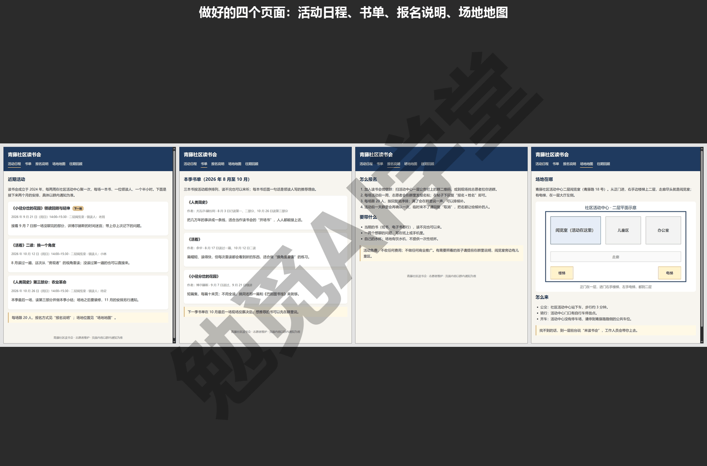

这篇文章的实操内容需要 Claude 的付费订阅（Pro 起），和前面各篇一样；上线那一节要用到《Git、GitHub 与代码审查》里注册并登录过的 GitHub 账号，免费账号够用。

### 16.1 项目定义：四个页面、三条验收标准

**为什么一个读书会需要一个网站。** 一个社区读书会平时靠一个微信群运转。群里最常被问的是三类事：“下一场什么时候、在哪”“这一季读什么书”“怎么报名、能带孩子吗”。志愿者每周都要答一遍，新来的人往上翻几百条消息也翻不到。把这些信息放到一个网址上，群公告只留一句“看网站”，门口再贴一张二维码，问题就少了一大半。这类网站不需要登录、不需要留言、不需要有程序在后面实时算什么，只要把几页信息放上去、手机能看就够了，正好适合交给 Claude Code 做第一个完整项目。

**四个页面。** 这个网站定成四页，每页回答一类问题：

- **活动日程（index.html）**：接下来两个月的三场活动，每场写日期、时间、地点、领读人和一句话介绍；它也是网站的首页，打开网址先看到它。
- **书单（books.html）**：本季的三本书，每本附一句领读人写的推荐理由，读不完也可以来听。
- **报名说明（signup.html）**：怎么进群、怎么在报名帖下回复、每场限多少人、临时来不了怎么办、要带什么。
- **场地地图（venue.html）**：活动中心二层阅览室在哪、楼梯和电梯怎么走，公交、骑行、开车各怎么来。

做好之后四页并排是下面这个样子，每页顶部同一排导航、同一套配色（导航最后一项“往期回顾”是 16.4 第二轮才加的），先有个印象，后面各节一步步做出来：

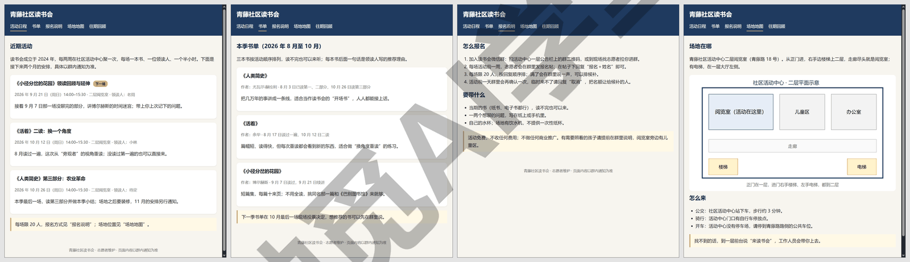

文件名用英文小写是网页文件的惯例：网址里会直接出现文件名，英文名在任何浏览器里都不会出乱码；页面里的文字全部是中文。index.html 这个名字有特殊含义——打开一个网站的网址而不指定文件时，放网站的那台电脑默认给出的就是这一页，所以首页必须叫 index.html。

**静态网站和托管。** 这个网站是一个“静态网站”：全部内容就是几个写好的网页文件（HTML）和一个样式文件（CSS，管颜色、字号和排版），谁打开看到的都一样，背后不需要一个程序实时算东西。静态网站的好处是放到哪里都能用、几乎不花钱、很难被弄坏。把网站文件放到一台一直开着、有网址的电脑上让别人能访问，这件事叫“托管”；本篇用的托管是 GitHub 提供的 GitHub Pages，免费，16.6 里会讲怎么开。这两个词现在不必专门记，看完本篇你就已经用过它们了。

**三条验收标准。** 动手之前先把“做到什么样算完成”写下来，做完就按这三条验收：

- 四个页面都能打开，页面之间能互相跳转，站内的每一个链接点了都有东西，没有指向不存在文件的链接；
- 手机上能看：窄屏幕下内容一列排开、不出现横向滚动条、中文不显示成乱码；
- 有一个别人能打开的公开网址，用这个网址生成的二维码扫出来就是首页。

第三条要等 16.6 上线以后才能验收；前两条从第一版起就要一直成立，所以本篇会让它写一个自检脚本，每改一次都跑一遍，16.3 里会讲这个脚本查什么。

**准备文件夹。** 新建一个空文件夹，比如 D:\Claude练习\读书会网站，本篇所有文件都会落在这里。《桌面应用全导览》讲过，会话选的那个文件夹就是它干活的范围，生成的文件也都放在里面。如果你做过《CLAUDE.md 与规则》9.7 的练习任务二、已经给读书会文件夹生成过一份 CLAUDE.md，可以直接用那个文件夹，下一节把规矩换成本篇这一份就行。

### 16.2 CLAUDE.md 定规矩

**先写规矩再动手。** 《CLAUDE.md 与规则》讲过，CLAUDE.md 是放在项目文件夹根目录的规矩文件，每次开会话它都先读一遍，写一次就一直生效，不用每条指令都重复“用中文”“别删文件”。这个项目的规矩有六条，写的都是它自己看不出来、又会实际影响做法的事（长行按排版折行）：

```markdown
# 青藤社区读书会网站 · 项目规矩

- 纯静态站：只有 HTML、CSS 和 data/ 里的示例数据，不用框架、不引外部脚本、
  不接后台。
- 页面文字全部用简体中文；每页头部都要有 `<meta charset="utf-8">` 和 viewport 标签，
  手机上要能看（窄屏一列排开，不出现横向滚动条）。
- 四个页面固定：index.html（活动日程）、books.html（书单）、signup.html（报名说明）、
  venue.html（场地地图）；加页面要同时改所有页面的导航。
- 改完任何页面都要跑一遍 `python tools/check_site.py`，零错误才能提交。
- 不放任何真实个人信息：联系方式只写“到活动现场找志愿者”或群内说明。
- 回复一律用简体中文；改文件之前先说一句打算改哪里。
```

**第一条：纯静态。** 不用框架、不引外部脚本、不接后台，是为了让这个网站放到任何托管上都能直接打开，也让它不会为了“更酷的效果”给你引进一堆看不懂、维护不了的东西。“框架”指的是那些现成的网页开发工具包，功能强，但零基础的人接手不了；一个四页的信息站用不上。

**第二条：中文与手机。** 页面头部那两行声明是手机能看的前提：`<meta charset="utf-8">` 告诉浏览器用哪种方式读文字，缺了中文可能显示成乱码；viewport 标签告诉手机浏览器按屏幕宽度排版，缺了手机会把页面当成电脑版整个缩小，字小得看不清。这两行它一般会自己写，写进规矩后自检脚本也会查，等于上了两道保险。

**第三条：四个页面固定，加页面要改所有导航。** 每个页面顶部都有一排导航链接，指向另外几页。新增一页时，只在新页面上写导航是不够的，四个老页面的导航也要各加一项，否则新页面只有知道网址的人才进得去。这一条在 16.4 的第二轮改版会用到，16.5 演练的翻车也和它有关。

**第四条：改完必跑自检、零错误才提交。** 自检脚本会在 16.3 里让它一起做出来；规矩先写上，它做计划时就应该把这个脚本列进去，没列的话在计划里补一条。这条规矩把“验证”变成了每次改动的固定动作，不靠你记。

**第五条：不放真实个人信息。** 网站以后是公开的，任何人都能看到；志愿者的手机号、微信号一旦写进页面，就等于贴到了大街上。所以联系方式只写“到活动现场找志愿者”或者“群内说明”。16.6 上线前会再对着这条检查一遍。

**第六条：中文回复，改前先说明。** 《CLAUDE.md 与规则》9.3 那份模板里就有“回复一律用简体中文”；后半句要求它改文件之前先说明打算改哪里，这是给你留一个看的机会——Accept edits（自动接受编辑）模式下它改文件不问你，动手前先说明要改哪里，你至少知道它要动什么。

**怎么把它写进文件夹。** 有两种做法。一种是自己动手：在文件夹里新建一个文本文档，把上面那段粘进去，另存为 CLAUDE.md（保存时编码选 UTF-8，文件名不要带 .txt 后缀），《CLAUDE.md 与规则》9.2 讲过它就放在文件夹根目录。另一种是让它建，顺序是：点 New 新建会话，环境选 Local（本机）；点 Select folder（选择文件夹）选中读书会文件夹，第一次选它会弹一张信任提示 Trust this workspace（信任此工作区），点信任；模型用默认；最后把权限模式切到 Manual（手动）——选完文件夹它多半停在 Auto，要自己切。然后发送：

```text
在这个文件夹里新建一个 CLAUDE.md，内容就用我下面贴的这段，原样写入，不要增减：
（把上面那段规矩粘在这里）
```

Manual 模式下它会先说明打算建什么文件，再弹出一张写文件的卡片，下面是 Deny（拒绝）、Always allow（始终允许）、Allow once（只允许这一次）三个按钮，你点 Allow once 文件才真正写进去。规矩文件是开会话时读入的，所以建好之后新开一个会话，后面的步骤都在新会话里做，它读到的就是这六条。

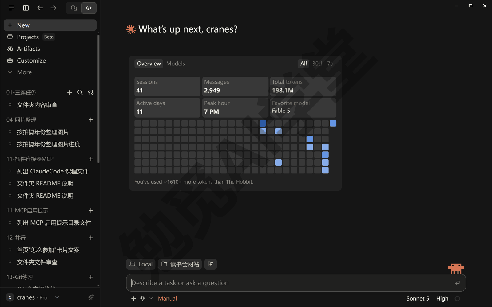

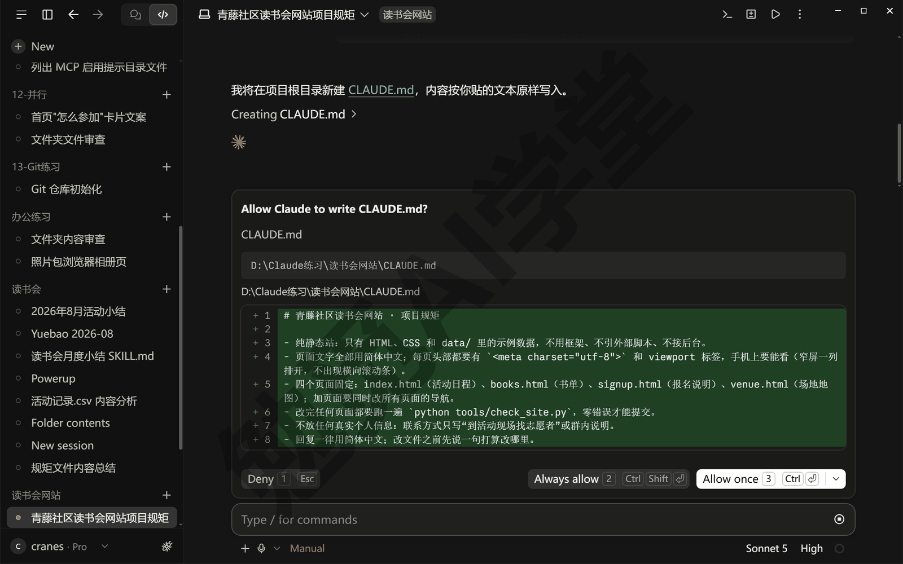

### 16.3 计划模式出方案，批准后做出四页

**为什么这一步用计划模式。** 四页网站牵涉十来个文件。直接说一句“做吧”，它会按自己的理解从头做到尾，等你发现书单页没写推荐理由、地图是随手画的，改起来就是一整轮。《计划模式、差异审阅与回退》讲过：切到 Plan（计划）这一档，它只读不改，先交一份计划，你改到满意再批准，批准后它才动手。项目越大，先看计划省下的返工越多。

**第 1 步：切到 Plan，发需求。** 在新会话里点输入框下方的模式选择器，选 Plan（计划）；也可以按 Ctrl+Shift+M 打开模式菜单，《桌面应用全导览》2.8 的快捷键表里有它。然后把需求整段发出去。需求里把四页各放什么、用哪些内容、要哪两个小工具都写全，长一点没关系，写全了计划才准。需求里提到的 SVG，是一种在网页里用代码画图的写法，画出来的图和页面文字存在同一个文件里，不是单独的图片，以后改颜色它能跟着一起改；你不用会画，说清楚要画什么就行。需求全文如下：

```text
给“青藤社区读书会”做一个四页的静态网站，先出计划，不要动手。
四个页面：
1. index.html 活动日程（首页）：接下来两个月的三场活动，每场写日期、时间、
   地点、领读人和一句介绍。三场是：9 月 21 日 14:00–15:30
   《小径分岔的花园》领读回顾与延伸，领读人老周，报名中；10 月 12 日
   《活着》二读：换一个角度，领读人小林；10 月 26 日《人类简史》第三部分：
   农业革命，领读人待定。地点都是社区活动中心二层阅览室，每场限 20 人。
2. books.html 书单：本季三本书——《人类简史》（尤瓦尔·赫拉利）、《活着》（余华）、
   《小径分岔的花园》（博尔赫斯），每本一句领读人的推荐理由。
3. signup.html 报名说明：扫活动中心一层公告栏的群二维码进群；每场前一周
   志愿者发报名帖，回复“报名＋姓名”；按顺序限 20 人，满了排候补；
   前一天再确认一次，来不了回复“取消”。要带的：当期的书、一两个想聊的问题、
   自己的水杯。活动免费，不做商业推广。
4. venue.html 场地地图：青藤社区活动中心二层阅览室（青藤路 18 号），正门进
   右手楼梯上二层，走廊尽头是阅览室，电梯在一层大厅左侧；用 SVG 画一张
   二层平面示意图（阅览室、儿童区、办公室、走廊、楼梯、电梯），
   再写公交（社区活动中心站下车步行约 3 分钟）、骑行、开车（路侧公共车位）怎么来。
活动数据另存一份 data/events.json，页面里的信息要和它一致；往期三场也存进去
（8 月 3 日《人类简史》到场 12 人、8 月 17 日《活着》15 人、9 月 7 日
《小径分岔的花园》9 人），页面暂时不展示。
另外做两个小工具：tools/check_site.py 检查每个页面有没有 utf-8 编码声明、
viewport 标签和标题，站内链接指向的文件是否都存在，CSS 里有没有超过 480 像素的
固定宽度，有问题逐条列出来；tools/make_qr.py 把网站网址生成一张二维码存到
assets/qr.png，网址先用占位的，上线后再换成真网址。
```

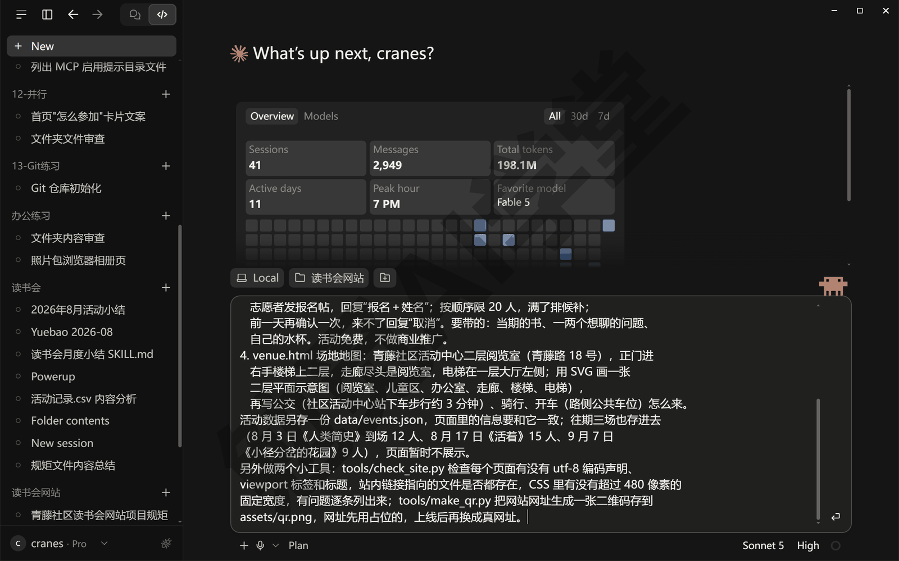

**第 2 步：读计划、改计划。** 发送后它会先读文件夹——现在里面只有 CLAUDE.md——然后可能反问一两个问题，比如生成二维码用哪个 Python 库。电脑上没装的话它会列几个选项让你挑，选它推荐的那个就行（问不问、问什么以实际表现为准）。接着它交计划：对话里只有一行 Proposing plan（正在提出计划），计划全文在右边自动打开的 Plan（计划）面板里；面板关掉了，点底部批准卡（下一步会讲它）右上角的 Open plan（打开计划），或者从会话右上角工具栏的 ⋮ 菜单里重新打开（《计划模式、差异审阅与回退》6.2 讲过这一步）。

计划一般会列出要新建的文件、每页的结构、两个脚本各查什么、做完怎么验收。读计划时对着 16.1 的三条验收标准和 CLAUDE.md 的六条规矩逐条核对：自检脚本有没有列进去、有没有写“每页都要有 viewport 标签”、二维码有没有写“上线后重跑”。少了哪条，直接在对话里说“计划里补上 X”，它会改完再给你一版。

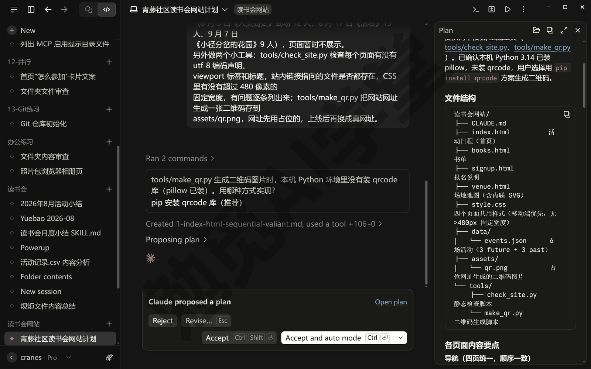

**第 3 步：批准，切到 Accept edits。** 计划改到满意后，要点击的是底部那张批准卡上主按钮右边的 ▾，选里面的 Accept and allow edits（批准并切到 Accept edits）——这个项目的文件都是新建的、不怕改坏，所以选这一项。卡上的几个按钮分别是：Reject（拒绝）、Revise（修改计划）、Accept（批准，之后每处改动它仍逐条问你）、Accept and auto mode（批准并切到 Auto，默认的主按钮），别直接按主按钮，那会切到 Auto。选完它随即退出计划模式开始动手，模式选择器会变成 Accept edits，看一眼确认。

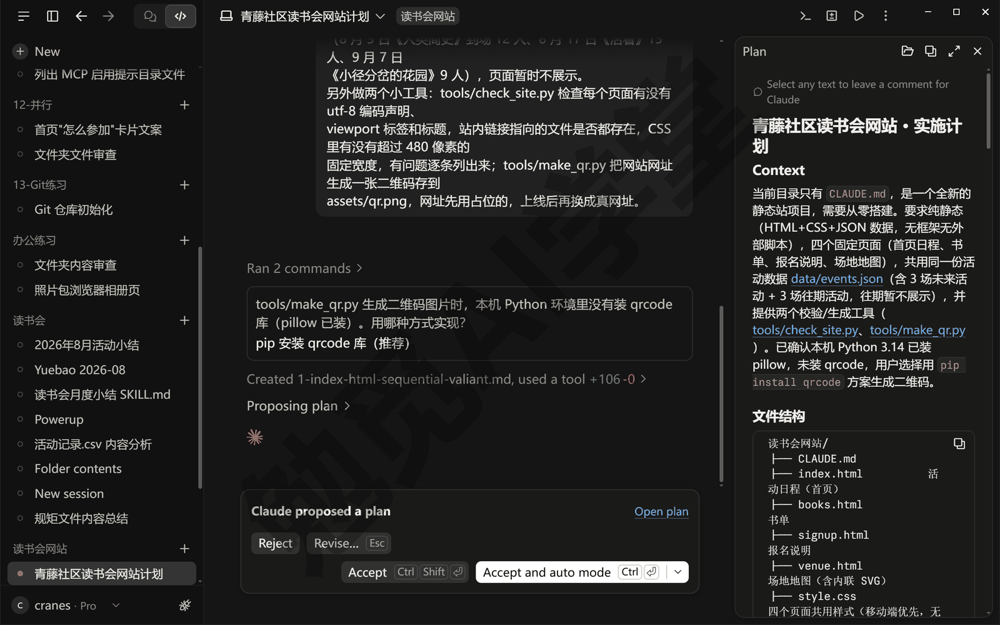

**第 4 步：看它写文件。** 对话里会连着出现一串写文件的卡片：CLAUDE.md 旁边多出 index.html、books.html、signup.html、venue.html 四个页面，一个 style.css 样式文件，data 文件夹里的 events.json，tools 文件夹里的两个脚本，assets 文件夹里的二维码图。生成二维码要用一个 Python 库（这次它选的是 qrcode，用哪个它会先查电脑上装了什么），没装的话它会先运行安装命令——《文件与办公能力一篇讲全》5.5 讲过它自己安装工具的做法：它装、它验证，你只点同意。Accept edits 模式下改文件不问、跑命令仍然问，所以安装这一步会有一张审批卡片。全部写完后，界面上的差异计数是几百行新增，点开差异视图能看到十来个文件，它写的那份计划文件也算在里面（准确数字以你这次生成的为准）。

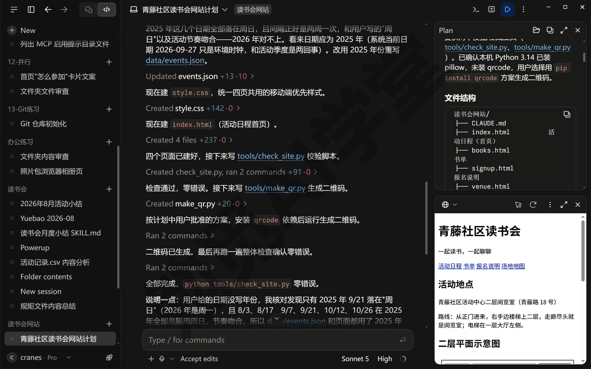

**第一版是什么样子。** 首页顶部是读书会名字和一排四项导航，下面三张活动卡片，最近的一场带一个小标签（比如“下一场”或“报名中”），每张卡片写日期、时间、地点、领读人和一句介绍，底部一条提示“每场限 20 人，报名方式见‘报名说明’；场地位置见‘场地地图’”。书单页三张卡片，每本书一句推荐理由。报名说明页分“怎么报名”“要带什么”两块，一块是四步，一块是三件东西。场地页是一张二层平面示意图——阅览室、儿童区、办公室、走廊、楼梯、电梯各占一块——加“怎么来”三条。四页共用同一个 style.css，所以字体、卡片、颜色完全一致。页脚都写着“志愿者维护 · 页面内容以群内通知为准”。

**第 5 步：让它在浏览器面板里自己验证。** 写完它一般会自己开一个本地预览服务、在浏览器面板里打开首页、截图检查，《内置浏览器、应用预览与电脑操控》7.1 讲过这套自动验证：它每改一次文件，都自己看一遍再向你汇报。如果它没有主动这么做，或者你想让它按验收标准再过一遍，发送：

```text
在浏览器面板里打开首页，把导航上的四个页面逐个点开看一遍，确认每页都能打开、
文字没有乱码；再把面板缩窄到手机宽度，确认每页内容一列排开、没有横向滚动条。
有问题直接改，改完再看一遍。
```

面板里会依次出现四个页面，对话里跟着出现一行行 Used Claude Preview（用了预览工具）的记录，点开写着 preview screenshot 的那一行就是它截的图，最后是它的检查结论；手机宽度那一张最要紧——它会自己把预览的视口设成 375 像素宽去看，第二条验收标准就是在这里验的。你自己也可以在面板里点一点：点导航切页、拖窄面板看排版，面板的用法《内置浏览器、应用预览与电脑操控》7.2 讲过。

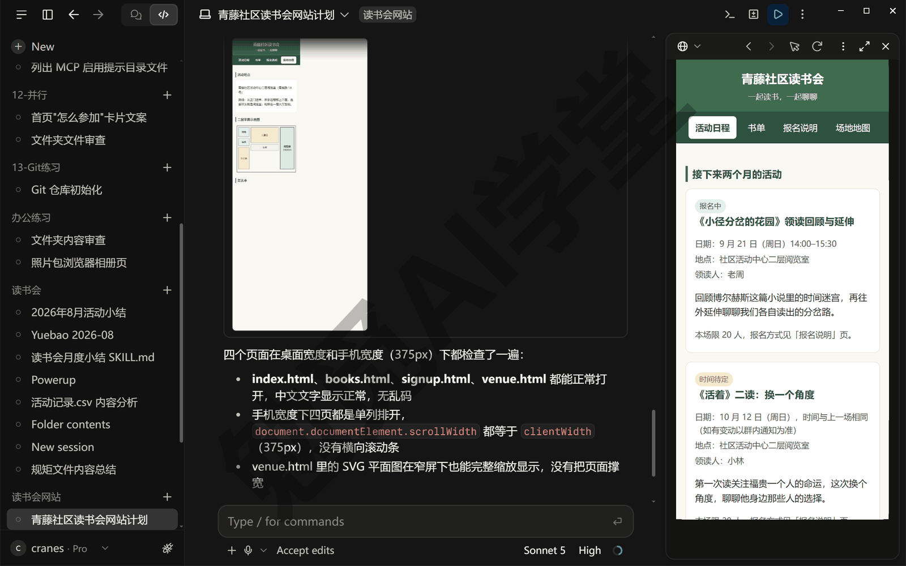

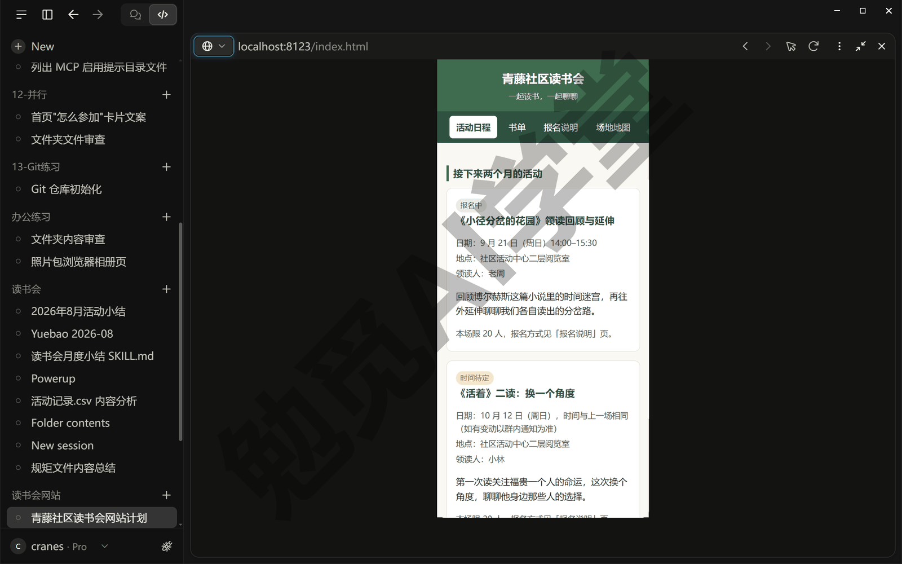

**第 6 步：跑自检脚本。** 面板验的是“看起来对不对”，自检脚本验的是“文件里有没有埋着问题”。在对话里说“运行 tools/check_site.py”，这条命令需要审批，卡片标题是它起的一句中文短名，要运行的命令在下面的灰框里，看清了点 Allow once（只允许这一次）。这次的输出（脚本是它现写的，措辞以你这次生成的为准）：

```text
> python tools/check_site.py
检查了 4 个页面：books.html, index.html, signup.html, venue.html
零问题：编码、视口、站内链接、固定宽度都正常
```

脚本查的四样东西各对应一种常见的翻车：没有 utf-8 编码声明，中文在别人的浏览器里可能显示成乱码；没有 viewport 标签（输出里叫“视口”），手机会把页面当电脑版缩小显示；站内链接指向不存在的文件，点了就是一页“找不到”；CSS 里写了超过 480 像素的固定宽度，窄屏就会出横向滚动条。脚本一次把四样都查一遍，几秒钟出结果，比人眼一页页点快得多——16.5 演练的翻车就靠它抓出来。

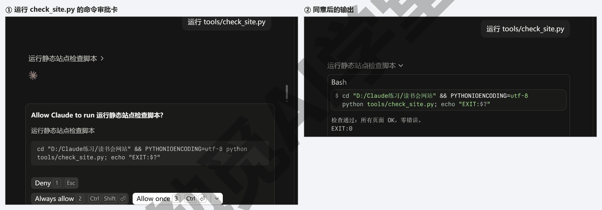

**第 7 步：第一次提交。** 到这里第一版完成。按《Git、GitHub 与代码审查》13.2 讲过的习惯，每做完一件能说清楚的事就让它提交一次：

```text
把这个文件夹初始化成 Git 仓库，把现在的全部文件做第一次提交，提交说明写
“读书会四页站 v1：活动日程、书单、报名说明、场地地图，配站内自检脚本与
门口二维码（占位网址）”。
```

它会先看一眼这是不是已经是仓库（只读的命令不弹卡），再跑初始化、加入文件、提交这几条命令（这次是四条，多出的一条是查看待提交的文件列表），每条命令前弹一次审批。提交完让它列一下历史，或者自己按 Ctrl+`（反引号）打开终端面板输入 git log --oneline，会看到类似下面这样的一行（七位编号以你自己的为准，长行按排版折行）：

```text
> git log --oneline
b2377a9 读书会四页站 v1：活动日程、书单、报名说明、场地地图，
        配站内自检脚本与门口二维码（占位网址）
```

这一行是你的第一颗“后悔药”：从现在起无论后面改成什么样，都能回到这一版。

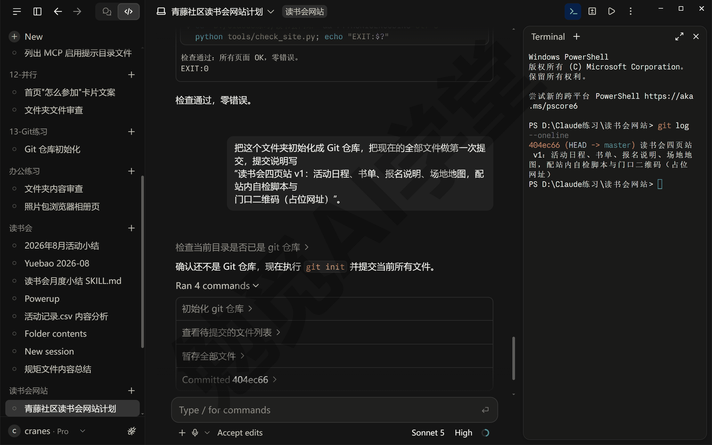

### 16.4 两轮改版：换配色、加一页

**网站做出来只是开始。** 真实的读书会网站不会一次定稿：志愿者看了说颜色太素，下一季要加往期回顾，这类改动会一直有。改版也正好检验前面那套做法：规矩文件、自检脚本、提交历史都在，改动才有把握。

**第一轮改版：换配色。** 第一版是茶绿色做主色。假设志愿者们商量后想换成更沉稳的藏青色，点缀用暖黄。发送：

```text
把整站配色从现在的茶绿换成藏青色做主色、暖黄色做点缀，只改颜色，不动布局和文字；
场地示意图和门口二维码里用到的颜色也一起换成新配色。改完跑一遍 tools/check_site.py。
```

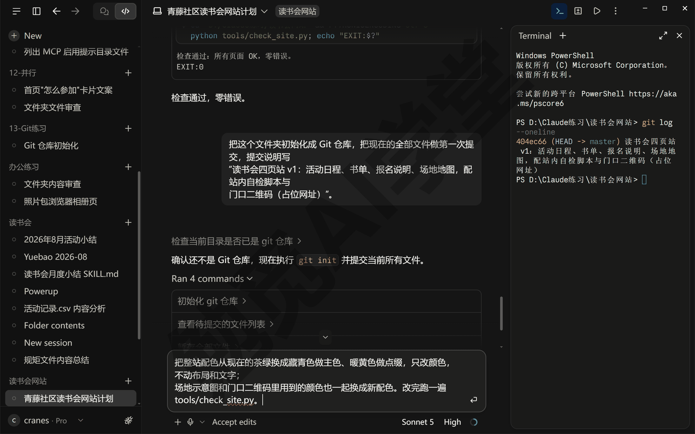

Accept edits 模式下它直接改，改完看差异计数：这次是 +30 -23，改动落在四个文件上。点开差异视图逐个文件看——《计划模式、差异审阅与回退》6.3 讲过：左边是文件列表，右边是每个文件改了哪几行，删掉的和新增的用不同颜色标出。这四个文件分别是：

- **style.css**：十来行——页头、导航、高亮、按钮的颜色值都写在这一个文件里，它逐处换成新配色；你的项目里，它当初写样式时要是把颜色集中成了开头的几个变量（程序里给一组值起的名字），差异就只在开头那几行，行数会比十来行少。
- **venue.html**：十来行——示意图是用 SVG 直接画在页面里的，房间、楼梯和电梯的填充色写在图里，它逐个换成了新配色。
- **tools/make_qr.py**：几行——二维码的深色换成藏青、底色换成暖黄，海报和网站配色一致。
- **assets/qr.png**：二维码图用新颜色重新生成了一张。

看差异时核对两件事：该改的文件有没有漏（示意图和二维码都在，没漏）；没让改的地方有没有被动（只有颜色值那几行变了，文字与布局的行没动）。这就是差异审阅在改版里的用法：不用读懂 CSS，只看动了哪几个文件、每个文件动了几行、动的是不是颜色值。

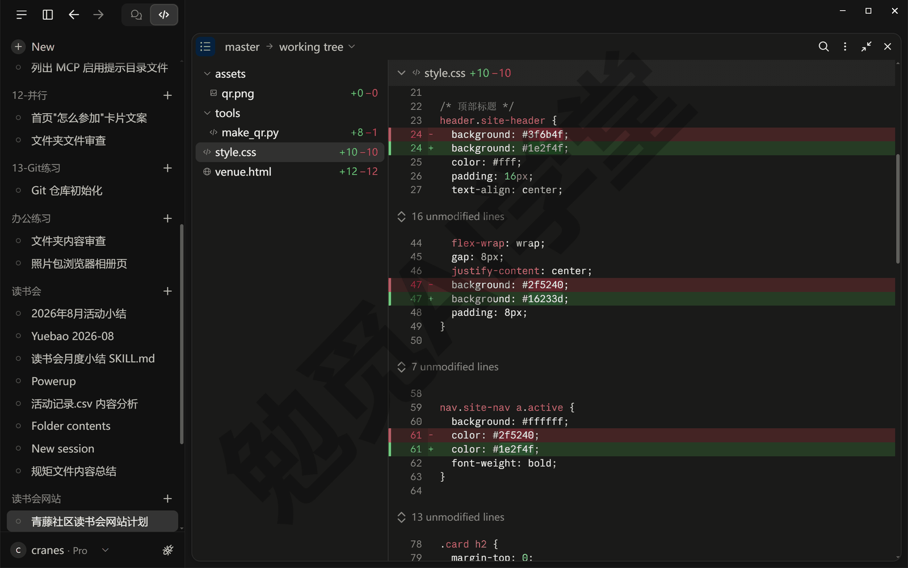

它按指令跑了自检，输出和第一版一样是四个页面零问题；浏览器面板里的首页也换成了藏青加暖黄。看过没问题就提交：

```text
把这次改动提交，说明写“迭代一：配色从茶绿改为藏青加暖黄点缀，示意图与二维码同步换色”。
```

“迭代”是软件行业对“一轮改动”的叫法，这里只在提交说明里用它当轮次编号，方便以后按轮查历史；正文里叫它第一轮、第二轮改版。

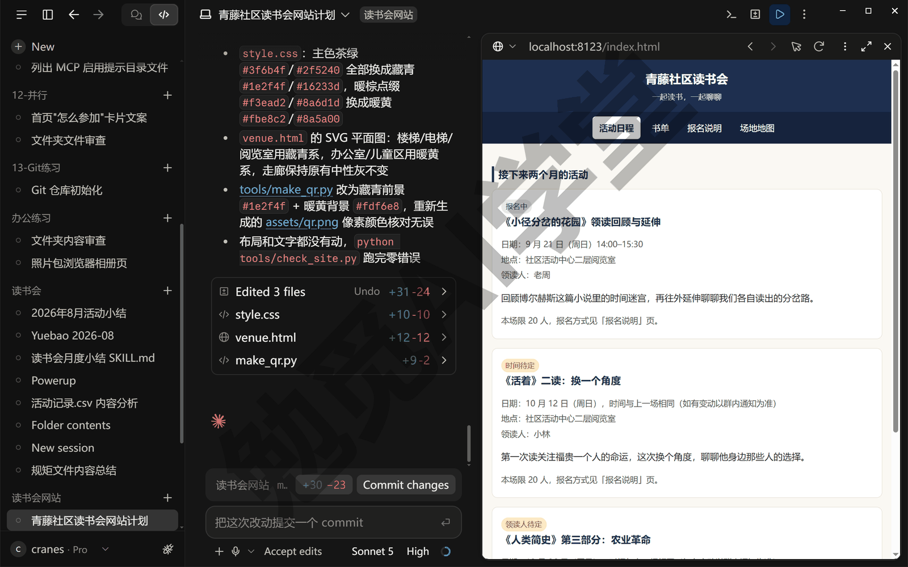

**第二轮改版：加一页“往期回顾”。** 读书会开了三场，志愿者想把每场来了多少人、聊了什么记下来给新人看。这一轮动的是结构：新增一个页面，四个已有页面的导航都要多一项——CLAUDE.md 第三条规矩“加页面要同时改所有页面的导航”管的就是这件事。发送：

```text
加一页 recap.html“往期回顾”：用 data/events.json 里的往期三场，每场一张卡片，
写日期、书名、到场人数、领读人，再加一两句当天聊了什么；样式和现有页面一致。
按 CLAUDE.md 的规矩把它接进每个页面的导航，改完跑自检。
```

改完差异计数是 +68 -4，差异视图里七个文件：recap.html 是一个五十来行的新文件，四个老页面各多了一行导航，data/events.json 补上了往期三场的领读人和当天聊了什么，tools/check_site.py 的页面清单也加进了新页面。这一次重点看那四个老页面各加的一行——链接名和新文件名对不对得上，16.5 演练的翻车就出在这一行。

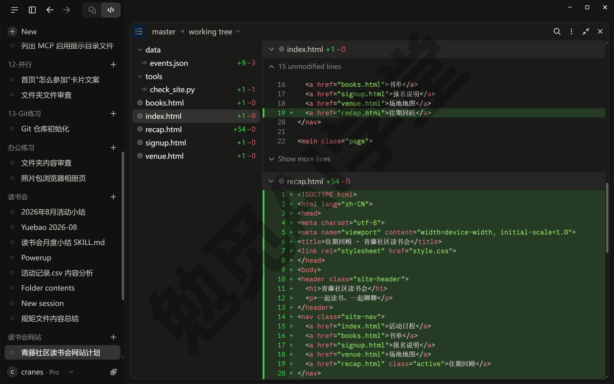

### 16.5 翻车实录：导航指向了一个不存在的文件

**跟着演练一次翻车。** 第二轮改版这一遍它把链接写对了：四个老页面导航里的“往期回顾”都指向 recap.html，自检零问题。但这一步最容易出的错就是链接名和文件名没对上，所以这里故意把它做错一次，你也跟着做。发送：

```text
把四个老页面导航里“往期回顾”的链接都改成 huigu.html（文件名不动，仍是 recap.html），
然后跑一遍 tools/check_site.py，把结果贴给我。
```

Accept edits 模式下它直接改，跑完自检报出来是这样：

```text
> python tools/check_site.py
检查了 5 个页面：books.html, index.html, recap.html, signup.html, venue.html
发现 4 个问题：
  - books.html: 链接指向的文件不存在 -> huigu.html
  - index.html: 链接指向的文件不存在 -> huigu.html
  - signup.html: 链接指向的文件不存在 -> huigu.html
  - venue.html: 链接指向的文件不存在 -> huigu.html
```

文件名和链接是两处、各写了一个名字，没对上，自检把四个页面上的那一处都点了出来。这种错在预览里很难一眼看出来：首页打开是好的，五个导航项也都在，只有点“往期回顾”时才会跳到一页“找不到文件”；要是没有自检脚本，很可能等网站上线、有人扫码点进去才发现。

**怎么救。** 真遇到这种报错，不用自己去改文件，把自检输出原样发回去，让它顺着报错改。《文件与办公能力一篇讲全》5.7 讲过“把报错原样发回去”这个习惯，报错里有文件名和出错的链接，比你转述一句“往期回顾点不开”准得多。发送：

```text
自检报了 4 个问题，都是导航里的“往期回顾”链接写成了 huigu.html，
而新页面的文件名是 recap.html。把四个页面导航里的链接改成 recap.html，
改完重跑自检，零问题再提交，提交说明里把这次的错也写上。
```

它把四处链接改成 recap.html，重跑自检：

```text
> python tools/check_site.py
检查了 5 个页面：books.html, index.html, recap.html, signup.html, venue.html
零问题：编码、视口、站内链接、固定宽度都正常
```

然后提交。提交说明把这次的错也记进去，以后翻历史能看到这一轮发生过什么（长行按排版折行；编号以你自己的为准）：

```text
> git log --oneline
1bfc48a 迭代二：新增“往期回顾”页并接进导航（首版导航把文件名写成 huigu.html，
        自检报 4 处断链后改回 recap.html）
c183d14 迭代一：配色从茶绿改为藏青加暖黄点缀，示意图与二维码同步换色
b2377a9 读书会四页站 v1：活动日程、书单、报名说明、场地地图，
        配站内自检脚本与门口二维码（占位网址）
```

**这次演练说明什么。** 有三件事：

- 名字要一致的地方最容易出错。链接名和文件名是两处，写的时候各写一遍，改一处漏一处。以后加页面，先让它说一句“新文件叫什么名字”，再让它改导航，两边就对得上。
- 自检脚本抓的是人眼容易漏的问题。预览时你多半只看首页和新页面，不会把五个页面上的每个导航项都点一遍；脚本几秒钟就把五个页面上的全部链接查了一遍。
- 规矩里那条“改完必跑自检、零错误才提交”不是多余的手续。按规矩跑了自检，问题才不会进入提交、更不会上线。要是它哪次改完没跑，你可以直接要求“先跑自检再提交”。

### 16.6 上线：GitHub Pages 与门口二维码

**为什么用 GitHub Pages。** 静态网站放哪都行，本篇用 GitHub Pages，原因有两个：一是免费，公开仓库开一个开关就有一个网址；二是你在《Git、GitHub 与代码审查》13.3 已经装好并登录了 gh——GitHub 官方的命令行小工具，它靠这个工具在你电脑上和 GitHub 打交道——所以建仓库、推送、开网页都可以让它替你做。GitHub Pages 本身是 GitHub 给每个仓库附带的静态网站托管：把开关打开、指定用哪条分支的文件发布，仓库里的网页文件就能通过“https://你的用户名.github.io/仓库名/”这样的网址访问。

**上线前先想清楚一件事：仓库要公开。** 免费的 GitHub 账号只有公开仓库能用 Pages（付费套餐的私有仓库也能，以 GitHub 当前的规则为准）。公开的意思是任何人都能看到仓库里的全部文件和全部提交历史，不只是网页。所以上线前对着 CLAUDE.md 第五条检查一遍：页面里没有真实的电话、住址、人名，数据文件里也没有；以后往这个仓库里放东西也一样。本篇的内容全是虚构的，可以放心公开。13.3 建的那个练习仓库是私有的，本篇不用它，新建一个公开的。

**第 1 步：建公开仓库并推送。** 在读书会文件夹的会话里发送：

```text
在我的 GitHub 账号下新建一个公开仓库，名字叫 qingteng-reading-club，
描述写“青藤社区读书会四页站（课程演示，虚构内容）”，把这个项目连历史一起推上去，
然后把仓库网址给我。
```

它会跑两条命令、各弹一次审批：先一条查仓库状态和 gh 的登录，再一条 gh 命令把建仓库、连远程、推送一次做完（具体命令以它列出的为准）。演示电脑上第一次提交时主线叫 master（16.3 末尾那张首次提交的图里，git log 括号里写的就是它），推送前它把主线改名成了 main，所以下面输出里是 main；你的主线要是还叫 master（13.1 讲过，这台电脑上 Git 默认就是它），输出里就是 master，后面说 main 的地方都换成 master，或者推之前让它“把主线改名叫 main”。这次的输出：

```text
https://github.com/Cranes249i/qingteng-reading-club
To https://github.com/Cranes249i/qingteng-reading-club.git
 * [new branch]      HEAD -> main
branch 'main' set up to track 'origin/main'.
```

第一行就是仓库网址，打开能看到你的全部文件和三次提交。演示账号叫 Cranes249i，你的网址里会是你自己的用户名；推完以后，应用顶栏的文件夹标签和侧栏分组也会从文件夹名变成仓库名。

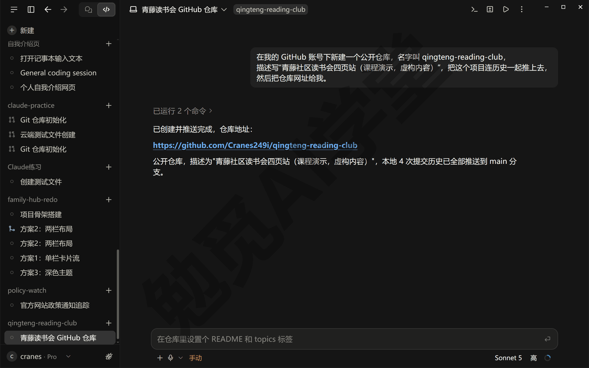

**第 2 步：打开 Pages。** 有两种做法，选一种就行。

第一种是自己在网页上点。打开仓库网址，点仓库名下方的 Settings（设置）；左侧栏“Code, planning, and automation”一组里点 Pages；在“Build and deployment”下的 Source（来源）里选 Deploy from a branch（从分支发布）；下面的分支下拉菜单选 main，文件夹选“/ (root)”，点 Save（保存）。第一次发布要等一两分钟，之后页面顶部会出现“Your site is live at …”一行和网址（各项文案与位置以 GitHub 实际页面为准）。

第二种是让它开。发送：

```text
把这个仓库的 GitHub Pages 打开，用 main 分支的根目录发布；
开好后过一会查一次状态，等状态变成 built 就把网站网址给我。
```

它会用 gh 直接向 GitHub 发请求打开 Pages，然后开一个后台任务每隔几秒查一次状态（会话里会显示有一个正在运行的任务），大约一分钟后状态变成 built，它自动接着把网站网址告诉你（做法与命令以它列出的为准）。它查到的状态里最要紧的两行是：

```text
"status": "built"
"html_url": "https://cranes249i.github.io/qingteng-reading-club/"
```

status 是 built 表示已经发布好；html_url 就是网站网址。

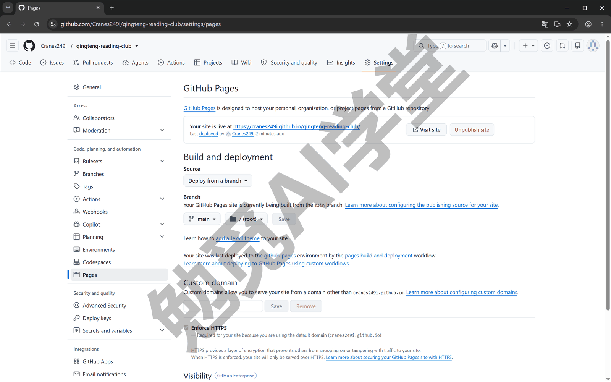

**第 3 步：在电脑和手机上各打开一次。** 在电脑浏览器里打开网站网址，看到“青藤社区读书会”首页、五个导航都能点，就是发布成功了。再用手机浏览器打开同一个网址：内容一列排开、不用左右滑——第二条验收标准在真机上再验一遍，第三条“别人能打开”也成立了。

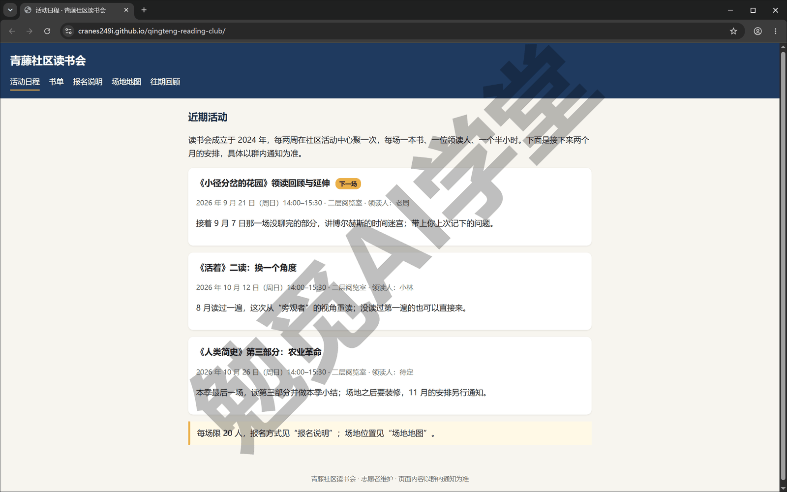

**第 4 步：把二维码换成真网址。** 16.3 生成的二维码指向的是占位网址，现在有了真网址，让它重跑一次：

```text
网站网址是 https://cranes249i.github.io/qingteng-reading-club/ ，
用它重跑 tools/make_qr.py 换掉门口二维码，网址也记进 data/events.json；
跑自检，然后提交并推送，说明写“上线：门口二维码换成真实网址，
data/events.json 记下站点网址”。
```

它跑脚本、自检、提交、推送，脚本的输出（路径是演示项目的，你的会是你自己的文件夹）：

```text
> python tools/make_qr.py "https://cranes249i.github.io/qingteng-reading-club/"
二维码已生成：D:\教程演示\ClaudeCode课\16-读书会网站\assets\qr.png
指向：https://cranes249i.github.io/qingteng-reading-club/
```

用手机扫一下 assets/qr.png，打开的就是网站首页。把这张图放进门口海报里打印出来就行；以后网址变了（比如改了仓库名），再重跑一次脚本。

**以后每次改动怎么上线。** 流程固定成四步：让它改、跑自检、提交、推送。推送之后 GitHub Pages 会自动重新发布，一两分钟后刷新网页就能看到。改完本地是新的、网站上还是旧的，先按这四步查是哪一步没做，16.99 的 Q2 有排查顺序。

### 16.7 回顾与用量记账

**整条线回头看一遍。** 这个项目从头到尾走了六步：先写 CLAUDE.md 定下六条规矩；切到 Plan 让它出计划，你对着验收标准改计划、批准；它做出四页，在浏览器面板里自己验证，再跑自检脚本，提交第一版；换配色，在差异视图里核对动了哪几个文件；加一页，演练一次导航写错文件名，看自检怎么抓出来、发回去怎么改好；建公开仓库、开 GitHub Pages、手机上打开、二维码换成真网址。每一步的入口都是前面十五篇里学过的，这一篇只是第一次把它们按顺序连起来用。

**它说“做好了”不算，证据才算。** 这条线里有两处是专门用来核对它的：浏览器面板里它自己截的图，和自检脚本的输出。前一个看“看起来对不对”，后一个查“文件里有没有埋着问题”，两个都独立于它“做”的那一步。以后无论让它做什么，都给自己留一个这样的核对办法；下一篇《实战二：网店订单月报流水线》做数据类任务，那里的核对办法叫“独立复算”。

**用量花在哪。** 本课的用量记账只讲机制，不写数值。这个项目里用量花得最多的是三处：计划模式那一步（它要读文件夹、写一份长计划）、第一版四页（一次写出三百多行）、每一轮自动验证（截图、读页面、再截图，每改一次都来一遍）。几乎不花用量的是跑自检、提交、推送这类命令——命令本身不算用量，它读输出才算一点。想看这个会话花了多少，看输入框旁的用量环，它有两层含义：这个会话的上下文用了多少、这一期套餐用了多少，《权限、沙盒与模型》3.7 讲过怎么读。一个项目做到上线，上下文多半会满一次，满了用 `/compact` 压缩（《对话与上下文管理》4.5 讲过），或者按阶段分会话——做、改版、上线各开一个，新会话靠 CLAUDE.md 和 Git 历史接上前面的事。

**这个项目最后交出的东西。** 一个网站网址、一个仓库网址、一张二维码图（assets/qr.png）、一份 CLAUDE.md、一个自检脚本，以及四次提交的历史。网站网址和二维码图给读书会的人，仓库网址、CLAUDE.md、自检脚本和提交历史留给下一次改版的你。四次提交就是这个项目的账本，让它列出来，或者在终端面板里输入 git log --oneline（长行按排版折行；编号以你自己的为准）：

```text
> git log --oneline
b76121f 上线：门口二维码换成真实网址，data/events.json 记下站点网址
1bfc48a 迭代二：新增“往期回顾”页并接进导航（首版导航把文件名写成 huigu.html，
        自检报 4 处断链后改回 recap.html）
c183d14 迭代一：配色从茶绿改为藏青加暖黄点缀，示意图与二维码同步换色
b2377a9 读书会四页站 v1：活动日程、书单、报名说明、场地地图，
        配站内自检脚本与门口二维码（占位网址）
```

从下往上读就是这一篇的顺序：第一版、换配色、加一页、上线。以后想知道哪一版改了什么、想退回哪一版，都从这里查；下一季再改版，新的提交接着往上记。

### 16.8 三个练习任务

下面提示词里方括号的内容，换成你自己的。

**任务一：换成你自己的兴趣小组再做一版**

```text
给 [你的小组名，比如“周末徒步队”] 做一个四页的静态网站，先出计划，不要动手：
[第一页放什么]、[第二页放什么]、[第三页放什么]、[第四页放什么]；
内容用我下面给的：[把活动、成员分工、规则等信息写在这里，全部用虚构或已公开的信息]。
另外做一个 tools/check_site.py 自检脚本，查编码声明、viewport 标签、站内链接和固定宽度。
```

完成标准：先在 Plan 模式下改过至少一处计划再批准；四页在浏览器面板里都打开过，缩窄到手机宽度看过一遍；自检零问题；做了第一次提交。

**任务二：再加一页“常见问题”**

```text
加一页 faq.html“常见问题”，写 [五个新人最常问的问题] 和回答；
样式和现有页面一致，按 CLAUDE.md 的规矩把它接进每个页面的导航。
改完先跑自检，把自检输出发给我，零问题再提交，说明写“加常见问题页”。
```

完成标准：差异视图里能看到新文件和每个老页面各加的一行导航；自检输出你看过，零问题；提交历史里多了一条。

**任务三：把配色换成深色**

```text
把整站换成深色配色：深灰底、浅色文字、点缀色自己选一个和现有配色协调的；
只改颜色不动布局，示意图和二维码的颜色也一起换。
改完在浏览器面板里把每页看一遍，再缩窄到手机宽度看一遍，跑自检，然后提交。
```

完成标准：差异计数里只有颜色相关的文件在变；面板里每页都看过、手机宽度下正常；自检零问题；如果不喜欢，用《计划模式、差异审阅与回退》讲的改动汇总卡 Undo（撤销）撤回，或让它恢复到上一次提交退回去（`/rewind` 只退对话，不退文件）。

### 16.98 本篇小结与自检

这一篇从零做完了一个能扫码打开的网站：先写 CLAUDE.md 定六条规矩；用计划模式出方案、改方案、批准，做出活动日程、书单、报名说明、场地地图四页，让它在浏览器面板里自己验证、再跑自检脚本，提交第一版；换配色时在差异视图里核对只有颜色行在动；加“往期回顾”页时演练了一次翻车：把导航链接写成不存在的文件名，自检脚本抓出四处指向不存在文件的链接，把输出原样发回去改好；最后建公开仓库、开 GitHub Pages、手机上打开、把门口二维码换成真网址。

可以对照下面的清单检查学习结果：

- [ ] 能说出四个页面各回答哪类问题，以及三条验收标准
- [ ] 给项目写过 CLAUDE.md，六条规矩每条能说出为什么要写
- [ ] 用计划模式走完过“发需求、读计划、改计划、批准”并做出第一版
- [ ] 看过它在浏览器面板里自己验证，包括缩窄到手机宽度那一张
- [ ] 跑过 tools/check_site.py，知道它查的四样东西各防什么错
- [ ] 做过两轮改版，在差异视图里核对过动了哪几个文件、每个文件动了几行
- [ ] 见过自检抓出链接指向不存在文件的问题，知道把自检输出原样发回去
- [ ] 建过公开仓库、开过 GitHub Pages，网站在手机上打开过，二维码换成了真网址
- [ ] 知道以后每次改动上线的四步：改、自检、提交、推送

完成这些内容后，你手里有了一个别人扫码就能打开的网站，也第一次把“规矩、计划、验证、历史、上线”这条线走完了。下一篇《实战二：网店订单月报流水线》做数据类任务：三个平台的订单表进，带图表的 Excel 和一页 PPT 出，第一要求是数字要对，那一篇用“独立复算”当验收。

### 16.99 新手常见问题

**Q1：没有域名，怎么让别人看？**

不需要域名。GitHub Pages 给的“你的用户名.github.io/仓库名/”本身就是一个能给别人的网址，把它做成二维码贴出去就行。想用自己的域名（比如 qingteng.example），GitHub Pages 也支持绑定，要先买域名、再改域名的解析记录，本课不展开。

**Q2：本地改好了，网站上为什么还是旧的？**

按 16.6 末尾那四步的顺序查：

- 改动有没有提交：让它“列出提交历史”，看最新一条是不是这次的改动；没有就让它提交。
- 有没有推送：打开仓库网址，看 GitHub 上最新的提交是不是同一条；不是就让它“推送”。
- 推送后 GitHub Pages 要一两分钟重新发布，等一会再刷新网页。
- 浏览器可能还显示着缓存的旧页面，按 Ctrl+F5 强制刷新，或者换手机打开看。

四步都对还不变，仓库页 Settings → Pages 里会显示最近一次发布的状态，有错会写在那里。

**Q3：能不能用别的托管？**

能。静态网站放到任何静态托管上都一样能用：Cloudflare Pages、Netlify、Vercel 这类都是把 GitHub 仓库连上去、推送后自动发布，国内的云服务商也有静态网站托管；做法大同小异，网站文件一个字不用改。本课选 GitHub Pages，只是因为仓库已经在 GitHub 上。github.io 的网址在个别网络环境下可能打开慢，以你的实际网络为准；确实不方便就换一家托管，把同一个仓库连过去。

**Q4：仓库公开了，别人能改我的网站吗？**

能看，不能改。公开仓库里的文件和历史任何人都能看、能复制一份走，但只有你（和你邀请的人）能往里推送，网站也只按你的仓库发布；别人复制走的那一份改了，是他自己的仓库和网址，和你的无关。所以公开仓库的规矩只有两条：不放个人信息，不放任何密码和密钥。

**Q5：我一点代码都不懂，网站以后出问题怎么办？**

不需要懂代码，需要的是三个习惯。出了问题先跑自检，把输出原样发给它；页面显示不对就在浏览器面板里让它自己看，把你看到的现象说给它。改坏了用“后悔药”：还在同一个会话里就点那一轮改动汇总卡上的 Undo，跨会话就让它“恢复到上一次提交”，《Git、GitHub 与代码审查》13.2 讲过怎么说。每次改动前先提交一次，坏了就有地方退。
