## 实战二：网店订单月报流水线

这一篇做全课的第二个实战项目：把一家小网店在淘宝、拼多多、抖音小店三个平台导出的订单表交给 Claude Code，让它清洗（把三份写法各异的表整理成一张能直接算的干净表）、合并、算账，做出一份带图表的 Excel 月报、一页汇报 PPT 和一份摘要；再把这套做法写成技能，最后设置成每月自动运行。《实战一：社区读书会网站》做的是看得见的网页，这一篇做数据类任务，第一要求是数字要对，本篇一半的篇幅都在讲“怎么保证数字对”。

你可以把流水线理解成一条固定的加工线：订单表从一头进，月报从另一头出，中间每一步都固定下来、可以反复运行。本篇的数字、脚本与运行结果，来自演示项目 D:\教程演示\ClaudeCode课\17-订单月报 的完整运行（2026 年 9 月，Windows 电脑上）；演示订单由脚本生成，换成你自己导出的真实订单表、或者让它生成一批虚构订单同样能跑（素材怎么来，17.1 会说）。对话过程中的界面画面以你看到的为准；同一件事做两遍，它写出的脚本、输出的格式和措辞都会不一样，图里的输出和正文贴的不一定一字一样，数字是一样的，以你自己跑出来的为准。

先看做出来的样子（动图）：把三个平台的订单表放进去，一条命令跑完清洗、合并、算账，得到一份带饼图的 Excel 月报和一页 PPT；另写一个脚本独立复算，三项结果全对，最后设成每月自动跑。

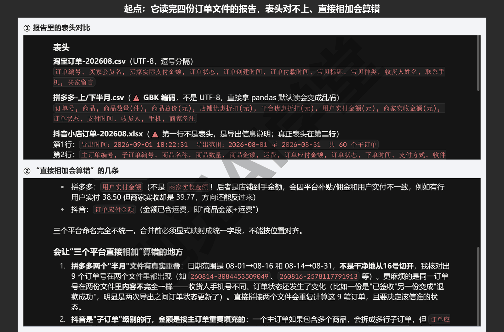

这篇文章的实操内容需要 Claude 的付费订阅（Pro 起），和前面各篇一样；本篇不新增付费功能。

### 17.1 三份订单表是什么样子

**为什么月底算不清账。** 如果你开着一家小网店，货多半同时挂在两三个平台上：淘宝一个店、拼多多一个店，再开一个抖音小店。每个平台的后台都能看自己的销量，但没有一个地方能回答“这个月三家一共卖了多少、哪个品类卖得最好、退了多少”。三个后台都支持把订单导出成表格文件，把三份文件合起来算总账，听起来是一道加法题。

真动手就会发现，这道加法题不能直接做。三份文件的表头不一样、订单号和日期的写法不一样、连“顾客付了多少钱”都不止一列，更麻烦的是藏着几处会让结果直接算错的地方。这一节先把三种表摊开看清楚。

**演示数据从哪来。** 为了避免拿真实顾客信息演示，本篇的四份订单表（2026 年 8 月，淘宝一份、拼多多两份、抖音一份）由项目里的 tools/make_orders.py 生成，店名“小鹿文具”、顾客名和商品都是虚构的。三份表的字段名参考了常见导出文件的样子，不是任何平台的原版格式，你自己的导出文件列名多半有出入，17.6 的翻车实录会讲列名对不上时怎么办。演示的四份表和 make_orders.py 不随课程发放，你练习时的素材有两种来源：有自己店铺的，把导出的文件放进 data/raw/ 文件夹，文件名保留“淘宝订单”“拼多多订单”“抖音小店订单”开头即可，后面的流水线按文件名开头识别平台；没有的，开会话后先发下面这段，让它造一批毛病相近的数据：

```text
在 data/raw/ 下生成四份 2026 年 8 月的虚构订单表，
文件名以“淘宝订单”“拼多多订单”“抖音小店订单”开头：
淘宝一份 csv，订单号用 ="…" 包着，订单状态里混几单“交易关闭”；
拼多多两份 csv，按 GBK 编码保存，分上半月、下半月，日期范围重叠三天，
重叠的几天里至少放一单在下半月那份里状态变成“退款成功”，
金额分“用户实付金额(元)”“商家实收金额(元)”两列，状态里再混几单“退款成功”“已取消”；
抖音小店一份 xlsx，第一行是导出说明、表头从第二行开始，
一个订单买几种商品就占几行（子订单），日期写成 2026/8/3 21:14 这种不补零的样子，
状态里混几单“已退款”“已取消”；三个平台的列名各不相同。
```

两种来源算出来的数字都和本篇不一样，以你自己跑出来的为准。

演示项目的文件夹是 D:\教程演示\ClaudeCode课\17-订单月报。你练习时新建一个空文件夹、把它选成会话的文件夹就行；《桌面应用全导览》讲过，会话选的那个文件夹就是它干活的范围，生成的文件也都落在里面。

**先看淘宝：订单编号被一层“壳”包着。** 用记事本打开淘宝导出的 CSV，订单编号一列不是光秃秃的数字，而是写成 `="26080144958593310003"` 这样、外面套着一个等号和一对引号。这层壳是导出时故意加的：订单编号有二十来位，Excel 把它当成普通数字打开会丢掉末尾几位、显示成一串科学计数法，套上这层壳 Excel 就会把它当文字原样显示。程序读它的时候要把这层壳剥掉，只留里面的数字。往下看，“订单状态”一列有“交易成功”“买家已付款”“卖家已发货”，也有“交易关闭”——关闭的单子钱没收到或者已经退了，算销售额时不能要。文件开头的几行是这样的（长行按排版折行）：

```csv
订单编号,买家会员名,买家实际支付金额,订单状态,订单创建时间,订单付款时间,
宝贝标题,宝贝种类,收货人姓名,联系手机,买家留言
"=""26080144958593310003""",t_***22,89.00,交易关闭,2026-08-01 11:27:23,
2026-08-01 11:29:23,小鹿 文具礼盒 开学季 x1,1,严俊杰,176****7442,
```

**再看拼多多：两份文件，两列金额。** 拼多多的表分成“上半月”“下半月”两份，是店主分两次导出的，时间段一份是 1 日到 16 日、一份是 14 日到 31 日，中间 14 日到 16 日重叠了三天——这三天的订单在两份文件里各出现一次。这两份文件在磁盘上都是按 GBK 编码保存的。文本文件把文字存进去的方式（编码）有好几种，中文环境常见 GBK 与 UTF-8 两种，用错编码打开看到的就是一屏乱码；很多工具默认按 UTF-8 读，一读就乱。金额这里有两列要分清：“用户实付金额(元)”是顾客付的钱，“商家实收金额(元)”是平台扣掉手续费、补回平台优惠之后打到店主账上的钱，两个数每一单都差几分到几块。表头与第一行数据：

```csv
订单号,商品,商品数量(件),商品总价(元),店铺优惠折扣(元),平台优惠折扣(元),
用户实付金额(元),商家实收金额(元),订单状态,支付时间,收货人,手机,商家备注
260801-1706086877461,小鹿 笔袋 帆布 大容量 *1,1,24.50,0.00,0.00,24.50,24.35,
已发货,2026-08-01 12:46:42,施诗涵,183****4086,
```

**最后看抖音：一张 Excel，一单好几行。** 抖音小店导出的是 .xlsx 文件，第一行不是表头，而是一句导出说明“导出时间：2026-09-01 10:22:31 导出范围：……共 60 个子订单”，真正的表头从第二行才开始。更要紧的是它的记录方式：一个订单里买了几种商品，就占几行，每一行是一个“子订单”，主订单编号重复出现；“订单应付金额”写的是整单的钱，在这个订单的每一行上都重复一遍。把每一行都当一个订单数，订单数会多出十几个；把每一行的“订单应付金额”都加起来，同一单的钱就会被加好几遍。日期还是另一种写法：`2026/8/3 21:14`，斜杠、不补零。

**为什么不能直接加。** 把四份文件的金额直接加总，会同时犯四种不一样的错，而且每一种单看报表都发现不了。

- **错处一：重复导出的订单算两遍。** 拼多多两份文件重叠的三天，同一个订单号出现两次。演示数据里这类行有 9 行。
- **错处二：抖音一单多行当成多单。** 60 行子订单其实只有 49 个订单，多数了 11 单，金额还会被重复加。
- **错处三：退款和取消的单子混在里面。** 三个平台各有自己的说法——淘宝叫“交易关闭”、拼多多叫“退款成功”“已取消”、抖音叫“已退款”“已取消”——不挑出来，销售额就比实际高。这次演示数据里这类单有 33 个。
- **错处四：金额选错列。** 拼多多有“用户实付”和“商家实收”两列，两列都能加出一个“总额”，数字都像真的，但意思不一样。月报讲的是卖了多少，要用顾客实付那一列；三个平台都要按同一个意思选列。

所以第一步不是写程序，而是让它把四份文件读一遍、报告问题。新建一个会话，文件夹选演示项目，权限模式先用 Manual，发送这条指令：

```text
只读不改：data/raw 里有四份订单导出文件，来自淘宝、拼多多（分上下半月两份）、
抖音小店三个平台。逐个读一遍告诉我：每份文件的表头是什么，
订单号、日期、金额的写法有什么不同，哪一列才是顾客实际付的钱，
有没有会让“三个平台直接相加”算错的地方。先别动手清洗。
```

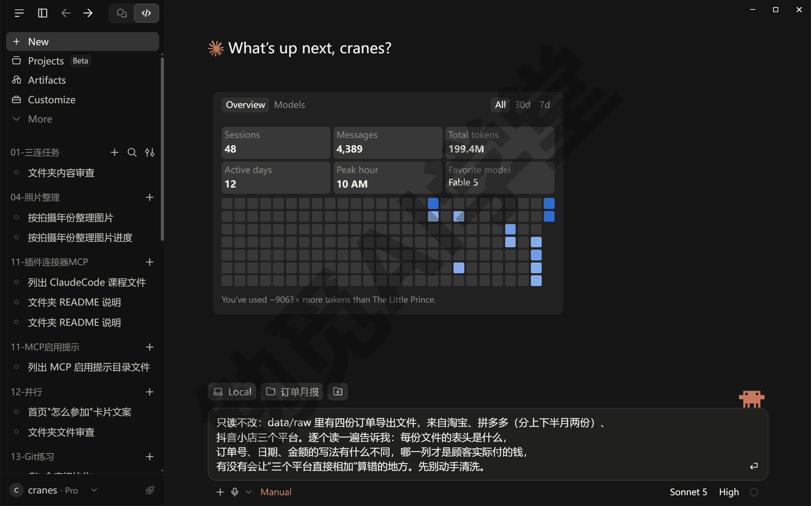

发出后，它会逐个读取四份文件。拼多多那两份先按 UTF-8 读出乱码，它会自己换编码重读；读 .xlsx、转编码都要跑一小段程序，Manual 模式下它每跑一条命令都会先问你，这一轮会连着问十几次，逐条点 Allow once（只允许这一次）就行；中途它会写几个临时文件再删掉，data/raw 里的四份原始文件不会动。几分钟后它给出一份报告：三套表头、订单编号的“壳”、两种日期写法、两列金额、重叠的三天、抖音的一单多行；报告末尾它会把要你定的事列出来——重叠的订单以哪份为准、哪些状态算有效——等你确认了再动手。这份报告和这几个问题，就是下一节清洗规则的原材料。

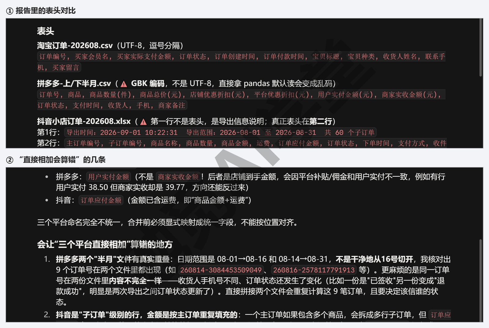

### 17.2 清洗规则设计

**先定规则，再写程序。** 上一节的报告在手，下一步是把“怎么算才对”一条条写明白。这类规则没有唯一正确答案：退款单是不计还是单列？两份文件里重复的订单留哪一条？同一个人同一天在两个平台各下了一单，是两笔生意还是一笔？所以不要直接说一句“帮我清洗”就把整件事交出去，而是让它先列规则草案，你逐条确认或修改。确认过的规则，要求它原文写进脚本开头，日后打开脚本第一眼就能看到。

先发“照 17.1 的报告，把清洗规则列成草案给我，一条一句，先别写程序”，它列出来后你逐条改到满意。演示里来回改完定下的是下面六条，定下之后让它原样写进 pipeline.py 开头的说明里（RULES 段，长行按排版折行）：

```text
清洗规则（RULES，与店主逐条确认过，改规则先改这里再改代码）：
  1. 三套表头各自映射到统一字段：
     平台／订单号／下单时间／商品／数量／实付金额／状态／收货人
  2. 淘宝的订单编号去掉 ="…" 包裹；拼多多文件是 GBK 编码；
     抖音第一行是导出说明，且一单多行（每个子订单一行），按主订单编号合并成一单
  3. 「实付金额」统一取顾客实际付的钱：淘宝「买家实际支付金额」、
     拼多多「用户实付金额(元)」（不是「商家实收金额」）、抖音「订单应付金额」
  4. 只有有效订单计入销售：淘宝「交易关闭」、拼多多「退款成功／已取消」、
     抖音「已退款／已取消」不计，单独列进「退款与取消」页
  5. 同一平台内订单号重复（导出时间段重叠）只留一条，保留后读到的那条
     （后导出的文件状态更新）；跨平台同一收货人、同一天买同一商品的，
     后下单的那一笔列进「待核对」页、不计销售
  6. 品类按订单第一件商品的关键词归到 笔记本／笔类／收纳／礼盒，归不到的进「其他」
```

第 1、2 条管格式，程序读对了就好；第 3、4、5 条决定数字对不对；第 6 条决定报表好不好读。下面把第 5 条拆开讲透，再把三个格式上的坑说明白。

**重复导出的订单：留哪一条有讲究。** 拼多多重叠的三天里，同一个订单在两份文件里各有一行，金额一样，状态却可能不一样：顾客下单时是“待发货”，第二次导出时已经变成“已发货”，也可能变成了“退款成功”。所以去重不是随便留一行，而是留状态最新的那一行——也就是后导出的那份文件里的。流水线按文件名顺序读文件，“下半月”排在“上半月”后面，规则定成“同一订单号保留后读到的那条”就做到了。这条规则也最容易写反——留先读到的那条看起来同样合理——17.4 会专门演练一次写反了会怎样、独立复算怎么把它抓出来，那是本篇最值得看的一段。

**跨平台疑似重复：只标出来，不替你删。** 演示数据里有三组这样的订单：同一位收货人、同一天、买了同一件商品，只是一单在淘宝、一单在拼多多（或抖音）。真实生意里这多半是顾客比价后两边都下了单、准备退掉一单，也可能真的是买了两份。程序判断不了哪种，所以规则定成：后下单的那一笔不计销售额，单独列进月报的“待核对”页，由店主对着两个后台确认。这次运行标出了 3 单、134.30 元。

**金额列选“实付”。** 第 3 条对应错处四。三个平台里只有拼多多把“顾客付的”和“店主收到的”分成两列，规则定成统一用顾客实付，三个平台算的就是同一个意思：淘宝“买家实际支付金额”、拼多多“用户实付金额(元)”、抖音“订单应付金额”。想看扣完手续费到账多少，是另一份报表要回答的问题，本篇不混在一起算。

**格式坑一：拼多多的 GBK 编码。** 按 UTF-8 读拼多多的文件，要么满屏乱码，要么程序直接报错。让读取代码按 GBK 编码打开这一种文件就行。不建议自己动手把文件另存为 UTF-8：这个月转了，下个月新导出的文件还是 GBK，每月都得手动转一次，“自动”就断了。要让程序去适应文件，不要反过来改文件。

**格式坑二：淘宝订单编号的“壳”。** 读入时把开头的 `="` 和末尾的 `"` 去掉，只留里面的数字串；去重和待核对都靠订单号比对，壳不剥掉，同一个订单号就会被当成两个不一样的号。

**格式坑三：抖音的说明行与一单多行。** 读 .xlsx 时跳过第一行、从第二行取表头；然后按“主订单编号”把同一单的几行合成一条：商品名连起来、数量加起来、金额只取一次。这次运行 60 行子订单合成了 49 单。

规则确认后，让它动手：

```text
按我们确认的这六条清洗规则写 pipeline.py：读取 data/raw 里三个平台的订单文件，
统一成“平台、订单号、下单时间、商品、数量、实付金额、状态、收货人”八个字段；
淘宝订单编号去掉 ="…" 包裹，拼多多按 GBK 读，抖音跳过第一行并按主订单编号合并子订单；
同一平台内订单号重复的只留一条；退款和取消的单子单独放一边；
同一收货人同一天在两个平台买同一商品的，后一单标成“待核对”、不计入销售额。
把六条规则原文放在脚本开头的说明里。写完先跑一遍，把清洗统计打出来，先别生成表格。
```

Manual 模式下，写文件前它会先弹一张 Allow Claude to write pipeline.py?（允许写入）的审批卡，卡上就是脚本开头的几行；同意后会话的文件夹里出现 pipeline.py，脚本开头就是那六条规则（措辞多半照你指令里的写法，不一定和上面那段 RULES 一字一样）；对话里会出现文件卡片和差异计数（比如 `+281 -1`），点开能看到整份脚本。跑完它可能会问一两件指令里没说准的事——比如待核对那三单要不要先从销售额里剔掉（照规则第 5 条，要剔掉）——回答了再往下。

这一步先只看清洗统计对不对——用演示数据、规则写对的话，统计是：读入 230 行、剔掉 9 行重复剩 221 个订单、有效 185 单（完整的几行 17.3“跑起来”那一段会贴）；你自己的数据数字不同，核的是账：有效、退款与取消、待核对三堆加起来，要正好等于去重后的订单数；分类和生成表格放在下一节。

### 17.3 出 Excel 与 PPT

**分类：按商品名里的关键词归品类。** 报表要回答“什么卖得好”，就得把订单归进品类。做法很朴素：看第一件商品的名字里带哪个关键词，就归进对应的品类，程序里把这张对应关系表叫映射表。本篇的映射表写在 pipeline.py 里，共四个品类：

```python
CATEGORY_KEYWORDS = {
    "笔记本": ["笔记本", "横线本", "活页本"],
    "笔类": ["中性笔", "荧光笔", "铅笔"],
    "收纳": ["收纳盒", "笔袋"],
    "礼盒": ["礼盒", "手账套装"],
}
```

映射不到的归“其他”。“按第一件商品归类”是一条为了简单而定的规则：一单买了笔记本又买了笔，整单算进笔记本。演示店只有十种商品、多数订单只买一种，这样算够用；你的店商品多，就让它改成按商品明细行分别统计，练习任务二会练。这张关键词表要长期维护，每月看一眼“其他”类，把新上的商品补进来。

**生成表格不需要装 Office。** 《文件与办公能力一篇讲全》讲过的做法在这里直接用：让它写脚本生成 Excel 和 PPT，用的是能直接写出 .xlsx 与 .pptx 文件的 Python 库（openpyxl 与 python-pptx），电脑上装没装 Office 都能生成。这两个库没装的话，让它装上即可，它会先问你要不要运行安装命令。接着把生成表格的要求发给它：

```text
在 pipeline.py 里加上分类与出表：按订单第一件商品的关键词归成笔记本、笔类、收纳、礼盒
四个品类，归不到的进“其他”。生成四个文件放进 output 文件夹——
订单月报-2026-08.xlsx（汇总页，外加按平台饼图、按日折线、按品类柱状三个图表页，
再加商品 Top10、退款与取消、待核对、清洗后明细四页）、
订单月报-2026-08.pptx（一页：饼图加五行结论）、月报摘要.md、summary.json。
做完运行一遍，把关键数字报给我。
```

**跑起来。** 改 pipeline.py 要先过一张写文件的审批卡；运行 python pipeline.py 之前它又会请求你同意运行命令——《权限、沙盒与模型》讲过，Windows 上没有沙盒，命令是实打实在你电脑上执行的，Manual 和 Accept edits 两档下它运行命令前都会先问你，那张审批卡片就是你确认的地方，看清命令再点同意（命令可能比你想的长，它这次把输出先写进一个临时文件再读，正事就是中间那句 python pipeline.py）。跑完它会把关键数字整理给你；这次运行打印出来的统计是这样的：

```text
清洗：{'files': 4, 'raw_rows': 230, 'douyin_sub_rows': 60, 'dupes': 9,
      'cross_platform_pending': 3}
有效订单 185 单，销售额 12,537.10 元，客单价 67.77 元；
退款与取消 33 单 2,149.00 元；待核对 3 单
按平台： {'抖音': 3085.4, '拼多多': 4694.0, '淘宝': 4757.7}
按品类： {'笔类': 2562.5, '收纳': 2133.6, '礼盒': 4935.4, '笔记本': 2905.6}
生成的文件： 订单月报-2026-08.xlsx 、 订单月报-2026-08.pptx 、
月报摘要.md、summary.json → D:\教程演示\ClaudeCode课\17-订单月报\output
```

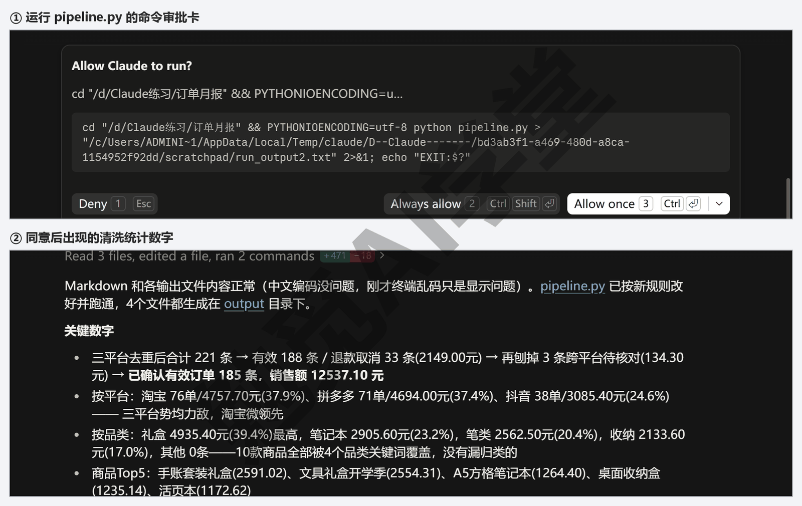

把这几行数读一遍，账就清楚了：

- 四个文件共读入 230 行订单（淘宝 89 行，拼多多 41 加 51 行，抖音 60 行子订单先合成 49 单，按 49 计）。拼多多重叠三天的 9 行重复导出剔掉，剩 221 个订单。
- 221 个订单分成三堆：有效 185 单，退款与取消 33 单，跨平台待核对 3 单，三堆加起来正好 221，一单不多一单不少。
- 销售额 12,537.10 元，只算有效的 185 单；客单价（平均每单多少钱）67.77 元。
- 三个平台里淘宝 4,757.70 元最高，拼多多 4,694.00 元只少了六十多块，抖音 3,085.40 元。四个品类里礼盒 4,935.40 元最高——演示数据把 8 月设成开学季、礼盒卖得多，是这份数据的设计造成的；换成你的真实订单，各品类卖了多少才真正有参考价值。

**四个结果文件逐个看。**

- **订单月报-2026-08.xlsx**：八个工作表。“汇总”是十几行关键数字；“按平台饼图”“按日折线”“按品类柱状”各带一张图；“商品Top10”列出卖得最多的十种商品（这次按件数排，中性笔 12 支装 53 件排第一）；“退款与取消”“待核对”“清洗后明细”是三张明细表，待核对页每一行都写着它和哪个平台的哪个订单疑似同一笔。
- **订单月报-2026-08.pptx**：只有一页，左边是三个平台的销售额饼图，右边五行结论：订单数与销售额、销售额最高的平台、销售额最高的品类、退款与取消多少、待核对多少（五行各写什么由它定，这次是这样）。发到店里的群或者投屏讲，一页就够。
- **月报摘要.md**：纯文本摘要，最要紧的是“关键数字”那几行（它可能先写一行标题和生成时间，再是这几行）：

```text
- 有效订单 185 单；销售额合计 12,537.10 元；客单价 67.77 元
- 按平台：淘宝 4,757.70 元，拼多多 4,694.00 元，抖音 3,085.40 元（淘宝最高）
- 按品类：礼盒 4,935.40 元，笔记本 2,905.60 元，笔类 2,562.50 元，收纳 2,133.60 元
- 退款与取消 33 单、2,149.00 元，未计入销售额
- 跨平台疑似重复 3 单、134.30 元，列在「待核对」页、未计入销售额
- 清洗：读入 4 个文件、230 行订单（抖音 60 行子订单已合并），剔除重复导出 9 行
```

- **summary.json**：给程序读的汇总数据。下一节的复算脚本要读它，《毕业项目：家庭事务中心 + 课程总结》的家庭事务页也会直接读它取数据。

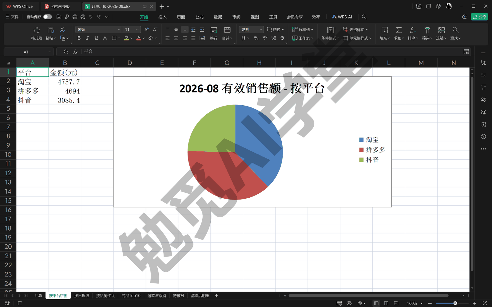

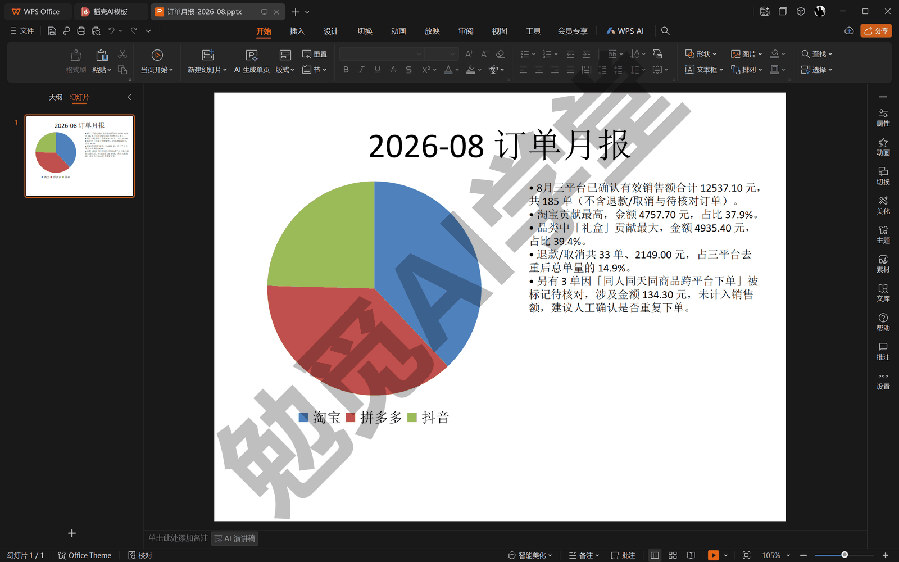

### 17.4 独立复算核对

**为什么要独立复算。** 到这里数字已经出来了，但有一个问题不能不想：这些数字都是同一个脚本算的，脚本要是错了呢？数据类任务最怕的不是程序报错（报错你看得见），而是程序不报错、数字错了。清洗环节每多一条规则，就多一个出错的机会：重复剔多了、状态判反了、抖音合并漏了一行，报表照样完整地生成出来，只是数字是错的。

对策是换一套独立的逻辑，把关键数字重算一遍：两套代码互不借用，在同一批原始文件上得出同一个结果，才可信。这和《实战一：社区读书会网站》里“让它自己打开浏览器验证网页”是同一种态度：结论要有第二个独立证据支撑。

**独立复算怎么做。** 让它写一个独立的复算脚本：

```text
写 tools/verify.py 做独立复算：不要复用 pipeline.py 的任何函数，
自己从头读 data/raw 的原始文件，用最简单的逻辑只算三个数——
有效订单数、销售额合计、按平台分项之和；剔除重复、退款取消、待核对的规则要和
pipeline.py 一样。把三个数和 summary.json 里的月报数字对一遍，
各输出“一致：True/False”。写完跑给我看。
```

三项核对各自回答一个问题：有效订单数回答“该算的单子是不是这些”，销售额合计回答“钱数对不对”，按平台分项之和回答“按平台拆的时候有没有漏掉或算了两遍”。

**演练一次不一致。** 这一遍它写的 pipeline.py 第一版就把第 5 条做对了，复算三项一致。但“重复的留哪一条”是最容易写反的一条——留先读到的那条看起来同样说得通——所以这里故意把它写反一次，你也跟着做。写反之后能不能看出差额，要看数据里有没有在两次导出之间改了状态的订单：17.1 让它造的虚构数据里特意放了这样一单；如果你用的是自己店铺的数据，写反之后三项照样一致，说明你的数据里没有这种单，看懂下面怎么查就行。发送：

```text
把 pipeline.py 里的去重临时改成保留先读到的那条，重跑一遍流水线出一份新的 summary.json，
再跑 tools/verify.py，把复算输出贴给我。
```

Manual 模式下改文件和跑命令各弹审批卡，照常放行。输出是这样的：

```text
读取完成（已按规则4去重）：共 221 条（淘宝89 + 拼多多83 + 抖音49）
剔除退款/取消 33 条，剩余 188 条
剔除待核对 3 条，最终确认有效 185 条

独立复算结果:
  有效订单数 = 185
  销售额合计 = 12537.1
  按平台分项 = {'淘宝': 4757.7, '拼多多': 4694.0, '抖音': 3085.4}  之和 = 12537.1

与 output/summary.json 对比:
  有效订单数：复算=185  summary.json=186  一致：False
  销售额合计：复算=12537.1  summary.json=12547.0  一致：False
  按平台分项之和：复算=12537.1  summary.json=12547.0  一致：False

三项全部一致：False
```

对比那三行里，有效订单数复算 185 单、月报 186 单，差一单；销售额差 9.90 元；按平台之和也差同样的 9.90 元（开头那句“已按规则4去重”是它按你指令里六句话的顺序数的，就是 RULES 的第 5 条）。真遇到这种不一致，不要急着让它重写，先看差值：9.90 元正好是一件“按动铅笔 0.5 两支装”的价钱，多半是某一单被一边算了、另一边没算。把差值和这个猜测发给它，让它顺着差值找：

```text
复算和月报差了 1 单、9.90 元，正好是一单铅笔的钱。
别改代码，先找出是哪一单、为什么两边算得不一样，告诉我。
```

顺着差值查下去，会查到拼多多订单 260814-3084453509049：14 日下的单，正好落在两份文件重叠的三天里。上半月那份文件里它是“已发货”，下半月那份里它变成了“退款成功”——顾客在两次导出之间退了款。改成保留先读到的那条之后，流水线把它算进了销售（上半月，已发货），复算脚本留的是后读到的那条（下半月，退款成功，不算），于是一边 186 单、一边 185 单，差的正是这 9.90 元。

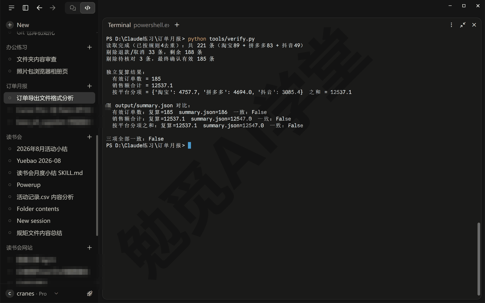

哪边对？状态更新的那条对——顾客确实退了款。所以第 5 条要定成“同一订单号保留后读到的那条”。让它“把去重改回保留后读到的那条，重跑流水线和复算”（真遇到时，就是让它照这条规则改），三项全部一致（前面读取、复算那几行和上次一样，只贴对比部分）：

```text
与 output/summary.json 对比:
  有效订单数：复算=185  summary.json=185  一致：True
  销售额合计：复算=12537.1  summary.json=12537.1  一致：True
  按平台分项之和：复算=12537.1  summary.json=12537.1  一致：True

三项全部一致：True
```

17.3 里贴的那组数字，就是规则写对时跑出来的那组。

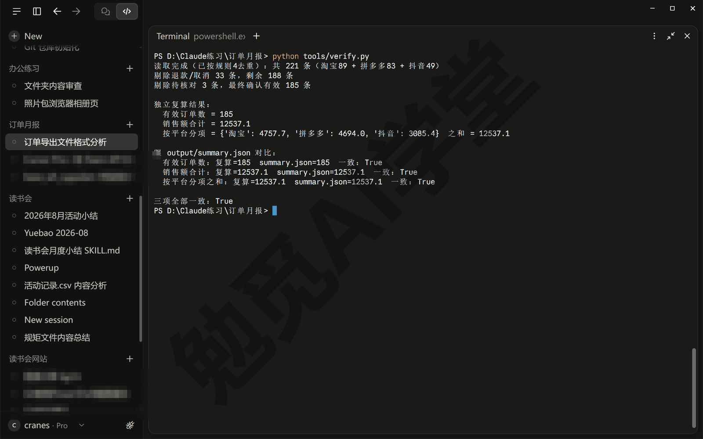

**这次演练说明什么。** 两套独立的逻辑，各自都“没报错、跑通了”，却差了一单——如果只有一套脚本、规则又恰好写反了，这 9.90 元会一直错下去，月报每个月都比实际多一单。复算的价值不是最后那三个 True，而是它逼着两套逻辑把同一条含糊的规则（“重复的留哪一条”）说清楚。真遇到不一致，照这个顺序：先看差值是多少、像不像某一单或某一类的金额；把差值和猜测发给它，让它找原因；找到了再决定改哪一边的规则。比“推倒重来”快得多，也稳得多。

这一步背后是一个通用观念：让 AI 干活，验收标准要独立于干活的过程。下一篇《实战三：旅行费用分摊计算器》会把这个观念再推进一步，那里的独立标准叫“测试”。

### 17.5 把这套做法写成技能

**调好的做法，下个月还得重新交代一遍。** 到 17.4 为止，流水线在当前这个会话里已经调好了。但《对话与上下文管理》讲过“一事一会话”的习惯，下个月你多半会开一个新会话处理新订单，而新会话不知道这套流程：先跑 pipeline 再跑 verify、三项一致才算数、拼多多是 GBK 别转存……都得重新说。

解决办法就是《技能与斜杠命令》讲过的技能：一个装着 SKILL.md 文件的文件夹，把一套做法写成“做法说明书”，它每次干活前都能看到，并判断当前任务该不该按这套做法来。技能放的位置有两处：放在项目文件夹的 .claude/skills/技能名/ 里是项目技能，只在这个文件夹的会话里生效、跟着文件夹走；放在你用户目录的 .claude/skills/ 里是个人技能，你所有本地会话都能用。本篇写成项目技能，因为它只对这家店的订单有用。

让它自己写：

```text
把这套月报做法写成项目技能，放在 .claude/skills/monthly-order-report/。
SKILL.md 里写清楚：什么时候用（用户提到“出月报”“上月订单”“这个月卖了多少”，
或 data/raw 出现新订单文件时）；五个步骤，其中必须包含
“运行 tools/verify.py，三项一致才交付”；再写几条注意——拼多多是 GBK 别转存、
用实付不用商家实收、重复订单留后读到的、列名对不上先问我再加别名、
“其他”品类超过一成要提醒补关键词。
```

它写好的 SKILL.md，开头与“步骤”“注意”两节是这样的（措辞以它写的为准，看结构；长行按排版折行）：

```markdown
---
name: monthly-order-report
description: 把 data/raw 里淘宝、拼多多、抖音小店三个平台的订单导出文件清洗合并后
  生成网店订单月报（带图表的 Excel、一页 PPT、摘要）。用户提到「出月报」「上月订单」
  「这个月卖了多少」，或往 data/raw 放了新的订单文件时使用。
---

## 步骤

1. 确认 `data/raw/` 里的文件名以「淘宝订单」「拼多多订单」「抖音小店订单」开头
   （流水线按文件名开头决定用哪种读法）；缺哪个平台就告诉用户少了哪个，
   不要拿旧月份的文件凑数
2. 运行 `python pipeline.py`，读输出里的清洗统计：读入行数、剔除的重复导出行数、
   抖音子订单合并数、待核对单数
3. 运行 `python tools/verify.py`，确认有效订单数、销售额、按平台分项之和三项都
   「一致：True」；有一项 False 就不要交付，把两边的差值报给用户，
   差值往往正好等于某一单的金额
4. 打开 `output/月报摘要.md`，用三句话讲给用户：销售额与订单数、
   哪个平台和哪个品类最高、退款与待核对各多少；
   提醒用户「待核对」页里的跨平台疑似重复要人工确认
5. 生成的文件：`output/订单月报-<年-月>.xlsx`、`output/订单月报-<年-月>.pptx`、
   `output/月报摘要.md`、`output/summary.json`

## 注意

- 拼多多导出是 GBK 编码，不要手动另存成 UTF-8 再放进来，流水线已按 GBK 读
- 拼多多有「用户实付金额」和「商家实收金额」两列，月报用前一列；改这条规则前先问用户
- 同一平台两份文件时间段重叠时，同一订单号保留后读到的那条（状态更新）；
  淘宝订单编号带 ="…" 包裹，流水线会去掉
- 流水线报「列名对不上」时，把它打印的实际表头和试过的列名一起发给用户，
  等用户确认后再往 `COLUMNS` 里加别名，不要自己猜列的含义
- 归到「其他」品类的销售额超过总额 10% 时，提醒用户补 `CATEGORY_KEYWORDS`
```

对照《技能与斜杠命令》讲过的结构，看三处：

- **description 决定技能什么时候被用上**：它按这段描述判断当前对话是否匹配。写得越具体（提到“出月报”“上月订单”，或 data/raw 有新文件），触发就越准。在 / 菜单里选中这个技能时右边浮出来的那段说明，就是它。
- **步骤里带着验收**：第 3 步写明“三项一致才交付，不一致先报差值”，把 17.4 的复算变成每次必过的关卡，不用靠人去记。
- **注意事项就是本篇踩过的坑**：五条分别对应 GBK 编码、两列金额、重复订单留哪条、列名对不上、“其他”越来越大。技能就是记这些坑的地方，以后每踩一个新坑，就回来补一条。

**怎么用它。** 有两种方式，都在新会话里（文件夹仍选这个项目）：

- 自动触发：直接说“出一下 8 月的月报”，它按 description 匹配到这个技能，对话里出现一行 Ran skill /monthly-order-report（运行了技能），接着照五步执行；
- 手动点名：在输入框输入 /，弹出的是一长串内置命令，你的技能排在后面、不一定在第一屏；接着再输几个字母，比如 mon，列表就只剩两三项、monthly-order-report 排在最上面（选中它，右边浮出 SKILL.md 里那段 description，末尾标着 (project)，表示这是项目技能）；也可以点 + 按钮里的 Slash commands 找到它。选中后它会作为一个标签出现在输入框里，后面接着写“出 8 月月报”再发送（标签的样子以实际界面为准）。

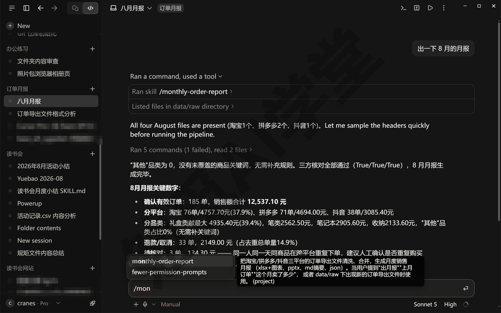

侧栏 Customize 里也有一个 Skills 分区，《桌面应用全导览》提过：那里管的是走账号同步的技能，Cowork 任务和云端会话用的是那一套；本篇这个技能是项目文件夹里的一个文件，只要会话选的是这个文件夹就能用，两套不冲突。从此每个月的操作只剩两步：把新导出的订单表放进 data/raw/，说一句“出月报”。

### 17.6 每月自动跑

**先调完美，再做成自动化。** 《定时任务、钩子与自动化》定下的原则在这里正式用上：自动化不负责把事做对，只负责把已经能做对的事按时再做一遍。前面五节就是“调完美”的过程：规则确认过、复算一致、技能写好，现在才轮到定时。往下有两条路，按你的电脑习惯选。

**路线一（课程主线）：桌面应用的定时任务，在你电脑上按月跑。** 《定时任务、钩子与自动化》讲过机制：桌面应用可以按时间表自动新开一个会话执行一段指令，任务跑在你自己的电脑上，能读你本地的文件；条件是到点的时候应用开着、电脑没睡。动手时以你看到的界面为准。

第 1 步：打开定时任务页。在 Code 页签的侧栏里点 Routines（例行任务；侧栏里没有的话在侧栏的 More 菜单里找，点过一次它就会升到侧栏一级入口），进入任务列表页（第一次打开可能空白两三秒，等一下或再点一次），点右上角的 New routine（新建），选 Local（本机）——另一个选项 Cloud（云端）是跑在云端的例行任务，17.6 末尾再说。

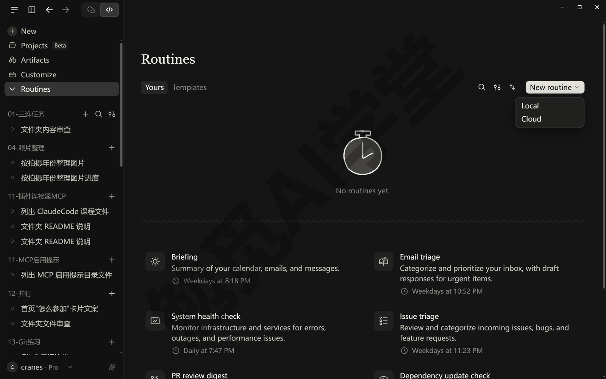

第 2 步：填四个字段。表单顶上有一句提示 Local routines only run while your computer is awake and online.（本机任务只在电脑没进睡眠、联网的时候运行），后面“还有三件事”第一条就是它。Name（名称，必填）填 monthly-order-report-run 这类英文小写、连字符相连的名字，它会用作任务在磁盘上的文件夹名；Description（描述，必填）一句话，列表里显示用；Instructions（指示）就是任务到点后要执行的那段话，写法和平时发消息一样，下面这段可以直接用；Instructions 框的左下角选这次任务用的权限模式、右下角选模型（权限模式选 Manual 就行——这个任务只跑命令、不让它改文件，Manual 和 Accept edits 下它跑命令都要先问你一次，两档没区别；模型留 Default）；框底下点 Select folder（选择文件夹）选工作文件夹，列表里是最近用过的文件夹，选演示项目；旁边的 Worktree（工作树）不勾，本任务要读写文件夹里的真实文件。

```text
用 monthly-order-report 技能出上个月的订单月报：data/raw 里是店主放好的新文件，
按技能的五个步骤跑完 pipeline.py 和 tools/verify.py，三项一致才算完成；
只运行这两个现成脚本，不要另写命令看表头。
最后把 output/月报摘要.md 里“关键数字”下面那几行原样贴出来。
```

第 3 步：定时间。Schedule（计划）里的预设有 Manual（手动）、Hourly（每小时）、Daily（每天）、Weekdays（工作日）、Weekly（每周）、Custom（自定义）六档，前五档里没有“每月”，Custom 里能不能直接设成每月（需实机验证）。官方给的做法是用一句话让它改，顺序是：先按默认选中的 Daily 把任务保存下来（At 后面默认填着一个时间，先不用管），按第 4 步手动跑通一次，再在任意一个会话里说“把 monthly-order-report-run 这个定时任务改成每月 1 日早上 9 点跑一次”，它会替你改好时间表（需实机验证）；改好之前它按 Daily 每天跑一次，所以第 4 步跑通之后当天就回来改，没改成的话回到任务详情页点 Edit 看 Schedule 里能不能选 Custom。表单底下还有一句提示：任务会故意晚几分钟开跑，不是故障。

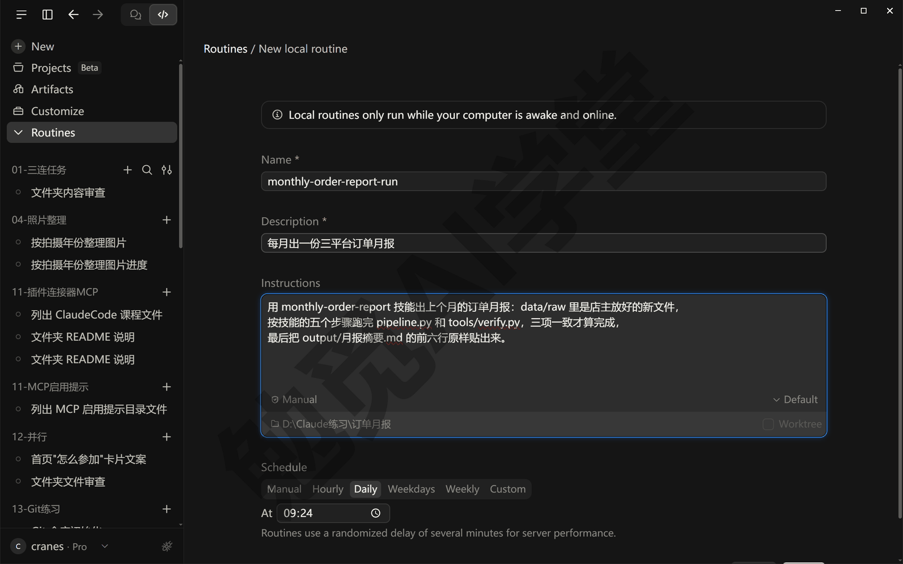

第 4 步：先手动跑一次。点页面底部的 Create（创建）保存，会直接进这个任务的详情页，点右上角的 Run now（立即运行）。页面不会跳走，下面的 History（运行历史）里多出一行 Running（运行中），点这一行才进到这次运行的会话里；这个会话也会出现在侧栏的 Routines（例行任务）分组里，点进去能看到它做了什么、贴出来的摘要对不对。

第一次运行它会在跑命令前弹审批卡，能选 Always allow（总是允许）的都选它，以后每月自动跑遇到同样的命令就不再问。演示那次弹了四张：看表头、跑 pipeline.py、跑 verify.py、读摘要。第一张看表头的只有 Deny 和 Allow once 两个按钮（命令写成一整段脚本的那种），碰到这种卡，任务每次运行都会停下来等人，自动跑时也一样；《定时任务、钩子与自动化》15.2 讲过怎么办，这里的办法是让它少临时写整段命令。

上图表单里演示那次填的指示，和第 2 步给你的有两处不一样。一处是还没有“只运行这两个现成脚本，不要另写命令看表头”这一句，所以多弹了看表头那一张；你的指示里有这一句，要是任务还停在这种卡上，就改走下面的路线二。另一处是末句写的还是旧写法“摘要前六行”，所以下图里它贴的是一行标题、一行生成时间和一个小标题，数字在它接着自己补的一段里；你的指示已经改成“关键数字下面那几行”，贴出来的就是数字（摘要文件里有没有“关键数字”这个小标题，取决于它当初怎么写 pipeline.py，没有就把这半句换成你摘要里数字那一段的小标题）。

跑通之后别忘了第 3 步说的那件事：回到任意一个会话，让它把这条任务改成每月 1 日跑。

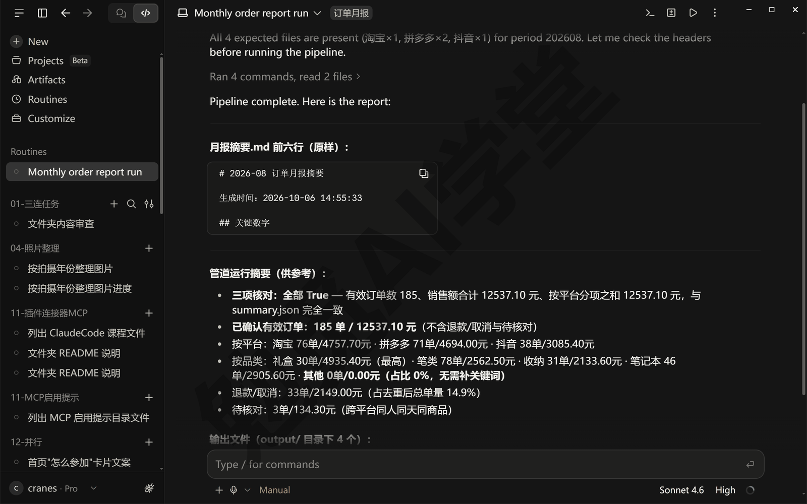

还有三件事：

- **电脑得醒着。** 定时任务只在应用开着、电脑没睡的时候检查时间表；到点时电脑睡着，这次就跳过。设置页 Settings 的 Desktop app → General 里有一个 Keep computer awake（保持唤醒）开关，开了它电脑不会因为闲置而睡；合上笔记本盖子照样会睡。
- **错过了会补一次。** 应用重新打开或电脑醒来时，它会检查过去七天里有没有错过的运行，有就补跑一次（只补最近那一次）。所以每月 1 日出差没开电脑，回来开机它会补跑，不用你手动点。
- **任务本身是一个文件。** 每个定时任务对应你用户目录下 .claude/scheduled-tasks/任务名/SKILL.md 这样一个文件，指示写在里面；想改指示可以直接编辑它，改时间、文件夹要回到任务详情页的 Edit。

**路线二（本地兜底）：Windows 计划任务。** 如果你不想让应用一直开着，或者只想要“把脚本跑一遍”而不需要它在对话里讲结论，可以绕开智能体，直接让 Windows 按月执行脚本。思路是把“跑流水线加复算”包成一个双击就能执行的入口脚本，再让 Windows 按月自动执行它。让它照下面这份写一个：发“在项目根目录新建 run_report.bat，内容如下：”再把全文贴给它。演示项目里的 run_report.bat 全文：

```bat
@echo off
rem Monthly order report runner (ASCII only: cmd misparses batch files with CJK).
set PYTHONIOENCODING=utf-8
cd /d "%~dp0"
echo [%date% %time%] START >> output\run_history.log
python -X utf8 pipeline.py >> output\run_history.log 2>&1
python -X utf8 tools\verify.py >> output\run_history.log 2>&1
echo [%date% %time%] END >> output\run_history.log
```

正事只有四行：记一条开始时间、跑流水线、跑复算、记一条结束时间，所有输出都追加到 output/run_history.log；前面 set 和 cd 两行是准备，一行让 Python 按 UTF-8 输出、日志里的中文才不会乱，一行先进到脚本所在的文件夹。这个 .bat 文件（Windows 叫它批处理文件）里的注释是英文，注释本身写明了原因：中文注释在这类文件里可能被命令行读错，这是 Windows 命令行的一个老问题，让它写脚本时照这个要求就好。

把这个脚本注册成每月 1 日早上 8 点自动跑的计划任务（这条命令是你自己贴进 PowerShell 跑的，不用经过它：按 Win 键搜 PowerShell 打开，把下面整段粘进去回车；路径换成你自己的项目文件夹）：

```powershell
schtasks /Create /TN "网店订单月报" /SC MONTHLY /D 1 /ST 08:00 `
  /TR "cmd /c cd /d D:\教程演示\ClaudeCode课\17-订单月报 && run_report.bat" /F
```

注册成功后，任务会出现在 Windows 的“任务计划程序”里。不想要了就删掉：

```powershell
schtasks /Delete /TN "网店订单月报" /F
```

**两条路线怎么选。** 想每月在对话里看到它讲三句结论、再问它一句“比上月多了还是少了”，选路线一；只想要文件按时生成、电脑不常开着应用，选路线二。两条都跑在你自己的电脑上，订单表不离开电脑。还有第三条：Routines 里选 Cloud（云端）建的是云端例行任务，电脑关着也跑，但它跑在一份从 GitHub 仓库复制下来的项目上，读不到你电脑里的 data/raw，订单表也得放进仓库——《云端会话与手机端》讲过云端的隐私边界，订单里有顾客姓名和手机号，本篇不推荐走这条。

**翻车实录：列名变了怎么办。** 列名变了是数据流水线最常见的一种失败。假设拼多多下个月把“用户实付金额(元)”这一列改名叫“买家实付(元)”，其他都没变，流水线跑起来会怎样？这次演练在终端面板里直接运行 python pipeline.py，输出是这样的：

```text
列名对不上，流水线停止： 拼多多 文件里找不到「实付金额」这一列，
试过的列名：['用户实付金额(元)', '用户实付金额', '用户实付(元)']；
实际表头：['订单号', '商品', '商品数量(件)', '商品总价(元)', '店铺优惠折扣(元)',
'平台优惠折扣(元)', '买家实付(元)', '商家实收金额(元)', '订单状态', '支付时间',
'收货人', '手机', '商家备注']
```

它没有勉强往下算、也没有随便挑一列凑数，而是停下来，把“找哪一列、试过哪些名字、文件里实际有哪些列”全打出来。这不是运气，是写 pipeline.py 时就定下的一条要求：每个统一字段在每个平台下都写几个可能的列名（脚本里叫 COLUMNS 别名表），一个都对不上就报错并列出实际表头。看到这条输出，你一眼就能看出“买家实付(元)”就是原来那一列，让它把这个名字加进别名表再跑一遍，两分钟解决。

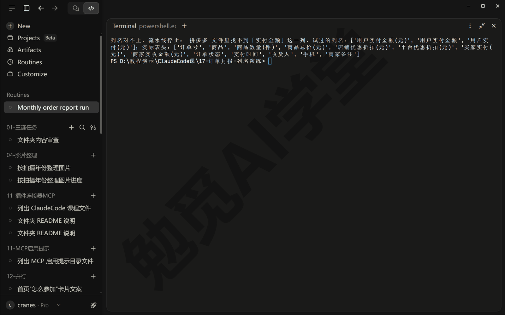

反过来想，如果流水线写成“找不到就跳过这一列”或者“找不到就用第七列”，会怎样？前一种，拼多多的销售额全部变成 0，月报照样生成，只是拼多多那一片消失了；后一种，第七列碰巧还是金额，数字看起来正常、其实错了。两种都比“停下来报错”糟得多。所以技能的注意事项里写着：列名对不上，先把实际表头发给用户、确认了再加别名，不要自己猜。

### 17.7 运行记录回看

**自动化最怕悄悄失败。** 设置好定时之后，你多半就不再盯着了：哪个月文件名放错、哪个月复算不一致，如果没有记录，可能到年底才发现月报断了档。所以流水线还差最后一件事：让每次运行都留下能回看的记录。

**本地看 run_history.log。** 路线二的入口脚本每次运行，都会把开始时间、全部输出、结束时间追加进 output/run_history.log。这次试跑留下的记录：

```text
[周三 2026/09/23 21:41:25.59] START
清洗：{'files': 4, 'raw_rows': 230, 'douyin_sub_rows': 60, 'dupes': 9,
      'cross_platform_pending': 3}
有效订单 185 单，销售额 12,537.10 元，客单价 67.77 元；
退款与取消 33 单 2,149.00 元；待核对 3 单
按平台： {'抖音': 3085.4, '拼多多': 4694.0, '淘宝': 4757.7}
按品类： {'笔类': 2562.5, '收纳': 2133.6, '礼盒': 4935.4, '笔记本': 2905.6}
生成的文件： 订单月报-2026-08.xlsx 、 订单月报-2026-08.pptx 、
月报摘要.md、summary.json → D:\教程演示\ClaudeCode课\17-订单月报\output
独立复算有效订单 185 / 月报 185 一致：True
独立复算销售额 12,537.10 / 月报 12,537.10 一致：True
按平台分项之和 12,537.10 / 销售额合计 12,537.10 一致：True
Excel 工作表： ['汇总', '按平台', '按日', '按品类', '商品Top10', '退款与取消',
               '待核对', '清洗后明细'] ；图表数： [0, 1, 1, 1, 0, 0, 0, 0]
[周三 2026/09/23 21:41:26.70] END
```

从 START 到 END 不到两秒。末尾“Excel 工作表／图表数”那两行是这版复算脚本顺带做的抽查——打开生成的 Excel，确认八个工作表齐全、三张图都在；你让它写的 verify.py 有没有这一步，看你当时提没提。每月回看时盯三处：

- START 和 END 是否成对出现，有头没尾说明中途断了；
- 三行“一致：True”还在不在，出现 False 时当月月报不可用，先找差值；
- 清洗统计里剔除重复、合并子订单、待核对的数字是否在正常范围，突然变成 0 或者暴涨，多半是文件放错、命名不对。

**桌面定时任务看任务详情页。** 走路线一的话，每个任务的详情页里有一个历史列表，能看到每一次运行，包括被跳过的那几次；把鼠标停在一条“跳过”上，会显示为什么跳过——电脑睡着了、上一次还没跑完、或者别的任务正在跑。每次运行本身就是侧栏 Routines 分组里的一个会话，点进去，它读了什么、跑了什么、贴了什么摘要，全在对话里。

**日志的另一个用法：把报错原样交给它。** 入口脚本把正常输出和报错都写进了日志（命令末尾的 2>&1 就是“连报错一起收”的写法），所以哪个月流水线半路出错，错误原文一定记录在 run_history.log 里那次 START 之后。处理办法照《对话与上下文管理》讲过的习惯：把报错段落原样复制给它，让它顺着报错找原因，比你自己转述一句“好像哪里不对”要快得多，也准得多。17.6 那条“列名对不上”的输出，就是设计成可以整段复制给它的。

**断档最常见的三个原因。** 从这套流水线的机制看，月报断档基本逃不出三种情况。最常见的是新订单表忘了放进 data/raw：流水线只认这个文件夹，没有新文件它就只能拿旧数据再算一遍，结果文件的修改时间变了、数字却纹丝不动。其次是文件名开头不对：流水线按“淘宝订单／拼多多订单／抖音小店订单”三种文件名开头决定用哪种读法，文件被重命名过就对不上任何一种，清洗统计里的文件数会变少。还有一种是拼多多的文件被顺手转存成了 UTF-8：流水线按 GBK 读，转存之后反而读不了，17.2 专门提醒过。对着这三条查，多数断档能很快找到原因。

**再养一个小习惯。** 偶尔打开 output 文件夹看结果文件的修改时间：四个文件的修改时间都应该在最近一次运行之后。修改时间没动，说明流水线根本没跑；修改时间动了而数字没变，那才是数据本身没变。

### 17.8 三个练习任务

下面提示词里方括号的内容，换成你自己的。

**任务一：用你自己的订单表跑通流水线**

```text
我把 [你从三个平台导出的上月订单表] 放进了 data/raw，文件名保留
“淘宝订单”“拼多多订单”“抖音小店订单”开头。用 monthly-order-report 技能跑一遍月报
和独立复算，列名对不上就把实际表头发给我、等我确认再加别名，
最后把清洗统计和三项核对结果发我，再用三句话讲结论。
```

完成标准：三项复算全部“一致：True”；清洗统计里能看到你自己订单表的剔除与合并行数；output 里四个结果文件齐全、修改时间是刚刚；如果有列名对不上，你见到了它列出的实际表头、并且是你确认之后它才改的。

**任务二：改成按商品明细行统计品类**

```text
现在品类是按每单第一件商品归的，我的店一单常买好几种商品。
先告诉我改成“按订单里每件商品分别归品类”后，一单的实付金额要怎么分到几件商品上
（比如按各商品标价的比例分），我确认后再改 pipeline.py；改完重跑流水线和复算，
把改前改后各品类的金额并排列给我。
```

完成标准：它先提方案、你确认后它才动手；重跑后“按品类”页各品类金额之和仍等于销售额合计；三项复算仍全部一致。

**任务三：把定时任务真正设置起来**

```text
帮我建一个本地定时任务：每月 1 日早上 9 点，在这个文件夹里用
monthly-order-report 技能出上月月报，跑完把摘要里“关键数字”下面那几行贴出来。
建好后立刻手动运行一次，我来处理权限确认；然后把这个任务的时间表和文件夹念给我听，
再告诉我以后想暂停或删除该在哪里点。
```

完成标准：Routines 列表里能看到这个任务；手动运行的那次会话出现在侧栏 Routines 分组里，对话末尾有月报摘要；你知道暂停和删除在任务详情页的哪里。

### 17.98 本篇小结与自检

这一篇把三个平台的订单表做成了一条可反复运行的月报流水线：先读四份文件摸清各自的写法，确认六条清洗规则，剔掉 9 行重复导出、把 60 行抖音子订单合成 49 单、挑出 33 单退款取消和 3 单跨平台待核对，生成 Excel、PPT、摘要与 summary.json；用独立复算演练了一次不一致——去重规则写反时差出一单 9.90 元，顺着差值找到原因、把“重复订单留哪一条”这条规则定对；然后写成 monthly-order-report 技能，最后给出桌面应用定时任务与 Windows 计划任务两条按月自动跑的路线。

可以对照下面的清单检查学习结果：

- [ ] 能说出三份订单表各自的写法差异，以及三个平台不能直接相加的四个原因
- [ ] 能讲清“重复导出的订单留后读到的那条”这条规则是怎么来的、为什么留状态新的
- [ ] 知道跨平台疑似重复为什么只标出来不删除，知道“待核对”页在哪
- [ ] 跑通了 pipeline.py，看到过清洗统计与四个结果文件
- [ ] 跑通了 tools/verify.py，见过不一致、也见过三项一致，能说出遇到不一致先看什么
- [ ] 在 .claude/skills/ 里看到了 monthly-order-report 技能，知道自动触发与输入 / 点名两种用法
- [ ] 知道桌面定时任务在哪建、为什么要先 Run now 一次、电脑睡着了会怎样
- [ ] 知道列名变了流水线会停下来报什么、该怎么处理

完成这些内容后，你手里已经有一条“订单表进、月报出”的流水线，也第一次体验了“验收标准独立于执行过程”的做法。下一篇《实战三：旅行费用分摊计算器》把这个思想再往前推一步：做一个有真实规则的小应用，用边界值测试当验收，用两个工作树并行做两版界面择优，还会故意改坏一次，练习用 Git 还原。

### 17.99 新手常见问题

**Q1：订单表里有顾客的姓名和手机号，交给它安全吗？**

本篇两条定时路线都跑在你自己的电脑上，文件不离开电脑；智能体读文件内容时，读到的文字会发给模型处理，这一点和你在对话里贴一段文字是一样的，《权限、沙盒与模型》讲过数据去哪了。想更稳妥，可以在放进 data/raw 之前先让它写一个小脚本把姓名和手机号两列删掉——月报用不到这两列，跨平台待核对那条规则要用收货人姓名，删了它这条规则就失效，自己取舍。云端任务要把文件放进仓库，本篇不推荐。

**Q2：它算错了我怎么发现？**

靠 17.4 的独立复算，不靠肉眼。两套代码互不借用、在同一批文件上算出同一个结果才算数，本篇演练过一次：去重规则写反了，复算就差出一单。看到不一致，先看差值是多少、像不像某一单的金额，把差值发给它让它找原因，找到了再改规则。另外每月看一眼“待核对”页和“其他”品类的金额，这两处是规则覆盖不到、需要人判断的地方。

**Q3：这个技能能给别人用吗？**

项目技能就是项目文件夹里 .claude/skills/monthly-order-report/ 这个文件夹，把整个项目文件夹（连脚本一起）复制给对方，对方用 Claude Code 打开同一个文件夹就能用。对方的订单表列名多半和你的不一样，第一次跑会停在“列名对不上”，按 17.6 翻车实录的办法加别名即可。想让技能跨项目、在你自己所有会话里都能用，把它挪到用户目录的 .claude/skills/ 下就成了个人技能。

**Q4：我电脑上没装 Office，也能出 Excel 和 PPT 吗？**

能。流水线用 openpyxl 和 python-pptx 这两个 Python 库直接生成 .xlsx 与 .pptx 文件，生成过程不需要 Office。打开查看时，用任何能读这两种格式的软件都行（Office、WPS 或在线文档工具）。库没装时，让它安装即可，它会先问你要不要运行安装命令。
