## 实战三：旅行费用分摊计算器

这一篇做全课的第三个实战项目：一个有真实规则的小应用。四个人一起去京都玩了五天，民宿、租车、吃饭、门票各由不同的人先付，有人只住两晚，有人替别人买了门票，一半的账还是日元，回来之后要算清“谁该给谁多少钱”。本篇让 Claude Code 把这套算账的规则做成一个网页，打开就能填、填完立刻出结果，手机上也能用。《实战二：网店订单月报流水线》讲的是“数字要对”，用独立复算当验收；这一篇把同一个想法再往前推一步：动手之前先把验收标准写成测试，改一次代码就让电脑替你逐条检查一遍。

除了算账本身，这一篇还要练三件事：用两个工作树各做一版界面、并排比较后留一版；把代码改坏一次，用 Git 把它退回去；最后把做好的页面放到网上，同行的人用手机就能打开。本篇的数字、脚本、测试结果和 Git 历史，来自在演示项目 D:\教程演示\ClaudeCode课\18-费用分摊 里从头到尾做一遍的记录（2026 年 9 月，Windows 电脑上）；示例行程“京都四人行”和四位同行者都是虚构的。对话过程中的界面画面以你看到的为准；同一件事做两遍，它写出的文件、测试的名字和提交编号都会不一样，图里的和正文贴的不一定一字一样，数字是一样的，以你自己做出来的为准。

先看做出来的样子（动图）：七组测试先全部通过，两个工作树各做出一版页面、并排比较后留下一版，中途改坏一次用 Git 退回去，最后推到 GitHub 公开仓库、开 Pages 上线。

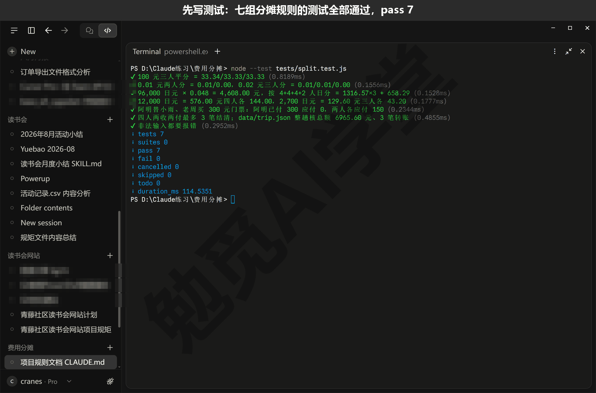

这篇文章的实操内容需要 Claude 的付费订阅（Pro 起），和前面各篇一样；本篇不新增付费功能。上线用到的 GitHub 账号和 GitHub Pages 都是免费的。

### 18.1 把分摊规则写清楚

**为什么群里算不清。** 如果你和几个朋友一起出门，账多半是这么记的：民宿是阿明订的，付了 96,000 日元；租车是小雨刷的卡；第一晚居酒屋老周结的账；寺庙门票阿明替小雨和老周买了，自己没进去；丹丹只住了两晚。回来以后在群里对账，每个人都记得自己付过什么，却没人算得清自己最后该收还是该付。难点不在加减法，而在规则：住两晚的人，民宿该不该和住四晚的人平摊？替别人买的门票怎么算？日元按哪天的汇率换？一百块钱三个人分，多出来的那一分钱给谁？这些问题不先说清楚，无论人算还是程序算，算出来都会有人不服。

**这个项目要做成什么样。** 一个网页：打开就能填“同行的人”和“每一笔费用”，页面立刻算出每个人应付多少、已付多少、最后谁转给谁多少钱；填过的数据存在你自己的浏览器里，关掉再打开还在，不上传到任何地方。它不需要服务器（放在别处一直开着的电脑），也不需要数据库（专门存数据的软件），就是一个 index.html 网页文件加一个装规则的 split.js 文件，在自己电脑上能打开，放到网上也能用。这类规则明确、界面简单的小应用，交给 Claude Code 做很合适，前提是规则先由你定清楚。

**示例行程。** 本篇的演示数据叫“京都四人行”：阿明、小雨、老周、丹丹四个人，4 晚 5 天，出发前定好汇率 1 日元 = 0.048 元。一共 7 笔费用：

| 费用 | 金额 | 谁付的 | 怎么分 |
| --- | --- | --- | --- |
| 民宿 4 晚 | 96,000 日元 | 阿明 | 按人日：阿明、小雨、老周各 4 晚，丹丹 2 晚 |
| 租车 3 天 | 24,000 日元 | 小雨 | 阿明、小雨、老周三人平分 |
| 第一晚居酒屋 | 12,000 日元 | 老周 | 四人平分 |
| 寺庙门票 | 300 元 | 阿明 | 小雨、老周两人平分，阿明代付、不参与 |
| 抹茶体验 | 2,700 日元 | 丹丹 | 小雨、老周、丹丹三人平分 |
| 机场打车 | 100 元 | 小雨 | 四人平分 |
| 伴手礼 | 100 元 | 老周 | 阿明、小雨、老周三人平分 |

这 7 笔是特意挑的，把容易出问题的情况都放了进去：有外币，有按人日分，有代付，还有 100 元三个人分的零头。

**五条分摊规则。** 对着这 7 笔账，把规则一条一条定下来。本篇最终定下五条：

1. 每一笔费用先选“怎么分”：平均分（勾上参与的人，人人一份），或者按人日分（谁住几晚按几晚算，住一晚算一个人日）；付款人可以不参与分摊，这就是代付。
2. 外币按出发前定好的汇率换成人民币，全程用同一个数，换完再分；人民币不用换。
3. 分到“分”为止：金额先按 1 元 = 100 分换成整数的分，按份数分，除不尽余下的一分两分，补给“精确份额”（不抹零头时每人该分到的数）里小数部分最大的那个人，几个人的小数部分一样大，就按名单顺序补给排前面的；这样每笔的分摊加起来正好等于原金额，不多一分也不少一分。
4. 每个人的净额等于自己已经付出去的钱减去自己应该分摊的钱；净额是正数的人要收钱，是负数的人要付钱。
5. 结清的时候用最少的转账笔数：每次让欠得最多的人转给该收最多的人，几个人的账最多转“人数减一”笔就能清。

第 3 条拿两笔账看一下就明白。100 元的伴手礼三个人分，每人 33.33 元，加起来只有 99.99 元，余下的 1 分补给名单里排第一的阿明，所以是阿明 33.34 元、小雨 33.33 元、老周 33.33 元。民宿 96,000 日元按汇率换成 4,608.00 元，四个人一共 14 个人日，每个人日 329 元多一点；阿明、小雨、老周各 4 个人日，算出来都是 1,316.57 元，丹丹 2 个人日算出来是 658.28 元多一点点，四个人里她那份多出来的零头最大，余下的那一分补给她，得 658.29 元；四个数加起来正好 4,608.00 元。

**规则先写进 CLAUDE.md。** 《CLAUDE.md 与规则》讲过，项目文件夹里的 CLAUDE.md 是它每次开会话都会先读的规矩文件，写在里面的规矩不用每次重复说。这个项目的规矩有五条，动手之前先写进去。新建一个空文件夹（比如 D:\Claude练习\费用分摊），新建会话，环境选 Local（本机），点 Select folder（选择文件夹）选中它，权限模式选 Manual（手动），发送：

```text
在这个文件夹里新建 CLAUDE.md，写下这个项目的五条规矩：
1. 纯静态页面：只有 index.html、split.js 和 data/ 里的示例，
   不用服务器、不用数据库、不接任何后台；
2. 界面文字全部用简体中文；手机上要能用（窄屏一列排开）；
3. 分摊规则只写在 split.js 里，界面只负责显示，
   不许在 index.html 里另写一套算法；
4. 动过 split.js 就必须重跑 node --test tests/split.test.js，
   七组全过才能提交；
5. 数据只存在使用者自己的浏览器（localStorage），不上传到任何地方，
   页面上要写明这一点。
先别写别的文件。
```

Manual 模式下它写文件之前会先弹一张审批卡 Allow Claude to write CLAUDE.md?（允许写入 CLAUDE.md），卡上就是整份文件的内容，看一眼点 Allow once（只允许这一次）；写完对话里出现 Created CLAUDE.md（已创建）的文件卡片和 +11 −0 的差异计数。它写好的 CLAUDE.md 全文如下（措辞、编号和加粗是它自己定的，你的可能略有不同；长行按排版折行）：

```markdown
# 费用分摊项目规矩

1. **纯静态页面**：只有 `index.html`、`split.js` 和 `data/` 里的示例数据，
   不用服务器、不用数据库、不接任何后台。

2. **界面文字全部用简体中文**；手机上要能用
   （窄屏下一列排开，不能横向滚动或错位）。

3. **分摊规则只写在 `split.js` 里**，界面只负责显示和交互，
   不许在 `index.html` 里另写一套算法。

4. **动过 `split.js` 就必须重跑** `node --test tests/split.test.js`，
   七组测试全过才能提交。

5. **数据只存在使用者自己的浏览器**（`localStorage`），不上传到任何地方，
   页面上要写明这一点。
```

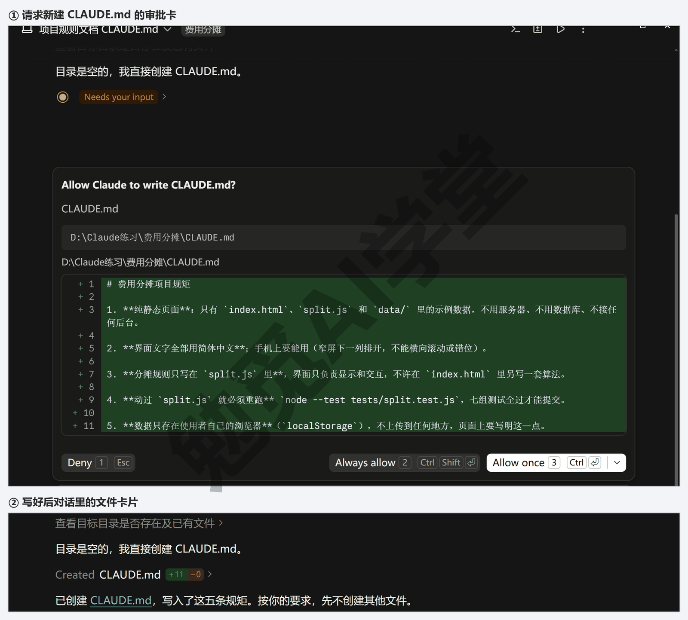

五条里第 3、第 4 两条和本篇后面的做法直接相关。第 3 条“规则只写在 split.js 里，界面只负责显示”，是为了 18.3 做两版界面时两版共用同一份规则，改界面不会把计算改坏；第 4 条“动过 split.js 必须重跑测试”，是本篇的保险，18.4 的翻车实录里会看到它能拦住什么。第 5 条的 localStorage 是浏览器自带的本地存储：网页可以往里存一点数据，只存在这台设备的这个浏览器里，别人打开同一个网址看不到你存的东西。

**示例数据存成文件。** 接着让它把上面那 7 笔账存成一个数据文件，后面写测试、做页面都读它：

```text
把下面这趟“京都四人行”存成 data/trip.json：同行四人 阿明、小雨、老周、丹丹，
汇率 1 日元 = 0.048 元。七笔费用：民宿 4 晚 96,000 日元 阿明付，
按人日分（阿明、小雨、老周各 4，丹丹 2）；租车 3 天 24,000 日元 小雨付，
阿明、小雨、老周平分；第一晚居酒屋 12,000 日元 老周付，四人平分；
寺庙门票 300 元 阿明付，小雨、老周平分（阿明不参与）；
抹茶体验 2,700 日元 丹丹付，小雨、老周、丹丹平分；
机场打车 100 元 小雨付，四人平分；伴手礼 100 元 老周付，阿明、小雨、老周平分。
```

做完文件夹里多了 data/trip.json（Manual 模式下建文件夹、写文件各弹一张审批卡），点开看，每笔费用一段，名目、金额、币种、付款人、参与的人或人日都在里面，和上面那张表一一对应；字段叫什么、参与的人和人日怎么写由它定。

**验收用例先写。** 用例就是一条“给什么输入，应该得到什么结果”的检查项，验收用例是动手之前就定好的那几条。本篇定了 7 条，其中好几条是边界值，也就是最容易出错的极端情况，比如 0.01 元两个人分：

| 用例 | 输入 | 应该得到 |
| --- | --- | --- |
| 零头 | 100 元三人平分 | 33.34／33.33／33.33，合计仍是 100.00 |
| 零头极小 | 0.01 元两人分；0.02 元三人分 | 0.01／0.00；0.01／0.01／0.00 |
| 按人日 | 民宿 96,000 日元，4＋4＋4＋2 人日 | 折合 4,608.00 元；1,316.57×3 加 658.29，合计 4,608.00 |
| 外币 | 12,000 日元四人平分；2,700 日元三人平分 | 576.00 元，各 144.00；129.60 元，各 43.20 |
| 代付 | 阿明替小雨、老周买 300 元门票 | 阿明已付 300、应付 0；小雨、老周各应付 150 |
| 结算 | 两人收、两人付；整趟京都行程 | 最多 3 笔转账结清，付出的等于收到的；总花费 6,965.60 元，3 笔转账 |
| 非法输入 | 金额 0 或负数、参与人为空、汇率 0、付款人不在名单、人日为 0 | 都要报错，不能算出一个数来 |

这 7 条现在还只是一张表，下一节让它变成能自动运行的测试。为什么要在写程序之前写：这时候你脑子里想的是“账该怎么算”，还没被程序的做法带着走；等页面做出来再想，很容易被页面上看起来合理的数字说服。最后那条“非法输入要报错”尤其重要，金额填成 0、汇率忘了填，程序如果不报错而是算出一个数，这个数就会被当真。

### 18.2 让它先写测试，再写页面

**测试是什么。** 测试是一小段程序，专门用来检查另一段程序：把上一节的 7 条用例一条条写成“输入这些，结果必须等于这些”，运行一下，电脑替你逐条核对，对的打勾、错的报出差在哪。《实战二：网店订单月报流水线》的独立复算，是你发一句话让它用另一种方法重算一遍；测试是把这件事写成文件放在项目里，以后每次改完代码都能一秒钟重跑，规则改了、页面改了、换了电脑，都还是这 7 条在守着。

**先装 Node.js。** 网页里的脚本用的是 JavaScript（网页里用的编程语言）。规则写在 split.js 里，网页要用它，测试也要用它；要在网页之外直接运行 JavaScript 文件，得靠一个叫 Node.js 的程序，它自带一个测试工具 node --test，不用再装别的。先问它一句：

```text
这台电脑上装了 Node.js 吗？没装的话帮我装最新的长期支持版，装好告诉我版本号。
```

它会先跑一两条查版本的命令（只看不改，Manual 模式下也不会停下来问你），装了的话报出版本号（演示电脑上是 v24）；没装它会提出安装命令，Windows 上多半用系统自带的 winget（具体命令以它列出的为准，需实机验证），Manual 模式下会先问你要不要运行，看清命令再同意。装完把 Claude 桌面应用整个关掉再打开，它才能找到新装的程序，《Git、GitHub 与代码审查》装 gh 时也是这一步。

**第 1 步：只写规则和测试，不写页面。** 在这个文件夹的会话里发送：

```text
先不写页面。按 CLAUDE.md 的规矩做两件事：
1. 写 split.js，只放分摊规则，不读文件、不碰界面。规则：外币按行程固定的汇率
   换成人民币再分；每笔按“平均分”或“按人日”分到人；零头分到“分”，
   余下的补给小数部分最大的人（一样大按名单顺序），分摊之和必须等于原金额；
   每人净额 = 已付 − 应付；最后用最少的转账笔数结清。
   金额是 0 或负数、参与人为空、汇率是 0、付款人不在名单、人日是 0，都要报错。
2. 写 tests/split.test.js，用 Node.js 自带的 node --test，把下面七组验收用例
   一组一组写成测试：100 元三人平分 = 33.34/33.33/33.33；
   0.01 元两人分 = 0.01/0.00，0.02 元三人分 = 0.01/0.01/0.00；
   96,000 日元 × 0.048 = 4,608.00 元，按 4+4+4+2 人日分 = 1316.57×3 + 658.29；
   12,000 日元 = 576.00 元四人各 144.00，2,700 日元 = 129.60 元三人各 43.20；
   阿明替小雨、老周买 300 元门票，阿明已付 300 应付 0、两人各应付 150；
   四人两收两付最多 3 笔结清，再用 data/trip.json 整趟行程核总额 6,965.60 元、
   3 笔转账；上面那些非法输入都要报错。
写完运行 node --test tests/split.test.js，把结果贴给我。
```

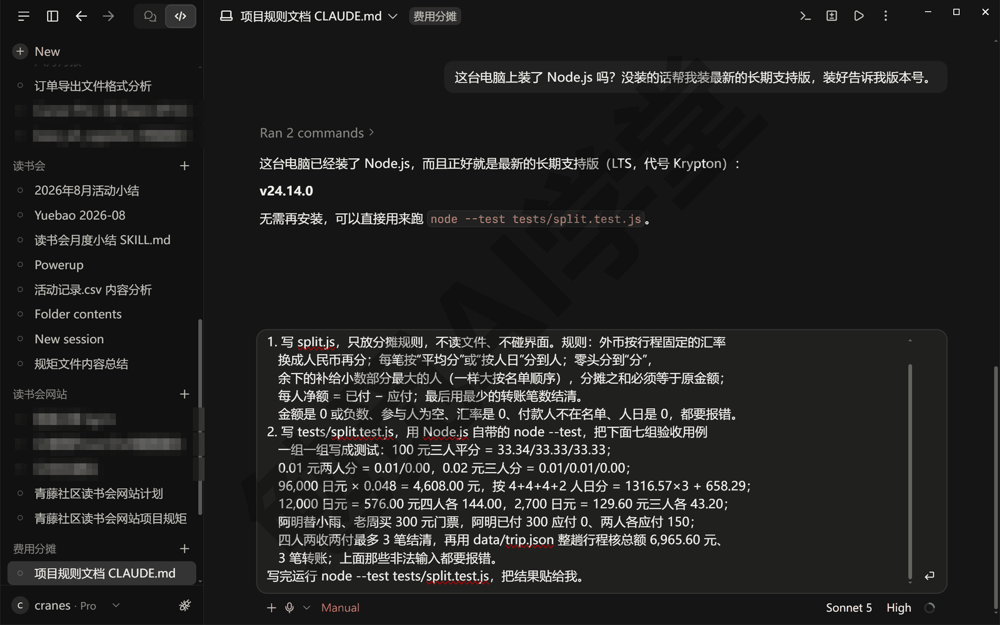

Manual 模式下它新建每个文件、运行测试命令之前都会先弹审批卡，逐张点 Allow once（只允许这一次）。做完文件夹里多了 split.js 和 tests/split.test.js 两个文件。测试文件不用看懂，但可以打开看一眼它的样子，每组测试就是一句中文说明加几行“必须等于”的检查，比如第一组大致是这个样子（它起的变量名和检查的写法以文件里的为准）：

```javascript
test("100 元三人平分 = 33.34/33.33/33.33", () => {
  const s = splitEqual(100, ["阿明", "小雨", "老周"]);
  assert.deepEqual(s, { 阿明: 33.34, 小雨: 33.33, 老周: 33.33 });
  assert.equal(sum(s), 100);
});
```

第一行引号里的中文是这组用例的名字，它照你指令里的写法起；下面三行是让电脑核对：分出来的三个数是不是 33.34、33.33、33.33，加起来是不是 100。它运行测试的输出（长行按排版折行；每行末尾括号里的耗时省略了）：

```text
✔ 100 元三人平分 = 33.34/33.33/33.33
✔ 0.01 元两人分 = 0.01/0.00，0.02 元三人分 = 0.01/0.01/0.00
✔ 96,000 日元 × 0.048 = 4,608.00 元，按 4+4+4+2 人日分
  = 1316.57×3 + 658.29
✔ 12,000 日元 = 576.00 元四人各 144.00，2,700 日元 = 129.60 元三人各 43.20
✔ 阿明替小雨、老周买 300 元门票：阿明已付 300 应付 0，两人各应付 150
✔ 四人两收两付最多 3 笔结清；data/trip.json 整趟核总额 6965.60 元、
  3 笔转账
✔ 非法输入都要报错
ℹ tests 7
ℹ suites 0
ℹ pass 7
ℹ fail 0
ℹ cancelled 0
ℹ skipped 0
ℹ todo 0
ℹ duration_ms 114.5351
```

看两处就够：每一行开头的 ✔ 表示这一组过了；末尾那几行 ℹ 里看 pass 7、fail 0 两行，是过了几组、没过几组，其余几行（suites、cancelled、skipped、todo、duration_ms）不用管，终端里每行末尾括号里的毫秒数是这一组跑了多久，也不用管。以后每次重跑，你只看这两处；有一组不过，开头会变成 ✖，下面会把“算出来的数”（actual）和“应该是的数”（expected）列出来，18.4 里会见到。

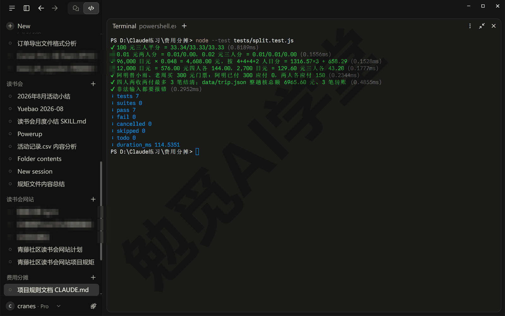

**第 2 步：写第一版页面。** 规则和测试都过了，再写界面。第一版按最直观的样子做，一张表填账、下面出结果：

```text
现在写 index.html，表格式录入：最上面填同行的人（逗号隔开）和汇率；
中间一张表一行一笔费用，列是名目、金额、币种、付款人、怎么分、参与的人，
按人日分时每个人后面能填晚数；点“算一算”后下面出三块：分摊明细、
每个人的账（应付、已付、净额）、谁转给谁。界面只调用 split.js 里现成的计算，
不要另写一套算法；加“载入示例”按钮读示例行程，加“清空”；
填过的数据存在浏览器的 localStorage 里；页面上写明数据不上传。
做完起一个本地预览，在浏览器面板里打开给我看。
```

做完对话里会出现 index.html 的文件卡片和差异计数；它会起一个本地预览（《内置浏览器、应用预览与电脑操控》讲过，预览服务怎么起记在文件夹里的 .claude/launch.json 里，Manual 模式下起预览也要你放行），在浏览器面板里打开页面，地址栏是 localhost 加一串端口号，比如 localhost:4173。指令里特意写“起一个本地预览”而不是“打开 index.html”，是因为页面的“载入示例”要读同文件夹里的 data/trip.json，直接打开的本地网页读不了这个文件，点“载入示例”会报错；走本地预览就没有这个问题。要是它还是直接打开了 index.html 文件（地址栏显示的是文件路径）、点“载入示例”报了错，补一句“用本地预览打开”就行。

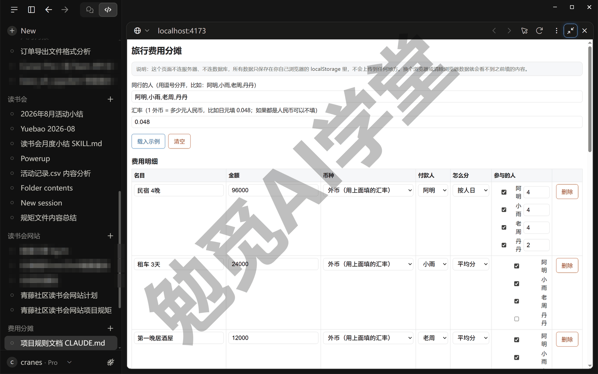

第一次打开时页面已经载入了示例行程。页面从上到下一列排开：最上面填同行的人与汇率，下面一张表一行一笔费用，表底下是“加一笔费用”和“算一算”两个按钮；点“算一算”，再往下出来分摊明细、每个人的账两张表和“谁转给谁”。示例行程算出来是这样的：

| 人 | 应付 | 已付 | 净额 |
| --- | --- | --- | --- |
| 阿明 | 1,902.91 | 4,908.00 | +3,005.09 |
| 小雨 | 2,096.10 | 1,252.00 | −844.10 |
| 老周 | 2,096.10 | 676.00 | −1,420.10 |
| 丹丹 | 870.49 | 129.60 | −740.89 |

总花费 6,965.60 元，四个净额加起来是 0；结清只要 3 笔：老周转给阿明 1,420.10 元，小雨转给阿明 844.10 元，丹丹转给阿明 740.89 元。这一趟阿明预付了民宿和门票，付了 4,908.00 元，其他三个人都欠他钱，所以三笔转账都是转给他。

**自己核一笔。** 页面上的数不要全信，拿最复杂的那笔民宿手算一遍：96,000 日元乘 0.048 是 4,608.00 元；14 个人日，每个人日 329.14 元（四舍五入后的显示值，页面实际按分算）；阿明 4 个人日 1,316.57 元（不是 329.14 乘 4 的 1,316.56，按分算 4,608.00 元的 4／14 本来就是 1,316.57 元），小雨、老周也各 4 个人日 1,316.57 元，丹丹 2 个人日 658.29 元，四个数加起来 4,608.00 元，和分摊明细里那一行一致。再看小雨的应付 2,096.10 元：民宿 1,316.57、租车 384.00、居酒屋 144.00、门票 150.00、抹茶 43.20、打车 25.00、伴手礼 33.33，七个数相加正好是 2,096.10。测试过了、手算也对上一笔，这版可以定了。

**第 3 步：提交第一版。** 《Git、GitHub 与代码审查》讲过，提交就是给整个文件夹拍一张带说明的快照，以后随时能翻回来。发送：

```text
把这个文件夹初始化成 Git 仓库，把现在的文件做第一次提交，提交说明写
“旅行费用分摊计算器 v1：分摊规则模块、七组边界值测试、表格式界面（方案 A）”。
做之前先告诉我你要跑哪几条命令。
```

它会先把要跑的几条命令列出来（初始化仓库、按文件名逐个加入、提交、看状态）；中途它可能停下来问你一句：.claude/launch.json 要不要一起提交——那是上一步起本地预览时它写的配置文件——选它推荐的“不提交，先加 .gitignore”。接着每条会改东西的命令都会弹审批卡，逐张点 Allow once。仓库建好后，输入框上方会多出一条状态条，写着文件夹名、分支名和改动行数，旁边一个 Commit changes（提交改动）按钮。看一眼分支名：图里是 master，本篇后面都按 main 说，你的要是 master，再补一句“把主线改名叫 main”让它改过来。做完按 Ctrl+`（反引号）打开终端面板，输入 `git log --oneline` 回车，能看到这一条：

```text
8087649 旅行费用分摊计算器 v1：分摊规则模块、七组边界值测试、表格式界面（方案 A）
```

开头的七位是这次提交的编号，每个人每次都不一样（图里是 a76f284，正文的示例用的是另一次做出来的编号），18.3 的历史里还会见到它。这一版界面本篇叫方案 A，下一节要拿它和另一版比。

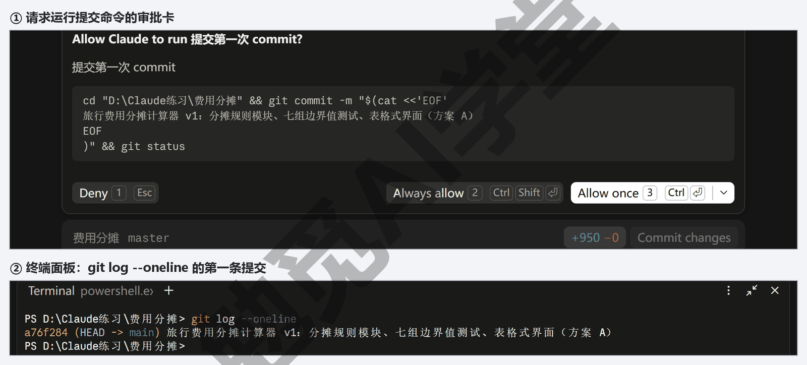

### 18.3 两个工作树各做一版界面，并排比较择优

**界面这种事，做两版再选。** 规则对不对，有测试管着；界面好不好用，没有标准答案，只有比出来的答案。方案 A 是表格式的：在电脑上一屏能看全，但手机那么窄的屏幕放不下一张六七列的表，要么挤成一团，要么每笔费用拆成竖着排的一长条，一笔账要翻好几屏，离 CLAUDE.md 第 2 条“手机上要能用”差得远。与其在这一版上反复改，不如再做一版完全不同的，两版放在一起按标准比。《子智能体、并行会话与工作树》讲过这套做法：开两个会话各做一版，并排看，按事先写下的三条标准挑一版留下；两个会话在同一个项目上同时改文件会互相覆盖，所以第二个会话要勾工作树，也就是让 Git 给这个项目再复制一份独立的文件夹，改动互不影响。

**第 1 步：开第二个会话，勾工作树。** 点侧栏里“费用分摊”这个分组标题右边的 ＋，直接开一个这个文件夹的新会话（按 Ctrl+N 或点侧栏顶部的 New（新建）再选这个文件夹也一样）；因为文件夹已经是 Git 仓库，输入框上方那一行里、分支名 main 的右边多出一个 worktree（工作树）复选框，默认不勾，点一下勾上；底部的权限模式看一眼是不是 Manual（从分组 ＋ 开的新会话会沿用上一个会话的模式）。第一个会话不用动，它继续在项目的主文件夹上，也就是 main 分支上；新会话在自己的副本里干活。


在新会话里发送下面这段：

```text
在这个工作树里做另一版界面，split.js 和 tests 一个字都不改：
卡片式录入，一笔费用一张卡，从上往下填，改一个数结果立刻更新，不用点按钮；
总花费和转账笔数固定在屏幕底部的结算栏里，滚到哪都看得见，
点结算栏上的按钮再展开“每个人的账”和“谁转给谁”；
手机优先，最大宽度 640 像素、单列排开。做完运行 node --test tests/split.test.js，
再起一个本地预览，在浏览器面板里打开给我看。
```

上图输入框里那次发的是旧写法，末句是“在浏览器面板里打开 index.html”，所以和这里差半句：直接打开文件会遇到 18.2 说过的那个错，演示时又补发了一句“用本地预览打开”才正常；你发的这段已经改好，不会碰到这一步。

发出去后对话里会先出现一行 Creating worktree（正在创建工作树），几秒钟就好；要是这一行转了很久不动，在侧栏点一下别的会话再点回来，画面就刷新出来了（副本是发第一条消息时才真正建的，不是勾上复选框那一刻）。它写好后同样会在对话里给出文件卡片和差异计数，然后在工作树里另起一个预览（端口和主文件夹那个不一样，比如 localhost:4174），在浏览器面板里打开。把浏览器面板拖窄一点看手机宽度下的效果（鼠标按住面板左边缘往右拖）。这一版界面本篇叫方案 B。

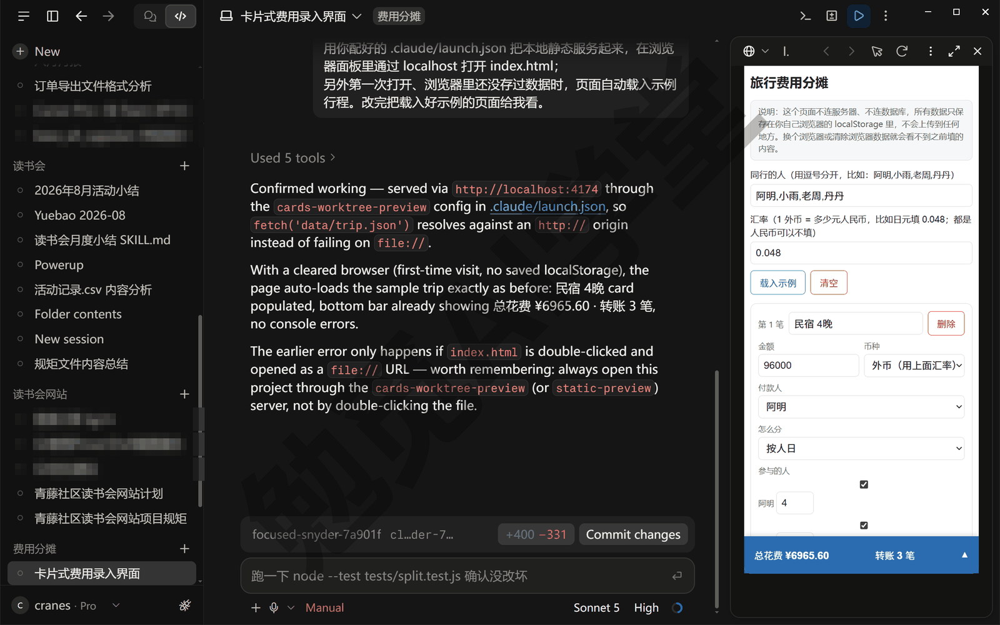

**第 2 步：两边都跑一遍测试。** 指令里让方案 B 的会话跑了一遍测试，你也可以在两个会话里各开一个终端面板（Ctrl+`）自己跑 `node --test tests/split.test.js`。演示项目里两边跑出来都是 pass 7、fail 0。这正好说明 CLAUDE.md 第 3 条的用处：两版界面看起来完全不一样，用的是同一份 split.js，测试一行没改、照样全过；如果计算写在页面里，做第二版就得把计算再写一遍，两版算出来的数很可能还不一样。

工作树的副本放在项目文件夹下的 .claude\worktrees\ 里，一个会话一个子文件夹，名字是它随机起的一组英文词，比如 focused-snyder-7a901f，这个会话写文件的审批卡上就能看到这个路径（这是默认位置；在 Settings → Claude Code（设置 → Claude Code）的 Worktree location（工作树位置）里改过的以那里为准）。在资源管理器里打开它，能看到一套完整的项目文件，方案 B 的 index.html 就在这里，主文件夹里的 index.html 仍是方案 A。

**第 3 步：并排比。** 按住 Alt 点侧栏里的另一个会话，它会在右边再开一栏，两个会话左右并排，各自的浏览器面板里一版一个；并排后每一栏都窄，先按 Ctrl+B 收起侧栏，再拖两栏中间的分隔条和面板的分隔条，让两个页面都看得清；按 Ctrl+Alt+W 关掉有焦点的一栏，回到单会话。比较之前先把标准写下来——本篇的三条就是下面这张表的第一列，按《子智能体、并行会话与工作树》12.5 节讲过的做法，最好在开第二个会话之前就定好：

| 标准 | 方案 A（表格式） | 方案 B（卡片式，底部结算栏） |
| --- | --- | --- |
| 手机窄屏一列排开、不出横向滚动条（CLAUDE.md 定的硬要求） | 表格在窄屏下要么挤成一团，要么拆成竖排，一笔费用要看好几屏 | 录入区是卡片，最大宽度 640 像素，单列排开 |
| 录入一笔要点几下，能不能边录边看结果 | 表格里逐格填，结果在页面底部，要点“算一算”再滚下去看 | 卡片顶行填名目和金额，改一个数立刻重算，结算栏一直在底部 |
| 结算结果能不能一眼看清谁该给谁多少 | 两张结果表，应付、已付、净额、明细都有，最完整 | 一张“每个人的账”加转账列表，少一张分摊明细 |

三条里方案 B 赢了前两条，第三条方案 A 更全。第一条是 CLAUDE.md 里定的硬要求，方案 A 过不了；所以留方案 B，方案 A 的分摊明细表以后可以补进方案 B，18.6 的任务三就练这个。

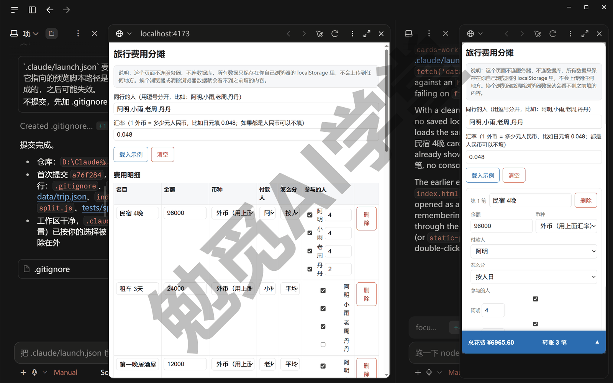

**第 4 步：留一版，另一版存在分支上。** 分支是仓库里的一条版本线，《Git、GitHub 与代码审查》讲过，主线叫 main，工作树里的改动都在它自己的分支上。回到方案 B 的会话发送：

```text
方案 B 定了。把这个工作树里的改动提交，说明写
“方案 B：卡片式录入 + 底部固定结算栏（手机优先）”，然后合回主线 main；
主线上原来的方案 A 不要丢，留在一条叫“方案A”的分支上，
这个工作树的分支改名叫“方案B”。做完把 git log 贴给我。
```

它会先在工作树里提交，再给两条分支起名，然后回到主文件夹把改动合回 main（用哪几条命令、什么顺序由它决定，以实际执行的为准；Manual 模式下每条命令都会先弹审批卡，这次是五张：提交、新建 方案A 分支、把工作树的分支改名 方案B、合并、看历史）。其中合并那张卡只有 Deny 和 Allow once 两个按钮，卡上多一句提醒，意思是这条命令要先切到另一个文件夹再跑 Git、确认你信得过再放行——这是它自己列的命令，点 Allow once。它贴回来的 git log 里，HEAD（Git 用来标记“现在站在哪条分支上”的记号）指着 方案B，那是因为它是在工作树那份副本的文件夹里看的；你回到第一个会话（主文件夹的那个），在它的终端面板里输入 `git log --oneline --graph --all` 回车，看到的是这样（长行按排版折行）：

```text
* c0189ad (HEAD -> main, 方案B) 方案 B：卡片式录入 + 底部固定结算栏（手机优先）
* 8087649 (方案A) 旅行费用分摊计算器 v1：分摊规则模块、七组边界值测试、
                  表格式界面（方案 A）
```

两行就是两次提交，从新到旧排（编号以你自己的为准，图里是 a64dbc0 和 a76f284）。括号里是分支名：main 和 方案B 都指着最新的这次提交，说明方案 B 已经是主线；方案A 指着第一次提交，方案 A 就留在那里，以后想看它，让它“开一个工作树切到 方案A 分支”就能再打开。回到第一个会话，把浏览器面板刷新一下（面板不会自己重新加载，不刷新还停在方案 A），主文件夹的预览里已经是卡片式的方案 B 了。

方案 B 的会话到这里事情做完了，在侧栏里右键它、选 Archive（归档），会话就归档了；它的工作树副本不会跟着删，还留在 .claude\worktrees\ 下面，副本怎么处理，《子智能体、并行会话与工作树》12.3 节讲过。

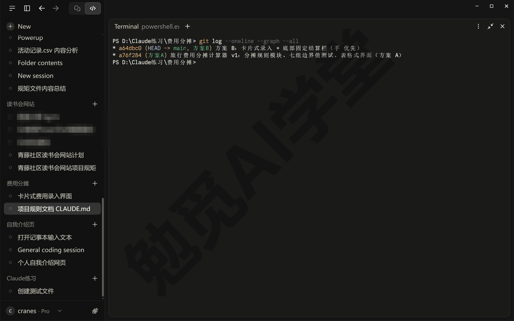

### 18.4 翻车实录：改坏一次，用 Git 还原

**改坏是常态，要练的是怎么退。** 项目做到能用之后还会继续改：加一种货币、调一下页面、改一条规则。每一次改都有可能把原来对的东西改坏，而且改坏的那一处往往不是你正在改的地方。这一节你跟着演练一次改坏：故意把一处错提交进历史，提交说明里标上“误改”，方便以后在历史里认出来；这处错在 split.js 的汇率换算上，外币换人民币本该是金额乘汇率，改成金额除以汇率。真实项目里这种错怎么来的都有：改别处的时候碰到了这一行，或者把“1 日元等于多少元”和“1 元等于多少日元”弄反了。这一节要看的是，出了这种错，多久能发现、怎么退回去。

**第 1 步：故意改坏，直接提交。** 在主文件夹的会话里发送：

```text
练习用：把 split.js 里外币换人民币的地方，从金额乘汇率改成金额除以汇率，
这次跳过 CLAUDE.md 第 4 条、不要跑测试，直接提交，说明写“（误改）汇率换算写成了除法”。
```

它多半会提醒你 CLAUDE.md 第 4 条要求改完先跑测试，回一句“这次是练习，照做”就行；Manual 模式下改文件和提交各弹一张审批卡，照常放行。

**第 2 步：先跑测试，不要先看页面。** 每次它改完 split.js，不管改的是什么，先重跑测试。在主文件夹的会话里发送：

```text
重跑 node --test tests/split.test.js，把完整结果贴给我。
```

对话里它贴回来的多半是整理过的版本：七行 ✔✖ 加一行总数，然后它会告诉你三组失败是同一个原因——split.js 里把乘汇率写成了除以汇率（这次误改在演示的脚本里碰到了两处，在你的脚本里碰到几处，要看它当初是怎么写的）——并问你要不要把它改回来。先别答应，下一步用 Git 退。完整的输出在终端面板里重跑一遍就能看到，这次演练跑出来是这样的（长行按排版折行；每行末尾的耗时和中间几段英文调用栈省略了）：

```text
✔ 100 元三人平分 = 33.34/33.33/33.33
✔ 0.01 元两人分 = 0.01/0.00，0.02 元三人分 = 0.01/0.01/0.00
✖ 96,000 日元 × 0.048 = 4,608.00 元，按 4+4+4+2 人日分
  = 1316.57×3 + 658.29
✖ 12,000 日元 = 576.00 元四人各 144.00，2,700 日元 = 129.60 元三人各 43.20
✔ 阿明替小雨、老周买 300 元门票：阿明已付 300 应付 0，两人各应付 150
✖ 四人两收两付最多 3 笔结清；data/trip.json 整趟核总额 6965.60 元、
  3 笔转账
✔ 非法输入都要报错
ℹ tests 7
ℹ suites 0
ℹ pass 4
ℹ fail 3
ℹ cancelled 0
ℹ skipped 0
ℹ todo 0
ℹ duration_ms 98.9263

✖ failing tests:

test at tests\split.test.js:41:1
✖ 96,000 日元 × 0.048 = 4,608.00 元，按 4+4+4+2 人日分
  = 1316.57×3 + 658.29
  AssertionError [ERR_ASSERTION]: Expected values to be strictly equal:
  ……
    actual: '2000000.00',
    expected: '4608.00',
    operator: 'strictEqual'
……
```

七组里过了四组、三组没过，没过的三组全和日元有关：按人日的民宿、两笔外币、整趟行程的总额；只有人民币的四组全过。光看这个分布就能猜到问题出在汇率换算上。再看 failing tests 下面的细节：每一组失败都会列出 actual（算出来的数）和 expected（应该是的数），第一组是 actual 2000000.00、expected 4608.00，也就是算出来 2,000,000，应该是 4,608；96,000 除以 0.048 正好是 2,000,000，乘除写反了。另外两组错的也是同一处：12,000 日元按除法会算成 250,000 元，整趟行程的总花费会算到两百八十多万元。

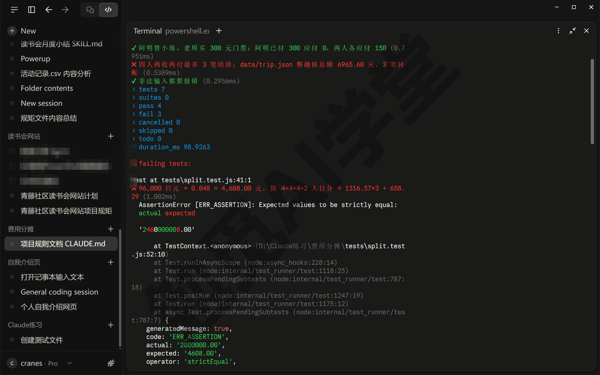

这次的错很大，页面上总花费变成两百八十万，肉眼也看得出不对。但换一种错，比如汇率多算了 1%，页面上民宿一栏显示 4,654.08 元，你根本看不出哪里不对，测试照样会停在 actual 4654.08、expected 4608 这一组上。这就是 18.1 坚持先写用例的原因：错在哪一条规则上，测试直接告诉你，不用你对着页面猜。

**第 3 步：退回去，不要手改。** 发现改坏之后有三种退回去的办法，看这处错已经走到了哪一步，选对应的一种：

- 改动还没放行：Manual 模式下改动卡片上点 Deny（拒绝），这处改动就不会写进文件，《计划模式、差异审阅与回退》6.3 节讲过卡片上 Deny、Always allow、Allow once 三个按钮。
- 已经放行、还没提交：点那一轮改动汇总卡上的 Undo（撤销），或者让它“把 split.js 恢复到上一次提交的样子”，《Git、GitHub 与代码审查》13.2 节第 4 步做过这件事。
- 已经提交了，本篇这次就是这种：让它撤销那次提交。

在主文件夹的会话里发送：

```text
上一次提交把汇率换算改错了。用 Git 撤销那次提交，保留历史、不要删提交，
撤销之后重跑 node --test tests/split.test.js，把结果贴给我。
```

它会用 Git 的撤销命令生成一条新提交，Manual 模式下先弹审批卡问你要不要运行，看到命令是 git revert 一类就点 Allow once；接着重跑测试那条命令再弹一张，一共两张。撤销不是把错的那条记录抹掉，而是再加一条“反着改回来”的提交，历史里错和改回都留着，以后翻历史能看到这里踩过一次坑。做完在终端面板里输入 `git log --oneline --graph --all` 回车，历史变成四行（长行按排版折行；编号以你自己的为准）：

```text
* dffcd80 (HEAD -> main) Revert "（误改）汇率换算写成了除法"
* b7da0bc （误改）汇率换算写成了除法
* c0189ad (方案B) 方案 B：卡片式录入 + 底部固定结算栏（手机优先）
* 8087649 (方案A) 旅行费用分摊计算器 v1：分摊规则模块、七组边界值测试、
                  表格式界面（方案 A）
```

最上面那条以 Revert 开头，就是撤销生成的提交，引号里是被撤销那次的说明。撤销之后重跑测试，又是七个 ✔、pass 7、fail 0，和 18.2 第一次跑的一样。

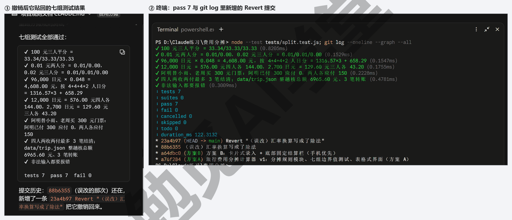

**为什么不直接手改回来。** 你可能会想：乘号改回来只是一个字符，手改不是更快？不建议这么做，有两个原因。一个是你不一定知道那次改动碰了几处（这次演示的误改就碰了 split.js 里两处），手改了看得见的一处，看不见的另一处还留着；用 Git 撤销是把那次提交的全部改动一起退掉，不多不少。另一个是历史：手改回去之后历史里只剩“改错”那一条，看不出后来改回过；撤销提交把“错”和“改回”都记着，半年后再翻这段历史，还能看出汇率换算在这里出过问题。这次演练是故意让它跳过 CLAUDE.md 第 4 条、把错直接提交，为的是练“已经提交了怎么退”；平时让它按 CLAUDE.md 做，它每次改完 split.js 都会自己跑一遍测试，多数错在提交之前就被拦下来了。

**三种“后悔药”怎么分工。** 到这里全课的三种退回办法都用过了，管的范围不一样：

- 改动卡片上的 Deny（拒绝）管的是这一处改动，在你放行之前，一处一处地退；
- 改动汇总卡上的 Undo（撤销）和 `/rewind` 管的是这一个会话：Undo 撤回那一轮改动，`/rewind` 把对话退回到某一句之前，退起来快，但只认这个会话，会话归档了就没有了；
- Git 提交管的是整个文件夹的每一次定稿，跨会话、跨电脑，只要仓库在就能退回任何一次提交，代价是要你主动说一句“提交”。

平时可以这样用：改动小、还在同一个会话里，用前两种；每做完一件能说清楚的事就提交一次，这样第三种随时可用。本篇四次提交就是四个能退回去的点。

### 18.5 上线与回顾

**为什么要放到网上。** 页面现在只能在你的电脑上打开，同行的人要用得凑到你屏幕前。放到网上之后，每个人在自己手机上打开网址就能填、就能看结果；各自填的数据存在各自的浏览器里，互不干扰，也不会传到网上。用的办法是 GitHub Pages：GitHub 免费提供的一项服务，把仓库里的网页文件发布到一个固定网址上，仓库里的文件改了、推送上去，网址上的页面一两分钟后跟着更新。免费账号要用它，仓库得是公开的，所以只放代码和虚构的示例数据，真实的账目本来就不进仓库，只存在浏览器里。

**第 1 步：建公开仓库并推送。** 前提是 `gh` 已经装好并登录，《Git、GitHub 与代码审查》13.3 节做过：终端面板里 `gh auth login`，选 GitHub.com、HTTPS、用浏览器登录，一次登录以后都能用。在主文件夹的会话里发送：

```text
在我的 GitHub 账号下新建一个公开仓库，名字叫 trip-expense-split，
描述写“旅行费用分摊计算器（课程演示，虚构内容）”；
把 main、方案A、方案B 三条分支都推上去，然后把仓库网址给我。
```

它会用 `gh` 在你的账号下建仓库、把本地仓库连上去、推送三条分支，最后在对话里给出网址（选用的命令以它列出的为准，Manual 模式下它会逐条问你）。演示项目推到了 github.com/Cranes249i/trip-expense-split，你的会是 github.com/你的用户名/trip-expense-split。打开网址，能看到文件列表、四次提交，分支下拉菜单里有 main、方案A、方案B 三条。

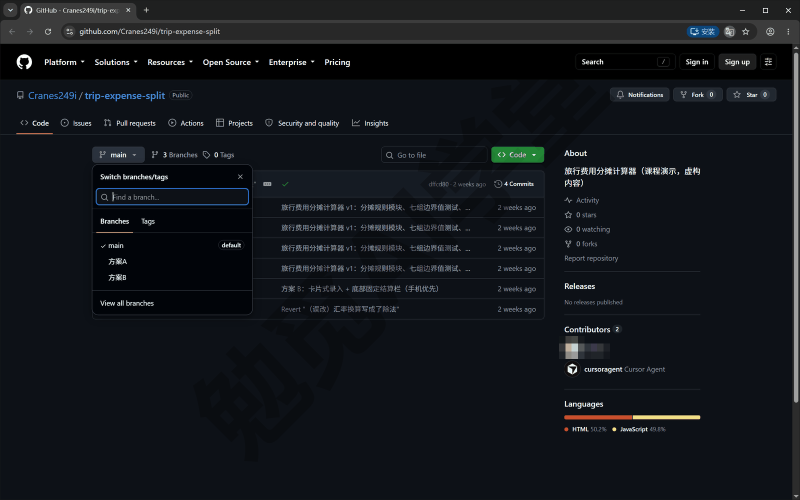

**第 2 步：开启 GitHub Pages。** 有两种做法，选一种。让它做：

```text
把这个仓库的 GitHub Pages 开在 main 分支的根目录，
开好后告诉我网页的网址，并确认网页已经能打开。
```

它会用 `gh` 调用 GitHub 的功能开启，然后把网址报给你。自己做：在仓库页面点上方的 Settings（设置），左侧栏找到 Pages，在 Build and deployment（构建与发布）里把 Source（来源）选成 Deploy from a branch（从分支发布），分支选 main、文件夹选 /（root），点 Save（保存）。这几个名字就是图里的（GitHub 的设置页目前没有中文）。保存后页面顶上会多出一个绿框 Your site is live at…（你的网站已上线），后面跟着网址，第一次要等一两分钟才出现。

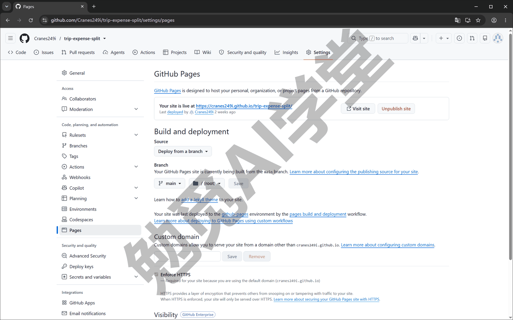

**第 3 步：等一两分钟，打开网址。** 网址的样子是固定的：https://你的用户名.github.io/仓库名/，演示项目是 https://cranes249i.github.io/trip-expense-split/。第一次发布要等一两分钟，太早打开会看到 404（网页不存在），过一会再刷新。打开之后是方案 B 的页面，已经载入示例行程，底部结算栏显示总花费 6,965.60 元、结清要转 3 笔；用手机打开同一个网址，是单列排开的卡片。

**以后改了怎么更新。** 网上的页面跟着 main 分支走：以后在主文件夹里改完、测试过了，让它“提交并推送”，一两分钟后网址上就是新版；方案A 分支也在仓库里，但不影响网页，网页只发布 main。别人打开网址填的数据存在他自己的浏览器里，改不到你的仓库，也改不到网页本身；只有对仓库有写权限的人推送，网页才会变。

**回顾。** 这一篇从头到尾练的是一套顺序，以后做任何有规则的小工具都能照着走。先把规则一条条写清楚、写进 CLAUDE.md，再把验收用例列成表，规则说不清的地方在这一步就会暴露出来，比做出页面再返工省得多；然后让它先写测试再写页面，规则和界面分开放，界面怎么改都不会碰到计算，测试一直是那 7 条。界面拿不定主意就做两版，两个工作树各做一版，按事先写下的标准并排比，落选的留在分支上不删。每做完一件事提交一次；改坏了先跑测试找到错在哪，再用 Git 撤销那次提交，不手改。上线之前跑一遍测试，上线之后用手机打开一次。

用量方面按《权限、沙盒与模型》讲过的机制记一笔：本篇最消耗用量的环节是写两版界面和它每次读整个项目的文件，规则模块和测试本身很小。做法上省用量的地方有两处，一是一件事一个会话、做完就归档，二是让它改 split.js 时先说“只改这一处、别的文件不要动”，它就不必把所有文件再读一遍。

### 18.6 三个练习任务

下面提示词里方括号的内容，换成你自己的。

**任务一：加一种货币**

```text
示例行程里再加一种外币 [美元]，汇率 [1 美元 = 7.1 元]，让一趟行程能同时有两种外币。
先在 tests/split.test.js 里加一组用例：[100 美元三人平分 = 236.67/236.67/236.66，
合计 710.00]，跑一遍看规则模块是不是已经能算；然后改 index.html，
让“同行的人与汇率”那里能填两种外币和各自的汇率，每笔费用选币种时能选到它。
改完把全部测试结果贴给我。
```

完成标准：八组测试全过；页面上能填两种外币，每笔费用的币种能选到新加的那种；载入示例后原来的七笔数字一个没变。

**任务二：改一条分摊规则**

```text
给“怎么分”加第三种：按比例分，给每个参与的人填一个份数（比如 [2、1、1]），
按份数的比例分，零头仍按“分到分、余下的补给小数部分最大的人”处理。
先把用例说给我听、我确认后再写测试；测试通过后再改 split.js 和页面，
动过 split.js 就重跑全部测试。
```

完成标准：它先给出用例、你确认之后它才写测试；新旧测试全部通过；页面上按比例分的那笔，分摊之和等于原金额，一分不差。

**任务三：把方案 A 的明细表补进方案 B**

```text
开一个工作树：把 方案A 分支里“分摊明细”那张表（名目、折合人民币、付款人、
每人分摊）搬进现在的方案 B，放在“每个人的账”上面，样式跟卡片一致，
手机上不出横向滚动条。做完跑测试，在浏览器面板里打开给我看。
```

完成标准：并排比较之后你决定留哪一版；留下的那版合回 main，测试全过，推送后一两分钟，网上的页面能看到明细表，手机上仍是单列。

### 18.98 本篇小结与自检

这一篇做了一个旅行费用分摊计算器：先把五条分摊规则和 7 条验收用例写清楚，写进 CLAUDE.md；让它先写规则模块和测试、再写页面，七组测试全过、手算一笔核对一致后提交第一版；开第二个会话勾工作树做了卡片式的方案 B，两版并排按三条标准比，留方案 B、方案 A 存在分支上；把汇率换算改坏一次，测试三组失败当场找到是乘除写反，用 Git 撤销那次提交退回；最后建公开仓库、开 GitHub Pages 上线，手机能打开。

可以对照下面的清单检查学习结果：

- [ ] 能说出五条分摊规则，知道 100 元三人分多出来的一分钱给谁、按人日是怎么算的
- [ ] 知道测试是什么、为什么要在写页面之前先写，能读懂 pass 7、fail 0 和 ✖ 后面那两个数
- [ ] 跑通了 node --test tests/split.test.js，见过七个 ✔
- [ ] 开过一个勾了工作树的会话，知道副本在哪、两个会话怎么并排看
- [ ] 能讲清两版界面是按哪三条标准比的、为什么留方案 B、方案 A 去了哪里
- [ ] 见过三组失败的测试输出，知道从“算出来的数”和“应该是的数”反推出哪里错了
- [ ] 知道改动卡片的拒绝、汇总卡 Undo 与 /rewind、Git 撤销提交这三种退回去的办法各管什么范围
- [ ] 把页面放上了 GitHub Pages，用手机打开过自己的网址

完成这些内容后，你手里有了一个上了线的小应用，也第一次用测试当验收、用工作树比方案、用 Git 退回改坏的代码。下一篇《实战四：政策与补贴通知追踪》换一类任务：追踪几处官方公告页的更新，让它只把新增的条目挑出来、分好类、写成周报，再做成每周自动跑的定时任务。

### 18.99 新手常见问题

**Q1：规则我自己也说不清楚，它会怎么做？**

它不会停下来等你想清楚，多半会自己补一个最常见的做法，比如零头直接四舍五入、代付的人也参与平摊。这些做法不一定错，但不一定是你要的，而且它不会特别提醒你“这里我替你定了”。办法是 18.1 的顺序：先对着几笔真实的账把用例写出来，写用例的时候说不清的地方就是规则没定的地方；拿不准就问它“这一条有哪几种常见做法，各有什么区别”，让它列出来你选，选定了再让它写。

**Q2：测试是什么，为什么要先写而不是做完再测？**

测试是一段专门检查另一段程序的小程序，把“输入这些、结果必须是这些”写成文件，每次一秒钟重跑。先写的原因有两个：一是这时候你想的是“账该怎么算”，还没被程序的做法带着走；二是先写的测试第一次跑一定是失败的，等它写完规则再跑变成通过，你亲眼看到了“从失败到通过”，这组测试才真的在检查东西。做完再补的测试，常常是照着已经算出来的数写的，算错了也照样通过。本篇 18.2 为了少一轮往返，让它把规则和测试一起写完再跑；18.6 的任务二按“先写测试、看它失败、再改规则”的顺序走一遍，你就能亲眼看到从失败到通过。

**Q3：两版界面都不满意怎么办？**

不要在两个会话里各自反复改，那等于同时在做四版、六版。先把两版各自好的地方说清楚，开第三个会话（同样勾工作树）让它综合，比如“录入用方案 B 的卡片，结果区用方案 A 的三张表”，做出来再按同样三条标准比一次。第三版还不行，多半是标准本身没定好，回到 18.3 第 3 步把三条标准重写一遍再开。《子智能体、并行会话与工作树》12.5 节讲过同样的办法。

**Q4：数据存在哪？别人打开我的网址，能看到我填的账吗？**

看不到。页面把你填的内容存在你这台设备、这个浏览器的本地存储里，别人打开同一个网址，看到的是他自己浏览器里的数据，一开始就是示例行程。反过来也一样：你换一台设备或者清了浏览器数据，填过的账就没了。要长期保存，让它给页面加一个“导出成文件”的按钮，或者结算完截一张图发到群里。

**Q5：上线的网页别人能改吗？**

不能。网页跟着仓库的 main 分支走，只有对仓库有写权限的人推送，网页才会变；别人在页面上填数、点按钮，改的都是他自己浏览器里的数据。想让别人也能改代码，在 GitHub 上把他加成仓库的协作者，《Git、GitHub 与代码审查》13.4 节讲的合并请求就是多人改同一个仓库时的做法。
