## 实战四：政策与补贴通知追踪

这一篇做全课的第四个实战项目：盯住几处政府网站的公告列表页，每周自动看一遍有没有新发的通知，把新增的挑出来、按类别分好，再让 Claude Code 读完这些新条目，用几句话告诉你“本周与你有关的”是哪几条、出处在哪。前三个实战做的是网页、报表和小应用，这一篇做的是一件长期的、每周都要重复的事，重点在“怎么让它每周自己跑，跑完只把和你有关的告诉你”。

政策与补贴通知有一个特点：发布分散在很多个网站上，每个网站只登自己的，多数与你无关，但漏掉的那一条可能正是一笔能领的补贴、一个要赶的申报期限。手工盯的办法是每周把几个网站各点开一遍、凭记忆判断哪些是新的，费时间，也容易漏。本篇把这件事拆成两半：抓取、对比、分类这些“每次做法都一样”的事交给脚本，判断“哪条与你有关”这件要读懂内容的事交给智能体。

本篇的脚本、运行输出与周报，来自演示项目 D:\教程演示\ClaudeCode课\19-通知追踪 里的几次运行（2026 年 9 月，Windows 电脑上）；追踪的六个网站全是公开的政府网站列表页，脚本只读页面，不登录、不提交任何表单。对话过程中的界面画面以你看到的为准；同一件事做两遍，图里的运行日期、文件名、来源名和正文不一定一字一样，抓到的条数是一样的，以你自己跑出来的为准。

先看做出来的样子（动图）：六个政府网站的公告列表页找齐，脚本每次抓取后只报新增，它把“本周与你有关的”写进周报，最后设成每周在云端自动跑一次。

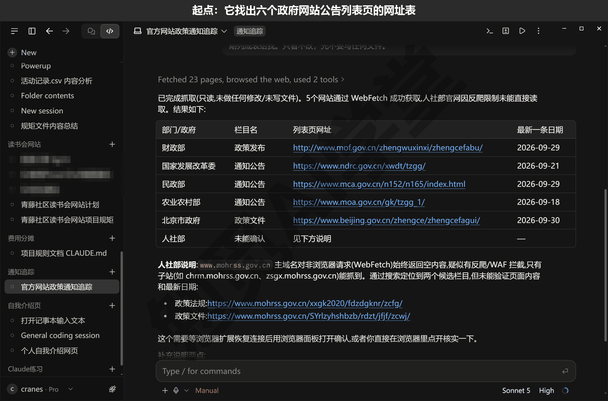

这篇文章的实操内容需要 Claude 的付费订阅（Pro 起），和前面各篇一样；19.4 的云端例行任务在 Pro 及以上套餐可用，以账号页面显示为准。

### 19.1 项目定义：追踪哪几处、只看新增

**先定目标、范围和验收标准。** 《对话与上下文管理》讲过，一条好指令要说清三件事：要做什么、做到哪里为止、怎么算做好。做一个长期跑的项目更要先把这三件事写下来，因为以后每周替你干活的是一段固定的指示，不再有你在旁边随时补一句。本篇的三件事是这样定的。目标是每周知道关注的几处官方页面新发了什么、其中哪些与自己有关。范围是只看列表页上新增的条目，不下载正文，不追踪需要登录的页面。验收标准有三条：连续跑两次以上，第二次没有新通知时新增数应该是 0；每条新增条目都带来源、日期和官方链接；周报里“本周与你有关的”每一条都能在新增条目里找到对应编号。

**关注清单：盯哪几页。** 政府网站的首页什么都有，正文页一篇一个，都不适合盯；适合盯的是“政策发布”“通知公告”这类栏目的列表页，一页几十条标题，每条带日期，新发的排在最前面。本篇定下的清单写在项目文件夹的 watchlist.json 里，每一条三样：周报里显示的来源名、列表页网址、这个源大致管什么（写给自己看，选源时不迷路）。现在这份是第二版，sources 一项里是六个源（长行按排版折行）：

```json
{"name": "财政部·政策发布",
 "url": "https://www.mof.gov.cn/zhengwuxinxi/zhengcefabu/",
 "topic": "财政补贴、税费优惠的正式文件"},
{"name": "国家发展改革委·通知",
 "url": "https://www.ndrc.gov.cn/xxgk/zcfb/tz/",
 "topic": "价格、消费、以旧换新等政策通知"},
{"name": "民政部·政策文件",
 "url": "https://www.mca.gov.cn/n152/n165/index.html",
 "topic": "低保、养老、社会救助"},
{"name": "农业农村部·通知公告",
 "url": "http://www.moa.gov.cn/gk/tzgg_1/tz/",
 "topic": "农业补贴、惠农政策"},
{"name": "北京市政府·政策文件",
 "url": "https://www.beijing.gov.cn/zhengce/zhengcefagui/",
 "topic": "北京地方性补贴与办事规定（换成你所在城市）"},
{"name": "人社部·政策法规",
 "url": "https://www.mohrss.gov.cn/SYrlzyhshbzb/zcfg/",
 "topic": "社保、就业补贴、职业培训（列表页有反爬，脚本抓不到，19.5 里讲怎么办）"}
```

**为什么是这六个。** 这六个不是一次定下来的：第一版清单有九个源，第一次运行只有三个抓到了条目（另外六个各是怎么回事，19.5 会讲），调整之后才定成这六个，其中人社部明知抓不到也留着。留它有用：脚本遇到抓取失败时只记一条日志，其他源照常抓完，有这个源在，每周都能看到这一点。你自己做的时候，源不必多，三到六个够用，但每个都要自己点开看一眼：是不是一页带日期的标题列表，最新一条是不是近期的。北京市政府那一条换成你所在的城市。

**只看新增是什么意思。** 每个列表页都挂着几十条旧通知，第一次运行把它们全部记下来当基线（基线就是第一次抓到的全部条目，以后只跟它比），之后每次运行只报没见过的链接，这就是“只看新增”。你要的是变化，不是每周把 115 条旧标题再看一遍。基线记在 data/last_snapshot.json 里，19.2 里会讲它的结构。

**让它帮你找列表页网址。** 机构名你知道，栏目网址不一定记得。新建一个会话，文件夹选演示项目（或者你自己新建的空文件夹），权限模式先用 Manual（手动）——选了新文件夹后模式会回到 Auto，看一眼底部再切回 Manual。发送：

```text
我想每周追踪几处官方网站新发的政策和补贴通知。请直接读网页，打开
财政部、国家发展改革委、民政部、农业农村部、北京市政府、人社部的官网，
分别找到“政策发布”或“通知公告”栏目的列表页，把每个列表页的网址、
栏目名和最新一条的日期列给我。只看不改，先不要写任何文件。
```

下图输入框里那次发的是旧写法“用浏览器面板打开”，所以和这里差半句：这一版的浏览器面板只开本机预览、开不了外面的网站（《内置浏览器、应用预览与电脑操控》讲过），它当时报了浏览器打不开，再改用自带的读网页工具一页一页抓；这里直接写成“读网页”，结果是一样的。

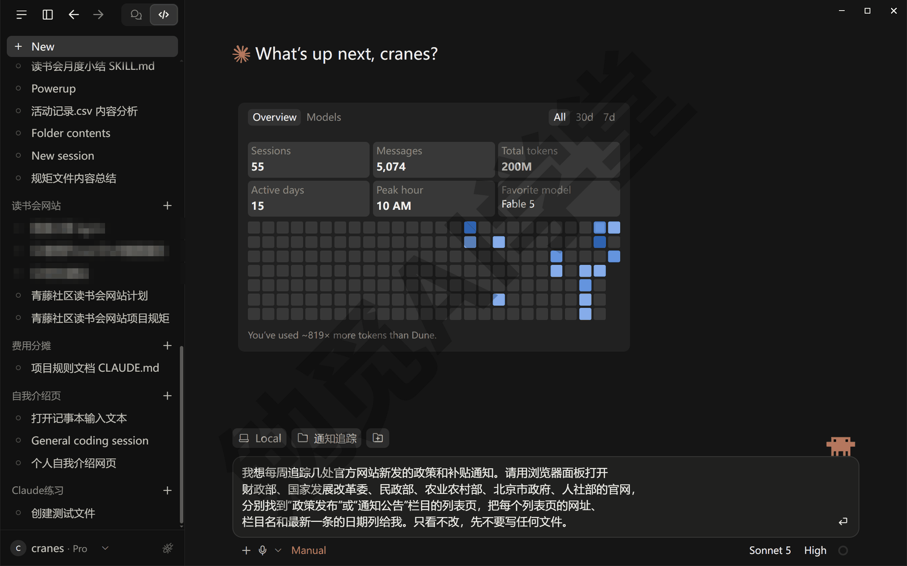

Manual 模式下每读一页都弹一张审批卡，这一轮要连着点二十几次 Allow once，几分钟后它把找到的网址、栏目名和最新日期列成一张表；抓不到的会单独说明，这次人社部就是“未能确认”，它还列了两个候选栏目。表里每一行你都自己在浏览器里点开核一遍，栏目选错了，后面抓到的都没用；人社部这种它抓不到的，你自己点开官网找到栏目页，把网址给它、说明知道抓不到也留着（为什么留着，上面“为什么是这六个”说过）。核完让它把定下的清单写成文件：

```text
把上面确认过的六个列表页写成项目根目录的 watchlist.json：
顶层一个 sources 列表，每条三个字段——name（周报里显示的来源名，
用“机构·栏目”写法）、url（列表页网址）、topic（这个源大致管什么，一句话）。
文件用 UTF-8 编码保存。
```

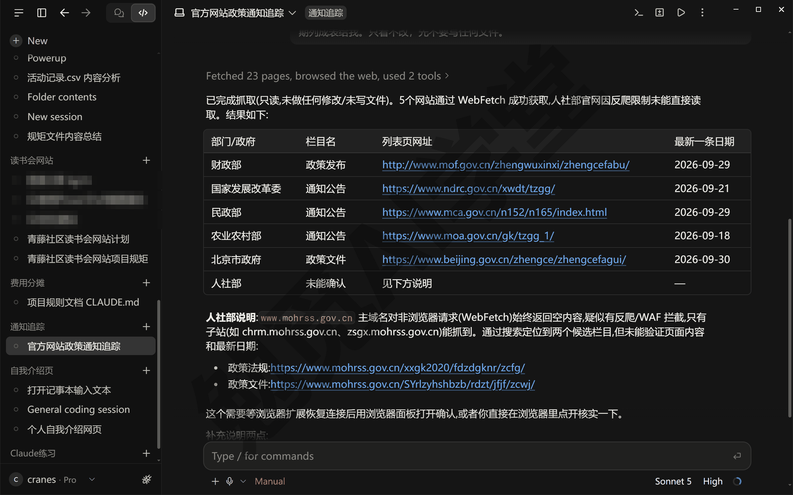

做完后项目文件夹里多了 watchlist.json，对话里会看到 Created watchlist.json 的新建文件卡片和差异计数。以后想加一个源、换一个城市，只改这个文件，脚本不用动。

### 19.2 抓取脚本与快照对比

**先分工：脚本做什么，智能体做什么。** 抓页面、找条目、和上次比、按关键词分类，这四件事每周的做法完全一样，写成脚本后同样的输入给出同样的结果，出错有日志可查，跑一次也不花你套餐里的用量；判断一条通知和你有没有关系，要读懂标题甚至正文，这件事只有智能体做得了。能写成规则的交给脚本，要理解内容的交给智能体，这和《实战二：网店订单月报流水线》里“数字由脚本算、结论由它讲”是同一个思路。

**让它写 fetch.py。** 在同一个会话里发送：

```text
按 watchlist.json 写一个抓取脚本 fetch.py，只用 requests 和 lxml 两个库，
只读页面、不登录、不提交表单。对每个源：抓列表页，找出带日期的标题链接，
每个源最多取 30 条，标题少于 8 个字的跳过；抓取失败或解析不出条目的，
只在日志里记一句原因，不要中断其他源。把见过的链接累积记在
data/last_snapshot.json 里，只有没见过的算“新增”，第一次运行全部记为基线。
新增条目按标题关键词分成“政策文件”“解读问答”“通知公告”三类，归不进的进“其他”。
每次运行生成三样：data/items-日期.json（日志加新增条目）、周报/日期.md、
更新后的快照。周报里留一节“本周与你有关的”空着，这一节以后由你读完条目再填。
写完先不要运行。
```

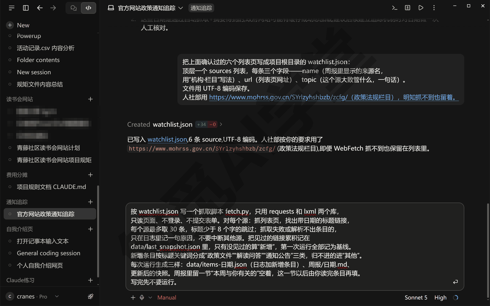

做完后文件夹里多了 fetch.py，点开差异计数能看到整份脚本，它还会把实现要点列几条、问你要不要跑一次。先别跑。看不懂代码也没关系，只核它列的实现要点里两件事：终端输出是不是“每个源一行”；第一次运行是不是把全部条目都列进周报。

这次它第一版这两处都和指令要的不一样，照着补两句让它改（你的要点里已经写对的那条就不用发）：一是终端里打印的是一行行记录格式，不是每个源一句话，补“终端输出每个源一行，‘[来源名] 抓到 N 条’或‘抓取失败：原因’，最后一行固定写‘共抓取 N 条，新增 N 条；周报：周报/日期.md’”；二是它把“第一次运行全部记为基线”理解成了第一次不列条目、周报四类都写“本次无新增”，这样 19.3 就没东西可读，补“第一次运行时没见过的链接也都算新增、都列进周报，只是总览那句写‘第一次运行：共抓取 N 条，全部记为基线’”。改完对话里是 Edited fetch.py 加减几行的卡片。

它做的四件事，对着 9 月那版脚本的写法说清楚（你的脚本细节会有出入，比如超时秒数、找日期的办法，看它的注释就行）。

**第一件：抓页面。** 用 requests 向列表页网址发一次请求，带上普通浏览器的身份标记，15 秒没回应就算失败。返回的内容不到 3000 字节也算失败：正常的列表页有几万字节，只回来几百字节的多半是一张验证页，19.5 里的人社部就是这样。

**第二件：找条目。** 用 lxml 把页面解析开（把网页源码拆成一个个元素），逐个看页面上的链接：标题不足 8 个字的、只是跳到本页某个位置的跳过；日期先在链接自己的文字里找，找不到就往上找三层，因为列表页的日期一般写在链接旁边的同一行里；日期接受 2026-09-14、2026.09.14、2026/09/14、2026年9月14日几种写法，统一成 2026-09-14。没有日期的链接不要，列表页上不带日期的链接多半是导航和栏目名。每个源最多取 30 条，够覆盖一周的新增。

**第三件：比快照。** 快照就是 data/last_snapshot.json，记着两样东西：见过的全部链接（seen），和每次运行的日期、抓到几条、新增几条（runs）。本次抓到的条目里，链接不在 seen 里的就是新增；比完把本次的链接全部并进 seen。第一次运行时 runs 是空的，脚本靠这一点判断这是第一次运行、要记基线，周报开头会写“第一次运行：共抓取 N 条，全部记为基线”。

**第四件：分类。** 只看标题，按顺序匹配三组关键词，先命中哪组算哪类（下面是 9 月那版脚本的规则，它这次写的关键词会不一样）：

| 类别 | 标题里含有 |
| --- | --- |
| 解读问答 | 解读、问答、答问、图解、一图、问题解答、政策问答 |
| 政策文件 | 通知、意见、办法、规定、条例、决定、方案、细则、规划、批复，或以“公告”“令”结尾 |
| 通知公告 | 公告、公示、通报、公布、名单、征求意见 |
| 其他 | 以上都没命中 |

这套分类很粗，它的用处只是把周报排得有条理，不负责判断“和你有没有关系”，那是 19.3 里智能体的事。19.5 会讲一个分错类的例子。

**跑第一次。** 在终端面板里输入 python fetch.py 回车（《终端、编辑器与 VS Code 扩展》讲过，按 Ctrl+`（反引号）打开终端面板，它和会话共用同一个文件夹），或者直接对它说“运行 fetch.py”，Manual 模式下它会先弹出运行命令的审批卡，看清命令再同意。requests 和 lxml 没装的话让它装上，它同样会先问你，《文件与办公能力一篇讲全》讲过一句话安装。第一次运行的输出（长行按排版折行）：

```text
> python fetch.py
[财政部·政策发布] 抓到 25 条
[国家发展改革委·通知] 抓到 25 条
[民政部·政策文件] 抓到 15 条
[农业农村部·通知公告] 抓到 20 条
[北京市政府·政策文件] 抓到 30 条
[人社部·政策法规] 抓取失败：返回内容只有 985 字节，
    不是正常的列表页（疑似反爬或页面靠脚本渲染）
共抓取 115 条，新增 115 条；周报：周报/2026-09-24.md
```

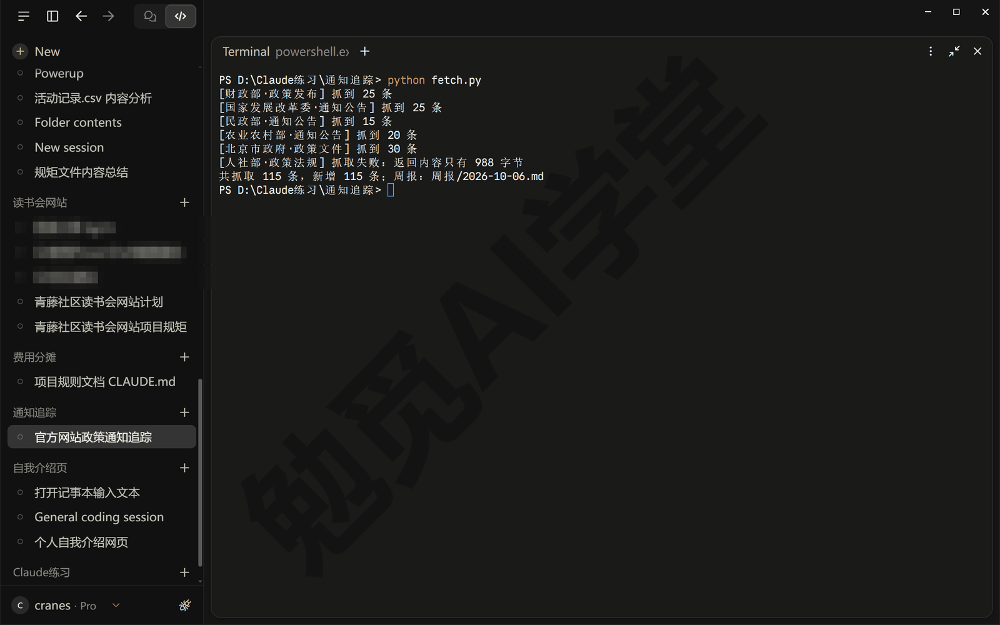

五个源加起来 25+25+15+20+30 正好 115 条，全部记为基线；人社部那一行是预料中的失败，其他五个源照常抓完，没有因为它停下。图里的来源名有两个和正文不同（它那次给发改委、民政部找到的是“通知公告”栏目），人社部那行的字节数和失败原因的措辞每次、每版脚本都不一样，看结构就行。

**再跑第二次。** 跑之前先把 周报 文件夹里刚生成的那份周报改名，文件名后面加“-基线”（比如 2026-09-24-基线.md）——同一天跑两次，第二次会覆盖第一次的文件，19.3 要读的就是基线这一份。改完名隔几分钟再运行一次：

```text
> python fetch.py
[财政部·政策发布] 抓到 25 条
[国家发展改革委·通知] 抓到 25 条
[民政部·政策文件] 抓到 15 条
[农业农村部·通知公告] 抓到 20 条
[北京市政府·政策文件] 抓到 30 条
[人社部·政策法规] 抓取失败：返回内容只有 983 字节，
    不是正常的列表页（疑似反爬或页面靠脚本渲染）
共抓取 115 条，新增 0 条；周报：周报/2026-09-24.md
```

抓到的还是 115 条，新增 0：几分钟里没有新通知，快照对比正常。这就是验收标准第一条，第二次新增应该为 0。要是第二次又报了 115 条新增，说明快照没存上或者比对写错了，先看 data/last_snapshot.json 在不在、里面的 seen 有没有内容。


**生成的文件在哪。** 运行后文件夹里有三处变化。data/items-2026-09-24.json 记着这次的日志和新增条目，第二次运行时新增条目是空的。周报 文件夹里现在有两份：改了名的 2026-09-24-基线.md 是第一次跑出来的，2026-09-24.md 是第二次的，19.3 读的是基线那一份。data/last_snapshot.json 是快照，第二次运行后是这样的（节选）：

```json
{
 "seen": ["http://gks.mof.gov.cn/…", "…共 115 条链接"],
 "runs": [
  {"date": "2026-09-24", "fetched": 115, "new": 115},
  {"date": "2026-09-24", "fetched": 115, "new": 0}
 ]
}
```

周报和日志文件都按日期命名，同一天跑两次，第二次会覆盖第一次的文件，所以上面第二次跑之前让你先把基线那一份改了名。每周只跑一次不会遇到这个问题。

### 19.3 周报：让它写“本周与你有关的”

**周报里有什么。** 打开 周报/2026-09-24-基线.md（19.2 让你改名留下的第一次那份），从上到下四段：一句总览，第一次运行写“全部记为基线”，之后写“与上次相比新增 N 条”；抓取日志，六个源各一行；“本周与你有关的”，脚本留空；新增条目，按类别分组，每条一行写标题、来源、日期、官方链接。基线那一份的新增条目一节开头是这样的（网址略，长行按排版折行）：

```markdown
## 新增条目

### 政策文件（97 条）

1. 《紧急采购管理暂行办法》印发｜财政部·政策发布｜2026-09-14｜[官方链接](…)
2. 《关于加快农业保险高质量发展的实施方案》印发｜财政部·政策发布｜
   2026-09-11｜[官方链接](…)
3. 《改善普通高中学校办学条件补助资金管理办法》修订印发｜财政部·政策发布｜
   2026-09-01｜[官方链接](…)
```

9 月那次的 115 条基线分成政策文件 97 条、通知公告 2 条、其他 16 条，解读问答这一组是 0；重做时它写的关键词不同，分出来的四组多少也不同。各组多少条不重要，分类只是把周报排整齐，看下一块。

**为什么这一节要留给它写。** 脚本分类只看标题里有没有某个词，分不出“这条补贴你能不能领”。基线那 115 条里，有石油天然气的五年规划，也有普通高中办学条件补助资金的管理办法，哪条和你有关，取决于你是谁、住在哪、做什么。这件事要读懂内容再判断，所以交给智能体。脚本在周报里给它留的那一节，9 月那版脚本写的是这样一段（你的脚本可能只留一行“（待补充）”，看它写了什么）：

```markdown
## 本周与你有关的

（留空，交给智能体填写：读完下面“新增条目”里的每一条再写，3～5 条，
每条括号里注明分类与条目编号；只写与本人／本店直接有关的补贴、报销、
申报事项，纯部门内部事务跳过；拿不准是否有关的写“待确认”。）
```

**先把“你是谁”写进规矩文件。** 它要判断“与你有关”，得先知道你是谁。这句话每周都要用，写进项目的 CLAUDE.md 最合适，《CLAUDE.md 与规则》讲过，项目文件夹里的 CLAUDE.md 每次开会话它都会先读；会话中途才加的，它按指令里的“按 CLAUDE.md 里写的身份”也会自己去找来读。三条就够，方括号里的内容换成你自己的：

```markdown
# 政策与补贴通知追踪 · 项目规矩

- 我是[北京]的[个体网店店主，家里有一位 70 岁以上的老人]，关心的是：
  [网店经营相关的税费优惠与补贴、老年人补贴与社会救助、北京市的办事规定]。
- 写“本周与你有关的”时只挑与上面身份直接有关的条目，每条注明分类与编号，
  拿不准的写“待确认”；纯部门内部事务跳过。
- 不要修改 fetch.py 和 watchlist.json，除非我明确要求。
```

**让它写要点。** 发送（文件名换成你最新一份周报的）：

```text
读 周报/2026-09-24-基线.md 里“新增条目”的每一条（先看标题、来源和日期，
拿不准的可以打开官方链接看正文），按 CLAUDE.md 里写的身份，
挑出与我直接有关的 3～5 条，写成“本周与你有关的”：每条一句话说清
这条通知要我做什么或者能领什么，括号里注明分类和条目编号，
拿不准的标“待确认”。直接写进周报文件的那一节，别的内容不要动。
```

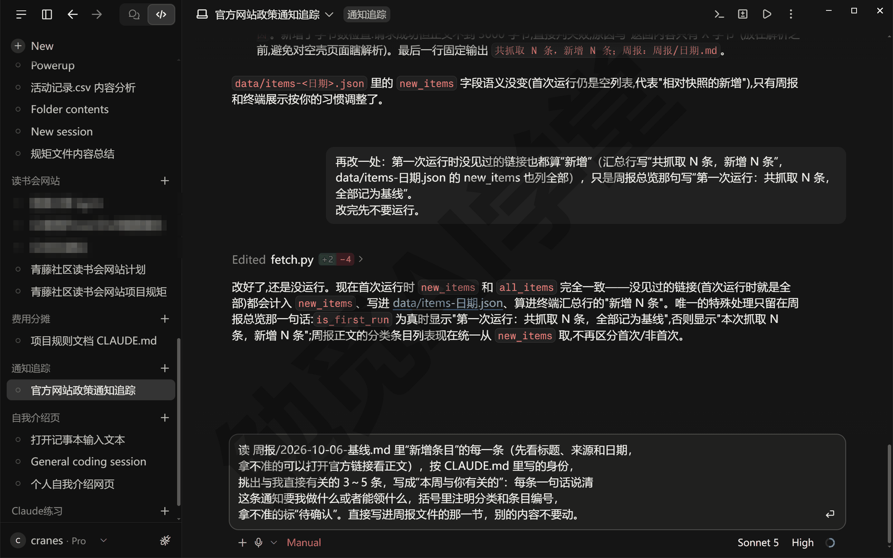

它会先读 CLAUDE.md 和周报，逐条看新增条目，拿不准的几条用自带的读网页工具打开正文（Manual 模式下每读一页弹一张审批卡，这次读了 5 页），几分钟后把写好的要点填进周报里“本周与你有关的”那一节，对话里能看到 Edited 周报文件 +5 −1 这样的改文件卡片，点开能看到它删掉占位、加上几条的差异；回复里还会说明每条为什么挑。写出来的每一条是这个样子（这次它写成了无序列表，编号写“第 N 条”）：

```markdown
- [一句话：这条通知要你做什么／能领什么、截止到什么时候]（通知公告 第 39 条，待确认）
```

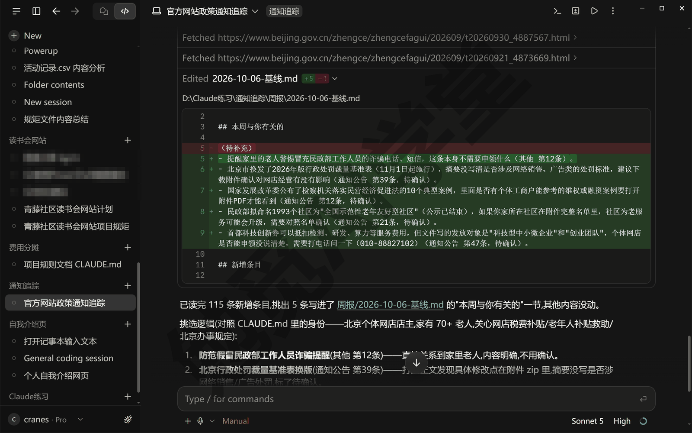

**条条有出处，怎么验。** 括号里的“通知公告 第 39 条”就是出处：翻到新增条目里“通知公告”组的第 39 条，标题、日期、链接都在。验收只做两件事。每条的编号都要能在新增条目里对上，对不上的说明它写的不是这次新增的内容。再随手点开一两条的官方链接，看正文说的和它那一句是不是一回事。发现它把拿不准的写成了肯定句，回一句让它改：拿不准的必须标“待确认”，宁可多标。

**没有新增的那周。** 第二次运行的周报里新增条目一节写着“本周无新增”（或者各组都是“无”，看它怎么写），这时不用让它写要点。下一篇《毕业项目：家庭事务中心 + 课程总结》里汇总这份周报的页面会显示“本周要点待填写”，那不是出错，是这一节还空着的正常状态，19.4 的云端任务会让它在这种时候写一句“本周无新增”。

### 19.4 做成每周云端例行任务

**为什么这一篇用云端。** 《定时任务、钩子与自动化》讲过定时任务的三种做法，本机的三种都要桌面应用开着、电脑醒着；云端例行任务（桌面应用里叫 Cloud）在 Anthropic 的机器上跑，电脑关着也跑，前提是项目放在 GitHub 仓库里。《实战二：网店订单月报流水线》没选云端，因为订单表里有顾客信息，不该离开电脑；本篇正好反过来，抓的是公开网页，项目里没有任何隐私，一周只跑一次，正适合交给云端。

**三个前提。**

- **项目要在 GitHub 上，并且你的 Claude 账号连上了 GitHub**：云端每次运行都是从仓库重新复制一份开始的；电脑上的 gh 登录和这个是两回事，Claude 账号要另外装 Claude 的 GitHub App 并把这个仓库授权给它（《云端会话与手机端》讲过），没连的话表单里选不到仓库。
- **云端环境的网络访问要放开**：新建环境时网络访问默认推荐 Trusted（受信任），只放行一批常见的开发网站（软件包源、代码托管这类），政府网站不在名单里，脚本一访问就会被拒；要把 Network access（网络访问）改成 Custom（自定义），把六个网站的域名（网址开头那一段，比如 www.mof.gov.cn）一行一个加进 Allowed domains（允许的域名），并勾上下面“同时带上常见软件包源”那一项，不然装不了库；或者直接选 Full（不限制）。只加列表页的域名就够，正文页多半在别的子域名上，所以云端的指示里让它只看标题、不打开正文。
- **requests 和 lxml 要在云端装一遍**：环境的 Setup script（启动脚本）里写一行 pip install requests lxml。第一次运行时启动脚本会跑，跑完的结果会缓存下来，之后直接用；缓存大约七天过期，改了脚本或允许的域名也会重跑，所以每周跑一次的任务，启动脚本多半每次都会再跑一遍。指示里再让它先检查、没装就装，两头都保一下。

**第 1 步：把项目放到 GitHub。** 在项目的会话里发送下面这段。它会做的事《Git、GitHub 与代码审查》13.3 节讲过：先查 git、gh 装没装、gh 登没登录（只看不改，不弹卡），再初始化仓库、写 .gitignore、提交、用 gh 在你的账号下建仓库并推上去，会改东西的命令每条弹一张审批卡（这次七张），最后把仓库网址和提交里有哪几个文件列给你。末句“主分支用 main”是为了不让它建出叫 master 的主线，《实战三：旅行费用分摊计算器》遇到过。

```text
把这个文件夹初始化成 Git 仓库，data 和 周报 两个文件夹一起交给 Git 管理，
__pycache__ 加进 .gitignore；提交一次，说明写“通知追踪第一版”；
然后在我的 GitHub 账号下新建一个私有仓库 policy-watch 并推上去，
把仓库网址告诉我。
主分支用 main。
```

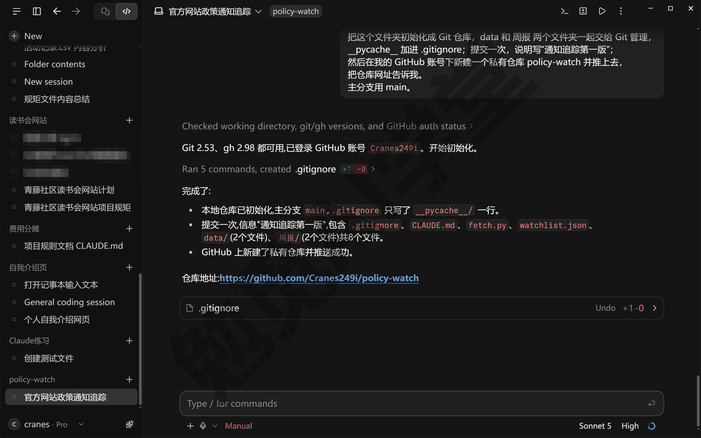

**第 2 步：新建云端例行任务。** 在 Code 页签的侧栏里点 Routines（例行任务）；侧栏里看不到的话，把鼠标移到侧栏顶部 New 一带，Projects／Artifacts／Customize／More 几项才会显出来，在 More 菜单里找，点过一次它就升到侧栏一级入口。进了 Routines 页，点右上角的 New routine（新建例行任务），这次选 Cloud（云端），另一项 Local（本机）是《定时任务、钩子与自动化》用的本机例行任务。同一个表单在网页 claude.ai/code/routines 上也有，建的任务是同一份，在哪建都行。

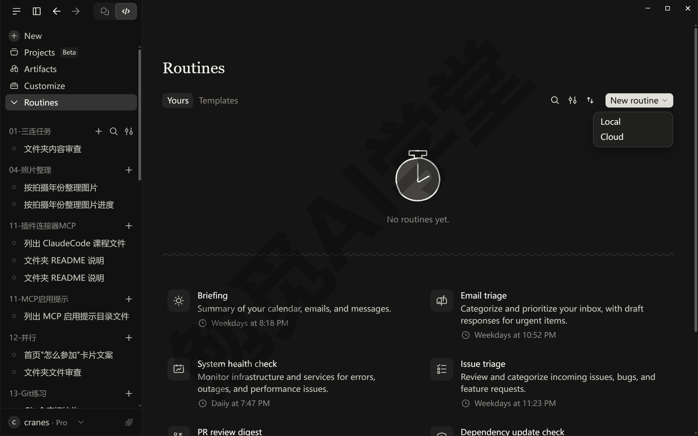

**第 3 步：填表单。** 表单从上到下是这几块：

- **名称和指示**：Name（名称）填 policy-watch-weekly 这类；Instructions（指示）是每次运行它要做的整件事，写法见下面这段；指示框右下角能选这次运行用的模型，留默认就行。
- **仓库**：指示框底下点 Select a repository（选择仓库），选第 1 步推上去的那个；私有仓库在列表里不一定直接列出来，在搜索框里输全名（比如 Cranes249i/policy-watch）才搜得到；下拉里是空的、提示你 Connect to GitHub，就是前提一没做，点它去浏览器授权。每次运行从它的主分支 main 复制一份。
- **环境**：旁边点 Select a cloud environment（选择云端环境）。下拉里没有现成的环境（这个演示账号就没有），点 Add cloud environment（添加云端环境）新建一个：Name 起个名（比如 policy-watch），Network access 选 Custom、填六个域名、勾上带常见软件包源，Setup script 里写安装命令，API credentials 和 Environment variables 本篇不用，点 Add environment（添加环境）。有现成环境的也建一个专用的，域名单独放开。
- **触发器**：Select a trigger（选择触发器）有三种——Schedule（按时间表）、GitHub event（仓库上有动静时）、API（你自己的程序来触发），选 Schedule。它先生成一条“每天在当前时刻跑”，点进去把预设改成 Weekly（每周）、挑星期几和时间（预设有 Once、Hourly、Daily、Weekdays、Weekly、Custom 六档）；时间按你的本地时区显示，实际开始会比定的时间晚几分钟。
- **连接器**：下面 Connectors（连接器）页签默认把你账号里连着的连接器全带上（这次是两个），点每个右边的 × 去掉；页签上的黄色提示说的就是这件事——运行时它用这些连接器不会再问你，连会改东西的操作也不问，所以用不到的都去掉。旁边 Behavior／Notifications 两个页签先不用管。

指示这样写：

```text
这是每周一次的政策与补贴通知追踪。步骤：
1. 在仓库根目录运行 python fetch.py（requests、lxml 没装就先装）。
2. 打开 周报/ 里今天日期的那份周报，读“新增条目”里每一条的标题、来源和日期
   （不打开正文），按 CLAUDE.md 里写的身份写“本周与你有关的”（3～5 条，
   每条注明分类与编号，拿不准的标“待确认”）；新增为 0 就在那一节写“本周无新增”。
3. 把 data/ 和 周报/ 的改动提交，说明写“周报 <日期>”，直接推送到 main。
4. 最后把“本周与你有关的”那一节原样贴在回复末尾。
不要改 fetch.py 和 watchlist.json；只读网页，不登录、不提交表单。
```

第 3 条为什么要推回 main：下周的运行是从仓库重新复制一份开始的，这周更新过的快照不推回去，下周它就会把这周的 115 条再当新增报一遍。仓库是你自己的、只有你的提交，它推 main 不会被拦。运行结束时系统还会自动把这次的提交再推到一条 claude/ 开头的分支上，那是云端会话的固定做法，不影响 main，也不会开合并请求，不用管它。

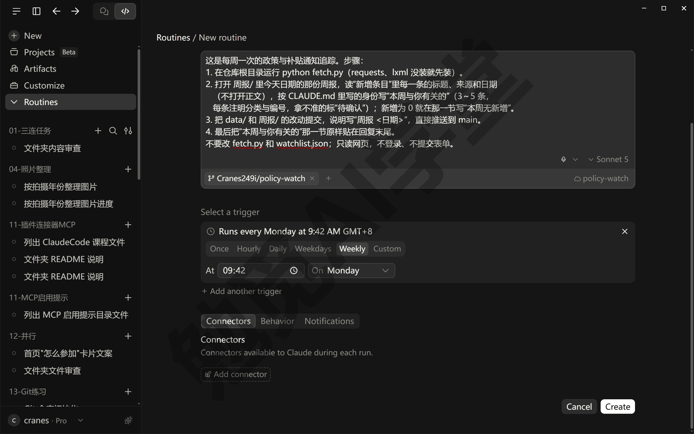

**第 4 步：先手动跑一次，再等每周。** 点 Create（创建）后直接进这个任务的详情页，History（运行历史）还是空的，里面有一个 Run now（立即运行）按钮，点它（跑过一次之后这个按钮挪到右上角，是一个 ▷ 图标）。每次运行都是一个新的云端会话，出现在侧栏的 Routines（例行任务）分组里，点开能看到它读了什么、跑了什么、贴出来的要点是什么，右边会自动开着一个 Runs（运行记录）面板。

官方文档专门提醒过一件事：Runs 面板里的 Completed（已完成）只说明这次会话正常开始和结束，不代表你交的事做成了，要点开会话读一遍记录才知道。第一次运行看三样：抓取日志里哪几个源抓到了条目、人社部一行是失败；仓库里多了一次“周报 <日期>”的提交；回复末尾贴出了要点，没有新增就是“本周无新增”。三样都对，以后每周它自己跑。

这次演示的第一次云端运行就没有全对：状态是 Completed，可六个源只有财政部和发改委抓到了（共 50 条），民政部、农业农村部、北京市政府三个在云端连不上（日志里的“代理返回 502”“连接被重置”都是连不上的意思），加上人社部本来就抓不到的那一个，正好六个；它在回复里把这一点说清了，还提醒“本周无新增”不可靠、建议稍后重跑。云端出口连某些政府网站就是不稳，遇到了多试几次、换个时间，实在不行这几个源回本机跑（下面“边界与用量”里的本机做法）。

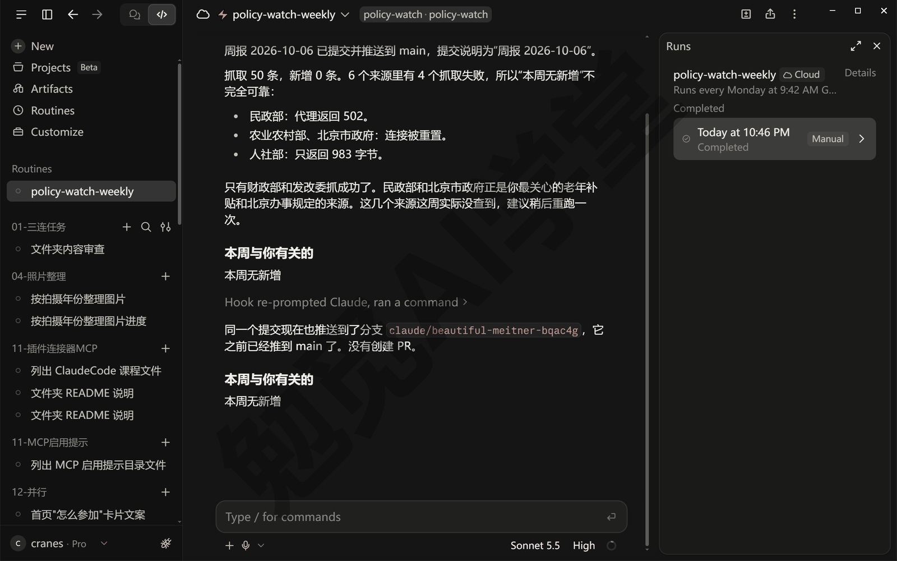

**手机上收结果。** 每次运行都是云端会话，《云端会话与手机端》讲过，手机 App 里能打开同一份云端会话列表，看它做到哪、回答它的问题（入口的名字和位置需实机验证）。因为指示里让它把要点贴在回复末尾，你在手机上点开那次运行的会话，翻到最后就是本周要看的几条，不用打开仓库找文件；做完它会发一条通知，把结果概括成几句（这次通知里就说了四个来源抓取失败、建议重跑），手机上装着 App 的话会收到推送，形态以实际表现为准。想在电脑上看完整的周报，打开仓库里 周报/ 文件夹的最新一份。

**边界与用量。** 云端运行同样从你的套餐用量里扣，另外每个账号每天能启动的例行任务次数有上限，每周一次离上限很远。GitHub 连接过期时它会跳过运行，最多等你三天，三天内重新连上会自己接着跑；超过三天任务会被关掉，要你到任务详情页右上角把开关从 Paused（已暂停）再点成 Active（启用）；平时想停掉任务也是这个开关，关掉只停触发器，任务和运行历史都还在。云端不会向你请求权限，所以边界要写进指示里：只读网页、只改 data/ 和 周报/、不改脚本。

如果你不想用云端，本机也有两种做法：《定时任务、钩子与自动化》15.2 的本机例行任务，应用开着、电脑醒着才跑；《实战二：网店订单月报流水线》17.6 的 Windows 计划任务，把那条注册命令里的 `/SC MONTHLY /D 1` 换成 `/SC WEEKLY /D MON`、要执行的命令换成运行 fetch.py 就行，它只跑脚本、不写要点。

### 19.5 翻车实录：抓不到、抓错、误报

**第一版清单的第一次运行。** 演示项目的清单不是一次定下的。第一版有九个源，第一次运行只有三个抓到了条目：财政部 25 条、农业农村部 20 条、北京市政府 30 条，共 75 条记为基线；另外六个源分成两种情况。四个源“抓到了页面但解析不出条目”，脚本的日志是这样一句：

```text
[国家医保局·通知公告] 抓取失败：未解析到符合条件的条目
```

两个源“页面本身就没拿到”：

```text
[人社部·政策法规] 抓取失败：返回内容只有 988 字节
[工信部·政策文件] 抓取失败：返回内容只有 2116 字节
```

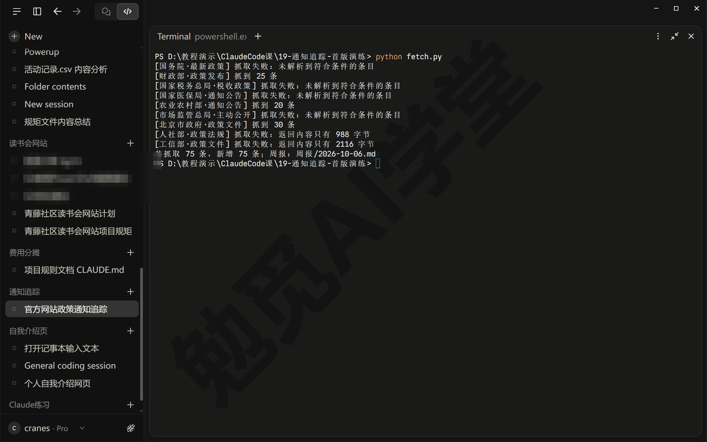

六个源逐个点开看，原因各不相同：

| 源 | 现象 | 原因 |
| --- | --- | --- |
| 国务院·最新政策 | 抓到两万多字节的页面，解析不出条目 | 列表由页面里的程序在打开后才去取，直接请求只拿到一个空壳 |
| 国家税务总局·税收政策 | 抓到页面，解析不出条目 | 选错栏目：这一页停在 2021 年，条目后面跟的是文号不是日期 |
| 国家医保局·通知公告 | 抓到 8419 字节的页面，解析不出条目 | 栏目号抄错，抓的是“局领导”简介页 |
| 市场监管总局·主动公开 | 抓到 9193 字节的页面，只有 11 个链接 | 这是子栏目的导航页，不是列表页 |
| 人社部·政策法规 | 只返回几百字节（这次 988） | 一张验证页，网站有反爬 |
| 工信部·政策文件 | 只返回 2116 字节 | 一张验证页，网站有反爬 |

**抓不到：反爬与脚本渲染。** 反爬是网站专门挡自动抓取程序的机制，网站判断来访问的不是浏览器，就只回一张几百字节的验证页；脚本渲染是另一种情况，列表不是写在网页里的，而是网页打开后由页面里的程序再去取的，脚本拿到的只是一个空壳。两种情况脚本都拿不到条目，处理办法一样：先换这家机构的另一个栏目页，同一家机构不同栏目的做法可能不一样，一个栏目挡了，另一个也许是普通页面；实在换不到，就不用脚本：让它用 Claude in Chrome 扩展在你的 Chrome 里打开这一页，把标题和日期抄下来（以实际表现为准）。

为什么只有这个办法能用：这一版的浏览器面板开不了外站；它自带的读网页工具和脚本一样，拿不到验证页后面的内容、也拿不到靠程序才显示出来的列表；Chrome 扩展打开的是真正的网页，页面里的程序会正常运行（《内置浏览器、应用预览与电脑操控》讲过三者的分工）。这个办法补几条可以，每周都这样做不划算，所以演示项目把人社部留在清单里，不去抄它，只让它每周演示一次“失败只记日志、其他源照常抓”；你也照这样做，装不装扩展由你决定。

**抓错：选错栏目。** 三个源抓到了页面却抓错了东西，都是网址选错。税务总局那一页停更在 2021 年，条目后面跟的是文号，脚本按“带日期的链接”找条目自然一条都找不到；医保局那一页的栏目编号抄错了一位，打开是领导简介；市场监管总局那一页是一堆子栏目的入口，只有 11 个链接。这三种错脚本判不出来，它只知道“解析不出条目”，要靠你自己点开网址看一眼：是不是一页带日期的标题列表，最新一条的日期是不是近期。这就是 19.1 让它找完网址后要你逐个核一遍的原因。

**误报一：换清单后忘了重建基线。** 第二版清单加了国家发展改革委和民政部两个新源，如果留着第一版的快照直接跑，这两个源的 40 条会全部算“新增”，而它们其实是几个月里陆续发的旧通知。处理办法是清单一改就删掉 data/last_snapshot.json，让下一次运行重新记基线，演示项目就是这样做的：删掉快照，重跑一次，115 条全部记为基线。只改分类关键词、不改源，不用删快照。

**误报二：分类只看标题。** 基线里“2026年度民政部地名研究所社会公开招聘面试公告”被归进了“政策文件”，因为标题以“公告”结尾，脚本规则把以“公告”结尾的算政策文件。招聘公告显然不是政策，可脚本只认字，不认意思。这种分错类不影响 19.3 的结果，智能体读一遍就会跳过它；想让周报本身更干净，就补一条“招聘、面试、笔试的标题归其他”的规则，19.6 的任务一会练。

**出了问题先怎么做。** 遇到这三种翻车，你都从同一步开始：先看日志原文。抓取日志每个源一行，写着抓到几条或者失败在哪；把那一行原样发给它，让它先找原因、不改代码，找到了再决定是换网址、删快照还是改规则。《实战二：网店订单月报流水线》里对复算不一致也是这个做法：先看差在哪，再动手。

### 19.6 三个练习任务

下面提示词里方括号的内容，换成你自己的。

**任务一：加一个源，重建基线，再补一条分类规则**

```text
把 [你所在区县政府网站的通知公告栏目] 加进 watchlist.json，
先读一遍这个页面确认它是一页带日期的标题列表；然后删掉
data/last_snapshot.json 重新记基线，跑两次 fetch.py，第二次新增应该为 0。
另外在 fetch.py 的分类规则里加一条：标题含“招聘”“面试”“笔试”的归“其他”，
改完把基线周报里受影响的条目数报给我。
```

完成标准：watchlist.json 多了一条；两次运行的输出第一次全部记为基线、第二次新增 0；招聘类标题不再出现在“政策文件”组里。

**任务二：改成每天跑的日报**

```text
把这个项目改成每天早上 8 点跑一次：在 Routines 里把任务的触发器改成 Daily；
指示里只改说法：回复末尾那一节叫“今日与你有关的”，提交说明写“日报 <日期>”，
新增为 0 的日子只写一句“今日无新增”、不写要点；周报/ 文件夹、fetch.py
和周报文件里的节名都不动。改完先 Run now 一次，把这次运行的回复贴给我看。
```

完成标准：任务详情页里的计划变成每天一次；手动运行的那次会话末尾贴出了要点或者“今日无新增”；你能说出日报比周报多花的是什么（多跑六次脚本不花用量，多读六次新增条目花用量）。

**任务三：把要点发到你的邮箱（需要邮箱连接器）**

```text
用 [你连接好的邮箱连接器，例如 Gmail] 把本周周报里“本周与你有关的”那一节
发到 [你的邮箱]，邮件标题写“政策通知周报 <日期>”，正文就是那几条要点，
每条保留分类与编号。发之前先把邮件内容贴给我确认。
```

完成标准：邮箱里收到了这封邮件，内容和周报里那一节一致；它发送前先给你看过内容；你要是没有邮箱连接器，《插件、连接器与 MCP》讲过怎么接，或者把这条改成“把要点另存成一个 txt 文件”。

### 19.98 本篇小结与自检

这一篇把“每周盯几处官方公告页”做成了一件自动的事：先定目标、范围和三条验收标准，让它抓过六个网站、自己点开核过六个列表页，写进 watchlist.json；让它写出只读不登录的 fetch.py，抓页面、找带日期的条目、和快照比只留新增、按标题关键词分四类，第一次运行 115 条记为基线、第二次新增 0；周报里“本周与你有关的”留给它读完条目再写，每条带分类与编号，身份写进 CLAUDE.md；然后把项目推上 GitHub，建成每周一次的云端例行任务，环境里放开政府网站的域名、指示里让它把快照推回 main、要点贴在回复末尾，手机上点开会话就能看；最后回放了第一版九个源里六个源的三种翻车。

可以对照下面的清单检查学习结果：

- [ ] 能说出这个项目为什么把抓取交给脚本、把“与你有关”交给智能体
- [ ] 知道列表页和首页、正文页的区别，会自己点开一个网址判断它是不是合格的源
- [ ] 跑过两次 fetch.py，第一次全部记为基线，第二次新增 0，知道快照文件在哪
- [ ] 能讲清周报的四段各是什么，知道“本周与你有关的”为什么留空
- [ ] 让它写过一次要点，验过每条的编号能在新增条目里对上
- [ ] 知道云端例行任务的三个前提，能说出为什么要把快照推回 main
- [ ] 知道 Runs 面板里的 Completed 不等于任务做成了，要点开会话看记录
- [ ] 能说出抓不到、抓错、误报各是什么情况，遇到时先看哪一行日志

完成这些内容后，你手里有了一个每周自己跑、只把和你有关的几条送到手机上的追踪器，也把“脚本做确定的事、智能体做要判断的事”这条分工用到了一个长期项目上。下一篇《毕业项目：家庭事务中心 + 课程总结》把四个实战的成果汇成一页家庭事务中心，用三个会话做三套版式挑一版，走一遍云端接力与代码审查上线，最后做全课的总结。

### 19.99 新手常见问题

**Q1：网站改版了怎么办？**

改版后最常见的是两种表现：这个源的日志变成“抓到页面但没解析出带日期的条目”，或者抓到的条数突然变少。先自己打开网址看一眼，栏目搬家了就换新网址，页面结构变了就把网址和日志那一行发给它，让它看着新页面改 fetch.py 里找条目的写法。改完照 19.5 误报一的做法处理基线：只改了脚本、没换源，快照可以留着；换了网址，删掉快照重新记基线。

**Q2：能不能追踪需要登录的页面？**

本篇不做。脚本只读公开页面，不登录、不提交表单，这既是为了简单，也是边界：账号和密码不该写进脚本，更不该放进云端的仓库里。确实要看登录后的页面，在本机做：用 Claude in Chrome 扩展（《内置浏览器、应用预览与电脑操控》讲过，它用的是你自己 Chrome 里的登录状态）让它在你登录过的网站上抄条目，以实际界面为准；这类页面不要做成云端任务。

**Q3：用量会不会很大？**

不会大。fetch.py 是普通脚本，运行它不花套餐用量；花用量的只有 19.3 那一步，它读一遍新增条目再写几条要点。每周新增一般是几条到几十条，读起来很快；只有第一次记基线那 115 条让它全读一遍花得多一些。云端运行同样从套餐里扣，另有每天启动次数的上限，每周一次远远用不到。想更省，把指示里的“打开官方链接看正文”改成“只看标题”，拿不准的它会标“待确认”，由你自己点开。

**Q4：抓政府网站的页面合适吗？**

本篇抓的是公开发布给所有人看的通知列表，只读、每周一次、不登录、不提交任何表单，和你自己每周打开这些页面看一遍是一回事，只是由程序代劳。守住三条：频率低，一周一次足够；遇到反爬就换栏目，或者自己在浏览器里打开看，不去绕过它；只抓列表页，不批量下载正文和附件。
