## 毕业项目：家庭事务中心 + 课程总结

这一篇是全课的毕业项目，也是最后一篇。项目本身是把前四个实战的成果汇成一页“家庭事务中心”：读书会接下来几场的安排、网店上个月的销售数字、旅行费用分摊的结果、政策通知周报的要点，四块内容一页看完。做法上把课程后半段学的几样能力再连起来用一次：三个会话各做一套版式、并排挑一版；本机做一半送到云端接着做，手机上看进度；开合并请求、跑一次代码审查，再发到网上。项目做完，后半篇做全课的总结：一张功能对照表帮你验收二十篇学到的东西，Claude Code、Cursor、Codex 三门课怎么分工，接下来学什么。

本篇的页面、脚本、Git 历史与运行输出，来自演示项目 D:\教程演示\ClaudeCode课\20-家庭事务中心（2026 年 9 月，Windows 电脑上）；它读的四份数据来自《实战一：社区读书会网站》《实战二：网店订单月报流水线》《实战三：旅行费用分摊计算器》《实战四：政策与补贴通知追踪》四个演示项目，内容全部虚构。做好的页面发在 https://cranes249i.github.io/family-hub/ ，任何人都能打开看。对话过程中的界面画面以你看到的为准；同一件事做两遍，图里的提交编号、工作树文件夹名和正文不一定一字一样，数字是一样的，以你自己做出来的为准。

先看做出来的样子（动图）：三个工作树各做一套版式、并排挑一版合入，页面上四个面板一页看完；送到云端接着做并开出 PR，跑一次代码审查，最后发到网上。

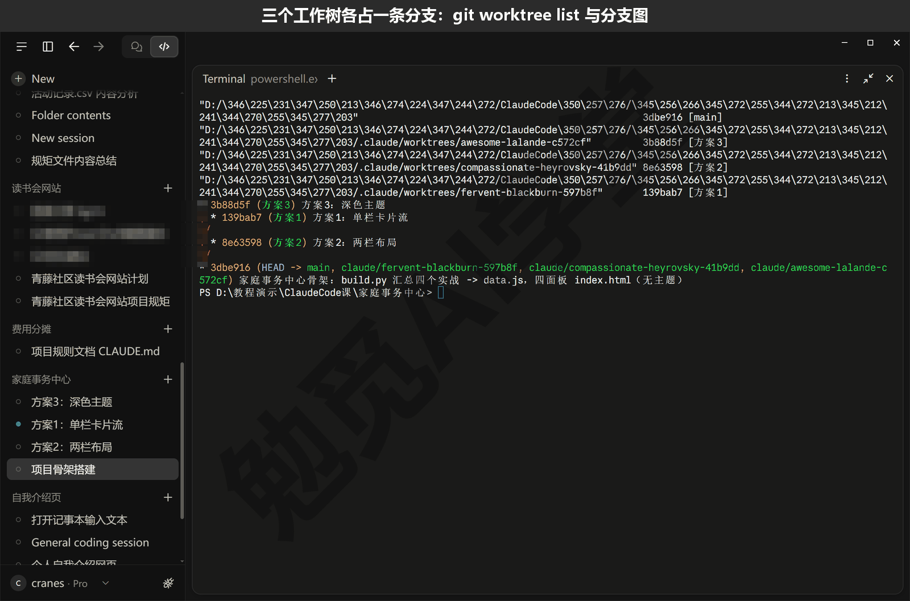

这篇文章的实操内容需要 Claude 的付费订阅（Pro 起），和前面各篇一样；上线用到的 GitHub 账号与 GitHub Pages 是免费的。

### 20.1 项目定义：四个作品汇成一页

**为什么要汇成一页。** 四个实战做完，成果散在四个文件夹里：读书会的日程在网站的数据文件里，月报在一份 Excel 和一个 summary.json 里，分摊结果要打开计算器页面才看得到，通知周报每周一份 md 文件。想知道“这周家里有什么事”，得开四个地方。家庭事务中心解决的就是这件事：一页，四个面板，各自从对应的项目取数据，每次重跑一个脚本就更新。

**先把规矩写进 CLAUDE.md。** 《CLAUDE.md 与规则》讲过，项目文件夹里的 CLAUDE.md 每次开会话它都先读。这个项目的规矩全文如下：

```markdown
# 家庭事务中心 · 项目规矩

- 这是毕业项目：把前四个实战的成果汇成一页静态网页（读书会日程、网店月报、
  旅行费用分摊、政策通知周报），页面本身不做计算、不抓取，只读 `data.js`。
- 数据一律由 `build.py` 从四个实战文件夹按相对路径取（四个项目文件夹和本文件夹
  放在同一个上级目录里），要更新就重跑 `python build.py`，不许手改 `data.js`。
- 分摊规则只用《旅行费用分摊计算器》的 `split.js`，由 `build.py` 原样复制过来，
  不许在本项目里另写一套算法。
- 纯静态、简体中文、手机能看；不引外部脚本；不放任何真实个人信息。
- 主题样式放 `style.css`；做新主题开工作树、各自提交、各截一张整页图再比。
- 回复一律用简体中文；改文件之前先说一句打算改哪里。
```

前三条是这个项目最要紧的。页面不做计算，只读一份数据文件：算的事四个项目各自已经算对、验证过了，这一页再算一遍就多一处会错的地方。数据由 build.py 取、不许手改 data.js：手改的数字下次重跑就没了，也对不上来源。分摊只用《实战三：旅行费用分摊计算器》里那份 split.js 的原样复制：那一篇写了七组测试保护它，这里再写一遍公式，两处算出来的数可能不一样。这三条合起来是同一个意思：每个数字只有一个出处，就是算出它的那个项目。

**数据从哪来。** build.py 按相对路径去四个项目文件夹取，所以四个项目文件夹和这个文件夹要放在同一个上级目录里，演示项目都在 D:\教程演示\ClaudeCode课\ 下：

| 面板 | 来源文件 | 取什么 |
| --- | --- | --- |
| 读书会日程 | 16-读书会网站/data/events.json | 接下来几场的日期、书目、领读人、报名状态，往期到场人数 |
| 网店月报 | 17-订单月报/output/summary.json | 月份、销售额、有效订单数、客单价、退款、按平台与按品类、卖得最多的三件 |
| 旅行费用分摊 | 18-费用分摊/split.js 与 data/trip.json | 规则文件原样复制，行程数据交给页面里的 split.js 现场算 |
| 政策通知周报 | 19-通知追踪/周报/ 里最新一份 | 总览句、“本周与你有关的”要点、各类别新增条数 |

**验收标准三条。** 四个面板显示的数字要和来源项目一致，分摊总额、月报销售额这些数不能只是看着像；手机上打开，四个面板自动排成一列，能看清；有一个公开网址，家里人扫码或者点链接就能打开。

**让它搭骨架。** 在四个实战项目的上级目录里新建一个空文件夹（比如 家庭事务中心），先把上面的 CLAUDE.md 放进去。新建一个会话，文件夹选它，第一次打开一个新文件夹会先弹 Trust this workspace?（信任此工作区）对话框，点 Trust workspace；权限模式用 Accept edits（自动接受编辑）——选完文件夹模式会回到 Auto，看一眼底部再切。下面指令里 16-读书会网站 等四个文件夹名换成你自己起的那四个，发送：

```text
按 CLAUDE.md 做这个项目的骨架：写 build.py，按相对路径读上级目录里
16-读书会网站/data/events.json、17-订单月报/output/summary.json、
18-费用分摊/data/trip.json 和 19-通知追踪/周报/ 里最新一份周报，生成 data.js；
把 18-费用分摊/split.js 原样复制过来。写 index.html 放四个面板（读书会日程、
网店月报、旅行费用分摊、政策通知周报），分摊面板直接调用 split.js 算总额、
每人应付和最少转账；style.css 先只写素色的基本样式，主题留到后面做。
周报里“本周与你有关的”没填时，面板显示“本周要点待填写”，不要报错。
写完运行 python build.py，把输出贴给我。
```

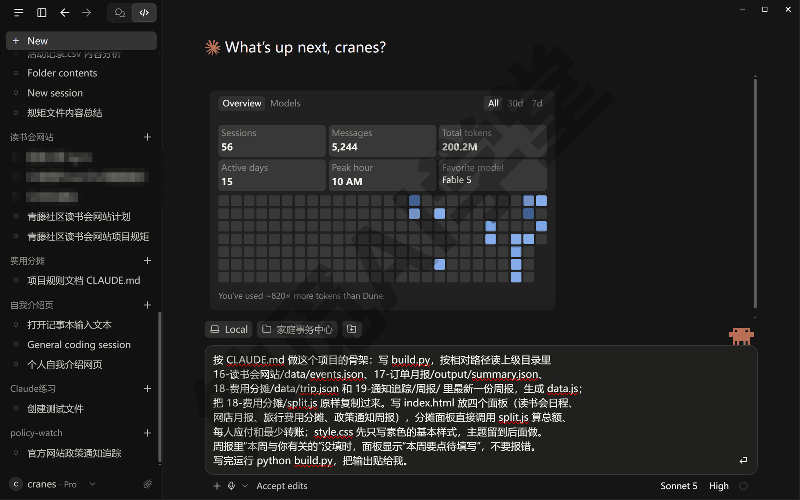

它会先讲一下打算建哪几个文件（CLAUDE.md 最后一条要求的），然后写出 build.py、index.html、style.css，复制 split.js，运行 build.py。Accept edits 模式下写文件不弹卡，但 python、复制文件、node 这些命令每条弹一张审批卡，这一轮有十几张，中间有一条命令失败了它自己改了再跑。这次运行它贴出来的输出：

```text
读书会：3 场预告，3 场历史
网店月报：2026-08，有效订单 185 笔
旅行分摊：京都四人行（4 晚 5 天），7 笔费用
政策周报：2026-09-24（来自 2026-09-24.md），本周与你有关的：待填写
已写入 data.js，已复制 split.js
```

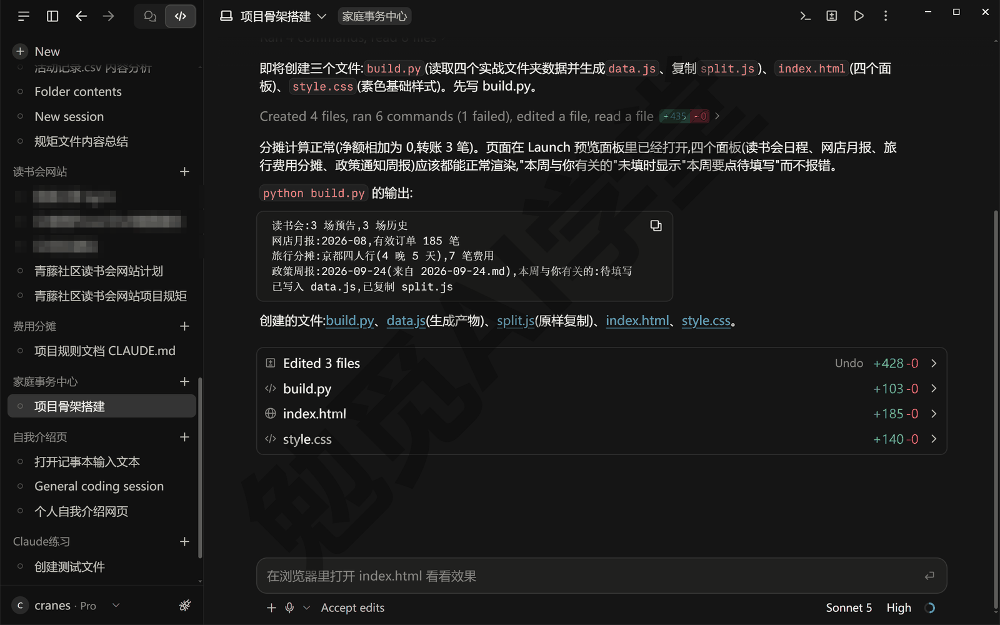

五行输出把四个来源各报了一个数（每行写什么由它定，这次没报销售额，报的是有效订单 185 笔）：读书会 3 场预告、月报是 2026 年 8 月、分摊 7 笔、周报是 9 月 24 日那一份、要点还没填。它多半会自己把 index.html 开进浏览器面板，可直接打开的本地网页读不了旁边的 data.js、split.js 和 style.css，四个面板会显示“暂无数据”、也没有样式；补一句“起一个本地预览，在浏览器面板里打开”（《实战三：旅行费用分摊计算器》18.2 说过原因），它会配好 .claude/launch.json 起一个本地服务（地址是 localhost 加端口号，比如 localhost:5190），这时四个素色面板就都有内容了。

**数字核对。** 页面上的数要对着来源核一遍，不能只看着像。演示项目核了两处。分摊面板：用 Node 直接跑 split.js 算演示行程，总花费 6,965.60 元，每人应付阿明 1,902.91 元、小雨 2,096.10 元、老周 2,096.10 元、丹丹 870.49 元，结清要转 3 笔（老周给阿明 1,420.10 元、小雨给阿明 844.10 元、丹丹给阿明 740.89 元），和《实战三：旅行费用分摊计算器》页面上、测试里的数一致。月报面板：summary.json 里 2026 年 8 月销售额 12,537.10 元、有效订单 185 单、客单价 67.77 元、退款 33 单 2,149.00 元，和《实战二：网店订单月报流水线》17.3 报出来的数一致。你自己做的时候让它核：

```text
不看页面，用 node 直接跑 split.js 算 data/trip.json 里的行程，把总花费、
每人应付和转账笔数列出来；再读 summary.json 把月报的四个数列出来；
然后和 data.js 里的数逐个对一遍，有不一致的告诉我，不要改。
```

**这一步做完你有什么。** 文件夹里有 build.py、index.html、style.css、split.js（复制来的）、data.js（生成的）、CLAUDE.md，还有一个 .gitignore 让 Git 忽略 __pycache__ 和 .claude/worktrees/ 两个文件夹（后一个是下一节工作树副本的位置）。让它“把这个文件夹初始化成 Git 仓库”，再把这些提交一次，说明写“家庭事务中心骨架：build.py 汇总四个实战 -> data.js，四面板 index.html（无主题）”，这次提交是下一节三个方案共同的起点。页面还是素色的，好不好看下一节再说。

### 20.2 三方案并行择优

**为什么一次做三版。** 版式这种事，看到成品才知道好不好；做一版、改一版、再改一版，每一轮都要等。《子智能体、并行会话与工作树》12.5 节讲过同一题做两版、并排挑一版的做法：几个会话同时开、各占一个工作树（同一个项目的独立副本），互不干扰。这一节做三版，代价是三倍用量，20.6 会算这笔账；好处是过一会儿就有三套成品可以比。

**先写下三条标准。** 12.5 讲过，比较的标准要在开会话之前写好，不凭第一眼的喜好。本篇的三条：电脑上一屏能不能看全四个面板；周报长文读起来是否清楚，它是更新最勤、也最长的面板；手机窄屏自动变成单栏之后还好不好用。

**第 1 步：开三个会话，各占一个工作树。** 点侧栏里“家庭事务中心”分组标题右边的 ＋ 开一个这个文件夹的新会话（按 Ctrl+N 再选同一个文件夹也一样），把输入框上方分支名 main 右边的 worktree（工作树）复选框勾上（勾选状态会沿用到下一个新会话，开第二、三个时看一眼就行）；重复三次。会话名它会按你第一句话自动起（比如“方案1：单栏卡片流”），侧栏里会话名前面的黄点表示有审批卡等着你点。三个会话分别发送下面这段，方括号里换成各自的方案；提交说明跟着换成“方案2：两栏布局”“方案3：深色主题”，分支名换成 方案2、方案3：

```text
只改 style.css，不动 index.html 和 build.py。做[方案 1：单栏卡片流，
四个面板从上往下排]。做完起一个本地预览，在浏览器面板里打开看一遍，
然后提交，说明写“方案1：单栏卡片流”，分支名用 方案1。
```

另外两个会话的方括号分别写“方案 2：两栏布局，三个小面板排一行、周报独占一整行”和“方案 3：深色主题，深底浅字”。三份工作树副本放在项目文件夹下的 .claude\worktrees\ 里，子文件夹名是应用随机起的一组英文词（比如 awesome-lalande-c572cf），不是方案名；应用建工作树时还会先建一条 claude/ 开头的随机名分支，它再按指令另建 方案1 这样的分支去提交（位置以 Settings → Claude Code（设置 → Claude Code）里 Worktree location（工作树位置）显示的为准）。这次有一个会话从头到尾用日文回复，CLAUDE.md 里“回复一律用简体中文”也没拦住——遇到了回一句“用中文”就好，不影响它改文件。

下图是演示时的两个画面：上半是三个会话都在跑，侧栏里三个会话名；下半是新建会话时输入框上方勾着的 worktree 复选框。图里输入框里发的那段是旧写法，末句是“在浏览器面板里打开 index.html”，和上面代码块里给你的那段差半句：直接打开的文件没有数据也没有样式，演示时又补发了一句才起预览；你发的这段已经改好。

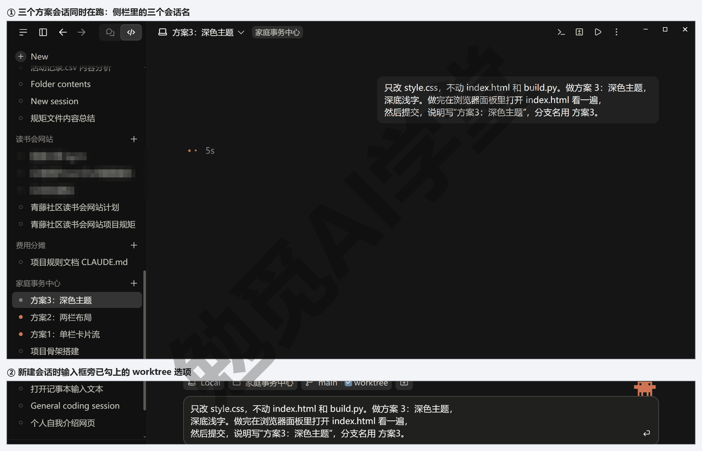

**第 2 步：看三条分支。** 三个会话都提交完，在主文件夹的终端面板里（按 Ctrl+`（反引号）打开）输入两条命令看结果。Git 默认会把中文路径显示成一串看不懂的数字和斜杠（在 git 后面加上 -c core.quotepath=off，比如 git -c core.quotepath=off log --oneline，就能显示中文），下面按可读的写法列出，副本的路径太长，前半段用 … 省略；编号以你自己的为准（图里是 3dbe916、139bab7、8e63598、3b88d5f）：

```text
> git worktree list
D:/教程演示/ClaudeCode课/20-家庭事务中心                              79006af [main]
…/20-家庭事务中心/.claude/worktrees/awesome-lalande-c572cf           d097769 [方案3]
…/20-家庭事务中心/.claude/worktrees/compassionate-heyrovsky-41b9dd   8df8c2e [方案2]
…/20-家庭事务中心/.claude/worktrees/fervent-blackburn-597b8f         0f2032e [方案1]

> git log --oneline --all --graph --decorate
* d097769 (方案3) 方案3：深色主题
| * 0f2032e (方案1) 方案1：单栏卡片流
|/
| * 8df8c2e (方案2) 方案2：两栏布局
|/
* 79006af (HEAD -> main, claude/fervent-blackburn-597b8f,
    claude/compassionate-heyrovsky-41b9dd, claude/awesome-lalande-c572cf)
    家庭事务中心骨架：build.py 汇总四个实战 -> data.js，
    四面板 index.html（无主题）
```

第一条命令列出四份文件夹：主文件夹在 main，三份副本各在自己的分支上。第二条画出的图要这样读：最下面一行是 20.1 的骨架提交，三条分支都从它分出去，各有一次提交；main 还停在骨架那一行，因为主文件夹一个字都没改；骨架那一行后面还挂着三条 claude/ 开头的分支，是应用建工作树时自动建的，停在骨架上没动，不用管。《Git、GitHub 与代码审查》讲过分支是一条独立的版本线，这张图就是三条线并排的样子。

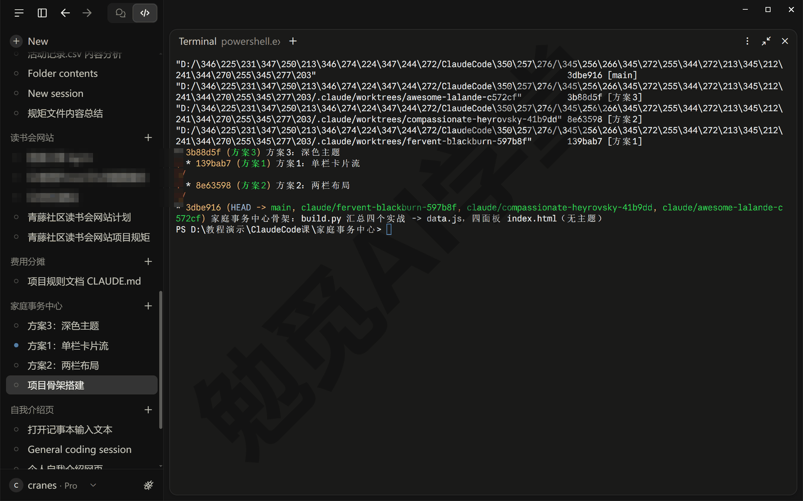

**第 3 步：按三条标准并排比。** 按住 Alt 点侧栏里的会话，两个会话左右并排（先按 Ctrl+B 收起侧栏，再拖中间的分隔条，两边才都看得清）。每个工作树会话各自起的本地预览，端口和主文件夹那个不一样，面板里是自己那版的样子；哪个会话要是还停在直接打开的 index.html 上（没有数据也没有样式），让它“起一个本地预览在浏览器面板里打开”。并排后每个面板都窄，方案 2 这时只显示两列，想看它三个小面板排一行的样子，关掉另一栏让面板变宽；把浏览器面板拖窄到手机的宽度，看第三条标准。三个会话一次并排两个，第三个换着看。演示项目的比较结果：

| 标准 | 方案 1 单栏卡片流 | 方案 2 两栏布局 | 方案 3 深色主题 |
| --- | --- | --- | --- |
| 电脑上一屏能不能看全四个面板 | 从上往下排，四个面板必然超出一屏，看周报要滚到底 | 三个小面板排一行，周报独占整行，一屏能看全 | 两列排，周报独占整行，基本一屏，略多一行 |
| 周报长文读起来是否清楚 | 白底、宽 720 像素，读起来清楚 | 白底、整行宽，读起来清楚 | 深底浅字，大段文字读起来眼睛最累 |
| 手机窄屏变单栏后还好不好用 | 本来就是单栏，不变 | 720 像素以下变单栏，正常 | 720 像素以下变单栏，正常 |

方案 2 在前两条胜出，第三条三版持平，留方案 2。方案 3 的深色底放一两句话好看，放一整段周报眼睛就累，这是比之前想不到、比了才知道的。

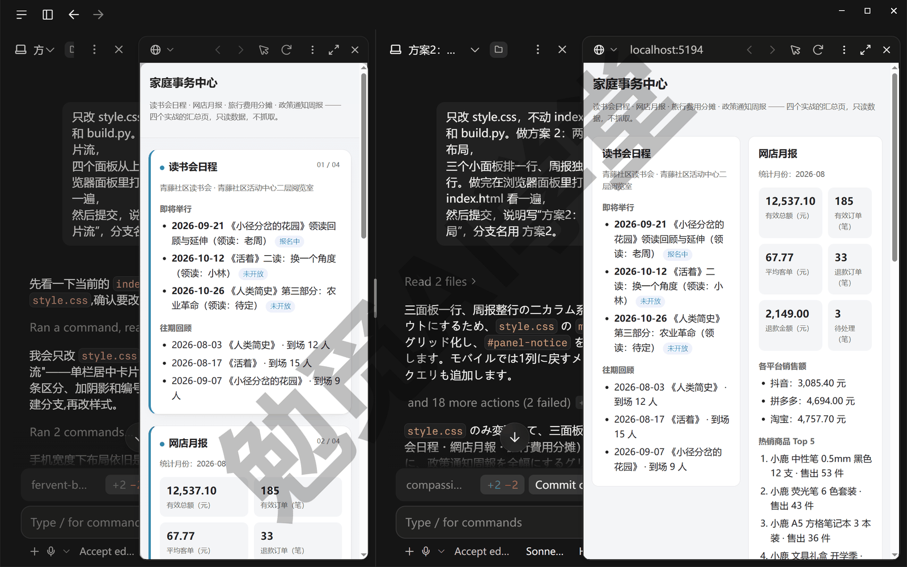

**第 4 步：合入方案 2，另外两版留在分支上。** 回到方案 2 的会话发送：

```text
方案 2 定了。把这个工作树的改动合回主线 main，合完在主文件夹里重跑
python build.py，再列一下提交历史给我看。方案 1 和方案 3 的分支留着不删。
合完也起一个本地预览，在浏览器面板里打开主文件夹的 index.html 给我看。
```

它用的命令和输出（长行按排版折行；提交编号以你自己的为准）：

```text
> git merge --ff-only 方案2
Updating 79006af..8df8c2e
Fast-forward
 style.css | 30 ++++++++++++++++--------------
 1 file changed, 16 insertions(+), 14 deletions(-)

> git log --oneline --graph --all --decorate
* 8df8c2e (HEAD -> main, 方案2) 方案2：两栏布局
| * 0f2032e (方案1) 方案1：单栏卡片流
|/
| * d097769 (方案3) 方案3：深色主题
|/
* 79006af 家庭事务中心骨架：build.py 汇总四个实战 -> data.js，
    四面板 index.html（无主题）
```

输出里的 Fast-forward 叫快进合并：主线自骨架之后一个字没改，合并不需要新造一次提交，直接把 main 挪到方案 2 那次提交上，所以图里 main 和 方案2 指着同一行。改动只有 style.css 一个文件，加 16 行、删 14 行，正是“只改 style.css”这条要求的样子。合完它会给主文件夹另起一个本地预览（比如 localhost:5196），面板里就是两栏布局的主文件夹页面，三个小面板排一行、周报独占下面一整行。

方案 1、方案 3 的会话到这里事情做完了，各自在侧栏里右键、选 Archive（归档）；归档不会删掉它们的工作树副本，副本还在 .claude/worktrees/ 下面，两条分支也还留在仓库里，哪天想换风格，让它“开一个工作树切到 方案3 分支”就能接着改。

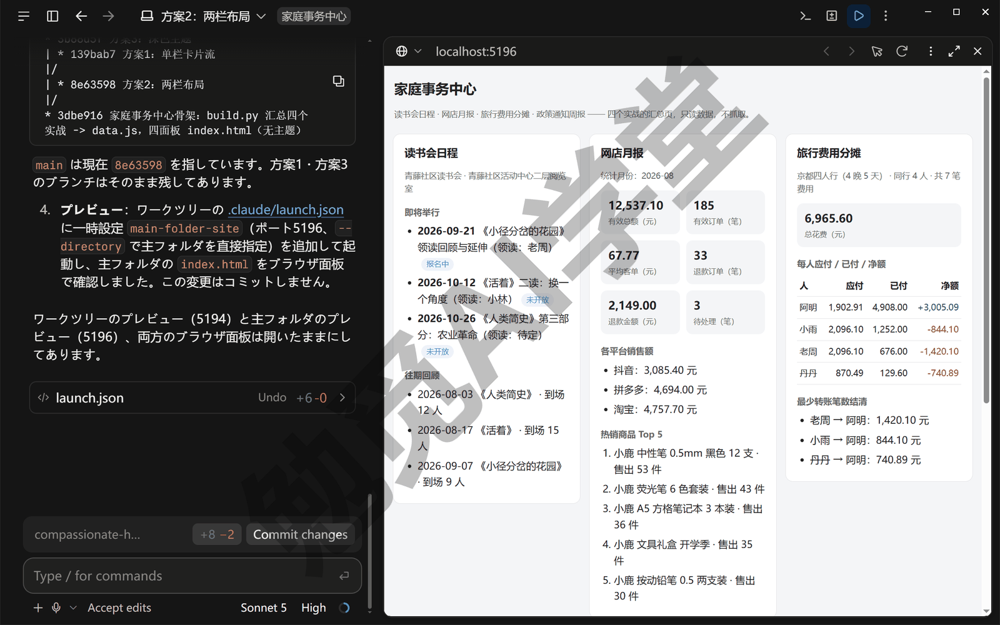

**三版都不满意怎么办。** 《子智能体、并行会话与工作树》12.5 节讲过，不要在三个会话里各自反复改，那等于在做六版、九版；把各版好的地方说清楚，开第四个会话让它综合，做出来再按三条标准比一次。第四版还不行，多半是标准本身没写清，回到标准重写。

### 20.3 云端接力：本机起头，云端接着做，手机看进度

**给读书会面板加一个网站入口。** 版式定了，还剩一处收尾：读书会面板只有日程，没有一个能点进读书会网站的入口，《实战一：社区读书会网站》上线后有了真网址，应该接进来。这件事不大，但假设你现在得出门，又不想它停下。《云端会话与手机端》14.4 节讲过“在以下位置继续：云端”（官方叫 Continue in）：把本机这场对话连同已经做的改动送到云端，云端的它接着做，你在手机上看进度。这一节按那一篇讲过的做法走一遍，界面上的图标与菜单名以你看到的为准。

**第 1 步：先提交，再送出去。** 送到云端有三个条件：本机的改动要全部提交过，也就是工作区干净；项目已经在 GitHub 上、本机连着它，并且你的 Claude 账号连上了 GitHub、把这个仓库授权给了 Claude 的 GitHub App（《云端会话与手机端》讲过；还没建仓库的先按 20.4 第一条命令建仓推送）；不能是 SSH 或 WSL 会话。

在 20.2 合入后的那个会话里，先把任务说清楚、让它开始做——发“读书会面板加一个‘打开读书会网站’的链接，网址从 events.json 的 site_url 字段取，没有这个字段就不显示；build.py 需要的话一起改”（这次它写的 build.py 把 events.json 整个带进了 data.js，site_url 已经在里面，所以只剩 index.html 要改），它动起来、做到一半你要走时发送：

```text
先把当前改动提交，说明写“读书会面板加真实网站入口（进行中）”。
提交完告诉我一声，我要把这个会话送到云端接着做。
```

它提交后差异计数归零，这时才能送。

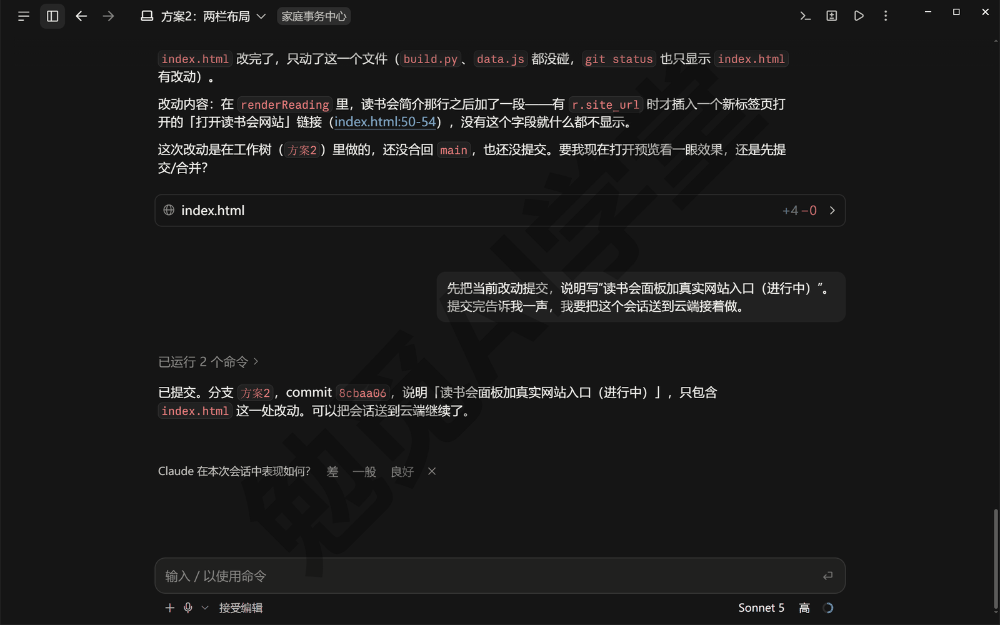

**第 2 步：打开方式 → 在以下位置继续：云端。** 点会话标题右边的 ∨（点标题文字会进重命名），菜单里把鼠标停在“打开方式”上，二级菜单分三组：新建窗口；在本机编辑器里打开（Cursor、VS Code、资源管理器，按你电脑上装了什么列）；“在以下位置继续”下面的“云端”，灰字写着“无需您的电脑即可运行”，点它。弹出确认框“将此会话移至云端？”，一句话把要做的三件事说全了：推送你的分支、发一份对话记录摘要、新建一个云端会话让它从中断的地方继续；本地会话保留在这台电脑上，不会问你归档还是留着。点“在云端继续”，框里依次打勾：正在推送分支、正在撰写交接说明、正在启动云端会话。要是报“无法推送您的分支”，多半是仓库还没建到 GitHub、本机没连上远程，按第 1 步说的建仓推送后点重试。

送出去先看两件事：新出现的云端会话开头带着“会话总结”——用户需求、已完成工作——读一遍，确认“读书会面板加真实网站入口链接”这条在；它会在你的分支上另起一条带后缀的分支（比如 方案2-tnmgb2）干活，接着说当前分支、工作区干净、最新提交是哪个；再到 GitHub 上看分支是不是推上去了。

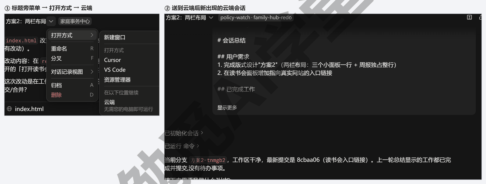

**第 3 步：手机上看进度、答问题。** 现在可以关掉桌面应用出门。《云端会话与手机端》14.3 节讲过，手机 App 里能打开同一份云端会话列表（入口的名字和位置需实机验证），能看它做到哪、回答它的提问、发新指令；它需要你确认什么，手机会收到推送，形态以实际表现为准。这一步它要做的事只有两处：build.py 从 events.json 多取一个 site_url 字段写进 data.js（它当初要是把整个 events 对象都带进了 data.js，这一处就省了），index.html 的读书会面板在有这个字段时显示一个“打开读书会网站”的链接。它可能会问没有 site_url 时要不要显示这个链接，答“不显示”就行。

你照第 1 步做到一半就送，云端那头接着做完才有东西看；这次演示送出去时 index.html 已经在本机改完、提交过了，所以云端那头说没有待办、问接下来做什么——你要是也做完了才送，同样会这样，直接发第 4 步开 PR 的指令就行。

**第 4 步：让它开合并请求交回。** 回到电脑，或者就在手机上，发送：

```text
改动做完了就开一个 PR，标题和说明用中文，说明里写改了什么、为什么、
怎么验证（本地重跑 python build.py 后读书会面板出现“打开读书会网站”链接）。
```

PR 是 pull request 的缩写，中文叫合并请求，《Git、GitHub 与代码审查》13.4 节讲过：把一条分支上的改动打包成一份请求，审过、检查过再合进 main。云端会话会把分支推到 GitHub、开出 PR、把网址给你——它用的是 GitHub 连接器（对话里会看到 Open new pull request 这样的工具行），不是跑 gh；PR 的来源分支是它自己起的那条带后缀的分支，页面顶上要是有一条“The head ref may contain hidden characters”的黄条，是分支名带中文，不用管。要是它报推送被拒、没有权限，就是 Claude 的 GitHub App 还没授权到这个仓库，到 GitHub 的 Settings → Applications 里把仓库加进去再让它重试。

开好后输入框上方会出现一条 PR 状态条，写着 PR 编号、仓库、分支、改动行数和 CI 状态，《Git、GitHub 与代码审查》13.4 节讲的 CI 状态栏就是它。云端改的是云端那份复制品，你电脑上的文件一个字节没动，改动要等 PR 合并才进主线，这是云端会话最让人放心的一点。

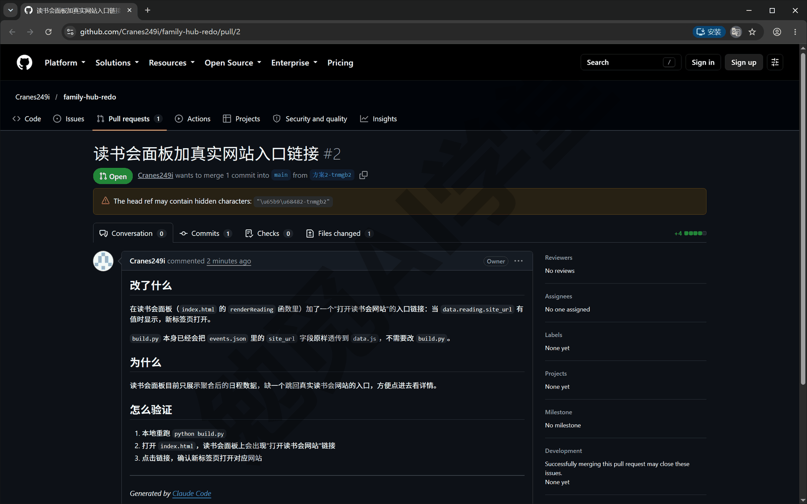

**什么时候用接力，什么时候直接开云端会话。** 任务已经在本机聊了一半、不想重新描述一遍，用“在以下位置继续：云端”；一件全新的任务，按《云端会话与手机端》14.2 节直接新开云端会话更直接。用量方面，云端会话同样从套餐里扣，云端机器本身不另收费。

### 20.4 代码审查与上线

**合并前审一遍。** 《Git、GitHub 与代码审查》13.5 节讲过 `/code-review`：让它把还没定稿的改动检查一遍，把可能出错的地方写在对话里。云端会话里同样能用，这时它审的是这条分支从分出来到现在的全部改动，适合开 PR 之后、合并之前做一次总检查。在桌面应用里或者网页版 claude.ai/code 打开 20.3 那个云端会话（两处是同一个会话的两个入口，一边发的另一边立刻能看到），输入框里输入：

```text
/code-review
```

输入 / 弹出的菜单很长，code-review 在后半段，接着打 code 就只剩它一项；选中后再按一次回车才发出去。它会对这条分支的改动出一份报告，这次的样子是一个代码块里的清单，每条给文件和行号、问题概述和一个出错的场景，报告的形态以实际输出为准。这次改动只有 4 行，它挑出两条：新加的链接把 site_url 没做任何处理就拼进了网页，要是数据文件里的网址被人换成一段脚本，点链接就会执行；读书会面板里原有的标题、领读人几处也是同样写法，新加的一行照搬了旧写法。

这次挑出的两条值得改：回一句“把拼进网页的 site_url、标题、领读人这些字段都做转义处理，site_url 只接受 http 或 https 开头的网址，改完提交推送”——转义处理就是让文字里的特殊符号只当文字显示、不被当成代码执行，标题、领读人这类文字靠它就够；网址要是整个被换成一段脚本，里面没有特殊符号可转，所以 site_url 还得只认 http／https 开头的；它改完推上去，PR 会自动更新（图里那次没有再改，你做的时候改掉再合并）。

13.4 节讲的 CI 状态栏就是输入框上方那条 PR 状态条，Auto-fix（自动修复 CI 并处理评论）开关也在那儿，云端会话靠的是装在仓库上的 Claude GitHub App。

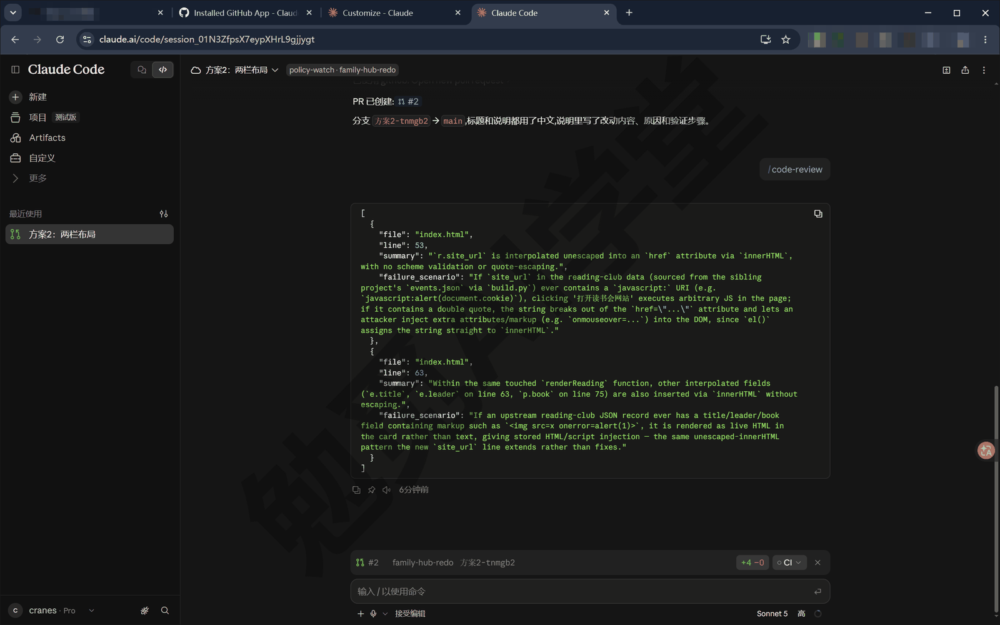

**合并。** 到 GitHub 的 PR 页面点合并。合并后 GitHub 上的 main 有了这处改动，多了一个合并提交；回到云端会话，输入框上方的 PR 状态条会自己变成“已合并”。你电脑上的 main 还停在原来那次提交，回到本机的会话让它“git pull 让本机 main 跟上”再往下做。《Git、GitHub 与代码审查》13.4 节讲过的 Auto-archive after PR merge or close（PR 合并或关闭后自动归档）开着的话，这个会话会自动收进归档。

**上线：GitHub Pages。** 《实战一：社区读书会网站》16.6 节讲过 GitHub Pages 是 GitHub 给公开仓库附带的静态网站托管，把开关打开、指定用 main 分支的根目录发布，一两分钟后就有一个 https://你的用户名.github.io/仓库名/ 的网址。有两种做法：自己在仓库的 Settings → Pages 页面上点，或者让它用 gh 做。上线前对着 CLAUDE.md 第四条检查一遍：公开仓库里的每个文件所有人都看得到，页面和数据文件里不能有真实的姓名、电话、住址，演示项目的内容全是虚构的。演示项目让它用 gh 做：发“把这个仓库的 GitHub Pages 开在 main 分支的根目录，开好后把网址给我”。演示那次是到这一步才建的仓库，所以它跑了下面四条命令，前两条是建仓库、推分支；每条做什么、哪两条你不用再跑，代码块后面说（把 Cranes249i 换成你的用户名，长行按排版折行；Accept edits 模式下这些命令每条都要你放行一张卡）：

```powershell
gh repo create family-hub --public --source=. --remote=origin --push `
  --description "家庭事务中心：四个实战成果汇成一页（课程演示，虚构内容）"
git push -u origin --all
gh api -X POST repos/Cranes249i/family-hub/pages `
  -f "source[branch]=main" -f "source[path]=/"
gh api repos/Cranes249i/family-hub/pages
```

第一条建公开仓库并把 main 推上去，第二条把 方案1、方案2、方案3 三条分支也推上去（留着以后换风格）——20.3 送云端之前已经建过仓库、推过分支的，这两条不用再跑；第三条打开 Pages、指定 main 分支根目录，第四条查状态。刚打开时查到的 status 可能还是空的或者 building，等半分钟到一分钟再查一次；它也可能自己起一个后台任务每半分钟查一回，会话底部多一行“1 个正在运行的任务”，查到了会告诉你。查状态那一条返回的内容里最要紧的两项：

```text
"status":"built"
"html_url":"https://cranes249i.github.io/family-hub/"
```

status 是 built 说明已经发布好了；打开 html_url 那个网址，页面上有“家庭事务中心”四个字，四个面板都在。这就是验收标准第三条。

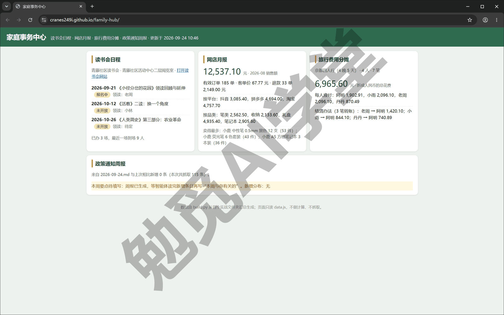

**以后每次改动怎么更新。** 顺序固定：让它改、重跑 build.py、提交、推送，GitHub Pages 自动重新发布（仓库的 Actions 页里会多出一条自动的 pages build and deployment，每次推 main 都跑一次），一两分钟后刷新网页就能看到。演示项目最后一次改动就是 20.3 那处读书会入口：重跑 build.py 后提交、推送，不到一分钟网页上的读书会面板里就多了“打开读书会网站”一行，点进去就是《实战一：社区读书会网站》的网址。本地改了、网页没变，先按这四步查是哪一步没做，16.99 的 Q2 有排查顺序。

### 20.5 翻车回放：出了问题怎么查

**五个实战，五次翻车。** 每个实战篇都留了一节翻车实录，记的是三件事：错在哪、怎么发现的、怎么救回来的。放在一起看：

| 实战 | 翻在哪 | 谁发现的 | 补救办法 |
| --- | --- | --- | --- |
| 读书会网站 | 演练：新加“往期回顾”页后，把四个老页面导航里的文件名改成 huigu.html，新文件其实叫 recap.html | 站内自检脚本报了 4 处“链接指向的文件不存在” | 把网址和自检输出发给它，改成 recap.html，再跑自检 |
| 订单月报 | 演练：把去重规则临时改成留先读到的那条，一单 9.90 元的退款算进了销售额 | 独立复算与月报差一单、9.90 元 | 顺着差值找到那一单，把规则定成“留后读到的那条” |
| 费用分摊 | 汇率换算乘除写反，96,000 日元算成 2,000,000 元 | 七组测试挂了三组，全和日元有关 | 用 Git 撤销那次提交，测试回到 7 通过 |
| 通知追踪 | 九个源里六个抓不到或抓错，换清单后基线要重建 | 抓取日志每个源一行，写着失败原因 | 换源、删快照重建基线、补分类规则 |
| 家庭事务中心 | 周报面板显示“本周要点待填写” | 页面自己显示的 | 不是错，见下段 |

五次里四次不是人眼看出来的，是自检脚本、独立复算、测试、日志先报的；前三次是各篇故意做出来的错，发现它们的办法和真出错时一样。这是全课最想让你带走的一条：让 AI 干活，验收要独立于干活的过程，先把“怎么算做对”写成能自动跑的东西，再让它动手。

**这一篇自己的那一次。** 演示页面的政策通知周报面板现在显示的是“本周要点待填写：周报已生成，等智能体读完新增条目再写‘本周与你有关的’。新增分布：无”。原因在上游：build.py 取的是通知追踪项目里最新的一份周报，也就是《实战四：政策与补贴通知追踪》19.2 第二次运行生成的那份；19.3 写要点写的是基线那一份，最新这份没有要点，build.py 就把它标成待填写。这一处是故意这样设计的：上游给过来的那份还没有要点，下游不报错、不显示空白，而是把状态明明白白显示出来，你一眼知道该去哪补。给最新那份周报也写上要点（或者让它把 build.py 改成取最新一份写了要点的周报），回到这个项目重跑 build.py、提交、推送，面板就换成要点列表。

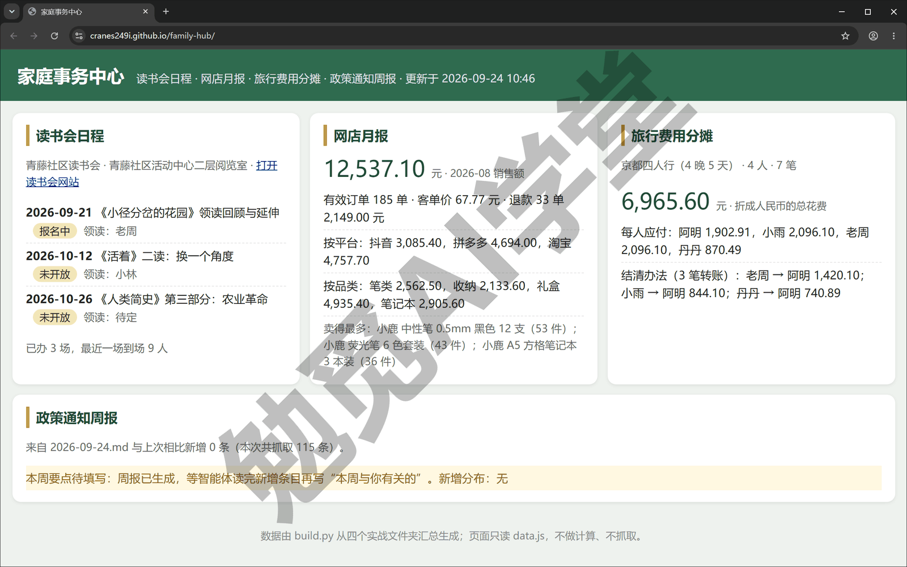

**出了问题先做三件事。** 《实战二：网店订单月报流水线》17.4 节对复算不一致定过一个顺序，这五次翻车都对得上，以后遇到任何不对劲照着走。先看现象的原文：报错、日志、测试输出、差值，一个字不要转述，复制下来。再把原文和你的猜测发给它，让它先找原因、不改代码，这一步最省用量也最少走弯路。找到原因了再决定改哪一边：是规则错了改规则，是代码错了改代码，是数据错了换数据。发给它的话可以这样写：

```text
下面是刚才运行的原始输出，别急着改代码，先告诉我错在哪一步、为什么：
[把报错、日志或测试输出原样粘贴在这里]
```

**上线之后再看一眼。** 上线之后再回头看一眼页面，多半还能发现一两处该补的，演示项目上线后才发现读书会面板缺一个网站入口。这不算翻车，算正常：改、重跑、提交、推送四步，一分钟后就是新的。

### 20.6 用量总账（只讲机制）

**先回顾用量是怎么算的。** 《权限、沙盒与模型》3.7 节讲过：用量环有两层含义，本会话的上下文占了多少、本期套餐用了多少；套餐按五小时窗口加每周上限计，Claude Code、Cowork、聊天共用一个用量池；`/usage` 能把这一期的用量拆开看，怎么读那一节讲过。本课不写数值，数值以你账号页面显示的为准。这一节只回答一个问题：二十篇下来，什么花得多、什么不花。

**五个实战里花用量的地方。** 用量主要花在这四处：

- **长对话用得最多**：《实战二：网店订单月报流水线》六节在一个会话里做完，上下文越长，每一句话消耗的用量越多，这也是《对话与上下文管理》讲“一事一会话”和 `/compact` 的原因。
- **读大文件用得多**：《实战四：政策与补贴通知追踪》让它把 115 条基线读一遍写要点，比之后每周读几条新增用得多得多。
- **并行成倍**：本篇 20.2 三个会话各做一版，用量是做一版的三倍；《子智能体、并行会话与工作树》讲过子智能体也一样，派几个分身就是几份用量。
- **云端同样计**：云端会话和云端例行任务从同一个套餐里扣，例行任务另有每天启动次数的上限。

不花用量的是脚本：fetch.py、pipeline.py、verify.py、build.py、测试与自检，运行它们不经过模型，跑一百次也不花。

**五个省用量的习惯。** 这五个习惯前面各篇都出现过，这里放在一起：

- **一事一会话**：一件事做完就开新会话，不要把五件事塞进一场对话，对话变长了先 `/compact`，《对话与上下文管理》4.5 节讲过它会把前面的对话压成一段摘要。
- **先想清楚再动手**：拿不准的事先切到 Plan（计划）让它出方案，方案错了改方案，比做出成品再推倒重来用得少。
- **能写成脚本的事写成脚本**：清洗、复算、抓取、自检交给脚本，模型只做要判断的那一步，这也是《实战四：政策与补贴通知追踪》分工的原因。
- **并行之前先写标准**：三版并排比是三倍用量，标准写清了比一次就够，不写清就要做第四版、第五版。
- **定时任务的指示写紧**：只读最近的、只改该改的文件夹，跑一次用一次的量，不要让它每周把整个项目重看一遍。

**云端会话要单算一笔。** 云端会话和云端例行任务不占你电脑的资源，但用量照样从套餐里扣，例行任务还有每天启动次数的上限。本篇 20.3 送到云端接着做的那一场，用量和留在本机做完记的是同一笔账，只是换了个地方跑；《实战四：政策与补贴通知追踪》每周一次的例行任务，每次运行是一场完整的会话，读的新增条目越多花得越多，所以那一篇让它写要点时写的是“先看标题，拿不准再打开正文”。

**怎么看自己花在哪。** 在任何会话里发送：

```text
/usage
```

它会列出这一期用量的分项，云端会话与例行任务的用量在账号页面 claude.ai/settings/usage 里也能看，显示形态以实际界面为准。看的时候盯两处：哪一类占得最多，多半就是上面五个习惯里哪一条没做到；每周上限用到几成，接近了就把非紧急的事排到下个周期。

### 20.7 全课总结：功能对照表与三课分工

**先验收：二十篇你应该能做到什么。** 下表按篇列出这门课讲过的功能，右列是“现在应该能做到”。对着自己的电脑逐条过一遍，做不到的回那一篇再看一遍，那一篇的小结与自检清单里有更细的条目。

| 篇 | 讲了什么 | 现在应该能做到 |
| --- | --- | --- |
| 认识与装好 | 是什么、五个入口、套餐机制、装桌面应用与 Git、登录、中文回复 | 装好、登录、跑完装完就能用的三连任务、用过一次“后悔药” |
| 桌面应用全导览 | 侧栏、开会话四件事、输入框、面板布局、设置页、快捷键、用量环 | 指着界面说出每个区域是什么、用两种方式把文件交给它 |
| 权限、沙盒与模型 | 五档权限模式、Windows 上没有沙盒、模型与努力档、用量、数据去哪了 | 说出五档各自什么时候问你，自己切模式并知道后果 |
| 对话与上下文管理 | @ 文件、贴图、边跑边插话、`/compact`、侧聊、分叉、`/rewind` | 用三种方式交材料，中途改方向，知道上下文满了怎么办 |
| 文件与办公能力一篇讲全 | 读、识图、整理改名、转换、做表做文档、一句话安装 | 整理过一个真实文件夹、做出过一份 Excel、装过一个工具 |
| 计划模式、差异审阅与回退 | Plan 出方案、差异视图批注、`/code-review`、退回 | 跑过一次完整的计划、执行、审阅、回退 |
| 内置浏览器、应用预览与电脑操控 | 它自己开预览验证、外站怎么办、浏览器面板与 Chrome 扩展、电脑操控 | 看它自己验证过网页，知道这一版面板只开本机预览、外站它改用读网页工具 |
| 终端、编辑器与 VS Code 扩展 | 终端面板、文件面板、命令行版、`/desktop`、编辑器扩展 | 在终端面板跑过命令，装过命令行版并接回桌面 |
| CLAUDE.md 与规则 | 规矩文件在哪、`/init`、规则文件、写规则的原则、记忆 | 有一份自己写的 CLAUDE.md 并验证过生效 |
| 技能与斜杠命令 | 内置命令、技能是什么、自制技能、叠加技能、`/powerup` | 装过、自制过、用 `/` 点名调用过技能 |
| 插件、连接器与 MCP | 插件一键装、连接器接外部工具、MCP 手写配置、安全五条 | 装过一个插件、接过一个连接器 |
| 子智能体、并行会话与工作树 | 子智能体后台跑、任务面板、并行会话各占工作树、多方案对比 | 跑过一次并行会话并合入一版 |
| Git、GitHub 与代码审查 | Git 三个词、提交与还原、连 GitHub、PR、Auto-fix 与 Auto-merge、代码审查两入口 | 有一个推上 GitHub 的仓库和一个合并过的 PR |
| 云端会话与手机端 | 云端会话、网页版、在以下位置继续（Continue in）、Dispatch、SSH 与 WSL、费用与隐私 | 跑过一次云端会话并在另一端看到它 |
| 定时任务、钩子与自动化 | 本机定时任务、钩子、`claude -p`、GitHub Actions 里的 @claude、跟上更新 | 有一个跑过一次的定时任务 |
| 实战一：社区读书会网站 | 规矩、计划、预览验证、两轮改版、翻车、GitHub Pages | 一个能在手机上打开的四页站 |
| 实战二：网店订单月报流水线 | 清洗规则、Excel 与 PPT、独立复算、封装成技能、每月自动跑 | 技能一句话跑出月报、复算一致 |
| 实战三：旅行费用分摊计算器 | 规则先写清、先写测试、两工作树择优、Git 还原、上线 | 七组用例全过并上线 |
| 实战四：政策与补贴通知追踪 | 关注清单、抓取与快照、智能体写要点、云端例行任务、翻车三种 | 跑过两次以上并出过一份周报 |
| 毕业项目：家庭事务中心 + 课程总结 | 汇成一页、三方案择优、云端接力、代码审查与上线 | 一个上线的家庭事务中心页面 |

表里哪一行右列做不到，让它带你再做一次，比自己重看快：

```text
我在学 Claude Code，[某一项功能，比如“用两个工作树各做一版再合入一版”]
还没有亲手做过。请在这个练习文件夹里带我做一遍：每一步先说要做什么、
在界面的哪里点，等我做完回你一句再进下一步。
```

**Claude Code、Cursor、Codex 三门课怎么分工。** 这门课和《Cursor 零基础入门教程》《Codex 零基础入门教程》是同一套思路做的三门课，学的东西大半相通：权限、计划模式、差异审阅、规矩文件、技能、连接器、工作树、云端、Git，三家都有，只是叫法和位置不一样。

差别在于它们各自在哪个应用里，三家都在快速更新，下面只说成文时的样子，以各家当前版本为准。Claude Code 在 Claude 桌面应用的 Code 页签里，面板式的工作区、云端会话与例行任务、连接器与电脑操控是它这一版的重点，适合主要在自己电脑上处理文件、做小工具、不打算打开代码编辑器的人。Cursor 是一个代码编辑器，智能体在编辑器旁边干活，改动直接落在你眼前的文件里，适合想亲手看代码、经常要手改文件、以后可能往编程方向走的人。Codex 在 ChatGPT 桌面应用里，和 ChatGPT 共用一个账号与用量，适合已经天天用 ChatGPT、想在同一个应用里让它替你干活的人。

选哪一门，先看你已经付费的是哪一家；三家的套餐都在变，能用什么、有多少用量，以各家账号页面显示的为准。学会一门之后学另一门，概念不用重学，只要认一遍界面。

**适合谁，不适合谁。** 《认识与装好》1.2 节讲过谁适合、谁不适合，现在你学完了全课，再回头看：如果你有一堆文件要整理、有一份表要算、想做一个自己用的小网页或小工具、愿意把验收标准说清楚，它适合你，二十篇里五个实战都是这一类。你要是指望说一句话就出成品、不愿意看差异视图和运行输出、不愿意给它划权限边界，它会做出东西，但你不知道对不对。两者的差别不在会不会编程，在于愿不愿意验收。

### 20.8 接下来学什么

**跟上更新。** 这门课写的是 2026 年 9 月的界面和做法，Claude Code 更新很快，几个月后按钮的名字、菜单的位置多半有变化。《定时任务、钩子与自动化》15.7 节讲过跟上更新的三样东西：

- **看版本号**：桌面应用点 Help（帮助）里的 About（关于），点版本号可以复制；命令行版在终端里输入 claude --version。
- **看变化**：官方每周新功能页 code.claude.com/docs/en/whats-new 从最近一周往前翻，能找到某个按钮为什么不见了、新出了什么；应用更新在 Help 里的 Check for Updates（检查更新）。
- **查用法**：文档站 code.claude.com 搜那个功能的英文名，本课每篇讲功能时都把英文名留在了括号里，搜的时候直接用。

教程和界面对不上时，以界面为准，别硬套教程。

**让它替你读更新。** 每周新功能页是英文的，这件事本身就可以交给它：

```text
读一下 https://code.claude.com/docs/en/whats-new 这一页，
看最近四周的更新，把和桌面应用 Code 页签有关的条目用中文列给我，
每条一句话说清变了什么、在界面哪里能看到。
```

它会用自带的读网页工具把这一页抓回来（这一版的浏览器面板开不了外站，《内置浏览器、应用预览与电脑操控》讲过），列一张中文表出来；对着表看自己常用的功能有没有变，比自己读英文快得多。

**进阶主题名单。** 本课有几样只讲到“认识一下”的地方，接下来想往深走，按用得上的顺序选：

| 主题 | 本课讲到哪 | 往下学什么 |
| --- | --- | --- |
| 命令行版 | 《终端、编辑器与 VS Code 扩展》8.3 与 8.4 节，`claude -p` 一句话跑完 | 参数全集、`/schedule` 从命令行建例行任务、把它接进你已有的脚本 |
| 钩子 | 《定时任务、钩子与自动化》15.3 节，只用它拦下不该做的动作 | 让钩子自动放行某类动作、在动作之后自动整理与检查 |
| 自定义子智能体 | 《子智能体、并行会话与工作树》12.2 节，它自己派分身 | 写自己的子智能体文件，给每个分身固定的职责与工具 |
| MCP | 《插件、连接器与 MCP》11.5 节，手写配置接一个本地服务 | 自己搭一个服务，把家里的设备或你的数据接给它 |
| GitHub 上的 @claude | 《Git、GitHub 与代码审查》13.5 节、《定时任务、钩子与自动化》15.5 节，认识入口 | 让它在 GitHub 上替你审别人的 PR、按事件自动干活 |
| 团队功能 | 《Git、GitHub 与代码审查》13.5 节末尾提过几样 | 几个人共用规矩、技能与例行任务时怎么分工 |
| 电脑操控 | 《内置浏览器、应用预览与电脑操控》7.5 节，研究预览 | 等它结束研究预览，再看哪些桌面软件适合交给它 |

这张表里的每一样，官方文档都有对应的页，用上面那条指令的做法让它替你读，先看能不能解决你手头的一件具体的事，再决定学不学。

**三门课怎么接着学。** 想把这门课的项目做得更像正式软件，接《Cursor 零基础入门教程》，在编辑器里看代码是怎么一步步写出来的；想在 ChatGPT 里做同样的事，接《Codex 零基础入门教程》。三门课的实战是同类不同题，做完这门课再做另一门的实战，会发现难的不是工具，而是把规则和验收标准说清楚。

### 20.9 三个练习任务

下面提示词里方括号的内容，换成你自己的。

**任务一：把自己的作品替换进家庭事务中心**

```text
我的四个实战项目在 [四个项目文件夹的路径]，和这个文件夹在同一个上级目录。
把 build.py 里四个来源的相对路径改成我的，字段名对不上的地方列出来问我再改；
改完重跑 python build.py，把输出贴给我，并把 data.js 里的数和我各项目的
来源文件逐个对一遍。
```

完成标准：build.py 的输出里四个数都来自你自己的项目；它遇到字段名对不上时先问了你；页面四个面板显示的是你的数据。

**任务二：给家庭事务中心加一个新面板**

```text
加第五个面板“[面板名，比如家庭待办]”，数据来源是 [一个你自己维护的 json 或 csv 文件]，
显示 [要显示的几项]。按 CLAUDE.md 的规矩：数据由 build.py 取进 data.js，
页面只读不算；改完重跑 build.py，起一个本地预览在浏览器面板里打开看一遍，把面板拖窄确认
手机宽度下还是单栏。做完提交，说明写“加第五个面板：[面板名]”。
```

完成标准：页面多了一个面板、数据正确；手机宽度下五个面板排成一列；提交历史里多了一次提交；推送后网页在一两分钟内更新。

**任务三：写一份自己的“三课怎么选”**

```text
我用 Claude Code 做完了这门课的五个实战，我的情况是：[你的工作、你常做的事、
你已经付费的 AI 服务]。参考 20.7 节里三门课的分工，帮我写一份三百字以内的
“我接下来该学哪一门”，要给出一个明确的选择和两条理由，理由必须和我的情况有关，
不要泛泛而谈。
```

完成标准：它给出了一个明确的选择；两条理由都对应你写的情况；你读完能说出自己同意还是不同意、为什么。

### 20.98 本篇小结与自检

这一篇把四个实战的成果汇成了一页家庭事务中心：先用 CLAUDE.md 定下“页面只读数据、数据只由 build.py 取、分摊只用原来的 split.js”三条规矩，搭出四面板的骨架并核过数字；三个会话各占一个工作树做三套版式，按写好的三条标准并排比，快进合入方案 2、另两版留在分支上；本机做一半用“在以下位置继续：云端”送到云端接着做、手机上看进度，开 PR 交回；合并前跑一次 `/code-review`，合并后用 GitHub Pages 发到网上，之后每次改动按“改、重跑、提交、推送”四步更新。总结部分回放了五个实战的五次翻车与“先看原文、再找原因、最后决定改哪边”的三步查法，讲了用量花在哪、五个省用量的习惯，给出了二十篇的功能对照表、三门课的分工建议和进阶主题名单。

可以对照下面的清单检查学习结果：

- [ ] 能说出家庭事务中心的三条规矩各是为了防什么错
- [ ] 跑过 build.py，核过至少一个面板的数字和来源项目一致
- [ ] 开过三个带工作树的会话，按事先写好的标准比过，合入过一版
- [ ] 知道送云端接着做的三个条件，知道云端改的是复制品、要靠 PR 才进主线
- [ ] 跑过一次 `/code-review`，知道它审的是哪些改动、结果写在哪里
- [ ] 有一个上线的家庭事务中心网址，知道以后每次改动怎么更新
- [ ] 能复述五次翻车各是谁发现的，出了问题知道先做哪三件事
- [ ] 对着功能对照表过了一遍，做不到的那几项知道回哪一篇

课程到这里就结束了。二十篇下来你手里有五个能打开的作品、一套自己写的规矩文件、几个会自己跑的定时任务，更要紧的是养成了一个习惯：交任务之前先说清怎么算做好，做完之后用独立的办法验一遍。这个习惯换到 Cursor、Codex 或者以后任何一款新工具上都照样管用。

### 20.99 新手常见问题

**Q1：不会编程，真的算做完了吗？**

算。五个实战里你没有写过一行程序，写程序的是它；你做的是定规矩、写验收标准、看差异、跑测试、核数字、决定合不合并，这些事在任何软件项目里都是要紧的环节。做完这门课你仍然不是程序员，但已经能把一件事说清楚到让一个智能体替你做对，并且知道怎么验证它做对了。想往编程方向走，从《Cursor 零基础入门教程》接着学最合适。

**Q2：接下来该学 Cursor 还是 Codex？**

先看你已经在付费用哪一家：如果你用的是 ChatGPT，接 Codex，两者共用账号与用量；如果你想亲手看代码、以后可能自己改代码，接 Cursor。如果都不确定，先把这门课的五个作品替换成你自己的数据（20.9 任务一），用上一个月，再决定要不要学第二门。三门课的概念相通，第二门学起来快得多。

**Q3：用量花了多少，值不值？**

本课不写数值，你的账号页面和 `/usage` 显示的才是你自己的数。值不值看两头：花掉的是套餐里的用量，换来的是五个作品加一套做事的方法。20.6 讲过哪些环节花得多，用得最多的是长对话、读大文件和并行做几版，几乎不花的是脚本；如果你按“一事一会话、先计划再动手、能写脚本的写脚本”这几条做，同样五个实战花的量会比演示项目少不少。

**Q4：我的家庭事务中心放在公开仓库上，别人能看到我家的数据吗？**

能，公开仓库里的每个文件、每次提交任何人都看得到，网页更是给所有人看的。所以 CLAUDE.md 第四条写了不放任何真实个人信息，演示项目里的人名、店名、行程全是虚构的。你替换成自己的数据前先想清楚：读书会日程这类本来就公开的可以放；家庭费用、真实姓名不该放，要么去掉这些字段，要么不上线、只在本机打开 index.html 用，页面本身不依赖网络。
