## 实战一：小店官网

从这一篇起进入实战：每篇做一个完整项目，从需求到交付走完全程。第一个项目是给一家社区茶铺做官网——四个页面、两轮真实迭代、一次翻车与自救，最后做出门口的二维码、把网站上线。本篇的网站成品、数字与三次 Git 提交号，全部来自 2026-09-08 在演示机上完整跑通的真实项目；内置浏览器的预览画面一处是按官方文档和最可能的形态写的，界面细节以你实际看到的为准。

先看做出来的样子（动图）：电脑上的首页、菜单价目、门店信息三页，手机上的首页和菜单，以及上线后扫门口的二维码打开。

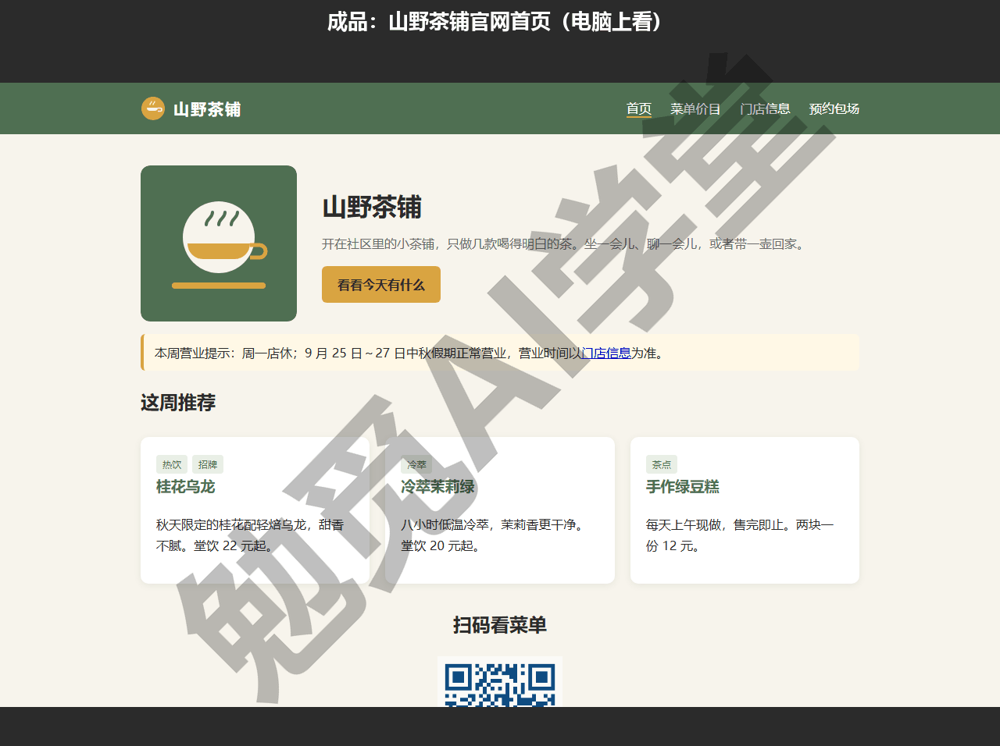

### 16.1 需求与规矩

**项目背景。** 假设你要帮一家开在社区里的小茶铺做官网，店叫“山野茶铺”（虚构的演示店，数据与文案都是编的，不含真实个人信息）。店主的要求很朴素：顾客能在网上看到菜单和价格，找得到店，能预约包场；将来价格变了，自己能改。

**第 1 步：用三要素把需求说清楚。**《对话与上下文管理》定下的说需求三要素——目标、约束、验收——在项目开工时最有用。这个项目的三要素是：

- 目标：一个给顾客看的官网，四个页面——首页、菜单价目、门店信息、预约包场。
- 约束：纯静态页面（HTML、CSS 加少量 JS，分别管网页的内容、样式和交互，不接后台服务器），将来用 GitHub Pages 免费发布；配色用茶汤绿系；不出现真实手机号。
- 验收：四页在电脑和手机上都能正常看、互相能跳转，并且把“改版意见到上线”这套流程完整走通一次。

**第 2 步：计划模式先出方案。** 大任务先想清楚再动手——《计划、提问与调试三模式》定下的习惯。把模式切到 Plan，发送：

```
给“山野茶铺”做一个官网。目标：顾客能看到菜单价目、找到门店、了解预约包场；
约束：纯静态页面（HTML/CSS，少量 JS），不接后台，将来用 GitHub Pages 发布，
配色用茶汤绿系，不出现真实手机号；验收：首页、菜单价目、门店信息、预约包场
四个页面，电脑和手机都能正常看。先别动手，把方案和页面结构列出来给我确认。
```

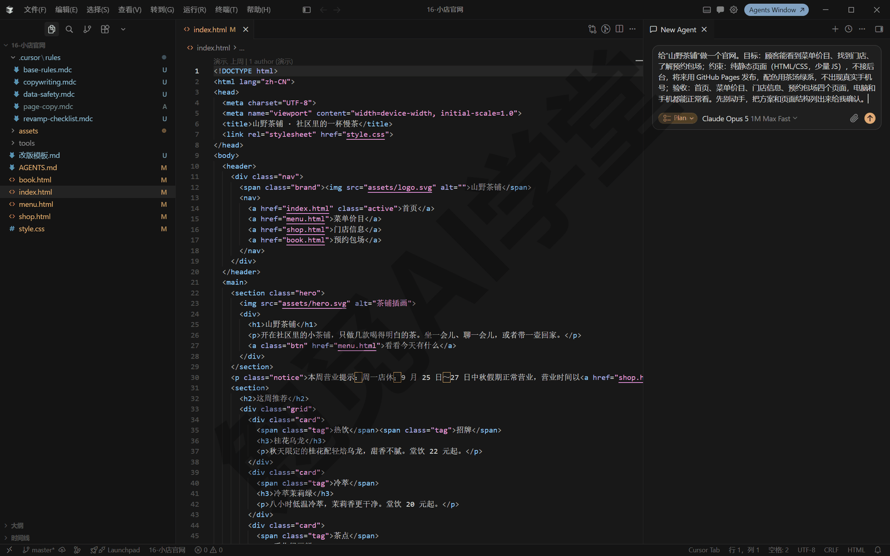

计划里定下的要点有四条，和最后做出来的东西一致：

- 四个页面各放什么内容、怎么互相链接，四页共用一份 style.css，保持风格统一；
- 标志和首页插画用 SVG 矢量图现画（SVG 是一种用代码描述的图，放大不会模糊，不依赖照片素材）；
- 二维码用脚本生成；
- 全程用 Git 管版本。

确认计划之后先不急着让它写页面——还差一步。

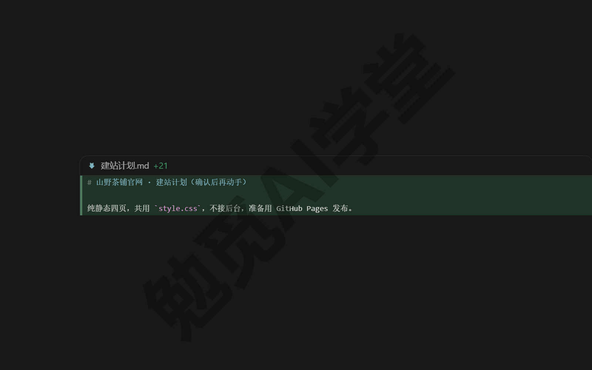

**第 3 步：把规矩写成 AGENTS.md。**《规则与 AGENTS.md》讲过：AGENTS.md 是放在项目根目录的规矩文件，之后每次对话它都会自动带上，不用你反复叮嘱。给别人做东西——哪怕是给自己的店——先定规矩再动工，是实战里最划算的一步。发送：

```
动手之前，先把这个项目的规矩写成 AGENTS.md 放在项目根目录：
配色——主色茶汤绿 #4f6f52、强调色蜜金 #d9a441、背景宣纸白 #f7f4ec；
字体用系统中文字体，所有页面共用 style.css，不写行内样式；
文案禁区——不写绝对化用词、不写疗效，价格写“元起”或具体数字，
营业时间以门店信息页为唯一来源，不出现真实手机号；
结构——index／menu／shop／book 四页，图片放 assets/，二维码由脚本生成。
```

生成的 AGENTS.md 全文 20 行。节选两段演示项目里的原文，看看一份规矩文件要写到多具体：

```
## 配色与排版
- 主色 `#4f6f52`（茶汤绿），强调色 `#d9a441`（蜜金），
  背景 `#f7f4ec`（宣纸白），正文 `#2b2b2b`
- 字体：系统中文字体优先（`"PingFang SC", "Microsoft YaHei", sans-serif`），不引外部字体
- 所有页面共用 `style.css`，不写行内样式

## 文案禁区
- 不写「全城最好」「第一」「顶级」这类绝对化用词，不写疗效
- 价格写「元起」或具体数字，不写「优惠」百分比；营业时间以门店信息页为唯一来源
- 不出现真实手机号、身份证号；预约只做表单展示位与邮箱占位
- 中文标点用全角，中英文之间留一个空格
```

其中“唯一来源”这条最要紧。营业时间这类信息，如果首页写一份、门店信息页再写一份，日后店主改了其中一处忘了另一处，网站就自相矛盾。规矩定成“只有门店信息页可以写营业时间，其他页面要提就只能放链接”，改的时候只需要改一处。这条规矩在 16.4 的迭代二里会真正发挥作用。

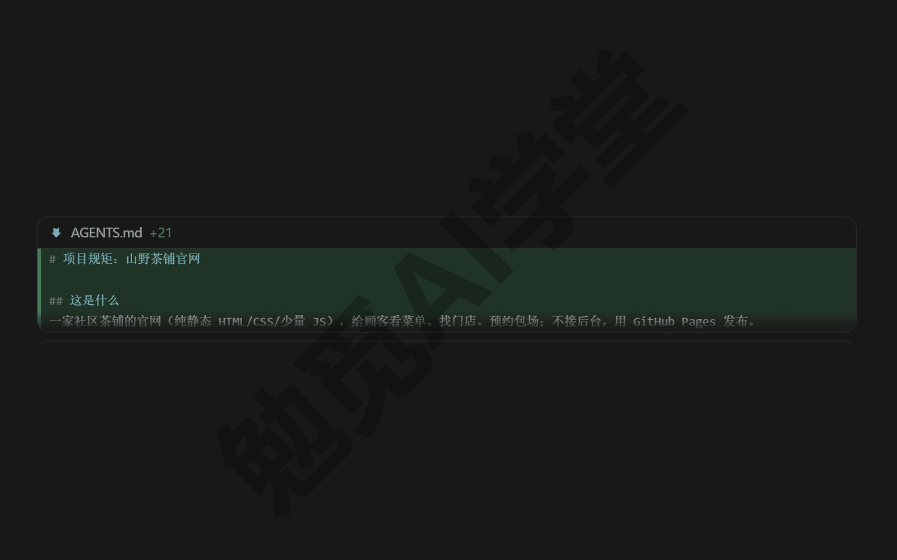

### 16.2 生成四页与本地预览

**一条提示词生成整站。** 规矩就位，把任务交出去：

```
按计划和 AGENTS.md 的规矩把四个页面做出来：
index.html 首页——招牌介绍、“这周推荐”三张卡片；
menu.html 菜单价目——热饮、冷萃与冰饮、茶点、带回家四张价目表；
shop.html 门店信息——营业时间、地址、怎么来、店内环境、联系方式（邮箱占位）；
book.html 预约包场——表单展示位，提交只做本页预览、不真正发送；
共用一份 style.css；标志和首页插画用 SVG 画，不用照片；页脚统一，含“返回顶部”。
```

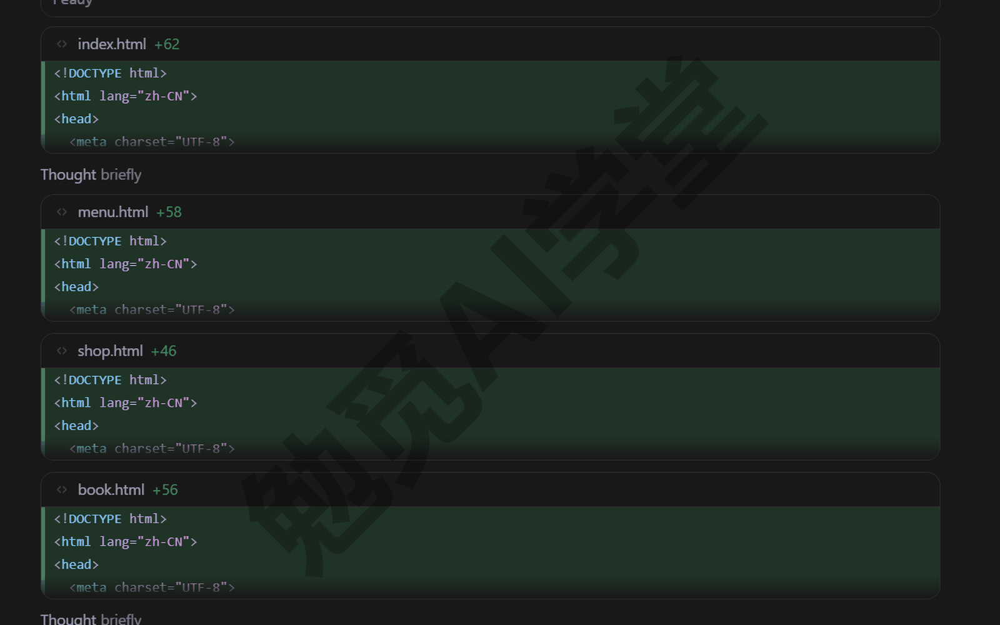

几分钟后，工作区（也就是你打开的这个文件夹，《两套界面全导览》讲过这个叫法）里多出这批文件：

```
16-小店官网/
├── AGENTS.md          规矩文件（16.1 已生成）
├── index.html         首页
├── menu.html          菜单价目
├── shop.html          门店信息
├── book.html          预约包场
├── style.css          四页共用样式
├── assets/            logo.svg、hero.svg 两张矢量图（二维码稍后也存这里）
└── tools/make_qr.py   二维码生成脚本（16.6 细讲）
```

智能体画完两张 SVG 后，还自己检查了一遍文件里有没有英文字母、数字和符号之外的字符（术语叫非 ASCII 字节，结果为 0）——SVG 是纯文本格式，混进中文这类字符偶尔会引发编码问题，它提前做了这项检查。生成与跑命令的过程中你会看到熟悉的审批弹窗：Windows 上没有文件系统沙盒，安全网是自动审查加审批（《权限、沙盒与模型》讲过），该看的审批别急着放行。

**第一版先提交。**《Git、GitHub 与代码审查》定下的习惯：成型的东西先提交，提交是永久后悔药。让它初始化仓库并提交全部文件，这次实际做下来的第一次提交是（git log 原样）：

```
319d680 山野茶铺官网 v1：四页站点、AGENTS.md 规矩、二维码
```

**本地预览：先启动本地服务，再看页面。** 静态页面你双击也能打开，但要看它上线后的样子，就先在本机启动一个服务，让页面跑在 http://localhost:8000 这样的本地网址上。演示里智能体用的是 Python 自带的一行命令：

```
python -m http.server 8000
```

然后逐页检查。这次演示走的是命令行截图路线：智能体调用无头浏览器（没有窗口界面、专供脚本使用的浏览器，演示用的是 Edge 的无头模式）访问每一页，桌面按 1280 像素宽、手机按 390 像素宽各截一张，四页共 8 张。你自己跑的时候，也可以直接让它用内置浏览器打开预览（《内置浏览器与设计模式》讲过的内嵌浏览器面板，画面形态以实际界面为准）：

```
用内置浏览器打开 http://localhost:8000，四个页面各看一遍，
确认互相能跳转、样式正常，每页截一张图。
```

下面这张是演示里用无头浏览器截的首页，能看到本周营业提示、三张推荐卡片和底部二维码，不是内置浏览器窗格本身——窗格是什么样子，以你机器上实际看到的为准。

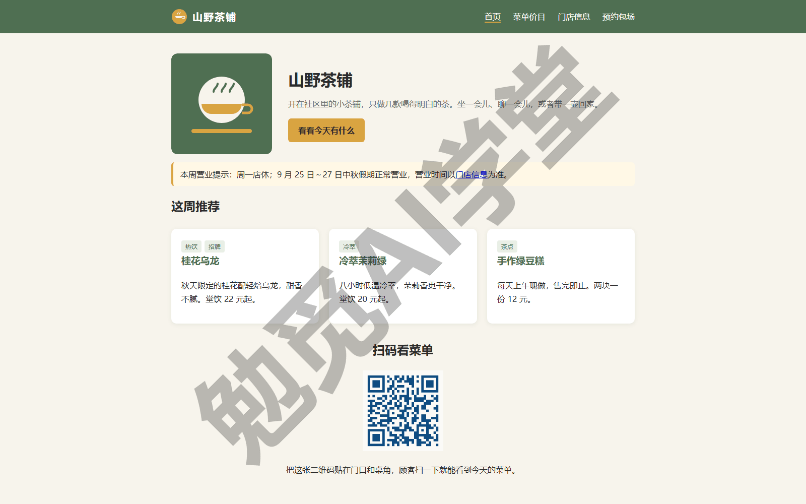

四个页面的桌面端效果如下。本篇里的页面截图（包括后面的手机端截图）都是两轮迭代做完、截图工具也修好之后重新截的最终版。

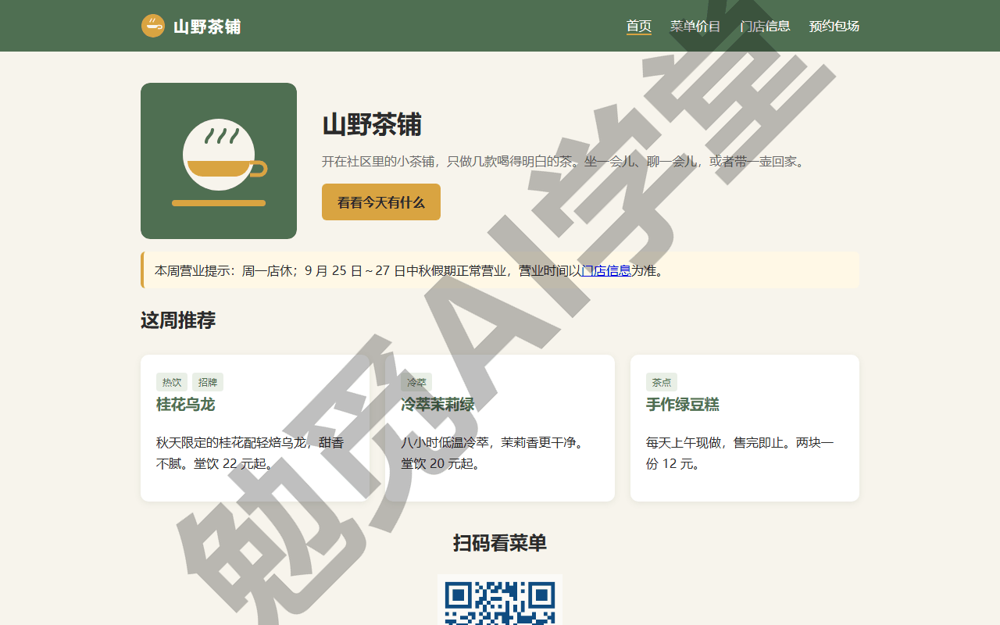

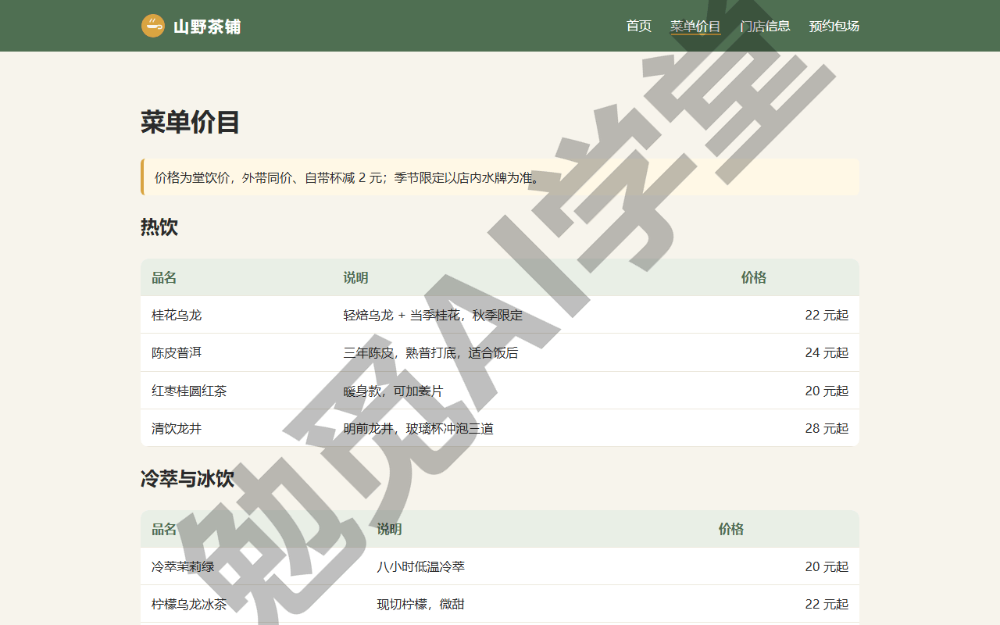

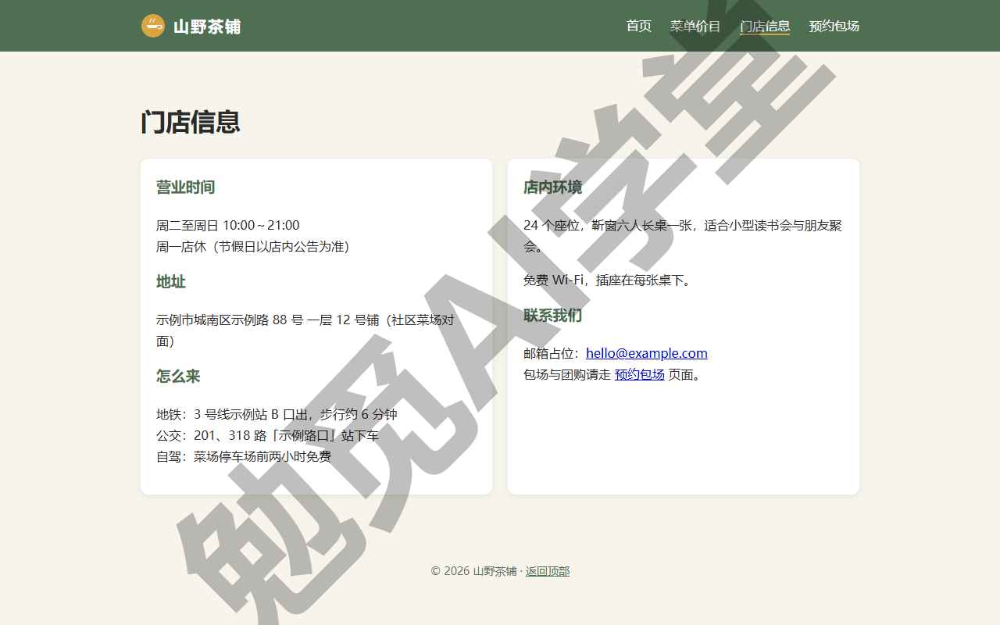

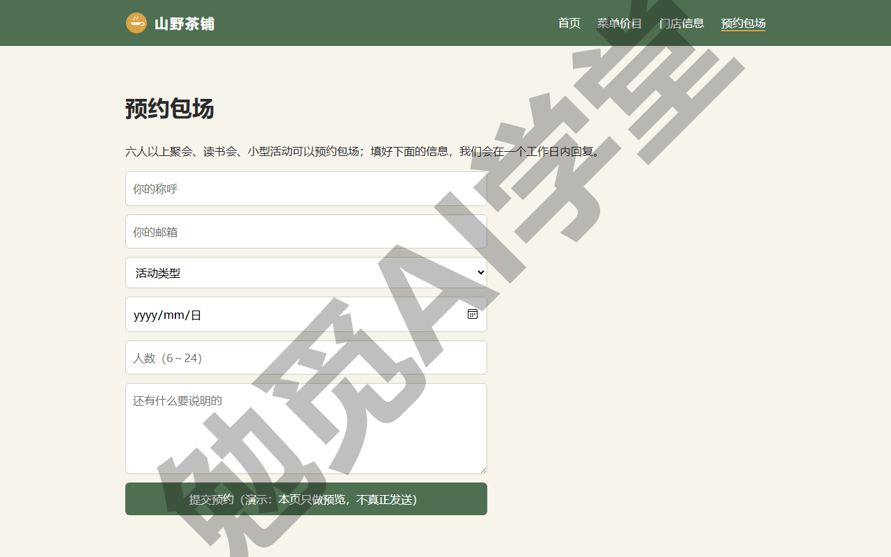

四页靠顶部导航互相跳转，按首页、菜单价目、门店信息、预约包场的顺序连起来看是这样（动图）：


### 16.3 改版用哪种方式

四个页面都做出来了，你把它们从头看一遍，总会有想调的地方：这张表太挤、那块颜色不对、首页少一句提示。接下来就是动手改这些地方。

改版有两种方式，《内置浏览器与设计模式》里都讲过。一种是设计模式：在内置浏览器里直接点中页面上的元素，说你要它改成什么样。智能体拿到的不只是你这句话，还有被点中那个元素的身份（能对应到具体代码）和一张页面截图，它不用猜你指的是哪一块。另一种是对话改版：在对话里用文字把位置和要求说清楚，比如“菜单价目页的第一张表格，每行再松一点”。

这个项目的两轮迭代走的都是对话改版，原因有两个。一是设计模式除了点选单个元素，还有多选和画圈两种用法，而 3.7.42 版上这两个入口都没有找到，《内置浏览器与设计模式》里记的也是这个结果；你那个版本有没有，以实际界面为准。二是这次要改的东西（表格的列宽、首页加一行营业提示）用文字就指得清楚，不用再到页面上点元素。两种方式做出来的结果是一样的：设计模式省掉了描述位置这一步，对话改版不挑版本。

**四张价目表共用一套样式，改一张四张都会变。** 菜单价目页上的热饮、冷萃与冰饮、茶点、带回家四张表，用的是 style.css 里同一套表格样式，这是 AGENTS.md 里“共用 style.css”那条规矩带来的结果。下一节的迭代一就遇到过这种情况：为了让手机上放得下，它写了一条隐藏说明列的样式，这条样式对所有 `table.menu` 都生效（四张价目表在代码里都叫这个名字），四张表的说明列于是一起收了起来，那次正好是想要的效果。轮到你只想改其中一张时，要在话里把是哪一张说明白：

```
菜单价目页上的四张价目表共用同一套表格样式。
这次只把“冷萃与冰饮”那一张的行高加两像素，另外三张保持原样。
```

这样说，它才知道你要的是一条只对这张表生效的样式，而不是去动那套公共的。不管用设计模式还是用对话改版，这一点都一样。

**对话改版怎么把位置说准。** 没有鼠标替你指，位置全靠一句话交代。好用的说法分三层：先给页面，再给页面里的哪一块，必要时再给到块里的哪个部位。“菜单价目页”是页面，“第一张表格”“底部的联系方式”“这周推荐那三张卡片”是块，“表头”“价格列”是部位。三层叠起来基本不会指错，比如“菜单价目页第一张表格的表头”。页面用你自己看得懂的叫法就行，不必写成文件名。

说完改哪里，再补一句不要动什么。下一节迭代一发出去的那条指令，末尾就是“只改样式，不动内容”。有了这一句，它在调表格列宽的时候不会顺手改掉菜品名和价格。“只改这一页”“别动 AGENTS.md”“先不要提交”都是在交代不要动什么，想清楚了就一并写进去。

### 16.4 两轮真实迭代

真实项目不会一次成型。这一节的两轮迭代都是演示里真实发生的，提交号也是当时的原样。

**迭代一：手机端看起来出了问题。** 第一批手机截图（390 宽）里，菜单价目页的表格三列超出屏幕、价格列看不见，导航四个链接也被挤了出去。菜单价目页在这批截图里是下面这个样子（按当时的截图命令重截）：

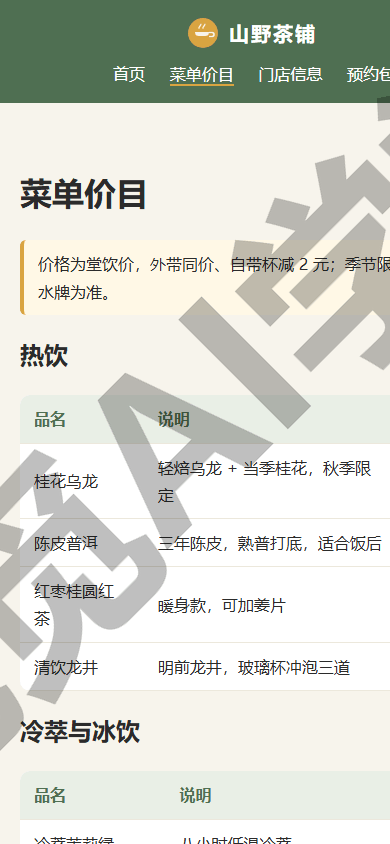

把问题描述发回对话：

```
手机截图里菜单价目的表格三列挤出屏幕、价格列看不见，导航四个链接也被挤出。
窄屏下优化一下：菜单表格可以隐藏“说明”列，品名允许换行；导航允许换行居中。
只改样式，不动内容。
```

它在 style.css 的窄屏样式块（针对 600 像素以下宽度的屏幕）里加了 4 行，实际改动的差异原文：

```
+  .nav nav { display: flex; flex-wrap: wrap; justify-content: center; gap: 6px 14px; }
+  .nav a { margin-left: 0; font-size: 14px; }
+  table.menu th:nth-child(2), table.menu td:nth-child(2) { display: none; }
+  table.menu td:first-child { max-width: 60vw; overflow-wrap: anywhere; }
```

这四行说的是导航允许换行并居中、窄屏上导航字号小一点，菜单表格在窄屏隐藏第二列（说明列）、品名列过长允许折行。提交记录：

```
bcc9858 迭代一：修复手机端菜单表格与导航溢出
```

改完的手机端菜单页是这样——说明列收起，品名和价格都在屏幕内：

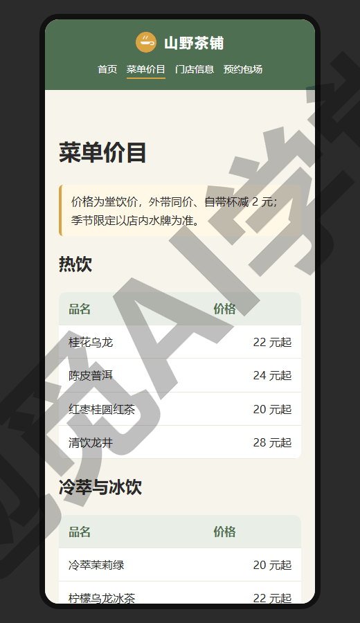

把改动前后的菜单页都放在真实的 390 像素宽度下对比，能看清这四行样式做了什么，说明列收起、品名不再折成两行（动图）：

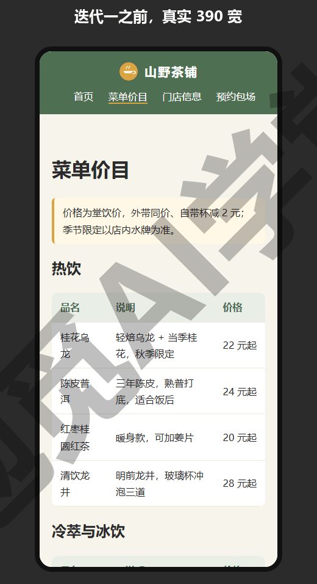

这次“修复”的起因，回头看有一半是假象——样式改完重截，画面仍不对劲，真正的原因放在 16.5 展开。样式改动本身没有白做：窄屏隐藏说明列、导航可换行，后来证明是合理的窄屏优化，保留了下来。

**迭代二：店主的需求变更。** 上线前店主提了个新要求：节前想在首页提醒顾客，周一店休、中秋假期正常营业。这条需求正好和 AGENTS.md 里“营业时间以门店信息页为唯一来源”这条规矩有关。发送：

```
店主要在首页加一条“本周营业提示”：周一店休，9 月 25 日到 27 日中秋假期正常营业。
注意 AGENTS.md 的规矩：营业时间以门店信息页为唯一来源，提示里不要写具体营业时间，
写“营业时间以门店信息为准”并链接到门店信息页。
```

其实就算你忘了提醒，AGENTS.md 也会随对话自动带给它——把规矩写进文件的好处，在这种时刻就显出来了。它在首页招牌区下方加了一行提示条，index.html 实际改动的差异只有这一行：

```
<p class="notice">本周营业提示：周一店休；9 月 25 日～27 日中秋假期正常营业，
营业时间以<a href="shop.html">门店信息</a>为准。</p>
```

注意这一行的写法，提示条只说“哪些天开门”，具体几点到几点一个字没写；点“门店信息”链接过去，才看到“周二至周日 10:00～21:00”。日后店主把打烊时间改到 22:00，只改门店信息页一处，首页提示原封不动。这就是“唯一来源”这条规矩起作用的实例：规矩写在 AGENTS.md 里，需求变更时它自动生效。提交记录：

```
8d133d9 迭代二：首页增加本周营业提示
```

首页的最终效果见 16.2 的第一张截图，提示条就在招牌区下方。

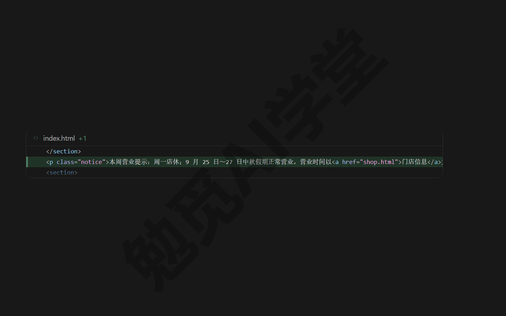

从首页提示条点“门店信息”过去，几点开门、几点打烊只在门店信息页出现（动图）：

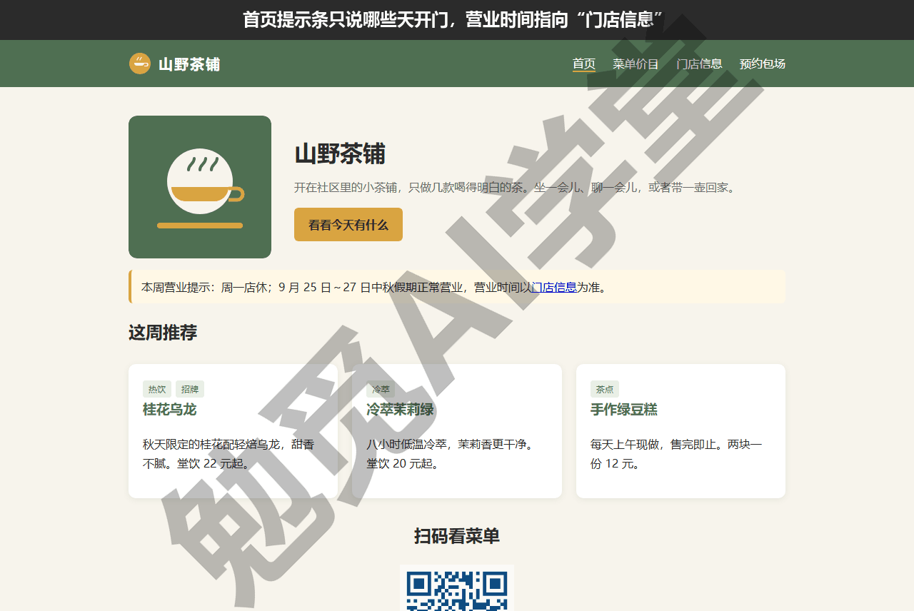

### 16.5 翻车实录：截图里的假象

这一节的排查实际发生在迭代一与迭代二之间；16.4 里为了把“需求变更”讲完整，把两轮迭代放在了一起。

**改完样式，截图还是不对。** 迭代一明明改了窄屏样式，重新截图之后，价格列仍旧显示不全。重截出来的菜单页是这样，说明列是收起了，价格一列却只剩表头：

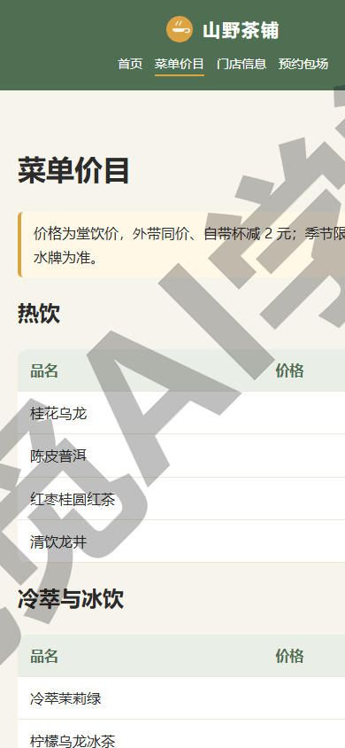

到这一步，多数人的本能是继续改样式：再砍一列、再缩字号。演示里没有这么做，而是停下来，先量。

**先量再改。** 让智能体用无头浏览器把“页面实际拿到的宽度”量出来，你可以直接这样说：

```
先别改页面。用无头浏览器量一下手机截图时页面实际拿到的视口宽度
（window.innerWidth），再比一比 document.documentElement.scrollWidth 和
clientWidth，看页面有没有横向溢出。把数字告诉我，我们再决定改不改。
```

它会写一小段测量代码去跑。下面这张是把这个测量写成一个小脚本 tools/measure_viewport.py 后在终端里跑出来的结果，数字与当时一致：

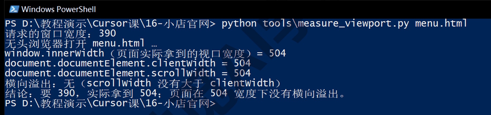

量出来的结果推翻了之前的全部判断：请求的窗口宽度是 390，页面实际拿到的视口宽度（浏览器分给网页的显示区域宽度）却是 504，而且页面在 504 宽度下没有任何横向溢出（内容没有超出屏幕宽度）。

**结论：页面没有问题，问题出在截图工具。** 原因串起来是这样的：

- 演示机的系统显示缩放是 125%，这个设置影响了无头浏览器实际给出的视口宽度——要 390，拿到的是 504；
- 截图文件本身仍按 390 宽保存，于是每张“手机截图”其实是 504 宽画面的左边 390 像素——价格列和导航项不是被页面挤出去的，是被截图裁掉的。

**修一次不够，还得再修一次。** 演示里第一次修的时候，智能体给截图命令加上了强制 1:1 缩放的参数（--force-device-scale-factor=1），重新截了一遍，还是不对。加上参数再量一次，页面拿到的宽度是 492，依然不是要的 390：

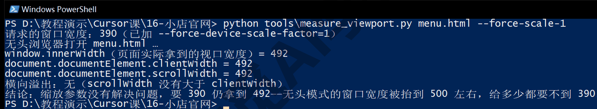

再查才发现第二层原因：Chromium（Chrome、Edge 共用的浏览器内核）的无头模式有一个约 500 像素的最小窗口宽度，390 的窗口要不到，给多少都会被抬到 500 左右。最终的处理办法绕开了这个限制：截图窗口开成 520 宽，里面放一个真实 390×844 的 iframe（网页里内嵌的另一个网页框），让目标页在 iframe 里以真正的 390 宽度显示，再截。手机端截图从此正常，本篇所有手机端配图都出自这套修正后的流程。同一份菜单页，截图工具存下的画面和真实 390 宽下的画面放在一起看，差别就在价格那一列（动图）：

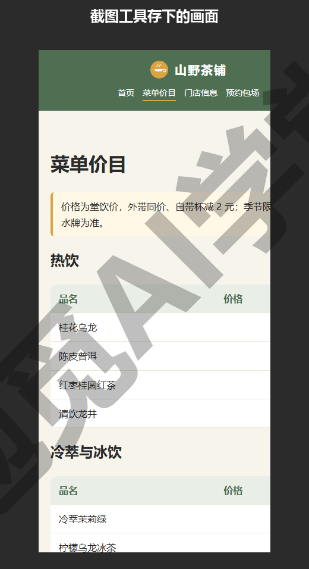

修正后重截的三页手机端画面：

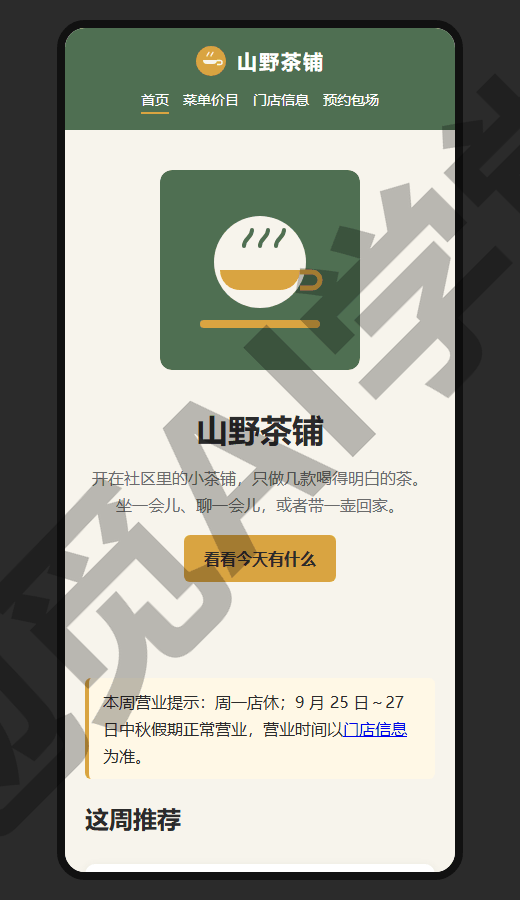

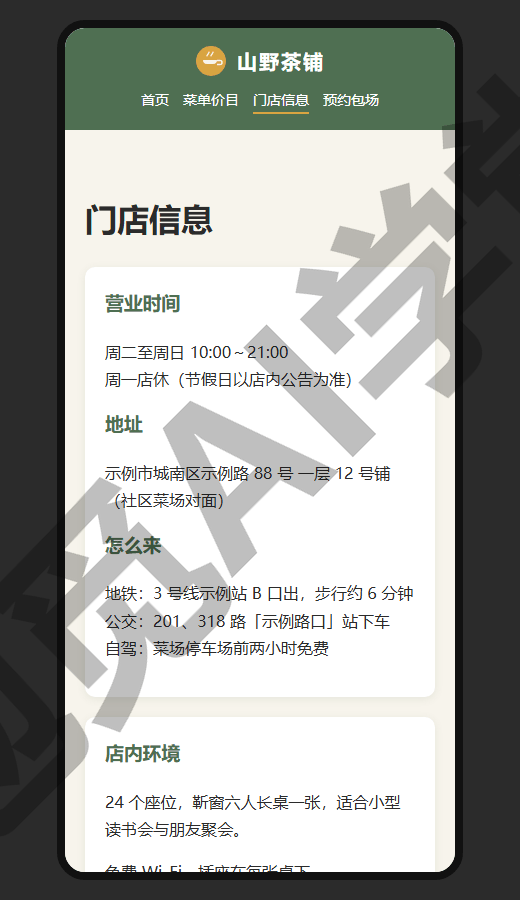

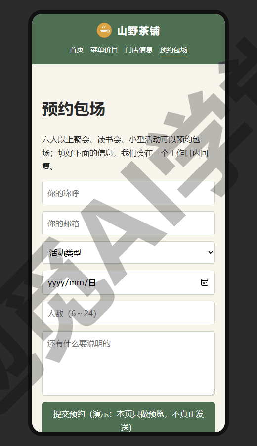

**这次翻车留下的教训。** 以后你在手机上“看着不对”时，第一步永远是量，不是改：

- 量视口——window.innerWidth 是多少，和你以为的宽度一致吗；
- 量溢出——scrollWidth 是否大于 clientWidth，页面到底有没有横向超宽；
- 分清两类问题——如果页面真的溢出了，就改样式；如果是视口不对，要修的是截图或预览工具，页面一行都不用动。

迭代一的样式改动最后留了下来，是因为它作为窄屏优化本身就合理；但如果当时顺着假象继续砍列、缩字号，好好的页面就会被改坏。先量再改：量一下只要一分钟，不量可能白改一下午。

### 16.6 二维码、三次提交与上线

**门口二维码：一行核心代码。** 店主想在门口和桌角贴一张二维码，顾客扫一下就能打开网站。二维码用 Python 的 segno 库（一个用 Python 写的二维码生成库，在终端里运行 `pip install segno` 就装好了）生成。演示项目里的 tools/make_qr.py，核心就一行：

```
segno.make(url, error="m").save(str(out), scale=8, border=2,
    dark="#0f4c81", light="#fbfaf7")
```

运行的命令照演示里的原样写在下面——网址是占位的示例地址，等上线拿到真实网址后再跑一遍换掉：

```
python tools/make_qr.py https://example.github.io/shanye-tea/
```

脚本把二维码存到 assets/qr.png，首页底部的“扫码看菜单”一节直接引用它。实际输出：

```
二维码已生成：D:\教程演示\Cursor课\16-小店官网\assets\qr.png
（内容：https://example.github.io/shanye-tea/）
```

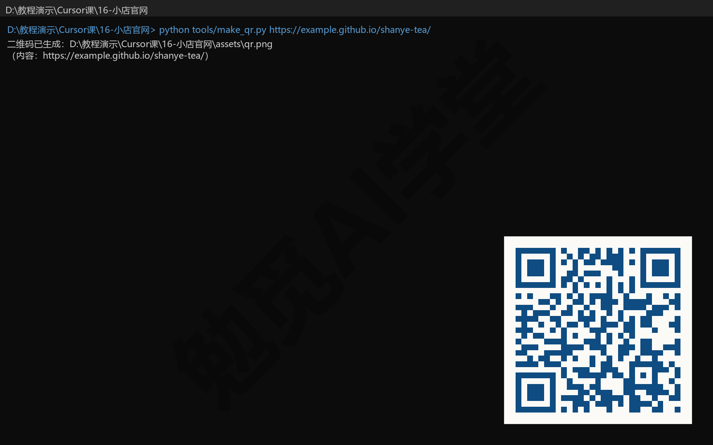

**三次提交，回看全程。** 到这里项目一共提交了三次（git log 原样）：

```
8d133d9 迭代二：首页增加本周营业提示
bcc9858 迭代一：修复手机端菜单表格与导航溢出
319d680 山野茶铺官网 v1：四页站点、AGENTS.md 规矩、二维码
```

三次提交对应项目的三个阶段：第一版成型、窄屏优化、需求变更。哪天改坏了，任何一个阶段都回得去——这就是《Git、GitHub 与代码审查》说的“Git 是永久后悔药”在真实项目里的样子。

**推上 GitHub、开 Pages。** 演示项目已经推到 GitHub 上的公开仓库 xwlrun/shanye-tea，三次提交与上面 git log 一致。下面分三步。

第 1 步，把仓库推上 GitHub。前提是 Cursor 已连接你的 GitHub 账号（《Git、GitHub 与代码审查》讲过连接方法），然后在对话里直接说：

```
把这个项目推到我的 GitHub，新建一个名叫 shanye-tea 的公开仓库。
```

推完之后，打开你的仓库页（演示里是 github.com/xwlrun/shanye-tea），仓库首页能看到文件，Commits 页能看到这三次提交。

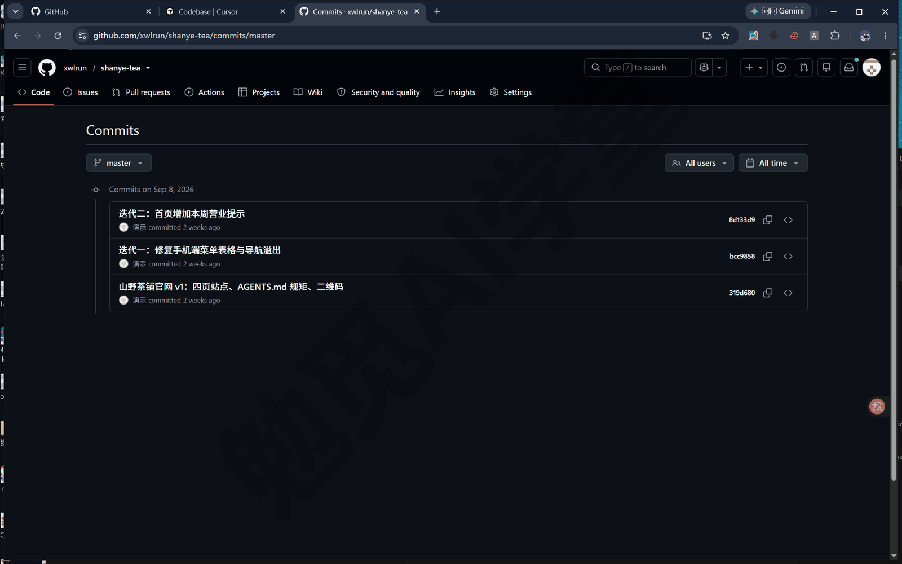

第 2 步，开 GitHub Pages。GitHub Pages 是 GitHub 提供的免费静态网站托管服务（把你仓库里的网页放到网上，别人用网址就能打开）。打开仓库的 Settings，左侧栏点 Pages，Build and deployment 下的 Source 选 Deploy from a branch（从分支部署），Branch 选你仓库的默认分支（演示仓库的默认分支叫 master，你的可能叫 main，选列表里有的那一个）、目录选 / (root)，点 Save（这一页是英文界面，下图是设置完成、站点已上线后的样子）。等几分钟，站点会发布在这样的网址上：

```
https://xwlrun.github.io/shanye-tea/
```

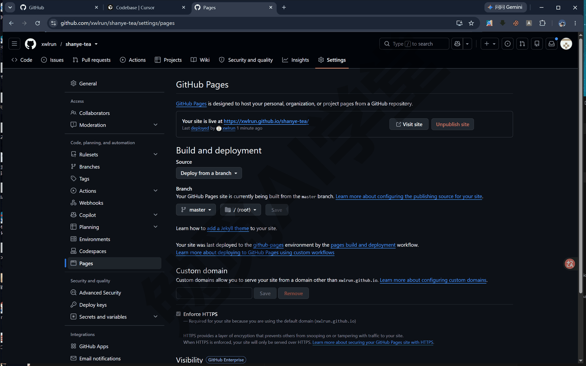

第 3 步，收尾两件事：拿真实网址重跑一遍 tools/make_qr.py，把首页二维码换成正式网址，提交并推送；再用手机扫一下二维码，确认能打开网站。

这一步在演示项目里的运行输出，网址已经换成上线后的正式网址：

```
python tools/make_qr.py https://xwlrun.github.io/shanye-tea/
二维码已生成：D:\教程演示\Cursor课\16-小店官网\assets\qr.png
（内容：https://xwlrun.github.io/shanye-tea/）
```

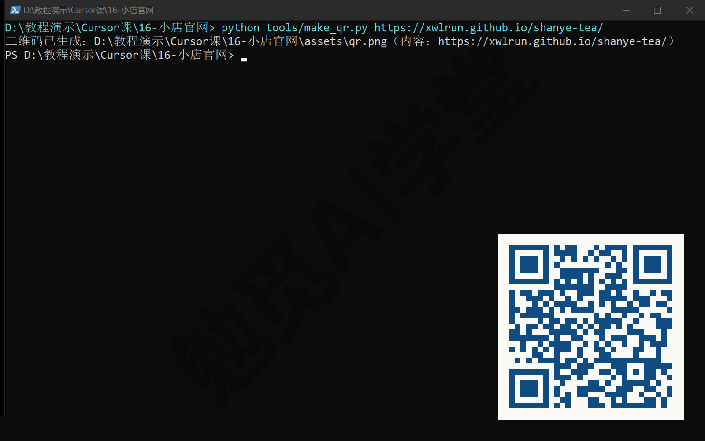

提交说明可以写“二维码换成正式网址”；推送后等 Pages 重新发布（通常几分钟），首页底部那张二维码，扫出来就是你的网站。

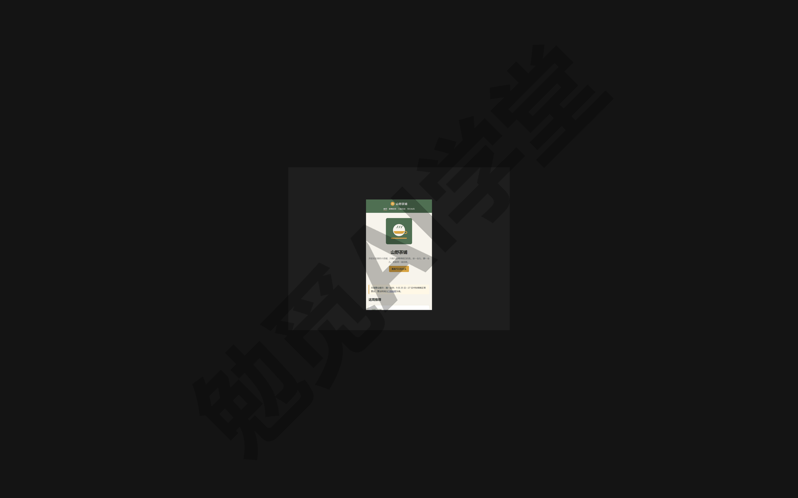

**改一处菜单，再发布一次。** 上线之后还要会改，这条流程才算完整。演示里还模拟了一次变更——店主说桂花酸梅汤过季下市了，要做的只有三步：对话里让它把 menu.html 里那一行删掉（并顺带检查有没有别的页面提到这个品名，和“唯一来源”是同一个思路）；提交并推送；等 Pages 自动重新发布（通常几分钟）。之后顾客再扫同一张二维码，看到的就是新菜单。走完这一次，你就有了完整的“改版意见到上线”循环，本篇开头定下的验收标准也就达到了。

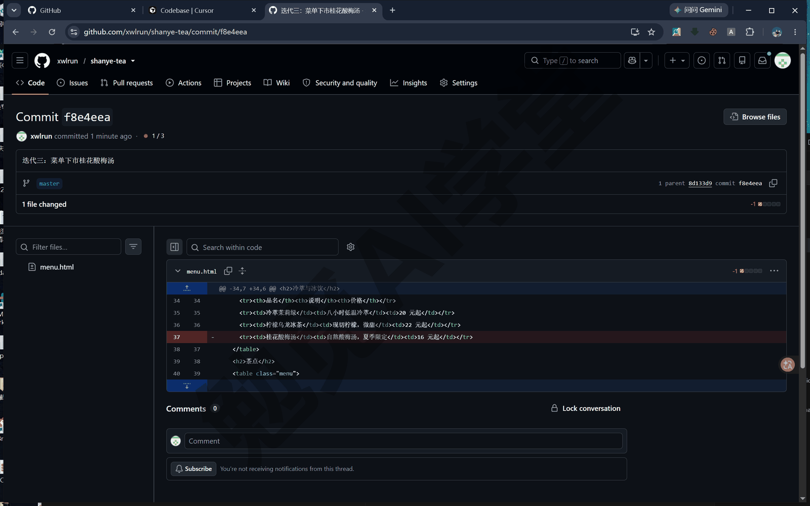

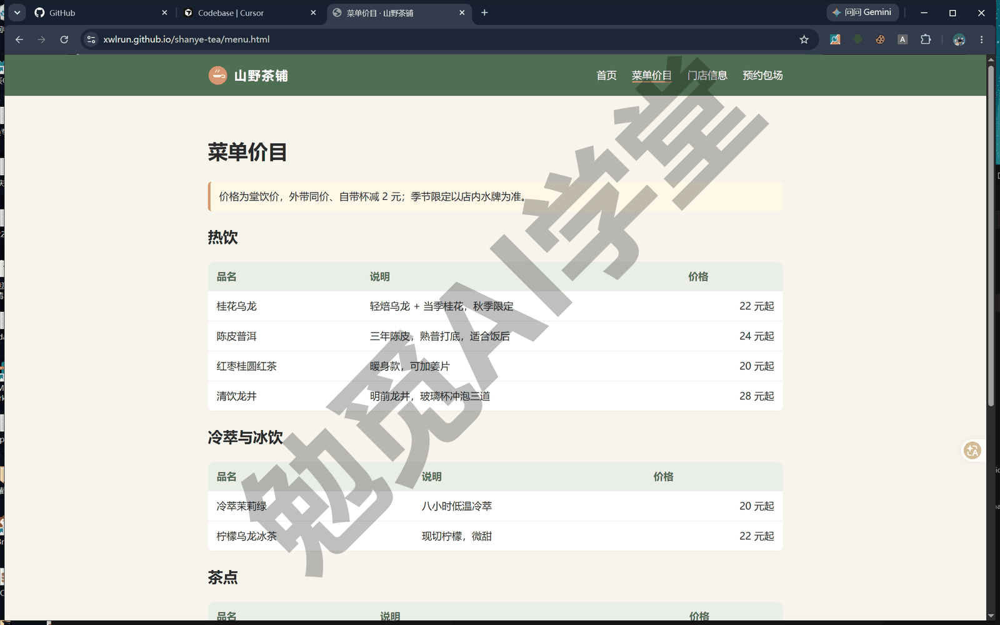

**交付物清单。** 这个项目最终交出的东西：一个可访问的网址（上线后）、一个带五次提交的仓库（建站时的三次，加上把二维码换成正式网址、改菜单各一次）、一张贴在门口的二维码，外加一条店主自己也能走的改菜单流程。

### 16.7 三个练习任务

把本篇流程在你自己的项目上走一遍。提示词里方括号的内容换成你自己的。

**任务一：给自己的店定规矩**

```
我要给 [你的店或朋友的店] 做官网。先别写页面，把项目规矩写成 AGENTS.md：
配色用 [你想要的主色调]；文案不写绝对化用词；[你最在意的一条信息，比如营业时间]
以 [某一个页面] 为唯一来源，其他页面只能放链接；不出现真实手机号。
```

完成标准：AGENTS.md 出现在项目根目录；规矩分了组（配色、文案、结构）；“唯一来源”那条写清楚了以哪一页为准。

**任务二：从规矩到四页站**

```
按 AGENTS.md 的规矩给 [你的店] 生成四个页面：首页、[价目或作品页]、门店信息、
[预约或联系页]。共用一份 style.css，标志用 SVG 画。做完在本地起服务，
桌面和手机宽度各截一张首页图给我。
```

完成标准：四页互相能跳转；样式全部来自共用的 style.css；两张截图里页面都没有横向滚动。

**任务三：处理一次需求变更**

```
[某个商品] 的价格变了，改成 [新价格]。只改该改的地方，改完告诉我动了哪个文件的
哪一行，并按 AGENTS.md 检查一遍还有没有别的页面写了这个价格。
```

完成标准：只有价目页发生改动；它报出了具体改动位置；如果别的页面也写了这个价格，它按唯一来源的思路指出来并建议改成链接；最后提交一次，提交信息说清这次变更。

### 16.98 本篇小结与自检

这一篇从一家茶铺的需求出发，走完了“从提需求到上线”的全程：三要素说清需求、AGENTS.md 定规矩、一条提示词生成四页站、两轮真实迭代、一次“先量再改”的翻车自救、门口二维码与三次提交，最后上线，并改一处菜单再发布一次。

可以对照下面的清单检查学习结果：

- [ ] 会用目标、约束、验收三要素描述一个建站需求，并先用计划模式出方案
- [ ] 给项目写过 AGENTS.md，能说出“唯一来源”规矩防的是什么
- [ ] 生成了多页静态站，四页互相能跳转、共用样式，并在本地预览过
- [ ] 知道改版有设计模式和对话改版两种方式，也知道这个项目的四张价目表共用一套样式、改一张四张都会变
- [ ] 手机端显示不对时，会先量视口和溢出，再决定改页面还是修工具
- [ ] 用脚本生成过站点二维码
- [ ] 项目有完整的提交记录，能说出每次提交对应哪个阶段
- [ ] 知道推 GitHub、开 Pages、改一处再发布的完整流程

完成这些内容后，你已经独立交付了第一个完整项目。下一篇《实战二：家庭账单月报流水线》换一类任务：把微信、支付宝、银行卡三种导出账单交给它，做出带图表的月报 Excel 和一页 PPT——数据类项目怎么把数据整理干净、怎么核对数字、怎么自动跑，和建站是完全不同的一套做法。

### 16.99 新手常见问题

**Q1：没有域名可以上线吗？**

可以。GitHub Pages 免费提供“你的用户名.github.io/仓库名”形式的网址，本篇的二维码指向的就是这类地址。想要更好记的独立域名，以后可以在 Pages 设置里绑定，不影响先上线。

**Q2：上线之后改价格，要重做网站吗？**

不用。改价格走的就是 16.6 结尾那套流程：让智能体改 menu.html 里对应的一行，提交、推送，等 Pages 自动重新发布，几分钟后顾客扫同一张二维码看到的就是新价格。二维码不用换——它指向网址，不指向内容。

**Q3：手机上看着不对，是页面问题还是截图问题？**

先量再改。让它量两个数：视口宽度（window.innerWidth）是不是你预期的值；页面有没有横向溢出（scrollWidth 是否大于 clientWidth）。如果是视口不对，就去修截图或预览工具；页面真有溢出，才改样式。本篇 16.5 的翻车实录，就是把截图工具的假象当成页面问题、险些白改一轮的完整案例。

**Q4：设计模式点不中我想改的东西怎么办？**

退回对话改版，用文字把位置指清楚（比如“菜单价目页第一张表格的表头”），做出来的结果一样。《内置浏览器与设计模式》里还讲了多选和画圈两种选法，不过 3.7.42 版上这两个入口没有找到。本篇演示的两轮迭代全部用对话改版完成，这个办法一直行得通。
