## 实战二：家庭账单月报流水线

这一篇做全课的第二个实战项目：把微信、支付宝、银行卡三种导出账单交给 Cursor，让它清洗（把乱糟糟的账单整理成能直接算的干净表格）、归类、算账，做出一份带图表的 Excel 月报、一页汇报 PPT 和一份摘要，再把整套做法封装成技能、设置成每月自动运行。《实战一：小店官网》做的是看得见的网页，这一篇做数据类任务，第一要求是数字要对；本篇一半的篇幅都在讲“怎么保证数字对”。

你可以把流水线理解成一条固定的加工线：账单从一头进，报表从另一头出，中间每一步都固定下来、可以反复运行。本篇的全部数字、代码与运行结果，来自 2026-09-08 在 Windows 桌面端 Cursor 3.7.42 上完成的一次完整的实际运行；演示账单由脚本生成、可以复现，换成你自己的真实账单同样能跑。

先看成品（动图）：账单从一头进，Excel 月报、一页 PPT 和运行日志从另一头出。

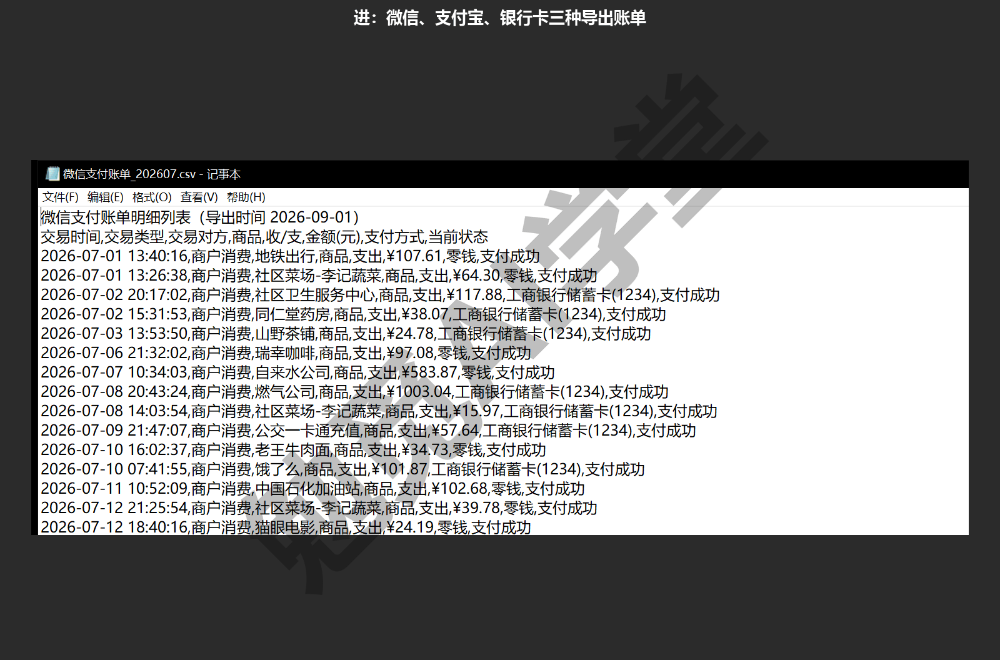

### 17.1 乱账单是什么样子

**为什么月底算不清账。** 你家的钱多半也从三个地方进出：微信、支付宝，再加上直接走银行卡的水电燃气代扣和工资入账。每个 App 都能看自己的账，但没有一个地方能回答“这个月我们家一共花了多少、花在哪了”。三个 App 都支持把账单导出成 CSV 表格文件，把三份文件合起来算总账，听起来是一道加法题。

真动手就会发现，这道加法题不能直接做。三份文件的表头不一样、日期写法不一样、金额写法不一样，更麻烦的是藏着几处会让结果直接算错的坑。这一节先把三种账单摊开看清楚。

**演示数据从哪来。** 为了让你跑出来的数字和本篇一致，也避免拿真实隐私数据演示，本篇的六份账单（2026 年 7、8 两个月，三种来源各两份）由项目里的 tools/make_messy_bills.py 生成，生成时固定了随机种子（随机数的起点），所以任何人重跑得到的都是同一批数据；文件里的每一种“乱”，都取自三类 App 真实导出文件的常见形态。你自己练习时，从微信、支付宝、银行的 App 里导出账单，直接放进 data/raw/ 文件夹就能替换演示数据，文件名保留“微信支付账单”“支付宝账单”“银行卡账单”开头即可，后面的流水线按文件名开头识别账单来源。

练习前先下载 [第17篇-模拟账单资源包.zip](%E8%B5%84%E6%BA%90%E5%8C%85/%E7%AC%AC17%E7%AF%87-%E6%A8%A1%E6%8B%9F%E8%B4%A6%E5%8D%95%E8%B5%84%E6%BA%90%E5%8C%85.zip)，解压后在 Cursor 中打开 `17-家庭账单月报` 文件夹作为工作区。包内含六份模拟账单、`tools/make_messy_bills.py` 和使用说明，`data/raw` 已按正文要求放好，可以直接从下面的只读探查步骤开始。

演示项目的文件夹是 D:\教程演示\Cursor课\17-家庭账单月报。你可以把解压后的文件夹放在自己的任意位置。《两套界面全导览》讲过，工作区就是 Cursor 干活的那个文件夹，生成的文件也都保存在里面。

**先看微信：第一行不是表头。** 用记事本或 Excel 打开微信导出的 CSV，最上面一行不是表头，而是一句导出说明“微信支付账单明细列表（导出时间 2026-09-01）”，真正的表头从第二行才开始。坑就在这里：程序如果把第一行当表头，所有列名都对不上，整份文件一行都读不出来。往下看数据行，金额一列带着货币符号，写成 ¥107.61 这样，转成数字前要先把符号去掉。还有一列“支付方式”值得多看一眼：有的行写“零钱”，有的行写“工商银行储蓄卡(1234)”，后一种是用绑定的银行卡付的钱，17.2 里最要紧的坑就从这里来。文件开头的几行是这样的：

```csv
微信支付账单明细列表（导出时间 2026-09-01）
交易时间,交易类型,交易对方,商品,收/支,金额(元),支付方式,当前状态
2026-07-01 13:40:16,商户消费,地铁出行,商品,支出,¥107.61,零钱,支付成功
```

用记事本打开就是这样，第一行是导出说明，第二行才是表头：

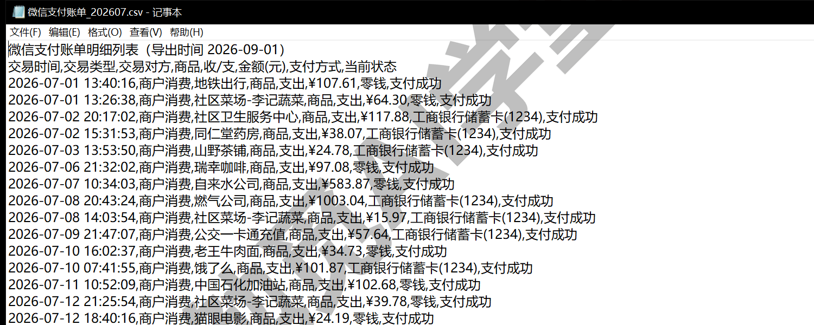

**再看支付宝：坑不在表头，在编码。** 这份文件在磁盘上是按 GBK 编码保存的。文本文件把文字存进去的方式（编码）有好几种，中文环境常见 GBK 与 UTF-8 两种，用错编码打开，看到的就是一屏乱码——支付宝导出用 GBK，而很多工具默认按 UTF-8 读，一读就乱。编码之外还有两个地方要注意：金额一旦上千就带千分位逗号、并被引号包住（`"2,191.71"`），当数字用之前要去掉逗号；日期用斜杠写法（2026/07/21 9:41），与微信的横杠写法不同。下面这行样例同时带着这两个问题，而且它还是一笔退款，“收/支”一列写的是“收入”：

```csv
交易创建时间,交易对方,商品名称,金额（元）,收/付款方式,交易状态,收/支
2026/07/21 9:41,燃气公司,退款-订单,"2,191.71",余额宝,退款成功,收入
```

同一个文件用两种编码读，差别是这样（动图）：

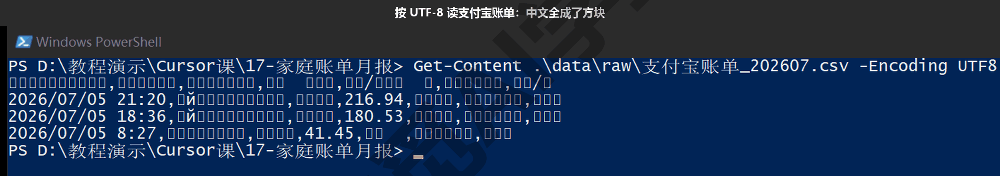

**最后看银行卡：负数记支出，还替微信记了一遍账。** 打开银行卡账单，你会看到日期是八位数字（20260710），没有任何分隔符；金额不分收支两列，靠正负号分方向，负数是支出、正数是收入，比如每月 10 日入账的工资 12,000.00 就是一笔正数。最要紧的是摘要里带“财付通-微信支付”字样的行：它不是一笔新支出，而是你在微信里用绑定银行卡付款时，银行那边记下的同一笔钱。下面是两行样例，一行是工资、一行是代扣：

```csv
交易日期,摘要,交易金额,余额,对方户名
20260710,工资,"12,000.00",,示例科技有限公司
20260702,财付通-微信支付-社区卫生服务中心,-117.88,,财付通支付科技有限公司
```

用记事本打开的样子，负数支出和“财付通-微信支付”开头的代扣行都在：

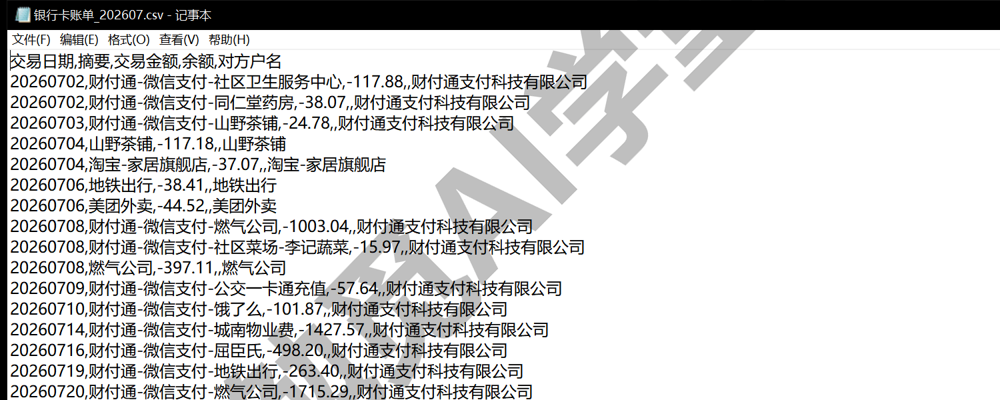

**为什么不能直接加。** 把六份文件的支出直接加总，会同时犯三种不一样的错。

**第一种错：同一笔钱算两遍。** 微信里用银行卡付的每一笔，微信账单记一次、银行流水再记一次代扣，直接相加就成了双份。这是三种错里对总数影响最大的一种，演示数据里这类行有几十行，准确数字下一节定规则时就会给出。

**第二种错：重复导出行。** 导出时间段重叠或者导出操作重复，会让完全相同的行在同一份文件里出现不止一次。它悄悄把个别商户的数字抬高一点，单看报表很难察觉，只有逐行比对才能发现。

**第三种错：退款没抵扣。** 退款在账单里记作“收入”，不处理它，支出算多了、收入也算多了，两个数都比实际高。月报要同时回答“花了多少”和“净花了多少”，就必须把退款单独列出来。

所以第一步不是写程序，而是让智能体把六份账单读一遍、报告问题。模式切到 Ask（只看不改，《计划、提问与调试三模式》讲过怎么切），发送这条指令：

```
只读不改：data/raw 里有六份账单文件，微信、支付宝、银行卡各两个月。
逐个读一遍告诉我：每种账单的表头是什么，日期和金额的写法有什么不同，
有没有会让“三份直接相加”算错的地方。先别动手清洗。
```

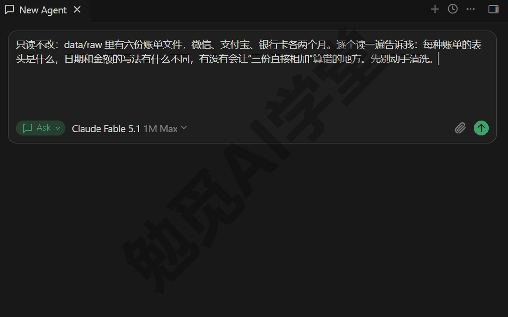

发出后，它会逐个读取六份文件（支付宝那两份如果先按 UTF-8 读出乱码，它一般会自己换编码重试，以实际表现为准），然后给出一份报告：三套表头、两种日期写法、金额符号与千分位、疑似重复的代扣行和重复导出行。这份报告就是下一节清洗规则的原材料。

### 17.2 清洗规则设计

**先定规则，再写程序。** 上一节的报告在手，下一步是把“怎么算才对”一条条明确下来。这类规则问题没有唯一正确答案：退款算不算收入？代扣行留银行那边还是微信这边？完全相同的两行是重复导出还是真的买了两次？所以别直接说一句“帮我清洗”就把整件事交出去，而是让智能体先列规则草案，你逐条确认或修改。确认过的规则，要求它原文写进脚本开头，日后打开脚本第一眼就能看到。

本篇最终确认的六条清洗规则，原样写在 pipeline.py 开头的说明里（RULES 段）：

```python
清洗规则（RULES）：
  1. 三套表头各自映射到统一字段：日期／对方／金额／方向（支出|收入）／来源
  2. 微信账单第一行是导出说明，跳过；支付宝账单是 GBK 编码
  3. 金额去 ¥ 与千分位；银行账单负数＝支出、正数＝收入
  4. 银行账单里摘要含「财付通-微信支付」的代扣记录与微信账单是同一笔，
     只保留微信侧，避免重复计入
  5. 同一来源内全字段重复的导出行去重；退款按收入计入并单列
  6. 类别按对方关键词映射，映射不到归「其他」
```

第 1、2、3 条管格式，程序读对了就好；第 4、5 条决定数字对不对；第 6 条决定报表好不好读。下面把最要紧的第 4 条展开讲透，再把两个格式坑说明白。

**跨来源重复：本篇最重要的一个坑。** 你在微信里付款，钱其实是从绑定的银行卡里扣的，于是同一笔消费产生两条记录：微信账单记的是商户消费，银行流水记的是“财付通-微信支付”代扣。从演示数据里配对出来的一组记录：

```
微信账单：2026-07-02 20:17:02,商户消费,社区卫生服务中心,商品,支出,
          ¥117.88,工商银行储蓄卡(1234),支付成功
银行账单：20260702,财付通-微信支付-社区卫生服务中心,-117.88,,
          财付通支付科技有限公司
```

在两份原始文件里把这两行找出来，是这样：

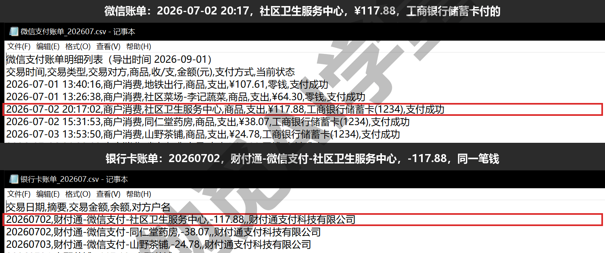

同一天、同一个商户、同一个金额：一笔钱，记了两条账。不处理，这笔 117.88 就会被算成 235.76。处理办法是二选一，只留一条。本篇留微信那一笔，理由是信息更全：微信记录了商户名、精确到秒的时间和支付方式，银行流水里只有一行摘要。而剔银行那一笔恰好也最容易做到：摘要里带“财付通-微信支付”字样的行，读入时直接跳过。这次运行，六份账单按这条规则剔掉了 37 行代扣记录。

有两点要提醒。

- 这条规则默认你的微信绑的是银行卡、而且这张卡的流水也在账单里。如果你平时用支付宝绑卡消费，银行流水里对应的代扣摘要是另一种写法，要照同样的思路处理支付宝对应的代扣行。这类规则变化不要让智能体直接改，先和你确认再改；17.5 封装技能时，会把这条写进注意事项。
- 规则定完抽查一次：随便挑一行被剔除的代扣，去微信账单里找同日期、同金额的那笔。找得到，说明剔得对；找不到，说明这条摘要匹配规则剔错了东西，要收紧匹配条件。

**格式坑一：支付宝的 GBK 编码。** 如果按 UTF-8 去读支付宝账单，你看到的要么是满屏乱码，要么程序直接报错。正确的处理办法是让读取代码按 GBK 编码打开这一种文件（本篇流水线就是这么做的）。不建议的做法是自己动手把文件另存为 UTF-8：这个月转了，下个月新导出的账单还是 GBK，每月都得手动转一次，“自动”就断了。所以要让程序去适应文件的编码，不要反过来改文件。

**格式坑二：微信的第一行是导出说明。** 微信账单的第一行是“微信支付账单明细列表（导出时间 2026-09-01）”这样一句话，真正的表头在第二行；程序要是把第一行当表头，所有列名都对不上，一行数据也读不出。处理办法很简单：读文件时跳过第一行。这类“文件开头带说明文字”的形态在各种导出文件里都常见，以后遇到读不出的 CSV，先打开看一眼前几行，往往就是这个原因。

**同一来源的重复行与退款。** 什么样的两行算重复导出？只有同一来源内全部字段完全一致才算，标准宁可严一点，不要松：同一天在同一家店买两杯同价的咖啡完全可能，只有连时间戳（精确到秒的交易时间）都一样，才算重复、可以去掉。这次运行按这条去掉了 8 行。退款则按收入计入并单独列一类，不去从某个支出类别里扣掉；月报里“支出合计”与“净支出”并排展示，两个数字都保留，谁看都不会误会。

规则确认后，让智能体动手：

```
按我们确认的这六条清洗规则写 pipeline.py：读取 data/raw 的三种账单，
统一成“日期、对方、金额、方向、来源”五个字段；剔除银行侧“财付通-微信支付”
代扣行；同一来源内全字段重复的行去重；退款按收入计入并单列。
把六条规则原文放在脚本开头的说明里。写完先跑一遍，把清洗统计打出来。
```

做完后工作区里会出现 pipeline.py，脚本开头就是上面那段 RULES。这一步先只看清洗统计对不对，分类和生成表格放在下一节。

### 17.3 分类与生成表格

**分类：按“对方”关键词归类。** 报表要回答“花在哪了”，就得把一条条流水归进类别。做法很朴素：看“对方”字段里带哪个关键词，就归进对应的类别，程序里把这张对应关系表叫映射表。本篇的映射表写在 pipeline.py 里，支出共六类：

```python
CATEGORY_KEYWORDS = {
    "餐饮": ["外卖", "饿了么", "茶铺", "面", "咖啡", "菜场", "餐"],
    "交通": ["地铁", "滴滴", "公交", "加油"],
    "购物": ["京东", "淘宝", "拼多多", "超市", "屈臣氏"],
    "居住": ["物业", "电费", "自来水", "燃气", "房租"],
    "娱乐": ["电影", "会员", "游泳"],
    "医疗": ["药房", "卫生服务", "医院"],
}
```

映射不到的归“其他”，工资单独记成“收入-工资”。这张关键词表要长期维护：你家常去的店，第一版关键词不一定都覆盖，每月看一眼“其他”类，把经常出现的商户补进来，报表会越来越准。怎么补，练习任务二会专门练。

**生成表格不需要装 Office。** 《文件与办公能力一篇讲全》定下的做法在这里直接用：让智能体写脚本生成 Excel 和 PPT，用的是能直接写出 .xlsx 与 .pptx 文件的 Python 库（openpyxl 与 python-pptx），电脑上装没装 Office 都能生成。这两个库没装的话，让它顺手装上即可。接着把生成表格的要求发给它：

```
在 pipeline.py 里加上分类与产出：支出按“对方”关键词分成餐饮、交通、购物、
居住、娱乐、医疗六类，映射不到归“其他”，工资单列。产出四件——
家庭账单月报.xlsx（清洗后明细，外加按类别饼图、每日折线、商户 Top10 柱状
三个图表页）、家庭账单汇报.pptx（一页：饼图加五行结论）、月报摘要.md、
summary.json，都放进 output 文件夹。做完运行一遍，把关键数字报给我。
```

**跑起来。** 智能体运行 python pipeline.py 前会请求终端命令审批，看清命令再同意。《权限、沙盒与模型》讲过的背景在这里同样适用：Windows 上没有文件系统沙盒，命令是真的在你电脑上执行的，审批弹窗就是你把关的地方。这次运行的输出：

```
清洗：{'files': 6, 'raw_rows': 167, 'dupes': 8, 'bank_wechat_skipped': 37}
支出 69,500.43，退款 3,291.44，净支出 66,208.99；收入 27,291.44
按类别：{'居住': 49857.89, '购物': 11680.14, '交通': 3672.1,
        '餐饮': 2623.25, '医疗': 1185.28, '娱乐': 481.77}
按月：{'2026-07': 20067.98, '2026-08': 49432.45}
产物：家庭账单月报.xlsx、家庭账单汇报.pptx、月报摘要.md、summary.json
  → D:\教程演示\Cursor课\17-家庭账单月报\output
```

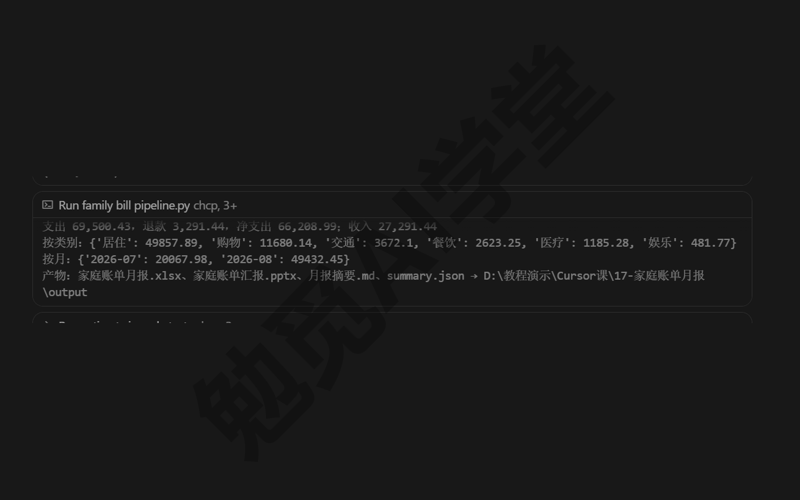

把这几行数读一遍，账就清楚了：

- 六份文件共 204 行交易记录（微信 41＋40 行，支付宝 25＋27 行，银行 30＋41 行）。银行流水里的微信代扣 37 行在读入时剔除，读入 167 行；再去掉同一来源内重复的 8 行，进入统计的是 159 行。
- 支出合计 69,500.43 元，退款 3,291.44 元，净支出等于支出减退款，66,208.99 元。
- 收入合计 27,291.44 元。演示数据里收入只有两类：工资 24,000.00 元（每月 12,000.00 元、入账两个月），加上按收入计的退款 3,291.44 元。
- 类别里“居住”远高于其他类（49,857.89 元）。演示数据把水电、燃气、物业、房租都归在这一类，是这份数据的设计造成的；换成你的真实账单，各类花了多少才真正有参考价值。

**四个结果文件逐个看。** 跑完之后 output 文件夹里是这五个文件，四个结果文件加一份运行日志（日志是 17.6 的入口脚本写的，17.7 里会讲）：

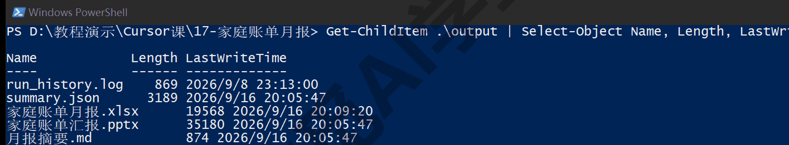

- **家庭账单月报.xlsx**：四个工作表。“清洗后明细”存 159 行统一字段的流水，另外三个表“按类别”“按日”“商户Top10”各带一张图（饼图、折线、柱状）。数据和图都在文件里，发给家人看，对方不需要另装任何软件。
- **家庭账单汇报.pptx**：宽屏一页，左边是支出结构饼图，右边五行结论：支出与净支出、收入构成、最大类别与花得最多的商户、按月对比、清洗统计。发到家庭群或者投屏讲，一页就够。
- **月报摘要.md**：纯文本摘要，开头三行是最要紧的：

```
- 支出合计 69,500.43 元；退款 3,291.44 元；净支出 66,208.99 元
- 收入合计 27,291.44 元（工资 24,000.00 元）
- 清洗：读入 167 行，去重复导出 8 行，剔除银行侧微信代扣重复 37 行
```

- **summary.json**：给程序读的汇总数据。这份文件后面还有用：《毕业项目：个人数字工作台 + 课程总结》的工作台页会直接读它取数据。

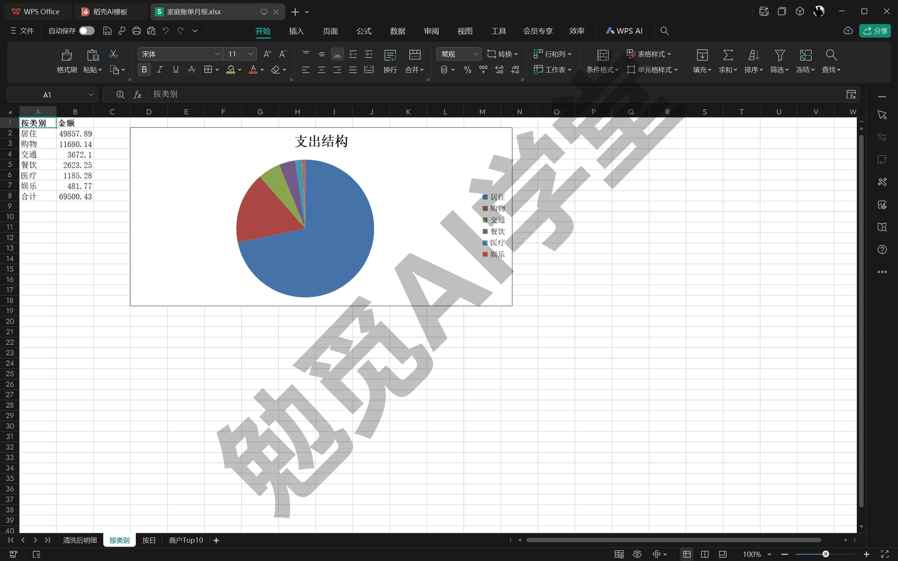

四个工作表翻一遍是这样（动图，用 WPS 表格打开）：

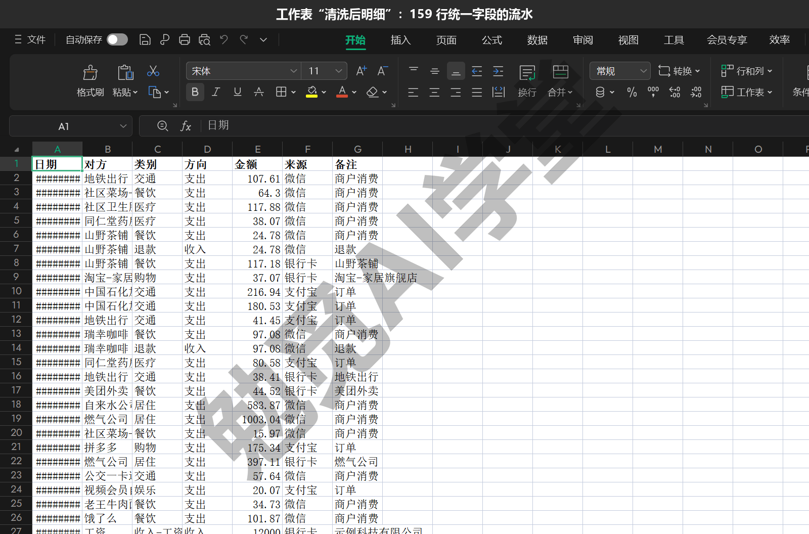

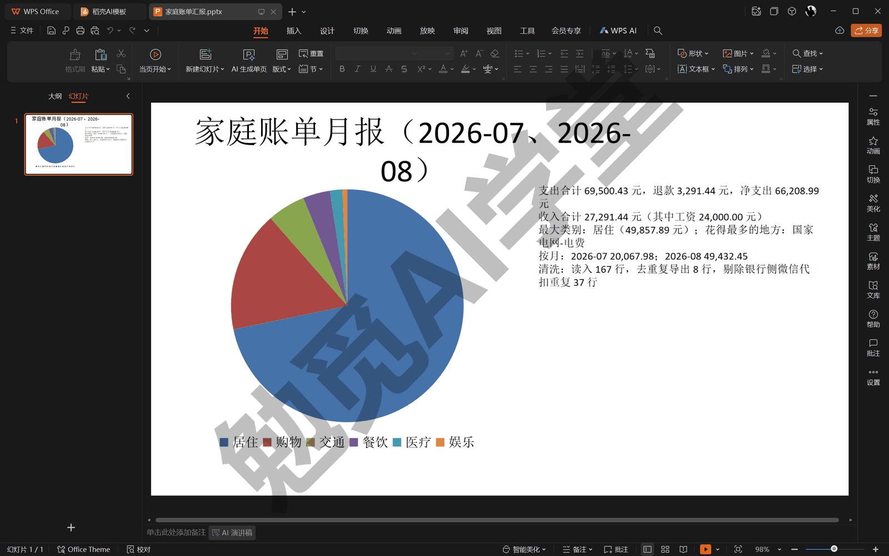

摘要里“花得最多的十个地方”也值得看，前五名是：国家电网-电费 12,836.22 元、燃气公司 12,733.92 元、自来水公司 10,144.61 元、城南物业费 8,516.69 元、房租-张女士 5,626.45 元。钱主要流向哪里，一眼看清。

### 17.4 独立复算核对

**为什么要独立复算。** 到这里数字已经出来了，但你得先想一个问题：这些数字都是同一个脚本算的，脚本要是错了呢？数据类任务最怕的不是程序报错（报错你看得见），而是程序不报错、数字错了。清洗环节每多一条规则，就多一个出错的机会：代扣剔多了、去重去过了头、某个来源的正负号理解反了，报表照样正常生成，只是数字是错的。

对策是换一套独立的逻辑，把关键数字重算一遍：两套代码互不借用，在同一批原始数据上得出同一个结果，才可信。这和《实战一：小店官网》定下的“先量再改”（动手之前先拿实际数据核实判断）是同一种态度：结论要有第二个独立证据支撑。

**独立复算怎么做。** 让智能体写一个独立的复算脚本：

```
写 tools/verify.py 做独立复算：不要复用 pipeline.py 的解析函数，
自己从头读 data/raw 的原始账单，用最简单的逻辑只算三个数——
支出合计、收入合计、按类别分项之和；剔除代扣与去重的规则要和 pipeline.py 一样。
把三个数和 summary.json 里的月报数字对一遍，各输出“一致：True/False”。
写完跑给我看。
```

三项核对各自回答一个问题：支出合计回答“钱数对不对”，收入合计回答“收支方向分得对不对”，“类别分项之和等于支出合计”回答“分类有没有把钱漏掉或者算了两遍”。这次运行的输出如下：

```
独立复算支出 69,500.43 / 月报 69,500.43 一致：True
独立复算收入 27,291.44 / 月报 27,291.44 一致：True
类别分项之和 69,500.43 / 支出合计 69,500.43 一致：True
Excel 工作表： ['清洗后明细', '按类别', '按日', '商户Top10'] ；图表数： [0, 1, 1, 1]
```

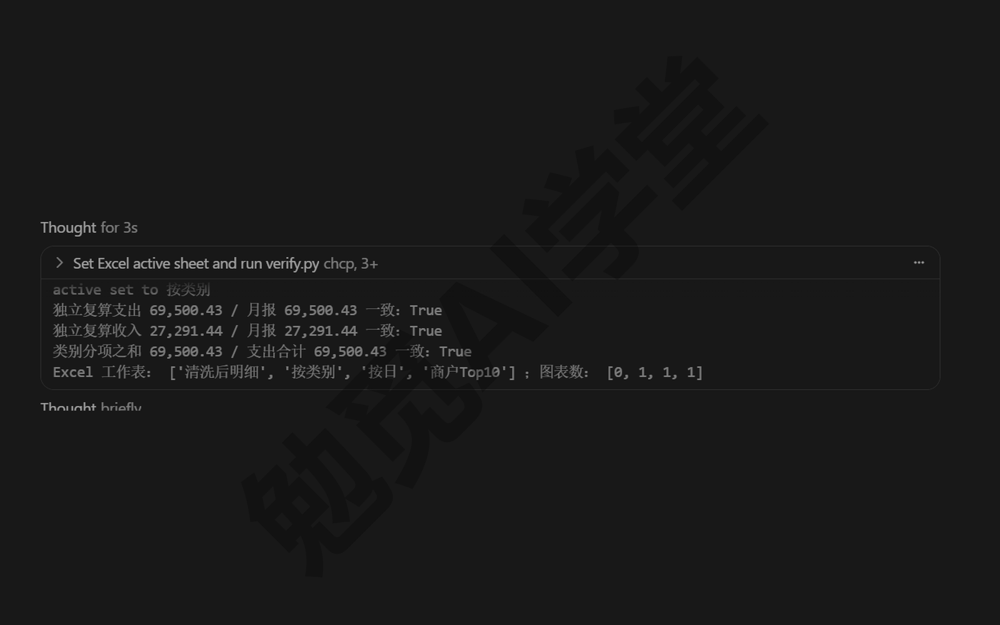

最后一行是脚本顺带做的抽查：它打开生成的 Excel，确认四个工作表齐全、三张图都在（明细表不配图，所以图表数是 0、1、1、1）。

**三项一致说明什么，不一致怎么办。** 三项都一致，说明两套独立逻辑在同一批数据上算出了同一个结果，主要规则（剔代扣、去重、正负方向、分类求和）没有一边单独算错。如果有一项不一致，别急着让它重写，先核对两边的规则：复算脚本是不是也剔了代扣、也做了去重？两边差值是多少？差值往往正好等于某一类被漏掉或多算的记录之和，把差值发给智能体、让它顺着差值找原因，比“推倒重来”快得多。

这一步背后是一个通用观念：让 AI 干活，验收的标准要和干活的过程分开，另外准备一套。下一篇《实战三：装修预算估算器》会把这个观念再推进一步，那里的独立标准叫“测试”。

### 17.5 封装成技能

**调好的做法，下个月还得重新交代一遍。** 到 17.4 为止，流水线在当前这个对话里已经调好了。但《对话与上下文管理》讲过“一事一对话”的习惯，下个月你多半会开一个新对话处理新账单，而新对话不知道这套流程：先跑 pipeline 再跑 verify、三项一致才算数、代扣只留微信那一笔……都得重新说。

解决办法就是《技能与自定义模式》介绍过的技能（Agent Skills）：把一套做法写成“做法说明书”，放进约定好的文件夹，智能体每次干活前都能看到它、并判断当前任务是否该按这套做法来。技能的核心是一个 SKILL.md 文件，放在项目的 .cursor/skills/技能名/ 文件夹里；项目级技能跟着项目走，日后把项目推上仓库，云端跑的时候一样能用。

让智能体自己封装：

```
把这套月报做法封装成项目技能，放在 .cursor/skills/monthly-bill-report/。
SKILL.md 里写清楚：什么时候用（用户提到“跑月报”“家庭账单”“这个月
花了多少”，或 data/raw 出现新账单时）；五个步骤，其中必须包含“运行
tools/verify.py，三项一致才交付”；再写三条注意——代扣只留微信侧、
支付宝是 GBK 编码别转存、“其他”类超过一成要提醒补关键词。
```

实际生成的 SKILL.md，开头部分与“步骤”“注意”两节原文如下（节选，长行按排版折行）：

```markdown
---
name: monthly-bill-report
description: 把 data/raw 里微信、支付宝、银行卡三种导出账单清洗归类后生成
  家庭账单月报（带图表的 Excel、一页 PPT、摘要）。用户提到「跑月报」
  「家庭账单」「这个月花了多少」或往 data/raw 放了新账单时使用。
---

## 步骤
1. 确认 `data/raw/` 里三种账单的文件名以「微信支付账单」「支付宝账单」
   「银行卡账单」开头（流水线按文件名前缀选解析器）；缺哪种就告诉用户
   少了哪种
2. 运行 `python pipeline.py`，读输出里的清洗统计：重复导出行、
   剔除的银行侧微信代扣行
3. 运行 `python tools/verify.py`，确认支出、收入、类别分项之和三项都
   「一致：True」；不一致不要交付，先报告差异
4. 把 `output/月报摘要.md` 用三句话讲给用户：净支出、最大类别、花得最多
   的地方，并提醒退款与工资已单列
5. 产物路径：`output/家庭账单月报.xlsx`（按类别饼图、每日折线、商户 Top10
   柱状）、`output/家庭账单汇报.pptx`（一页）、`output/summary.json`

## 注意
- 银行账单里「财付通-微信支付」代扣与微信账单是同一笔，流水线只保留微信侧；
  如果用户改用支付宝绑卡，要同样处理「支付宝-」代扣，先问再改
- 支付宝导出是 GBK 编码，别手动另存成 UTF-8 再放进来，流水线已按 GBK 读
- 归到「其他」的支出超过总支出 10% 时，提醒用户补类别关键词
```

对照《技能与自定义模式》讲过的结构，看三处：

- **description 决定技能什么时候被启用**：智能体按这段描述判断当前对话是否匹配。写得越具体（提到“跑月报”“家庭账单”、或 data/raw 有新文件），触发就越准。
- **步骤里带着验收**：第 3 步写明“三项一致才交付，不一致先报告差异”，把 17.4 的复算变成每次必过的关卡，不用靠你去记。
- **注意事项就是本篇踩过的坑**：三条分别对应跨来源重复、GBK 编码、“其他”类越来越大。技能就是记这些坑的地方，以后每踩一个新坑，就回来补一条。

**怎么用它。** 你可以用两种方式调用它：

- 自动触发：新对话里直接说“跑一下这个月的账单”，智能体按 description 匹配到这个技能，照五步执行；
- 手动调用：在输入框输入 /，弹出斜杠菜单，接着输入 monthly，列表就只剩 monthly-bill-report 一项；选中后它变成一枚橙色的技能标记留在输入框里，后面接着写“跑一下这个月的账单”，一起发送。

手动调用这三步是这样（动图）：

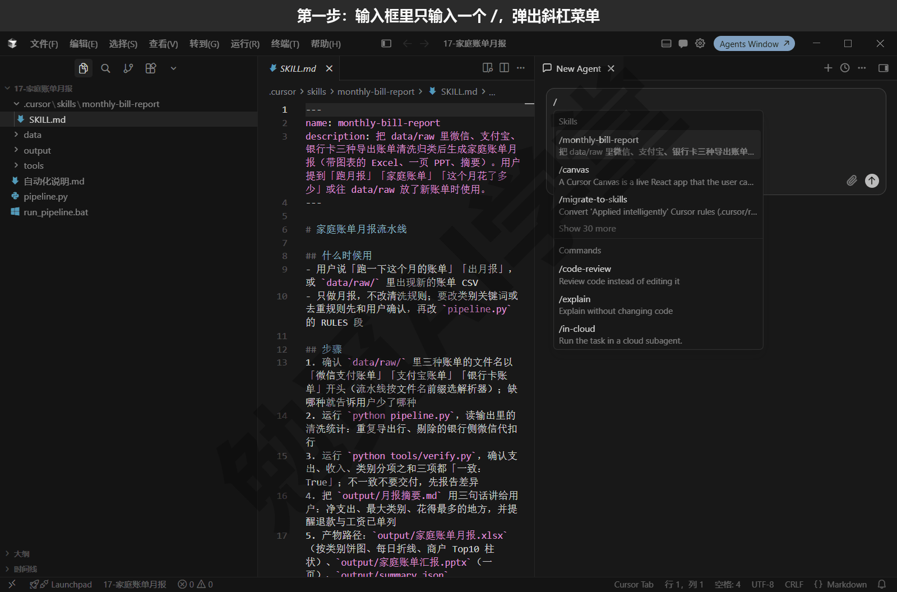

从此每个月的操作只剩两步：把新导出的账单放进 data/raw/，说一句“出月报”。

### 17.6 设置成每月自动运行

**先调完美，再固化。** 《自动化、钩子与命令行》定下的原则在这里正式用上：自动化不负责把事做对，只负责把已经能做对的事按时再做一遍。前面五节就是“调完美”的过程：清洗规则确认过、复算一致、技能封装好，现在才轮到定时。往下有两种方案，按你对隐私的在意程度选。

**方案一（课程主线）：Cursor 自动化，云端每月跑。** 《自动化、钩子与命令行》讲过机制：自动化（Automations）是按定时或事件触发的云端任务，由云端智能体（Cloud Agents，以前叫 Background Agents）在 Cursor 的云端环境里执行，你的电脑关着也能跑。它需要付费套餐，并连接 GitHub 这类代码托管平台，费用按云端智能体的用量计，具体以账号页面为准。

这条路线下面按官方机制写全，动手时以实际界面为准。

第 1 步：把项目推到 GitHub 仓库。在对话里让智能体初始化仓库、提交、推送，做法《Git、GitHub 与代码审查》讲过，这里直接照用。账单是隐私数据，仓库一定要建成私有；下面“账单隐私”那一段里还有两种更稳妥的选择。

第 2 步：在代理窗口的对话里输入 /automate，用一句话描述任务。这条自动化的描述可以这样写：

```
每月 1 日早上 8 点，在这个仓库里运行 python pipeline.py 和
python tools/verify.py，把 output/ 的新产物提交并开一个 PR，
PR 描述里贴月报摘要
```

PR 是把一批改动打包送审的申请，也就是《Git、GitHub 与代码审查》讲过的拉取请求；在这里它还起到“月报到了”的通知作用，手机上点开 PR 就能看到摘要数字。

第 3 步：核对它生成的配置草稿，也就是《自动化、钩子与命令行》15.2 里那张自动化表单。触发器选定时，预设只有每小时、每天、每周三档，每月 1 日要选 Custom (cron)，填 `0 0 1 * *`（cron 按世界标准时间计，0 点就是北京时间早上 8 点，15.2 讲过）；仓库在表单顶部的仓库下拉里选这个私有仓库；工具保留默认的“创建 PR”；最后点右上角的 Create 保存并激活。除了在对话里输入 /automate，代理窗口左侧栏的 Automations 列表页（点右上角的 New Automation）和 cursor.com/automations 网页上也能新建自动化。

第 4 步：先手动触发一次（手动触发入口以实际界面为准），确认运行成功、PR 里的摘要数字与本地一致，再放心等每月 1 日自动跑。

**账单隐私有三种做法，从最稳妥到最省步骤。**

- 最稳妥：不放到云端，改用下面的 Windows 计划任务（方案二），账单从头到尾不离开你的电脑；
- 折中：仓库只放脚本，账单和结果文件留在本地；云端自动化只用来做提醒，数字仍在本地算；
- 想省步骤：私有仓库整套放到云端。要想清楚这意味着账单数据会存到云端。《云端智能体与手机端》讲过，云端功能要求隐私模式允许云端存储，开启前请确认你接受这一点。

**方案二（本地兜底，也更适合隐私账单）：Windows 计划任务。** 先把“跑流水线＋复算”包成一个双击就能执行的入口脚本，再让 Windows 按月自动执行它。演示项目里的 run_pipeline.bat 全文（注释行按排版折行）：

```bat
@echo off
rem Monthly household bill report runner (ASCII only: cmd misparses
rem batch files with CJK after chcp).
set PYTHONIOENCODING=utf-8
cd /d "%~dp0"
echo [%date% %time%] START >> output\run_history.log
python pipeline.py >> output\run_history.log 2>&1
python tools\verify.py >> output\run_history.log 2>&1
echo [%date% %time%] END >> output\run_history.log
```

正事只有四行：记一条开始时间、跑流水线、跑复算、记一条结束时间，所有输出都追加到 output/run_history.log。前面 set 和 cd 两行是准备：set 那一行让 Python 按 UTF-8 编码输出，这样日志里的中文才不会乱；cd 那一行先进到脚本所在的文件夹。这个 .bat 文件（Windows 叫它批处理文件）的注释是英文，文件里的注释本身写明了原因：中文注释在这类文件里可能被命令行读错，这是 Windows 命令行的一个老问题，交给智能体处理就好。

把这个脚本注册成每月 1 日早上 8 点自动跑的计划任务（注册命令要在管理员 PowerShell 里执行：开始菜单搜 PowerShell，右键选“以管理员身份运行”，再把下面的命令粘进去；路径换成你自己的项目文件夹）：

```powershell
schtasks /Create /TN "家庭账单月报" /SC MONTHLY /D 1 /ST 08:00 `
  /TR "cmd /c cd /d D:\教程演示\Cursor课\17-家庭账单月报 && run_pipeline.bat" /F
```

注册成功后，打开 Windows 的“任务计划程序”（开始菜单里搜这个名字就能打开），任务计划程序库里就多了“家庭账单月报”这一行，触发器一列写着每月 1 日的 8:00，下次运行时间是下个月 1 日，像下面这样（图里其他任务是这台电脑自己的，已经打了马赛克）：

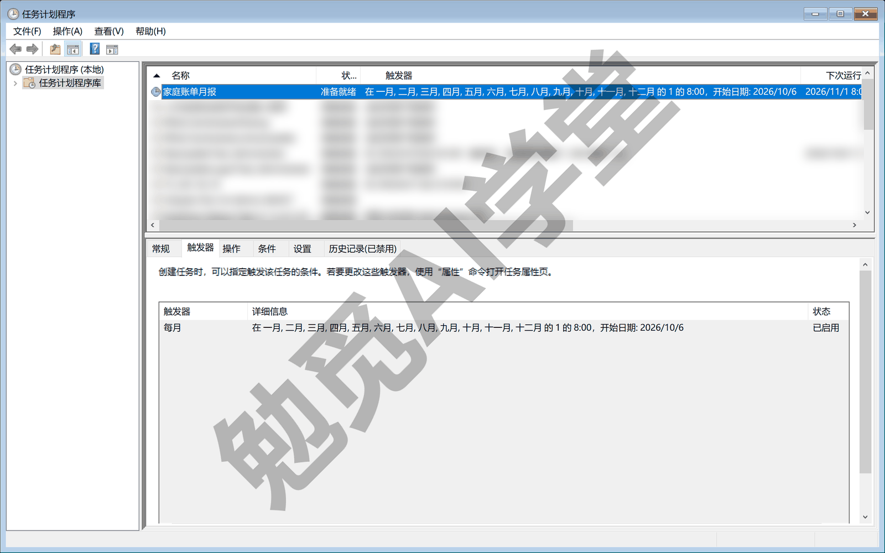

不想要了就删掉：

```powershell
schtasks /Delete /TN "家庭账单月报" /F
```

本课主线是 Windows；macOS 没有“任务计划程序”，但有同类的定时运行功能，思路一致，让智能体按你的系统给出对应命令即可。

**两种方案怎么选。** 如果你不想让账单离开电脑、电脑又基本每天开机，就用 Windows 计划任务，简单可靠；要是电脑经常关机、又想在手机上收月报，就用云端自动化，配私有仓库，并接受账单放到云端；拿不准，就先用计划任务跑两个月，流程稳定了再考虑放到云端。

### 17.7 运行历史回看

**自动化最怕悄悄失败。** 设置好定时之后，你就不会再天天盯着它了：哪个月账单文件名不对、哪个月复算不一致，如果没有记录，可能到年底才发现月报断了档。所以流水线还差最后一件事：让每次运行都留下可回看的记录。

**本地看 run_history.log。** 入口脚本 run_pipeline.bat 每次运行，都会把开始时间、全部输出、结束时间追加进 output/run_history.log。这次试跑留下的记录：

```
[周二 2026/09/08 23:12:59.29] START
清洗：{'files': 6, 'raw_rows': 167, 'dupes': 8, 'bank_wechat_skipped': 37}
支出 69,500.43，退款 3,291.44，净支出 66,208.99；收入 27,291.44
独立复算支出 69,500.43 / 月报 69,500.43 一致：True
独立复算收入 27,291.44 / 月报 27,291.44 一致：True
类别分项之和 69,500.43 / 支出合计 69,500.43 一致：True
Excel 工作表： ['清洗后明细', '按类别', '按日', '商户Top10'] ；图表数： [0, 1, 1, 1]
[周二 2026/09/08 23:13:00.67] END
```

在记事本里打开这份日志就是这样：

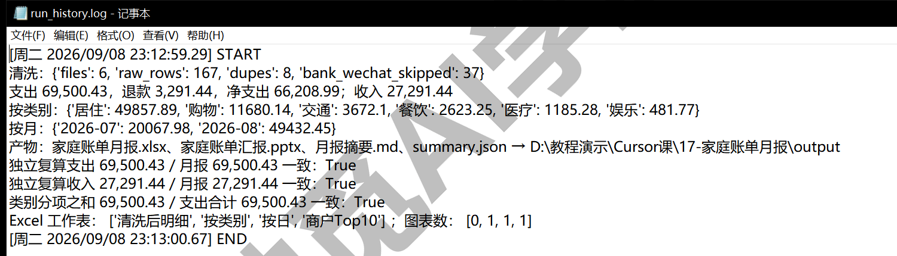

从 START 到 END 不到两秒。每月回看时盯三处：

- START 和 END 是否成对出现，有头没尾说明中途断了；
- 三行“一致：True”还在不在，出现 False 时当月月报不可用，先找差异；
- 清洗统计里剔除与去重的行数是否在正常范围，突然变成 0 或者暴涨，多半是账单文件放错、命名不对。

**日志的另一个用法：把报错原样交给智能体。** 入口脚本把正常输出和报错都写进了日志（命令末尾的 2>&1 就是“连报错一起收”的写法），所以哪个月流水线半路出错，错误原文一定记录在 run_history.log 里那次 START 之后。处理办法照《对话与上下文管理》讲过的习惯：把报错段落原样复制给智能体，让它顺着报错找原因，比你自己转述一句“好像哪里不对”要快得多，也准得多。

**断档最常见的三个原因。** 哪天月报断了档，基本逃不出下面三种情况，按常见程度从高到低：

- 你忘了把新账单放进 data/raw：流水线只认这个文件夹，没有新文件它就只能拿旧数据再算一遍，结果文件的修改时间变了、数字却纹丝不动，打开 data/raw 看一眼有没有这个月的新文件就能确认；
- 文件名开头不对：流水线按“微信支付账单／支付宝账单／银行卡账单”这三种文件名开头决定用哪种读法，文件被重命名过就对不上任何一种，看 run_history.log 里清洗统计的 files 数是不是比你放进去的文件少，就能看出来；
- 支付宝账单被顺手转存成了 UTF-8：流水线按 GBK 读，转存之后反而读不了，17.2 专门提醒过，重新从支付宝导出一份原始文件放回去即可。

对着这三条查，多数断档的原因都能很快找到。

**云端看运行记录与工件。** 如果你用的是云端自动化，它每次运行都会在自动化列表页（代理窗口左侧栏的 Automations，或网页 cursor.com/automations）留下记录，能看到运行状态与生成的工件，也能在这里暂停或删除这条自动化。工件是云端运行生成的附件，截图、日志这一类，《云端智能体与手机端》介绍过（页面形态以实际界面为准）。月报场景里最容易看到结果的地方是那个自动开出的 PR：摘要数字贴在描述里，手机上也能看。

**再养一个小习惯。** 偶尔打开 output 文件夹看结果文件的修改时间：四个文件的修改时间都应该在最近一次运行之后。修改时间没动，说明流水线根本没跑；修改时间动了而数字没变，那才是数据本身没变。

### 17.8 三个练习任务

下面提示词里方括号的内容，换成你自己的。

**任务一：用你自己的账单跑通流水线**

```
我把 [你的微信、支付宝、银行卡导出账单] 放进了 data/raw，文件名保留
“微信支付账单”“支付宝账单”“银行卡账单”开头。跑一遍月报流水线和独立复算，
把清洗统计和三项核对结果发我，再用三句话讲结论。
```

完成标准：三项复算全部“一致：True”；清洗统计里能看到你自己账单的剔除与去重行数；output 里四个结果文件齐全、修改时间是刚刚。

**任务二：补类别关键词**

```
读 output/月报摘要.md 和 Excel 里的清洗后明细，列出“其他”类里金额最高的
五个商户，给出你建议的归类，等我确认后再把关键词补进 pipeline.py 的
类别映射，然后重跑流水线和复算，告诉我“其他”类金额从多少降到多少。
```

完成标准：智能体先给建议、你确认后它才动手；重跑后“其他”类金额明显下降；三项复算仍全部一致。

**任务三：把本地定时真正设置起来**

```
把 run_pipeline.bat 注册成每月 1 日早上 8 点的 Windows 计划任务。
注册前先把要执行的命令解释给我听；注册后查询任务状态给我看，
再告诉我以后想取消该用哪条命令。
```

完成标准：任务计划程序里能查到这个任务；手动运行一次入口脚本后，run_history.log 追加了成对的 START 与 END；你知道删除任务的命令。

### 17.98 本篇小结与自检

这一篇把三种导出账单做成了一条可复用的月报流水线：先读账单摸清各自乱在哪里，确认六条清洗规则，剔掉跨来源重复的 37 行代扣、去掉 8 行重复导出，生成 Excel、PPT、摘要与 summary.json，用独立复算核对三项一致，然后封装成 monthly-bill-report 技能，最后给出云端自动化与本地计划任务两条定时路线。

对照下面的清单检查学习结果：

- [ ] 能说出三种账单各自乱在哪里，以及三份账单不能直接相加的三个原因
- [ ] 能讲清银行流水里“财付通-微信支付”代扣为什么要剔除、剔除后怎么抽查
- [ ] 跑通了 pipeline.py，看到过清洗统计与四个结果文件
- [ ] 跑通了 tools/verify.py，能说出三项核对各管什么
- [ ] 在 .cursor/skills/ 里看到了 monthly-bill-report 技能，知道自动触发与 / 手动调用两种用法
- [ ] 知道云端自动化与本地计划任务怎么选，能说出账单隐私的三种处理做法

完成这些内容后，你手里已经有一条“账单进、报表出”的流水线，也第一次体验了“验收标准和执行过程分开”的做法。下一篇《实战三：装修预算估算器》把这个观念再往前推一步：做一个有真实业务规则的小应用，用边界值测试当验收，用工作树并行两套界面方案择优，还会故意改坏一次，练习用 Git 还原。

### 17.99 新手常见问题

**Q1：我电脑上没装 Office，也能出 Excel 和 PPT 吗？**

能。流水线用 openpyxl 和 python-pptx 这两个 Python 库直接生成 .xlsx 与 .pptx 文件，生成过程不需要 Office。打开查看时，用任何能读这两种格式的软件都行（Office、WPS 或在线文档工具）。库没装时，让智能体顺手安装即可。

**Q2：同一笔钱在微信和银行卡账单里都出现，怎么办？**

这就是 17.2 重点讲的跨来源重复：用绑定银行卡在微信里付款，微信账单记一笔、银行流水再记一笔“财付通-微信支付”代扣。处理原则是只留一边，本篇留信息更全的微信那一笔、剔银行流水那一笔，这次运行剔了 37 行。如果你用支付宝绑卡消费，银行流水里也会有对应的代扣行，要按同样思路处理支付宝的代扣行；改这条规则前，让智能体先把要怎么改说给你听，你确认了再让它动手。

**Q3：跑出来“其他”类金额很大，怎么补类别？**

让智能体列出“其他”类里金额靠前的商户，你确认归类后，把关键词补进 pipeline.py 的映射表再重跑（练习任务二就是这件事）。技能的注意事项里写了一条提醒：“其他”超过总支出 10% 就该补关键词了。补完记得重跑复算，确认“类别分项之和等于支出合计”仍然成立。

**Q4：账单放到云端安全吗？**

账单是很私密的数据，建议按 17.6 的顺序考虑：最稳妥是本地计划任务，账单不离开电脑；折中是仓库只放脚本、账单留本地；确实要整套放到云端，用私有仓库，并理解云端运行意味着数据会存到云端（云端功能对隐私模式的要求见《云端智能体与手机端》）。拿不准时，先本地跑两个月再说。
