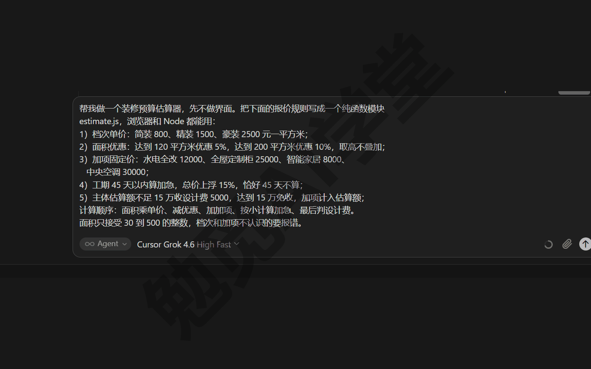
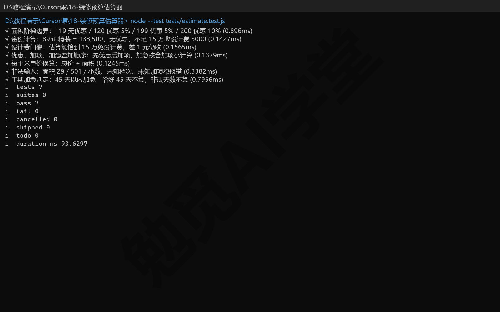
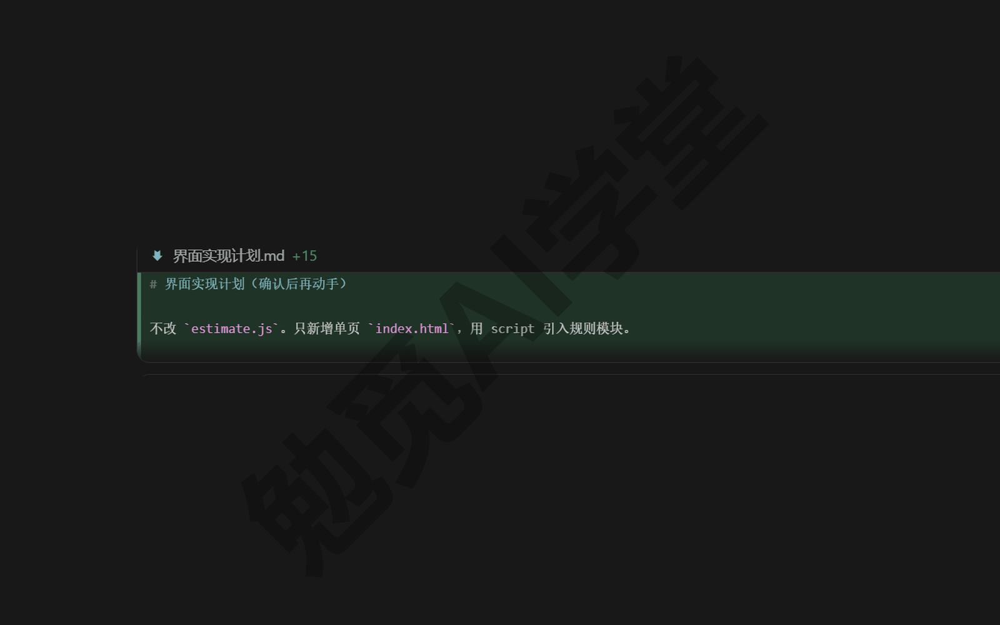
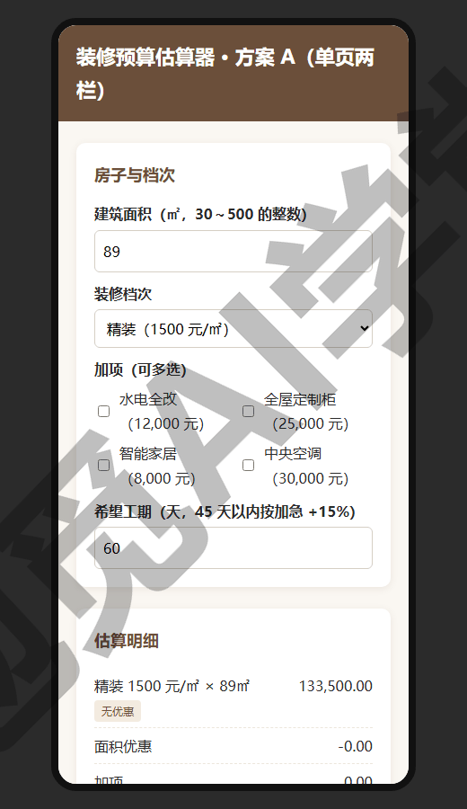
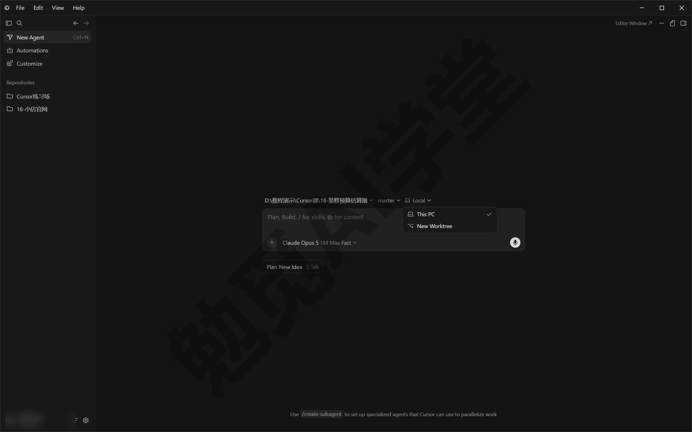
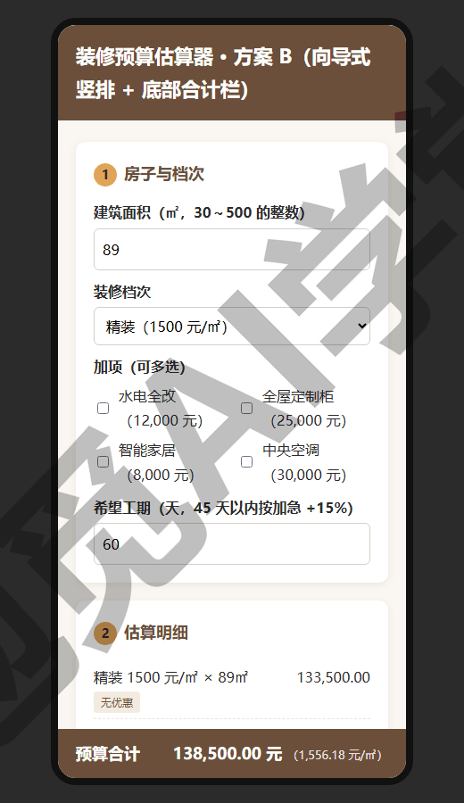
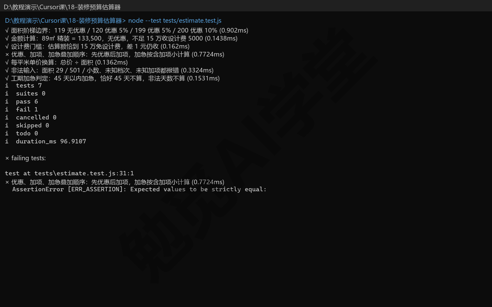
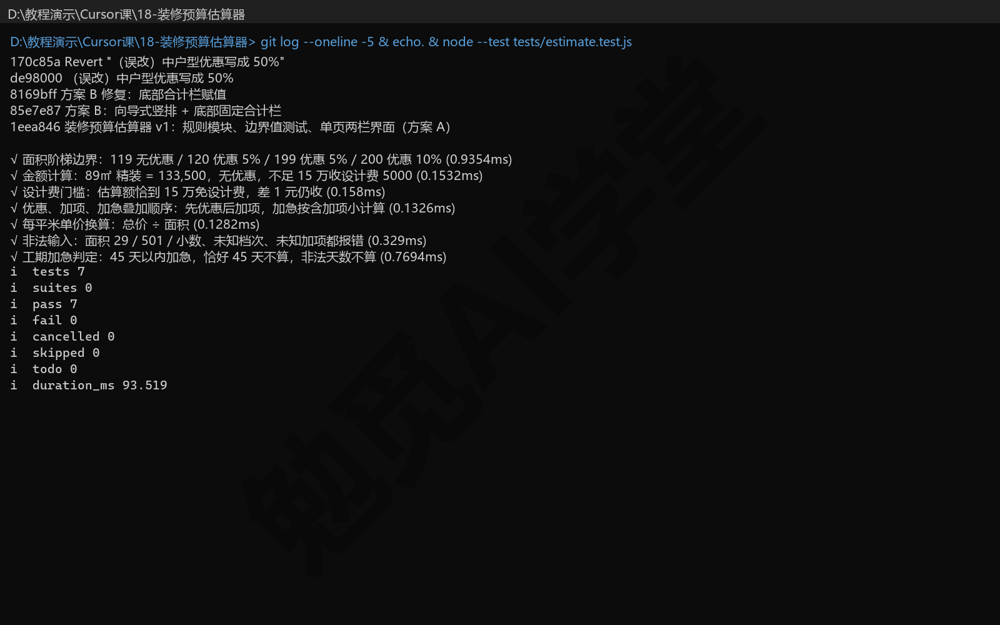
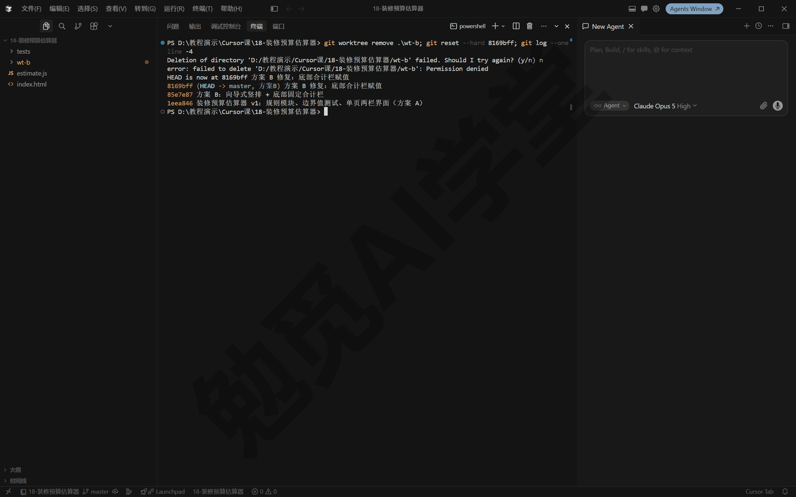

## 实战三：装修预算估算器

这一篇做第三个实战项目：一个有真实业务规则的小应用——装修预算估算器，输入面积、档次、加项和工期，立刻算出报价明细，还带一个预约量房表单。上一篇《实战二：家庭账单月报流水线》留下的观念“验收标准和执行过程分开”，在这一篇有了正式的名字：测试。你会用边界值测试给规则验收，用工作树同时做两套界面方案择优，最后故意把规则改坏一次，练习用 Git 还原。

本篇的全部数字、代码、提交记录与翻车经过，来自 2026-09-08 在 Windows 桌面端 Cursor 3.7.42 上完成的一次完整的实际运行。演示用的价目和优惠规则是虚构的，结构取自装修行业的常见报价方式，你可以整套换成自己的行当。

先看成品（动图）：选好面积、档次、加项和工期，右栏立刻重算；手机上滚动时，合计栏一直贴在底部。


### 18.1 把业务规则理清楚

**规则在脑子里，报价靠心算。** 假设你帮一家装修工作室做报价。老师傅报价又快又熟，但规则都在他脑子里：“简装八百精装一千五”“面积大有优惠”“赶工要加钱”。客户在微信里问一句“89 平精装多少钱”，就得等师傅有空心算。想做成一个自动算价的小工具，第一步不是写代码，而是把这些口头规则一条条写成白纸黑字。

**理到什么程度算清楚：每条规则都能回答边界问题。** 口头规则最大的毛病是含糊。“面积大有优惠”，多大算大？正好 120 平方米算不算？“赶工加钱”，45 天整算不算赶工？把规则写到能明确回答这类“正好压线”的问题，才算理清楚了。本篇最终确认的五组规则，先看总表：

| 规则 | 内容 |
|---|---|
| 档次单价 | 简装 800、精装 1500、豪装 2500 元一平方米 |
| 面积两级优惠 | 达到 120 平方米减 5%，达到 200 平方米减 10%，只按高的一档减、不叠加 |
| 四个加项 | 水电全改 12,000 元、全屋定制柜 25,000 元、智能家居 8,000 元、中央空调 30,000 元 |
| 工期加急 | 45 天以内总价上浮 15%，恰好 45 天不算 |
| 设计费门槛 | 主体估算额不足 15 万收 5,000 元，达到 15 万免收 |

总表只是索引，每一条都有必须提前问清的边界，下面逐条过。

**档次单价，报价的地基。** 底价等于面积乘单价，“选哪一档”是整套报价里影响最大的一项。档次名字要与价目表逐字一致：填进“顶配”这类价目表里没有的名字，程序必须报错，不能随便挑一档凑数——报价工具宁可算不出，也不能算得似是而非。面积也一样，只接受 30～500 的整数，29、501、88.5 这类输入都要被拦下并给出提示。

**面积两级优惠，边界在“达到”两个字。** 120 平方米整就算中户型、减 5%，119 平方米一分不减；200 平方米整升到大户型、减 10%。两档只按高的那一档减、不叠加，200 平方米不是先减 5% 再减 10%。119、120、199、200 这四个数，下一节会原样写进测试。

**四个加项，固定价。** 这四项与面积无关，勾了哪一项，就把哪一项的价加进总价。它和其他规则的关系是这样的：面积优惠只打在底价上，加项不参与打折；但加项会计入设计费门槛看的那个估算额，这层影响放在设计费一条里讲。

**工期加急，“以内”不含第 45 天。** 44 天算加急、恰好 45 天不算，0 天、负数这类无效天数也不算。生活里说“45 天以内”常常两种理解都说得通，写进程序必须二选一，本篇定的是不含。加急费的基数同样有讲究：按“优惠后加加项”的小计乘 15%，不是按底价乘，这个先后关系放在下面“计算顺序”一段讲。

**设计费门槛，两条规则互相作用的地方。** 主体估算额指优惠、加项、加急都算完之后、设计费之前的那个数：不足 15 万收 5,000 元，达到 15 万就免收。最容易漏算的组合是加项把估算额抬过门槛：99 平方米精装本来是 148,500 元，要收设计费，总价 153,500 元；勾一个 8,000 元的智能家居，估算额到 156,500 元，设计费免了，总价 156,500 元。也就是说这 8,000 元的加项实际只让总价多了 3,000 元。这种两条规则叠加出来的账，人工心算最容易错，正适合交给测试守着。

**计算顺序也是规则。** 同样五组规则，先加加项再打折，和先打折再加加项，算出来的钱不一样。本篇定下的顺序是：面积乘单价得底价，减面积优惠，加加项，得到小计后按小计算加急，最后判断设计费。顺序不同结果就不同，所以顺序本身也要写成白纸黑字，18.2 里有一组测试专门守它。

**写成纯函数：规则和界面分开。** 你可以把纯函数理解成一台只管算数的计算器：同样的数进去，出来的永远是同样的结果，不读文件、不碰界面、不联网。把规则装进纯函数有两个直接的好处：

- 规则可以单独验证：测试直接拿它算一遍、对答案，不用打开网页点来点去；
- 规则可以在好几处共用：网页界面用它算价，测试也用它，将来《毕业项目：个人数字工作台 + 课程总结》的工作台页还会复用它。

把理清楚的规则发给智能体：

```
帮我做一个装修预算估算器，先不做界面。把下面的报价规则写成一个纯函数模块
estimate.js，浏览器和 Node 都能用：
1）档次单价：简装 800、精装 1500、豪装 2500 元一平方米；
2）面积优惠：达到 120 平方米优惠 5%，达到 200 平方米优惠 10%，只按高的一档算、不叠加；
3）加项固定价：水电全改 12000、全屋定制柜 25000、智能家居 8000、
   中央空调 30000；
4）工期 45 天以内算加急，总价上浮 15%，恰好 45 天不算；
5）主体估算额不足 15 万收设计费 5000，达到 15 万免收，加项计入估算额；
计算顺序：面积乘单价、减优惠、加加项、按小计算加急、最后判设计费。
面积只接受 30 到 500 的整数，档次和加项不认识的要报错。
```



实际生成的 estimate.js 全文如下（长行按排版折行，内容未改）。不用逐行读懂，只看三个地方：开头三张“价目表”（GRADES、AREA_TIERS、EXTRAS）就是你的规则原文；estimate 函数是唯一入口，按定好的顺序一步步算；算不了的输入直接报错。

```javascript
// 装修预算估算规则（纯函数，浏览器与 Node 共用）。
// 规则：面积 × 档次单价 → 面积阶梯优惠 → 加项（固定价）
//      → 工期加急 +15% → 设计费（估算额不足 15 万收 5000 元）。
const GRADES = {
  "简装": 800,
  "精装": 1500,
  "豪装": 2500,
};

const AREA_TIERS = [
  { min: 200, rate: 0.10, label: "大户型优惠 10%" },
  { min: 120, rate: 0.05, label: "中户型优惠 5%" },
  { min: 0, rate: 0, label: "无优惠" },
];

const EXTRAS = {
  "水电全改": 12000,
  "全屋定制柜": 25000,
  "智能家居": 8000,
  "中央空调": 30000,
};

const RUSH_RATE = 0.15;          // 工期压缩到 45 天以内加价
const RUSH_DAYS = 45;
const DESIGN_FEE = 5000;         // 元
const DESIGN_FREE_FROM = 150000; // 估算额达到即免设计费
const AREA_MIN = 30, AREA_MAX = 500;

function round2(x) { return Math.round(x * 100) / 100; }

function tierFor(area) { return AREA_TIERS.find(t => area >= t.min); }

function estimate({ area, grade, extras = [], rush = false }) {
  if (!(grade in GRADES)) throw new Error(`未知档次：${grade}`);
  if (!Number.isInteger(area) || area < AREA_MIN || area > AREA_MAX)
    throw new Error(`面积必须是 ${AREA_MIN}～${AREA_MAX} 的整数（㎡）`);
  for (const e of extras) if (!(e in EXTRAS)) throw new Error(`未知加项：${e}`);
  const unit = GRADES[grade];
  const base = unit * area;
  const tier = tierFor(area);
  const discount = round2(base * tier.rate);
  const extrasFee = extras.reduce((s, e) => s + EXTRAS[e], 0);
  const subtotal = base - discount + extrasFee;
  const rushFee = rush ? round2(subtotal * RUSH_RATE) : 0;
  const goods = round2(subtotal + rushFee);
  const designFee = goods >= DESIGN_FREE_FROM ? 0 : DESIGN_FEE;
  return {
    area, grade, unit, base: round2(base), tier: tier.label, discount,
    extras: [...extras], extrasFee, rushFee, goods, designFee,
    total: round2(goods + designFee),
    perSqm: round2((goods + designFee) / area),
  };
}

function isRush(days) {
  if (!Number.isInteger(days) || days <= 0) return false;
  return days < RUSH_DAYS;
}

if (typeof module !== "undefined")
  module.exports = { GRADES, AREA_TIERS, EXTRAS, estimate, isRush,
                     round2, RUSH_DAYS, DESIGN_FREE_FROM, DESIGN_FEE };
```

将来单价涨了、优惠变了，改的就是开头那几张表，改完跑一遍测试就知道有没有改坏。

### 18.2 边界值验收

**测试是什么。** 测试就是一段替你对答案的代码：它把一批数交给规则函数，检查算出来的结果是不是等于事先算好的正确答案，全对就报“过”，有一处不对就报“败”，并指出是哪一处。它和上一篇《实战二：家庭账单月报流水线》的独立复算是同一个思路，只是形式更正规：复算是写个脚本对三个数，测试是把每一条规则的对错都写成可以反复运行的检查项。

**完全不会写代码，能用测试吗？** 能，而且零基础用户更该用测试。测试代码同样让智能体写，你的分工只有两件事：

- **出题**：挑几个你能口算或按计算器算出来的例子，告诉它“这种情况应该等于多少”。比如 89 平方米精装：89 乘 1500 等于 133,500，不到 15 万要收 5,000 设计费，总价应该是 138,500。这道题你自己能算，就能当验收标准。
- **验收**：看运行结果是全过还是有败。全过放行，有败就把失败信息发回去让它修。

你出的例子越贴着边界，这套验收就越可靠。所谓边界值，就是规则里那些正好压线的数：119 和 120、199 和 200、恰好 15 万和差一点到 15 万、第 44 天和第 45 天。规则出错，多半就错在这些线上：“达到”写成“超过”、“以内”多算一天，平常的数看不出来，压线的数一试，错处就暴露出来了。

**七组用例守七条边界。** 让智能体按上面的思路写测试（一组用例就是一道对答案的题，一组里可以有好几个数）：

```
给 estimate.js 写一组边界值测试 tests/estimate.test.js，用 node --test 能跑：
面积 119 和 120、199 和 200 的优惠档位；89 平方米精装总价我口算是 138500
（133500 加设计费 5000），照这个对；设计费门槛恰好 15 万免、不到就收、
加项抬过门槛也要免；优惠、加项、加急的叠加顺序；每平米单价换算；
面积 29、501、小数，未知档次、未知加项都要报错；工期恰好 45 天不算加急。
写完跑给我看结果。
```

实际生成的用例全文（一条长注释按排版折行，内容未改）：

```javascript
// 业务逻辑边界值验收：node --test tests/estimate.test.js
const test = require("node:test");
const assert = require("node:assert/strict");
const { estimate, isRush } = require("../estimate.js");

test("面积阶梯边界：119 无优惠 / 120 优惠 5% / 199 优惠 5% / 200 优惠 10%", () => {
  assert.equal(estimate({ area: 119, grade: "简装" }).tier, "无优惠");
  assert.equal(estimate({ area: 120, grade: "简装" }).tier, "中户型优惠 5%");
  assert.equal(estimate({ area: 199, grade: "简装" }).tier, "中户型优惠 5%");
  assert.equal(estimate({ area: 200, grade: "简装" }).tier, "大户型优惠 10%");
});

test("金额计算：89㎡ 精装 = 133,500，无优惠，不足 15 万收设计费 5000", () => {
  const q = estimate({ area: 89, grade: "精装" });
  assert.equal(q.base, 133500);
  assert.equal(q.discount, 0);
  assert.equal(q.goods, 133500);
  assert.equal(q.designFee, 5000);
  assert.equal(q.total, 138500);
});

test("设计费门槛：估算额恰到 15 万免设计费，差 1 元仍收", () => {
  // 100㎡ 精装 = 150,000 → 免
  assert.equal(estimate({ area: 100, grade: "精装" }).designFee, 0);
  // 99㎡ 精装 = 148,500 → 收
  assert.equal(estimate({ area: 99, grade: "精装" }).designFee, 5000);
  // 加项能把估算额抬过门槛：99㎡ 精装 + 智能家居 8000 = 156,500 → 免
  assert.equal(estimate({ area: 99, grade: "精装", extras: ["智能家居"] }).designFee, 0);
});

test("优惠、加项、加急叠加顺序：先优惠后加项，加急按含加项小计算", () => {
  // 120㎡ 简装：96,000 → 优惠 5% = 4,800 → 91,200 → 水电全改 +12,000
  //           = 103,200 → 加急 +15,480 = 118,680 → 收设计费 5000 → 123,680
  const q = estimate({ area: 120, grade: "简装", extras: ["水电全改"], rush: true });
  assert.equal(q.discount, 4800);
  assert.equal(q.extrasFee, 12000);
  assert.equal(q.rushFee, 15480);
  assert.equal(q.goods, 118680);
  assert.equal(q.designFee, 5000);
  assert.equal(q.total, 123680);
});

test("每平米单价换算：总价 ÷ 面积", () => {
  // 500,000 → 优惠 10% → 450,000，免设计费
  const q = estimate({ area: 200, grade: "豪装" });
  assert.equal(q.total, 450000);
  assert.equal(q.perSqm, 2250);
});

test("非法输入：面积 29／501／小数、未知档次、未知加项都报错", () => {
  assert.throws(() => estimate({ area: 29, grade: "简装" }));
  assert.throws(() => estimate({ area: 501, grade: "简装" }));
  assert.throws(() => estimate({ area: 88.5, grade: "简装" }));
  assert.throws(() => estimate({ area: 90, grade: "顶配" }));
  assert.throws(() => estimate({ area: 90, grade: "简装", extras: ["泳池"] }));
});

test("工期加急判定：45 天以内加急，恰好 45 天不算，非法天数不算", () => {
  assert.equal(isRush(44), true);
  assert.equal(isRush(45), false);
  assert.equal(isRush(0), false);
  assert.equal(isRush(-3), false);
});
```

七组里，第三组和第四组测的都是几条规则叠在一起时的结果，这恰恰是人工心算最容易漏的地方。第三组“设计费门槛”连“加项把估算额抬过 15 万于是免设计费”这种组合情况都覆盖了。第四组“叠加顺序”把 18.1 里定的计算顺序整条固定下来：120 平方米简装从 96,000 一路算到 123,680，中间每一步的数都固定写在断言（测试里写明“应该等于多少”的那些行）里，顺序一旦被改动，立刻报败。

**跑起来。** 测试用 Node 自带的测试功能执行（Node 是运行 JavaScript 的环境，演示机上装的是 Node 24；没有的话，照《文件与办公能力一篇讲全》讲过的做法让智能体装）。运行命令与这次运行的输出：

```
node --test tests/estimate.test.js
```

```
✔ 面积阶梯边界：119 无优惠 / 120 优惠 5% / 199 优惠 5% / 200 优惠 10% (0.896ms)
✔ 金额计算：89㎡ 精装 = 133,500，无优惠，不足 15 万收设计费 5000 (0.1427ms)
✔ 设计费门槛：估算额恰到 15 万免设计费，差 1 元仍收 (0.1565ms)
✔ 优惠、加项、加急叠加顺序：先优惠后加项，加急按含加项小计算 (0.1379ms)
✔ 每平米单价换算：总价 ÷ 面积 (0.1245ms)
✔ 非法输入：面积 29／501／小数、未知档次、未知加项都报错 (0.3382ms)
✔ 工期加急判定：45 天以内加急，恰好 45 天不算，非法天数不算 (0.7956ms)
ℹ tests 7
ℹ pass 7
ℹ fail 0
ℹ duration_ms 93.6297
```



七组全过，规则这一层的验收通过了；报告末尾的 duration_ms 93.6297 说明整套验收跑完不到零点一秒。从现在起定一条纪律：凡是动过 estimate.js，必须重跑一遍测试。这是本篇后半部分反复要用的安全网。

### 18.3 计划模式分步实现界面

**规则验收完，才轮到界面。** 界面是给人用的那一层，规则才是钱数的来源；先把规则验收好再做界面，返工最少。做界面这种一次牵动布局、交互、文案的多步改动，适合用《计划、提问与调试三模式》讲过的计划模式：先让智能体给出一份步骤计划，你确认或修改后再动工，避免它一口气做完才发现方向不对。

```
用计划模式做界面：单页 index.html，引用 estimate.js，别改规则文件。
页面上选面积、档次、加项、工期，即时算出报价明细——底价、面积优惠、
加项、工期加急、设计费、预算合计、折合每平米；非法输入要在页面上提示。
再加一个预约量房表单（称呼、电话、小区地址），演示阶段只保存在本机
浏览器里，不发送到任何地方。先给我计划，我确认后再动手。
```



计划确认后它开始动工，做出方案 A，单页两栏：左栏“房子与档次”放全部输入项，右栏“估算明细”逐行列出底价、面积优惠、加项、工期加急、设计费、预算合计与折合每平米，明细下方接预约量房表单。


对照截图看几个地方：

- 打开页面的默认状态是 89 平方米、精装、工期 60 天，正好是 18.2 里口算过的那道题：预算合计 138,500.00 元、折合每平米 1,556.18 元，和测试里断言的是同一个数。界面和测试用同一个 estimate.js，这就是“规则只写一份”的直接好处。
- 改任何一个输入，页面都会立即重算：勾一个加项、把工期改到 44 天，右栏数字当场就变。
- 把面积改成 29，左栏输入区下方出红字“面积必须是 30～500 的整数（㎡）”，右栏明细清空。这行提示正是 estimate.js 报的错，界面只负责把它显示出来。
- 明细末尾一行小字“估算仅供参考，实际报价以量房后的方案为准”，把这个工具的定位说清楚：它是沟通起点，不是合同。

勾加项、改工期、改面积，右栏跟着重算的过程连起来看是这样（动图）：


面积改成 29 的画面（动图）：


**预约表单，本机保存。** 填称呼、电话、小区地址后提交，表单下方出现绿底确认条，写明“已记录预约”加上称呼、地址、面积档次、预算和本机已保存的条数。数据存在浏览器的本地存储（localStorage）里，只在这台设备的这个浏览器里有，不会上传到任何地方。电话一栏的标签直接写着“演示：只在本机保存，不发送”，把边界告诉使用者。真要把预约收到自己手里怎么办，18.7 里再谈。

提交前后的画面（动图，电话是演示用的占位号）：


手机上看同一个页面：



窄屏下两栏折叠成一列，填参数时预算合计不在屏幕上，要滚下去才能看到。记住这个画面，下一节对比方案时它是关键证据。

界面做完，让智能体提交一次。《Git、GitHub 与代码审查》定下的习惯是：一个阶段完成就提交，提交是可以随时回去的存档点。这就是主线的第一笔提交 1eea846“装修预算估算器 v1：规则模块、边界值测试、单页两栏界面（方案 A）”。

### 18.4 工作树并行两方案

**想试第二种布局，又不想动第一种。** 方案 A 能用了，但你想试试另一种思路：手机上从上往下一步步填，像填问卷那样走完，合计始终固定在屏幕底部。直接在 A 上改，改到一半两个方案就混在一起了；把整个项目文件夹复制一份去改，是能用的笨办法，但两份文件夹很快分不清谁新谁旧，改好了还得手工搬回来。

《子智能体、并行与工作树》讲过的工作树正好派上用场：给同一个项目开一个隔离的副本目录，共享同一份 Git 历史，两边各改各的互不影响，最后哪边好就把哪边的提交带回主线。前提只有一个：项目得是 Git 仓库，上一节的提交 1eea846 已经满足了。

**开工作树，两种方式。** 代理窗口里最常用的做法，是新建智能体时在运行环境下拉里把 This PC（本机）切成 New Worktree（新建工作树）——这个下拉在《子智能体、并行与工作树》里用过，项目已经是 Git 仓库时，它旁边还会多出一个分支选择器；这次走的是效果一样的另一种做法，在对话里直接让智能体用 Git 的工作树命令建，它执行的命令大致是这样：

```
git worktree add <新文件夹路径> <分支名>
```



给工作树里的智能体发指令：

```
在一个新的工作树里做方案 B，别动主线：把界面改成向导式竖排，从上往下
“房子与档次、估算明细、预约量房”依次排开，页面底部加一条固定的合计栏，
滚动时始终可见。做完在桌面和手机两种宽度各截一张图，和方案 A 放在一起
给我对比。
```

方案 B 在“方案B”分支上完成，提交 85e7e87“方案 B：向导式竖排 + 底部固定合计栏”。第一版截图时暴露了一个问题：底部合计栏是空白的。这是本篇翻车实录的第一条，完整经过放在 18.6 里讲，这里只说结果：修复提交 8169bff 之后，合计栏正常显示，两方案进入对比。




从第 1 步一直滚到预约表单，合计栏不动，连起来看是这样（动图）：


**对比与择优。** 四张图放在一起比较。运行日志里的择优结论原文是“桌面端 A 一屏看全；手机端 B 的底部固定合计栏在滚动时始终可见，顾客多用手机看，选 B 合入主线，A 留在历史提交可回退”。拆开说：

- 桌面端 A 更好：左边改参数、右边看明细，一屏看全，不用滚动；
- 手机端 B 更好：不管滚到哪一步，“预算合计 138,500.00 元”都贴在屏幕底部，参数一改数字立刻更新，顾客边填边看时最需要的就是这一点；
- 最后怎么选看使用场景：装修客户大多拿手机看链接，手机端的体验更要紧，选 B。

择优不是淘汰。方案 A 完整地留在提交历史里（1eea846），想回去随时能回，用 Git 管方案的好处就在这里。让智能体把方案 B 的两笔提交带回主线，主线此刻停在 8169bff；对比用完的工作树可以删掉，但删之前有一个讲究，见 18.6 第二条翻车。

### 18.5 改坏一次怎么救

**故意演练一次事故。** 真实场景里，规则被改坏往往发生在最平常的时刻：谈优惠时顺手改了个数、让智能体调样式时它顺带动了不该动的文件。与其等真出事，不如主动演练一遍完整的救援流程。让智能体来：

```
做一次故障演练：把 estimate.js 里中户型的优惠比例从 5% 改成 50%，
提交一笔注明“误改”的提交，然后跑测试，把结果原样发我。
```

这笔误改提交是 de98000“（误改）中户型优惠写成 50%”，一个不小心就能发生的改动：0.05 写成 0.5，优惠翻了十倍。

**测试第一时间报警。** 重跑 node --test，这次运行的输出（节选）：

```
✔ 设计费门槛：估算额恰到 15 万免设计费，差 1 元仍收 (0.162ms)
✖ 优惠、加项、加急叠加顺序：先优惠后加项，加急按含加项小计算 (0.7724ms)
✔ 每平米单价换算：总价 ÷ 面积 (0.1362ms)
ℹ pass 6
ℹ fail 1
✖ failing tests:
✖ 优惠、加项、加急叠加顺序：先优惠后加项，加急按含加项小计算 (0.7724ms)
```



六过一败，败的正是守叠加顺序的那组用例：它断言 120 平方米简装的优惠是 4,800 元（按 5% 算），优惠比例被改成 50% 后，算出的数对不上，当场拦下。注意报警有多精确：不是笼统地说“有问题”，而是明确指出哪一组用例、哪一条没对上，排查范围一下子缩到一处。

**用 git revert 还原。** 《Git、GitHub 与代码审查》讲过还原的两种工具：没提交的改动可以直接丢弃；已经提交的，用 revert。revert 不删除历史，而是自动做一笔内容相反的新提交，把指定提交的改动抵消掉。这里误改已经提交，用 revert：

```
用 git revert 撤销刚才那笔误改提交，重跑测试确认全过，
最后把提交历史列给我看。
```

它执行 git revert HEAD（HEAD 指的是当前最新的一笔提交，这里就是那笔误改），生成还原提交 170c85a，测试回到七组全过：

```
[master 170c85a] Revert "（误改）中户型优惠写成 50%"
ℹ pass 7
ℹ fail 0
```

这次演示最终的提交历史（git log 输出原文）：

```
170c85a Revert "（误改）中户型优惠写成 50%"
de98000 （误改）中户型优惠写成 50%
8169bff 方案 B 修复：底部合计栏赋值
85e7e87 方案 B：向导式竖排 + 底部固定合计栏
1eea846 装修预算估算器 v1：规则模块、边界值测试、单页两栏界面（方案 A）
```



从下往上读，这个小项目的全部经过都在：第一版、方案 B、修复、误改、还原。误改和还原都留在历史里，谁、什么时候、改了什么、怎么救的，全都查得到；这是 revert 和“偷偷把文件改回去”最大的区别。

**和检查点怎么分工。** 《权限、沙盒与模型》介绍过检查点：对话里每步改动的自动快照，点一下就能回到某步之前，管的是这一轮对话里的后悔，是临时后悔药。Git 提交管的是隔了几天才发现的后悔，是永久后悔药：今天的误改明天才发现，检查点未必还在，提交一定在。另外，代理窗口的差异视图还支持在合入前逐文件、逐块拒绝改动，相当于事前把关（操作形态以实际界面为准）。三层配起来：差异视图管事前，检查点管当场，Git 管长期。

### 18.6 翻车实录

本节两条翻车都出在这次演示里，经过按运行日志讲。第一条的教训是“改完必须看结果”，第二条的教训是“删工作树前先离开那个文件夹”。

**翻车一：合计栏是空白的。**

方案 B 第一版做完，智能体按要求截了桌面和手机两张图。图片一打开就不对：页面底部那条合计栏只有“预算合计”四个字，右边本该显示金额的位置是空的。规则模块没动过、测试也全过，钱数怎么会不见？

智能体从结果往回查。合计栏里的数字来自一行把金额填进去的代码（程序里叫赋值），它检查 index.html，发现这行代码在文件里根本不存在；可当初负责插入它的批量替换脚本，明明报告执行成功。也就是说，这次改动“看起来做了”，文件其实一个字都没变。

原因出在换行符上。文本文件里的“换行”是一个看不见的字符，Windows 传统上用两个字符表示（CRLF），其他系统常用一个（LF）；两种写法混在同一个项目里，人眼看不出任何差别。而批量替换是一个字一个字对着找的：替换脚本里要找的那段文字用的是一种换行符，文件里存的是另一种，程序认定“这两段文字不一样”，找不到目标，替换就悄悄落空——不报错，也不生效。运行日志里这一条的原文（长行折行）：

```
[翻车实录] 方案 B 底部合计栏首版空白：用脚本批量替换插入赋值语句时，
替换串里的换行符（CRLF/LF）与文件不一致导致替换静默未生效；
处置：改用编辑器精确替换，重截图确认合计栏显示。
```

补救办法很直接：放弃批量替换，改用编辑器的精确替换把那行代码重新插入，再截一次图，确认合计栏的金额显示出来才算完。这次修复就是提交 8169bff，方案 B 也是带着这笔修复才进入 18.4 的对比。


这条翻车最要紧的一点，是它演示了“静默失效”这种故障形态：报错至少留了一条信息，静默失效什么都不留，改动没发生、流程还在往下走。所以教训要记两层：对智能体，让它每次改完界面都重新截图或在浏览器里自己验证，一句话就能把这个要求写进任务；对你自己，验收时看的是结果，不是它的过程汇报——“执行成功”四个字，抵不上一张能看到金额的截图。

**翻车二：删工作树时，工作目录还在里面。**

对比结束、方案 B 已经合入主线，收尾动作是删掉用完的工作树文件夹。问题出在一个不起眼的细节：执行删除时，命令行的工作目录（它当前所在的文件夹）还停在那个要删的文件夹里面。文件夹正被命令行自己占用着，删除命令 git worktree remove 报 Permission denied（没有权限），删除失败。

如果事情到此为止，不过是删不掉、换个位置再删的小事。麻烦在后面：当时的演示脚本没有停下来，接着往下跑——它接下来要做的，正是 18.5 那场“误改演练”的第一版。脚本按相对路径（从当前所在文件夹出发去找文件的写法）读写文件，工作目录不对，读写全部落空，预定写进 estimate.js 的“误改”根本没有发生；可脚本里的 git revert HEAD 不依赖那些文件，照跑不误，把当时最新的一笔提交“方案 B 修复：底部合计栏赋值”撤销了，凭空多出一笔还原提交 1123ad3。日志里这一刻的记录：

```
[master 1123ad3] Revert "方案 B 修复：底部合计栏赋值"
ℹ pass 7
ℹ fail 0
1123ad3 Revert "方案 B 修复：底部合计栏赋值"
8169bff 方案 B 修复：底部合计栏赋值
85e7e87 方案 B：向导式竖排 + 底部固定合计栏
1eea846 装修预算估算器 v1：规则模块、边界值测试、单页两栏界面（方案 A）
```

注意那两行“pass 7、fail 0”：被撤销的是界面修复，测试只覆盖报价规则，跑出来照样七组全过。单看测试，这次误撤销完全发现不了；是查看提交历史时发现顶上多了一笔不该有的 Revert，才意识到出了问题。这一层最隐蔽，也最容易在别处再碰到——测试全过不等于一切正常，测试只守它覆盖的范围，界面对不对要靠截图，提交历史干不干净要靠 git log，三个证据来源各管一段，不能互相替代。

救援分四步。先把工作目录挪出那个文件夹；再用 git reset --hard 回到 8169bff，丢弃那笔多出来的还原提交（reset --hard 会丢弃未提交的改动和指定位置之后的提交，这里丢的恰好是要丢的东西；自己动手前一定要确认没有想留的内容）；然后删掉残留文件夹、用 git worktree prune 清理工作树登记；最后把演示脚本改成绝对路径（从盘符开始写全的路径）读写文件，重做一遍“误改到还原”，才有了 18.5 里那条干净的记录。



这条翻车的教训有两条，都很容易做到：删工作树前，先让命令行离开那个文件夹；让智能体在脚本里读写文件一律用绝对路径。它们都写进了本篇小结的自检清单。

两条翻车都没有造成损失，原因很朴素：每个阶段完成都提交过，Git 里有据可查，也有存档点可以退回。保持“阶段完成就提交”的习惯，这类错误就都有得救。

### 18.7 诚实边界

**这个项目为什么让人放心。** 装修预算估算器是纯静态小应用：规则在访客自己的浏览器里算，预约数据存在访客自己的浏览器里，网站本身只是几个文件，没有跑在服务器上的程序和数据库。这样的项目，你作为零基础读者也可以放心做、自己维护。《实战一：小店官网》的四页站和这一篇的估算器都属于这一类，坏了最坏的结果是页面暂时打不开，重新发布一次就好，不会弄丢任何人的数据。

**判断标准：动手前先问三个问题。** 学完这两篇，你多半会冒出各种小工具想法。能不能照这套做法做，用三个问题就能分辨。

**第一问：数据存在谁那里？** 数据存在访客自己的设备上（像本篇的预约记录），或者根本没有数据要存（像纯展示的官网），都可以放心做。要把数据集中收到你手里，事情就变了：从“发布一个页面”变成“替别人保管信息”，责任完全不同。

**第二问：坏了最坏会怎样？** 静态页坏了，重新发布即可，最坏是页面打不开几分钟；带后台的项目坏了，可能丢的是真实客户的真实信息，还可能丢得无声无息。页面打不开几分钟这种后果，你自己就能承担；丢掉客户信息这种后果，不是你能承担的。

**第三问：涉不涉及登录和钱？** 凡是要做账号密码、要接支付的，新手阶段一律绕开。这两样对安全的要求远超本课覆盖的范围，出问题的代价也最大。

三问都过得了，放手做；任何一问过不了，先停下来。

**什么样的需求先不要碰。** 下面四类是小商家最顺理成章的“下一步”：

- 集中收集客户预约，再做一个管理后台；
- 在线支付或收定金；
- 会员注册登录；
- 多人同时读写的库存表或排班表。

它们恰恰全都过不了上面的三问：都要求后台数据库、账号体系和有人一直看着的服务器，数据要防丢防泄露，账号要防盗，出了问题影响的是真实客户。本课的建议很直接：新手阶段不做带后台数据库的项目。等你能独立看懂后台每一行代码、说得清数据存在哪、丢了怎么办，再考虑自己搭后台。

**拿不准，先让智能体帮你分类。** 三问用熟了会变成直觉，一开始拿不准时，可以先让智能体帮你判断：

```
我想做 [你的小工具想法]。先别动手，按三个问题帮我判断：
数据会存在谁那里？坏了最坏的后果是什么？涉不涉及登录和支付？
然后告诉我它属于能放心做的纯静态小应用，还是需要后台的项目；
如果需要后台，给我一个不用自建后台的过渡做法。
```

它会按三问给出归类和理由。它判断得准不准，看你把想法说得多具体：“做个预约工具”和“预约数据要汇总到我这里、还要发短信提醒客户”，得到的结论会完全不同——第二种说法里一句“汇总到我这里”就触发了第一问。

**真要收集数据，两个过渡办法。** 一个是用成熟的表单托管服务（专门替你收表单数据的网站）换掉本机表单：数据存在服务商那里，不用你维护服务器；选择时看三点——数据能不能随时导出、隐私条款清不清楚、停用后数据怎么删除。另一个最朴素：页面上留联系电话，让顾客直接打电话预约。两个都算不上完美，但都比新手自建后台稳妥。

**上线与更新。** 上线走《实战一：小店官网》同一条路：推到 GitHub，用 Pages 发布成公开网址（完整流程见那一篇，动手时以实际界面为准）。上线之后改规则，完整动作是四步：改 estimate.js、跑测试确认七组全过、提交、重新发布，一个都不省，测试这道关尤其不能跳。

### 18.8 三个练习任务

下面提示词里方括号的内容，换成你自己的。

**任务一：把估算器换成你的行当**

```
把装修估算器改成 [你的行业，例如保洁、搬家、婚庆摄影] 的报价工具。
档次单价是 [你的三档价格]，优惠规则是 [你的满减或折扣规则]，
加项有 [你的加项与价格]。先帮我把规则理成一条条能回答边界问题的表述，
我确认后再写成纯函数和测试，最后套用现在的界面。
```

完成标准：每条规则都能回答“正好压线算哪边”；测试全过；页面上改输入即时重算。

**任务二：加一条新规则，先写测试再实现**

```
给规则加一条 [老客户九五折，打在设计费之前的小计上]：先写测试用例，
用我给的口算例子 [你的例子和期望结果]，此时测试应该是失败的；
我看过用例后你再改 estimate.js，让新用例通过，原来的七组一条都不能坏。
```

完成标准：新用例先败后过；原七组测试始终全过；你能说出新规则插在计算顺序的哪一步。

**任务三：完整演练一次“改坏、报警、还原”**

```
做一次还原演练：把 [任意一档单价] 改错并提交一笔注明“演练误改”的提交，
跑测试把失败结果发我；然后用 git revert 还原，重跑测试确认全过，
最后把提交历史发我。
```

完成标准：测试出现过“有败”又回到全过；提交历史里能同时看到误改与还原两笔提交；你能说出 revert 与直接改回去的区别。

### 18.98 本篇小结与自检

这一篇做出了一个有真实业务规则的小应用：五组报价规则理清楚后写成纯函数 estimate.js，七组边界值测试当验收（7/7 全过），计划模式做出方案 A，工作树并行做出方案 B，按手机端体验择优合入 B；随后故意把优惠改成 50%，测试六过一败报警，git revert 还原到七组全过；两条翻车实录（批量替换静默失效、删工作树时误撤销）也都讲了经过。

对照下面的清单检查学习结果：

- [ ] 能给五组规则各提一个边界问题（120 平方米算不算优惠、第 45 天算不算加急这类）
- [ ] 能说出纯函数和界面分开写的两个好处
- [ ] 理解测试的分工：智能体写用例，你出几个口算得出来的例子、看结果是过还是败
- [ ] 跑通过 node --test，见过 7/7 全过，也见过六过一败
- [ ] 用工作树并行过两个方案，能复述择优结论与理由
- [ ] 完成过“误改、报警、revert 还原”的完整演练，能看懂那五笔提交历史
- [ ] 能复述两条翻车的教训：改完看结果；删工作树先离开目录、脚本用绝对路径

完成这些内容后，你已经掌握了带业务规则的小应用从理清规则、验收到并行择优、出错还原的完整做法。下一篇《实战四：关注清单更新追踪》换一个方向：让 Cursor 盯住你在用的软件和网站的官方发布，从多个来源抓取、和上次对比只看新增、每周自动汇成一份带出处的周报。

### 18.99 新手常见问题

**Q1：预约数据存在哪里？换台电脑还能看到吗？**

存在提交预约的那台设备的浏览器本地存储（localStorage）里，换浏览器、换电脑、清除浏览数据都会看不到。这是演示阶段故意这么做的：数据不出本机，页面上也写明了“只在本机保存，不发送”。想集中收集预约，见 18.7 的边界建议：用表单托管服务过渡，或页面留电话，新手阶段不建议自建后台。

**Q2：估算结果和实际报价能差多少？**

估算器只是忠实执行你给它的规则，而规则本身是对真实报价的简化，现场情况（墙体、水电现状、材料到货时间）都不在规则里。所以页面上写了“估算仅供参考，实际报价以量房后的方案为准”。它的用处不在算得分毫不差，而在规则公开：每一项怎么算的、优惠打在哪一步，客户和你看到的是同一套明细，谈起来有共同起点。

**Q3：测试到底是什么？我完全不会写代码怎么办？**

测试是替你对答案的代码：把数交给规则，检查算出来的结果等不等于事先算好的正确答案。完全不会写也不要紧，用例让智能体写；你的分工是出题和验收：挑几个自己口算得出来的例子（尤其压着边界的），告诉它应该等于多少，然后只看运行结果是全过还是有败。记住一条纪律：改了规则必须重跑测试。

**Q4：两个方案都想留，怎么办？**

择优合入不等于删掉另一个。方案 A 完整留在提交历史里（本篇是 1eea846），方案分支也可以保留不删；哪天想恢复，让智能体从历史提交或分支里把它恢复出来即可。要长期两版并存（比如桌面版用 A、手机版用 B），也可以让智能体按屏幕宽度自动切换布局，那就是新一轮“理清需求、改代码、跑测试”的循环了。
