## 实战四：关注清单更新追踪

这一篇做第四个完整项目：把你在用的软件与关心的站点列成一份关注清单，让脚本定期抓取它们的官方发布源，只挑出新增的条目、分好类，再由智能体读完这些条目写出“本周值得注意”，最后固化成每周自动运行的周报。做完这一篇，你会得到一套可以长期运转的更新追踪系统，还会带走一条能复用到任何信息追踪场景的纪律：总结必须读完原始条目再写，单一来源只作线索。

本篇的全部数字与运行结果，都来自 2026-09-08 在演示机上的一次完整的实际运行（Windows 10、Cursor 3.7.42、Python 3.14）：七个官方源、第一次运行把 101 条条目记为基线（以后只跟它比新增）、第二次运行新增 0 条，中途还翻过一次车。项目就是一个普通文件夹，演示机上的路径为 `D:\教程演示\Cursor课\19-更新追踪周报\`，你可以在任何位置新建自己的文件夹照着做。

先看成品（动图）：每周一份带出处的更新周报，来源都是官方发布源。

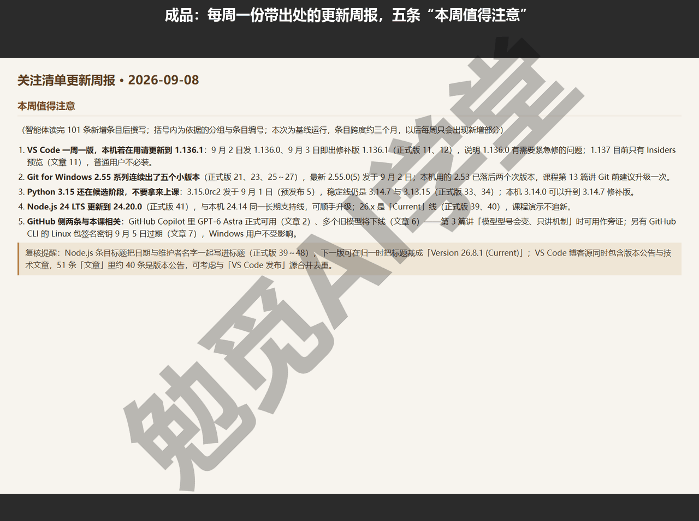

### 19.1 关注清单怎么列

先看没有这套东西的时候，你是怎么盯更新的。多数人的做法是：想起某个软件了去官网看一眼，或者看到一篇自媒体文章才知道出了新版本。这种方式有两个问题。

- 会漏掉更新。没人能记得住自己在用的每个工具，几周不看，安全修复版都错过了。
- 来源是二手的。自媒体转述常常晚几天、断章取义，甚至把测试版当成正式版来报道。

关注清单要解决的就是这两件事：把“我在用什么、我关心什么”写成一份固定名单，更新消息直接从官方源头取。你可以把它理解成一张自己定的订阅名单：名单在你手里，内容从官方源头直接送来，中间不经过任何转述。

**这份名单存成一个 JSON 文件。** 项目里它叫 `watchlist.json`，每个源三个字段：`name` 是周报里显示的来源名，`url` 是发布源地址，`type` 决定这个源的条目走哪条分类路线（`release` 表示软件发布，会区分正式版与预发布；`blog` 表示文章，一律归入文章类）。JSON 你不需要会写，让智能体建就行，但这三个字段的含义要清楚，因为以后加源、改源都是改这个文件。

**GitHub 项目都有现成的发布源。** 你在用的软件只要在 GitHub 上有仓库，在仓库地址后面加 `/releases.atom` 就是它的发布源，这是本篇最好用的一条规律。格式固定，如下：

```
https://github.com/<组织名>/<仓库名>/releases.atom
```

发布源（feed）是网站专门给程序订阅更新用的地址，返回的是程序能直接读的更新列表，常见格式有 Atom 与 RSS 两种，后面 19.2 里会讲怎么统一处理。你在用的工具类软件，多数在 GitHub 上有官方仓库，照这个规律就能拼出地址；官方博客、更新日志页则一般提供 RSS 地址，在页面底部或“订阅”入口能找到。

**清单怎么定：你在用什么，就追什么。** 这次的七个源不是什么标准配置，就是这台演示机的真实工作环境：记笔记用 Obsidian，写东西改代码用 VS Code，全课的版本管理靠 Git for Windows，课程脚本跑在 Python 上，估算器的测试用 Node.js 跑；再加两个平台层面的官方消息渠道——GitHub 更新日志（本课的云端、PR、上线都在 GitHub 上办）和 VS Code 官方博客（文章类源的例子）。每个源为什么值得追，一句话列在下表：

| 来源 | type | 为什么值得追 |
|---|---|---|
| Obsidian 发布 | release | 日常笔记软件，版本更新关系到库与插件的兼容 |
| VS Code 发布 | release | 主力编辑器，更新节奏约一周一版，不追，更新就会攒成一堆 |
| Git for Windows 发布 | release | 全课的版本后悔药，演示机上的 2.53 有没有落后，靠它提醒 |
| Python 发布 | release | 课程脚本的运行环境，修补版里常常有安全修复 |
| Node.js 发布 | release | 估算器的测试靠它跑，长期支持线的安全更新不能漏 |
| GitHub 更新日志 | blog | 云端、PR、上线都依赖这个平台，功能变化直接影响工作流 |
| VS Code 博客 | blog | 官方的文章类源，版本公告与技术文章都从这里发 |

照这个思路换成你自己的清单：主力编辑器或笔记软件、常用的运行环境、再加一两个平台官方日志，一开始有五到八个源就合适——够覆盖日常，也不至于每周读不完。

动手建清单。在 Cursor 里打开你的项目文件夹（工作区就是文件夹，它生成的文件都会保存在这里），在代理窗口（Agents Window）发送：

```
在这个文件夹里建一个 watchlist.json，作为我的关注清单。列 7 个官方源：
Obsidian、VS Code、Git for Windows、Python、Node.js 这五个用 GitHub 发布源，
地址规律是 https://github.com/组织名/仓库名/releases.atom，type 填 release；
再加 GitHub 官方更新日志和 VS Code 官方博客的 RSS 源，type 填 blog。
每个源给 name、url、type 三个字段，文件开头加一行说明。
```

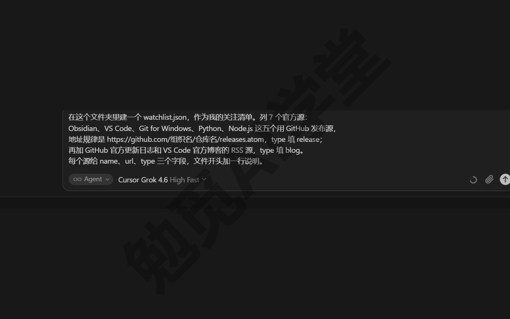

发送后它会创建文件，你在差异视图里能看到完整内容，逐个源核对一遍地址再接受。地址对不对有一个简单的验证办法：把 `releases.atom` 地址粘到浏览器里打开，能看到一堆带尖括号的 XML 文本（一种给程序读的文本格式）就是对的。

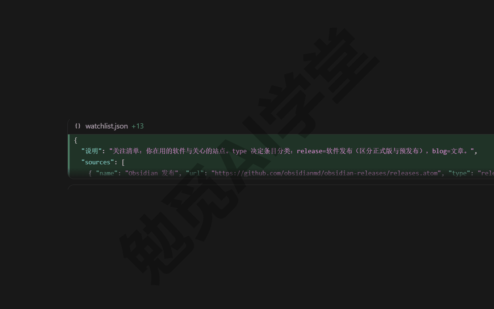

把其中一个地址粘进浏览器打开，看到的是这样一片 XML，说明地址对：

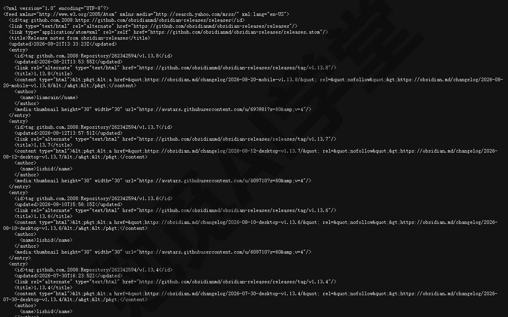

有两条边界要先知道：

- 需要登录或者有反爬（网站阻止程序抓取的手段）的站点，先不要放进清单，脚本抓不到这类源，19.5 里会给补数据的办法；
- 清单不追求长，先用七个左右跑通机制，以后随用随加。

### 19.2 多源抓取与归一

清单有了，下一步是让一段脚本把七个源都抓回来。这里有一个现实问题：GitHub 的发布源是 Atom 格式，博客常用 RSS 格式，两种格式的字段名、结构都不一样。所以脚本要做的第一件事叫归一——不管条目来自哪种格式，都整理成同样的六个字段：来源、类型、标题、链接、日期、摘要。归一之后，所有源的条目就是一张表，后面的对比、分类、写周报都只面对这一张表。

发送下面的指令，让智能体写抓取脚本：

```
读一下 watchlist.json，写一个 fetch.py，只用标准库加 requests：
1. 逐个抓取清单里的源，Atom 与 RSS 两种格式都解析，统一成六个字段：
   来源、类型、标题、链接、日期、摘要（去掉 HTML 标签，最多留 160 字）；
2. 某个源抓取失败时，把失败原因记进抓取日志，继续抓下一个，不要中断；
3. 抓完与 data/last_snapshot.json 里记过的链接对比，只把没见过的链接算“新增”；
   第一次运行没有快照文件，就把全部条目算新增，作为基线；
   快照要累积记录所有见过的链接；
4. type 是 release 的条目，标题里含 beta、alpha、rc、insider、nightly 的算“预发布”，
   其余算“正式版”；type 是 blog 的一律算“文章”；
5. 每次运行输出两份产物：data/items-当天日期.json（含抓取日志与新增条目），
   以及 周报/当天日期.md——开头一行写与上次相比新增多少条，然后是抓取日志、
   留空的“本周值得注意”一节（把填写要求写进模板），
   最后按 正式版、预发布、文章 三组列出新增条目，每条带来源、日期、链接。
写完自己跑一遍，把输出给我看。
```

脚本里有几处设计，决定了这套系统能不能长期跑。

**失败的源只记日志，不中断整轮。** 七个源里任何一个都可能临时出问题：网络波动、站点维护、地址失效。如果一个源失败就整体报错，周报就会经常整份出不来。正确做法是把失败原因写进抓取日志、继续抓下一个；周报开头能看到哪个源这周没抓到，你再决定要不要处理。

**摘要去掉标签、截短。** 发布源里的正文常常带一堆 HTML 标签和超长说明。脚本只留纯文本的前 160 字，摘要的作用是帮你判断值不值得点开链接，不是替你读完全文。

**只需要额外装一个程序包。** 脚本只用 Python 自带的功能，外加一个叫 `requests` 的程序包。如果你的电脑没装过，直接让智能体顺手装——《文件与办公能力一篇讲全》讲过这个用法：一句话让它安装并自己验证装好了没有。

写完让它跑，或者你自己在终端执行：

```
python fetch.py
```

让智能体跑命令时会经过审批：《权限、沙盒与模型》讲过，Windows 上没有文件系统沙盒，命令按你的运行模式档位（自动审查／白名单／全部运行，中文文案以实际界面为准）走分类器或审批弹窗，这类只在项目文件夹里读写的脚本正常放行即可。

第一次运行你会看到七行抓取日志：五个 GitHub 源各抓到 10 条，GitHub 更新日志 10 条，VS Code 博客 41 条，共 101 条。数量不齐是正常的：发布源里放多少条历史记录由源自己决定，GitHub 的 `releases.atom` 一般只给最近十条左右，博客站给多少的都有。


### 19.3 只看新增：快照机制

101 条你不可能每周读一遍，而且也不需要：这里面绝大多数是几个月内的旧闻，你真正要看的是“上次看过之后新出现的那几条”。这就是快照机制解决的问题，也是它和“每次都抓全部条目”的普通抓取脚本最大的差别。

机制本身很简单。`data/last_snapshot.json` 这个文件记录“见过的所有条目链接”；每次抓取完成后，脚本拿新抓的条目与快照对比，链接不在快照里的才算新增；对比完把这次见到的链接加进快照。第一次运行时快照还不存在，全部条目都算新增——这一份就叫基线。基线的意思是：把当前各源里能看到的条目一次性记下来，作为以后每次比较的起点。

这两次运行把这个机制验证得很直观：

- 第一次运行：新增 101 条，建立基线，快照记下 101 条链接；
- 紧接着第二次运行：同样抓到 101 条，但新增 0 条——每一条都在快照里了。

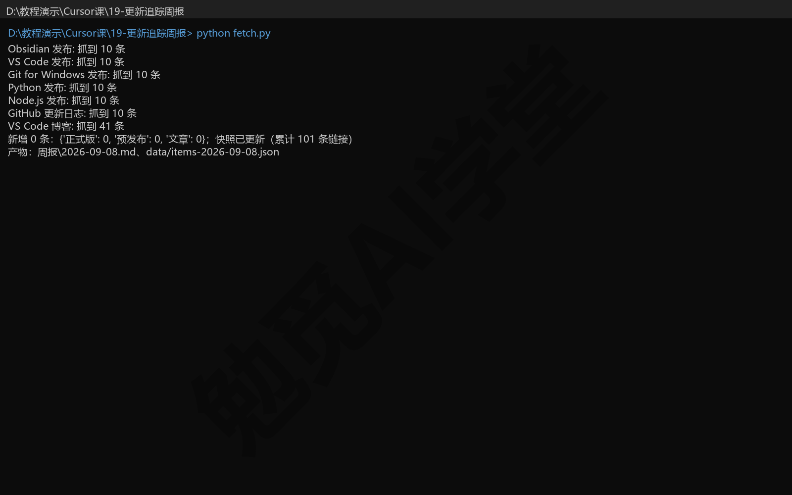

快照还有三个细节：

- **快照只存链接和运行日期。** 判断“见没见过”用链接就够了，条目的完整内容存在 `data/items-日期.json` 里，两个文件分工不同。
- **快照是累积的。** 旧条目从发布源里消失之后，快照仍然记得它，不会出现“旧闻隔几个月又被当成新增”的问题。
- **删掉快照等于重建基线。** 哪天你觉得记录乱了、或者改了分类规则想重新来，删掉 `data/last_snapshot.json` 再跑一次就行，代价是那一期周报会把全部条目重新列一遍。

另外，快照判断“新不新”只看链接。同一个链接的条目，事后标题、正文被改了也不会再被算作新增；反过来，同一件事在两个源各有链接时会算成两条——比如 VS Code 出 1.136 版，发布源里有它的版本条目，博客源里又有它的公告文章，基线里两条都在。这条规则是有意定得这么简单的：宁可偶尔重复，也不做复杂的内容比对，重不重复，你读周报时一眼就能判断。

每次运行除了周报，还会生成一份 `data/items-当天日期.json`，里面是本次的抓取日志与新增条目，按固定格式整理好。两份文件分工明确：周报给人读，JSON 给程序读——以后想把新增条目接进别的页面、或者做点统计，直接读这个文件，不用再从周报的文字里一条条找出来。两次运行之后，data 与 周报 两个文件夹里是这几个文件：

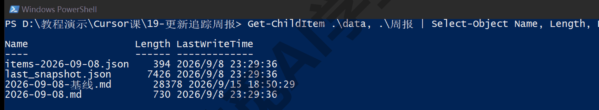

再看周报文件本身。每次运行生成 `周报/当天日期.md`，从上到下四块：开头一行对比说明（与上次运行相比新增几条、共抓取几条）、抓取日志、留空的“本周值得注意”一节、按正式版／预发布／文章分的三组新增条目。其中“本周值得注意”的模板里预先写明了填写要求：读完条目再写、注明编号、预发布只作预告。这样无论谁来填（你、智能体、以后的自动化），要求都跟着模板走。第二次运行生成的那份周报（新增 0）用记事本打开，四块结构都在：

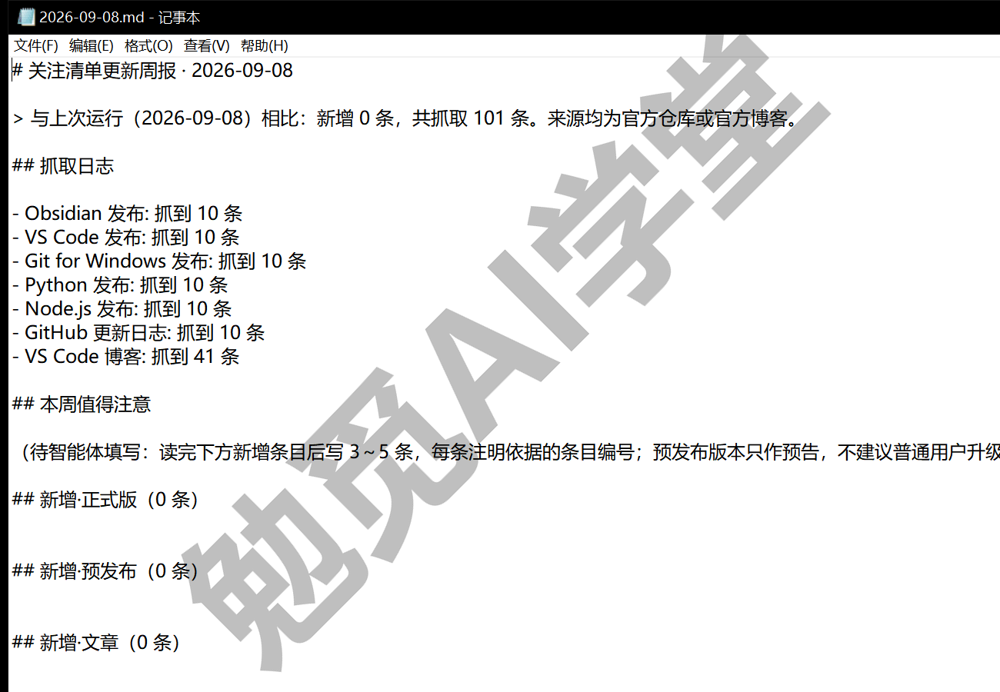

还有一个小坑：周报按日期命名，同一天跑两次，第二次会覆盖同名文件。这次就遇到了——第一次运行生成的基线周报填好要点后，为了做第二次运行的演示，先把它另存成了 `周报/2026-09-08-基线.md`，第二次运行的 `周报/2026-09-08.md` 就是那份“新增 0”的空周报。正常按周跑不会重名，密集测试时注意先把有内容的那份改名。

### 19.4 分类与可信度，附一次翻车实录

**分类只看 type 和标题。** 每个新增条目会被标成三类之一，规则完全由 `watchlist.json` 里的 type 字段加标题判定：type 为 blog 的一律算“文章”；type 为 release 的看标题——含 beta、alpha、rc、insider、nightly 这类标记的算“预发布”，其余算“正式版”。分出预发布的原因很实际：预发布是给开发者试错的版本，普通用户看到它只需要知道“新版本在路上”，不需要安装。

**可信度只认官方源。** 这次的清单里全部是官方仓库与官方博客，所以每个条目的链接前都标着“官方”。这背后是一条要长期执行的纪律：写进周报的每一条信息，都要能对应到官方源的链接上；自媒体文章、聊天群消息可以提醒你去看，但它们只作线索，不作依据。如果以后你想把某个自媒体源收进清单，就在清单里给它加一个 confidence 字段标成“线索”，让周报能一眼区分两种来源——脚本注释里已经预留了这个字段的位置。

**这一篇的翻车实录：预发布组只分出了 2 条。**

第一次基线跑完，分组数是正式版 48、预发布 2、文章 51。发现问题的方式并不高级，就是做了一次人工抽查：三组各从头扫一遍标题。预发布组只有 2 条，与七个源的数量对不上——清单里有 Python 和 Git 两个大项目，正常都会有几个候选版本在测试中；再看正式版组的 Python 段，`v3.15.0rc2`、`v3.15.0b4` 就列在里面。rc 是候选版本、b 是测试版，这些明明是预发布。后来又用修复前的判定，拿新抓的一批数据重跑了一次（发布源只给最近十条，这一批里的预发布比当时少一个），问题一眼就能看到：

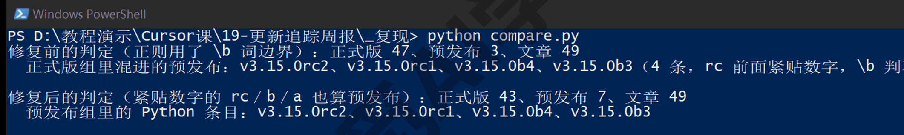

还有一个容易误判的地方：第二次运行的“新增 0”并没有暴露这个问题。对比机制只看链接见没见过，不看分类对不对，所以分类错了，流程照样一路正常。机制跑得通，不代表结果是对的，人工抽查这一步省不得。

原因出在预发布判定的正则（正则表达式，一种按模式匹配文本的写法）用了 `\b` 词边界。`\b` 的含义是“字母数字与非字母数字的交界”：多数项目的预发布写成 `2.55.0-rc2`，rc 前面有一个连字符，边界成立，匹配得上；但 Python 的写法是 `3.15.0rc2`，0 与 r 都属于字母数字一侧，中间根本不存在边界，`rc` 前面的边界条件永远不成立，判定直接漏过。一共漏了 5 个预发布版。

补救办法分两步。第一步改判定，把规则改成“前面紧贴数字的 rc、b、a 也算预发布标记”，只需要改一行正则。第二步重建基线——光改规则不够：错误的分组已经写进那期基线周报，而快照又会让下一次运行“新增 0”，错误就成了没人再看第二眼的既成事实。所以删掉快照重跑，让基线按新规则重新生成。重建后分组变成正式版 43、预发布 7、文章 51；再跑一次对比，新增 0，快照机制不受影响。对一下账：48 减 5 等于 43，2 加 5 等于 7，被挪动的正好是漏判的那 5 条。

通用教训有两条：

- 分类规则不能只在脑子里想一遍，要拿真实数据抽查——七个源里恰好有一个的版本号写法不一样，这种事前很难想到，抽查一遍就能发现；
- 发现分错不用慌，改规则、删快照、重建基线，整个代价就是重跑一次，快照机制让重来变得很便宜。

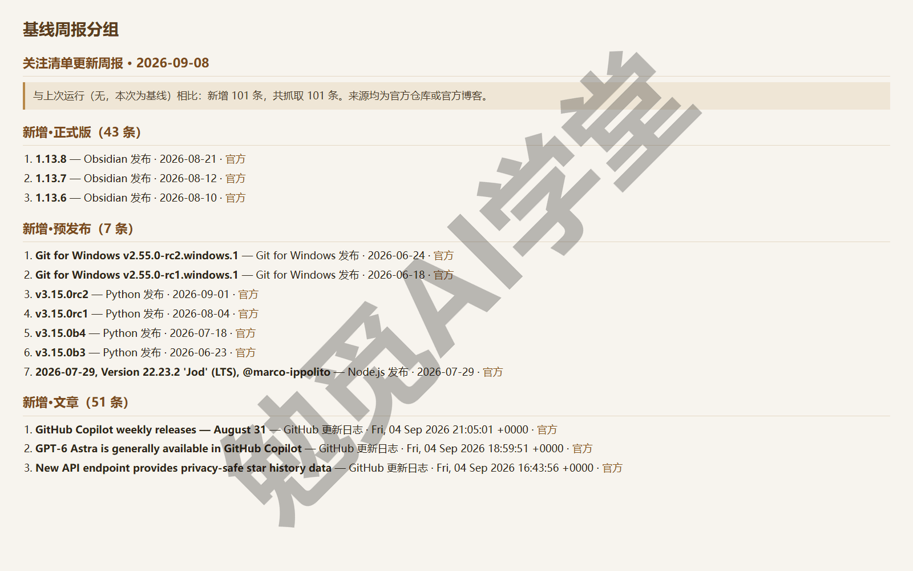

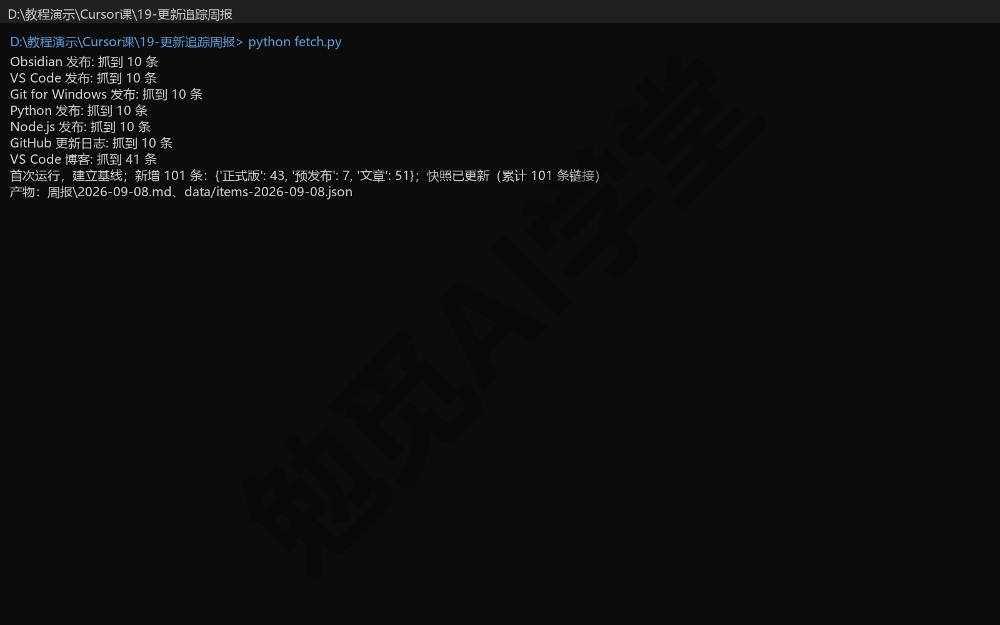

### 19.5 反爬源怎么补：内置浏览器

清单跑通之后，你迟早会遇到抓不到的源。这次试了一个：把 36氪的 feed 地址加进清单试抓，返回的不是文章列表，而是一段反爬脚本——网站识别出这不是浏览器发来的请求，直接拦下。这不是故障，是很多内容站点的常态：要么要求登录，要么对程序发来的请求设置了门槛。对这类源，脚本路线到此为止，换内置浏览器路线。

脚本请求拿回来的东西是这样，状态码是 200（表示请求成功），内容却是网页和一段看不懂的脚本，没有任何文章条目（RSS 里叫 item）：

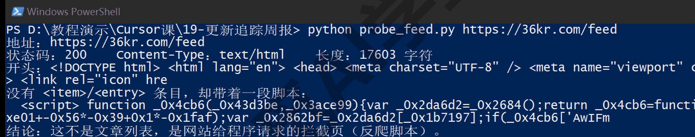

同一个地址用浏览器打开，拿到的却是正常的 RSS 内容：

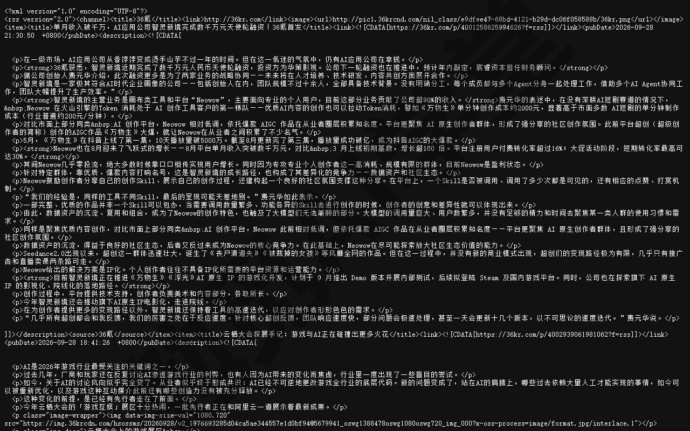

《内置浏览器与设计模式》讲过这项能力：智能体自带一个内置浏览器，能打开网页、点击、输入、滚动、截图，读控制台与网络请求，浏览器会话按工作区隔离保存。反爬挡的是“程序请求”，挡不住“真的打开页面看”——让智能体像人一样打开页面，把最近的更新读出来，就绕过了这道门槛。

这一步属于图形界面操作，下面的步骤按官方文档与《内置浏览器与设计模式》的机制写出，具体画面以实际界面为准。

第 1 步，在代理窗口发送指令：

```
用内置浏览器打开 36氪的快讯页，读出今天与 AI 工具相关的条目，
每条给标题、时间、链接，列给我。只读页面，不要登录、不要点任何互动按钮。
```

第 2 步，处理审批。首次使用浏览器会弹出审批：浏览器动作默认每步需要你确认，审批档位在设置（Ctrl+Shift+J）的 Agents 分区里调整（官方文档里写的是 Auto-Run，位置《内置浏览器与设计模式》讲过；中文界面文案以实际界面为准），分手动审批、白名单、自动运行三档。白名单的含义是把你确认过的动作放进免审批名单，其余照旧。对陌生网站保持手动审批，不要开自动运行——这是《内置浏览器与设计模式》给过的安全边界，页面上有什么脚本你事先不知道。

第 3 步，把读回来的条目补进周报。让它按周报格式追加到“文章”组，来源写站点名，可信度一栏标“线索”而不是“官方”——浏览器读回来的是媒体的二手转述，要用的时候回官方源核对，这也是 19.4 里定下的纪律。

还有两个细节能让这条流程更顺畅。

**登录一次，长期有效。**《内置浏览器与设计模式》讲过，浏览器会话按工作区保存，登录状态和 cookie（网站用来记住你的一小段数据）在同一工作区里跨对话保留。所以遇到要登录才能看的源，你手动登录一次，之后每周让它直接读页面就行，不必每次重新登录。边界也要守住：登录状态只用来“读”，发帖、下单这类会改变账号状态的动作，不要交给自动流程。

**也可以你来打开页面、它来读。** 除了让它自己去打开页面，你还可以先在浏览器窗格里手动打开目标页面，再用 @Browser 把当前页面状态带进对话，让它只负责读和整理。页面结构复杂、或者只想让它看某一屏内容时，这个分工更稳，需要审批的动作也更少。

浏览器补数据是半自动的做法：它需要你在场审批，速度也比脚本慢，适合每周看一眼的少数源，不适合塞进本地定时任务里。所以清单里的源这样安排：能找到官方发布源的一律走脚本，找不到的才走浏览器，并且控制数量。至于全自动，云端自动化的运行环境自带浏览器能力，理论上能把这类源也放进定时流程，但那属于进阶配置，先把官方源的主线跑稳再考虑（以实际功能开放为准）。

### 19.6 智能体写“本周值得注意”

101 条基线也好、以后每周的三五条也好，光有条目列表还不算周报，你还需要一段易读的总结：这周哪些事值得我花时间，哪些跟我有关。这一步交给智能体，但要先定下本篇最重要的纪律：**要点总结必须由智能体读完条目再写，每条注明依据。**

为什么这条纪律最重要？因为大模型不读材料也能写出一段看起来可信的“本周软件圈动态”——凭它训练时记住的东西编的那种，版本号、日期常常对不上，你既没法核对，也找不到出处。读完条目再写、每条括号里注明分组与条目编号，这两个要求把它的输出限定在真实数据上：任何一条你都能顺着编号翻回原始条目、点开官方链接。要点只是索引，顺着它去看原始条目才算读完。

发送指令（把本机在用的版本告诉它，升级建议才对得上你的情况）：

```
读一下 周报/2026-09-08.md 里“新增”三组的全部条目，把“本周值得注意”一节写完：
写 3～5 条，每条括号里注明依据的分组与条目编号；
结合我本机在用的版本（VS Code、Git 2.53、Python 3.14、Node 24）给出升级建议；
预发布版本只作预告，不建议普通用户升级。
写完后，把你读条目时发现的来源质量问题附在这一节末尾作为复核提醒。
```

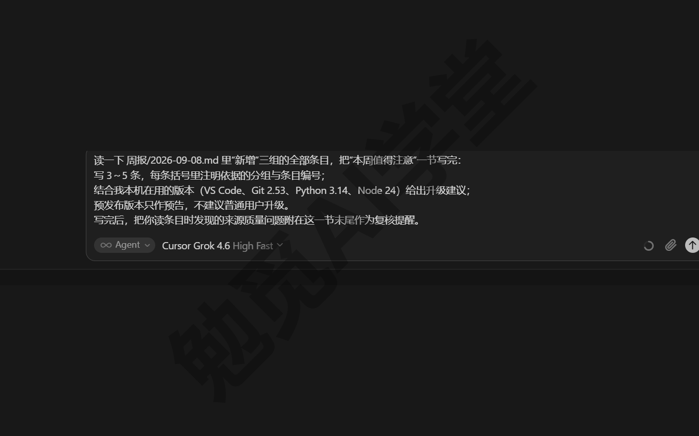

这次它写出的 5 条要点如下，全文照抄自 `周报/2026-09-08-基线.md`：

```
1. VS Code 一周一版，本机若在用请更新到 1.136.1：9 月 2 日发 1.136.0、
   9 月 3 日即出修补版 1.136.1（正式版 11、12），说明 1.136.0 有需要紧急修的问题；
   1.137 目前只有 Insiders 预览（文章 11），普通用户不必装。
2. Git for Windows 2.55 系列连续出了五个小版本（正式版 21、23、25～27），
   最新 2.55.0(5) 发于 9 月 2 日；本机用的 2.53 已落后两个次版本，
   课程第 13 篇讲 Git 前建议升级一次。
3. Python 3.15 还在候选阶段，不要拿来上课：3.15.0rc2 发于 9 月 1 日（预发布 5），
   稳定线仍是 3.14.7 与 3.13.15（正式版 33、34）；本机 3.14.0 可以升到 3.14.7 修补版。
4. Node.js 24 LTS 更新到 24.20.0（正式版 41），与本机 24.14 同一长期支持线，
   可顺手升级；26.x 是「Current」线（正式版 39、40），课程演示不追新。
5. GitHub 侧两条与本课相关：GitHub Copilot 里 GPT-6 Astra 正式可用（文章 2）、
   多个旧模型将下线（文章 6）——第 3 篇讲「模型型号会变、只讲机制」时可用作旁证；
   另有 GitHub CLI 的 Linux 包签名密钥 9 月 5 日过期（文章 7），Windows 用户不受影响。
```

这份周报有三点值得你留意：

- 每条都对应一个行动：该升的（VS Code、Git、Node）、不该碰的（Python 3.15 预发布）、只需要知道的（GitHub 两条），读完就知道自己要不要动手。
- 括号里的编号能把你带回下方分组里的原始条目，官方链接就在那里，随时能核对。
- 预发布真的只作了预告——纪律写进指令，结果就守纪律。

它还在这一节末尾附了两条复核提醒，同样照抄它生成的原文：

```
> 复核提醒：Node.js 条目标题把日期与维护者名字一起写进标题（正式版 39～48），
> 下一版可在归一时把标题裁成「Version 26.8.1 (Current)」；
> VS Code 博客源同时包含版本公告与技术文章，51 条「文章」里约 40 条是版本公告，
> 可考虑与「VS Code 发布」源合并去重。
```

这是“读完再写”的副产品：智能体通读了 101 条，顺手替你把数据检查了一遍，发现了两处来源上的问题（Node 的标题格式冗长、VS Code 两个源内容重叠）。这类提醒不必立刻处理，留作下一轮改进清单即可——但只有真读过条目才提得出来，这也说明这条纪律确实有用。

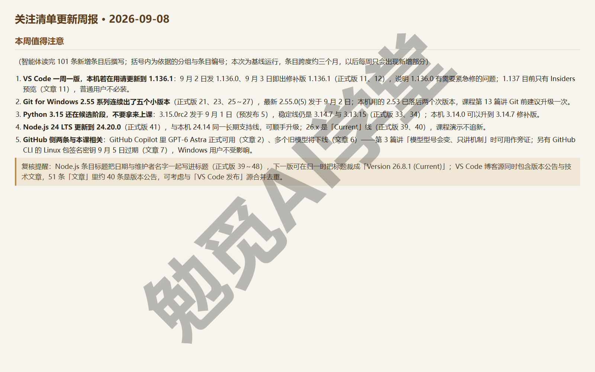

用量方面，本篇最费用量的环节是“写脚本”与“写要点”两段对话，抓取本身是脚本在跑、不占用量；写要点每周一次、输入是几十条文本，用量不大，实际消耗以你的用量页为准。

### 19.7 固化为每周自动化

到这里，整条流程你已经在对话里完整走通了一遍：抓取、对比、分类、写要点，每一步的结果都验证过。《自动化、钩子与命令行》定下的原则这时候才用得上：先在对话里把任务调到完美，再固化成自动任务。固化的是已经验证过的流程，不是希望它自己想明白的流程。固化有两种方案。

**方案一（课程主线）：Cursor 云端自动化。** 前提是有付费套餐，并且已经连接 GitHub。云端智能体（Cloud Agents）在《云端智能体与手机端》讲过：它在 Cursor 的云端电脑里干活，你关掉本机也不停；自动化就是按触发器定时启动的云端智能体，结果做成一个 PR（拉取请求，就是把一批改动打包送审的申请）交回来，由你审阅后合并。这条路线下面按官方文档写全，具体表单与按钮以实际界面为准。

第 1 步，把项目推到 GitHub 仓库——让智能体初始化仓库、提交、推送的做法，《Git、GitHub 与代码审查》讲过，这里直接照用。注意 `data/last_snapshot.json` 必须一起提交：它是“上次看到了什么”的记忆，云端每次运行都靠它判断新增；快照不进仓库，云端每次都会把全部条目当成新增重来。

第 2 步，在代理窗口发送 /automate，用一句话把需求说全：

```
/automate 每周一早上 8 点运行 python fetch.py，阅读生成的 周报/当天日期.md，
把“本周值得注意”一节写完（3～5 条，每条注明依据的分组与条目编号，
预发布版本只作预告），把快照与周报一起提交并开 PR
```

第 3 步，核对它回给你的自动化配置草稿（就是《自动化、钩子与命令行》里建自动化时的那张表单）：触发器为定时、每周一，看触发器那一行显示的是不是本地时间的 08:00（15.2 讲过 cron 按世界标准时间计、差 8 小时，不对就在那一行把时间改成 08:00）；仓库选本仓库；工具里默认开着的创建 PR（Create pull request，中文文案以实际界面为准）保留；最后点右上角的 Create 保存并激活。

第 4 步，手动触发一次（手动触发入口以实际界面为准），到这条自动化的详情页看运行记录与工件，确认生成的周报与你在对话里调好的一致，再放手让它每周自己跑。

第 5 步，之后的每周一变成这样：手机收到通知、读周报要点、觉得没问题就合并 PR；合并后快照随仓库更新，下周继续只看新增。手机端用 iPhone 的 Cursor App，Android 用网页版，具体怎么接收和查看以实际界面为准。

费用方面，自动化按云端智能体的用量计费，首次使用云端会要求设置支出上限，机制与数额以账号页面为准。隐私方面，本项目全部是公开信息，放公开仓库没有顾虑；如果你的清单里加了公司内部源，参照《实战二：家庭账单月报流水线》定过的做法改用私有仓库。

**方案二（本地兜底）：Windows 计划任务只跑抓取。** 不想连接 GitHub、或者想先观察一阵再上云端，就用系统自带的计划任务定时跑脚本，“本周值得注意”留到你打开 Cursor 时让智能体一句话补上。注册命令如下——为阅读方便拆成了多行，开始菜单搜 PowerShell 打开它，整段粘进去回车就能运行（要不要让它长期定时跑由你决定）：

```powershell
$tr = "cmd /c cd /d D:\教程演示\Cursor课\19-更新追踪周报 " +
      "&& set PYTHONIOENCODING=utf-8 && python fetch.py"
schtasks /Create /TN "更新追踪周报" /SC WEEKLY /D MON `
  /ST 08:00 /TR $tr /F
```

注册成功后，打开任务计划程序（开始菜单里搜这个名字就能打开），任务计划程序库里会多出“更新追踪周报”这一行，触发器一列写着每周星期一的 8:00，下次运行时间是下一个周一，像下面这样（图里其他任务是这台电脑自己的，已经打了马赛克）：

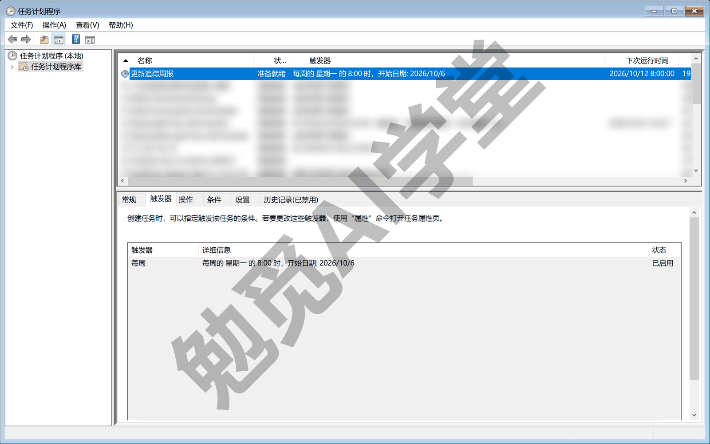

取消注册用：

```powershell
schtasks /Delete /TN "更新追踪周报" /F
```

命令里的路径换成你自己的项目文件夹。注册后每周一早上 8 点脚本自动跑一次，周报与数据文件保存在项目文件夹里；你周一有空时打开 Cursor，把 19.6 那条写要点的指令发一遍就补齐了。

两种方案怎么选：如果你有付费套餐、也愿意把项目放到 GitHub 上，就用云端自动化，全程自动直到开出 PR、手机上就能看；要是暂时不想绑账号，就用 Windows 计划任务，半自动、不依赖任何账号。两种方案跑的是同一个 fetch.py，只看新增的做法也一样。

最后把交付物与验收标准收齐。交付物有三件：关注清单（`watchlist.json`）、每周自动更新的周报（`周报/` 目录）和快照（`data/last_snapshot.json`）。验收标准有两条：第二次运行新增为 0，证明对比机制生效；每条要点都能追溯到分组、条目编号与官方链接。

### 19.8 练习任务

下面三个任务把本篇的机制在你自己的清单上过一遍。方括号里的内容换成你自己的。

**任务一：建立你自己的关注清单**

```
把 watchlist.json 里的源换成我自己的：保留 GitHub 更新日志，
加上 [你在用的软件名] 的 GitHub 发布源（releases.atom）
和 [你常看的官方博客] 的 RSS 源。
改完跑一次 python fetch.py，告诉我建立了多少条基线。
```

完成标准：抓取日志里每个源都有条数或失败原因；生成了你自己的基线周报；`data/last_snapshot.json` 里能看到累积的链接。

**任务二：验证“只看新增”机制**

```
再跑一次 python fetch.py，确认这次新增为 0；
然后删掉 data/last_snapshot.json 再跑一次，观察是否全部条目又变成新增。
跑完把三次运行的新增条数整理成一行汇报给我。
```

完成标准：三次运行的新增数分别为全部条目、0、全部条目；你能用自己的话说出快照文件的作用和删掉它的后果。

**任务三：写一份带出处的要点**

```
读一下最新那份周报里“新增”三组的全部条目，把“本周值得注意”写成 3 条，
每条括号里注明依据的分组与条目编号，
并结合我在用的 [软件名与版本号] 给出要不要升级的建议；预发布只作预告。
```

完成标准：每条要点的编号能对回原始条目；升级建议与你报给它的版本对得上；没有任何一条建议你安装预发布版。

### 19.98 本篇小结与自检

这一篇搭起了第四个完整项目：关注清单定来源，脚本抓取归一，快照机制只看新增，分类规则区分正式版、预发布与文章，智能体读完条目写出带出处的要点，最后固化成每周自动化。最要记住的是三件事：来源认官方，新增靠快照，总结先读后写、条条有出处。

- [ ] 能说出 GitHub 项目发布源的地址规律，并为自己在用的软件找到至少一个官方源
- [ ] 跑通过两次 fetch.py，亲眼见过“第一次全量基线、第二次新增 0”
- [ ] 能解释快照文件的作用，知道删掉它等于重建基线
- [ ] 看懂了预发布判定翻车的修复过程，能说出正式版／预发布／文章的分类依据
- [ ] 让智能体写过一次带分组与条目编号的“本周值得注意”
- [ ] 知道抓不到的源改走内置浏览器补数据，并且只把它标作线索
- [ ] 清楚固化的两条路线（云端自动化、本地计划任务）各自的前提与取舍

完成这些内容后，四个实战就集齐了：一个做好的小店官网、一条家庭账单流水线、一个装修预算估算器、一套关注清单更新追踪。下一篇《毕业项目：个人数字工作台 + 课程总结》会把这四个作品汇到同一个页面上，用三个工作树并行做主题、并排择优合入，再把全课的功能清单、翻车教训、排错方法与分工建议一并收齐。

### 19.99 新手常见问题

**Q1：想追踪的软件不在 GitHub 上怎么办？**

先找它的官方渠道有没有发布源：官网底部、帮助中心、更新日志页常有 RSS 或 Atom 入口；在更新日志地址后面加 `/feed` 或 `/rss` 试着打开，有些站点也能拿到发布源。都没有的话，这个源就归入 19.5 的浏览器补数据路线，每周让智能体打开页面读一次。不建议的做法是拿自媒体转述当唯一来源——可以作线索，最终要回到官方页面核对。

**Q2：为什么第一次运行有一百来条，以后每周只有几条？**

第一次运行没有快照，各个发布源里现存的条目（一般是最近十条左右，博客源可能更多）全部算新增，这是建立基线，只有第一次会这样。之后每次运行只有“上次没见过的链接”才算新增，正常一周就是几条到十几条。如果哪天又出现全部条目都算新增的情况，先检查是不是快照文件被删了或没随仓库提交。

**Q3：预发布版本要不要装？**

一般不装。预发布（beta、rc 这类）是给开发者和尝鲜者试错的版本，可能带着未修完的问题。周报把它单列成一组就是为了让你“知道有这回事”而不必行动——等它变成正式版，周报自然会再报一次。唯一例外是某个预发布修了正在困扰你的问题，那也建议等对应的正式版或修补版。

**Q4：周报能自动发到微信吗？**

不能直接发，Cursor 官方能对接的是 Slack、Linear 这类工具，没有微信通道。替代办法有三条：走云端自动化路线时，PR 的通知会通过 GitHub 邮件与手机 App 推送到你手上；走本地路线时，生成的周报就在项目文件夹里，打开就能看；如果一定要送进微信，让智能体每周把要点整理成一段纯文本，你自己复制转发，一步就够。
