## 毕业项目：个人数字工作台 + 课程总结

这是全课最后一篇，分两半。前一半做毕业项目，把前四个实战的成果汇成一个“个人数字工作台”页面，用三个工作树并行做出三套主题、并排择优合入，再按云端接力与双重审查的流程收尾、上线。后一半是课程总结，包括五处翻车回放、排错三板斧、数据与隐私、用量总账，一张毕业验收清单，工具分工建议，以及怎么在课程结束后自己跟上产品迭代。

毕业项目不学新功能。它的用处是把学过的东西第一次完整地串起来用：数据来自《实战二：家庭账单月报流水线》与《实战四：关注清单更新追踪》实际生成的文件，规则模块直接复用《实战三：装修预算估算器》做好的那一个，入口指向《实战一：小店官网》；并行、择优、审查、上线，每一步都在前面的文章里单独练过。本篇的数字与运行结果，都来自 2026-09-08 在演示机上的一次实际运行，项目路径为 `D:\教程演示\Cursor课\20-个人数字工作台\`。

先看成品（动图）：四个面板一页看全，估算面板现场算价，手机上自动变成单栏。

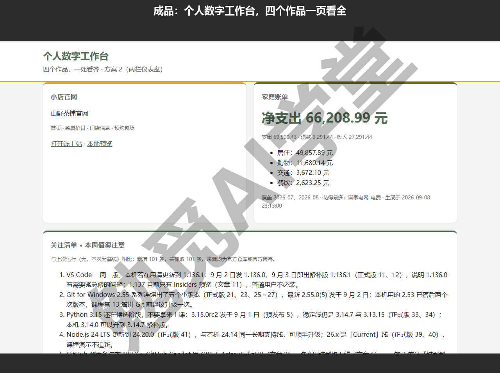

### 20.1 项目定义：四个作品，一页看全

四个实战做完，成果散在四个文件夹里：想看这个月花了多少钱要去翻月报，想看软件更新要去翻周报，想给客人算装修还要打开估算器。笨办法是挨个打开；工作台的思路是做一个静态页面，把四样东西的“最要紧的那部分”汇到一屏上。

工作台页有四个面板，每个面板对应一个作品：

- **小店官网入口** ——站名、四个页面名、公开网址与本地预览链接；
- **家庭账单** ——净支出用大字显示，下面配支出、退款、收入与前四个类别；
- **关注清单要点** ——最新一期“本周值得注意”的全部条目；
- **快速装修估算** ——一个能现场算价的小表单，直接复用估算器的规则模块。

数据从哪来是这个项目的关键设计。页面本身不做任何计算与抓取，它只读一个数据文件 `data.js`；真正干活的是汇总脚本 `build.py`，它从前四个实战生成的文件里取数据，生成 `data.js`。这样分工有两个好处：页面是纯静态的，放到任何能放静态网页的地方都能跑；数据要更新时重跑一次脚本即可，页面代码不用动。

三条数据通道逐一看。

**账单通道。**《实战二：家庭账单月报流水线》的流水线每次运行都会输出一份给程序读的摘要文件 `summary.json`，`build.py` 从里面取净支出、支出、退款、收入、分月合计、前四个类别与花得最多的商户。这次取到的数字如下：净支出 66,208.99 元，支出 69,500.43、退款 3,291.44、收入 27,291.44，居住类 49,857.89 最多，最大商户是国家电网-电费。

**周报通道。**《实战四：关注清单更新追踪》的周报按日期一期一份，但不是每期都有要点（新增为 0 的那期“本周值得注意”是空的）。所以脚本的做法是：从新到旧找第一份要点已填写的周报，把要点列表与开头那行对比说明取出来；一份都找不到就显示“本周无新增更新”兜底。这次取到的是基线那期的 5 条要点。

**估算通道。**《实战三：装修预算估算器》当时特意把计价规则写成了纯函数模块 `estimate.js`（不依赖页面、在浏览器和命令行里都能跑的一个文件），现在好处显出来了：脚本把它原样复制过来，工作台页直接调用，七组边界值测试验证过的规则一行不用改。

小店官网这一项不取数据，只做入口卡片。要注意，演示做到这一步时官网还没有上线，`data.js` 里的公开网址是 `example.github.io` 占位网址，本地预览链接指向官网项目的相对路径；你做到这里时，官网如果已经按《实战一：小店官网》上线，直接填它的真实网址就行，否则等上线后按 20.5 的做法回填。

动手。在 Cursor 里打开工作台文件夹（它和四个实战文件夹放在同一个上级文件夹里，脚本才能按相对位置找到它们），发送：

```
写一个 build.py，把前四个实战的成果汇到工作台：
1. 读 ../17-家庭账单月报/output/summary.json，取净支出、支出、退款、收入、
   分月合计、前四个类别和花得最多的商户；
2. 到 ../19-更新追踪周报/周报/ 里从新到旧找第一份“本周值得注意”已填写的周报，
   取出要点列表和开头那行对比说明；一份都没有就写“本周无新增更新”；
3. 把 ../18-装修预算估算器/estimate.js 原样复制过来复用；
4. 小店官网做成入口卡片：站名、四个页面名、线上地址（先用占位网址）和本地预览路径；
5. 汇总生成 data.js，再写一个四面板的 index.html：小店官网入口、家庭账单、
   关注清单要点、快速装修估算（用 estimate.js 现场算价）。
   先不做主题样式，跑通再说。
```

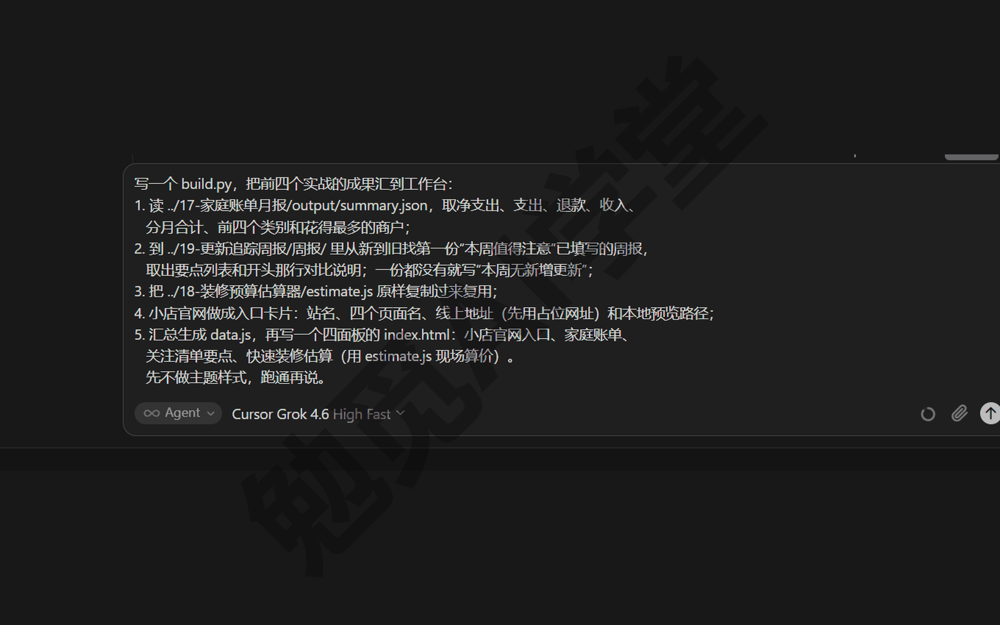

它写完后运行 `python build.py`，这次的输出是：

```
data.js 已生成：净支出 66,208.99，周报 2026-09-08-基线.md 要点 5 条，estimate.js 已复用
```

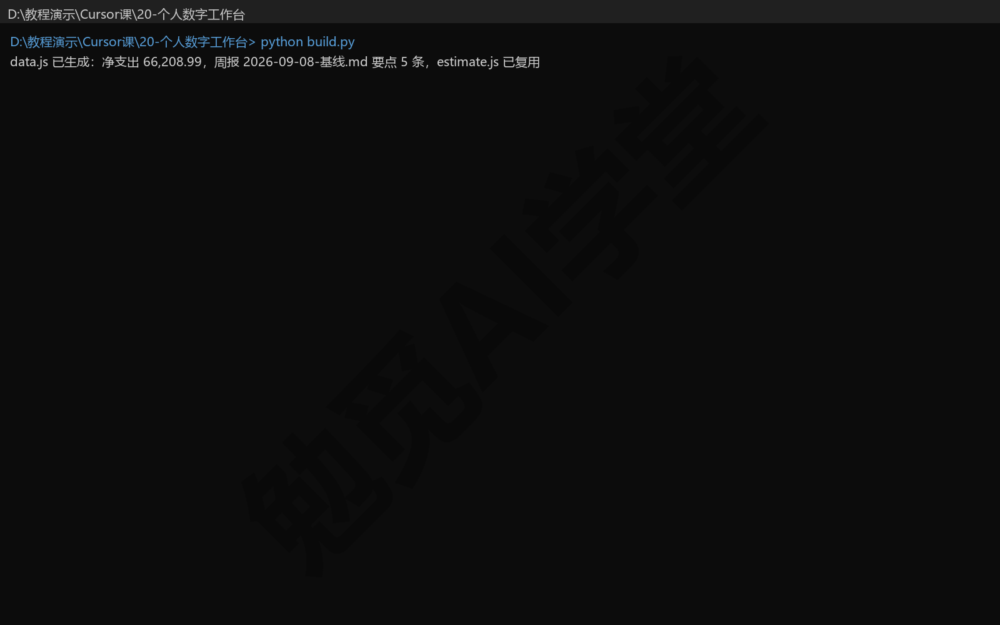

用浏览器打开 `index.html` 检查四个面板：账单数字与月报一致，要点与周报一致，估算面板默认填着 89 平米精装，算出 138,500.00 元；不足 15 万的估算额收 5,000 元设计费，这条《实战三：装修预算估算器》定下的规则在工作台里原样生效，顺手就验证了复用没有出错。骨架版打开是这样，四个面板都有了数据，主题还没做：

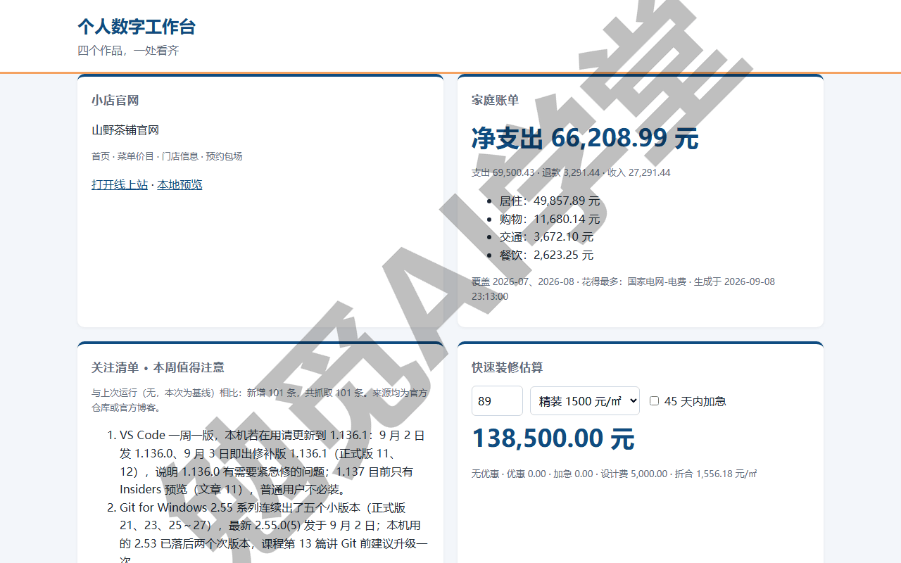

确认可用后，让它把这个无主题的版本提交为骨架（这次的提交号是 e6a68cd）。先提交骨架，是给接下来的三个方案一个共同的起点：并行开发要求三个方案都从同一次提交分头改。

### 20.2 三方案并行开发：三个工作树，三套主题

骨架能用了，但样式还没定。单栏往下排？两栏仪表盘？要不要深色？这类“方向未定”的问题最适合并行试：与其在一个版本上反复改来改去，不如三个方向各做一版，放在一起挑。

《子智能体、并行与工作树》讲过做法：工作树是同一个项目的隔离副本，每个副本有自己的文件与分支，各改各的互不影响。《实战三：装修预算估算器》用两个方案练过一次择优，这次升级到三个。三套主题各自要做成下面这样：

- **方案 1：单栏卡片流** ——面板按卡片从上往下排，结构最简单；
- **方案 2：两栏仪表盘** ——四个面板尽量收进一屏，周报独占一整行；
- **方案 3：深色主题** ——适合晚上看的深底配色。

三套配色都沿用小店官网的色系（茶汤绿加暖黄点缀），让四个作品在视觉上像一家人。发送：

```
给工作台做主题。用 git worktree 开三个隔离副本，分支名就叫 方案1、方案2、方案3：
方案 1 做单栏卡片流；方案 2 做两栏仪表盘，周报独占一整行；方案 3 做深色主题。
三套配色都和小店官网同一个色系（茶汤绿加暖黄点缀）。
每个方案改完各自提交，并各截一张桌面端整页图，文件名带方案号。
```

指令里特意写明“各自提交、各截一张整页图”，这不是啰嗦。《实战三：装修预算估算器》的两方案择优定过一条经验：几个方案要各自能运行、能截图，比较才有对象。放到并行开发里，就是每个方案完成后立刻留下两样东西——一次提交（以后能退回去的记录点）和一张整页截图（比较用的凭据），下一节的择优全靠它们。

这次用 `git worktree add` 命令完成了三个副本，三个分支各有一次提交：方案 1 提交号 0776ce4、方案 2 提交号 1fd2f4d、方案 3 提交号 fde4dc1。代理窗口里还有一种不敲命令、在界面上点的做法——输入框的运行环境下拉里有 New Worktree（新建工作树）一项（《实战三：装修预算估算器》18.4 里有这个下拉的截图），为每个方案各起一个智能体并选中它，效果一样；计划模式里的“并行构建”选项也是同一类能力，把计划里相互独立的步骤交给多个智能体同时跑，《计划、提问与调试三模式》介绍过这个选项。这次走的是命令路线，图形界面的画面以你实际看到的为准。

关于工作树还有两件常识。磁盘上，三个工作树是三个并排的文件夹，但仓库历史共用一份，只有工作文件各自独立，所以建得快、占的空间也不大；如果你的项目要装依赖才能运行，新建的工作树是“干净”的，官方提供 `.cursor/worktrees.json` 用来配置初始化命令——本项目是纯静态页，用不上它。另外，Cursor 会定期自动清理很久没用的工作树，保留数量有上限（可在设置里调整，以实际配置为准），所以重要成果要靠提交留住，别指望副本文件夹一直都在。

三个方案做出来的页面如下。

方案 1 是单栏卡片流，所有面板等宽、从上往下排：


方案 2 是两栏仪表盘，左右两栏、周报单独占一整行：

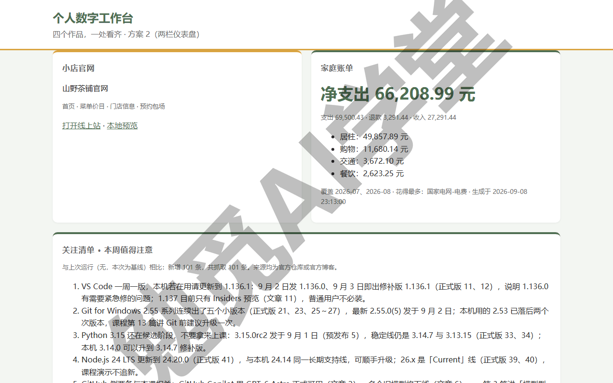

方案 3 是深色主题，深底浅字、配色仍是茶汤绿系：

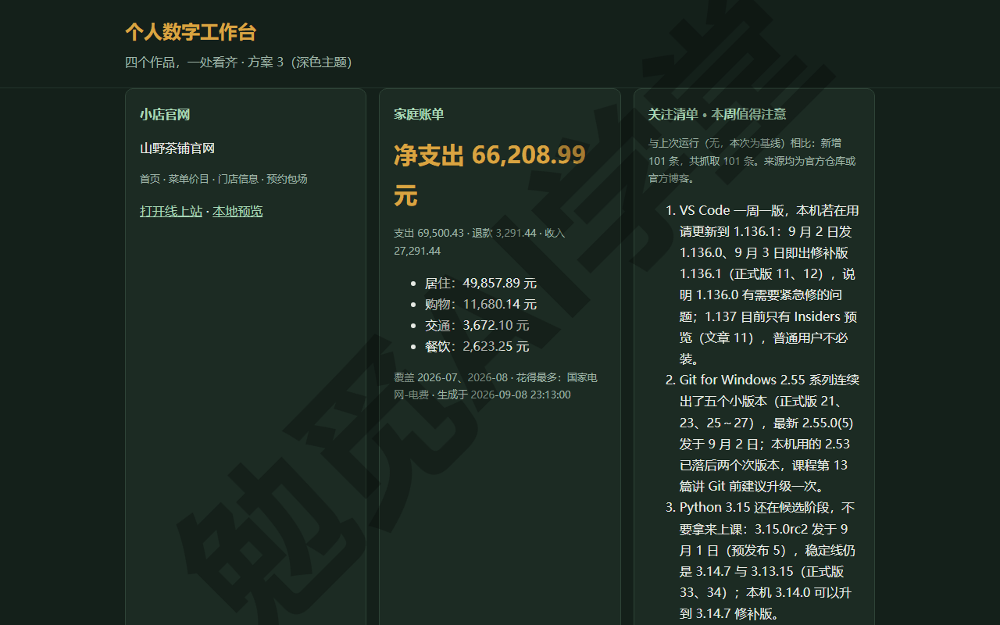

并行的好处和代价此刻都看得见：好处是三个方向都有真实成品放在面前，不用凭想象做决定；代价是三份改动量、三份用量。所以《子智能体、并行与工作树》定过的边界仍然适用——小改动、有先后依赖、用量紧张时不并行，并行留给“方向未定”的时候。

### 20.3 择优合入：并排比，讲理由

三张截图都有了，怎么挑？关键是先定好比较的标准再看图，否则只会觉得“都挺好看”，选不出来。标准不用凭空想，从使用场景推出来：

- 工作台的定位是每天顺手扫一眼，所以第一问是一屏能不能看全四个面板；
- 四个面板里更新最勤、内容最长的是周报，所以第二问盯周报长文的可读性；
- 手机上随手打开是常态，所以第三问看窄屏（手机宽度）下版面自动变成单栏之后还好不好用。

换一个项目，标准就换一套——先想清楚这页给谁看、在什么设备上看、最常看什么，再去比图。

可以把三张图发回对话（发图的方式《对话与上下文管理》讲过，拖进输入框或用 @ 选中文件都行），让智能体按这三条标准并排点评：

```
三张方案截图在这里：@ep20-方案1-index-desktop.png @ep20-方案2-index-desktop.png
@ep20-方案3-index-desktop.png
按三条标准并排比较：一屏能否看全四个面板；周报长文的可读性；窄屏下变成单栏后的表现。
给出结论：合入哪个方案，理由写清楚；另外两个分支不删，留档。
```

这次的择优结论照抄运行日志：

```
[择优] 三方案并排：方案 1 单栏要滚动；方案 3 深色下周报长文可读性差；
方案 2 两栏仪表盘一屏看全、周报独占整行。结论：合入方案 2，方案 1/3 分支留档。
```

三条理由展开说，每条都对应一条标准。方案 1 输在第一条标准：单栏排四个面板必然超出一屏，看估算面板要滚到底部。方案 3 输在第二条标准：深色底上读大段周报文字比浅色底吃力，而周报恰恰是这页更新最频繁的内容。方案 2 在前两条标准上都胜出——两栏版面把官网、账单、估算收进一屏，周报独占一整行不挤；第三条标准它也有交代，窄屏时自动变成单栏。这不是“方案 2 全面胜出”，是“在这组标准下方案 2 最合适”；换一组标准（比如夜间值班看板），结论可能就是方案 3——理由留了档，日后换标准重选时才有依据。

合入很简单，对话里说一句“把方案 2 合进 master，方案 1 和方案 3 的分支保留”，它会执行合并。这次合入后 master 指向 1fd2f4d（就是方案 2 的那次提交），提交历史两步：e6a68cd 骨架，1fd2f4d 方案 2。方案 1、方案 3 的分支原地留档，哪天想换风格，切过去接着改就行，不用从头再做。

再看这次合并在提交历史里的样子。master 原本停在骨架提交上，方案 2 的提交恰好接在它后面，这次合并只是把 master 直接往前挪到 1fd2f4d（Git 叫快进），历史里不会多出一个合并节点，所以提交记录只有干净的两步。留档也几乎没有代价：Git 的分支只是指向某次提交的名字，不复制文件，方案 1、方案 3 留着不占什么空间。最后养成一个习惯：把择优理由写下来——提交说明、运行日志或对话记录都行，这次那条“[择优]”记录就是这么留下的；过几个月回看，你仍然知道当时为什么选了方案 2。

合入后的完整页面：

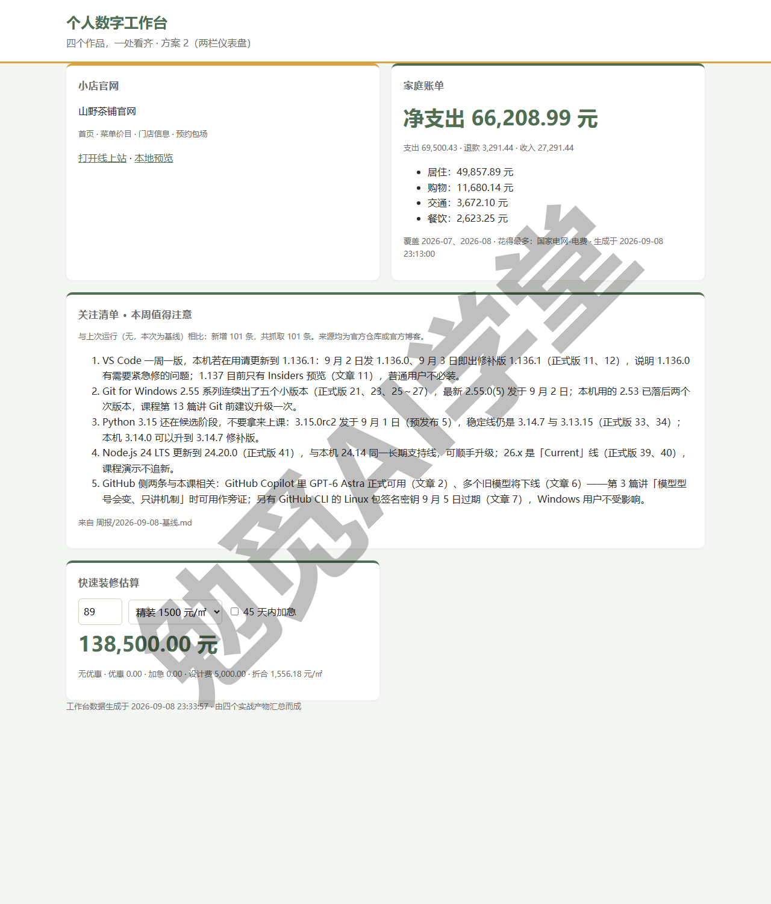

把窗口从 1280 像素宽逐步收窄到 390 像素宽，两栏在 720 像素宽处变成单栏，这就是第三条标准说的窄屏表现（动图）：

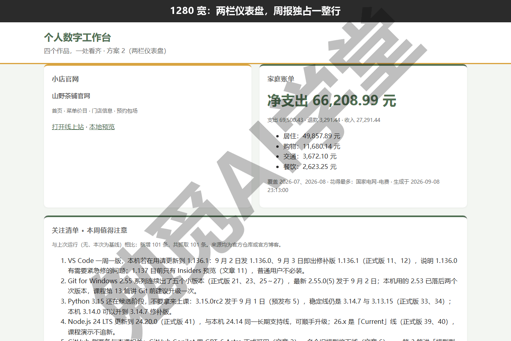

最下面的快速装修估算面板能现场算价，改面积、换档次、勾加急，数字当场变（动图）：


### 20.4 云端接力与双重审查

合入之后还有收尾工作：细节打磨、开 PR（拉取请求）、审查、合并。这段工作不一定要占着你的电脑，正好用来演示本课最后一条工作流：本地起头，云端接力，手机跟进，最后由双重审查把关。这套流程依赖付费套餐与 GitHub 账号，下面按官方文档把步骤写全，具体入口与按钮以实际界面为准。

先把两个角色回忆起来。云端智能体（《云端智能体与手机端》里详细讲过）是在 Cursor 云端电脑里干活的智能体，你关掉本机它也不停，结果做成 PR 交回来；它不走本地的运行模式审批，所以交给它的任务要提前想清楚范围。Bugbot 与 Agent Review（《Git、GitHub 与代码审查》里详细讲过）是两道审查：Bugbot 盯 PR，Agent Review 审查本地改动。

**第 1 步：推到 GitHub。** 对话里让它初始化仓库、提交并推送到 GitHub。GitHub 连接在《Git、GitHub 与代码审查》里做过，这里直接复用。

**第 2 步：移交云端。** 把收尾任务（比如“页脚补上四个作品的完成日期，检查窄屏样式”）发给智能体后，用移交入口把它挪到云端接着跑：输入框下方的运行环境下拉选“云端”，或使用对话里的 Move to Cloud（移到云端）入口并选择分支（入口与文案以实际界面为准）。移交后本机可以关。

**第 3 步：手机跟进。** 路上想起补充需求，打开 iPhone 的 Cursor App 找到这个智能体直接追问，例如“页脚再加一行数据更新时间”；Android 用网页版。推送通知会告诉你它干完了（手机端形态以实际界面为准）。

**第 4 步：云端开 PR。** 这一步不用你动手：云端智能体完成后会把改动推上分支并开 PR，附带它自己验证用的截图等工件。

**第 5 步：两道审查。** 两道审查各管一段。Bugbot 需要先在 cursor.com 的 Automations 页对这个仓库启用（个人付费套餐可用，只审查你本人的 PR）；启用后它自动审查每次 PR 更新，在 PR 上留下问题评论与修复建议，也可以在 PR 里评论 `cursor review` 手动触发。

Agent Review 在本地跑：输入 `/agent-review`，或在源代码管理页对全部本地改动触发一次审查，深度有 Quick（快速）与 Deep（深度）两档；它的选项在设置页的 Agents 分区（较新版本移到 Git & PRs 下的 Pull Requests 一节，中文文案以实际界面为准）。

两者的分工可以这样记：Agent Review 把关“交出去之前”的本地改动，Bugbot 把关“已经交出去”的 PR，一内一外。审查发现问题就改，改完推上去，Bugbot 默认只审查新提交的部分。想给审查定规矩，项目里放 `.cursor/BUGBOT.md`——《Git、GitHub 与代码审查》定过这个规矩文件的写法，两道审查都会读它。

**第 6 步：合并。** 检查通过后，在代理窗口里查看这个 PR 并合并（合并入口以实际界面为准）。到这里，毕业项目的开发流程就走完了，最后一步是一次带审查记录的合并。

### 20.5 上线与交付物清单

上线走《实战一：小店官网》定下的主线：GitHub Pages——免费、只需要一个 GitHub 账号，而工作台恰好是纯静态页，不需要额外的生成步骤或配置。

**上线前先做一遍隐私检查。** 上线意味着任何拿到网址的人都能打开这一页，四个面板里要单独审一遍的是家庭账单：它放的虽然是汇总数字而不是流水明细，但净支出、类别构成也属于不必给陌生人看的信息。这层取舍在 20.6 的数据与隐私一节展开，这里先给做法：不想公开，就在 `build.py` 里去掉账单通道（或者只保留月份、去掉金额），重新生成 `data.js` 再上线；两全的办法是公开版去掉账单、本地版保留完整。

**上线分三步。** 第 1 步，确认仓库已经推上 GitHub——20.4 第 1 步做过，这里只是再核对一下。第 2 步，打开仓库页面的 Settings，左侧栏点 Pages，Build and deployment 下的 Source 选 Deploy from a branch（从分支部署），Branch 选 master、目录选 / (root)，点 Save（这一页是英文界面，《实战一：小店官网》16.6 有这一页的截图；选项以实际页面为准）。第 3 步，等几分钟刷新页面，出现站点网址后点开，把四个面板挨个核对一遍，尤其确认 `data.js` 跟着仓库一起发布成功、数字没有变成空白。

**上线后回填入口。** 把 `build.py` 里小店官网的占位网址换成真实网址，重跑一次生成新的 `data.js`，提交推送，工作台入口卡片从此指向真实网址。

**以后怎么更新。** 静态网站的更新循环就三个动作：改文件、提交、推送，Pages 会按分支的最新内容重新发布，生效通常要几分钟（以实际表现为准）。《实战一：小店官网》里“改一处菜单，再发布一次”那一段演示过同一个循环；放到工作台上，就是每周跑完 `build.py`、数字变了之后照做一遍，页面就跟上了。

**交付物清点。** 毕业项目交出的东西一共五样：

- **页面本身**：`index.html` 与 `style.css`，用的是方案 2 主题，四个面板都排在这一页上。
- **数据文件**：`build.py` 与它生成的 `data.js`，页面上的数字都从这里来，每周重跑一次 `build.py` 就更新。
- **复用的规则模块**：`estimate.js`，来自《实战三：装修预算估算器》，一行都没改，估算面板直接调用它。
- **带留档的 Git 仓库**：master 上有骨架与方案 2 两次提交，方案 1、方案 3 分支原地保留，另外两套主题随时能切换回去看。
- **上线网址**：完成本节后的 GitHub Pages 地址，之后改文件、提交、推送，页面几分钟内重新发布。

验收标准一条：四个面板的数字与来源文件一致。净支出对得上 `summary.json`，要点对得上基线周报，估算结果对得上测试过的规则模块，入口对得上官网四页。

### 20.6 全课总结

项目收尾，课程也到了盘点的时候。总结分两节走：这一节讲四样经验——五条翻车教训、一套排错顺序、一组数据与隐私的规矩、一本用量的明白账；下一节把全课的功能对照表转成毕业验收清单，让你逐项打勾。

#### 翻车集锦回放

全课五个实战一共翻过五次车，每一次都原样留在了那一篇实战里，因为排查与补救的过程比一帆风顺的演示教得多。这里按“现象、原因、补救办法、通用教训”各回放一遍，完整经过看各自的那一篇实战。

**翻车一：截图缩放假象（《实战一：小店官网》）。** 现象是手机端截图里价格列被挤出画面，看起来像页面写坏了。原因查下来页面没有任何问题：无头浏览器（在后台打开页面、不开窗口的浏览器，常用来自动截图）有约 500 像素的最小窗口宽度，要 390 的窗口实际拿到 504，截图又只裁左边 390，画面自然就不完整。补救办法是把页面放进一个固定 390×844 的内嵌框架（iframe）里再截。通用教训：改版式之前先量数据——那次是量出窗口实际宽度 504 才找到原因的，如果按“截图看着不对”直接改样式，就会把好页面改坏。

**翻车二：跨来源重复计入（《实战二：家庭账单月报流水线》）。** 现象是同一笔钱在两个来源里都出现：银行流水里的“财付通-微信支付”代扣，与微信账单里的那笔是同一次消费，直接汇总就会把这笔支出算两次。原因是各渠道独立记账，导出后天然重叠。补救办法是在清洗规则里加一条，把跨来源的重复认出来、只保留微信账单里的那笔明细，这次剔除 37 行。通用教训：多来源汇总的第一问永远是“同一笔数据会不会出现两次”，先把规则统一再谈统计。

**翻车三：批量替换静默失效（《实战三：装修预算估算器》）。** 现象是方案 B 的底部合计栏第一版一片空白。原因是脚本做批量文本替换时，目标文件的换行符与要替换的文字不一致，替换没生效也没报错，代码根本没插进去。补救办法是放弃批量替换，改用编辑器精确修改。通用教训：改完必须看结果，尤其是“没报错”的操作——这种不报错的失败比报错更危险。

**翻车四：删工作树时工作目录还在里面（《实战三：装修预算估算器》）。** 现象是删除工作树时报权限错误，接着一连串文件读不到，一次还原命令还误撤销了刚修好的提交。原因是删除时，命令行的工作目录（它当前所在的文件夹）还停在那个文件夹里，目录被占用导致删除失败，后面按相对位置写的路径全都找不到了。补救办法是先把工作目录挪出去，用 Git 硬重置（reset --hard，把文件强制回到指定提交的状态）回到正确提交，清掉残留文件夹，改用绝对路径重做。通用教训有两条：删工作树前先离开那个目录；脚本里读写文件用绝对路径。

**翻车五：预发布判定漏网（《实战四：关注清单更新追踪》）。** 现象是 Python 的 3.15.0rc2 这类候选版本被分进了正式版组，5 条预发布进错了组。原因是判定正则用词边界匹配 rc，而 Python 的版本号与 rc 之间没有分隔符，匹配不上。补救办法是改成“紧贴数字的 rc、b、a 也算”，删快照重建基线，分组从 48、2、51 修正为 43、7、51。通用教训：分类规则要拿真实数据抽查，别默认所有来源的写法都一样。

五条放在一起看，有一个共同点：没有一次翻车是靠“重试一遍”解决的，每次都是先找到证据（量宽度、对流水、看文件、查占用、扫标题），再对症下药。下面这套排错顺序，就是把这个共同点固定成习惯。

#### 排错三板斧

这里把课程里零散讲过的排错办法归成一套固定顺序。遇到问题按这个顺序走，大多数情况不用求人。

**第一板斧：看报错原文。** 出错时把报错原样交给智能体：终端文本直接复制回对话，界面弹窗就截图后粘贴进去（《对话与上下文管理》讲过它读得懂截图）。不要转述“好像说什么权限不对”，原文里的文件名、行号、错误码才是线索。大多数问题到这一步就解决了，因为它能看到你看不懂的部分。

**第二板斧：看用量页。** 如果症状是“变慢、答非所问、拒绝执行”，先去设置或账号页面的用量页看一眼额度状态。额度紧张时的表现容易被误判成“模型坏了”，白白改半天提示词；确认是额度问题，开按需用量或者等额度刷新，处理起来就简单得多（机制与数额以账号页面为准）。

**第三板斧：重启、重新登录。** 网络与登录状态的问题，表现五花八门（一直转圈、发不出消息、登录失效），处理却朴素：完全退出应用再启动，必要时重新登录。还不行，回《认识与装好》1.9 节，那里还有网络诊断与代理设置两步。

顺序有讲究：先证据（报错），再资源（额度），后环境（重启）。反过来走就容易“重启解决了但不知道为什么”，下次还会遇到同样的问题。

#### 数据与隐私

学到这里，你已经把电脑上的很多操作交给了智能体，收尾时把安全规矩集中理一遍。

**审批是 Windows 用户的主防线。**《权限、沙盒与模型》讲过：Windows 上没有文件系统沙盒，安全网就是自动审查分类器加审批弹窗，再加三道独立保护（浏览器保护、文件删除保护、工作区外文件保护）。所以两个习惯要保持：三道保护别关；弹出审批时看一眼它要干什么再放行，别把确认键按成条件反射。

**隐私数据想清楚放哪。** 全课最敏感的数据是《实战二：家庭账单月报流水线》的账单。规矩当时就定了：这类数据要么只留本地（用 Windows 计划任务在本机跑），要么进私有仓库再用云端自动化跑；绝不进公开仓库，更不能跟着工作台发到公开网页上——本篇工作台里放的是汇总数字，不是流水明细，公开前也要自问一遍“这些数字愿不愿意给陌生人看”，不愿意就把账单面板从公开版里去掉。

**授权给出去的，都能收回来。** 插件、MCP、GitHub 连接都按《插件、市场与 MCP》定下的安全五条来：可信来源、看清权限、最小授权、密钥不直接写进配置、不用就停。要停用，在 Cursor 设置里就能操作：插件在 Plugins 页、MCP 在 Tools & MCPs 页；第三方服务的授权在对应平台的授权管理页撤销（入口以各平台实际界面为准）。定期清一遍不再用的授权，只花一分钟。

**不想让 AI 看的文件，用 .cursorignore 挡住。**《权限、沙盒与模型》讲过写法：把含密钥、合同、身份信息的文件或目录列进去，它们就不进智能体的视野。项目里有敏感文件时，第一件事就是写这个文件。

#### 用量总账

全课讲用量的地方散在好几篇里，最后一篇归成一本总账。总账不报具体数字（数值随套餐与时间变，报了就误导人），只讲四条机制，以你的用量页为准。

**什么任务费用量。** 四类场景最明显：长对话一直不换新对话、工具调用密集的任务、云端智能体与自动化、多方案并行与多模型对比。本篇 20.2 的三方案就是三份改动量，《实战四：关注清单更新追踪》的周报要点则是用量很小的任务，两者在用量页上的分量完全不同。

**在哪看。** 设置页 Plan & Usage 能看到两个用量池；账号后台的用量页是按日明细。云端与自动化的消耗在云端的运行记录里。看的时候留意哪个池子紧，比只看总量有用——决定省哪一部分的依据就在这里。

**怎么省。** 你可以养成三个习惯：换任务开新对话，旧上下文不再计入；日常任务用又快又省的自家模型；大任务先开计划模式想清楚再动手——返工才是最大的浪费。

**额度用完后的两个选择。** 开按需用量，或者升级套餐；选择之前先看用量页确认瓶颈在哪个池子，再决定花哪份钱（数额与开关以账号页面为准）。

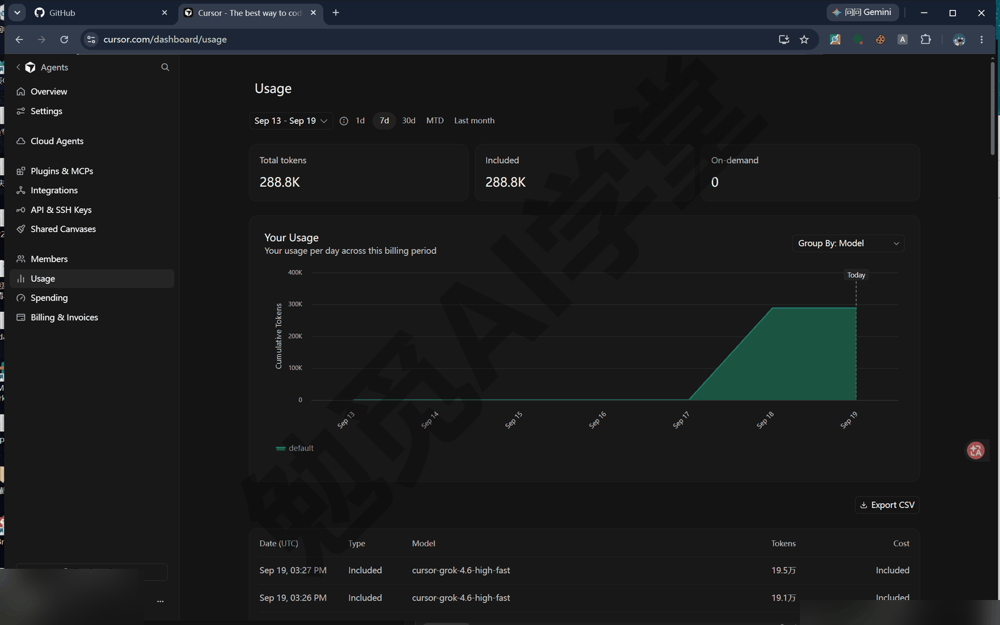

### 20.7 毕业验收清单

这门课靠一张功能对照表检查自己有没有讲全：每一块功能都要对应到具体哪一篇、逐项实际做一遍。现在轮到你了——把这张表转成你的毕业验收清单，逐条对照：能做到就打勾；打不上勾的，回到括号里的那一篇补课。全部打勾，这门课你就算真正学完了。

- [ ] **产品形态** ——说得出桌面应用（代理窗口＋编辑器）、网页版、手机 App、命令行 CLI 四个入口各适合什么场景（《认识与装好》）
- [ ] **账号套餐** ——知道免费与付费套餐差在哪类功能、两个用量池怎么分工，额度疑问先看账号页面（《认识与装好》《权限、沙盒与模型》）
- [ ] **安装登录** ——会安装、登录、切换中文界面，登不上会按《认识与装好》1.9 节的顺序排查
- [ ] **界面全景** ——两套界面每个区域说得出用途，会在两者之间来回切换（《两套界面全导览》）
- [ ] **权限安全** ——运行模式三档（自动审查／白名单／全部运行）会按需选，三道保护知道别关（《权限、沙盒与模型》）
- [ ] **检查点** ——误改之后会用检查点还原，说得出它与 Git 的分工（《权限、沙盒与模型》）
- [ ] **模型用量** ——会切模型、会看用量页，知道什么任务费用量（《权限、沙盒与模型》）
- [ ] **对话上下文** ——会用 @ 带上文件与终端输出、贴截图，养成一事一对话（《对话与上下文管理》）
- [ ] **文件办公** ——能把一个乱文件夹交给它读、整理、转换、出表格（《文件与办公能力一篇讲全》）
- [ ] **四种模式** ——Agent、Ask、Plan、Debug 的分工说得出，大任务先开计划模式（《计划、提问与调试三模式》）
- [ ] **内置浏览器** ——能让它自己开网页验证成果，浏览器审批三档会选（《内置浏览器与设计模式》）
- [ ] **设计模式** ——会在页面上点选元素、口述改版，知道多选和画圈两种用法要看版本（《内置浏览器与设计模式》）
- [ ] **编辑器三件套** ——Tab 补全、Ctrl+K 内联编辑、扩展与主题都用过（《编辑器三件套：Tab、内联编辑与扩展》）
- [ ] **规则** ——写过用户规则与项目规则，AGENTS.md 会建会改（《规则与 AGENTS.md》）
- [ ] **技能** ——知道内置技能有哪些，自制过至少一个技能并复用过（《技能与自定义模式》）
- [ ] **插件与 MCP** ——从市场装过插件、接过一个 MCP，安全五条记得住（《插件、市场与 MCP》）
- [ ] **并行** ——子智能体、多任务、工作树三个形态分得清，亲手用过工作树（《子智能体、并行与工作树》）
- [ ] **Git 与审查** ——仓库、提交、分支三个词说得清，会提交、开 PR、跑一次审查（《Git、GitHub 与代码审查》）
- [ ] **云端智能体** ——知道云端的前提与入口，会移交任务、收 PR（《云端智能体与手机端》）
- [ ] **手机端** ——手机上能查看进度、追问、合并（《云端智能体与手机端》）
- [ ] **自动化** ——建过一个定时自动化，记得先调完美再固化（《自动化、钩子与命令行》）
- [ ] **钩子与 CLI** ——知道钩子在流程的哪一层、CLI 适合什么时候用（《自动化、钩子与命令行》）
- [ ] **跟上迭代** ——更新日志、文档站、论坛三个渠道都会用（《自动化、钩子与命令行》与本篇 20.9）
- [ ] **安全排错** ——排错三板斧按顺序走，反馈问题会带 Request ID（本篇 20.6 与 20.9）

打不满勾也不用赶进度。这张清单不会过期，功能倒是会更新——哪一条卡住，就回讲它的那一篇把那个功能重新用一遍，比从头通读一遍省时间得多。

### 20.8 诚实定位与分工

你在课程开头的《认识与装好》里读过 Cursor 的定位。二十篇走完，再来说它适合谁、不适合谁，就有把握得多了。

**Cursor 适合谁。** 想把想法做成网页、小工具、自动化流程的非程序员（本课五个实战证明这条路走得通）；已经在用 VS Code、想把 AI 接进自己每天工作流程里的人；需要云端与手机接力、希望“电脑关了任务还在跑”的人。举个具体的例子：一位开社区茶铺的店主，想要一个能改能上线的官网、每月自动出一份账单月报、顺便盯住几款在用软件的更新——本课四个实战就是照这类人设计的。这个人不需要会写代码，需要的是把需求说清楚、按验收标准核对结果，这两样本课都教过。

**Cursor 不适合谁。** 只需要聊天问答的人，普通聊天工具更简单；期望零审批、把重要数据完全交给它自动处理的人，审批与验收始终要你参与，这是安全设计而不是缺陷；以及一上来就要做带数据库、支付、多人账号系统的新手，《实战三：装修预算估算器》定过诚实边界：静态小应用没问题，带后台的项目等基础打牢再说。也举个具体的例子：一位只想让 AI 帮忙润色邮件、回答概念问题的读者，为此装一个智能体应用、学习权限档位与审批习惯，纯属给自己加负担——聊天工具就够他用；哪天他开始嫌“每周手动整理一次文件夹”烦了，再回到本课不迟。

**与同类工具的一句话分工**（以各家当前版本的实际能力为准）：

- **Cursor** ——桌面智能体应用加经典编辑器两套界面，云端、手机、自动化接成一整套：建站、做估算器、搭周报系统这类“把想法做成软件”的任务，找它。
- **Codex** ——ChatGPT 这一家的智能体应用，与 ChatGPT 账号一体：批量整理文件、出 Excel 与 PPT 这类桌面办公任务，找它最合适。
- **Claude Code** ——以命令行为主的编程智能体：在终端里改代码、跑测试、连接服务器这类以代码为主业的任务，找它。
- **WorkBuddy** ——给办公场景用的桌面 AI 助手：日常事情与重复流程的自动化，找这类工具（以它的实际能力为准）。

**本课与 Codex 课怎么选，看你的时间花在哪。** 两课的五个实战同类不同题，交付物类型相同、工具各用各家：

| 类别 | Codex 课 | 本课 |
| --- | --- | --- |
| 建站类 | 个人品牌站 | 小店官网 |
| 数据报表类 | 销售报表 | 家庭账单月报 |
| 业务小应用类 | 报价计算器 | 装修预算估算器 |
| 情报追踪类 | 行业晨报 | 关注清单周报 |
| 毕业整合类 | 品牌桌宠 | 个人数字工作台 |

手里用哪个工具就看哪门课；两门对照看也不会重复做题。

**拿不定主意时，按顺序做三步判断。**

第 1 步，问自己平时用的是哪一家的工具。你的账号、习惯、数据在哪边，工具就先看哪边：ChatGPT 用得多的人先看 Codex；日常在 VS Code 和 GitHub 里工作的，自然先看 Cursor。

第 2 步，问任务的类型。想把想法做成网页、小工具、自动化，走本课验证过的 Cursor 路线；主要处理文档、表格、批量文件这类日常办公的，对应 Codex 那门课；整天在终端里写代码的，Claude Code 更合适。

第 3 步，问“人不在电脑前，任务要不要继续跑”。如果云端接力、手机跟进、定时自动化对你重要，就主要比这项能力谁更成熟（各家进展不同，以实际能力为准）。

三步走完还犹豫，就用最直接的办法：按《认识与装好》装一个，把装完就能用的三连任务跑一遍——工具合不合适，半小时就能看出来。

还有一个随时可用的判断办法：把要做的事直接讲给 Cursor，让它自己说适不适合接。方括号里的内容换成你自己的：

```
我想做一件事：[用一两句话描述你要做的事，例如“把家里十年的照片
按人物和年份整理成一个相册网站”]。
说说这件事适不适合用你来做：适合就给出大致步骤和要注意的边界；
不适合就直接说，并讲清缺了什么条件、更适合用什么方式做。
```

它的回答不必照单全收，但可以当第四条参考：如果它连步骤都说不清楚，这件事多半还不适合现在交给它；如果它顺手列出了清晰的步骤与边界，你也就同时拿到了开工的草稿。

这套分工描述的是 2026 年 9 月的形态，几家工具都在快速迭代，能力边界隔几个月就会挪动；半年后再看这一节，请以各家的更新日志为准。

### 20.9 自己跟上迭代

这门课的截图与版本号以 Cursor 3.7.42 为例，而这个产品几乎每周都在更新，界面某天对不上截图是迟早的事。课程给你的是机制与方法；界面变了以你看到的为准，用下面三个渠道自己跟上变化。

**渠道一：官方更新日志（cursor.com/changelog）。** 读更新日志有个先后顺序：先扫“默认设置变了什么”，再看“新增了什么功能”。默认设置的变化（比如运行模式的默认档、某个开关的默认值）会直接影响你现有的工作流，新增功能则可以按需再学。《自动化、钩子与命令行》讲过更新渠道与版本号的查看位置，版本对不上时先翻更新日志，再怀疑自己操作错。

拿一条本课用到的变化，示范一遍怎么读。运行模式的旧档“每次都问（Ask Every Time）”在 3.5 版取消，2026 年 5 月发布的 3.6 版起，推荐默认改为“自动审查”——《权限、沙盒与模型》里三档设定的来历，就是这两条更新记录。假设你是照一份旧教程学的“每次都问”，某天升级后在设置页找不到这一档：翻更新日志，先看到“默认设置变了”，再决定是接受自动审查、还是自己改成白名单，比对着旧截图满界面找按钮有效得多。同类的还有 Agent Review 的设置位置从 Agents 分区移到 Git & PRs 之下（20.4 提醒过）——这种“入口搬家”也算默认设置的变化，要优先看。

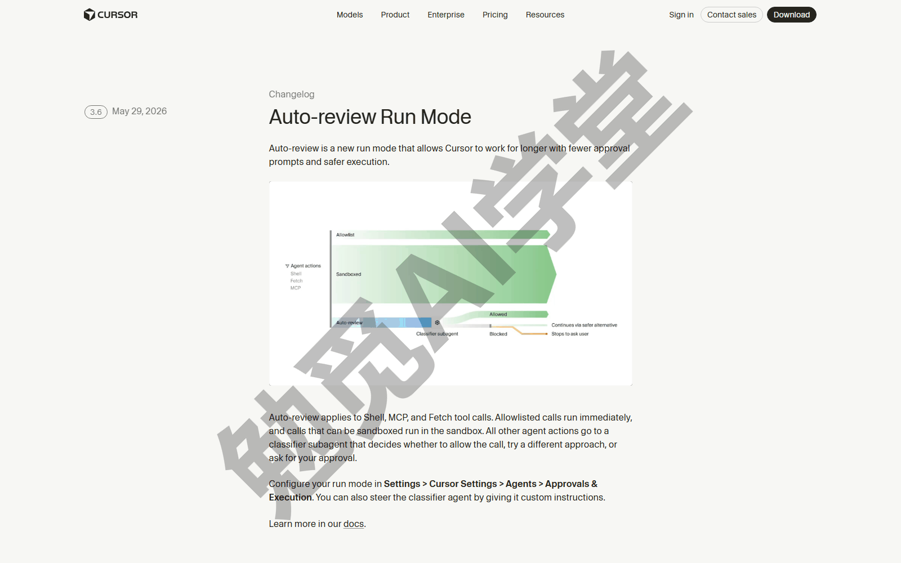

**渠道二：官方文档与帮助中心（cursor.com/docs）。** 功能怎么用、边界在哪，以文档为准；文档站提供中文版本（以站点实际显示为准）。本课每篇讲过的功能都能在文档里找到对应页，把文档当课程内容的最新版。还有一个省时间的读法：不少文档页末尾带常见问题一节，界面对不上时先翻那里，常能直接找到“从某版本起改为什么”的说明。

**渠道三：官方论坛（forum.cursor.com）。** 搜别人踩过的坑，或者报自己的问题。用法就一句：发帖前先搜一遍，大多数“这是不是坏了”的疑问已经有现成的帖子。确实要报问题，带齐三样材料再发，处理速度完全不同，步骤如下。

第 1 步，取 Request ID：回到出问题的那条回复所在的对话，点对话标签栏右侧的“…”菜单，选 Copy Request ID（复制请求 ID，中文文案以实际界面为准），点下去没有任何提示，这串编号已经复制好了——它能让官方直接定位到你那一次请求。

这一步在界面上是这样（动图；图里的对话用的是《实战一：小店官网》的项目，哪一条对话都一样）：

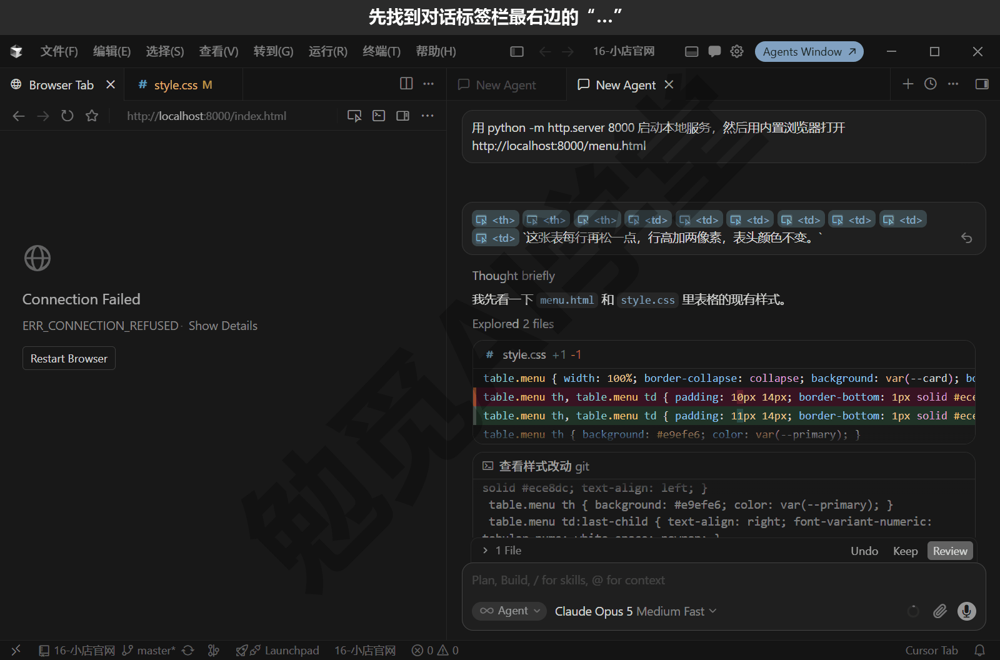

第 2 步，抄系统信息：在编辑器窗口点菜单栏的“帮助”，选最后一项“关于”，弹出的小窗里列着版本号与环境信息，点右下角的 Copy 整段复制（下图）。

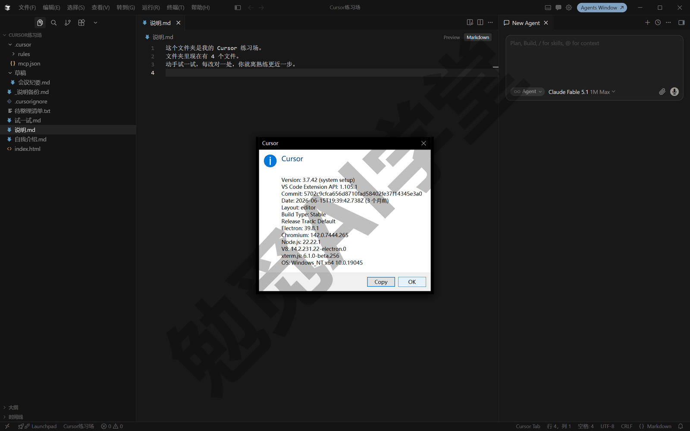

第 3 步，写复现步骤，也就是怎么一步步操作能让问题再出现一次：从“我做了什么”到“它出了什么”，一步一句，能配截图就配截图。

第 4 步，论坛发帖，把前三样一起贴上。报 Bugbot 的问题步骤稍有不同：在 PR 上评论 `cursor review verbose=true`，详细日志里带请求 ID，连同帖子一起交。

钩子、自定义子智能体、自托管机器、团队管理这几个进阶主题，本课只说过它们在哪里、没有展开，等你用得深了、需要它们时，从文档对应页进入即可。

### 20.10 练习任务

三个任务对应毕业项目的三项能力。方括号里的内容换成你自己的。

**任务一：让工作台指向你自己的作品**

```
跑一遍 python build.py 并把输出发我；
然后把 build.py 里小店官网的线上地址换成 [你的官网网址或本地路径]，
重新生成 data.js，用浏览器打开 index.html 确认入口卡片已更新。
```

完成标准：build.py 输出里能看到净支出与要点条数；入口卡片指向你给的地址；其余三个面板的数字保持不变。

**任务二：第四套主题，并给出换不换的结论**

```
用 git worktree 再开一个隔离副本，分支名 方案4，做一套 [你想要的风格] 主题。
改完提交，截一张桌面端整页图，和方案 2 的截图并排比较，
按“一屏看全、周报可读性、窄屏下变单栏”三条标准给我换或不换的结论与理由。
```

完成标准：方案 4 在独立分支上有一次提交；有并排对比的截图；结论按三条标准比出来，而不是凭“更好看”。

**任务三：毕业自查与补课清单**

先自己对照 20.7 的毕业验收清单逐项打勾，然后发送：

```
帮我建一个 我的补课清单.md：我说一条你记一条，
每条记三样——功能名、对应的文章名、我卡在哪一步，格式用无序列表。
```

完成标准：清单里每一项都写了对应文章名；卡在哪一步要具体到操作（例如“规则的触发方式分不清”而不是“规则没学会”）；补完一项就删一项，清单清零就算结业。

### 20.98 本篇小结与自检

毕业项目把四个作品汇成了一页工作台：`build.py` 从前四个实战的真实文件里取数据，三个工作树并行做出三套主题，凭三条写得清楚的理由合入方案 2，云端接力与双重审查负责收尾，GitHub Pages 负责上线。课程总结则把二十篇收进四样经验——翻车教训、排错顺序、数据规矩、用量明白账，外加一张毕业验收清单。

- [ ] 工作台四个面板都能打开，数字与来源文件一一对得上
- [ ] 用三个工作树做过三方案，完成过一次有明确理由的择优合入
- [ ] 说得出云端接力与双重审查的六个步骤，账号开通后能照着走通
- [ ] 20.7 的毕业验收清单过了一遍，没打勾的项知道回哪一篇补
- [ ] 排错三板斧的顺序与道理能讲给别人听
- [ ] 给自己的数据定了存放规矩：哪些可公开、哪些进私有仓库、哪些只留本地

完成这些内容后，这门课就全部结束了。四个作品会继续替你运转：周报每周更新，账单每月出一份月报，官网随需求改版，工作台把它们汇在一处。以后遇到新需求，先想一想它像哪个实战，就按那一篇的做法走；界面变了看更新日志，功能拿不准查文档，出了错按三板斧来。学完这一套，你不需要再看第二套 Cursor 教程——需要的只是在它更新时，用 20.9 的渠道让自己跟上。

### 20.99 新手常见问题

**Q1：学完这门课，还要去学编程吗？**

不是必须的。全课五个实战没有一处要求你手写代码：需求、验收标准、择优理由都是用中文说清楚的。但有三样东西学起来不费劲、用处很大：看得懂报错的第一行，分得清仓库、提交、分支三个词，知道文件路径怎么写。想再进一步，最好的办法是让智能体当老师：改动前让它讲讲要改哪里、为什么，日积月累就看得懂它交回来的东西了。

**Q2：工作台以后怎么加面板？**

做法是固定的三步：新作品先生成一个给程序读的数据文件（参照 `summary.json` 的做法）；`build.py` 里加一段读取它的代码，并像《实战四：关注清单更新追踪》的周报通道那样做兜底（数据缺失时显示占位文案，别让整页报错打不开）；`index.html` 里照现有面板的样式加一个新面板。三步都可以让智能体照现成模式做，你负责验收数字对不对。

**Q3：哪些功能免费版就够用？**

按机制记：免费套餐提供限量的智能体请求与 Tab 补全，本地功能（对话、文件处理、规则、技能、工作树这些）不是按功能分别限制，而是共用这一份额度；云端智能体、自动化、Bugbot、手机端联动这类云端能力需要付费套餐。所以“够不够”取决于你用得多不多、要不要云端——轻度本地使用可以先用免费档试试，额度与功能开放程度以账号页面显示为准。

**Q4：Codex 课和本课先看哪个？**

看你手里用哪个工具：用 Cursor 看本课，用 Codex 看那门课，两课实战同类不同题、交付物类型相同，学任何一门都能建立完整能力，对照着看也不重复。还没选定工具的，回《认识与装好》的诚实定位和本篇 20.8 的分工建议：偏“把想法做成软件、要云端与手机接力”选 Cursor，偏“用 ChatGPT 账号做日常文件与办公自动化”选 Codex。
